# Trips Enjoy: Entity-Relationship Design (ERD)

| Field | Value |
|---|---|
| Version | 1.0 |
| Date | 9 November 2026 |
| Status | For review |
| Traces to | BRD.md v1.1 (BR, BRL), SRS.md v1.1 (FR, DAT, section 6) |
| Database | PostgreSQL 16 with row-level security; TimescaleDB extension for time-series tables (architecture section 3) |
| Supersedes | The entity sketches in trips-enjoy-technical-architecture.md section 6 and trips-enjoy-workflows.md section 24 |

## 1. Conventions

These apply to every table unless the table says otherwise.

| Rule | Detail |
|---|---|
| Primary key | `id BIGSERIAL` (internal only, never exposed). |
| Public identifier | `uuid UUID NOT NULL DEFAULT gen_random_uuid() UNIQUE`. APIs, URLs, webhooks and exports use `uuid` only. |
| Timestamps | `created_at`, `updated_at`, `deleted_at` as `TIMESTAMPTZ`. All times are stored in UTC. |
| Soft delete | `is_deleted BOOLEAN NOT NULL DEFAULT false` plus `deleted_at`. Unique constraints include `deleted_at` (for example `UNIQUE (code, deleted_at)`). |
| Audit columns | `created_by`, `updated_by`, `deleted_by` as `BIGINT` FKs to `users.id`. |
| No enum types | Every status, type and category is a `BIGINT` FK to `lookups.id` (named `*_id`, for example `status_id`). The lookup type is named in the column notes. |
| Tenant column | Every row owned by an organization carries `organization_id BIGINT NOT NULL`, indexed, with an RLS policy on `app.current_organization_id` (SRS DAT-01, NFR-SEC-07). Child tables repeat `organization_id` (denormalized) so RLS never needs a join. |
| Money | `*_minor BIGINT` in minor units plus `currency_code CHAR(3)` FK `currencies.code`. Never a float, never a bare number (D-157). |
| Translatable text | `JSONB` shaped `{"en": "...", "ar": "..."}` for names and descriptions shown to users. |
| Country | `country_code CHAR(2)` FK `countries.code` (ISO 3166-1 alpha-2). |
| Immutable tables | `ledger_entries`, `ledger_transactions`, `audit_logs`, `deal_offers`, `checkin_events`, `tracking_points`, `consents`, `outbox_events`: insert only. They keep `created_at` and `created_by` but have no `updated_*`, `deleted_*` or `is_deleted`. Corrections are new reversing rows (SRS DAT-08). |
| Time-series | `checkin_events` and `tracking_points` are TimescaleDB hypertables partitioned on `occurred_at`; primary key `(id, occurred_at)`. |
| Encrypted columns | Columns marked "enc" are encrypted at column level with KMS (SRS DAT-05). A `*_hash` column next to them supports lookups. |

Base columns are not repeated in the tables below. "Base" means: `id`, `uuid`, `created_at`, `updated_at`, `deleted_at`, `is_deleted`, `created_by`, `updated_by`, `deleted_by`.

## 2. Domain map

| Domain | Tables | Section |
|---|---|---|
| Lookups and markets | lookup_types, lookups, countries, currencies, markets, market_payment_methods, tax_rates | 3.1 |
| Identity and access | users, user_roles, auth_factors, otp_challenges, sessions, devices, consents, notification_preferences, privacy_requests | 3.2 |
| Applications | applications, application_documents, application_decisions, appeals | 3.3 |
| Organizations | organizations, organization_members, permissions, member_permissions, invitations, crm_connections, webhook_endpoints, webhook_deliveries, api_keys | 3.4 |
| Suppliers | driver_profiles, photographer_profiles, provider_vehicles, availability_slots, portfolio_items, lab_partners, lab_tests, payout_methods | 3.5 |
| Fleet and trips | vehicle_types, vehicle_type_seats, vehicles, trips, trip_stops, trip_audiences, trip_vehicles, trip_staff_assignments, programs, program_tiers | 3.6 |
| Deals | deals, deal_offers | 3.7 |
| Booking and payment | bookings, booking_passengers, booking_programs, trip_seats, payments, payment_attempts, refunds, booking_remedies | 3.8 |
| Coupons | coupons, coupon_programs, coupon_audiences, coupon_redemptions, abuse_flags | 3.9 |
| Plans | plans, plan_limits, plan_prices, subscriptions, subscription_charges, plan_overrides, usage_counters | 3.10 |
| Operations | checkin_events, incidents, trip_reports, tracking_points, child_links, safety_cases | 3.11 |
| Media | albums, photos, album_shared_links, album_members, download_logs | 3.12 |
| Finance | ledger_accounts, ledger_transactions, ledger_entries, invoices, invoice_lines, payout_runs, payouts, settlements, settlement_lines, reconciliation_exceptions, disputes, dispute_files | 3.13 |
| Platform | notifications, notification_deliveries, notification_templates, feature_flags, analytics_events, analytics_daily, audit_logs, outbox_events, idempotency_keys | 3.14 |

## 3. Diagrams and entity dictionary

### 3.1 Lookups and markets

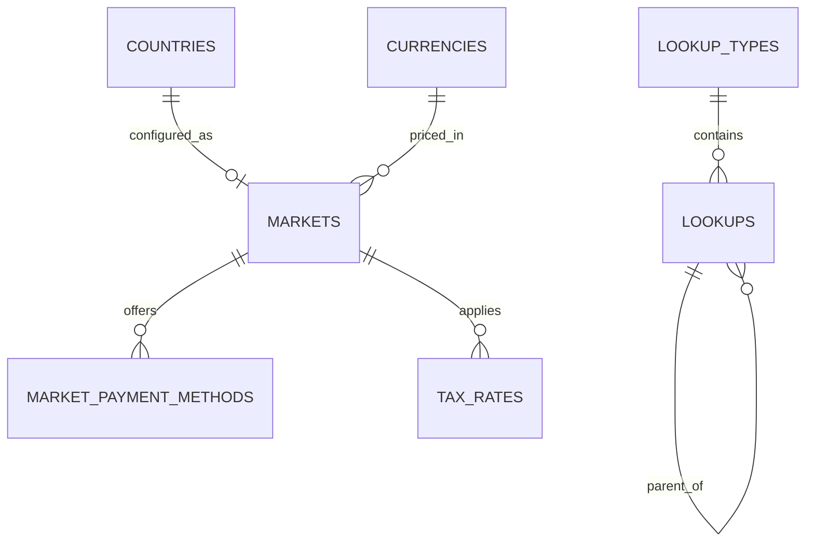

**lookup_types** (Base +)

| Column | Type | Notes |
|---|---|---|
| code | VARCHAR(80) | Unique with `deleted_at`, for example `booking_status` |
| name | JSONB | Translatable |
| description | JSONB | Translatable |
| parent_id | BIGINT FK lookup_types | Optional grouping |
| sort_by | INT | |
| is_public | BOOLEAN | Shown to clients |
| is_system | BOOLEAN | Cannot be edited by admin |

**lookups** (Base +)

| Column | Type | Notes |
|---|---|---|
| lookup_type_id | BIGINT FK lookup_types | |
| code | VARCHAR(80) | Unique with `(lookup_type_id, code, deleted_at)` |
| value | VARCHAR(255) | Optional machine value |
| name | JSONB | Translatable label |
| description | JSONB | |
| parent_id | BIGINT FK lookups | For example incident category under a group |
| sort_by | INT | |
| is_public, is_system | BOOLEAN | |

**countries**: `code CHAR(2) PK`, `name JSONB`, `phone_prefix VARCHAR(6)`, `is_active BOOLEAN`. Reference data, no soft delete.

**currencies**: `code CHAR(3) PK`, `minor_units SMALLINT`, `symbol JSONB`. Reference data.

**markets** (Base +) BR-MKT-01, BRL-27

| Column | Type | Notes |
|---|---|---|
| country_code | CHAR(2) FK countries | Unique |
| currency_code | CHAR(3) FK currencies | EGP, SAR, AED |
| default_timezone | VARCHAR(64) | Africa/Cairo, Asia/Riyadh, Asia/Dubai (D-282) |
| status_id | BIGINT FK lookups | `market_status`: draft, live, paused |
| launch_phase | SMALLINT | 2 or 5 |
| commission_rate_bp | INT | Basis points; placeholder 1000 (D-15) |
| invoice_rules | JSONB | Numbering prefix, required buyer fields, e-invoicing flag (OD-10) |

**market_payment_methods** (Base +): `market_id FK`, `method_id FK lookups (payment_method: card, apple_pay, google_pay, local_card, fawry_cash)`, `gateway_id FK lookups (gateway: stripe, paymob, tap, fawry)`, `use_for_bookings BOOLEAN`, `use_for_plans BOOLEAN`, `sort_by INT`, `is_active BOOLEAN`.

**tax_rates** (Base +): `market_id FK`, `tax_type_id FK lookups (tax_type: vat)`, `rate_bp INT` (OD-27), `valid_from DATE`, `valid_to DATE NULL`.

### 3.2 Identity and access

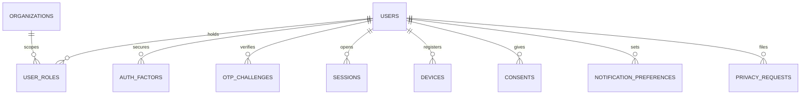

**users** (Base +) FR-AUTH-01 to FR-AUTH-10

| Column | Type | Notes |
|---|---|---|
| full_name | VARCHAR(200) | |
| email | CITEXT | Unique with `deleted_at` where not null |
| phone_enc | BYTEA | enc; E.164 |
| phone_hash | CHAR(64) | Unique with `deleted_at` where not null |
| email_verified_at, phone_verified_at | TIMESTAMPTZ | D-20 |
| password_hash | VARCHAR(255) | Argon2id; null for code-only accounts |
| country_code | CHAR(2) FK countries | BRL-23 |
| locale | VARCHAR(5) | en or ar |
| timezone | VARCHAR(64) | |
| status_id | BIGINT FK lookups | `account_status`: active, suspended, deletion_requested, closed |
| suspended_reason_id | BIGINT FK lookups | `suspension_reason` (D-234) |
| deletion_requested_at, deletion_due_at | TIMESTAMPTZ | 30-day grace (BRL-15) |
| failed_signins | SMALLINT | Reset on success |
| locked_until | TIMESTAMPTZ | BRL-21 |
| token_version | INT | Bump to revoke all tokens |
| traveler_plan_subscription_id | BIGINT FK subscriptions | Free by default |

**user_roles** (Base +) FR-AUTH-06, FR-AUTH-07

| Column | Type | Notes |
|---|---|---|
| user_id | BIGINT FK users | |
| role_id | BIGINT FK lookups | `role`: traveler, organization_owner, organization_employee, platform_driver, platform_photographer, org_driver, org_photographer, moderator, admin_super, admin_operations, admin_finance |
| organization_id | BIGINT FK organizations NULL | Set for organization-scoped roles |
| status_id | BIGINT FK lookups | `role_status`: pending, active, paused, suspended, ended |
| started_at, ended_at | TIMESTAMPTZ | |

Unique `(user_id, role_id, organization_id, deleted_at)`.

**auth_factors** (Base +): `user_id FK`, `factor_type_id FK lookups (auth_factor: totp, sms)`, `secret_enc BYTEA`, `verified_at TIMESTAMPTZ`, `last_used_at TIMESTAMPTZ`.

**otp_challenges** (Base +) BRL-20

| Column | Type | Notes |
|---|---|---|
| user_id | BIGINT FK users NULL | Null before the account exists |
| channel_id | BIGINT FK lookups | `otp_channel`: sms, whatsapp, email |
| destination_hash | CHAR(64) | |
| purpose_id | BIGINT FK lookups | `otp_purpose`: verify_email, verify_phone, sign_in, staff_code, password_reset |
| code_hash | CHAR(64) | |
| expires_at | TIMESTAMPTZ | 5 minutes |
| wrong_attempts | SMALLINT | Pause at 5 |
| paused_until | TIMESTAMPTZ | 15 minutes |
| failed_deliveries | SMALLINT | Switch channel at 3 (D-59) |
| consumed_at | TIMESTAMPTZ | |

**sessions** (Base +): `user_id FK`, `active_role_id FK user_roles`, `active_organization_id FK organizations NULL`, `refresh_token_hash CHAR(64)`, `device_id FK devices NULL`, `ip INET`, `user_agent TEXT`, `expires_at TIMESTAMPTZ` (web 12 h, BRL-22), `revoked_at TIMESTAMPTZ`.

**devices** (Base +): `user_id FK`, `platform_id FK lookups (device_platform: ios, android, web)`, `push_token TEXT`, `app_version VARCHAR(20)`, `last_seen_at TIMESTAMPTZ`.

**consents** (immutable) NFR-DAT-05: `id`, `uuid`, `user_id FK`, `consent_type_id FK lookups (consent_type: lab_test, background_check, child_tracking, guardianship, marketing, terms, privacy)`, `text_version VARCHAR(20)`, `granted BOOLEAN`, `occurred_at TIMESTAMPTZ`, `ip INET`, `created_at`, `created_by`.

**notification_preferences** (Base +): `user_id FK`, `category_id FK lookups (notification_category)`, `channel_id FK lookups (notification_channel: email, sms, whatsapp, push, in_app)`, `enabled BOOLEAN`. Unique `(user_id, category_id, channel_id, deleted_at)`.

**privacy_requests** (Base +) FR-TRV-07: `user_id FK`, `type_id FK lookups (privacy_request_type: data_copy, deletion)`, `status_id FK lookups (privacy_request_status: received, verified, in_progress, delivered, cancelled)`, `due_at TIMESTAMPTZ` (30 days, D-162), `file_path TEXT`, `completed_at TIMESTAMPTZ`.

### 3.3 Applications

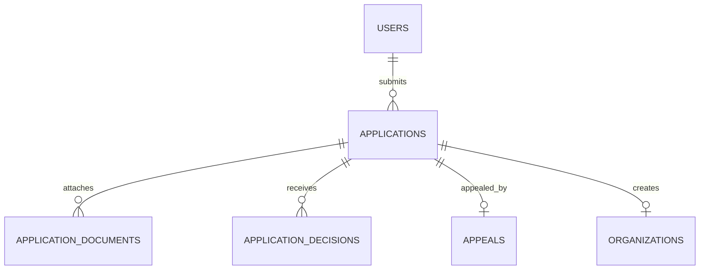

**applications** (Base +) FR-ONB-01 to FR-ONB-09

| Column | Type | Notes |
|---|---|---|
| applicant_user_id | BIGINT FK users | |
| type_id | BIGINT FK lookups | `application_type`: organization, platform_driver, platform_photographer |
| status_id | BIGINT FK lookups | `application_status`: draft, submitted, pending_review, changes_requested, approved, rejected, appealed, closed |
| country_code | CHAR(2) FK countries | |
| requested_plan_id | BIGINT FK plans | Chosen at registration, no charge (D-77) |
| payload | JSONB | Role-specific fields (legal names, CR and tax numbers, license, vehicle, rates, service regions) |
| submitted_at | TIMESTAMPTZ | |
| review_due_at | TIMESTAMPTZ | 2 working days (FR-ONB-03) |
| changes_due_at | TIMESTAMPTZ | 14 days, plus one 7-day extension (D-235) |
| extension_used | BOOLEAN | |
| decided_at | TIMESTAMPTZ | |
| reapply_after | DATE | Decision date plus 30 days (BRL-06) |
| previous_application_id | BIGINT FK applications | Re-application chain |

**application_documents** (Base +): `application_id FK`, `doc_type_id FK lookups (document_type: id_card, driving_license, vehicle_registration, insurance, lab_result, commercial_registration, tax_certificate, portfolio_photo, other)`, `storage_path TEXT` (restricted bucket, DAT-04), `mime_type VARCHAR(80)`, `size_bytes BIGINT` (10 MB documents, 25 MB photos, D-80, D-81), `valid_until DATE NULL`, `issued_on DATE NULL`, `check_status_id FK lookups (document_check: pending, accepted, rejected)`.

**application_decisions** (Base +): `application_id FK`, `decision_id FK lookups (application_decision: approve, request_changes, reject, close, uphold_appeal, overturn)`, `reason_id FK lookups (decision_reason, D-234) NULL`, `message JSONB` (in the applicant's language), `items JSONB` (requested changes), `decided_by BIGINT FK users`.

**appeals** (Base +) D-237: `application_id FK UNIQUE`, `statement TEXT`, `files JSONB` (up to 5), `submitted_at`, `due_at` (5 working days), `status_id FK lookups (appeal_status: submitted, upheld, rejected)`.

### 3.4 Organizations

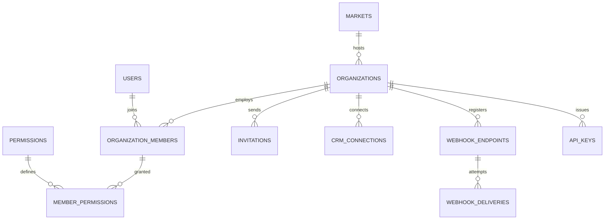

**organizations** (Base +) FR-ORG-01 to FR-ORG-08

| Column | Type | Notes |
|---|---|---|
| owner_user_id | BIGINT FK users | |
| application_id | BIGINT FK applications | |
| market_id | BIGINT FK markets | From country (BRL-27) |
| legal_name, trade_name | JSONB | |
| commercial_reg_no | VARCHAR(50) | |
| tax_no | VARCHAR(50) | |
| billing_email | CITEXT | |
| timezone | VARCHAR(64) | Defaults from market |
| status_id | BIGINT FK lookups | `organization_status`: active, suspended, closed |
| subscription_id | BIGINT FK subscriptions | |
| seat_self_selection_default | BOOLEAN | FR-ORG-05 |
| child_tracking_default | BOOLEAN | |
| branding | JSONB | Enterprise only (BR-ORG-08) |
| invoice_settings | JSONB | Prefix, footer, bank details |
| approved_at | TIMESTAMPTZ | |

**organization_members** (Base +) BR-AUTH-06, FR-EMP-01 to FR-EMP-06

| Column | Type | Notes |
|---|---|---|
| organization_id | BIGINT FK organizations | Tenant column |
| user_id | BIGINT FK users NULL | Null until the invitation is accepted |
| email | CITEXT | The access-list key used for organization switching |
| member_type_id | BIGINT FK lookups | `member_type`: owner, employee, org_driver, org_photographer, moderator |
| status_id | BIGINT FK lookups | `member_status`: invited, active, suspended, removed |
| joined_at, removed_at | TIMESTAMPTZ | |

Unique `(organization_id, email, deleted_at)`.

**permissions** (reference): `id`, `code VARCHAR(80) UNIQUE` (for example `trip.create`, `booking.refund`, `accounting.export`, `integration.manage`, `analytics.view`), `area_id FK lookups (permission_area)`, `name JSONB`.

**member_permissions** (Base +): `organization_id`, `member_id FK organization_members`, `permission_id FK permissions`. Every insert and soft delete writes an audit log entry (FR-EMP-02).

**invitations** (Base +): `organization_id`, `member_id FK`, `channel_id FK lookups (otp_channel)`, `token_hash CHAR(64)`, `expires_at` (7 days, D-286, D-94), `accepted_at`.

**crm_connections** (Base +): `organization_id`, `provider_id FK lookups (crm_provider)`, `credentials_enc BYTEA`, `status_id FK lookups (integration_status: connected, error, disconnected)`, `last_sync_at`.

**webhook_endpoints** (Base +) FR-ORG-06: `organization_id`, `url TEXT` (HTTPS only), `secret_enc BYTEA`, `previous_secret_enc BYTEA`, `previous_secret_valid_until TIMESTAMPTZ` (24 h after rotation), `events TEXT[]` (event codes), `is_active BOOLEAN`.

**webhook_deliveries** (Base +): `organization_id`, `endpoint_id FK`, `event_uuid UUID`, `event_type VARCHAR(80)`, `payload JSONB`, `attempt SMALLINT` (up to 5 over 24 h), `status_code SMALLINT`, `next_attempt_at`, `delivered_at`, `replay_until` (7 days, D-63).

**api_keys** (Base +): `organization_id`, `name VARCHAR(100)`, `key_prefix VARCHAR(12)`, `key_hash CHAR(64)`, `scopes TEXT[]`, `last_used_at`, `revoked_at`.

### 3.5 Suppliers

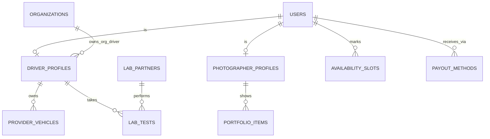

**driver_profiles** (Base +)

| Column | Type | Notes |
|---|---|---|
| user_id | BIGINT FK users | Unique per track |
| track_id | BIGINT FK lookups | `supplier_track`: platform, organization |
| organization_id | BIGINT FK organizations NULL | Set for organization-owned drivers (BRL-05) |
| license_no_enc | BYTEA | enc |
| license_valid_until | DATE | |
| service_regions | TEXT[] | |
| subscription_id | BIGINT FK subscriptions NULL | Platform drivers only |
| lab_status_id | BIGINT FK lookups | `driver_lab_status`: clear, paused, suspended |
| suspended_since | TIMESTAMPTZ | Close after 30 days (BRL-16) |
| visibility_id | BIGINT FK lookups | `profile_visibility`: standard, featured, top |
| verified_badge | BOOLEAN | Plan-driven |

**photographer_profiles** (Base +): `user_id FK`, `track_id FK lookups (supplier_track)`, `organization_id NULL`, `bio JSONB`, `equipment TEXT`, `service_regions TEXT[]`, `rates JSONB` (per currency), `subscription_id FK NULL`, `visibility_id FK lookups`, `verified_badge BOOLEAN`, `watermark_settings JSONB`.

**provider_vehicles** (Base +) FR-ONB-07: `driver_profile_id FK`, `plate_no VARCHAR(20)`, `model VARCHAR(80)`, `year SMALLINT`, `seat_count SMALLINT`, `registration_valid_until DATE`, `insurance_valid_until DATE` (at least 3 months at submission).

**availability_slots** (Base +) D-89: `user_id FK`, `starts_on DATE`, `ends_on DATE`, `kind_id FK lookups (availability_kind: available, unavailable)`. Dates and ranges only.

**portfolio_items** (Base +): `photographer_profile_id FK`, `storage_path TEXT`, `width INT`, `height INT`, `sort_by INT`. Count per plan (FR-PHO-01); minimum 8 at application.

**lab_partners** (Base +): `market_id FK`, `name JSONB`, `address JSONB`, `api_settings_enc BYTEA`, `is_active BOOLEAN`.

**lab_tests** (Base +) FR-DRV-03 to FR-DRV-06

| Column | Type | Notes |
|---|---|---|
| driver_profile_id | BIGINT FK driver_profiles | |
| lab_partner_id | BIGINT FK lab_partners NULL | |
| test_type_id | BIGINT FK lookups | `lab_test_type`: drug_screen, medical_fitness, both |
| status_id | BIGINT FK lookups | `lab_test_status`: requested, pending, result_uploaded, passed, failed, missed |
| requested_by | BIGINT FK users | Admin |
| requested_at | TIMESTAMPTZ | |
| deadline_at | TIMESTAMPTZ | 3 days default, 1 to 7 (D-21) |
| booked_slot_at | TIMESTAMPTZ | |
| result_path | TEXT | Restricted bucket |
| result_source_id | BIGINT FK lookups | `lab_result_source`: partner, driver_upload |
| decided_by, decided_at | BIGINT, TIMESTAMPTZ | Admin decision |
| is_initial | BOOLEAN | Application lab result |

**payout_methods** (Base +): `user_id FK`, `organization_id NULL`, `method_id FK lookups (payout_method: stripe_connect, bank_transfer, local_provider)`, `details_enc BYTEA`, `external_account_id VARCHAR(100)`, `currency_code`, `is_default BOOLEAN`, `verified_at`.

### 3.6 Fleet and trips

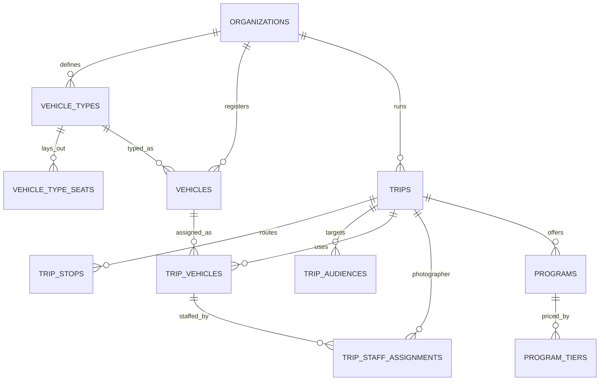

**vehicle_types** (Base +) FR-FLT-01, FR-FLT-06: `organization_id`, `name JSONB`, `seat_count SMALLINT`, `layout JSONB` (grid rows, columns, aisles, doors), `archived_at TIMESTAMPTZ`.

**vehicle_type_seats** (Base +): `organization_id`, `vehicle_type_id FK`, `label VARCHAR(10)` (for example 12B), `row_no SMALLINT`, `col_no SMALLINT`, `seat_kind_id FK lookups (seat_kind: standard, accessible, crew, blocked)`. Unique `(vehicle_type_id, label, deleted_at)`.

**vehicles** (Base +) FR-FLT-02: `organization_id`, `vehicle_type_id FK`, `plate_no VARCHAR(20)`, `model VARCHAR(80)`, `year SMALLINT`, `seat_count SMALLINT` (must equal the type), `registration_status_id FK lookups (registration_status)`, `registration_valid_until DATE`, `provider_vehicle_id FK provider_vehicles NULL` (a platform driver's own vehicle used on a deal).

**trips** (Base +) FR-TRIP-01 to FR-TRIP-07

| Column | Type | Notes |
|---|---|---|
| organization_id | BIGINT FK organizations | Tenant column |
| market_id | BIGINT FK markets | Copied from the organization at creation |
| code | VARCHAR(20) | Human reference, unique per organization |
| title, description | JSONB | |
| category_id | BIGINT FK lookups | `trip_category` |
| status_id | BIGINT FK lookups | `trip_status`: draft, published, negotiating, ready, filling_up, sold_out, in_progress, partially_completed, completed, post_processing, archived, cancelled, refunds_issued |
| publish_mode_id | BIGINT FK lookups | `publish_mode`: draft, public, targeted |
| timezone | VARCHAR(64) | |
| starts_at, ends_at | TIMESTAMPTZ | |
| base_price_minor | BIGINT | |
| currency_code | CHAR(3) | From market |
| capacity_total | INT | Sum of vehicle seats |
| seats_reserved | INT | Counter; Filling Up at 80 percent (D-189) |
| seat_mode_id | BIGINT FK lookups | `seat_mode`: company_assigned, self_select |
| child_tracking_enabled | BOOLEAN | FR-TRK-04 |
| vip_early_access_until | TIMESTAMPTZ NULL | D-146 |
| priority_seat_window_until | TIMESTAMPTZ NULL | D-316 |
| published_at, cancelled_at, completed_at, archived_at | TIMESTAMPTZ | |
| cancel_reason | TEXT | |
| counted_in_cycle | DATE | Month counted for the active-trip limit (D-143) |

Indexes: `(organization_id, status_id)`, partial `(starts_at)` where published or filling up.

**trip_stops** (Base +): `organization_id`, `trip_id FK`, `seq SMALLINT`, `kind_id FK lookups (stop_kind: pickup, stop, destination, dropoff)`, `name JSONB`, `address JSONB`, `lat NUMERIC(10,7)`, `lng NUMERIC(10,7)`, `planned_at TIMESTAMPTZ`.

**trip_audiences** (Base +): `organization_id`, `trip_id FK`, `user_id FK NULL`, `email CITEXT NULL`, `phone_hash CHAR(64) NULL`. Targeted publishing list (FR-TRIP-02).

**trip_vehicles** (Base +) FR-TRIP-03

| Column | Type | Notes |
|---|---|---|
| organization_id | BIGINT | Tenant column |
| trip_id | BIGINT FK trips | |
| vehicle_id | BIGINT FK vehicles NULL | |
| vehicle_type_id | BIGINT FK vehicle_types | |
| label | VARCHAR(40) | Bus A, Bus B |
| status_id | BIGINT FK lookups | `trip_vehicle_status`: planning, ready, departed, ended |
| seat_count | SMALLINT | |
| departed_at, ended_at | TIMESTAMPTZ | |
| last_lat, last_lng, last_point_at | NUMERIC, NUMERIC, TIMESTAMPTZ | Latest position cache |

**trip_staff_assignments** (Base +) FR-STF-01 to FR-STF-05

| Column | Type | Notes |
|---|---|---|
| organization_id | BIGINT | |
| trip_id | BIGINT FK trips | |
| trip_vehicle_id | BIGINT FK trip_vehicles NULL | Null for trip-level photographer |
| staff_role_id | BIGINT FK lookups | `staff_role`: driver, moderator, photographer |
| user_id | BIGINT FK users | |
| track_id | BIGINT FK lookups | `supplier_track`: organization, platform |
| deal_id | BIGINT FK deals NULL | Required when track is platform (BRL-04) |
| status_id | BIGINT FK lookups | `assignment_status`: proposed, accepted, replaced, released |
| access_until | TIMESTAMPTZ | Moderators: trip end plus 24 h (D-107) |

Unique active `(trip_vehicle_id, staff_role_id)` where status accepted.

**programs** (Base +) FR-PRG-01 to FR-PRG-06

| Column | Type | Notes |
|---|---|---|
| organization_id | BIGINT | |
| trip_id | BIGINT FK trips | |
| title, description | JSONB | |
| pricing_model_id | BIGINT FK lookups | `pricing_model`: free, per_person, by_quantity, per_group, tiered |
| price_minor | BIGINT NULL | Null for free and tiered |
| currency_code | CHAR(3) | |
| is_required | BOOLEAN | Pre-required |
| is_vip_only | BOOLEAN | |
| capacity | INT NULL | |
| enrolled_count | INT | |
| starts_at | TIMESTAMPTZ NULL | |

**program_tiers** (Base +): `organization_id`, `program_id FK`, `name JSONB`, `price_minor BIGINT`, `sort_by INT`.

### 3.7 Deals

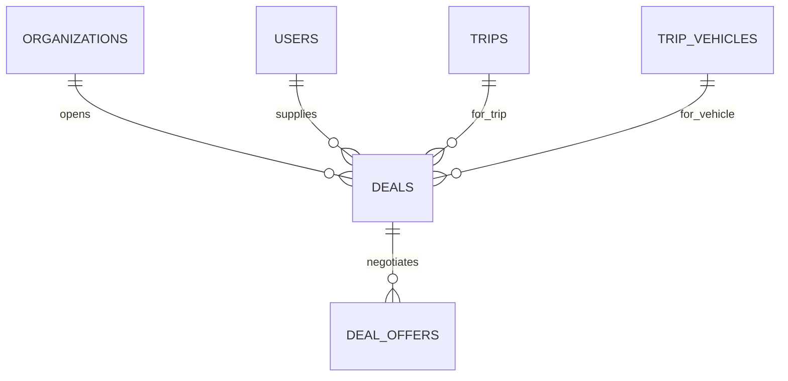

**deals** (Base +) FR-NEG-01 to FR-NEG-07

| Column | Type | Notes |
|---|---|---|
| organization_id | BIGINT | Tenant column; suppliers read through a platform-scoped repository |
| trip_id | BIGINT FK trips | |
| trip_vehicle_id | BIGINT FK trip_vehicles NULL | Null for photographer deals |
| provider_user_id | BIGINT FK users | |
| provider_type_id | BIGINT FK lookups | `provider_type`: driver, photographer |
| status_id | BIGINT FK lookups | `deal_status`: proposed, countered_by_provider, countered_by_organization, accepted_by_one, finalized, rejected |
| current_amount_minor | BIGINT | |
| currency_code | CHAR(3) | |
| organization_accepted_at, provider_accepted_at | TIMESTAMPTZ | Both set = finalized |
| last_offer_at | TIMESTAMPTZ | |
| expires_at | TIMESTAMPTZ | last_offer_at plus 72 h (BRL-26) |
| reject_reason_id | BIGINT FK lookups | `deal_end_reason`: rejected, expired, provider_paused, trip_cancelled |
| finalized_at | TIMESTAMPTZ | |
| flagged_reason | TEXT | Admin flag (D-252) |

**deal_offers** (immutable): `id`, `uuid`, `organization_id`, `deal_id FK`, `offered_by_side_id FK lookups (deal_side: organization, provider)`, `amount_minor BIGINT`, `note TEXT`, `action_id FK lookups (deal_action: propose, counter, accept, reject)`, `created_at`, `created_by`.

### 3.8 Booking and payment

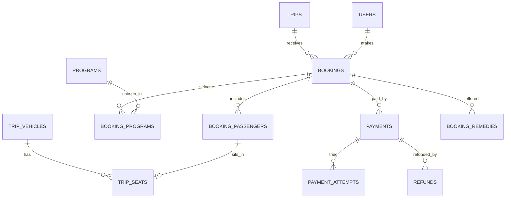

**bookings** (Base +) FR-BKG-01 to FR-BKG-07

| Column | Type | Notes |
|---|---|---|
| organization_id | BIGINT | Tenant column |
| trip_id | BIGINT FK trips | |
| booked_by_user_id | BIGINT FK users | |
| reference | VARCHAR(12) | Public booking reference used for child links |
| status_id | BIGINT FK lookups | `booking_status`: cart, seats_held, payment_pending, confirmed, payment_failed, checked_in, checked_out, cancelled, refund_pending, refunded |
| passenger_count | SMALLINT | |
| base_total_minor, programs_total_minor, plan_discount_minor, coupon_discount_minor, total_minor | BIGINT | Price locked when the hold starts (D-192) |
| currency_code | CHAR(3) | |
| hold_expires_at | TIMESTAMPTZ | 15 minutes; Fawry 48 h |
| payment_attempts | SMALLINT | Max 3 per hold (D-197) |
| buyer_tax_no | VARCHAR(50) NULL | Present means B2B invoice (BRL-28) |
| confirmed_at, cancelled_at | TIMESTAMPTZ | |
| cancel_reason_id | BIGINT FK lookups | `cancel_reason` |
| refund_rule_applied | VARCHAR(20) | For example `80_at_48h` |

**booking_passengers** (Base +): `organization_id`, `booking_id FK`, `full_name VARCHAR(200)`, `is_child BOOLEAN`, `birth_year SMALLINT NULL`, `trip_vehicle_id FK NULL`, `seat_id FK trip_seats NULL`, `checkin_status_id FK lookups (passenger_checkin: not_boarded, on_board, off_vehicle, completed)`, `boarding_code_hash CHAR(64)`.

**booking_programs** (Base +): `organization_id`, `booking_id FK`, `program_id FK`, `program_tier_id FK NULL`, `passenger_id FK booking_passengers NULL`, `quantity INT`, `unit_price_minor BIGINT`, `line_total_minor BIGINT`.

**trip_seats** (Base +) FR-SEAT-01 to FR-SEAT-07

| Column | Type | Notes |
|---|---|---|
| organization_id | BIGINT | |
| trip_vehicle_id | BIGINT FK trip_vehicles | |
| vehicle_type_seat_id | BIGINT FK vehicle_type_seats | |
| label | VARCHAR(10) | |
| status_id | BIGINT FK lookups | `seat_status`: available, held, reserved, checked_in, checked_out, released |
| held_by_booking_id | BIGINT FK bookings NULL | |
| held_until | TIMESTAMPTZ | |
| reserved_by_passenger_id | BIGINT FK booking_passengers NULL | |

Unique `(trip_vehicle_id, label, deleted_at)`. Hold races are resolved with a Redis lock and a conditional update on `status_id`.

**payments** (Base +) FR-PAY-01 to FR-PAY-07: `organization_id NULL` (null for plan charges), `booking_id FK NULL`, `subscription_charge_id FK NULL`, `payer_user_id FK`, `gateway_id FK lookups (gateway)`, `method_id FK lookups (payment_method)`, `amount_minor`, `currency_code`, `status_id FK lookups (payment_status: pending, succeeded, failed, expired, refunded, partially_refunded)`, `gateway_reference VARCHAR(120)` (unique per gateway), `voucher_expires_at TIMESTAMPTZ NULL` (Fawry), `succeeded_at`.

**payment_attempts** (Base +): `payment_id FK`, `attempt_no SMALLINT`, `gateway_event_id VARCHAR(120)` (unique, idempotent callbacks), `result_id FK lookups (attempt_result)`, `failure_code VARCHAR(80)`, `raw_status VARCHAR(80)`.

**refunds** (Base +) FR-PAY-03, FR-PAY-04: `organization_id`, `payment_id FK`, `booking_id FK`, `amount_minor`, `currency_code`, `reason_id FK lookups (refund_reason: traveler_cancel, org_cancel, dispute, admin_outside_policy, remedy)`, `policy_rule VARCHAR(20)`, `status_id FK lookups (refund_status: requested, sent, confirmed, failed)`, `gateway_reference`, `retries SMALLINT` (3, D-322), `approved_by FK users NULL`, `dispute_id FK NULL`.

**booking_remedies** (Base +) BRL-24: `organization_id`, `booking_id FK`, `change_type_id FK lookups (trip_change_type: program_removed, seat_mode_changed, vehicle_changed, time_changed)`, `options JSONB`, `chosen_option VARCHAR(40)`, `due_at` (7 days, D-148), `status_id FK lookups (remedy_status: offered, chosen, escalated, expired)`.

### 3.9 Coupons

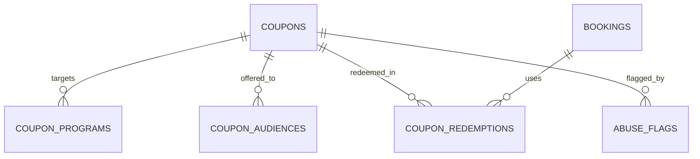

**coupons** (Base +) FR-CPN-01 to FR-CPN-08

| Column | Type | Notes |
|---|---|---|
| code | VARCHAR(40) | Unique with `deleted_at` (case-insensitive) |
| creator_type_id | BIGINT FK lookups | `coupon_creator`: admin, organization, driver, photographer |
| creator_user_id | BIGINT FK users | |
| organization_id | BIGINT FK organizations NULL | Scope for organization coupons |
| scope_user_id | BIGINT FK users NULL | Scope for driver or photographer coupons |
| market_id | BIGINT FK markets NULL | Null means all markets (admin only) |
| discount_type_id | BIGINT FK lookups | `discount_type`: fixed, percent, program_specific, free_program, first_booking, minimum_spend |
| value_minor | BIGINT NULL | Fixed amount |
| value_bp | INT NULL | Percentage in basis points |
| currency_code | CHAR(3) NULL | |
| min_spend_minor | BIGINT NULL | |
| usage_limit | INT NULL | |
| per_user_limit | INT | Default 1 |
| used_count | INT | |
| valid_from, valid_until | TIMESTAMPTZ | |
| audience_id | BIGINT FK lookups | `coupon_audience`: public, targeted |
| is_stackable | BOOLEAN | |
| status_id | BIGINT FK lookups | `coupon_status`: draft, active, paused, expired, exhausted, revoked |

**coupon_programs** (Base +): `coupon_id FK`, `program_id FK`.

**coupon_audiences** (Base +): `coupon_id FK`, `user_id FK NULL`, `segment_code VARCHAR(40) NULL`.

**coupon_redemptions** (Base +): `coupon_id FK`, `booking_id FK`, `user_id FK`, `organization_id`, `discount_minor BIGINT`, `currency_code`, `status_id FK lookups (redemption_status: applied, confirmed, reversed)`, `reversed_at`.

**abuse_flags** (Base +) D-216, D-217: `subject_type_id FK lookups (flag_subject: coupon, user, booking, deal)`, `subject_id BIGINT`, `rule_code VARCHAR(60)`, `details JSONB`, `status_id FK lookups (flag_status: open, reviewed_ok, actioned)`, `review_due_at` (2 working days), `reviewed_by FK users NULL`.

### 3.10 Plans and subscriptions

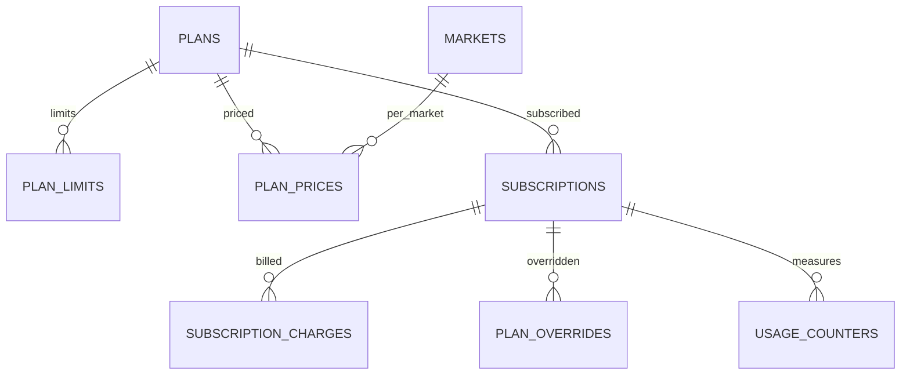

**plans** (Base +) FR-SUB-01: `role_scope_id FK lookups (plan_role: organization, driver, photographer, traveler)`, `code VARCHAR(40)` (starter, growth, enterprise, basic, professional, premium, studio, pro, free, explorer, vip), `name JSONB`, `tier_rank SMALLINT`, `trial_days SMALLINT NULL` (OD-28), `is_default_on_approval BOOLEAN`, `is_active BOOLEAN`.

**plan_limits** (Base +): `plan_id FK`, `limit_key VARCHAR(60)` (for example `active_trips_per_month`, `employees`, `vehicles_per_trip`, `programs_per_trip`, `coupons_active`, `bookings_per_month`, `portfolio_images`, `albums_per_trip`), `limit_value INT NULL` (null means unlimited), `feature_key VARCHAR(60) NULL` (for example `platform_suppliers`, `seat_self_select`, `child_tracking`, `watermark`, `album_privacy_link`, `album_privacy_selected`, `analytics_level`, `export`), `feature_value VARCHAR(40) NULL`.

**plan_prices** (Base +): `plan_id FK`, `market_id FK`, `interval_id FK lookups (billing_interval: monthly, annual)`, `amount_minor BIGINT` (OD-26), `currency_code`, `gateway_price_ref VARCHAR(120)`, `valid_from DATE`.

**subscriptions** (Base +) FR-SUB-02 to FR-SUB-07

| Column | Type | Notes |
|---|---|---|
| owner_type_id | BIGINT FK lookups | `subscription_owner`: organization, user |
| organization_id | BIGINT FK NULL | |
| user_id | BIGINT FK NULL | |
| plan_id | BIGINT FK plans | |
| plan_price_id | BIGINT FK plan_prices NULL | Null for Free |
| status_id | BIGINT FK lookups | `subscription_status`: trial, active, grace, downgraded, cancelling, ended |
| current_period_start, current_period_end | TIMESTAMPTZ | |
| trial_ends_at | TIMESTAMPTZ | |
| grace_started_at | TIMESTAMPTZ | 7 days (BRL-14) |
| scheduled_plan_id | BIGINT FK plans NULL | Downgrade at period end |
| cancel_at_period_end | BOOLEAN | |
| gateway_subscription_ref | VARCHAR(120) | |

**subscription_charges** (Base +): `subscription_id FK`, `period_start`, `period_end`, `amount_minor`, `proration_minor`, `currency_code`, `status_id FK lookups (charge_status: due, paid, failed, void)`, `attempt_no SMALLINT` (retries days 1, 3, 5, 7, D-09), `next_retry_at`.

**plan_overrides** (Base +) D-227: `subscription_id FK`, `override_plan_id FK plans`, `reason TEXT`, `starts_at`, `ends_at` (required), `requested_by FK users`, `approved_by FK users` (second admin, must differ), `reverted_at`.

**usage_counters** (Base +): `subscription_id FK`, `limit_key VARCHAR(60)`, `period_start DATE`, `used INT`. Unique `(subscription_id, limit_key, period_start)`. Reset at 00:00 on the 1st in the owner's time zone (D-218).

### 3.11 Operations

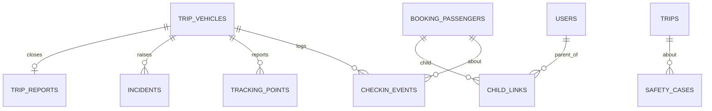

**checkin_events** (immutable hypertable) FR-CHK-01 to FR-CHK-05

| Column | Type | Notes |
|---|---|---|
| id, uuid | BIGSERIAL, UUID | Primary key `(id, occurred_at)` |
| organization_id | BIGINT | |
| trip_id | BIGINT | |
| trip_vehicle_id | BIGINT | |
| passenger_id | BIGINT FK booking_passengers | |
| event_type_id | BIGINT FK lookups | `checkin_event`: check_in, check_out, refused_wrong_vehicle |
| stop_id | BIGINT FK trip_stops NULL | |
| moderator_user_id | BIGINT FK users | |
| lat, lng, accuracy_m | NUMERIC, NUMERIC, REAL | Null when location is not permitted |
| occurred_at | TIMESTAMPTZ | Device time of the event |
| received_at | TIMESTAMPTZ | Server time; difference measures the 60-second target |
| client_event_id | UUID | Unique; offline replay is idempotent |
| created_at, created_by | | |

Retention 1 year.

**tracking_points** (immutable hypertable) FR-TRK-01, FR-TRK-02: `id`, `organization_id`, `trip_vehicle_id`, `occurred_at`, `lat`, `lng`, `speed_kmh REAL`, `heading SMALLINT`, `accuracy_m REAL`, `source_id FK lookups (gps_source: driver_app, moderator_app)`. Retention 90 days, then an hourly summary is kept.

**incidents** (Base +) FR-CHK-06: `organization_id`, `trip_id`, `trip_vehicle_id`, `reported_by FK users`, `category_id FK lookups (incident_category: safety, medical, vehicle_fault, lost_traveler, conduct, other)`, `severity_id FK lookups (severity)`, `description TEXT`, `attachments JSONB`, `lat`, `lng`, `status_id FK lookups (incident_status: open, acknowledged, resolved)`, `acknowledged_at`, `resolved_at`.

**trip_reports** (Base +) FR-MOD-02, FR-MOD-06: `organization_id`, `trip_vehicle_id FK UNIQUE`, `moderator_user_id`, `checked_in_count INT`, `final_headcount INT`, `mismatch_reason TEXT`, `notes TEXT`, `submitted_at` (locked after), `org_note TEXT`.

**child_links** (Base +) FR-PAR-01 to FR-PAR-06

| Column | Type | Notes |
|---|---|---|
| parent_user_id | BIGINT FK users | |
| booking_id | BIGINT FK bookings | |
| passenger_id | BIGINT FK booking_passengers | Must be `is_child` |
| organization_id | BIGINT | Copied for RLS on organization reads |
| guardianship_consent_id | BIGINT FK consents | D-126 |
| status_id | BIGINT FK lookups | `child_link_status`: active, ended |
| ended_at | TIMESTAMPTZ | Ends on cancellation or refund |

Unique active `(parent_user_id, passenger_id)`.

**safety_cases** (Base +) FR-PAR-07: `organization_id`, `trip_id FK`, `passenger_id FK NULL`, `reported_by FK users`, `reporter_role_id FK lookups (role)`, `description TEXT`, `status_id FK lookups (case_status: open, escalated, closed)`, `escalated_to VARCHAR(200)` (D-68), `escalated_at`, `closed_at`.

### 3.12 Media

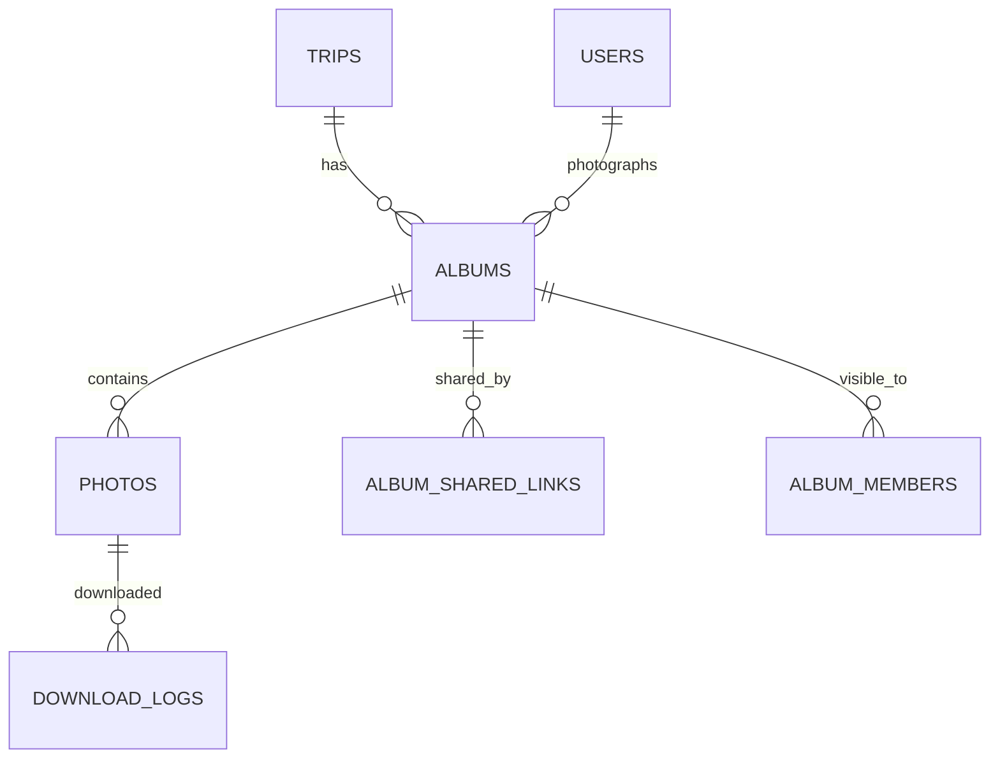

**albums** (Base +) FR-MED-01 to FR-MED-08: `organization_id`, `trip_id FK`, `photographer_user_id FK`, `title JSONB`, `privacy_mode_id FK lookups (album_privacy: public, shared_link, selected_users)`, `watermark_enabled BOOLEAN`, `status_id FK lookups (album_status: uploading, processing, published, archived)`, `upload_window_ends_at` (trip completion plus 14 days, D-267), `published_at`, `archived_at`.

**photos** (Base +): `organization_id`, `album_id FK`, `original_path TEXT`, `variants JSONB` (thumb, medium, large, watermarked), `width`, `height`, `perceptual_hash CHAR(16)`, `processing_status_id FK lookups (processing_status)`, `upload_batch_id UUID`, `client_file_id VARCHAR(120)` (resumable upload, unique per batch).

**album_shared_links** (Base +): `album_id FK`, `token_hash CHAR(64)` (32-character token), `revoked_at`.

**album_members** (Base +): `album_id FK`, `user_id FK`. Selected-users mode only.

**download_logs** (Base +): `photo_id FK`, `user_id FK`, `variant VARCHAR(20)`, `occurred_at`. Retention 1 year.

### 3.13 Finance

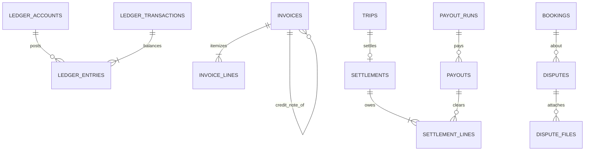

**ledger_accounts** (Base +): `owner_type_id FK lookups (ledger_owner: platform, organization, supplier, traveler_clearing, gateway)`, `organization_id NULL`, `user_id NULL`, `account_kind_id FK lookups (ledger_account_kind: cash, receivable, payable, revenue, commission, fee_expense, deferred, refund_clearing, tax_payable)`, `currency_code`, `code VARCHAR(60)` unique.

**ledger_transactions** (immutable) FR-ACC-01: `id`, `uuid`, `event_type_id FK lookups (ledger_event: booking_paid, refund, coupon, deal_cost, commission, gateway_fee, plan_charge, payout, invoice, settlement, reversal)`, `source_type VARCHAR(40)`, `source_id BIGINT`, `occurred_at`, `reverses_transaction_id FK NULL`, `created_at`, `created_by`. A check confirms entries sum to zero per currency.

**ledger_entries** (immutable): `id`, `uuid`, `transaction_id FK`, `account_id FK`, `organization_id NULL`, `debit_minor BIGINT`, `credit_minor BIGINT` (one is zero), `currency_code`, `trip_id NULL`, `booking_id NULL`, `deal_id NULL`, `gateway_reference NULL`, `created_at`, `created_by`. Retention 7 years.

**invoices** (Base +) FR-ORG-07, FR-BKG-05

| Column | Type | Notes |
|---|---|---|
| organization_id | BIGINT NULL | Issuer when the organization invoices a traveler; null for platform-issued |
| issuer_type_id | BIGINT FK lookups | `invoice_issuer`: organization, platform, supplier |
| buyer_type_id | BIGINT FK lookups | `invoice_buyer`: traveler, organization, supplier |
| kind_id | BIGINT FK lookups | `invoice_kind`: b2c, b2b, credit_note |
| number | VARCHAR(40) | Unique per issuer and market; null while numbering is retried (D-179) |
| market_id | BIGINT FK markets | |
| buyer_name, buyer_tax_no, buyer_address | VARCHAR, VARCHAR, JSONB | |
| booking_id, subscription_charge_id, deal_id, settlement_id | BIGINT NULL | Source |
| original_invoice_id | BIGINT FK invoices NULL | For credit notes (BRL-28) |
| subtotal_minor, tax_minor, total_minor | BIGINT | |
| currency_code | CHAR(3) | |
| status_id | BIGINT FK lookups | `invoice_status`: pending_number, issued, voided_by_credit, finance_review |
| issued_at | TIMESTAMPTZ | |
| e_invoice_status_id | BIGINT FK lookups NULL | Reserved for ZATCA (OD-10) |
| pdf_path | TEXT | |

**invoice_lines** (Base +): `invoice_id FK`, `description JSONB`, `quantity NUMERIC(10,2)`, `unit_minor BIGINT`, `tax_rate_bp INT`, `tax_minor BIGINT`, `line_total_minor BIGINT`.

**payout_runs** (Base +) FR-ACC-03: `run_date DATE` (Mondays 06:00, D-28), `market_id FK`, `status_id FK lookups (payout_run_status: draft, approved, submitted, completed, partial)`, `approved_by FK users`.

**payouts** (Base +): `payout_run_id FK`, `payee_user_id FK NULL`, `payee_organization_id FK NULL`, `payout_method_id FK`, `amount_minor`, `currency_code`, `status_id FK lookups (payout_status: pending, sent, paid, failed, held)`, `hold_reason_id FK lookups NULL` (lab pause D-175, negative balance D-173), `external_reference VARCHAR(120)`, `paid_at`.

**settlements** (Base +) FR-ACC-05, BRL-25: `organization_id`, `trip_id FK UNIQUE`, `status_id FK lookups (settlement_status: open, awaiting_payouts, disputed, closed)`, `opened_at` (trip Completed), `closed_at`, `totals JSONB` (gross, commission, fees, supplier costs, net).

**settlement_lines** (Base +): `settlement_id FK`, `from_party_type_id FK lookups (party)`, `from_party_id BIGINT`, `to_party_type_id FK lookups (party)`, `to_party_id BIGINT`, `reason_id FK lookups (settlement_reason: trip_revenue, commission, deal_cost, gateway_fee, refund, adjustment)`, `amount_minor`, `currency_code`, `payout_id FK NULL`, `settled_at`.

**reconciliation_exceptions** (Base +) FR-PAY-05: `gateway_id FK lookups`, `report_date DATE`, `gateway_reference VARCHAR(120)`, `kind_id FK lookups (recon_exception: missing_in_ledger, missing_in_gateway, amount_mismatch, currency_mismatch)`, `gateway_amount_minor`, `ledger_amount_minor`, `status_id FK lookups (exception_status: open, resolved, written_off)`, `resolved_by FK users NULL`.

**disputes** (Base +) FR-ADM-04, FR-ADM-08: `organization_id NULL`, `booking_id FK NULL`, `deal_id FK NULL`, `raised_by FK users`, `type_id FK lookups (dispute_type: booking, payment, refund, supplier_conduct, organization_conduct, other)`, `status_id FK lookups (dispute_status: open, information_requested, under_review, resolved, closed)`, `ack_due_at` (2 working days), `resolve_due_at` (10 working days), `outcome TEXT`, `refund_id FK refunds NULL`, `assigned_to FK users NULL`.

**dispute_files** (Base +): `dispute_id FK`, `storage_path TEXT`, `size_bytes BIGINT` (up to 5 files of 10 MB, D-259).

### 3.14 Platform

**notifications** (Base +) FR-NTF-01 to FR-NTF-06: `user_id FK`, `category_id FK lookups (notification_category)`, `template_id FK notification_templates`, `event_key VARCHAR(120)` (unique with `user_id` to stop duplicates), `payload JSONB`, `is_urgent BOOLEAN`, `scheduled_for TIMESTAMPTZ` (quiet hours), `read_at`.

**notification_deliveries** (Base +): `notification_id FK`, `channel_id FK lookups (notification_channel)`, `provider_message_id VARCHAR(120)`, `status_id FK lookups (delivery_status: queued, sent, delivered, failed, dropped)`, `attempt SMALLINT`, `next_attempt_at`, `error TEXT`.

**notification_templates** (Base +) FR-NTF-04: `category_id FK lookups`, `channel_id FK lookups`, `locale VARCHAR(5)`, `version INT`, `subject TEXT`, `body TEXT`, `is_active BOOLEAN`. Unique `(category_id, channel_id, locale, version)`.

**feature_flags** (Base +): `key VARCHAR(80)` unique, `description TEXT`, `is_enabled BOOLEAN`, `rules JSONB` (market, plan, organization, percentage).

**analytics_events** (insert only, partitioned by month) BR-ANL-01: `id`, `occurred_at`, `organization_id NULL`, `trip_id NULL`, `user_id NULL`, `anon_id UUID`, `event_name VARCHAR(60)` (page_view, trip_view, add_to_cart, checkout_start, booking_confirmed, album_view), `page_path TEXT`, `referrer TEXT`, `market_id`, `device_platform_id FK lookups`. Child data is excluded (FR-PAR-05).

**analytics_daily** (Base +): `day DATE`, `organization_id NULL`, `trip_id NULL`, `provider_user_id NULL`, `metric_key VARCHAR(60)`, `value NUMERIC(18,2)`. Unique `(day, organization_id, trip_id, provider_user_id, metric_key)`.

**audit_logs** (immutable, append-only store with object lock, 7 years) FR-ADM-05: `id`, `uuid`, `actor_user_id`, `actor_role_id`, `organization_id NULL`, `action VARCHAR(80)`, `target_type VARCHAR(60)`, `target_id BIGINT`, `before JSONB`, `after JSONB`, `reason TEXT`, `request_id UUID`, `ip INET`, `occurred_at`, `created_at`.

**outbox_events** (immutable): `id`, `uuid`, `aggregate_type`, `aggregate_id`, `event_type VARCHAR(80)`, `payload JSONB`, `occurred_at`, `published_at` (set by the relay; the only column ever updated).

**idempotency_keys**: `key VARCHAR(120)`, `user_id`, `request_hash CHAR(64)`, `response JSONB`, `status_code SMALLINT`, `expires_at` (24 h). Primary key `(user_id, key)`.

## 4. Lookup type catalog

Seeded with `is_system = true`. Admin can add values only to types marked "extensible".

| Lookup type | Values | Extensible |
|---|---|---|
| account_status | active, suspended, deletion_requested, closed | No |
| role | traveler, organization_owner, organization_employee, platform_driver, platform_photographer, org_driver, org_photographer, moderator, admin_super, admin_operations, admin_finance | No |
| application_type / application_status | See 3.3 | No |
| decision_reason, suspension_reason | D-234 list | Yes |
| trip_status, booking_status, seat_status, deal_status, subscription_status, coupon_status, lab_test_status | See SRS section 7 | No |
| pricing_model | free, per_person, by_quantity, per_group, tiered | No |
| payment_method, gateway | See 3.1 | Yes |
| incident_category | safety, medical, vehicle_fault, lost_traveler, conduct, other (D-331) | No |
| dispute_type | booking, payment, refund, supplier_conduct, organization_conduct, other (D-254) | No |
| notification_category | account, booking, payment, trip_reminder, trip_day, deal, application, lab_test, plan, promotion, safety | Yes |
| trip_category | school, corporate, religious, tourism, event, other | Yes |
| permission_area | trips, bookings, operations, accounting, coupons, employees, fleet, subscription, integrations, analytics | No |

## 5. Row-level security and access paths

| Path | Rule |
|---|---|
| Organization staff | `organization_id = app.current_organization_id` on every tenant table, plus permission checks in the service layer. |
| Platform supplier | Reads deals, assignments, albums and earnings where `provider_user_id` or `photographer_user_id` equals the caller, through a platform-scoped repository that logs every call. |
| Moderator | Reads `booking_passengers` and writes `checkin_events` only for `trip_vehicle_id` in an accepted, unexpired assignment. |
| Traveler | Reads own bookings, passengers, receipts and allowed albums. Never reads `tracking_points` (BRL-29). |
| Parent | Reads child status through `child_links` with status active; live position only when the trip is in progress and eligible (FR-PAR-03). |
| Admin | Bypass policy role; every query logged to `audit_logs`. |

## 6. Traceability

| SRS entity (section 6.1) | Tables |
|---|---|
| Account, Role assignment | users, user_roles, auth_factors, sessions |
| Organization, Employee permission set | organizations, organization_members, member_permissions, permissions |
| Application | applications, application_documents, application_decisions, appeals |
| Driver profile, Photographer profile | driver_profiles, photographer_profiles, provider_vehicles, portfolio_items, availability_slots |
| Vehicle type, Vehicle | vehicle_types, vehicle_type_seats, vehicles |
| Trip, Trip vehicle, Program | trips, trip_stops, trip_audiences, trip_vehicles, trip_staff_assignments, programs, program_tiers |
| Booking, Booking passenger, Seat | bookings, booking_passengers, booking_programs, trip_seats, booking_remedies |
| Deal and deal offer | deals, deal_offers |
| Coupon, Coupon redemption | coupons, coupon_programs, coupon_audiences, coupon_redemptions, abuse_flags |
| Plan, Subscription | plans, plan_limits, plan_prices, subscriptions, subscription_charges, plan_overrides, usage_counters |
| Ledger entry, Payout, Invoice | ledger_accounts, ledger_transactions, ledger_entries, payout_runs, payouts, invoices, invoice_lines |
| Settlement (new in v1.1) | settlements, settlement_lines |
| Album and photo | albums, photos, album_shared_links, album_members, download_logs |
| Check-in event, Tracking point | checkin_events, tracking_points, incidents, trip_reports |
| Child link | child_links, safety_cases |
| Lab test | lab_tests, lab_partners |
| Notification preference | notification_preferences, notifications, notification_deliveries, notification_templates |
| Audit log entry | audit_logs |
| Market (new in v1.1) | countries, currencies, markets, market_payment_methods, tax_rates |
| Analytics (new in v1.1) | analytics_events, analytics_daily |
| Dispute | disputes, dispute_files |
