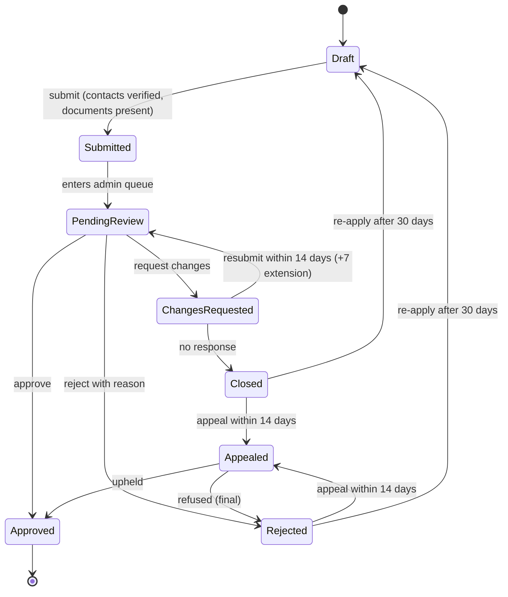

# Trips Enjoy: User Flows

| Field | Value |
|---|---|
| Version | 1.0 |
| Date | 9 November 2026 |
| Traces to | BRD.md v1.1, SRS.md v1.1, ERD.md v1.0 |

These files describe, for each app and role, how a person registers, how their access is approved, and what they can do once active. Each flow has a UF ID, the actor, the trigger, numbered steps, the rules that apply (BRL, FR), and edge cases. Screens are named by their SCR (web) or MSCR (mobile) IDs from the screen coverage audit where one exists.

## Index

| File | App or surface | Roles | Flow IDs |
|---|---|---|---|
| [01-traveler.md](01-traveler.md) | Traveler app (web and mobile) | Visitor, traveler | UF-TRV-01 to UF-TRV-14 |
| [02-organization.md](02-organization.md) | Organization dashboard (business.trips-enjoy.com) | Owner, employee | UF-ORG-01 to UF-ORG-20 |
| [03-admin.md](03-admin.md) | Admin console (admin.trips-enjoy.com) | Super admin, Operations, Finance | UF-ADM-01 to UF-ADM-14 |
| [04-driver.md](04-driver.md) | Driver app (mobile) | Platform driver, organization-owned driver | UF-DRV-01 to UF-DRV-10 |
| [05-photographer.md](05-photographer.md) | Photographer studio (responsive web, mobile) | Platform photographer, organization-owned photographer | UF-PHO-01 to UF-PHO-09 |
| [06-moderator.md](06-moderator.md) | Moderator app (installable web app) | Vehicle moderator | UF-MOD-01 to UF-MOD-08 |
| [07-parent.md](07-parent.md) | Parent tracker (section of the traveler app) | Parent or guardian | UF-PAR-01 to UF-PAR-06 |
| [08-shared.md](08-shared.md) | All surfaces | Everyone | UF-SHR-01 to UF-SHR-14 |

## Role summary

| Role | Registers via | Approved by | Plan needed | Lands on |
|---|---|---|---|---|
| Traveler | /register/traveler or the app | Nobody (active on verification) | No (Free default) | Trip browse |
| Organization | /register/organization (web only) | Admin | Yes (Starter default) | Organization workspace |
| Employee | Email invitation | Owner (permissions) | Organization's plan | Organization workspace |
| Platform driver | /register/driver or the driver app | Admin | Yes (Basic default) | Driver home |
| Platform photographer | /register/photographer or the studio | Admin | Yes (Basic default) | Studio home |
| Organization-owned driver or photographer | SMS or email invitation | Organization (accepted on assignment) | Organization's plan (OD-19) | Driver home or studio home, organization-scoped |
| Moderator | Assignment by organization (phone) | Organization | OD-06 | Vehicle home |
| Parent | Traveler account | Nobody; eligibility by plan | Explorer or VIP | Parent tracker |
| Admin | Invitation by Super admin | Super admin | Staff | Admin home |

## Application lifecycle (organizations and platform suppliers)

## Conventions

- "Must verify" means a one-time code (BRL-20): 5-minute expiry, 5 wrong codes pause 15 minutes, resend after 45 to 60 seconds.
- Every registration form records country (BRL-23); the country sets the market (BRL-27).
- Every plan-limited action can end in the upgrade prompt (UF-SHR-06).
- Every list and screen exists in Arabic (right to left) and English.
- Values marked (placeholder) or [OPEN] follow BRD section 11.
