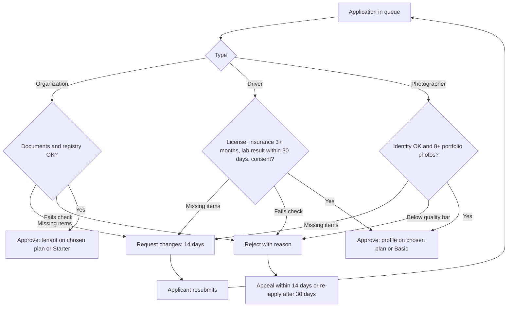

# 03. Admin console

Surface: admin.trips-enjoy.com, staff only. Roles: Super admin, Operations, Finance (D-49).

## Registration

There is no public registration. A Super admin invites a new admin by email with a role; the link is valid 72 hours (D-50). The new admin sets a password (12+ characters) and enrolls an authenticator before the console opens.

## Approval

The inviting Super admin is the approver. Role changes and removals are audited.

## Role permissions

| Area | Super admin | Operations | Finance |
|---|---|---|---|
| Applications, appeals | Yes | Yes | View |
| Accounts (suspend, reinstate, reset) | Yes | Yes | View |
| Lab tests | Yes | Yes | No |
| Disputes | Yes | Yes | Refund decisions |
| Plans, prices, overrides | Yes | View | Yes |
| Coupons, abuse flags | Yes | Yes | View |
| Payouts, settlements, reconciliation | Yes | View | Yes |
| Markets, templates, feature flags | Yes | Templates | Markets (tax, prices) |
| Admin staff | Yes | No | No |
| Audit log | Yes | View | View |

## Flows

### UF-ADM-01. Sign in
Email and password, then the authenticator code. 5 failures lock the account for 15 minutes.
Rules: FR-AUTH-04, FR-AUTH-05.

### UF-ADM-02. Review an application
Actor: Operations or Super admin. Trigger: an application in the queue.
1. Queue lists applications by type (organization, driver, photographer), age, overdue flag (over 2 working days), country.
2. Detail shows all fields, documents (opened from restricted storage, each open audited), and checks to record: identity, documents valid, insurance at least 3 months (drivers), lab result within 30 days (drivers), portfolio of 8+ photos (photographers), registry check (organizations).
3. Decision:
   - **Approve**: plan chosen or default assigned; organization tenant or supplier profile created; applicant notified.
   - **Request changes**: list items and a message in the applicant's language; 14-day due date.
   - **Reject**: reason code and message; applicant told about appeal (14 days) and re-apply (30 days).
Rules: FR-ONB-02 to FR-ONB-05.

### UF-ADM-03. Decide an appeal
1. Appeal shows the original decision, the statement and up to 5 files.
2. Uphold (application approved) or refuse (rejection final) within 5 working days.
Rules: FR-ONB-05.

### UF-ADM-04. Manage an account
1. Search by name, email, phone, booking reference or organization.
2. Entity detail: roles, plan, status, bookings, deals, audit trail.
3. Suspend with a reason code; reinstate; reset credentials; early lift of a safety suspension needs a second admin.
Rules: FR-AUTH-08, FR-ADM-01.

### UF-ADM-05. Privacy requests
Queue of data-copy and deletion requests with due dates; data copies delivered within 30 days; deletions show the grace end date.
Rules: FR-TRV-07, FR-AUTH-09.

### UF-ADM-06. Request and review a lab test
1. From a driver's profile, request a lab test: type (drug screen, medical fitness or both) and deadline (1 to 7 days, default 3).
2. The driver is paused at once; open deals end; upcoming assignments return to organizers.
3. Lab-test queue by state and deadline. Results from the partner lab or driver upload are reviewed: Passed (unpause) or Failed (stays paused; second failure in 12 months closes the account).
4. Missed deadline suspends the driver; over 30 days closes the account.
Rules: FR-ADM-09, FR-DRV-03 to FR-DRV-06.

### UF-ADM-07. Plans and overrides
1. Plan catalog per role: limits, features, trial length, prices per market and interval.
2. Overrides: one admin requests with reason and end date; a second admin approves; the owner is emailed; the plan reverts at the end date.
Rules: FR-SUB-01, FR-SUB-05.

### UF-ADM-08. Coupons and abuse
Create platform coupons (optionally per market); revoke any coupon; review abuse flags within 2 working days (flags never block automatically).
Rules: FR-ADM-06, FR-ADM-07, FR-CPN-07.

### UF-ADM-09. Deal audit
Deals list with filters; timeline of every offer; flag a deal with a reason, which can pause it.
Rules: FR-NEG-06.

### UF-ADM-10. Disputes
1. Queue with type, age, acknowledgment due (2 working days) and resolution due (10 working days).
2. Acknowledge, request information (answered within 5 working days), record outcome, issue a refund within or outside policy with a reason.
Rules: FR-ADM-04, FR-ADM-08, FR-PAY-04.

### UF-ADM-11. Finance operations
Actor: Finance or Super admin.
1. Platform financial view by market and month.
2. Weekly payout run (Mondays 06:00): review, approve, submit; failed and held payouts listed with reasons.
3. Settlements tracker: open, awaiting payouts, disputed, closed.
4. Reconciliation exceptions (daily) and the 08:00 Cairo digest.
5. Invoices in finance review (numbering failures).
Rules: FR-ACC-03 to FR-ACC-05, FR-ACC-09, FR-ORG-07.

### UF-ADM-12. Payment escalations
Payments pending over 15 minutes appear in a queue with gateway status checks; admin resolves by confirming or failing after checking with the gateway.
Rules: FR-PAY-08.

### UF-ADM-13. Configuration
Markets (currency, methods, tax, time zone, commission, status), notification templates by category, channel and language, feature flags. Every change audited.
Rules: FR-ADM-03, FR-MKT-01, FR-NTF-04.

### UF-ADM-14. Trip oversight and audit log
Trips across organizations with state filters; cancel only before In Progress. Audit log searchable by actor, action, target and date; read-only, kept 7 years.
Rules: FR-TRIP-05, FR-ADM-05.
