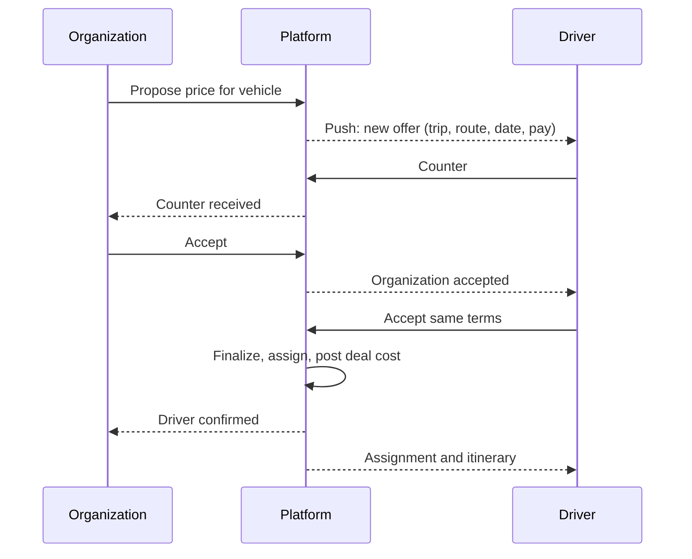

# 04. Driver app

Surface: mobile app; the web is limited to documents and profile (D-86). Roles: platform driver, organization-owned driver.

## Registration: platform driver

| Field | Required | Notes |
|---|---|---|
| Full name | Yes | |
| Email and phone | Yes, both verified | D-20 |
| Password | Yes | |
| Country | Yes | Sets market and payout currency |
| National ID | Yes | Restricted storage |
| Driving license number and photo, expiry | Yes | |
| Uses own vehicle? | Yes | If yes: plate, model, year, seat count, registration, insurance valid 3+ more months |
| Service regions | Yes | |
| Lab-test consent | Yes | Recorded with text version |
| Initial lab result | Yes | Dated within the last 30 days |
| Background-check consent | Where the market's legal review allows | |
| Plan choice | No | Basic if none (D-78); no charge before approval |

## Registration: organization-owned driver

Invited by an organization by SMS or email (valid 7 days). Fields: name, phone (verified), country, license. No admin approval; accepted on assignment.

## Approval: platform driver

Admin reviews identity, license, vehicle documents, insurance and lab result (03-admin.md, UF-ADM-02). Approve, request changes or reject. On approval the driver lands on home with the plan, and appears in the platform driver pool.

## Flows

### UF-DRV-01. Register and apply
1. Account step, verification of both contacts, details, vehicle, documents, lab consent and result, plan.
2. Submit; status page shows Pending Review and the 2-working-day target.
3. Changes requested: the status page lists items, due date, and an "ask for 7 more days" action (once).
Rules: FR-ONB-01, FR-ONB-07, FR-ONB-08.

### UF-DRV-02. Set availability and profile
Mark available or unavailable dates and ranges (no weekly rules). Edit rates, regions, vehicle and documents; expiring documents trigger reminders.
Rules: FR-DRV-08.

### UF-DRV-03. Respond to a deal
1. Offers inbox: new offers, counters, expiring soon (72 hours after the last counter).
2. Offer detail: organization, trip, route, date, vehicle, pay before any action.
3. Accept, counter with a new price and note, or reject.
4. When both sides accept the same terms, the deal locks and the assignment appears in Trips.
Edge cases: conflict with an existing assignment on the date (warning); plan's monthly booking limit reached on finalization (upgrade prompt).
Rules: FR-DRV-02, FR-NEG-01 to FR-NEG-04, FR-STF-06.

### UF-DRV-04. Run an assigned vehicle
1. Trips list: upcoming assignments with organization, vehicle, pickup time.
2. Pre-trip checklist; contact the moderator and operations.
3. Start route: GPS shared every 5 to 10 seconds while the trip is In Progress, buffered up to 60 minutes offline.
4. End of trip: route closes; location sharing stops.
Rules: FR-TRK-02, FR-TRK-06.

### UF-DRV-05. Lab test requested
Trigger: an admin requests a lab test.
1. The app opens on the lab-test gate. Only four actions work: book the lab, upload the result, contact support, sign out.
2. Book a slot at a partner lab (free); see the deadline countdown.
3. The partner sends the result, or the driver uploads it.
4. Passed: the app unlocks. Failed: stays paused for admin handling. Missed: suspended; closed after 30 days.
5. Upcoming trips go back to their organizers; completed trips are paid, uncompleted ones held.
Rules: FR-DRV-03 to FR-DRV-06, BRL-16, BRL-17.

### UF-DRV-06. Earnings and payouts
Earnings by trip, statements, weekly payouts on Mondays; commission shown as a ledger line without a printed rate until OD-15 is set; negative balances carried forward.
Rules: FR-DRV-07, FR-ACC-03.

### UF-DRV-07. Coupons
Create coupons that apply only to bookings where the driver is assigned, within the plan's count.
Rules: FR-CPN-01, FR-CPN-08.

### UF-DRV-08. Plan
Current plan, monthly booking usage, visibility level, upgrade or downgrade through the browser gateway page.
Rules: FR-SUB-02, FR-SUB-04.

### UF-DRV-09. Organization-owned driver home
Sees only that organization's trips and assignments; no offers inbox, no plan screen, no coupons.
Rules: FR-DRV-01, BRL-05.

### UF-DRV-10. Support
Contact support from any state, including the lab-test gate; tickets show status.
Rules: FR-DRV-03.
