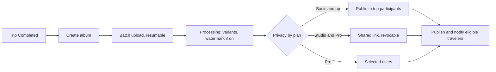

# 05. Photographer studio

Surface: responsive web in phase 1, plus mobile (D-86). Roles: platform photographer, organization-owned photographer.

## Registration: platform photographer

| Field | Required | Notes |
|---|---|---|
| Full name | Yes | |
| Email and phone | Yes, both verified | D-20 |
| Password | Yes | |
| Country | Yes | |
| ID document | Yes | Restricted storage |
| Portfolio | Yes, at least 8 photos | JPEG, PNG or HEIC, 25 MB each |
| Bio, equipment, service regions | Yes | |
| Rates | Yes | In the market currency |
| Plan choice | No | Basic if none (D-78) |

## Registration: organization-owned photographer

Invited by an organization by SMS or email (valid 7 days): name, phone, country. No admin approval; accepted on assignment.

## Approval: platform photographer

Admin checks identity and portfolio quality (03-admin.md, UF-ADM-02). Approve, request changes or reject. On approval the photographer becomes discoverable by Growth and Enterprise organizations. Lab tests do not apply to photographers.

## Flows

### UF-PHO-01. Register and apply
Account, verification, profile, portfolio upload (minimum 8), rates, plan; submit; status page as in UF-DRV-01.
Rules: FR-ONB-06.

### UF-PHO-02. Portfolio, profile and availability
Manage portfolio within the plan allowance (10, 50, unlimited); visibility and badge follow the plan; mark available and unavailable dates and ranges.
Rules: FR-PHO-01, FR-PHO-02, FR-PHO-06.

### UF-PHO-03. Respond to a deal
Same negotiation as drivers (04-driver.md, UF-DRV-03), for a whole trip rather than a vehicle. Deals for unavailable dates are refused.
Rules: FR-NEG-01 to FR-NEG-04, FR-STF-02.

### UF-PHO-04. Assigned trip brief
Trip, dates, route and stops, organization contact, programs to cover, expected album delivery window (14 days after completion).
Rules: FR-MED-01.

### UF-PHO-05. Create and upload an album
1. After the trip is Completed, create an album (within 14 days; count per plan).
2. Upload in batches directly to storage; interrupted batches resume.
3. Processing makes thumbnail, medium, large and watermarked copies; EXIF is stripped.
Rules: FR-MED-01, FR-MED-02, FR-MED-08.

### UF-PHO-06. Privacy and sharing
1. Choose the privacy mode the plan allows.
2. Shared link: generate, copy, revoke (a revoked link returns not found).
3. Selected users: pick travelers from the trip roster.
4. Downloads: public albums give the watermarked or medium copy; other modes are view only.
Rules: FR-MED-03 to FR-MED-05, FR-MED-07.

### UF-PHO-07. Watermark
Studio and Pro: turn on; fixed placement bottom right, inset 3 percent, 30 percent opacity; preview before publishing. Basic: locked with an upgrade prompt.
Rules: FR-MED-06.

### UF-PHO-08. Earnings, coupons and plan
Earnings and weekly payouts; coupons for own bookings; plan usage (bookings per month, portfolio, albums) and changes.
Rules: FR-PHO-03 to FR-PHO-05, FR-SUB-04.

### UF-PHO-09. Organization-owned photographer
Sees only that organization's trips; uploads albums for them; no marketplace, plan or coupons.
Rules: BRL-05.
