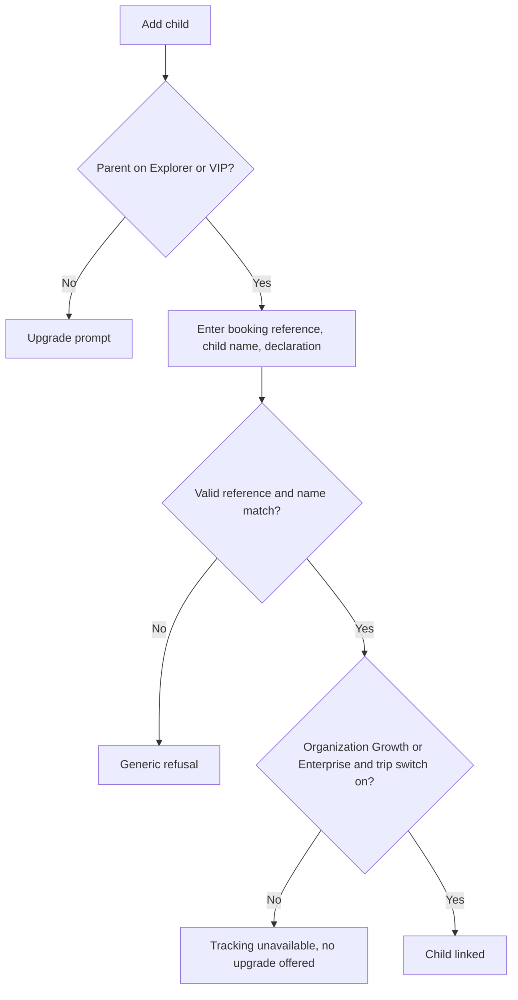

# 07. Parent tracker

Surface: a section of the traveler app (D-124). Role: parent or guardian (a traveler).

## Registration

A parent is a traveler (01-traveler.md, UF-TRV-02). No extra registration. Linking a child needs the booking reference, the child's name as on the booking, and a guardianship declaration recorded as consent.

## Eligibility (instead of approval)

| Condition | Required |
|---|---|
| Parent's plan | Explorer or VIP |
| Organization's plan | Growth or Enterprise |
| Trip setting | Child tracking switched on |
| Live position | Only while the trip is In Progress |

All three plan and setting conditions must hold (OD-05, proposed). The blocked screen says which one fails; only the parent-plan case offers an upgrade.

## Flows

### UF-PAR-01. Link a child
1. Parent tracker, Add child.
2. Enter booking reference and the child's name; confirm the guardianship declaration.
3. Linked: the child appears with the trip. Refused: generic message (invalid reference, name mismatch, not a child passenger, or tracking off for the trip).
Rules: FR-PAR-01, BRL-10.

### UF-PAR-02. Child trip status
For each linked child: trip, vehicle, seat, check-in status, programs, schedule; moderator contact.
Rules: FR-PAR-02.

### UF-PAR-03. Live map
While the trip is In Progress and eligible: the vehicle's position on a map, updated live; before start and after end, no position.
Rules: FR-PAR-03, FR-TRK-04, FR-TRK-06.

### UF-PAR-04. Notifications
Boarding confirmed, trip started, stop reached, trip ended; also "not boarded" when the vehicle departs without the child checked in (proposed).
Rules: FR-PAR-04.

### UF-PAR-05. Report a child-safety concern
Describe the concern; a case is created and routed to the escalation contact; status shown.
Rules: FR-PAR-07.

### UF-PAR-06. Link ends
When the booking is cancelled or refunded, the child disappears from the tracker and live data stops. Child trip history is kept 1 year.
Rules: FR-PAR-06.
