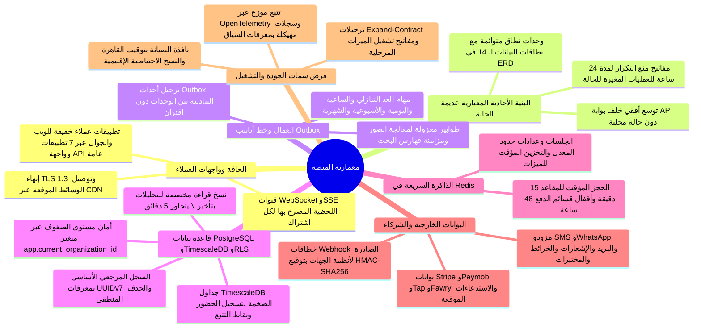
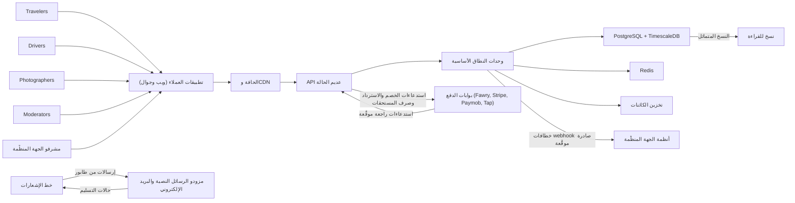

تصميم النظام في صفحة واحدة: مَن يتحدث إلى ماذا، وكيف تُشكَّل الخدمة، وأين تسكن البيانات، ومع ماذا تتكامل المنصة، وكيف يُفرض كل سمة من سمات الجودة. التصميم على مستوى الجداول في [نموذج البيانات (ERD)](/ar/docs/erd)؛ وقصص التشغيل في [سير العمل في النظام](/ar/docs/workflows)؛ والتنسيق المتكامل عبر المراحل في [النظام الشامل](/ar/docs/system)؛ والمخططات الهندسية التفصيلية في [توصيات المعمارية والتشغيل](/ar/docs/recommendations/architecture-and-ops).

<TraceBar
  brd={[
    { label: 'القيود §9.3', href: '/ar/docs/brd/compliance#93-القيود' },
    { label: 'قواعد العمل §7', href: '/ar/docs/brd/requirements#7-قواعد-العمل' },
  ]}
  srs={[
    { label: 'الجودة وNFRs §8', href: '/ar/docs/srs/quality' },
    { label: 'الواجهات وAPI §9', href: '/ar/docs/srs/quality#9-متطلبات-الواجهات-و-api' },
  ]}
  erd={[
    { label: 'نموذج البيانات', href: '/ar/docs/erd', detail: '14 نطاقًا' },
    { label: 'ACL وRLS', href: '/ar/docs/erd/acl' },
  ]}
  plan={[
    { label: 'مهام المنصة التأسيسية', href: '/ar/docs/plan', detail: '18 مهمة T-P*-PLAT-*' },
  ]}
  workflows={[
    { label: 'سير العمل في النظام', href: '/ar/docs/workflows' },
    { label: 'كتالوج الوظائف', href: '/ar/docs/workflows/scheduled-jobs' },
  ]}
  userFlows={[
    { label: '106 تدفقات أدوار', href: '/ar/docs/user-flows' },
  ]}
  design={[
    { label: 'نظام التصميم والواجهات', href: '/ar/docs/design' },
  ]}
  system={[
    { label: 'النظام الشامل', href: '/ar/docs/system' },
    { label: 'رحلة دورة الحياة', href: '/ar/docs/system/lifecycle' },
    { label: 'أطلس الخرائط الذهنية', href: '/ar/docs/system/mindmaps' },
  ]}
  recommendations={[
    { label: 'REC-ARCH-01 Outbox', href: '/ar/docs/recommendations/architecture-and-ops#rec-arch-01' },
    { label: 'REC-DATA-02 RLS وTimescale', href: '/ar/docs/recommendations/architecture-and-ops#rec-data-02' },
    { label: 'REC-BOOK-03 حجز المقاعد', href: '/ar/docs/recommendations/architecture-and-ops#rec-book-03' },
    { label: 'REC-PAY-04 بوابات الدفع', href: '/ar/docs/recommendations/architecture-and-ops#rec-pay-04' },
    { label: 'REC-TAX-05 ZATCA والضرائب', href: '/ar/docs/recommendations/architecture-and-ops#rec-tax-05' },
    { label: 'REC-OFF-06 عدم الاتصال', href: '/ar/docs/recommendations/architecture-and-ops#rec-off-06' },
  ]}
/>

<MindmapBlock
  title="معمارية المنصة — الطوبولوجيا ومخازن البيانات والتكاملات وفرض سمات الجودة"
  caption="بنية أحادية معيارية بنشر موحّد خلف الحافة وشبكة CDN، مدعومة بقاعدة بيانات PostgreSQL 16 مع RLS وTimescaleDB، وRedis 7 للحجوزات المؤقتة والجلسات، وعمال Outbox التبادلي، وتكاملات بوابات المنطقة."
  trace={{
    architecture: [
      { label: 'سياق النظام', href: '/ar/docs/architecture#سياق-النظام' },
      { label: 'نموذج الخدمات', href: '/ar/docs/architecture#نموذج-الخدمات' },
      { label: 'معمارية البيانات', href: '/ar/docs/architecture#معمارية-البيانات' },
      { label: 'التكاملات', href: '/ar/docs/architecture#التكاملات' },
      { label: 'طوبولوجيا النشر', href: '/ar/docs/architecture#طوبولوجيا-النشر' },
      { label: 'سمات الجودة', href: '/ar/docs/architecture#سمات-الجودة' },
    ],
    system: [
      { label: 'النظام الشامل', href: '/ar/docs/system' },
    ],
    recommendations: [
      { label: 'REC-TRK-07 بث GPS', href: '/ar/docs/recommendations/architecture-and-ops#rec-trk-07' },
      { label: 'REC-MED-08 خط الوسائط', href: '/ar/docs/recommendations/architecture-and-ops#rec-med-08' },
      { label: 'REC-SEC-09 السلامة والتدقيق', href: '/ar/docs/recommendations/architecture-and-ops#rec-sec-09' },
      { label: 'REC-FIN-10 السجل والمطابقة', href: '/ar/docs/recommendations/architecture-and-ops#rec-fin-10' },
      { label: 'REC-UX-11 RTL والوصول', href: '/ar/docs/recommendations/architecture-and-ops#rec-ux-11' },
      { label: 'REC-OPS-12 بوابات الإطلاق', href: '/ar/docs/recommendations/architecture-and-ops#rec-ops-12' },
    ],
  }}
>

</MindmapBlock>

## سياق النظام

تخدم عملية نشر واحدة كل الأدوار عبر الحافة ذاتها وAPI ذاته. يستخدم المسافرون والسائقون والمصوّرون والمشرفون ومشرفو الجهات المنظِّمة تطبيقاتهم الخاصة؛ والتطبيقات عملاء نحيفون فوق الـAPI. بوابات الدفع ومزودو الرسائل النصية والبريد الإلكتروني هم الأطراف الخارجية التي تستدعيها المنصة أو تثق باستدعاءاتها الراجعة؛ وتستقبل أنظمة الجهات المنظِّمة خطافات webhook صادرة.

- تُنهي الحافة اتصال TLS وتخدم الوسائط من الـCDN؛ ولا تصل تطبيقات العملاء إلى الـAPI مباشرةً أبدًا.
- تخرج التحديثات اللحظية — خريطة المقاعد، والتتبع المباشر للمركبات، والتعاقدات، والعمليات — من الوحدات الأساسية عبر قناة منفصلة، تُصرَّح لها لكل قناة عند الاشتراك ([NFR-PERF-06](/ar/docs/srs/quality#81-الأداء-nfr-perf)).
- كل استدعاء وارد من بوابة يُتحقق منه ويُعالج بمنع التكرار؛ وكل خطاف webhook صادر يُوقَّع ([FR-API-07](/ar/docs/srs/requirements/api#fr-api-07--تماثل-عقد-webhook)).

## نموذج الخدمات

هيكل أحادي معياري: واجهة API واحدة قابلة للنشر، ومجموعة من العمال الداخليين، وقاعدة بيانات أساسية واحدة. تعكس كل وحدة نطاقٍ نطاقًا في [نموذج البيانات (ERD)](/ar/docs/erd) — الهوية والوصول، وطلبات الانضمام، والجهات المنظِّمة، والمورّدون، والأسطول والرحلات، والتعاقدات، والحجز والدفع، والكوبونات، والخطط، والعمليات، والوسائط، والمالية، والمنصة. تتشارك الوحدات مسار الطلب لكنها تحتفظ بجداولها وقواعدها وآلات حالاتها داخل حدودها الخاصة.

يشغّل العمال كل ما ليس طلبًا: الوظائف المجدولة من [كتالوج الوظائف](/ar/docs/workflows/scheduled-jobs) — انتهاء العد التنازلي، وإعادة محاولات مطالبات السداد، والمطابقة اليومية للبوابات، وتشغيل صرف المستحقات الأسبوعي، وحذف السجلات وفق سياسة الاحتفاظ — وخط الإشعارات من [الإشعارات](/ar/docs/workflows/notifications). لا يملك العمال أي سطح عام؛ ويصلون إلى البيانات عبر الوحدات ذاتها التي يستخدمها الـAPI.

الـAPI عديم الحالة خلف البوابة ويتوسع بإضافة نسخ ([NFR-SCL-03](/ar/docs/srs/quality#84-قابلية-التوسع-nfr-scl)). تجلس الجلسات وذاكرات التخزين المؤقت والحجوزات المؤقتة للمقاعد وعدادات حدود المعدل في Redis، فتخدم أي نسخة أي طلب. تُكتب الآثار عبر الوحدات كأحداث outbox وتُسلَّم عبر الخط: يصل حدث نطاق واحد إلى خط الإشعارات وخطافات webhook الصادرة دون أن يعيد كل مستهلك إطلاقه.

## معمارية البيانات

PostgreSQL هو نظام التسجيل المرجعي. تستخدم مقاييس السلاسل الزمنية جداول TimescaleDB الضخمة (hypertables): تُقسَّم `checkin_events` و`tracking_points` على `occurred_at` وفق [الاتفاقيات الأساسية](/ar/docs/erd). تعمل التحليلات على نسخ القراءة، ولا تعمل على الأساسي أبدًا؛ ولا ترى لوحات المعلومات بيانات أقدم من 5 دقائق ([BR-ANL-04](/ar/docs/brd/requirements#617-التحليلات-anl)).

يُفرض عزل مساحات العمل على مستوى قاعدة البيانات بأمان مستوى الصفوف: كل صف مملوك لجهة منظِّمة يحمل `organization_id` وسياسة RLS مبنية على `app.current_organization_id`، وتتكرر القاعدة ذاتها في طبقتي المستودع والـAPI ([NFR-SEC-07](/ar/docs/srs/quality#82-الأمان-nfr-sec)). تعريفات السياسات وكتالوج الصلاحيات في [التحكم في الوصول (ACL)](/ar/docs/erd/acl).

تنطبق اتفاقيات مستوى الجداول على كل جدول وتُعرَّف في [نموذج البيانات](/ar/docs/erd): `id BIGSERIAL` داخليًا و`uuid` بصيغة UUIDv7 خارجيًا ([DAT-10](/ar/docs/srs/data#62-عزل-البيانات))، والحذف الناعم عبر `deleted_at` و`deleted_by` بنافذة استرجاع 30 يومًا ([DAT-11](/ar/docs/srs/data#63-الحذف-الناعم-وعدم-القابلية-للتغيير-والحذف))، والفهارس الجزئية على الصفوف الحية، والجداول غير القابلة للتغيير — سجلات السجل والتدقيق والأحداث تُدرَج فقط، والتصحيحات صفوف عكسية جديدة ([DAT-08](/ar/docs/srs/data#63-الحذف-الناعم-وعدم-القابلية-للتغيير-والحذف)). يحتفظ نطاق المنصة بالجداول العرضية التي يحتاجها الخط: `outbox_events` و`idempotency_keys` و`notification_deliveries` و`audit_logs`.

## التكاملات

**استدعاءات الدفع الواردة.** كل استدعاء راجع من بوابة يُتحقق منه ويُعالج مرة واحدة على الأكثر لكل مُعرِّف حدث من البوابة ([FR-PAY-02](/ar/docs/srs/requirements/pay#fr-pay-02--معالجة-الاستدعاءات-الراجعة-مرة-واحدة)). لا يفقد انقطاع بوابة أي دفعة مؤكدة: تدخل الاستدعاءات طابورًا وتُعاد ([NFR-AVL-03](/ar/docs/srs/quality#83-التوافر-nfr-avl)). وتقبل نقاط النهاية المُغيِّرة للحالة مفتاح idempotency يُحفظ 24 ساعة ([NFR-SEC-06](/ar/docs/srs/quality#82-الأمان-nfr-sec)).

**خطافات webhook الصادرة.** تستخدم تسليمات webhook المظروف والتوقيع ذاتين اللذين يستخدمهما عقد الـAPI العامة ([FR-API-07](/ar/docs/srs/requirements/api#fr-api-07--تماثل-عقد-webhook)) — مُعرِّف الحدث، والنوع، وزمن الحدوث، والتوقيع — حتى يتحقق الشركاء من السطحين بتنفيذ واحد. تُعاد محاولة التسليم 5 مرات على مدى 24 ساعة ويمكن إعادة تشغيلها لمدة 7 أيام؛ ويُبقي تدوير المفتاح السري المفتاح القديم صالحًا 24 ساعة ([FR-ORG-06](/ar/docs/srs/requirements/org#fr-org-06--نظام-crm-وwebhooks)).

**الرسائل النصية والبريد الإلكتروني.** تمر كل مراسلة صادرة عبر واجهة إشعارات واحدة. يختار المستلمون القنوات وفق التفضيل، وتحبس ساعات الهدوء الرسائل غير العاجلة حتى الساعة 07:00 بتوقيت المستلم، ورسالة واحدة لكل حدث لكل قناة، وتُعاد محاولة الإرسالات الفاشلة 3 مرات بتراجع أُسّي ([FR-NTF-05](/ar/docs/srs/requirements/ntf#fr-ntf-05--سجلات-التسليم-وإعادة-المحاولة)). تستدعي الواجهة مزود الرسائل النصية ومزود البريد الإلكتروني المعاملاتي؛ ويتبع الإشعارات الفورية الخط ذاته.

## طوبولوجيا النشر

تشغّل كل بيئة الحاويات ذاتها — صورة الـAPI وصورة العامل — مع إعدادات خاصة بكل بيئة. يرقى أثر واحد من البيئة التجريبية إلى الإنتاج؛ ولا يختلف إلا الإعداد.

تُنفَّذ الترحيلات قبل أن تستقبل الحاويات الجديدة حركة المرور، مُصدَّرة بنمط expand-contract للتغييرات الكاسرة مع خطة تراجع موثَّقة ([NFR-MNT-01](/ar/docs/srs/quality#89-قابلية-الصيانة-nfr-mnt)). وتُشحن الميزات خلف مفاتيح تشغيل لكل مرحلة ([NFR-MNT-03](/ar/docs/srs/quality#89-قابلية-الصيانة-nfr-mnt)).

تحد فحوص الصحة من نشر الإصدار. يفحص اختبار الجاهزية قاعدة البيانات وRedis والقناة اللحظية؛ وإذا فشل الفحص أُزيلت الحاوية من البوابة. تبقى الصيانة المخططة داخل نافذة من الساعة 01:00 إلى 03:00 بتوقيت القاهرة، بحد أقصى 4 ساعات شهريًا، مع الإعلان عنها قبل 72 ساعة ([NFR-AVL-02](/ar/docs/srs/quality#83-التوافر-nfr-avl)).

يُوصَل التتبع قبل أول نشر لكل مرحلة: أثر OpenTelemetry يتجاوز الـAPI والوظائف والقناة اللحظية والاستدعاءات الراجعة من البوابة ([NFR-OBS-03](/ar/docs/srs/quality#86-الرصد-nfr-obs))، وتحمل السجلات المهيكلة معرّفات الطلب والأثر ومساحة العمل والمستخدم ([NFR-OBS-01](/ar/docs/srs/quality#86-الرصد-nfr-obs)).

## سمات الجودة

| السمة | المجموعة | مكان الفرض |
|---|---|---|
| ميزانيات زمن الاستجابة | NFR-PERF | ميزانيات لنقاط النهاية في وحدات الـAPI؛ وخريطة المقاعد والتتبع عبر القناة اللحظية؛ والمصغرات من الـCDN. |
| عزل مساحات العمل | NFR-SEC | RLS في قاعدة البيانات، متكررة في طبقتي المستودع والـAPI؛ ومفاتيح سرية تُدوَّر من المخزن المُدار؛ وحدود معدل لكل دور. |
| زمن التشغيل | NFR-AVL | طابور الاستدعاءات وإعادتها عند حد التكامل؛ ونافذة الصيانة وصفحة الحالة. |
| التوسع | NFR-SCL | API عديم الحالة خلف البوابة؛ وجداول ضخمة تُقسَّم زمنيًا؛ وتحمل النسخ التحليلات. |
| الاحتفاظ ومكان الإقامة | NFR-DAT | وظائف حذف في المجدول؛ ومنطقة واحدة لكل سوق. |
| القابلية للملاحظة | NFR-OBS | انتشار الأثر من الحافة إلى العمال والاستدعاءات الراجعة من البوابة؛ ولوحات تسليم لكل قناة. |
| اللغة والأرقام | NFR-I18N | قوالب وواجهات بالعربية والإنجليزية؛ وأرقام غربية؛ وانعكاس RTL كامل. |
| إمكانية الوصول | NFR-A11Y | واجهات بمستوى WCAG 2.1 AA؛ وتشغيل بلوحة المفاتيح؛ وبديل قائمة لخريطة المقاعد. |

تُعرَّف مجموعات الجودة في [متطلبات الجودة والواجهات](/ar/docs/srs/quality). الجداول التي تحكمها في [نموذج البيانات](/ar/docs/erd)؛ والسلوك عبر الزمن في [سير العمل في النظام](/ar/docs/workflows).
