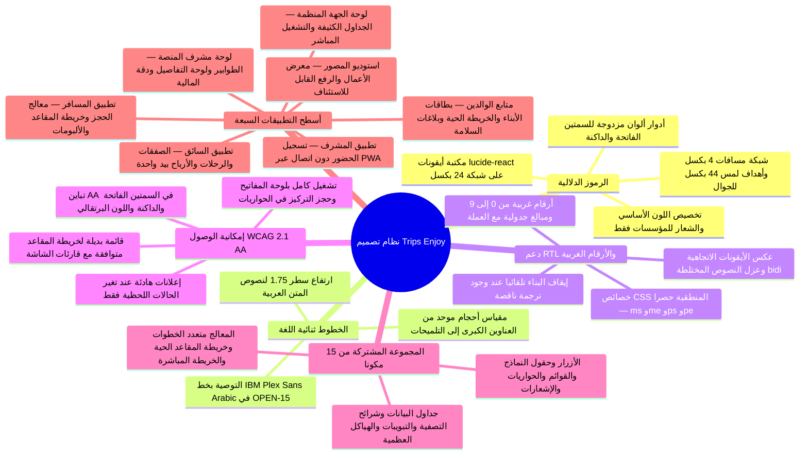
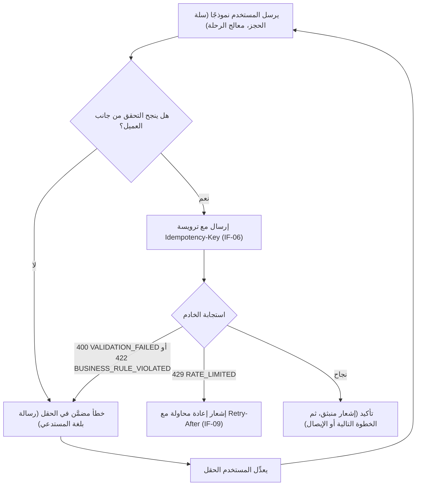

نظام تصميم واحد يخدم كل الأسطح: تطبيق المسافر، ولوحة الجهة المنظِّمة، ولوحة مشرف المنصة، وتطبيق السائق، وتطبيق المصوّر، وتطبيق المشرف، ومتابع الوالدين. كل شاشة بالعربية والإنجليزية منذ الإصدار الأول (NFR-I18N-01)، لذا تأتي كل مكوِّن بكلتا الاتجاهين والسمتين معًا وإلا لم يُشحن.

<TraceBar
  brd={[
    { label: 'الهوية البصرية للمؤسسات', href: '/ar/docs/brd/requirements#63-الجهات-المنظِّمة-والموظفون-org', detail: 'BR-ORG-08' },
  ]}
  srs={[
    { label: 'متطلبات الواجهات §4.1', href: '/ar/docs/srs#41-واجهات-المستخدم', detail: 'UI-01..09' },
    { label: 'قواعد التعريب §8.7', href: '/ar/docs/srs/quality#87-التدويل-nfr-i18n' },
    { label: 'إمكانية الوصول §8.8', href: '/ar/docs/srs/quality#88-إمكانية-الوصول-nfr-a11y' },
  ]}
  erd={[
    { label: 'نصوص JSONB ثنائية اللغة', href: '/ar/docs/erd', detail: 'en/ar JSONB' },
  ]}
  plan={[
    { label: 'خطة التسليم', href: '/ar/docs/plan', detail: '231 مهمة موسومة بالواجهات' },
  ]}
  workflows={[
    { label: 'الإشعارات وساعات الهدوء', href: '/ar/docs/workflows/notifications' },
    { label: 'يوم الرحلة دون اتصال', href: '/ar/docs/workflows/trip-day' },
  ]}
  userFlows={[
    { label: '106 تدفقات أدوار', href: '/ar/docs/user-flows' },
    { label: 'اللغة والتخطيط RTL', href: '/ar/docs/user-flows/shared#uf-shr-13-اللغة-والتخطيط' },
  ]}
  architecture={[
    { label: 'الحافة وCDN وتطبيقات العملاء', href: '/ar/docs/architecture#سياق-النظام' },
  ]}
  design={[
    { label: 'الرموز والأسس', href: '/ar/docs/design#الأسس' },
    { label: 'المجموعة المشتركة', href: '/ar/docs/design#المكونات' },
    { label: '7 أسطح تطبيقات', href: '/ar/docs/design#أسطح-التطبيقات' },
  ]}
  system={[
    { label: 'النظام الشامل', href: '/ar/docs/system' },
    { label: 'أطلس الخرائط الذهنية', href: '/ar/docs/system/mindmaps' },
  ]}
  recommendations={[
    { label: 'اختيار خط الويب العربي', href: '/ar/docs/recommendations/open-decisions#open-15', detail: 'OPEN-15' },
    { label: 'هندسة RTL وإتاحة المقاعد', href: '/ar/docs/recommendations/architecture-and-ops#rec-ux-11', detail: 'REC-UX-11' },
  ]}
/>

<MindmapBlock
  title="نظام التصميم — الرموز الدلالية وقواعد RTL وإمكانية الوصول والمكونات المشتركة والأسطح السبعة"
  caption="كيف يدعم عقد رموز دلالي واحد ومجموعة مشتركة من 15 مكوّنًا سبعة أسطح متميزة للويب والجوال والعمل دون اتصال، مع انعكاس RTL أصيل وأرقام غربية وامتثال WCAG 2.1 AA."
  trace={{
    design: [
      { label: 'الألوان والخطوط', href: '/ar/docs/design#الأسس' },
      { label: 'المكونات', href: '/ar/docs/design#المكونات' },
      { label: 'RTL والتعريب', href: '/ar/docs/design#rtl-والتعريب' },
      { label: 'إمكانية الوصول', href: '/ar/docs/design#إمكانية-الوصول' },
      { label: 'الحوكمة', href: '/ar/docs/design#الحوكمة' },
    ],
    recommendations: [
      { label: 'حسم خط الويب OPEN-15', href: '/ar/docs/recommendations/open-decisions#open-15' },
      { label: 'هندسة RTL في REC-UX-11', href: '/ar/docs/recommendations/architecture-and-ops#rec-ux-11' },
    ],
  }}
>

</MindmapBlock>

## الأسس

### أدوار الألوان

الرموز أدوار دلالية، ولا قيم hex خام في كود المكونات أبدًا. تحافظ كلتا السمتين على تباين AA، بما في ذلك نص البرتقالي الهوياتي — #C93A00 على الفاتح، و#FF8655 على الداكن (NFR-A11Y-04). القيم أدناه هي لوحة v1 المسجَّلة هنا؛ وتتبع التغييرات قسم الحوكمة.

| الرمز | الفاتح | الداكن | الدور |
|---|---|---|---|
| `primary` | #C93A00 | #FF8655 | إجراءات الهوية، والروابط، والحالات النشطة |
| `surface` | #FFFFFF | #111827 | خلفية الصفحة |
| `surface-raised` | #F9FAFB | #1F2937 | البطاقات، والأوراق، والحواريات |
| `muted` | #F3F4F6 | #27303F | تعبئات الأقسام، والحالات المعطَّلة |
| `border` | #E5E7EB | #374151 | الخطوط الرفيعة، والفواصل، وحدود حقول الإدخال |
| `text` | #111827 | #F9FAFB | النص الأساسي |
| `text-muted` | #6B7280 | #9CA3AF | النص الثانوي، والتلميحات |
| `success` | #15803D | #4ADE80 | مؤكد، مدفوع، تم تسجيل الحضور |
| `warning` | #B45309 | #FBBF24 | معلَّق، يحتاج إجراء، طُلبت تعديلات |
| `danger` | #B91C1C | #F87171 | ملغى، مرفوض، فشل الدفع |
| `info` | #1D4ED8 | #60A5FA | قيد التنفيذ، إشعارات محايدة |

لكل لون دلالي قيمة فاتحة وداكنة في الرمز ذاته — فالمكونات لا تتفرع حسب السمة أبدًا. تستبدل الهوية البصرية المخصصة للمؤسسات ([BR-ORG-08](/ar/docs/brd/requirements#63-الجهات-المنظِّمة-والموظفون-org)) الرمز `primary` والشعار لكل جهة منظِّمة على الصفحات المواجهة للمسافرين؛ ولا يتحرك شيء آخر.

### الخطوط

مقياس واحد يخدم اللغتين. يستخدم النص اللاتيني حزمة واجهة النظام. خط العرض العربي [OPEN: اختيار خط الويب العربي — المرشحون: IBM Plex Sans Arabic, Noto Kufi Arabic, Cairo] (راجع [التوصية المقترحة OPEN-15](/ar/docs/recommendations/open-decisions#open-15))؛ وحتى يُحسم ذلك، يعود العربية إلى حزمة الخطوط العربية للنظام.

| الرمز | الحجم / ارتفاع السطر | الاستخدام |
|---|---|---|
| `display` | 40 / 48 | أرقام صفحات الهبوط، وترويسات التسويق |
| `h1` | 32 / 40 | عناوين الصفحات |
| `h2` | 24 / 32 | عناوين الأقسام |
| `h3` | 20 / 28 | عناوين البطاقات |
| `body` | 16 / 24 | النص الافتراضي |
| `body-sm` | 14 / 20 | خلايا الجداول، وصفوف الميتا |
| `caption` | 12 / 16 | التلميحات، والأزمنة |

قواعد الخطوط العربية:

- ارتفاع سطر نص المتن العربي هو 16 / 28 (1.75)؛ فالعربية تمدد أكثر من اللاتينية بالحجم ذاته، لذا يُحسم رمز ارتفاع السطر لكل لغة، لا لكل مكوِّن.
- تبقى الأوزان بين 400 و500 و600 و700 لكلتا الكتابتين؛ فالأوزان الأثقل تظهر بشكل رديء في العربية بالأحجام الصغيرة.
- أرقام غربية من 0 إلى 9 في اللغتين (NFR-I18N-04, D-159). لا يستبدل النص العربي الأرقام العربية الهندية أبدًا، فتتحاذى الأرقام الجدولية بشكل مطابق في كلا الاتجاهين.

### المسافات وأنصاف الأقطار

المسافات مقياس 4 بكسل: 4 (حشو الشرائح والأيقونات)، و8 (بين عناصر تحكم مترابطة)، و12 (فجوات حقول النماذج)، و16 (حشو البطاقة)، و24 (تباعد الأقسام)، و32 (هوامش صفحات سطح المكتب)، و48 (كتل البطل). تحافظ أسطح اللمس على مساحة لمس 44 بكسل لكل عنصر تحكم مع 8 بكسل على الأقل بين الأهداف.

أنصاف الأقطار: 4 بكسل لحقول الإدخال والشرائح، و8 بكسل للأزرار والبطاقات، و12 بكسل للحواريات والوسائط، ونصف قطر كامل للكبسولات والصور الشخصية.

### الأيقونات

مجموعة lucide-react هي مكتبة الأيقونات الوحيدة؛ ولا تختلط العائلات. تُرسم الأيقونات على شبكة 24 بكسل بأحجام 16 أو 20 أو 24 بكسل. الأيقونة زخرفية فقط عندما يحمل التسمية المجاورة المعنى؛ وعنصر تحكم بأيقونة وحدها يملك دائمًا اسمًا قابلًا للوصول. تعيد أيقونات الأدوار المحفوظة لهوية الأسطح استخدام مفردات صفحة الهبوط: Map وBuilding2 وShield وCar وCamera وEye وHeartHandshake. وتنعكس الأيقونات الاتجاهية في RTL وفق قواعد قسم «RTL والتعريب».

## المكونات

المجموعة المشتركة هي ما يتكون منها كل سطح؛ ولا يُبنى شيء مرتين.

| المكوِّن | الأنماط | يستخدمه |
|---|---|---|
| زر | primary وsecondary وghost وdestructive؛ أحجام sm وmd وlg؛ حالة تحميل | جميع الأسطح |
| حقل الإدخال وحقل النموذج | text وemail وphone وpassword وnumber وtextarea؛ فتحات للتسمية والتلميح والخطأ | جميع الأسطح؛ ومكثَّف في معالج الرحلة ([UF-ORG-06](/ar/docs/user-flows/organization#uf-org-06-إنشاء-رحلة-معالج-إرشادي)) |
| قائمة اختيار | اختيار واحد، قائمة قابلة للبحث (الأسطول، السائقون، الموظفون) | لوحة الجهة المنظِّمة، لوحة مشرف المنصة |
| بطاقة | ثابتة، قابلة للنقر، مع وسائط | تطبيق المسافر، تطبيق المصوّر |
| جدول بيانات | أعمدة قابلة للترتيب، ترويسة مثبتة، إجراءات صف | لوحة الجهة المنظِّمة، لوحة مشرف المنصة |
| صف قائمة | عنوان، سطر ميتا، حالة ختامية، هدف لمس | تطبيق السائق، تطبيق المشرف، تطبيق المسافر |
| شريحة وشارة | حالة (success, warning, danger, info)، شريحة تصفية بعدّاد | جميع الأسطح |
| حوارية | تأكيد كاسر، حوارية نموذج، ورقة ملء الشاشة على الجوال | جميع الأسطح |
| إشعار منبثق | success وerror وinfo؛ إجراء اختياري؛ إخفاء تلقائي | جميع الأسطح |
| هيكل عظمي | عناصر بديلة للبطاقة والجدول والخريطة وخريطة المقاعد | جميع الأسطح |
| تبويبات | تبويبات أقسام، تحكم مقسَّم على الجوال | تطبيق المسافر، تطبيق المصوّر، لوحة الجهة المنظِّمة |
| معالج بخطوات | نماذج متعددة الخطوات مع تقدم وتحقق لكل خطوة | إنشاء الرحلة ([UF-ORG-06](/ar/docs/user-flows/organization#uf-org-06-إنشاء-رحلة-معالج-إرشادي))، الحجز ([UF-TRV-03](/ar/docs/user-flows/traveler#uf-trv-03-حجز-رحلة)) |
| خريطة المقاعد | توزيع حافلة حسب فئة المقعد، حالة لحظية | حجز تطبيق المسافر ([UF-TRV-03](/ar/docs/user-flows/traveler#uf-trv-03-حجز-رحلة))، لوحة الجهة المنظِّمة ([UF-ORG-09](/ar/docs/user-flows/organization#uf-org-09-إدارة-الحجوزات-والمقاعد)) |
| خريطة مباشرة وخط زمني | موقع المركبة، المحطات، علامة الطفل | العمليات المباشرة ([UF-ORG-12](/ar/docs/user-flows/organization#uf-org-12-العمليات-المباشرة))، تطبيق المشرف، متابع الوالدين ([UF-PAR-03](/ar/docs/user-flows/parent#uf-par-03-الخريطة-المباشرة)) |
| حالة فراغ وخطأ | أيقونة، رسالة من سطر واحد، إجراء أساسي | جميع الأسطح |

## الأنماط

### النماذج والتحقق

يعمل التحقق عند مغادرة الحقل، ثم عند التغيير بعد أول خطأ. يُعطَّل زر الإرسال فقط أثناء انتظار طلب، ولا بسبب حقول غير صالحة أبدًا — فالمستخدمون يجب أن يروا السبب. تظهر الأخطاء مضمّنة تحت الحقل انطلاقًا من رمز الخطأ المستقر، برسالة بلغة المستدعي (IF-03, IF-08). يرسل كل نموذج مُغيِّر للحالة ترويسة Idempotency-Key، فلا يستطيع إرسال مزدوج الحجز مرتين (IF-06). وتُؤكد الإجراءات الكاسرة (إلغاء رحلة، رفض طلب انضمام) عبر حوارية تذكر النتيجة.

### حالات الفراغ والتحميل والخطأ

يعرض التحميل هياكلًا عظمية على شكل المحتوى النهائي، بعد تأخير 300 ميلي ثانية كي لا تومض التحميلات السريعة؛ وتحافظ خريطة المقاعد والخريطة المباشرة على الهياكل العظمية حتى داخل ميزانيات أدائها ([NFR-PERF-04](/ar/docs/srs/quality#81-الأداء-nfr-perf), [NFR-PERF-06](/ar/docs/srs/quality#81-الأداء-nfr-perf)). تذكر حالات الفراغ أول إجراء مفيد (تصفح الرحلات، رفع ألبوم). تحوّل الأخطاء الرمز المستقر إلى رسالة معرَّبة؛ ويظهر سجل جهة أخرى كغير موجود (IF-12)، فتبقى نصوص 404 عامة. تقدم الأعطال القابلة لإعادة المحاولة زر إعادة؛ ويضيف تطبيق المشرف شريط عدم اتصال ما دام طابوره معلقًا ([UF-MOD-06](/ar/docs/user-flows/moderator#uf-mod-06-قائمة-الانتظار-دون-اتصال)).

### القوائم والترقيم

تُرقَّم القوائم بالمؤشر (cursor)، افتراضيًا 20 لكل صفحة وبحد أقصى 100 (IF-05). تستخدم أسطح المسافر التمرير اللانهائي؛ وتستخدم اللوحات «التالي» و«السابق» الصريحين مع عدّاد. تظهر المرشحات كشرائح بعدّادات أعلى القائمة. يُحدَّث حالة الصف تحسينيًا من الأحداث اللحظية ثم يُطابَق.

### أسطح الإشعارات

صندوق الوارد داخل التطبيق والإشعارات المنبثقة هما القناة داخل التطبيق في مصفوفة التفضيلات ([FR-NTF-01](/ar/docs/srs/requirements/ntf#fr-ntf-01--القنوات-حسب-التفضيل))؛ وتظهر رسائل أمان الحساب دائمًا. تحمل الإشعارات المنبثقة إجراءً واحدًا على الأكثر وتُخفى تلقائيًا؛ ويحتفظ صندوق الوارد بشارات غير مقروءة وعدّادات غير مقروءة على الجرس. يأتي النص من قوالب مُصدَّرة ([FR-NTF-04](/ar/docs/srs/requirements/ntf#fr-ntf-04--قوالب-مُدارة-بالإصدارات)) — فتعرض الأسطح ناتج القالب ولا تُثبِّت نص الإشعار برمجيًا أبدًا. تنطبق ساعات الهدوء على الرسائل النصية والإشعارات الفورية فقط ([FR-NTF-03](/ar/docs/srs/requirements/ntf#fr-ntf-03--ساعات-الهدوء))؛ وتظهر الأسطح داخل التطبيق فورًا.

## أسطح التطبيقات

### تطبيق المسافر

- يسيطر معالج الحجز وخريطة المقاعد ومُختار التعويض: توزيع بطاقات، ومعالج بخطوات، وخريطة مقاعد بحالة لحظية ([UF-TRV-03](/ar/docs/user-flows/traveler#uf-trv-03-حجز-رحلة), [UF-TRV-07](/ar/docs/user-flows/traveler#uf-trv-07-اختيار-الحل-بعد-تغيير-في-الرحلة)).
- تظهر الكوبونات كشرائح قابلة للإزالة مع تغذية راجعة للتحقق مضمّنة ([UF-TRV-04](/ar/docs/user-flows/traveler#uf-trv-04-تطبيق-كوبون)).
- يُفضَّل في يوم الرحلة والألبومات الخطوط الزمنية وبطاقات الوسائط على الجداول ([UF-TRV-08](/ar/docs/user-flows/traveler#uf-trv-08-يوم-الرحلة), [UF-TRV-09](/ar/docs/user-flows/traveler#uf-trv-09-الألبومات)).
- يعيد الملف الشخصي واللغة والخصوصية استخدام مجموعة النماذج وتأكيدات الحواريات ([UF-TRV-12](/ar/docs/user-flows/traveler#uf-trv-12-الملف-الشخصي-واللغة-والإشعارات), [UF-TRV-13](/ar/docs/user-flows/traveler#uf-trv-13-طلبات-الخصوصية)).

### تطبيق السائق

- الجوال أولًا: أهداف لمس كبيرة، ومدى يد واحدة، والتوافر كمفتاح تبديل واحد ([UF-DRV-02](/ar/docs/user-flows/driver#uf-drv-02-تحديد-الإتاحة-والملف-الشخصي)).
- عروض التعاقد بطاقات تعرض قيمة الأجر قبل أي زر إجراء ([UF-DRV-03](/ar/docs/user-flows/driver#uf-drv-03-الرد-على-صفقة))؛ ويقرن تشغيل المركبة قائمة البيان بإجراءات التحقق ([UF-DRV-04](/ar/docs/user-flows/driver#uf-drv-04-تشغيل-مركبة-مُسندة)).
- تستخدم الأرباح وصرف المستحقات إبرازًا رقميًا بأرقام جدولية ([UF-DRV-06](/ar/docs/user-flows/driver#uf-drv-06-الأرباح-وصرف-المستحقات)).

### تطبيق المصوّر

- الويب المتجاوب أولًا، ويتبعه الجوال (D-86): شبكة معرض أعمال، وبطاقات ألبوم، وتقدم رفع مع تغذية راجعة قابلة للاستئناف للمجموعات ([UF-PHO-02](/ar/docs/user-flows/photographer#uf-pho-02-ملف-الأعمال-والملف-الشخصي-والإتاحة), [UF-PHO-05](/ar/docs/user-flows/photographer#uf-pho-05-إنشاء-ألبوم-ورفعه)).
- أنماط الخصوصية ومعاينة العلامة المائية حواريات، وليست شاشات منفصلة ([UF-PHO-06](/ar/docs/user-flows/photographer#uf-pho-06-الخصوصية-والمشاركة), [UF-PHO-07](/ar/docs/user-flows/photographer#uf-pho-07-العلامة-المائية)).

### تطبيق المشرف

- تطبيق ويب قابل للتثبيت على الهواتف، وعدم الاتصال أولًا: يعرض كل صف حالة حضور في الطابور بينما تُزامَن القائمة ([UF-MOD-06](/ar/docs/user-flows/moderator#uf-mod-06-قائمة-الانتظار-دون-اتصال)).
- تسجيل الحضور والمغادرة إجراء أساسي كبير واحد لكل صف راكب ([UF-MOD-04](/ar/docs/user-flows/moderator#uf-mod-04-تسجيل-حضور-راكب), [UF-MOD-05](/ar/docs/user-flows/moderator#uf-mod-05-تسجيل-الخروج-عند-توقف-أو-وجهة)).
- الإبلاغ عن حادثة نموذج قصير يُبلَّغ منه من أي صف دون مغادرة البيان ([UF-MOD-07](/ar/docs/user-flows/moderator#uf-mod-07-الإبلاغ-عن-حادث)).

### لوحة الجهة المنظِّمة

- أكثر الأسطح كثافة: جداول بيانات للحجوزات والأسطول والتعاقدات والفواتير والتسويات ([UF-ORG-09](/ar/docs/user-flows/organization#uf-org-09-إدارة-الحجوزات-والمقاعد), [UF-ORG-04](/ar/docs/user-flows/organization#uf-org-04-الأسطول), [UF-ORG-14](/ar/docs/user-flows/organization#uf-org-14-الفواتير), [UF-ORG-15](/ar/docs/user-flows/organization#uf-org-15-المحاسبة-والتسويات)).
- إنشاء الرحلة معالج بخطوات مع تحقق ومراجعة لكل خطوة ([UF-ORG-06](/ar/docs/user-flows/organization#uf-org-06-إنشاء-رحلة-معالج-إرشادي))؛ وتجمع العمليات المباشرة الخريطة وخط المحطات الزمني والتنبيهات ([UF-ORG-12](/ar/docs/user-flows/organization#uf-org-12-العمليات-المباشرة)).
- تعيد الكوبونات والتحليلات وCRM استخدام أنماط الجدول مع شرائح التصفية ([UF-ORG-13](/ar/docs/user-flows/organization#uf-org-13-الكوبونات), [UF-ORG-16](/ar/docs/user-flows/organization#uf-org-16-التحليلات), [UF-ORG-17](/ar/docs/user-flows/organization#uf-org-17-crm-وwebhooks)).

### لوحة مشرف المنصة

- الطابور مع لوحة التفاصيل هو النمط الأساسي: طلبات الانضمام، والاستئنافات، والنزاعات، وتصعيدات الدفع ([UF-ADM-02](/ar/docs/user-flows/admin#uf-adm-02-مراجعة-طلب-انضمام), [UF-ADM-03](/ar/docs/user-flows/admin#uf-adm-03-البتّ-في-تظلم), [UF-ADM-10](/ar/docs/user-flows/admin#uf-adm-10-النزاعات), [UF-ADM-12](/ar/docs/user-flows/admin#uf-adm-12-تصعيد-الدفع)).
- تمنح شاشات المالية الأولوية للدقة: مبالغ بالوحدة الصغرى، وأرقام جدولية، وتسميات عملة صريحة ([UF-ADM-11](/ar/docs/user-flows/admin#uf-adm-11-العمليات-المالية)).
- تؤكد إجراءات الحساب وتجاوزات الاسترداد دائمًا عبر حواريات كاسرة ([UF-ADM-04](/ar/docs/user-flows/admin#uf-adm-04-إدارة-حساب), [UF-ADM-16](/ar/docs/user-flows/admin#uf-adm-16-الاسترداد-خارج-السياسة)).

### متابع الوالدين

- قسم من تطبيق المسافر (D-124): بطاقات أطفال مع شرائح حالة وخريطة مباشرة بعلامات الأطفال ([UF-PAR-02](/ar/docs/user-flows/parent#uf-par-02-حالة-رحلة-الطفل), [UF-PAR-03](/ar/docs/user-flows/parent#uf-par-03-الخريطة-المباشرة)).
- تصل الإشعارات إلى صندوق الوارد داخل التطبيق وفق تفضيلات القنوات ذاتها كأي جزء آخر من التطبيق ([UF-PAR-04](/ar/docs/user-flows/parent#uf-par-04-الإشعارات), [FR-NTF-01](/ar/docs/srs/requirements/ntf#fr-ntf-01--القنوات-حسب-التفضيل)).
- يبقى الإبلاغ عن سلامة الطفل على بعد لمسة واحدة كنموذج بارز ([UF-PAR-05](/ar/docs/user-flows/parent#uf-par-05-الإبلاغ-عن-مشكلة-تتعلق-بسلامة-الطفل)).

## RTL والتعريب

- تستخدم المكونات خصائص CSS المنطقية فقط — margin-inline-start (ms-) وmargin-inline-end (me-) وpadding-inline (ps-/pe-) وinset-inline وtext-start / text-end. لا يظهر اليسار واليمين الماديان في أنماط المكونات أبدًا.
- تنعكس الأيقونات الاتجاهية بالعربية: تنقلب الشارات السهمية والأسهم وعنصر التحكم «رجوع»؛ وتبقى الأيقونات المتناظرة (البحث، الإعدادات، الكاميرا)؛ وتتدفق الخطوط الزمنية والشرائح الدوارة والتقدم من البداية إلى النهاية تلقائيًا.
- الأرقام غربية من 0 إلى 9 في اللغتين (NFR-I18N-04, D-159) مع أرقام جدولية للمبالغ وأرقام المقاعد؛ وتُنسَّق التواريخ حسب لغة العرض (NFR-I18N-04).
- يُعرض كل مبلغ مع تسمية عملته (NFR-I18N-03)؛ ويسلّم الـAPI الوحدات الصغرى (IF-02) وتُنسَّق في الواجهة.
- يُعزل النص ثنائي الاتجاه: تُعرض الرموز اللاتينية المدمجة في العربية — مراجع الحجز، وعناوين URL، وأرقام الهواتف — داخل عزل bidi، ولا تتداخل بحرية على سطر واحد أبدًا.
- يُفشل الترجمة الناقصة البناء (NFR-I18N-05)، فلا يمكن لأي سطح عرض نص احتياطي.

## إمكانية الوصول

- WCAG 2.1 AA على جميع الأسطح (NFR-A11Y-01).
- يحافظ التباين على AA في السمتين الفاتحة والداكنة، بما يشمل قيم نص البرتقالي الهوياتي (NFR-A11Y-04)؛ وجدول الرموز أعلاه هو عقد التباين.
- كل إجراء ويب قابل للتشغيل بلوحة المفاتيح (NFR-A11Y-02): يتبع ترتيب التركيز الترتيب البصري والمنطقي، وحلقة التركيز رمز مُسمّى، وتحجز الحواريات التركيز وتعيده، ولا يُدخل أي مكوِّن فخًا للوحة المفاتيح.
- يأتي رمز خريطة المقاعد ببديل قائمة مقروء لقارئات الشاشة (NFR-A11Y-03)؛ وتكشف الخرائط ملخصًا نصيًا للمحطات والحالة.
- تبقى أهداف اللمس 44 بكسل على الأقل على أسطح الجوال: تطبيق السائق، وتطبيق المشرف، ومتابع الوالدين.
- تحمل عناصر التحكم بالأيقونة فقط أسماء قابلة للوصول؛ ويُعلن عن التحديثات اللحظية (التتبع، حالة المقاعد) بلطف وعند تغيّر الحالة فقط، لا عن كل حدث.

## الحوكمة

- تسكن الرموز في مصدر واحد مُصدَّر؛ ويذكر كل إصدار نسخة الرموز التي يشحنها.
- تصل تغييرات المكونات والرموز عبر طلب دمج مع مراجعة بصرية في كلتا السمتين (فاتح، داكن) وكلا الاتجاهين (LTR, RTL) قبل الدمج.
- المجموعة هي المصدر الوحيد لحقائق الواجهة: السطح الذي يحتاج نمطًا يوسّع المجموعة، ولا يستخدم CSS محليًا أبدًا.
- لا يُدمج مكوِّن يفتقر إلى تكافؤ السمة الداكنة ودعم RTL وفحوص إمكانية الوصول الخاصة به.
- تُطبَّق الهوية البصرية المخصصة للمؤسسات عبر رموز الهوية البصرية فقط ([BR-ORG-08](/ar/docs/brd/requirements#63-الجهات-المنظِّمة-والموظفون-org))؛ ولا يعيد أي سطح تلوين نفسه بنفسه.
