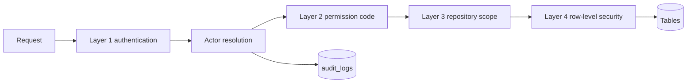

هذه الصفحة جزء من [نموذج البيانات](/ar/docs/erd)؛ الاصطلاحات والأعمدة الأساسية موثقة هناك.

يعمل التحكم في الوصول على أربع طبقات. الطلب الذي يجتازها جميعًا يترك مع ذلك أثرًا تدقيقيًا؛ والطلب الذي يفشل في أي منها يُرفض ([BRL-01](/ar/docs/brd/requirements#7-قواعد-العمل)، [FR-EMP-04](/ar/docs/srs/requirements/emp#fr-emp-04--فرض-النطاق-من-جانب-الخادم)).

| الطبقة | ما تتحقق منه | ترفض بـ |
|---|---|---|
| 1. المصادقة | رمز الجلسة أو هاش مفتاح API أو هاش الرمز المشترك يحل إلى فاعل. تفشل هنا الرموز المنتهية والملغاة (`revoked_at` و `token_version`) والفاعلون المقيَّدون ([BRL-21](/ar/docs/brd/requirements#7-قواعد-العمل)، [BRL-22](/ar/docs/brd/requirements#7-قواعد-العمل)). | 401 Unauthenticated |
| 2. الصلاحية | تطابق طبقة الخدمة رمز الصلاحية المطلوب مع مجموعة المنح الخاصة بالفاعل للجهة المنظِّمة النشطة ([FR-EMP-04](/ar/docs/srs/requirements/emp#fr-emp-04--فرض-النطاق-من-جانب-الخادم)). | 403 Forbidden |
| 3. نطاق المستودع | كل مستودع مرتبط بمستأجر واحد أو بنطاق المنصة؛ عمليات الربط بين المستأجرين لا تُنفَّذ أبدًا ([DAT-02](/ar/docs/srs/data#62-عزل-البيانات)). | نتيجة فارغة أو 403 |
| 4. الأمان على مستوى الصفوف | تشكل سياسات RLS في Postgres خط الدفاع الأخير على كل جدول وارد في [كتالوج السياسات](#كتالوج-السياسات) ([DAT-01](/ar/docs/srs/data#62-عزل-البيانات)، [NFR-SEC-07](/ar/docs/srs/quality#82-الأمان-nfr-sec)). | نتيجة فارغة أو 403 |

يخفي العميل المناطق التي لا يملك الموظف صلاحية لها، لكن ذلك تجميلي فقط؛ إذ يعيد الخادم التحقق في كل طلب ([FR-EMP-01](/ar/docs/srs/requirements/emp#fr-emp-01--مجموعات-الصلاحيات)).



## تحديد الفاعل

يُحل كل طلب إلى فاعل واحد بالضبط قبل تشغيل أي استعلام. يضبط الفاعل متغيرات جلسة قاعدة البيانات التي تقرأها سياسات RLS.

| نوع الفاعل | بيانات الاعتماد | يضبط | الجداول المعنية |
|---|---|---|---|
| جلسة مستخدم | هاش رمز التحديث في `sessions` | `app.current_user_id` و `app.current_organization_id` من `sessions.active_organization_id`، والدور النشط من `sessions.active_role_id` | sessions, user_roles, organization_members |
| مفتاح API لجهة منظِّمة | `key_hash` في `api_keys` | `app.current_user_id` بقيمة null، و `app.current_organization_id` من المفتاح، ومجموعة المنح = `scopes` للمفتاح | api_keys |
| مشغّل الإدارة | جلسة موظفين بدور `admin_*` | `app.is_admin()` بقيمة true؛ كل استعلام يُسجَّل في `audit_logs` | user_roles, audit_logs |
| مهمة منصة | هوية خدمة داخلية (تشغيلات صرف المستحقات، ترحيل outbox، تجميع التحليلات) | `app.is_platform_job()` بقيمة true؛ الكتابة عبر مستودع المنصة فقط | outbox_events, payout_runs |
| حامل رابط المشاركة | `token_hash` في `album_shared_links` | لا سياق مستأجر؛ يمكنه قراءة الصور المنشورة لألبوم واحد فقط | album_shared_links, photos |
| رمز الصعود | `boarding_code_hash` في `booking_passengers` | لا سياق مستأجر؛ يخوّل تسجيل حضور راكب واحد فقط | booking_passengers, checkin_events |

يُضبط سياق الدور والمستأجر لكل طلب، لا لكل اتصال. رفع قيمة `users.token_version` يبطل كل الرموز الصادرة دفعة واحدة ([FR-AUTH-10](/ar/docs/srs/requirements/auth#fr-auth-10--الجلسات-والرموز))؛ وحذف صف `organization_members` يُنهي سياق تلك الجهة المنظِّمة فورًا ([FR-EMP-05](/ar/docs/srs/requirements/emp#fr-emp-05--إزالة-الموظف)).

## كتالوج الأدوار

تأتي الأدوار من الجدول المرجعي `role` (غير قابل للتوسعة). يمكن للمستخدم أن يحمل عدة أدوار في آن واحد، كل منها بنطاق عام أو بنطاق جهة منظِّمة واحدة ([FR-AUTH-06](/ar/docs/srs/requirements/auth#fr-auth-06--حسابات-متعددة-الأدوار)، [FR-AUTH-07](/ar/docs/srs/requirements/auth#fr-auth-07--وصول-الموظفين-إلى-عدة-جهات-منظِّمة)).

| الدور | النطاق | كيفية الحصول عليه | ما يفتحه |
|---|---|---|---|
| traveler | الحساب | تسجيل ذاتي | الحجوزات والركاب والإيصالات والألبومات المسموح بها |
| organization_owner | جهة منظِّمة واحدة | اعتماد طلب الانضمام ينشئ المالك الأول | جميع الصلاحيات في تلك الجهة المنظِّمة، بما في ذلك إدارة الصلاحيات |
| organization_employee | جهة منظِّمة واحدة | دعوة من المالك ([FR-EMP-06](/ar/docs/srs/requirements/emp#fr-emp-06--الدعوة-وتسجيل-الدخول-الأول)) | مجموعة الصلاحيات الممنوحة فقط |
| org_driver, org_photographer | جهة منظِّمة واحدة | دعوة من المالك كموظفين | الرحلات والمركبات والألبومات المسندة؛ بلا مناطق إدارية |
| platform_driver, platform_photographer | المنصة | اعتماد طلب انضمام المورّد ([FR-ONB-01](/ar/docs/srs/requirements/onb#fr-onb-01--طلب-الانضمام-ووصول-المورد)) | الصفقات والإسنادات والألبومات والأرباح — صفوفه الخاصة فقط |
| moderator | لكل إسناد | إسناد موظف على مركبة رحلة ([FR-STF-05](/ar/docs/srs/requirements/stf#fr-stf-05--إسناد-المشرف)) | كتابة تسجيلات الحضور وقراءة بيانات الركاب للمركبة المسندة ما دامت قيمة `access_until` سارية |
| admin_super, admin_operations, admin_finance | المنصة | منح إداري من مشرف آخر | دور يتجاوز الفحص؛ كل استعلام يُسجَّل ([FR-ADM-05](/ar/docs/srs/requirements/adm#fr-adm-05--سجل-تدقيق-غير-قابل-للتغيير)) |

تحدد الأدوار *أين يمكن للمستخدم التصرف*؛ وتحدد مجموعة المنح *ما يمكنه فعله هناك*. يربط بين الاثنين `organization_members` ← `member_permissions`.

## كتالوج الصلاحيات

الصلاحيات رموز بصيغة `area.action` مخزنة في `permissions` وتُمنح لكل عضو عبر `member_permissions` ([FR-EMP-01](/ar/docs/srs/requirements/emp#fr-emp-01--مجموعات-الصلاحيات)). يثبّت الجدول المرجعي `permission_area` المناطق: trips, bookings, operations, accounting, coupons, employees, fleet, subscription, integrations, analytics.

| المنطقة | الرمز | يمنح | التتبع |
|---|---|---|---|
| trips | `trip.create` | إنشاء الرحلات وتحريرها في المعالج | [FR-TRIP-01](/ar/docs/srs/requirements/trip#fr-trip-01--معالج-إنشاء-الرحلة) |
| trips | `trip.publish` | النشر العام أو الموجَّه، والإلغاء، والأرشفة | [FR-TRIP-02](/ar/docs/srs/requirements/trip#fr-trip-02--المسودة-والنشر-العلني-والمستهدف) |
| bookings | `booking.view` | عرض الحجوزات والركاب والمقاعد | [FR-BKG-01](/ar/docs/srs/requirements/bkg#fr-bkg-01--تكوين-الحجز) |
| bookings | `booking.manage` | إسناد المقاعد، وتطبيق المعالجات، والإلغاء ضمن السياسة | [FR-SEAT-01](/ar/docs/srs/requirements/seat#fr-seat-01--التعيين-من-الجهة-افتراضيًا)، [BRL-24](/ar/docs/brd/requirements#7-قواعد-العمل) |
| bookings | `booking.refund` | الاستردادات خارج السياسة التلقائية | [FR-PAY-04](/ar/docs/srs/requirements/pay#fr-pay-04--الاسترداد-خارج-السياسة) |
| operations | `operations.checkin` | عمليات تسجيل الحضور للمشرف | [FR-CHK-01](/ar/docs/srs/requirements/chk#fr-chk-01--تسجيل-الحضور-عند-الصعود) |
| operations | `operations.incidents` | رفع الحوادث والإقرار بها وحلها | [FR-CHK-06](/ar/docs/srs/requirements/chk#fr-chk-06--الإبلاغ-عن-الحوادث) |
| operations | `operations.reports` | تقديم تقارير نهاية الرحلة والتعليق عليها | [FR-MOD-02](/ar/docs/srs/requirements/mod#fr-mod-02--تقرير-نهاية-الرحلة) |
| accounting | `accounting.view` | السجل والفواتير والتسويات وصرف المستحقات | [FR-ACC-01](/ar/docs/srs/requirements/acc#fr-acc-01--سجل-القيد-المزدوج) |
| accounting | `accounting.export` | تصدير البيانات المالية | [FR-ACC-01](/ar/docs/srs/requirements/acc#fr-acc-01--سجل-القيد-المزدوج) |
| coupons | `coupon.manage` | إنشاء الكوبونات وإيقافها مؤقتًا وإلغاؤها ضمن حدود الخطة | [FR-CPN-01](/ar/docs/srs/requirements/cpn#fr-cpn-01--نطاق-المُنشئ) |
| employees | `employee.invite` | دعوة الموظفين والسائقين | [FR-EMP-06](/ar/docs/srs/requirements/emp#fr-emp-06--الدعوة-وتسجيل-الدخول-الأول) |
| employees | `employee.manage` | منح مجموعات الصلاحيات وتغييرها وإزالتها | [FR-EMP-01](/ar/docs/srs/requirements/emp#fr-emp-01--مجموعات-الصلاحيات) |
| fleet | `fleet.manage` | أنواع المركبات وتخطيطات المقاعد وسجل المركبات | [FR-FLT-01](/ar/docs/srs/requirements/flt#fr-flt-01--أنواع-المركبات-القابلة-لإعادة-الاستخدام) |
| subscription | `subscription.manage` | تغيير الخطة والفوترة والمقاعد | [FR-SUB-02](/ar/docs/srs/requirements/sub#fr-sub-02--بوابات-الميزات) |
| integrations | `integration.manage` | اتصالات CRM ونقاط نهاية webhook | [FR-ORG-06](/ar/docs/srs/requirements/org#fr-org-06--نظام-crm-وwebhooks) |
| integrations | `integration.api_keys` | إنشاء مفاتيح API للجهة المنظِّمة وسردها وإلغاؤها | [FR-API-02](/ar/docs/srs/requirements/api#fr-api-02--دورة-حياة-مفاتيح-api) |
| analytics | `analytics.view` | لوحات المعلومات والتجميعات بمستوى الخطة | [BR-ANL-01](/ar/docs/brd/requirements#617-التحليلات-anl) |

كل منح أو تغيير أو إزالة يكتب صفًا في `audit_logs` يتضمن الفاعل والوقت والقيم قبل التغيير وبعده — وهذا هو سجل تاريخ صلاحيات الموظف ([FR-EMP-02](/ar/docs/srs/requirements/emp#fr-emp-02--تدقيق-تغييرات-الصلاحيات)).

### قوالب الصلاحيات

تُقدَّم كنقاط بداية عند دعوة موظف ([FR-EMP-01](/ar/docs/srs/requirements/emp#fr-emp-01--مجموعات-الصلاحيات))؛ ويمكن للمالك بعدها التعديل عضوًا بعضو.

| القالب | الرموز الممنوحة |
|---|---|
| العمليات | `trip.create`, `trip.publish`, `booking.view`, `booking.manage`, `operations.checkin`, `operations.incidents`, `operations.reports`, `fleet.manage` |
| المالية | `booking.view`, `accounting.view`, `accounting.export`, `coupon.manage`, `subscription.manage` |
| الدعم | `booking.view`, `booking.manage`, `operations.incidents` |
| المدير | جميع الرموز عدا `employee.manage` و `integration.api_keys` — صلاحية تشغيلية واسعة، مع بقاء منح الصلاحيات ومفاتيح API لدى المالك |

يملك مالك الجهة المنظِّمة كل الرموز بحكم قيمة owner في `member_type`؛ ومع ذلك تُكتب صفوف `member_permissions` للمالك عند الإنشاء ليكون لسجل التدقيق خط أساس ([FR-EMP-02](/ar/docs/srs/requirements/emp#fr-emp-02--تدقيق-تغييرات-الصلاحيات)).

## كتالوج السياسات

RLS مفعَّلة على كل جدول أدناه؛ السياسات هي خط الدفاع الأخير وليست فحص الصلاحيات ([DAT-01](/ar/docs/srs/data#62-عزل-البيانات)، [DAT-02](/ar/docs/srs/data#62-عزل-البيانات)). جميع أعمدة `*_id` وأعمدة الحالة والمفاتيح الخارجية FK التي تشير إليها السياسات مفهرسة وفق [الاصطلاحات](/ar/docs/erd).

| النمط | الجداول | القاعدة |
|---|---|---|
| عزل المستأجرين | trips, trip_stops, trip_audiences, trip_vehicles, trip_staff_assignments, programs, program_tiers, vehicle_types, vehicle_type_seats, vehicles, bookings, booking_passengers, booking_programs, trip_seats, booking_remedies, organizations, organization_members, member_permissions, invitations, crm_connections, webhook_endpoints, webhook_deliveries, api_keys, coupons, coupon_programs, coupon_audiences, coupon_redemptions, incidents, trip_reports, albums, settlements, settlement_lines, refunds | `organization_id = app.current_organization_id()` لجميع العمليات |
| مملوك للحساب | users, user_roles, auth_factors, devices, consents, notification_preferences, privacy_requests, sessions, otp_challenges, availability_slots, payout_methods, notifications, subscriptions, child_links | `user_id = app.current_user_id()` (أو العمود من جهة الأصل المذكور في الجدول) |
| مستأجر مشترك أو مورّد | deals (قراءة), deal_offers (قراءة), ملفات المورّدين المملوكة للجهة المنظِّمة | قاعدة المستأجر **أو** `provider_user_id = app.current_user_id()`؛ يقرأ مورّدو المنصة عبر مستودع منصة مُسجِّل |
| محدود بالإسناد | checkin_events (إدراج), booking_passengers (قراءة للمشرفين) | صف `trip_staff_assignments` مقبول وغير منتهٍ للمركبة ([FR-STF-05](/ar/docs/srs/requirements/stf#fr-stf-05--إسناد-المشرف)، D-107) |
| مسار الوالدين | child_links → bookings، حالة الرحلات، ملخص التتبع | رابط نشط؛ الموقع المباشر فقط أثناء سير الرحلة وفق الأهلية ([FR-PAR-03](/ar/docs/srs/requirements/par#fr-par-03--الأهلية)، [BRL-29](/ar/docs/brd/requirements#7-قواعد-العمل)) |
| رمز بلا فاعل | album_shared_links → الصور المنشورة | تطابق `token_hash` وعدم الإلغاء؛ لا يوجد سياق مستأجر |
| تجاوز الإدارة | جميع ما سبق | `app.is_admin()` تجتاز كل سياسة؛ وكل استعلام يكتب في `audit_logs` ([FR-ADM-05](/ar/docs/srs/requirements/adm#fr-adm-05--سجل-تدقيق-غير-قابل-للتغيير)) |
| إدراج فقط | ledger_transactions, ledger_entries, audit_logs, deal_offers, checkin_events, tracking_points, consents, outbox_events | سياسات SELECT و INSERT فقط؛ لا توجد سياسة UPDATE أو DELETE، فلا يمكن لأي منها التشغيل ([DAT-08](/ar/docs/srs/data#63-الحذف-الناعم-وعدم-القابلية-للتغيير-والحذف)) |
| بلا RLS | lookup_types, lookups, countries, currencies, markets, market_payment_methods, tax_rates, plans, plan_limits, plan_prices, lab_partners, feature_flags, notification_templates, idempotency_keys | بيانات مرجعية للمنصة؛ تمر القراءات عبر مستودعات عامة مخبأة، والكتابات عبر المشرف فقط |

تعريفات سياسات تمثيلية:

```sql
-- Tenant isolation (example: trips; same shape on every tenant table)
CREATE POLICY tenant_isolation ON trips FOR ALL
  USING      (organization_id = app.current_organization_id())
  WITH CHECK (organization_id = app.current_organization_id());

-- Account owned (example: notification_preferences)
CREATE POLICY own_rows ON notification_preferences FOR ALL
  USING      (user_id = app.current_user_id())
  WITH CHECK (user_id = app.current_user_id());

-- Shared tenant or supplier (example: deals)
CREATE POLICY deal_read ON deals FOR SELECT
  USING (organization_id = app.current_organization_id()
      OR provider_user_id = app.current_user_id());

-- Assignment scoped (example: moderator check-in writes)
CREATE POLICY moderator_checkin ON checkin_events FOR INSERT WITH CHECK (
  EXISTS (SELECT 1 FROM trip_staff_assignments a
          WHERE a.trip_vehicle_id = checkin_events.trip_vehicle_id
            AND a.user_id        = app.current_user_id()
            AND a.status_id      = app.lookup('assignment_status', 'accepted')
            AND a.access_until   > now()));

-- Admin bypass (example: trips; identical on every table)
CREATE POLICY admin_bypass ON trips FOR ALL
  USING (app.is_admin()) WITH CHECK (app.is_admin());
```

## مفاتيح API والوصول الآلي

تُوثِّق مفاتيح API الجهات المنظِّمة والشركاء على واجهة API العامة؛ وهي لا تتصرف بصفة مستخدم أبدًا ([FR-API-01](/ar/docs/srs/requirements/api#fr-api-01--واجهة-api-العامة)).

- تُخزَّن المفاتيح كـ `key_hash` مع `key_prefix` مرئي؛ ويُعرض المفتاح الصريح مرة واحدة عند الإنشاء.
- `scopes` للمفتاح مجموعة فرعية من [كتالوج الصلاحيات](#كتالوج-الصلاحيات)؛ وتتطلب إدارة المفاتيح الرمز `integration.api_keys` ([FR-API-02](/ar/docs/srs/requirements/api#fr-api-02--دورة-حياة-مفاتيح-api)).
- القراءات محدودة بالمستأجر: بيانات جهة منظِّمة أخرى تُرجع نتيجة فارغة لا خطأً ([FR-API-03](/ar/docs/srs/requirements/api#fr-api-03--نقاط-نهاية-القراءة-للموارد))؛ ولا تُرجع رحلات المسودة أبدًا.
- ينتشر الإلغاء خلال دقيقة واحدة عبر ذاكرة المفاتيح المؤقتة.
- تنطبق حدود المعدل لكل مفتاح مع الاستجابة 429 و `Retry-After`، وترويسات الحصة المتبقية في كل استجابة ([FR-API-06](/ar/docs/srs/requirements/api#fr-api-06--سلوك-تحديد-المعدل)).
- توقّع webhooks الصادرة الحمولات بـ HMAC عبر `secret_enc` المتغير، ويظل التوقيع صالحًا بالمفتاح السابق خلال فترة التداخل البالغة 24 ساعة ([FR-ORG-06](/ar/docs/srs/requirements/org#fr-org-06--نظام-crm-وwebhooks)، [FR-API-07](/ar/docs/srs/requirements/api#fr-api-07--تماثل-عقد-webhook)).

## مسارات الوصول الخاصة

| المسار | بيانات الاعتماد | النطاق | ينتهي بـ |
|---|---|---|---|
| رابط مشاركة الألبوم | `token_hash` على `album_shared_links` | الصور المنشورة لألبوم واحد ([FR-MED-05](/ar/docs/srs/requirements/med#fr-med-05--وصول-المستخدمين-المختارين)) | الإلغاء أو أرشفة الألبوم |
| رمز الصعود | `boarding_code_hash` على `booking_passengers` | تسجيل حضور راكب واحد ([FR-CHK-01](/ar/docs/srs/requirements/chk#fr-chk-01--تسجيل-الحضور-عند-الصعود)) | تسجيل المغادرة أو نهاية الرحلة |
| رابط الوالدين | صف `child_links` نشط | حالة الطفل، والموقع المباشر فقط أثناء سير الرحلة ([FR-PAR-03](/ar/docs/srs/requirements/par#fr-par-03--الأهلية)) | الإلغاء أو الاسترداد ([FR-PAR-06](/ar/docs/srs/requirements/par#fr-par-06--انتهاء-الارتباط-بانتهاء-الحجز)) |
| رمز الدعوة | `token_hash` على `invitations` | قبول دعوة واحدة، ثم تدفق تسجيل الدخول الأول | 7 أيام ([D-286](/ar/docs/erd/reference)) |

تُبحث بيانات الاعتماد القائمة على الهاش بمطابقة تامة للعمود `*_hash`؛ ولا يصل النص الصريح إلى قاعدة البيانات أبدًا.
