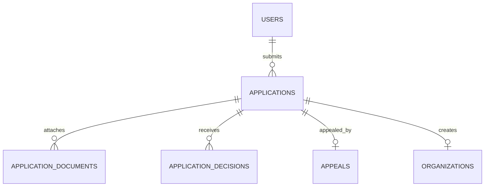

جزء من [نموذج البيانات](/ar/docs/erd)؛ تُوثَّق الاصطلاحات والأعمدة الأساسية هناك.

## applications
*(Base +) — حالة انضمام واحدة لجهة منظِّمة أو مورد، من المسودة مرورًا بالقرار والاستئناف وإعادة التقديم. من [FR-ONB-01](/ar/docs/srs/requirements/onb#fr-onb-01--طلب-الانضمام-ووصول-المورد) إلى [FR-ONB-09](/ar/docs/srs/requirements/onb#fr-onb-09--إشعارات-حالة-مقدِّم-الطلب)*

<TypeTable
  type={{
    "applicant_user_id": {
      type: "BIGINT FK users",
      required: true
    },
    "type_id": {
      type: "BIGINT FK lookups",
      description: "`application_type`: organization, platform_driver, platform_photographer",
      required: true,
    },
    "status_id": {
      type: "BIGINT FK lookups",
      description: "`application_status`: draft, submitted, pending_review, changes_requested, approved, rejected, appealed, closed",
      required: true,
    },
    "country_code": {
      type: "CHAR(2) FK countries",
      required: true
    },
    "requested_plan_id": {
      type: "BIGINT FK plans",
      description: "يُختار عند التسجيل دون أي رسوم (D-77)",
      required: true,
    },
    "payload": {
      type: "JSONB",
      description: "حقول خاصة بالدور (الأسماء النظامية، أرقام السجل التجاري والضريبي، الرخصة، المركبة، الأسعار، مناطق الخدمة)",
      required: true,
    },
    "submitted_at": {
      type: "TIMESTAMPTZ",
      required: true
    },
    "review_due_at": {
      type: "TIMESTAMPTZ",
      description: "يومَا عمل ([FR-ONB-03](/ar/docs/srs/requirements/onb#fr-onb-03--المدة-المستهدفة-لاتخاذ-القرار))",
      required: true,
    },
    "changes_due_at": {
      type: "TIMESTAMPTZ",
      description: "14 يومًا، مع تمديد واحد مدته 7 أيام (D-235)",
      required: true,
    },
    "extension_used": {
      type: "BOOLEAN",
      required: true
    },
    "decided_at": {
      type: "TIMESTAMPTZ",
      required: true
    },
    "reapply_after": {
      type: "DATE",
      description: "تاريخ القرار زائد 30 يومًا ([BRL-06](/ar/docs/brd/requirements#7-قواعد-العمل))",
      required: true,
    },
    "previous_application_id": {
      type: "BIGINT FK applications",
      description: "سلسلة إعادة التقديم",
      required: true,
    },
  }}
/>

الفهارس: `(applicant_user_id)`، و`(type_id, status_id)` لقائمة انتظار المراجعة، و`(previous_application_id)`، وفهرس جزئي على `(review_due_at)` حيث `status_id` هي `pending_review`.

**application_documents** (Base +) — ملفات الهوية والمؤهلات المرفقة بطلب الانضمام، مخزَّنة في الحاوية المقيدة: `application_id FK`، `doc_type_id FK lookups (document_type: id_card, driving_license, vehicle_registration, insurance, lab_result, commercial_registration, tax_certificate, portfolio_photo, other)`، `storage_path TEXT` (الحاوية المقيدة، [DAT-04](/ar/docs/srs/data#62-عزل-البيانات))، `mime_type VARCHAR(80)`، `size_bytes BIGINT` (10 ميغابايت للمستندات، و25 ميغابايت للصور، D-80 وD-81)، `valid_until DATE NULL`، `issued_on DATE NULL`، `check_status_id FK lookups (document_check: pending, accepted, rejected)`. الفهارس: `(application_id, check_status_id)`.

**application_decisions** (Base +) — صف واحد لكل قرار من مشرف المنصة أو طلب تعديلات أو نتيجة استئناف، مكوِّنًا مسار المراجعة: `application_id FK`، `decision_id FK lookups (application_decision: approve, request_changes, reject, close, uphold_appeal, overturn)`، `reason_id FK lookups (decision_reason, D-234) NULL`، `message JSONB` (بلغة مقدم الطلب)، `items JSONB` (التعديلات المطلوبة)، `decided_by BIGINT FK users`. الفهارس: `(application_id, decided_at)`.

**appeals** (Base +) — استئناف واحد لكل طلب مرفوض، يراجعه مشرف ثانٍ (D-237): `application_id FK UNIQUE`، `statement TEXT`، `files JSONB` (بحد أقصى 5)، `submitted_at`، `due_at` (5 أيام عمل)، `status_id FK lookups (appeal_status: submitted, upheld, rejected)`. الفهارس: `unique (application_id)`، و`(status_id, due_at)`.
