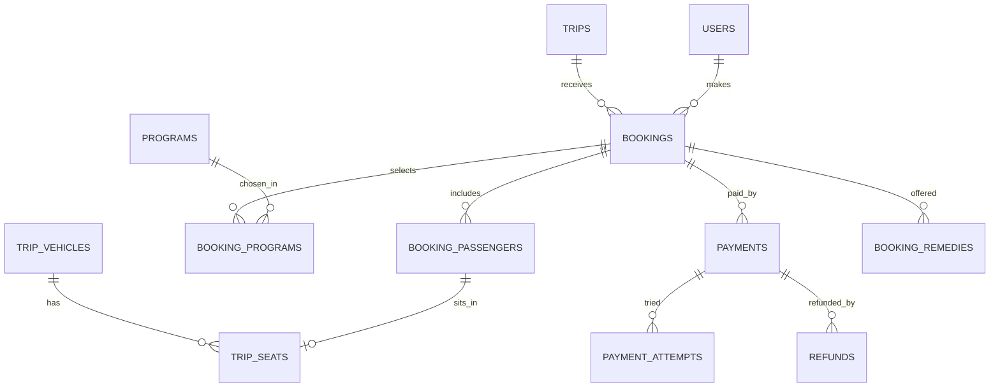

جزء من [نموذج البيانات](/ar/docs/erd)؛ الاصطلاحات والأعمدة الأساسية موثَّقة هناك.

## bookings
*(Base +) — حجز واحد بتسعير مقفل، من السلة مروراً بالدفع وحتى تسجيل المغادرة. [FR-BKG-01](/ar/docs/srs/requirements/bkg#fr-bkg-01--تكوين-الحجز) إلى [FR-BKG-07](/ar/docs/srs/requirements/bkg#fr-bkg-07--حالات-الحجز)*

<TypeTable
  type={{
    "organization_id": {
      type: "BIGINT",
      description: "عمود المستأجر",
      required: true,
    },
    "trip_id": {
      type: "BIGINT FK trips",
      required: true
    },
    "booked_by_user_id": {
      type: "BIGINT FK users",
      required: true
    },
    "reference": {
      type: "VARCHAR(12)",
      description: "مرجع حجز عام يُستخدم لروابط الأبناء",
      required: true,
    },
    "status_id": {
      type: "BIGINT FK lookups",
      description: "`booking_status`: cart, seats_held, payment_pending, confirmed, payment_failed, checked_in, checked_out, cancelled, refund_pending, refunded",
      required: true,
    },
    "passenger_count": {
      type: "SMALLINT",
      required: true
    },
    "base_total_minor, programs_total_minor, plan_discount_minor, coupon_discount_minor, total_minor": {
      type: "BIGINT",
      description: "يُقفل السعر عند بدء حجز المقاعد المؤقت (D-192)",
      required: true,
    },
    "currency_code": {
      type: "CHAR(3)",
      required: true
    },
    "hold_expires_at": {
      type: "TIMESTAMPTZ",
      description: "15 دقيقة؛ Fawry 48 ساعة",
      required: true,
    },
    "payment_attempts": {
      type: "SMALLINT",
      description: "الحد الأقصى 3 لكل حجز مؤقت (D-197)",
      required: true,
    },
    "buyer_tax_no": {
      type: "VARCHAR(50) NULL",
      description: "وجوده يعني فاتورة B2B ([BRL-28](/ar/docs/brd/requirements#7-قواعد-العمل))",
      required: true,
    },
    "confirmed_at, cancelled_at": {
      type: "TIMESTAMPTZ",
      required: true
    },
    "cancel_reason_id": {
      type: "BIGINT FK lookups",
      description: "`cancel_reason`",
      required: true,
    },
    "refund_rule_applied": {
      type: "VARCHAR(20)",
      description: "مثلاً `80_at_48h`",
      required: true,
    },
  }}
/>

الفهارس: `unique (reference)` — الرمز العام الذي تُحلَّل روابط الأبناء بموجبه، و`(trip_id, status_id)`، و`(booked_by_user_id, created_at)` لقائمة المسافر، وفهرس جزئي `(hold_expires_at)` حيث تكون `status_id` هي `cart` أو `seats_held` — مسح الحجوزات المؤقتة.

**booking_passengers** (Base +) — مسافر واحد لكل صف، طفلاً كان أو بالغاً، مع المركبة والمقعد وحالة الصعود: `organization_id`، `booking_id FK`، `full_name VARCHAR(200)`، `is_child BOOLEAN`، `birth_year SMALLINT NULL`، `trip_vehicle_id FK NULL`، `seat_id FK trip_seats NULL`، `checkin_status_id FK lookups (passenger_checkin: not_boarded, on_board, off_vehicle, completed)`، `boarding_code_hash CHAR(64)`. الفهارس: `(booking_id)`، و`(trip_vehicle_id, checkin_status_id)` لكشف المشرفين.

**booking_programs** (Base +) — بنود البرنامج مع السعر المُثبَّت وقت الحجز: `organization_id`، `booking_id FK`، `program_id FK`، `program_tier_id FK NULL`، `passenger_id FK booking_passengers NULL`، `quantity INT`، `unit_price_minor BIGINT`، `line_total_minor BIGINT`. الفهارس: `(booking_id)`، `(program_id)`.

## trip_seats
*(Base +) — مقعد واحد لكل مركبة رحلة، يُختَم من تخطيط نوع المركبة ويتنقل بين حالات الحجز المؤقت والحجز النهائي. [FR-SEAT-01](/ar/docs/srs/requirements/seat#fr-seat-01--التعيين-من-الجهة-افتراضيًا) إلى [FR-SEAT-07](/ar/docs/srs/requirements/seat#fr-seat-07--الاختيار-الذاتي-بحسب-الخطة)*

<TypeTable
  type={{
    "organization_id": {
      type: "BIGINT",
      required: true
    },
    "trip_vehicle_id": {
      type: "BIGINT FK trip_vehicles",
      required: true
    },
    "vehicle_type_seat_id": {
      type: "BIGINT FK vehicle_type_seats",
      required: true
    },
    "label": {
      type: "VARCHAR(10)",
      required: true
    },
    "status_id": {
      type: "BIGINT FK lookups",
      description: "`seat_status`: available, held, reserved, checked_in, checked_out, released",
      required: true,
    },
    "held_by_booking_id": {
      type: "BIGINT FK bookings NULL",
      required: true
    },
    "held_until": {
      type: "TIMESTAMPTZ",
      required: true
    },
    "reserved_by_passenger_id": {
      type: "BIGINT FK booking_passengers NULL",
      required: true
    },
  }}
/>

قيد فريد `(trip_vehicle_id, label, deleted_at)`. تُحلّ حالات التسابق على الحجز المؤقت بقفل Redis وتحديث شرطي على `status_id`.

الفهارس: `(trip_vehicle_id, status_id)` لخرائط التوفر، وفهرس جزئي `(held_until)` حيث `status_id = held` — مسح الحجوزات المؤقتة.

**payments** (Base +) — عملية خصم واحدة عبر بوابة الدفع لحجز أو اشتراك خطة ([FR-PAY-01](/ar/docs/srs/requirements/pay#fr-pay-01--نتائج-الدفع) إلى [FR-PAY-07](/ar/docs/srs/requirements/pay#fr-pay-07--وسائل-الدفع-حسب-السوق)): `organization_id NULL` (يكون NULL لرسوم الخطط)، `booking_id FK NULL`، `subscription_charge_id FK NULL`، `payer_user_id FK`، `gateway_id FK lookups (gateway)`، `method_id FK lookups (payment_method)`، `amount_minor`، `currency_code`، `status_id FK lookups (payment_status: pending, succeeded, failed, expired, refunded, partially_refunded)`، `gateway_reference VARCHAR(120)` (فريد لكل بوابة)، `voucher_expires_at TIMESTAMPTZ NULL` (Fawry)، `succeeded_at`. الفهارس: فهرس فريد جزئي `unique (gateway_id, gateway_reference)` بشرط `gateway_reference is not null`، و`(booking_id)`، و`(subscription_charge_id)`، و`(payer_user_id, created_at)`، وفهرس جزئي `(voucher_expires_at)` حيث `status_id = pending`.

**payment_attempts** (Base +) — صف واحد لكل استدعاء راجع من بوابة الدفع، آمن ضد التكرار بحسب معرّف الحدث: `payment_id FK`، `attempt_no SMALLINT`، `gateway_event_id VARCHAR(120)` (فريد، استدعاءات راجعة آمنة ضد التكرار)، `result_id FK lookups (attempt_result)`، `failure_code VARCHAR(80)`، `raw_status VARCHAR(80)`. الفهارس: `unique (gateway_event_id)`، `(payment_id, attempt_no)`.

**refunds** (Base +) — أموال تُعاد إلى الدافع، بموجب السياسة أو بقرار مشرف المنصة ([FR-PAY-03](/ar/docs/srs/requirements/pay#fr-pay-03--تنفيذ-الاسترداد)، [FR-PAY-04](/ar/docs/srs/requirements/pay#fr-pay-04--الاسترداد-خارج-السياسة)): `organization_id`، `payment_id FK`، `booking_id FK`، `amount_minor`، `currency_code`، `reason_id FK lookups (refund_reason: traveler_cancel, org_cancel, dispute, admin_outside_policy, remedy)`، `policy_rule VARCHAR(20)`، `status_id FK lookups (refund_status: requested, sent, confirmed, failed)`، `gateway_reference`، `retries SMALLINT` (3، D-322)، `approved_by FK users NULL`، `dispute_id FK NULL`. الفهارس: `(payment_id)`، و`(booking_id)`، وفهرس جزئي `(status_id)` حيث تكون `status_id` هي `requested` أو `sent` — مسح إعادة المحاولة.

**booking_remedies** (Base +) — خيارات تعويض تُقدَّم عند تغيّر رحلة محجوزة ([BRL-24](/ar/docs/brd/requirements#7-قواعد-العمل)): `organization_id`، `booking_id FK`، `change_type_id FK lookups (trip_change_type: program_removed, seat_mode_changed, vehicle_changed, time_changed)`، `options JSONB`، `chosen_option VARCHAR(40)`، `due_at` (7 أيام، D-148)، `status_id FK lookups (remedy_status: offered, chosen, escalated, expired)`. الفهارس: `(booking_id)`، وفهرس جزئي `(due_at)` حيث `status_id = offered`.
