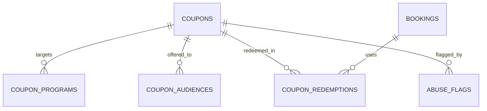

جزء من [نموذج البيانات](/ar/docs/erd)؛ تُوثَّق الاصطلاحات والأعمدة الأساسية هناك.

## coupons
*(Base +) — رمز خصم واحد مع نطاق المُنشئ وحدود الاستخدام والاستهداف حسب الجمهور. من [FR-CPN-01](/ar/docs/srs/requirements/cpn#fr-cpn-01--نطاق-المُنشئ) إلى [FR-CPN-08](/ar/docs/srs/requirements/cpn#fr-cpn-08--عدد-الكوبونات-حسب-الخطة)*

<TypeTable
  type={{
    "code": {
      type: "VARCHAR(40)",
      description: "فريد مع `deleted_at` (غير حسّاس لحالة الأحرف)",
      required: true,
    },
    "creator_type_id": {
      type: "BIGINT FK lookups",
      description: "`coupon_creator`: admin, organization, driver, photographer",
      required: true,
    },
    "creator_user_id": {
      type: "BIGINT FK users",
      required: true
    },
    "organization_id": {
      type: "BIGINT FK organizations NULL",
      description: "نطاق كوبونات الجهة المنظِّمة",
      required: true,
    },
    "scope_user_id": {
      type: "BIGINT FK users NULL",
      description: "نطاق كوبونات السائق أو المصوّر",
      required: true,
    },
    "market_id": {
      type: "BIGINT FK markets NULL",
      description: "القيمة الفارغة تعني جميع الأسواق (لمشرف المنصة فقط)",
      required: true,
    },
    "discount_type_id": {
      type: "BIGINT FK lookups",
      description: "`discount_type`: fixed, percent, program_specific, free_program, first_booking, minimum_spend",
      required: true,
    },
    "value_minor": {
      type: "BIGINT NULL",
      description: "مبلغ ثابت",
      required: true,
    },
    "value_bp": {
      type: "INT NULL",
      description: "النسبة المئوية بالنقاط الأساسية",
      required: true,
    },
    "currency_code": {
      type: "CHAR(3) NULL",
      required: true
    },
    "min_spend_minor": {
      type: "BIGINT NULL",
      required: true
    },
    "usage_limit": {
      type: "INT NULL",
      required: true
    },
    "per_user_limit": {
      type: "INT",
      description: "الافتراضي 1",
      required: true,
    },
    "used_count": {
      type: "INT",
      required: true
    },
    "valid_from, valid_until": {
      type: "TIMESTAMPTZ",
      required: true
    },
    "audience_id": {
      type: "BIGINT FK lookups",
      description: "`coupon_audience`: public, targeted",
      required: true,
    },
    "is_stackable": {
      type: "BOOLEAN",
      required: true
    },
    "status_id": {
      type: "BIGINT FK lookups",
      description: "`coupon_status`: draft, active, paused, expired, exhausted, revoked",
      required: true,
    },
  }}
/>

الفهارس: `unique (code, deleted_at)` غير حسّاس لحالة الأحرف، و`(organization_id, status_id)`، و`(scope_user_id)`، وفهرس جزئي على `(valid_until)` حيث `status_id = active` — مسح انتهاء الصلاحية.

**coupon_programs** (Base +) — البرامج التي ينطبق عليها كوبون مخصص لبرنامج معيّن: `coupon_id FK`، `program_id FK`. الفهارس: `unique (coupon_id, program_id, deleted_at)`.

**coupon_audiences** (Base +) — المستلمون المحدَّدون صراحةً لكوبون موجَّه: `coupon_id FK`، `user_id FK NULL`، `segment_code VARCHAR(40) NULL`. الفهارس: `(coupon_id)`، و`(user_id)`.

**coupon_redemptions** (Base +) — تطبيق واحد لكل حجز، قابل للعكس عند استرداد الحجز: `coupon_id FK`، `booking_id FK`، `user_id FK`، `organization_id`، `discount_minor BIGINT`، `currency_code`، `status_id FK lookups (redemption_status: applied, confirmed, reversed)`، `reversed_at`. الفهارس: `(coupon_id, user_id)` لحدود الاستخدام لكل مستخدم، و`(booking_id)`.

**abuse_flags** (Base +) — ناتج محرك القواعد يُدرَج في قائمة انتظار مراجعة الإشراف (D-216 وD-217): `subject_type_id FK lookups (flag_subject: coupon, user, booking, deal)`، `subject_id BIGINT`، `rule_code VARCHAR(60)`، `details JSONB`، `status_id FK lookups (flag_status: open, reviewed_ok, actioned)`، `review_due_at` (خلال يومَي عمل)، `reviewed_by FK users NULL`. الفهارس: `(subject_type_id, subject_id)`، وفهرس جزئي على `(review_due_at)` حيث `status_id = open`.
