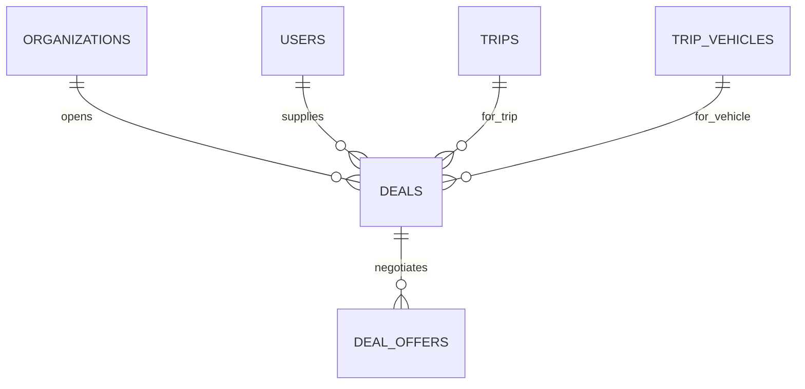

جزء من [نموذج البيانات](/ar/docs/erd)؛ تُوثَّق الاصطلاحات والأعمدة الأساسية هناك.

## deals
*(Base +) — تفاوض واحد بين جهة منظِّمة ومورد لتوفير الكوادر لرحلة أو مركبة. من [FR-NEG-01](/ar/docs/srs/requirements/neg#fr-neg-01--عرض-التعاقد) إلى [FR-NEG-07](/ar/docs/srs/requirements/neg#fr-neg-07--التفاوض-حسب-الخطة)*

<TypeTable
  type={{
    "organization_id": {
      type: "BIGINT",
      description: "عمود المستأجر (tenant)؛ يقرأ الموردون عبر مستودع محدود بنطاق المنصة",
      required: true,
    },
    "trip_id": {
      type: "BIGINT FK trips",
      required: true
    },
    "trip_vehicle_id": {
      type: "BIGINT FK trip_vehicles NULL",
      description: "فارغ لصفقات المصوّرين",
      required: true,
    },
    "provider_user_id": {
      type: "BIGINT FK users",
      required: true
    },
    "provider_type_id": {
      type: "BIGINT FK lookups",
      description: "`provider_type`: driver, photographer",
      required: true,
    },
    "status_id": {
      type: "BIGINT FK lookups",
      description: "`deal_status`: proposed, countered_by_provider, countered_by_organization, accepted_by_one, finalized, rejected",
      required: true,
    },
    "current_amount_minor": {
      type: "BIGINT",
      required: true
    },
    "currency_code": {
      type: "CHAR(3)",
      required: true
    },
    "organization_accepted_at, provider_accepted_at": {
      type: "TIMESTAMPTZ",
      description: "ضبط القيمتين معًا = تم التعاقد النهائي",
      required: true,
    },
    "last_offer_at": {
      type: "TIMESTAMPTZ",
      required: true
    },
    "expires_at": {
      type: "TIMESTAMPTZ",
      description: "last_offer_at زائد 72 ساعة ([BRL-26](/ar/docs/brd/requirements#7-قواعد-العمل))",
      required: true,
    },
    "reject_reason_id": {
      type: "BIGINT FK lookups",
      description: "`deal_end_reason`: rejected, expired, provider_paused, trip_cancelled",
      required: true,
    },
    "finalized_at": {
      type: "TIMESTAMPTZ",
      required: true
    },
    "flagged_reason": {
      type: "TEXT",
      description: "وسم مشرف المنصة (D-252)",
      required: true,
    },
  }}
/>

الفهارس: `(provider_user_id, status_id)` لصندوق وارد المورد، و`(trip_id, status_id)`، وفهرس جزئي على `(expires_at)` حيث `finalized_at is null and reject_reason_id is null` — مسح انتهاء الصلاحية.

**deal_offers** (غير قابل للتغيير) — صف واحد لكل عرض أو مقابل أو قبول أو رفض؛ سجل التفاوض يُلحَق فقط ولا يُعدَّل: `id`، `uuid`، `organization_id`، `deal_id FK`، `offered_by_side_id FK lookups (deal_side: organization, provider)`، `amount_minor BIGINT`، `note TEXT`، `action_id FK lookups (deal_action: propose, counter, accept, reject)`، `created_at`، `created_by`. الفهارس: `(deal_id, created_at)`.
