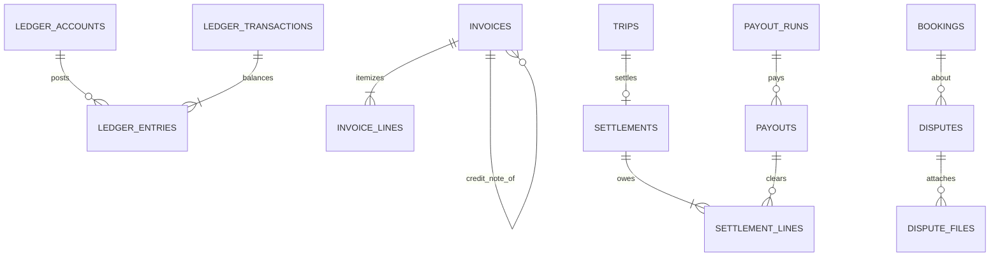

جزء من [نموذج البيانات](/ar/docs/erd)؛ الاصطلاحات والأعمدة الأساسية موثَّقة هناك.

**ledger_accounts** (Base +) — دليل الحسابات لكل مالك وعملة: `owner_type_id FK lookups (ledger_owner: platform, organization, supplier, traveler_clearing, gateway)`، `organization_id NULL`، `user_id NULL`، `account_kind_id FK lookups (ledger_account_kind: cash, receivable, payable, revenue, commission, fee_expense, deferred, refund_clearing, tax_payable)`، `currency_code`، `code VARCHAR(60)` فريد. الفهارس: `unique (code)`، `(owner_type_id, organization_id, user_id)`، `(account_kind_id)`.

**ledger_transactions** (غير قابلة للتغيير) — حدث واحد متوازن؛ التصحيحات تتم عبر معاملات معكوسة ([FR-ACC-01](/ar/docs/srs/requirements/acc#fr-acc-01--سجل-القيد-المزدوج)): `id`، `uuid`، `event_type_id FK lookups (ledger_event: booking_paid, refund, coupon, deal_cost, commission, gateway_fee, plan_charge, payout, invoice, settlement, reversal)`، `source_type VARCHAR(40)`، `source_id BIGINT`، `occurred_at`، `reverses_transaction_id FK NULL`، `created_at`، `created_by`. يتحقق قيد (check) من أن مجموع القيود يساوي صفراً لكل عملة. الفهارس: `(source_type, source_id)`، `(event_type_id, occurred_at)`، `(reverses_transaction_id)`.

**ledger_entries** (غير قابلة للتغيير) — طرف واحد مدين أو دائن؛ واحد فقط من المبلغين غير صفري: `id`، `uuid`، `transaction_id FK`، `account_id FK`، `organization_id NULL`، `debit_minor BIGINT`، `credit_minor BIGINT` (أحدهما صفر)، `currency_code`، `trip_id NULL`، `booking_id NULL`، `deal_id NULL`، `gateway_reference NULL`، `created_at`، `created_by`. مدة الاحتفاظ 7 سنوات. الفهارس: `(account_id, occurred_at)` لكشوف الحسابات، `(transaction_id)`، `(booking_id)`، `(trip_id)`، `(deal_id)`.

## invoices
*(Base +) — مستندات مالية لجميع تركيبات المشتري والمُصدِر، بما في ذلك إشعارات الدائن. [FR-ORG-07](/ar/docs/srs/requirements/org#fr-org-07--فواتير-b2b-وb2c)، [FR-BKG-05](/ar/docs/srs/requirements/bkg#fr-bkg-05--الإيصالات-والفواتير)*

<TypeTable
  type={{
    "organization_id": {
      type: "BIGINT NULL",
      description: "المُصدِر عندما تُصدر الجهة المنظِّمة فاتورة لمسافر؛ يكون NULL عندما تُصدرها المنصة",
      required: true,
    },
    "issuer_type_id": {
      type: "BIGINT FK lookups",
      description: "`invoice_issuer`: organization, platform, supplier",
      required: true,
    },
    "buyer_type_id": {
      type: "BIGINT FK lookups",
      description: "`invoice_buyer`: traveler, organization, supplier",
      required: true,
    },
    "kind_id": {
      type: "BIGINT FK lookups",
      description: "`invoice_kind`: b2c, b2b, credit_note",
      required: true,
    },
    "number": {
      type: "VARCHAR(40)",
      description: "فريد لكل مُصدِر وسوق؛ يكون NULL أثناء إعادة محاولة الترقيم (D-179)",
      required: true,
    },
    "market_id": {
      type: "BIGINT FK markets",
      required: true
    },
    "buyer_name, buyer_tax_no, buyer_address": {
      type: "VARCHAR, VARCHAR, JSONB",
      required: true
    },
    "booking_id, subscription_charge_id, deal_id, settlement_id": {
      type: "BIGINT NULL",
      description: "المصدر",
      required: true,
    },
    "original_invoice_id": {
      type: "BIGINT FK invoices NULL",
      description: "لإشعارات الدائن ([BRL-28](/ar/docs/brd/requirements#7-قواعد-العمل))",
      required: true,
    },
    "subtotal_minor, tax_minor, total_minor": {
      type: "BIGINT",
      required: true
    },
    "currency_code": {
      type: "CHAR(3)",
      required: true
    },
    "status_id": {
      type: "BIGINT FK lookups",
      description: "`invoice_status`: pending_number, issued, voided_by_credit, finance_review",
      required: true,
    },
    "issued_at": {
      type: "TIMESTAMPTZ",
      required: true
    },
    "e_invoice_status_id": {
      type: "BIGINT FK lookups NULL",
      description: "محجوز لـ ZATCA ([OD-10](/ar/docs/brd/compliance#11-القرارات-المفتوحة))",
      required: true,
    },
    "pdf_path": {
      type: "TEXT",
      required: true
    },
  }}
/>

الفهارس: فهرس فريد جزئي `unique (issuer_type_id, market_id, number)` بشرط `number is not null`، و`(booking_id)`، و`(subscription_charge_id)`، و`(settlement_id)`، وفهرس جزئي `(status_id)` حيث `status_id = finance_review`.

**invoice_lines** (Base +) — بنود مفصَّلة مع ضريبة لكل بند: `invoice_id FK`، `description JSONB`، `quantity NUMERIC(10,2)`، `unit_minor BIGINT`، `tax_rate_bp INT`، `tax_minor BIGINT`، `line_total_minor BIGINT`. الفهارس: لا فهارس إضافية عدا قاعدة FK.

**payout_runs** (Base +) — دفعة أسبوعية واحدة لكل سوق ([FR-ACC-03](/ar/docs/srs/requirements/acc#fr-acc-03--أرباح-المورّدين-وصرف-المستحقات)): `run_date DATE` (الاثنين 06:00، D-28)، `market_id FK`، `status_id FK lookups (payout_run_status: draft, approved, submitted, completed, partial)`، `approved_by FK users`. الفهارس: `unique (run_date, market_id)`، `(status_id)`.

**payouts** (Base +) — تحويل واحد لكل مستفيد في كل دفعة: `payout_run_id FK`، `payee_user_id FK NULL`، `payee_organization_id FK NULL`، `payout_method_id FK`، `amount_minor`، `currency_code`، `status_id FK lookups (payout_status: pending, sent, paid, failed, held)`، `hold_reason_id FK lookups NULL` (إيقاف المختبر D-175، الرصيد السالب D-173)، `external_reference VARCHAR(120)`، `paid_at`. الفهارس: `(payout_run_id, status_id)`، `(payee_user_id)`، `(external_reference)`.

**settlements** (Base +) — تقسيم أموال كل رحلة بين المنصة والجهة المنظِّمة والموردين ([FR-ACC-05](/ar/docs/srs/requirements/acc#fr-acc-05--التسويات)، [BRL-25](/ar/docs/brd/requirements#7-قواعد-العمل)): `organization_id`، `trip_id FK UNIQUE`، `status_id FK lookups (settlement_status: open, awaiting_payouts, disputed, closed)`، `opened_at` (عندما تصبح حالة الرحلة Completed)، `closed_at`، `totals JSONB` (الإجمالي، العمولة، الرسوم، تكاليف الموردين، الصافي). الفهارس: `unique (trip_id, deleted_at)`، `(status_id)`.

**settlement_lines** (Base +) — مبلغ مستحق واحد لكل زوج أطراف وسبب: `settlement_id FK`، `from_party_type_id FK lookups (party)`، `from_party_id BIGINT`، `to_party_type_id FK lookups (party)`، `to_party_id BIGINT`، `reason_id FK lookups (settlement_reason: trip_revenue, commission, deal_cost, gateway_fee, refund, adjustment)`، `amount_minor`، `currency_code`، `payout_id FK NULL`، `settled_at`. الفهارس: `(settlement_id)`، `(payout_id)`.

**reconciliation_exceptions** (Base +) — الفروقات بين تقارير بوابة الدفع والسجل ([FR-PAY-05](/ar/docs/srs/requirements/pay#fr-pay-05--مطابقة-بوابة-الدفع)): `gateway_id FK lookups`، `report_date DATE`، `gateway_reference VARCHAR(120)`، `kind_id FK lookups (recon_exception: missing_in_ledger, missing_in_gateway, amount_mismatch, currency_mismatch)`، `gateway_amount_minor`، `ledger_amount_minor`، `status_id FK lookups (exception_status: open, resolved, written_off)`، `resolved_by FK users NULL`. الفهارس: `(gateway_id, report_date)`، وفهرس جزئي `(status_id)` حيث `status_id = open`.

**disputes** (Base +) — نزاعات رسمية بشأن الحجوزات أو عمليات الدفع أو السلوك، مع مؤقتات SLA ([FR-ADM-04](/ar/docs/srs/requirements/adm#fr-adm-04--نتائج-النزاعات-والاستردادات)، [FR-ADM-08](/ar/docs/srs/requirements/adm#fr-adm-08--معالجة-النزاعات)): `organization_id NULL`، `booking_id FK NULL`، `deal_id FK NULL`، `raised_by FK users`، `type_id FK lookups (dispute_type: booking, payment, refund, supplier_conduct, organization_conduct, other)`، `status_id FK lookups (dispute_status: open, information_requested, under_review, resolved, closed)`، `ack_due_at` (يومان عمل)، `resolve_due_at` (10 أيام عمل)، `outcome TEXT`، `refund_id FK refunds NULL`، `assigned_to FK users NULL`. الفهارس: `(booking_id)`، `(deal_id)`، `(assigned_to, status_id)`، وفهرس جزئي `(resolve_due_at)` حيث تكون `status_id` واحدة من `open` أو `information_requested` أو `under_review`.

**dispute_files** (Base +) — مرفقات أدلة، حتى 5 ملفات بحجم 10 ميغابايت لكل منها (D-259): `dispute_id FK`، `storage_path TEXT`، `size_bytes BIGINT`. الفهارس: لا فهارس إضافية عدا قاعدة FK.
