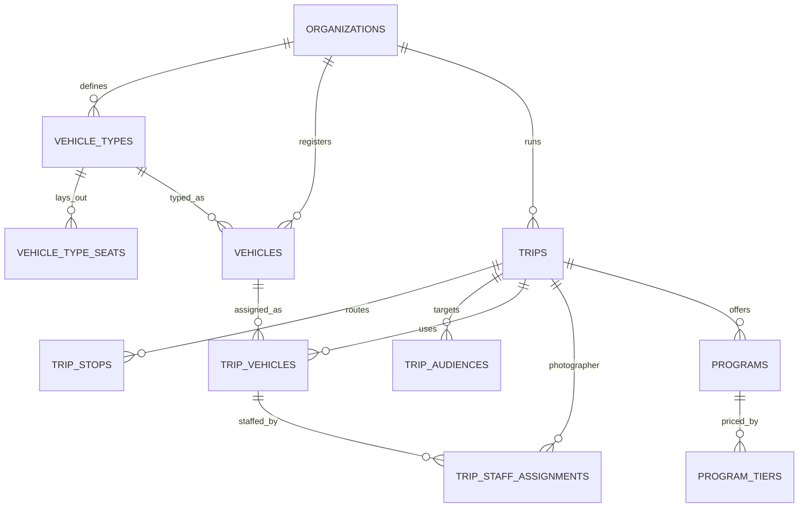

جزء من [نموذج البيانات](/ar/docs/erd)؛ الاصطلاحات والأعمدة الأساسية موثَّقة هناك.

**vehicle_types** (Base +) — تخطيطات مقاعد قابلة لإعادة الاستخدام تحددها الجهة المنظِّمة مرة واحدة وتُسندها إلى المركبات: `organization_id`، `name JSONB`، `seat_count SMALLINT`، `layout JSONB` (صفوف الشبكة، الأعمدة، الممرات، الأبواب)، `archived_at TIMESTAMPTZ`. [FR-FLT-01](/ar/docs/srs/requirements/flt#fr-flt-01--أنواع-المركبات-القابلة-لإعادة-الاستخدام)، [FR-FLT-06](/ar/docs/srs/requirements/flt#fr-flt-06--أرشفة-أنواع-المركبات). الفهارس: `(organization_id, archived_at)`.

**vehicle_type_seats** (Base +) — صف واحد لكل مقعد فعلي في التخطيط، وهو القالب الذي تُختَم منه صفوف `trip_seats`: `organization_id`، `vehicle_type_id FK`، `label VARCHAR(10)` (مثلاً 12B)، `row_no SMALLINT`، `col_no SMALLINT`، `seat_kind_id FK lookups (seat_kind: standard, accessible, crew, blocked)`. قيد فريد `(vehicle_type_id, label, deleted_at)`؛ وهذا الزوج هو الفهرس.

**vehicles** (Base +) — أسطول الجهة المنظِّمة المُسجَّل ([FR-FLT-02](/ar/docs/srs/requirements/flt#fr-flt-02--سجل-المركبات)): `organization_id`، `vehicle_type_id FK`، `plate_no VARCHAR(20)`، `model VARCHAR(80)`، `year SMALLINT`، `seat_count SMALLINT` (يجب أن يساوي قيمة النوع)، `registration_status_id FK lookups (registration_status)`، `registration_valid_until DATE`، `provider_vehicle_id FK provider_vehicles NULL` (مركبة سائق المنصة الخاصة المستخدمة في صفقة). الفهارس: `(organization_id, vehicle_type_id)`، `(registration_valid_until)` لمسح انتهاء الصلاحية.

## trips
*(Base +) — رحلة منظَّمة واحدة: التسعير، الجدول، عدادات السعة، وأختام دورة الحياة. [FR-TRIP-01](/ar/docs/srs/requirements/trip#fr-trip-01--معالج-إنشاء-الرحلة) إلى [FR-TRIP-07](/ar/docs/srs/requirements/trip#fr-trip-07--حد-الرحلات-النشطة)*

<TypeTable
  type={{
    "organization_id": {
      type: "BIGINT FK organizations",
      description: "عمود المستأجر",
      required: true,
    },
    "market_id": {
      type: "BIGINT FK markets",
      description: "يُنسخ من الجهة المنظِّمة عند الإنشاء",
      required: true,
    },
    "code": {
      type: "VARCHAR(20)",
      description: "مرجع بشري، فريد لكل جهة منظِّمة",
      required: true,
    },
    "title, description": {
      type: "JSONB",
      required: true
    },
    "category_id": {
      type: "BIGINT FK lookups",
      description: "`trip_category`",
      required: true,
    },
    "status_id": {
      type: "BIGINT FK lookups",
      description: "`trip_status`: draft, published, negotiating, ready, filling_up, sold_out, in_progress, partially_completed, completed, post_processing, archived, cancelled, refunds_issued",
      required: true,
    },
    "publish_mode_id": {
      type: "BIGINT FK lookups",
      description: "`publish_mode`: draft, public, targeted",
      required: true,
    },
    "timezone": {
      type: "VARCHAR(64)",
      required: true
    },
    "starts_at, ends_at": {
      type: "TIMESTAMPTZ",
      required: true
    },
    "base_price_minor": {
      type: "BIGINT",
      required: true
    },
    "currency_code": {
      type: "CHAR(3)",
      description: "من السوق",
      required: true,
    },
    "capacity_total": {
      type: "INT",
      description: "مجموع مقاعد المركبات",
      required: true,
    },
    "seats_reserved": {
      type: "INT",
      description: "عداد؛ يصبح ملء المقاعد عند 80 بالمئة (D-189)",
      required: true,
    },
    "seat_mode_id": {
      type: "BIGINT FK lookups",
      description: "`seat_mode`: company_assigned, self_select",
      required: true,
    },
    "child_tracking_enabled": {
      type: "BOOLEAN",
      description: "[FR-TRK-04](/ar/docs/srs/requirements/trk#fr-trk-04--مفتاح-تتبع-الأبناء-لكل-رحلة)",
      required: true,
    },
    "vip_early_access_until": {
      type: "TIMESTAMPTZ NULL",
      description: "D-146",
      required: true,
    },
    "priority_seat_window_until": {
      type: "TIMESTAMPTZ NULL",
      description: "D-316",
      required: true,
    },
    "published_at, cancelled_at, completed_at, archived_at": {
      type: "TIMESTAMPTZ",
      required: true
    },
    "cancel_reason": {
      type: "TEXT",
      required: true
    },
    "counted_in_cycle": {
      type: "DATE",
      description: "الشهر المحسوب لحد الرحلات النشطة (D-143)",
      required: true,
    },
  }}
/>

الفهارس: `unique (organization_id, code)`، `(organization_id, status_id)`، فهرس جزئي على `(starts_at)` عندما تكون الحالة published أو filling_up، و`(counted_in_cycle, organization_id)` لحد الرحلات النشطة، و`(market_id, status_id)` للقائمة الموجهة للعملاء المقيدة بالنطاق الجغرافي للبلد ([FR-MKT-06](/ar/docs/srs/requirements/mkt#fr-mkt-06--نطاق-البلد-ومرشِّح-القوائم)).

**trip_stops** (Base +) — نقاط مسار مرتبة مع أوقات مخطَّطة: `organization_id`، `trip_id FK`، `seq SMALLINT`، `kind_id FK lookups (stop_kind: pickup, stop, destination, dropoff)`، `name JSONB`، `address JSONB`، `lat NUMERIC(10,7)`، `lng NUMERIC(10,7)`، `planned_at TIMESTAMPTZ`. الفهارس: `(trip_id, seq)`.

**trip_audiences** (Base +) — قائمة الضيوف المدعوين للنشر الموجه ([FR-TRIP-02](/ar/docs/srs/requirements/trip#fr-trip-02--المسودة-والنشر-العلني-والمستهدف)): `organization_id`، `trip_id FK`، `user_id FK NULL`، `email CITEXT NULL`، `phone_hash CHAR(64) NULL`. الفهارس: `(trip_id)`، `(user_id)`، `(email)`.

## trip_vehicles
*(Base +) — خانة مركبة واحدة في رحلة، مع تخزين مؤقت لموقعها المباشر أثناء التشغيل. [FR-TRIP-03](/ar/docs/srs/requirements/trip#fr-trip-03--الرحلات-متعددة-المركبات)*

<TypeTable
  type={{
    "organization_id": {
      type: "BIGINT",
      description: "عمود المستأجر",
      required: true,
    },
    "trip_id": {
      type: "BIGINT FK trips",
      required: true
    },
    "vehicle_id": {
      type: "BIGINT FK vehicles NULL",
      required: true
    },
    "vehicle_type_id": {
      type: "BIGINT FK vehicle_types",
      required: true
    },
    "label": {
      type: "VARCHAR(40)",
      description: "Bus A, Bus B",
      required: true,
    },
    "status_id": {
      type: "BIGINT FK lookups",
      description: "`trip_vehicle_status`: planning, ready, departed, ended",
      required: true,
    },
    "seat_count": {
      type: "SMALLINT",
      required: true
    },
    "departed_at, ended_at": {
      type: "TIMESTAMPTZ",
      required: true
    },
    "last_lat, last_lng, last_point_at": {
      type: "NUMERIC, NUMERIC, TIMESTAMPTZ",
      description: "تخزين مؤقت لأحدث موقع",
      required: true,
    },
  }}
/>

الفهارس: `(trip_id, status_id)`، `(vehicle_id)`.

## trip_staff_assignments
*(Base +) — من يقود مركبة الرحلة أو يشرف عليها أو يصوّرها، من موظفي الجهة المنظِّمة أو من موردي المنصة. [FR-STF-01](/ar/docs/srs/requirements/stf#fr-stf-01--مسارا-السائق) إلى [FR-STF-05](/ar/docs/srs/requirements/stf#fr-stf-05--إسناد-المشرف)*

<TypeTable
  type={{
    "organization_id": {
      type: "BIGINT",
      required: true
    },
    "trip_id": {
      type: "BIGINT FK trips",
      required: true
    },
    "trip_vehicle_id": {
      type: "BIGINT FK trip_vehicles NULL",
      description: "يكون NULL للمصوّر على مستوى الرحلة",
      required: true,
    },
    "staff_role_id": {
      type: "BIGINT FK lookups",
      description: "`staff_role`: driver, moderator, photographer",
      required: true,
    },
    "user_id": {
      type: "BIGINT FK users",
      required: true
    },
    "track_id": {
      type: "BIGINT FK lookups",
      description: "`supplier_track`: organization, platform",
      required: true,
    },
    "deal_id": {
      type: "BIGINT FK deals NULL",
      description: "مطلوب عندما يكون المسار platform ([BRL-04](/ar/docs/brd/requirements#7-قواعد-العمل))",
      required: true,
    },
    "status_id": {
      type: "BIGINT FK lookups",
      description: "`assignment_status`: proposed, accepted, replaced, released",
      required: true,
    },
    "access_until": {
      type: "TIMESTAMPTZ",
      description: "المشرفون: نهاية الرحلة زائد 24 ساعة (D-107)",
      required: true,
    },
  }}
/>

قيد فريد نشط `(trip_vehicle_id, staff_role_id)` حيث تكون الحالة accepted.

الفهارس: `(user_id, status_id)` لقائمة إسنادات عضو الطاقم، و`(deal_id)`، والقيد الفريد الجزئي أعلاه كفهرس `(trip_vehicle_id, staff_role_id)` حيث تكون `status_id` هي `accepted`.

## programs
*(Base +) — أنشطة قابلة للحجز مرتبطة برحلة، مُسعَّرة وفق أحد خمسة نماذج. [FR-PRG-01](/ar/docs/srs/requirements/prg#fr-prg-01--نماذج-التسعير) إلى [FR-PRG-06](/ar/docs/srs/requirements/prg#fr-prg-06--حد-عدد-البرامج)*

<TypeTable
  type={{
    "organization_id": {
      type: "BIGINT",
      required: true
    },
    "trip_id": {
      type: "BIGINT FK trips",
      required: true
    },
    "title, description": {
      type: "JSONB",
      required: true
    },
    "pricing_model_id": {
      type: "BIGINT FK lookups",
      description: "`pricing_model`: free, per_person, by_quantity, per_group, tiered",
      required: true,
    },
    "price_minor": {
      type: "BIGINT NULL",
      description: "يكون NULL للنموذجين free و tiered",
      required: true,
    },
    "currency_code": {
      type: "CHAR(3)",
      required: true
    },
    "is_required": {
      type: "BOOLEAN",
      description: "مطلوب مسبقاً",
      required: true,
    },
    "is_vip_only": {
      type: "BOOLEAN",
      required: true
    },
    "capacity": {
      type: "INT NULL",
      required: true
    },
    "enrolled_count": {
      type: "INT",
      required: true
    },
    "starts_at": {
      type: "TIMESTAMPTZ NULL",
      required: true
    },
  }}
/>

الفهارس: `(trip_id)`؛ عداد `enrolled_count` يُحدَّث حسب المفتاح الأساسي.

**program_tiers** (Base +) — شرائح أسعار للبرامج ذات التسعير المتدرج: `organization_id`، `program_id FK`، `name JSONB`، `price_minor BIGINT`، `sort_by INT`. الفهارس: `(program_id, sort_by)`.
