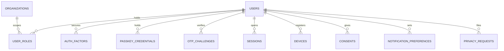

جزء من [نموذج البيانات](/ar/docs/erd)؛ الاصطلاحات والأعمدة الأساسية موثَّقة هناك.

## users
*(Base +) — هوية تسجيل دخول واحدة لكل شخص؛ كل دور وحجز ومنحة وقيد تدقيق يتفرع من هذا الصف. [FR-AUTH-01](/ar/docs/srs/requirements/auth#fr-auth-01--مسارات-تسجيل-خاصة-بكل-دور) إلى [FR-AUTH-10](/ar/docs/srs/requirements/auth#fr-auth-10--الجلسات-والرموز)*

<TypeTable
  type={{
    "full_name": {
      type: "VARCHAR(200)",
      required: true
    },
    "email": {
      type: "CITEXT",
      description: "فريد مع `deleted_at` عندما لا يكون فارغاً",
      required: true,
    },
    "phone_enc": {
      type: "BYTEA",
      description: "مشفَّر؛ بتنسيق E.164",
      required: true,
    },
    "phone_hash": {
      type: "CHAR(64)",
      description: "فريد مع `deleted_at` عندما لا يكون فارغاً",
      required: true,
    },
    "email_verified_at, phone_verified_at": {
      type: "TIMESTAMPTZ",
      description: "D-20",
      required: true,
    },
    "password_hash": {
      type: "VARCHAR(255)",
      description: "Argon2id؛ يكون NULL للحسابات المعتمدة على الرمز فقط",
      required: true,
    },
    "country_code": {
      type: "CHAR(2) FK countries",
      description: "[BRL-23](/ar/docs/brd/requirements#7-قواعد-العمل)",
      required: true,
    },
    "locale": {
      type: "VARCHAR(5)",
      description: "en أو ar",
      required: true,
    },
    "timezone": {
      type: "VARCHAR(64)",
      required: true
    },
    "status_id": {
      type: "BIGINT FK lookups",
      description: "`account_status`: active, suspended, deletion_requested, closed",
      required: true,
    },
    "suspended_reason_id": {
      type: "BIGINT FK lookups",
      description: "`suspension_reason` (D-234)",
      required: true,
    },
    "deletion_requested_at, deletion_due_at": {
      type: "TIMESTAMPTZ",
      description: "مهلة 30 يوماً ([BRL-15](/ar/docs/brd/requirements#7-قواعد-العمل))",
      required: true,
    },
    "failed_signins": {
      type: "SMALLINT",
      description: "يُصفَّر عند النجاح",
      required: true,
    },
    "locked_until": {
      type: "TIMESTAMPTZ",
      description: "[BRL-21](/ar/docs/brd/requirements#7-قواعد-العمل)",
      required: true,
    },
    "token_version": {
      type: "INT",
      description: "يُرفَع لإبطال جميع الرموز",
      required: true,
    },
    "traveler_plan_subscription_id": {
      type: "BIGINT FK subscriptions",
      description: "مجاني افتراضياً",
      required: true,
    },
  }}
/>

الفهارس: `unique (email, deleted_at)`، `unique (phone_hash, deleted_at)`، وفهرس جزئي `(status_id)` حيث `is_deleted = false`.

## user_roles
*(Base +) — حيازات الأدوار، يُحصر كل منها اختيارياً في جهة منظِّمة واحدة؛ يمكن أن تكون عدة أدوار نشطة في وقت واحد. [FR-AUTH-06](/ar/docs/srs/requirements/auth#fr-auth-06--حسابات-متعددة-الأدوار)، [FR-AUTH-07](/ar/docs/srs/requirements/auth#fr-auth-07--وصول-الموظفين-إلى-عدة-جهات-منظِّمة)*

<TypeTable
  type={{
    "user_id": {
      type: "BIGINT FK users",
      required: true
    },
    "role_id": {
      type: "BIGINT FK lookups",
      description: "`role`: traveler, organization_owner, organization_employee, platform_driver, platform_photographer, org_driver, org_photographer, moderator, admin_super, admin_operations, admin_finance",
      required: true,
    },
    "organization_id": {
      type: "BIGINT FK organizations NULL",
      description: "يُضبط للأدوار المحصورة في جهة منظِّمة",
      required: true,
    },
    "status_id": {
      type: "BIGINT FK lookups",
      description: "`role_status`: pending, active, paused, suspended, ended",
      required: true,
    },
    "started_at, ended_at": {
      type: "TIMESTAMPTZ",
      required: true
    },
  }}
/>

قيد فريد `(user_id, role_id, organization_id, deleted_at)`.

الفهارس: `(user_id, status_id)` لمنتقي الدور عند تسجيل الدخول، و`(organization_id, status_id)` لقوائم الموظفين.

**auth_factors** (Base +) — عوامل ثانية مُسجَّلة لتسجيل الدخول: `user_id FK`، `factor_type_id FK lookups (auth_factor: totp, sms)`، `secret_enc BYTEA`، `verified_at TIMESTAMPTZ`، `last_used_at TIMESTAMPTZ`. الفهارس: `unique (user_id, factor_type_id, deleted_at)`.

**passkey_credentials** (Base +) — بيانات اعتماد WebAuthn مُسجَّلة لكل مستخدم ([FR-AUTH-11](/ar/docs/srs/requirements/auth#fr-auth-11--تسجيل-مفاتيح-المرور) إلى [FR-AUTH-13](/ar/docs/srs/requirements/auth#fr-auth-13--إدارة-مفاتيح-المرور-والتعافي-من-فقدان-الجهاز)): `user_id FK`، `credential_id BYTEA` (حتى 1023 بايت)، `public_key BYTEA` (COSE — المفتاح الخاص لا يغادر الجهاز أبدًا)، `aaguid CHAR(36)`، `sign_count INT`، `label VARCHAR(100)`، `last_used_at TIMESTAMPTZ`. الفهارس: `unique (credential_id)`، `(user_id, deleted_at)` لقائمة الإعدادات.

## otp_challenges
*(Base +) — تحدٍّ واحد برمز تحقق؛ يُستهلك مرة واحدة، ويمكن إيقافه مؤقتاً بعد المحاولات الخاطئة. [BRL-20](/ar/docs/brd/requirements#7-قواعد-العمل)*

<TypeTable
  type={{
    "user_id": {
      type: "BIGINT FK users NULL",
      description: "يكون NULL قبل إنشاء الحساب",
      required: true,
    },
    "channel_id": {
      type: "BIGINT FK lookups",
      description: "`otp_channel`: sms, whatsapp, email",
      required: true,
    },
    "destination_hash": {
      type: "CHAR(64)",
      required: true
    },
    "purpose_id": {
      type: "BIGINT FK lookups",
      description: "`otp_purpose`: verify_email, verify_phone, sign_in, staff_code, password_reset",
      required: true,
    },
    "code_hash": {
      type: "CHAR(64)",
      required: true
    },
    "expires_at": {
      type: "TIMESTAMPTZ",
      description: "5 دقائق",
      required: true,
    },
    "wrong_attempts": {
      type: "SMALLINT",
      description: "إيقاف مؤقت عند 5",
      required: true,
    },
    "paused_until": {
      type: "TIMESTAMPTZ",
      description: "15 دقيقة",
      required: true,
    },
    "failed_deliveries": {
      type: "SMALLINT",
      description: "تبديل القناة عند 3 (D-59)",
      required: true,
    },
    "consumed_at": {
      type: "TIMESTAMPTZ",
      required: true
    },
  }}
/>

الفهارس: `(destination_hash, purpose_id)` للبحث عن جهة التسليم، وفهرس جزئي `(expires_at)` بشرط `consumed_at is null` للمسح الدوري.

**sessions** (Base +) — صف واحد لكل رمز تحديث؛ يحمل الدور النشط والجهة المنظِّمة لتحديد الفاعل: `user_id FK`، `active_role_id FK user_roles`، `active_organization_id FK organizations NULL`، `refresh_token_hash CHAR(64)`، `device_id FK devices NULL`، `ip INET`، `user_agent TEXT`، `expires_at TIMESTAMPTZ` (الويب 12 ساعة، [BRL-22](/ar/docs/brd/requirements#7-قواعد-العمل))، `revoked_at TIMESTAMPTZ`. الفهارس: `unique (refresh_token_hash)`، `(user_id, expires_at)`، وفهرس جزئي `(expires_at)` بشرط `revoked_at is null`.

**devices** (Base +) — أهداف إشعارات Push مسجَّلة مع إصدار التطبيق: `user_id FK`، `platform_id FK lookups (device_platform: ios, android, web)`، `push_token TEXT`، `app_version VARCHAR(20)`، `last_seen_at TIMESTAMPTZ`. الفهارس: `(user_id, last_seen_at)`.

**consents** (غير قابلة للتغيير) — منح أو إلغاء واحد لكل نوع موافقة وإصدار نص، لا يُحدَّث ولا يُحذف أبداً ([DAT-08](/ar/docs/srs/data#63-الحذف-الناعم-وعدم-القابلية-للتغيير-والحذف)): `id`، `uuid`، `user_id FK`، `consent_type_id FK lookups (consent_type: lab_test, background_check, child_tracking, guardianship, marketing, terms, privacy)`، `text_version VARCHAR(20)`، `granted BOOLEAN`، `occurred_at TIMESTAMPTZ`، `ip INET`، `created_at`، `created_by`. الفهارس: `(user_id, consent_type_id, occurred_at)` — للبحث عن أحدث موافقة.

**notification_preferences** (Base +) — اشتراكات اختيارية لكل مستخدم وفئة وقناة: `user_id FK`، `category_id FK lookups (notification_category)`، `channel_id FK lookups (notification_channel: email, sms, whatsapp, push, in_app)`، `enabled BOOLEAN`. قيد فريد `(user_id, category_id, channel_id, deleted_at)`؛ وهذا الثلاثي هو الفهرس.

**privacy_requests** (Base +) — طلبات نسخ البيانات وحذفها مع مؤقتها البالغ 30 يوماً ([FR-TRV-07](/ar/docs/srs/requirements/trv#fr-trv-07--نسخ-البيانات-وحذفها)): `user_id FK`، `type_id FK lookups (privacy_request_type: data_copy, deletion)`، `status_id FK lookups (privacy_request_status: received, verified, in_progress, delivered, cancelled)`، `due_at TIMESTAMPTZ` (30 يوماً، D-162)، `file_path TEXT`، `completed_at TIMESTAMPTZ`. الفهارس: `(user_id, status_id)`، وفهرس جزئي `(due_at)` بشرط `completed_at is null`.
