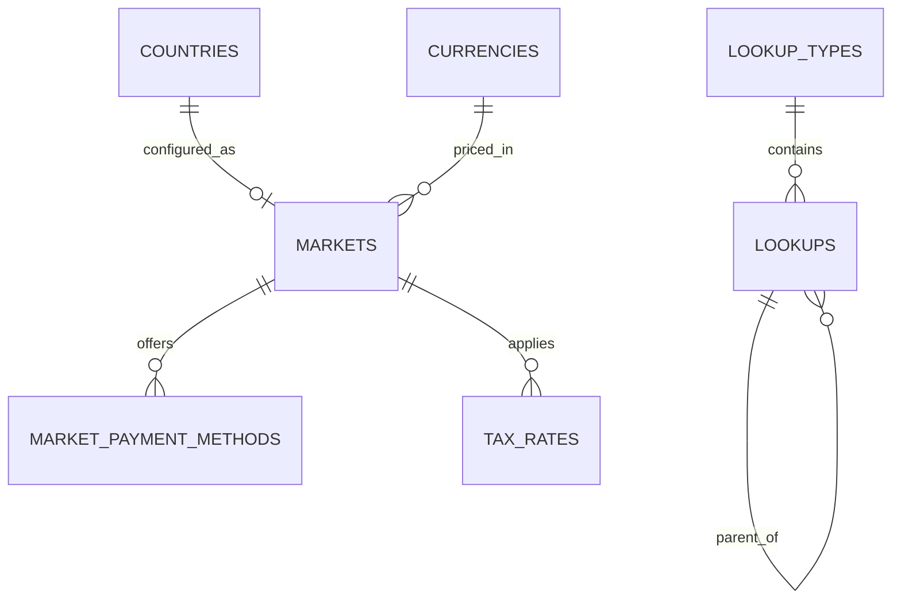

جزء من [نموذج البيانات](/ar/docs/erd)؛ وتُوثَّق الاتفاقيات والأعمدة الأساسية هناك.

## lookup_types
*(Base +) — سجل لكل مجموعة قابلة للتعداد؛ كل عمود حالة أو نوع أو تصنيف في النموذج يُحلّ عبر هذا الجدول.*

<TypeTable
  type={{
    "code": {
      type: "VARCHAR(80)",
      description: "فريد مع `deleted_at`، مثل `booking_status`",
      required: true,
    },
    "name": {
      type: "JSONB",
      description: "قابل للترجمة",
      required: true,
    },
    "description": {
      type: "JSONB",
      description: "قابل للترجمة",
      required: true,
    },
    "parent_id": {
      type: "BIGINT FK lookup_types",
      description: "تجميع اختياري",
      required: true,
    },
    "sort_by": {
      type: "INT",
      required: true
    },
    "is_public": {
      type: "BOOLEAN",
      description: "يُعرض للعملاء",
      required: true,
    },
    "is_system": {
      type: "BOOLEAN",
      description: "لا يمكن لمشرف المنصة تعديله",
      required: true,
    },
  }}
/>

الفهارس: `unique (code, deleted_at)`، و`(parent_id)`.

## lookups
*(Base +) — قيمة واحدة قابلة للتعداد داخل النوع؛ كل عمود `status_id` أو `*_type_id` أو عمود تصنيف يشير بمفتاح أجنبي إلى صف هنا.*

<TypeTable
  type={{
    "lookup_type_id": {
      type: "BIGINT FK lookup_types",
      required: true
    },
    "code": {
      type: "VARCHAR(80)",
      description: "فريد مع `(lookup_type_id, code, deleted_at)`",
      required: true,
    },
    "value": {
      type: "VARCHAR(255)",
      description: "قيمة آلية اختيارية",
      required: true,
    },
    "name": {
      type: "JSONB",
      description: "تسمية قابلة للترجمة",
      required: true,
    },
    "description": {
      type: "JSONB",
      required: true
    },
    "parent_id": {
      type: "BIGINT FK lookups",
      description: "مثلًا فئة الحادث ضمن مجموعة",
      required: true,
    },
    "sort_by": {
      type: "INT",
      required: true
    },
    "is_public, is_system": {
      type: "BOOLEAN",
      required: true
    },
  }}
/>

الفهارس: `unique (lookup_type_id, code, deleted_at)`، و`(lookup_type_id, is_public)` للقوائم العامة للعملاء.

**countries** — صفوف مرجعية وفق ISO 3166-1 يشير إليها كل عمود `country_code`: `code CHAR(2) PK`، و`name JSONB`، و`phone_prefix VARCHAR(6)`، و`is_active BOOLEAN`. بيانات مرجعية، بلا حذف منطقي.

**currencies** — صفوف مرجعية وفق ISO 4217 يقوم عليها كل عمود `currency_code`: `code CHAR(3) PK`، و`minor_units SMALLINT`، و`symbol JSONB`. بيانات مرجعية.

## markets
*(Base +) — إعدادات الإطلاق الخاصة بكل دولة: العملة والمنطقة الزمنية وقواعد العمولة والفوترة. [BR-MKT-01](/ar/docs/brd/requirements#616-الأسواق-mkt)، [BRL-27](/ar/docs/brd/requirements#7-قواعد-العمل)، [FR-MKT-01](/ar/docs/srs/requirements/mkt#fr-mkt-01--إعداد-السوق) إلى [FR-MKT-05](/ar/docs/srs/requirements/mkt#fr-mkt-05--التقريب-والعرض)*

<TypeTable
  type={{
    "country_code": {
      type: "CHAR(2) FK countries",
      description: "فريد",
      required: true,
    },
    "currency_code": {
      type: "CHAR(3) FK currencies",
      description: "EGP, SAR, AED",
      required: true,
    },
    "default_timezone": {
      type: "VARCHAR(64)",
      description: "Africa/Cairo, Asia/Riyadh, Asia/Dubai (D-282)",
      required: true,
    },
    "status_id": {
      type: "BIGINT FK lookups",
      description: "`market_status`: draft, live, paused",
      required: true,
    },
    "launch_phase": {
      type: "SMALLINT",
      description: "2 أو 5",
      required: true,
    },
    "commission_rate_bp": {
      type: "INT",
      description: "نقاط أساس؛ قيمة مؤقتة 1000 (D-15)",
      required: true,
    },
    "invoice_rules": {
      type: "JSONB",
      description: "بادئة الترقيم، وحقول المشتري المطلوبة، وعلم الفوترة الإلكترونية ([OD-10](/ar/docs/brd/compliance#11-القرارات-المفتوحة))",
      required: true,
    },
  }}
/>

الفهارس: `unique (country_code)`، و`(status_id)`.

**market_payment_methods** (Base +) — أزواج طرق الدفع وبوابات الدفع المتاحة في سوق معيّنة: `market_id FK`، و`method_id FK lookups (payment_method: card, apple_pay, google_pay, local_card, fawry_cash)`، و`gateway_id FK lookups (gateway: stripe, paymob, tap, fawry)`، و`use_for_bookings BOOLEAN`، و`use_for_plans BOOLEAN`، و`sort_by INT`، و`is_active BOOLEAN`. الفهارس: `unique (market_id, method_id, deleted_at)`، و`(market_id, is_active, sort_by)`.

**tax_rates** (Base +) — معدل ضريبة القيمة المضافة لكل سوق مع نافذة صلاحية: `market_id FK`، و`tax_type_id FK lookups (tax_type: vat)`، و`rate_bp INT` ([OD-27](/ar/docs/brd/compliance#11-القرارات-المفتوحة))، و`valid_from DATE`، و`valid_to DATE NULL`. الفهارس: `unique (market_id, tax_type_id, valid_from)`.
