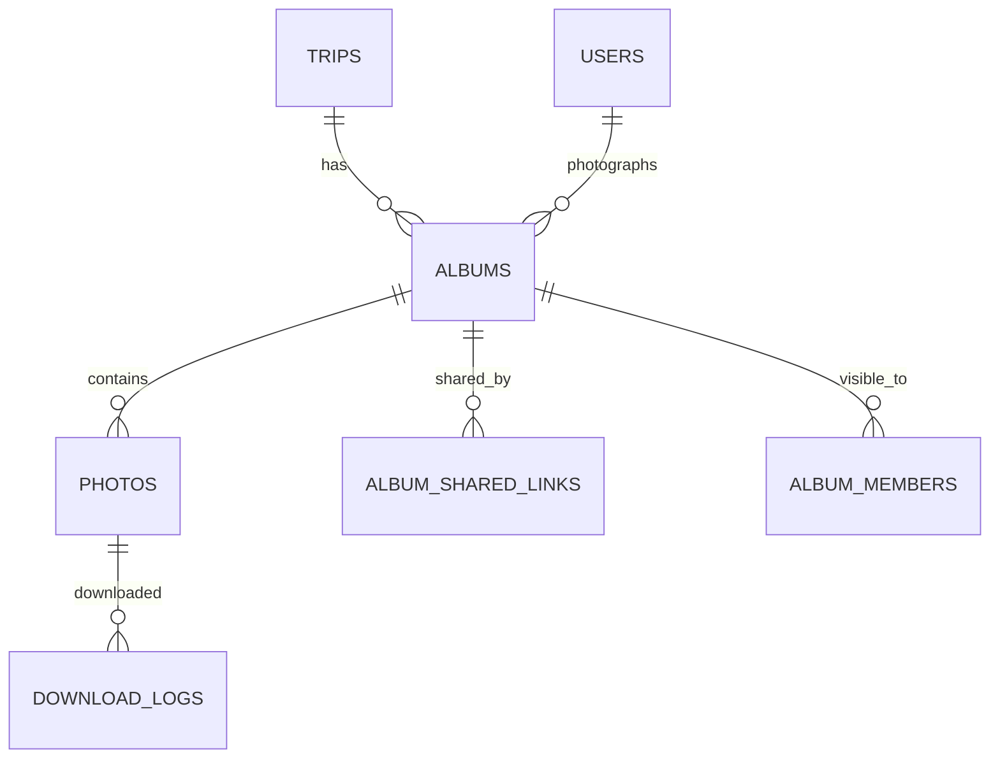

جزء من [نموذج البيانات](/ar/docs/erd)؛ تُوثَّق الاصطلاحات والأعمدة الأساسية هناك.

الوسائط هي مخزن الملفات الوحيد للمنصة لرفع كل النطاقات (مستندات طلبات الانضمام، صور الأعمال الفنية، صور الألبومات، وغيرها من الملفات)؛ ويحمل جدول النطاق المالك رابط الكيان. والملف الذي لا يكون مرتبطًا بكيانه المالك ولم تُنشئه المنصة يُحذف تلقائيًا، مع نسخه المشتقة، بعد 24 ساعة من الرفع ([BRL-31](/ar/docs/brd/requirements#7-قواعد-العمل), [FR-MED-09](/ar/docs/srs/requirements/med#fr-med-09--دورة-حياة-الملفات-وتنظيف-الملفات-اليتيمة)).

**albums** (Base +) — ألبوم صور واحد لكل رحلة ومصوّر، مع نافذة رفع محدودة ([FR-MED-01](/ar/docs/srs/requirements/med#fr-med-01--نافذة-إنشاء-الألبوم) إلى [FR-MED-08](/ar/docs/srs/requirements/med#fr-med-08--عدد-الألبومات-لكل-رحلة-حسب-الخطة)): `organization_id`، `trip_id FK`، `photographer_user_id FK`، `title JSONB`، `privacy_mode_id FK lookups (album_privacy: public, shared_link, selected_users)`، `watermark_enabled BOOLEAN`، `status_id FK lookups (album_status: uploading, processing, published, archived)`، `upload_window_ends_at` (اكتمال الرحلة زائد 14 يومًا، D-267)، `published_at`، `archived_at`. الفهارس: `(trip_id)`، و`(photographer_user_id, status_id)`، وفهرس جزئي على `(upload_window_ends_at)` حيث `status_id` في `uploading` أو `processing`.

**photos** (Base +) — صورة واحدة مع نسخها المشتقة: `organization_id`، `album_id FK`، `original_path TEXT`، `variants JSONB` (thumb, medium, large, watermarked)، `width`، `height`، `perceptual_hash CHAR(16)`، `processing_status_id FK lookups (processing_status)`، `upload_batch_id UUID`، `client_file_id VARCHAR(120)` (رفع قابل للاستئناف، فريد لكل دفعة). الفهارس: `(album_id, created_at)`، و`(upload_batch_id, client_file_id)`، و`(perceptual_hash)` لكشف التكرار.

**album_shared_links** (Base +) — رموز مشاركة قابلة للإلغاء لألبوم واحد: `album_id FK`، `token_hash CHAR(64)` (رمز من 32 حرفًا)، `revoked_at`. الفهارس: `unique (token_hash)`.

**album_members** (Base +) — المشاهدون المحدَّدون صراحةً في وضع المستخدمين المختارين: `album_id FK`، `user_id FK`. الفهارس: `unique (album_id, user_id, deleted_at)`.

**download_logs** (Base +) — صف واحد لكل تنزيل صورة، لأغراض الترخيص ومراجعة إساءة الاستخدام: `photo_id FK`، `user_id FK`، `variant VARCHAR(20)`، `occurred_at`. مدة الاحتفاظ سنة واحدة. الفهارس: `(photo_id, occurred_at)`، و`(occurred_at)` لمسح الانتهاء مدة الاحتفاظ.
