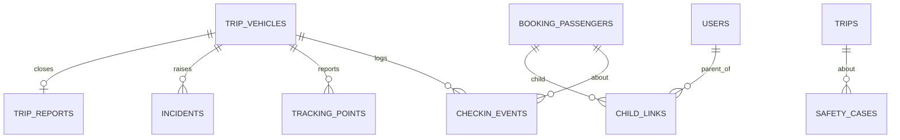

جزء من [نموذج البيانات](/ar/docs/erd)؛ وتُوثَّق الاتفاقيات والأعمدة الأساسية هناك.

## checkin_events
*(hypertable غير قابل للتغيير) — وقائع تسجيل الحضور عند الصعود وتسجيل المغادرة كما تبلِّغ عنها الأجهزة، وتُعاد معالجتها من قائمة الانتظار دون اتصال بطريقة idempotent. من [FR-CHK-01](/ar/docs/srs/requirements/chk#fr-chk-01--تسجيل-الحضور-عند-الصعود) إلى [FR-CHK-05](/ar/docs/srs/requirements/chk#fr-chk-05--قائمة-الانتظار-دون-اتصال)*

<TypeTable
  type={{
    "id, uuid": {
      type: "BIGSERIAL, UUID",
      description: "المفتاح الأساسي `(id, occurred_at)`",
      required: true,
    },
    "organization_id": {
      type: "BIGINT",
      required: true
    },
    "trip_id": {
      type: "BIGINT",
      required: true
    },
    "trip_vehicle_id": {
      type: "BIGINT",
      required: true
    },
    "passenger_id": {
      type: "BIGINT FK booking_passengers",
      required: true
    },
    "event_type_id": {
      type: "BIGINT FK lookups",
      description: "`checkin_event`: check_in, check_out, refused_wrong_vehicle",
      required: true,
    },
    "stop_id": {
      type: "BIGINT FK trip_stops NULL",
      required: true
    },
    "moderator_user_id": {
      type: "BIGINT FK users",
      required: true
    },
    "lat, lng, accuracy_m": {
      type: "NUMERIC, NUMERIC, REAL",
      description: "تكون NULL عندما لا يُسمح بالموقع",
      required: true,
    },
    "occurred_at": {
      type: "TIMESTAMPTZ",
      description: "وقت الحدث من الجهاز",
      required: true,
    },
    "received_at": {
      type: "TIMESTAMPTZ",
      description: "وقت الخادم؛ والفرق بينهما يقيس هدف 60 ثانية",
      required: true,
    },
    "client_event_id": {
      type: "UUID",
      description: "فريد؛ إعادة التشغيل دون اتصال idempotent",
      required: true,
    },
    "created_at, created_by": {
      type: "",
      required: true
    },
  }}
/>

مدة الاحتفاظ سنة واحدة.

الفهارس: `(trip_id, occurred_at)`، و`(passenger_id, occurred_at)` للخط الزمني للمسافر، و`(moderator_user_id, occurred_at)`، و`unique (client_event_id, occurred_at)` — قيد التفرد في hypertable يجب أن يتضمن عمود التقسيم، لذا يُفرض إلغاء تكرار إعادة التشغيل الشاملة مرة أخرى في مستودع المزامنة.

**tracking_points** (hypertable غير قابل للتغيير) — نبضات GPS الخام لكل مركبة رحلة ([FR-TRK-01](/ar/docs/srs/requirements/trk#fr-trk-01--موقع-المركبة-المباشر)، [FR-TRK-02](/ar/docs/srs/requirements/trk#fr-trk-02--جمع-الموقع)): `id`، و`organization_id`، و`trip_vehicle_id`، و`occurred_at`، و`lat`، و`lng`، و`speed_kmh REAL`، و`heading SMALLINT`، و`accuracy_m REAL`، و`source_id FK lookups (gps_source: driver_app, moderator_app)`. مدة الاحتفاظ 90 يومًا، ثم تُحفظ ملخصات ساعية. الفهارس: `(trip_vehicle_id, occurred_at DESC)` — تقرأ الخريطة المباشرة آخر نقاط كل مركبة.

**incidents** (Base +) — الحوادث التشغيلية التي يُبلَّغ عنها أثناء تنفيذ الرحلة ([FR-CHK-06](/ar/docs/srs/requirements/chk#fr-chk-06--الإبلاغ-عن-الحوادث)): `organization_id`، و`trip_id`، و`trip_vehicle_id`، و`reported_by FK users`، و`category_id FK lookups (incident_category: safety, medical, vehicle_fault, lost_traveler, conduct, other)`، و`severity_id FK lookups (severity)`، و`description TEXT`، و`attachments JSONB`، و`lat`، و`lng`، و`status_id FK lookups (incident_status: open, acknowledged, resolved)`، و`acknowledged_at`، و`resolved_at`. الفهارس: `(trip_id, status_id)`، و`(trip_vehicle_id, created_at)`.

**trip_reports** (Base +) — تقرير المشرف المقفل للعدّ النهائي في نهاية الرحلة ([FR-MOD-02](/ar/docs/srs/requirements/mod#fr-mod-02--تقرير-نهاية-الرحلة)، [FR-MOD-06](/ar/docs/srs/requirements/mod#fr-mod-06--قفل-التقرير)): `organization_id`، و`trip_vehicle_id FK UNIQUE`، و`moderator_user_id`، و`checked_in_count INT`، و`final_headcount INT`، و`mismatch_reason TEXT`، و`notes TEXT`، و`submitted_at` (يُقفل التقرير بعده)، و`org_note TEXT`. الفهارس: `unique (trip_vehicle_id, deleted_at)`.

## child_links
*(Base +) — عرض مباشر للوالد لمسافر طفل واحد في حجز واحد. من [FR-PAR-01](/ar/docs/srs/requirements/par#fr-par-01--ربط-طفل) إلى [FR-PAR-06](/ar/docs/srs/requirements/par#fr-par-06--انتهاء-الارتباط-بانتهاء-الحجز)*

<TypeTable
  type={{
    "parent_user_id": {
      type: "BIGINT FK users",
      required: true
    },
    "booking_id": {
      type: "BIGINT FK bookings",
      required: true
    },
    "passenger_id": {
      type: "BIGINT FK booking_passengers",
      description: "يجب أن يكون `is_child`",
      required: true,
    },
    "organization_id": {
      type: "BIGINT",
      description: "منسوخ لأجل RLS في قراءات مستوى الجهة المنظِّمة",
      required: true,
    },
    "guardianship_consent_id": {
      type: "BIGINT FK consents",
      description: "D-126",
      required: true,
    },
    "status_id": {
      type: "BIGINT FK lookups",
      description: "`child_link_status`: active, ended",
      required: true,
    },
    "ended_at": {
      type: "TIMESTAMPTZ",
      description: "ينتهي عند الإلغاء أو الاسترداد",
      required: true,
    },
  }}
/>

القيد الفريد النشط: `(parent_user_id, passenger_id)`.

الفهارس: `(booking_id)` لمعالجة إنهاء الرابط عند الاسترداد، و`(parent_user_id, status_id)` لروابط الوالد النشطة.

**safety_cases** (Base +) — بلاغات سلامة الأطفال التي يجري تصعيدها داخل المنصة أو خارجها ([FR-PAR-07](/ar/docs/srs/requirements/par#fr-par-07--الإبلاغ-عن-سلامة-الأبناء)): `organization_id`، و`trip_id FK`، و`passenger_id FK NULL`، و`reported_by FK users`، و`reporter_role_id FK lookups (role)`، و`description TEXT`، و`status_id FK lookups (case_status: open, escalated, closed)`، و`escalated_to VARCHAR(200)` (D-68)، و`escalated_at`، و`closed_at`. الفهارس: `(trip_id)`، وفهرس جزئي `(status_id)` حيث تكون `status_id` ضمن `open` أو `escalated`.
