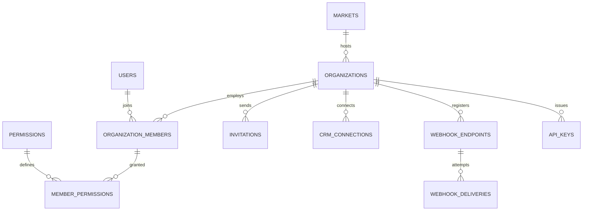

جزء من [نموذج البيانات](/ar/docs/erd)؛ وتُوثَّق الاتفاقيات والأعمدة الأساسية هناك.

## organizations
*(Base +) — جذر المستأجر؛ عمود `organization_id` في كل جدول من جداول المستأجر يشير إلى هنا. من [FR-ORG-01](/ar/docs/srs/requirements/org#fr-org-01--عزل-مساحة-العمل) إلى [FR-ORG-08](/ar/docs/srs/requirements/org#fr-org-08--هوية-بصرية-مخصصة)*

<TypeTable
  type={{
    "owner_user_id": {
      type: "BIGINT FK users",
      required: true
    },
    "application_id": {
      type: "BIGINT FK applications",
      required: true
    },
    "market_id": {
      type: "BIGINT FK markets",
      description: "يُشتق من الدولة ([BRL-27](/ar/docs/brd/requirements#7-قواعد-العمل))",
      required: true,
    },
    "legal_name, trade_name": {
      type: "JSONB",
      required: true
    },
    "commercial_reg_no": {
      type: "VARCHAR(50)",
      required: true
    },
    "tax_no": {
      type: "VARCHAR(50)",
      required: true
    },
    "billing_email": {
      type: "CITEXT",
      required: true
    },
    "timezone": {
      type: "VARCHAR(64)",
      description: "القيمة الافتراضية من السوق",
      required: true,
    },
    "status_id": {
      type: "BIGINT FK lookups",
      description: "`organization_status`: active, suspended, closed",
      required: true,
    },
    "subscription_id": {
      type: "BIGINT FK subscriptions",
      required: true
    },
    "seat_self_selection_default": {
      type: "BOOLEAN",
      description: "[FR-ORG-05](/ar/docs/srs/requirements/org#fr-org-05--إعداد-الاختيار-الذاتي-للمقاعد)",
      required: true,
    },
    "child_tracking_default": {
      type: "BOOLEAN",
      required: true
    },
    "branding": {
      type: "JSONB",
      description: "لخطة Enterprise فقط ([BR-ORG-08](/ar/docs/brd/requirements#63-الجهات-المنظِّمة-والموظفون-org))",
      required: true,
    },
    "invoice_settings": {
      type: "JSONB",
      description: "البادئة، والتذييل، وبيانات البنك",
      required: true,
    },
    "approved_at": {
      type: "TIMESTAMPTZ",
      required: true
    },
  }}
/>

الفهارس: `unique (application_id)`، و`(market_id)`، و`(status_id)`.

## organization_members
*(Base +) — قائمة الموظفين؛ و`email` هو مفتاح قائمة الوصول المستخدم للتبديل بين الجهات المنظِّمة. [BR-AUTH-06](/ar/docs/brd/requirements#61-الحسابات-والوصول-auth)، من [FR-EMP-01](/ar/docs/srs/requirements/emp#fr-emp-01--مجموعات-الصلاحيات) إلى [FR-EMP-06](/ar/docs/srs/requirements/emp#fr-emp-06--الدعوة-وتسجيل-الدخول-الأول)*

<TypeTable
  type={{
    "organization_id": {
      type: "BIGINT FK organizations",
      description: "عمود المستأجر",
      required: true,
    },
    "user_id": {
      type: "BIGINT FK users NULL",
      description: "يبقى NULL حتى قَبول الدعوة",
      required: true,
    },
    "email": {
      type: "CITEXT",
      description: "مفتاح قائمة الوصول المستخدم للتبديل بين الجهات المنظِّمة",
      required: true,
    },
    "member_type_id": {
      type: "BIGINT FK lookups",
      description: "`member_type`: owner, employee, org_driver, org_photographer, moderator",
      required: true,
    },
    "status_id": {
      type: "BIGINT FK lookups",
      description: "`member_status`: invited, active, suspended, removed",
      required: true,
    },
    "joined_at, removed_at": {
      type: "TIMESTAMPTZ",
      required: true
    },
  }}
/>

القيد الفريد: `(organization_id, email, deleted_at)`.

الفهارس: `(user_id, status_id)` لقائمة «جهاتي المنظِّمة»، و`(organization_id, status_id)` لقائمة الموظفين.

**permissions** (reference) — فهرس رموز قائمة التحكم بالوصول (ACL)، صف واحد لكل رمز `area.action` ([الفهرس](/ar/docs/erd/acl)): `id`، و`code VARCHAR(80) UNIQUE` (مثل `trip.create`، و`booking.refund`، و`accounting.export`، و`integration.manage`، و`analytics.view`)، و`area_id FK lookups (permission_area)`، و`name JSONB`. الفهارس: `unique (code)`، و`(area_id)`.

**member_permissions** (Base +) — صلاحية واحدة ممنوحة لكل صف عضو؛ كل إدراج أو حذف منطقي يُسجِّل قيدًا في سجل التدقيق ([FR-EMP-02](/ar/docs/srs/requirements/emp#fr-emp-02--تدقيق-تغييرات-الصلاحيات)): `organization_id`، و`member_id FK organization_members`، و`permission_id FK permissions`. الفهارس: `unique (member_id, permission_id, deleted_at)`.

**invitations** (Base +) — دعوات تُرسَل عبر البريد الإلكتروني للاستخدام مرة واحدة، تُنشئ العضو قبل أول تسجيل دخول: `organization_id`، و`member_id FK`، و`channel_id FK lookups (otp_channel)`، و`token_hash CHAR(64)`، و`expires_at` (7 أيام، D-286، D-94)، و`accepted_at`. الفهارس: `(member_id)`، وفهرس جزئي `(expires_at)` حيث `accepted_at is null`.

**crm_connections** (Base +) — بيانات الاعتماد المخزَّنة لتكامل CRM الخاص بالجهة المنظِّمة: `organization_id`، و`provider_id FK lookups (crm_provider)`، و`credentials_enc BYTEA`، و`status_id FK lookups (integration_status: connected, error, disconnected)`، و`last_sync_at`. الفهارس: `unique (organization_id, provider_id, deleted_at)`.

**webhook_endpoints** (Base +) — نقاط نهاية HTTPS تستقبل الأحداث الموقَّعة ([FR-ORG-06](/ar/docs/srs/requirements/org#fr-org-06--نظام-crm-وwebhooks)): `organization_id`، و`url TEXT` (بـ HTTPS فقط)، و`secret_enc BYTEA`، و`previous_secret_enc BYTEA`، و`previous_secret_valid_until TIMESTAMPTZ` (24 ساعة بعد التدوير)، و`events TEXT[]` (رموز الأحداث)، و`is_active BOOLEAN`. الفهارس: `(organization_id, is_active)`.

**webhook_deliveries** (Base +) — صف واحد لكل محاولة تسليم، مع إمكانية إعادة الإرسال خلال 7 أيام: `organization_id`، و`endpoint_id FK`، و`event_uuid UUID`، و`event_type VARCHAR(80)`، و`payload JSONB`، و`attempt SMALLINT` (حتى 5 محاولات خلال 24 ساعة)، و`status_code SMALLINT`، و`next_attempt_at`، و`delivered_at`، و`replay_until` (7 أيام، D-63). الفهارس: `(endpoint_id, created_at)`، وفهرس جزئي `(next_attempt_at)` حيث `delivered_at is null` — لعملية المسح الخاصة بإعادة المحاولة.

**api_keys** (Base +) — بيانات اعتماد آلية لواجهة API العامة، مُجزَّأة عند التخزين ([FR-API-02](/ar/docs/srs/requirements/api#fr-api-02--دورة-حياة-مفاتيح-api)): `organization_id`، و`name VARCHAR(100)`، و`key_prefix VARCHAR(12)`، و`key_hash CHAR(64)`، و`scopes TEXT[]`، و`last_used_at`، و`revoked_at`. الفهارس: `unique (key_hash)`، و`(key_prefix)`، و`(organization_id, revoked_at)`.
