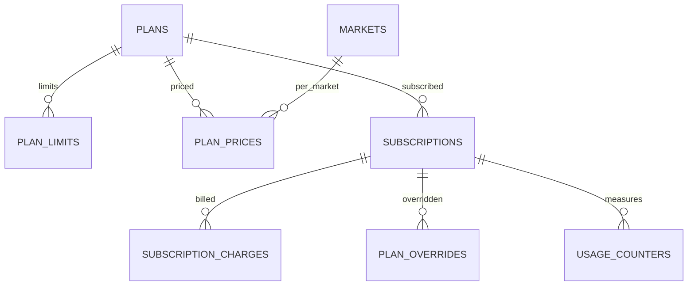

جزء من [نموذج البيانات](/ar/docs/erd)؛ وتُوثَّق الاتفاقيات والأعمدة الأساسية هناك.

**plans** (Base +) — كتالوج الخطط لكل نطاق دور، من Free إلى Enterprise ([FR-SUB-01](/ar/docs/srs/requirements/sub#fr-sub-01--كتالوج-الخطط)): `role_scope_id FK lookups (plan_role: organization, driver, photographer, traveler)`، و`code VARCHAR(40)` (starter, growth, enterprise, basic, professional, premium, studio, pro, free, explorer, vip)، و`name JSONB`، و`tier_rank SMALLINT`، و`trial_days SMALLINT NULL` ([OD-28](/ar/docs/brd/compliance#11-القرارات-المفتوحة))، و`is_default_on_approval BOOLEAN`، و`is_active BOOLEAN`. الفهارس: `unique (role_scope_id, code, deleted_at)`، و`(tier_rank)`.

**plan_limits** (Base +) — الحدود الرقمية وأعلام الميزات لكل خطة: `plan_id FK`، و`limit_key VARCHAR(60)` (مثل `active_trips_per_month`، و`employees`، و`vehicles_per_trip`، و`programs_per_trip`، و`coupons_active`، و`bookings_per_month`، و`portfolio_images`، و`albums_per_trip`)، و`limit_value INT NULL` (null تعني بلا حد)، و`feature_key VARCHAR(60) NULL` (مثل `platform_suppliers`، و`seat_self_select`، و`child_tracking`، و`watermark`، و`album_privacy_link`، و`album_privacy_selected`، و`analytics_level`، و`export`)، و`feature_value VARCHAR(40) NULL`. الفهارس: `unique (plan_id, limit_key, deleted_at)`.

**plan_prices** (Base +) — السعر لكل خطة وسوق وفترة فوترة، ويقابله نظير في بوابة الدفع: `plan_id FK`، و`market_id FK`، و`interval_id FK lookups (billing_interval: monthly, annual)`، و`amount_minor BIGINT` ([OD-26](/ar/docs/brd/compliance#11-القرارات-المفتوحة))، و`currency_code`، و`gateway_price_ref VARCHAR(120)`، و`valid_from DATE`. الفهارس: `unique (plan_id, market_id, interval_id, deleted_at)`، و`(gateway_price_ref)`.

## subscriptions
*(Base +) — خطة واحدة مملوكة لكل جهة منظِّمة أو مستخدم، مع الفترة والتجربة المجانية ومدة السماح والتخفيض المجدول للخطة. من [FR-SUB-02](/ar/docs/srs/requirements/sub#fr-sub-02--بوابات-الميزات) إلى [FR-SUB-07](/ar/docs/srs/requirements/sub#fr-sub-07--التجارب-المجانية)*

<TypeTable
  type={{
    "owner_type_id": {
      type: "BIGINT FK lookups",
      description: "`subscription_owner`: organization, user",
      required: true,
    },
    "organization_id": {
      type: "BIGINT FK NULL",
      required: true
    },
    "user_id": {
      type: "BIGINT FK NULL",
      required: true
    },
    "plan_id": {
      type: "BIGINT FK plans",
      required: true
    },
    "plan_price_id": {
      type: "BIGINT FK plan_prices NULL",
      description: "يكون NULL لخطة Free",
      required: true,
    },
    "status_id": {
      type: "BIGINT FK lookups",
      description: "`subscription_status`: trial, active, grace, downgraded, cancelling, ended",
      required: true,
    },
    "current_period_start, current_period_end": {
      type: "TIMESTAMPTZ",
      required: true
    },
    "trial_ends_at": {
      type: "TIMESTAMPTZ",
      required: true
    },
    "grace_started_at": {
      type: "TIMESTAMPTZ",
      description: "7 أيام ([BRL-14](/ar/docs/brd/requirements#7-قواعد-العمل))",
      required: true,
    },
    "scheduled_plan_id": {
      type: "BIGINT FK plans NULL",
      description: "خفض الخطة في نهاية الفترة",
      required: true,
    },
    "cancel_at_period_end": {
      type: "BOOLEAN",
      required: true
    },
    "gateway_subscription_ref": {
      type: "VARCHAR(120)",
      required: true
    },
  }}
/>

الفهارس: فهرس جزئي `unique (organization_id)` حيث تكون `status_id` ضمن `trial` أو `active` أو `grace`، وفهرس جزئي `unique (user_id)` حيث تكون `status_id` ضمن `trial` أو `active` أو `grace` — اشتراك فعال واحد لكل مالك، و`(current_period_end)` لمهام التجديد وخفض الخطة.

**subscription_charges** (Base +) — رسوم فترة فوترة واحدة مع جدول إعادة المحاولة الخاص بها: `subscription_id FK`، و`period_start`، و`period_end`، و`amount_minor`، و`proration_minor`، و`currency_code`، و`status_id FK lookups (charge_status: due, paid, failed, void)`، و`attempt_no SMALLINT` (إعادة المحاولة في الأيام 1 و3 و5 و7، D-09)، و`next_retry_at`. الفهارس: `(subscription_id, period_start)`، وفهرس جزئي `(next_retry_at)` حيث تكون `status_id` ضمن `due` أو `failed`.

**plan_overrides** (Base +) — رفع يدوي للخطة محدد بفترة زمنية، يعتمده مشرف ثانٍ (D-227): `subscription_id FK`، و`override_plan_id FK plans`، و`reason TEXT`، و`starts_at`، و`ends_at` (مطلوب)، و`requested_by FK users`، و`approved_by FK users` (مشرف ثانٍ، ويجب أن يكون مختلفًا)، و`reverted_at`. الفهارس: `(subscription_id, starts_at)`.

**usage_counters** (Base +) — استهلاك حدود الخطة لكل فترة: `subscription_id FK`، و`limit_key VARCHAR(60)`، و`period_start DATE`، و`used INT`. القيد الفريد `(subscription_id, limit_key, period_start)`؛ وهذا الثلاثي هو الفهرس نفسه. تُصفَّر القيم عند الساعة 00:00 من اليوم الأول بحسب المنطقة الزمنية للمالك (D-218).
