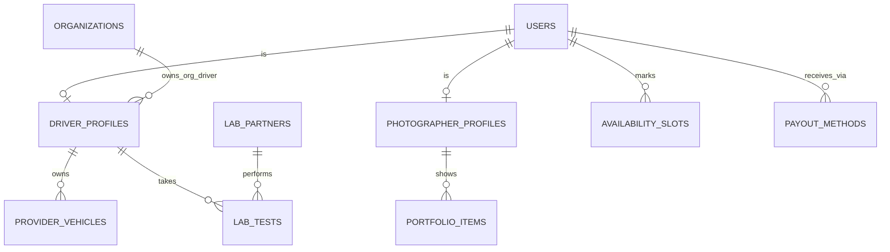

جزء من [نموذج البيانات](/ar/docs/erd)؛ وتُوثَّق الاتفاقيات والأعمدة الأساسية هناك.

## driver_profiles
*(Base +) — هوية سائق واحدة لكل مستخدم لكل مسار؛ حالة الفحص المختبري والاشتراك تحددان ما يجوز للسائق فعله.*

<TypeTable
  type={{
    "user_id": {
      type: "BIGINT FK users",
      description: "فريد لكل مسار",
      required: true,
    },
    "track_id": {
      type: "BIGINT FK lookups",
      description: "`supplier_track`: platform, organization",
      required: true,
    },
    "organization_id": {
      type: "BIGINT FK organizations NULL",
      description: "يُضبط لسائقي الجهات المنظِّمة ([BRL-05](/ar/docs/brd/requirements#7-قواعد-العمل))",
      required: true,
    },
    "license_no_enc": {
      type: "BYTEA",
      description: "مشفَّر",
      required: true,
    },
    "license_valid_until": {
      type: "DATE",
      required: true
    },
    "service_regions": {
      type: "TEXT[]",
      required: true
    },
    "subscription_id": {
      type: "BIGINT FK subscriptions NULL",
      description: "لسائقي المنصة فقط",
      required: true,
    },
    "lab_status_id": {
      type: "BIGINT FK lookups",
      description: "`driver_lab_status`: clear, paused, suspended",
      required: true,
    },
    "suspended_since": {
      type: "TIMESTAMPTZ",
      description: "يُغلق بعد 30 يومًا ([BRL-16](/ar/docs/brd/requirements#7-قواعد-العمل))",
      required: true,
    },
    "visibility_id": {
      type: "BIGINT FK lookups",
      description: "`profile_visibility`: standard, featured, top",
      required: true,
    },
    "verified_badge": {
      type: "BOOLEAN",
      description: "وفق الخطة",
      required: true,
    },
  }}
/>

الفهارس: `unique (user_id, track_id, deleted_at)`، و`(organization_id, lab_status_id)` لعمليات البحث عن السائقين للتكليف، و`(visibility_id)`.

**photographer_profiles** (Base +) — هوية مصوّر واحدة لكل مستخدم لكل مسار، مع إعدادات معرض الأعمال: `user_id FK`، و`track_id FK lookups (supplier_track)`، و`organization_id NULL`، و`bio JSONB`، و`equipment TEXT`، و`service_regions TEXT[]`، و`rates JSONB` (لكل عملة)، و`subscription_id FK NULL`، و`visibility_id FK lookups`، و`verified_badge BOOLEAN`، و`watermark_settings JSONB`. الفهارس: `unique (user_id, track_id, deleted_at)`، و`(organization_id)`، و`(visibility_id)`.

**provider_vehicles** (Base +) — مركبات السائق الخاصة المعروضة في العروض، مع صلاحية التسجيل والتأمين [FR-ONB-07](/ar/docs/srs/requirements/onb#fr-onb-07--بيانات-مركبة-السائق-وتأمينه): `driver_profile_id FK`، و`plate_no VARCHAR(20)`، و`model VARCHAR(80)`، و`year SMALLINT`، و`seat_count SMALLINT`، و`registration_valid_until DATE`، و`insurance_valid_until DATE` (صالحة 3 أشهر على الأقل عند التقديم). الفهارس: `(driver_profile_id)`، و`(registration_valid_until)`، و`(insurance_valid_until)` لعملية المسح الدوري لانتهاء الصلاحية.

**availability_slots** (Base +) — نطاقات تواريخ يحددها المورّد كمتاحة أو محجوبة (D-89): `user_id FK`، و`starts_on DATE`، و`ends_on DATE`، و`kind_id FK lookups (availability_kind: available, unavailable)`. تواريخ ونطاقات فقط. الفهارس: `(user_id, starts_on, ends_on)` لعمليات البحث عن التداخل.

**portfolio_items** (Base +) — صور معرض أعمال المصوّر، بحد أقصى وفق الخطة: `photographer_profile_id FK`، و`storage_path TEXT`، و`width INT`، و`height INT`، و`sort_by INT`. العدد وفق الخطة ([FR-PHO-01](/ar/docs/srs/requirements/pho#fr-pho-01--معرض-الأعمال))؛ والحد الأدنى 8 عند التقديم. الفهارس: `(photographer_profile_id, sort_by)`.

**lab_partners** (Base +) — العيادات التي تجري فحوصات السائقين المختبرية أو تستقبلها في سوق معيّنة: `market_id FK`، و`name JSONB`، و`address JSONB`، و`api_settings_enc BYTEA`، و`is_active BOOLEAN`. الفهارس: `(market_id, is_active)`.

## lab_tests
*(Base +) — دورة فحص مختبري واحدة لكل سائق، تحكم قاعدتَي الإيقاف المؤقت والتعليق. من [FR-DRV-03](/ar/docs/srs/requirements/drv#fr-drv-03--الإيقاف-مؤقتًا-لأجل-الفحص-المختبري) إلى [FR-DRV-06](/ar/docs/srs/requirements/drv#fr-drv-06--الإيقاف-عند-تجاوز-المهلة)*

<TypeTable
  type={{
    "driver_profile_id": {
      type: "BIGINT FK driver_profiles",
      required: true
    },
    "lab_partner_id": {
      type: "BIGINT FK lab_partners NULL",
      required: true
    },
    "test_type_id": {
      type: "BIGINT FK lookups",
      description: "`lab_test_type`: drug_screen, medical_fitness, both",
      required: true,
    },
    "status_id": {
      type: "BIGINT FK lookups",
      description: "`lab_test_status`: requested, pending, result_uploaded, passed, failed, missed",
      required: true,
    },
    "requested_by": {
      type: "BIGINT FK users",
      description: "مشرف المنصة",
      required: true,
    },
    "requested_at": {
      type: "TIMESTAMPTZ",
      required: true
    },
    "deadline_at": {
      type: "TIMESTAMPTZ",
      description: "الافتراضي 3 أيام، من 1 إلى 7 (D-21)",
      required: true,
    },
    "booked_slot_at": {
      type: "TIMESTAMPTZ",
      required: true
    },
    "result_path": {
      type: "TEXT",
      description: "حاوية تخزين مقيَّدة",
      required: true,
    },
    "result_source_id": {
      type: "BIGINT FK lookups",
      description: "`lab_result_source`: partner, driver_upload",
      required: true,
    },
    "decided_by, decided_at": {
      type: "BIGINT, TIMESTAMPTZ",
      description: "قرار مشرف المنصة",
      required: true,
    },
    "is_initial": {
      type: "BOOLEAN",
      description: "نتيجة فحص طلب الانضمام",
      required: true,
    },
  }}
/>

الفهارس: `(driver_profile_id, status_id)`، و`(lab_partner_id)`، وفهرس جزئي `(deadline_at)` حيث تكون `status_id` ضمن `requested` أو `pending` — لعملية المسح الخاصة بتجاوز الموعد النهائي.

**payout_methods** (Base +) — الوجهة التي تُحوَّل إليها أرباح المورّد، مع طريقة افتراضية واحدة لكل مستخدم: `user_id FK`، و`organization_id NULL`، و`method_id FK lookups (payout_method: stripe_connect, bank_transfer, local_provider)`، و`details_enc BYTEA`، و`external_account_id VARCHAR(100)`، و`currency_code`، و`is_default BOOLEAN`، و`verified_at`. الفهارس: `(user_id)`، و`(organization_id)`، وفهرس جزئي `unique (user_id)` حيث `is_default`.
