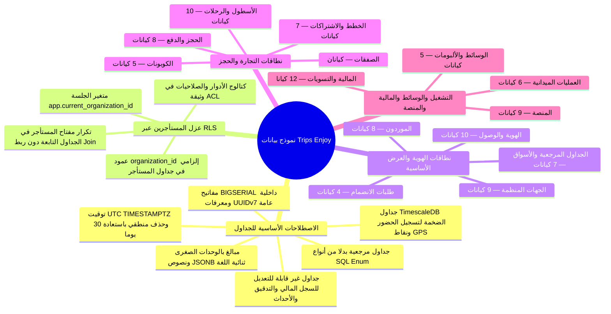
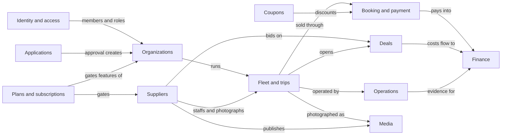

# Trips Enjoy: تصميم العلاقات بين الكيانات (ERD)

<TraceBar
  brd={[
    { label: 'قواعد العمل', href: '/ar/docs/brd/requirements#7-قواعد-العمل', detail: 'BRL-01 · BRL-15 · BRL-18' },
  ]}
  srs={[
    { label: 'قواعد البيانات §6', href: '/ar/docs/srs/data', detail: 'DAT-01..15' },
    { label: 'الأمان والبيانات NFR', href: '/ar/docs/srs/quality#82-الأمان-nfr-sec', detail: 'NFR-SEC-07' },
  ]}
  erd={[
    { label: 'التحكم في الوصول وRLS', href: '/ar/docs/erd/acl' },
    { label: 'كتالوج الجداول المرجعية', href: '/ar/docs/erd/reference' },
  ]}
  plan={[
    { label: 'خطة التسليم', href: '/ar/docs/plan', detail: '231 مهمة مرتبطة بالجداول' },
  ]}
  workflows={[
    { label: 'سير العمل في النظام', href: '/ar/docs/workflows' },
    { label: 'المالية والسجل', href: '/ar/docs/workflows/money' },
  ]}
  userFlows={[
    { label: 'تدفقات المستخدم', href: '/ar/docs/user-flows', detail: '106 UF-*' },
  ]}
  architecture={[
    { label: 'معمارية البيانات', href: '/ar/docs/architecture#معمارية-البيانات' },
  ]}
  design={[
    { label: 'نظام التصميم', href: '/ar/docs/design' },
  ]}
  system={[
    { label: 'النظام الشامل', href: '/ar/docs/system' },
    { label: 'أطلس الخرائط الذهنية', href: '/ar/docs/system/mindmaps' },
  ]}
  recommendations={[
    { label: 'RLS وTimescaleDB', href: '/ar/docs/recommendations/architecture-and-ops#rec-data-02', detail: 'REC-DATA-02' },
    { label: 'ثوابت دفتر القيد المزدوج', href: '/ar/docs/recommendations/architecture-and-ops#rec-fin-10', detail: 'REC-FIN-10' },
  ]}
/>

<MindmapBlock
  title="العمود الفقري لنموذج البيانات — 14 نطاقًا والاصطلاحات الأساسية وعزل RLS"
  caption="كيف تنمذج المنصة بيانات المستأجرين المتعددين في PostgreSQL 16 وTimescaleDB عبر 14 نطاقًا، مع سجلات مالية وأحداث غير قابلة للتعديل، ومعرّفات UUIDv7 عامة، وأمان صارم على مستوى الصفوف."
  trace={{
    erd: [
      { label: 'الهوية والوصول', href: '/ar/docs/erd/domains/identity-and-access' },
      { label: 'الجهات المنظِّمة', href: '/ar/docs/erd/domains/organizations' },
      { label: 'الأسطول والرحلات', href: '/ar/docs/erd/domains/fleet-and-trips' },
      { label: 'الحجز والدفع', href: '/ar/docs/erd/domains/booking-and-payment' },
      { label: 'العمليات', href: '/ar/docs/erd/domains/operations' },
      { label: 'المالية', href: '/ar/docs/erd/domains/finance' },
      { label: 'المنصة', href: '/ar/docs/erd/domains/platform' },
      { label: 'ACL وRLS', href: '/ar/docs/erd/acl' },
    ],
    srs: [
      { label: 'DAT-01..15', href: '/ar/docs/srs/data' },
    ],
    recommendations: [
      { label: 'REC-DATA-02', href: '/ar/docs/recommendations/architecture-and-ops#rec-data-02' },
    ],
  }}
>

</MindmapBlock>

تنطبق هذه القواعد على كل جدول ما لم يذكر الجدول خلاف ذلك.

| القاعدة | التفاصيل |
|---|---|
| المفتاح الأساسي | `id BIGSERIAL` (داخلي فقط، لا يُكشف للمستخدمين النهائيين أبدًا؛ انظر سياسة المعرّفات أدناه). |
| المعرّف العام | `uuid UUID NOT NULL UNIQUE`، يولّده التطبيق على هيئة UUIDv7 (مرتّب زمنيًا). لا تستخدم واجهات API وعناوين URL و webhooks وعمليات التصدير سوى `uuid`؛ ولا يترك `id` الواجهة الخلفية أبدًا (SRS [DAT-10](/ar/docs/srs/data#62-عزل-البيانات)). |
| الطوابع الزمنية | `created_at` و `updated_at` و `deleted_at` بصيغة `TIMESTAMPTZ`. تُخزَّن جميع الأوقات بتوقيت UTC. |
| الحذف المنطقي | تحمل الصفوف القابلة للحذف المنطقي `deleted_at TIMESTAMPTZ NULL` مع `deleted_by BIGINT NULL` كمفتاح أجنبي FK إلى `users.id`؛ ولا يوجد علم منطقي (boolean flag). يُعدّ الصف محذوفًا عندما تكون قيمة `deleted_at` غير فارغة (SRS [DAT-11](/ar/docs/srs/data#63-الحذف-الناعم-وعدم-القابلية-للتغيير-والحذف)). |
| نافذة الاستعادة | الصفوف المحذوفة منطقيًا قابلة للاستعادة لمدة 30 يومًا، بما يتوافق مع فترة السماح لحذف الحساب ([BRL-15](/ar/docs/brd/requirements#7-قواعد-العمل)). وتمحو الاستعادة `deleted_at` و `deleted_by`؛ وبعد انقضاء النافذة يبقى الصف مخفيًا ويُزال في التطهير بموجب سياسة الاحتفاظ (القسم 6.4 من SRS). |
| التفرد تحت الحذف المنطقي | قيود التفرد فهارس فريدة جزئية على الصفوف الحيّة فقط: `unique (cols) where deleted_at is null`. وحيثما وجب أن تبقى قيمة صف محذوف مميِّزة، يُستخدم فهرس رفيق `unique (cols, deleted_at) where deleted_at is not null` يعتمد عمود `deleted_at` حسمًا للتساوي (SRS [DAT-15](/ar/docs/srs/data#63-الحذف-الناعم-وعدم-القابلية-للتغيير-والحذف)). |
| أعمدة التدقيق | `created_by` و `updated_by` و `deleted_by` بصيغة `BIGINT` كمفاتيح FK خارجية إلى `users.id`. |
| لا أنواع enum | كل حالة ونوع وفئة هو مفتاح خارجي `BIGINT` FK إلى `lookups.id` (باسم `*_id`، مثل `status_id`). يُذكر نوع القيمة المرجعية في ملاحظات العمود. |
| عمود المستأجر | كل صف تملكه جهة منظِّمة يحمل `organization_id BIGINT NOT NULL` مفهرسًا، مع سياسة RLS على `app.current_organization_id` (SRS [DAT-01](/ar/docs/srs/data#62-عزل-البيانات)، [NFR-SEC-07](/ar/docs/srs/quality#82-الأمان-nfr-sec)). تكرر الجداول التابعة `organization_id` (بلا تطبيع) حتى لا تحتاج RLS أبدًا إلى ربط (join). |
| المبالغ المالية | `*_minor BIGINT` بوحدات صغرى مع `currency_code CHAR(3)` كمفتاح FK إلى `currencies.code`. ليس أبدًا عددًا عائمًا ولا رقمًا مجردًا (D-157). |
| النص القابل للترجمة | `JSONB` بالشكل `{"en": "...", "ar": "..."}` للأسماء والأوصاف المعروضة للمستخدمين. |
| الدولة | `country_code CHAR(2)` كمفتاح FK إلى `countries.code` (ISO 3166-1 alpha-2). |
| الجداول غير القابلة للتغيير | `ledger_entries`, `ledger_transactions`, `audit_logs`, `deal_offers`, `checkin_events`, `tracking_points`, `consents`, `outbox_events`: إدراج فقط. تحتفظ بـ `created_at` و `created_by` لكن ليس فيها أعمدة `updated_*` ولا `deleted_*` (SRS [DAT-13](/ar/docs/srs/data#63-الحذف-الناعم-وعدم-القابلية-للتغيير-والحذف)). والتصحيحات صفوف عكسية جديدة (SRS [DAT-08](/ar/docs/srs/data#63-الحذف-الناعم-وعدم-القابلية-للتغيير-والحذف)). |
| السلاسل الزمنية | `checkin_events` و `tracking_points` جداول hypertable في TimescaleDB مقسّمة على `occurred_at`؛ والمفتاح الأساسي `(id, occurred_at)`. |
| الأعمدة المشفرة | الأعمدة المعلَّمة بـ "enc" مشفرة على مستوى العمود باستخدام KMS (SRS [DAT-05](/ar/docs/srs/data#62-عزل-البيانات)). يدعم عمود `*_hash` المجاور لها عمليات البحث. |
| الفهارس | كل عمود مفتاح خارجي `*_id` مفهرس (فهرس b-tree أحادي العمود) حتى حيث لا يُكرَّر أدناه. تسرد أسطر "الفهارس" لكل جدول الفهارس المركبة والجزئية وفهارس التفرد التي تتجاوز تلك القاعدة. تُكتب الفهارس الجزئية بالصيغة `partial (cols) where condition`. ويحتفظ كل جدول قابل للحذف المنطقي بنسخة جزئية `where deleted_at is null` من كل فهرس استعلام ساخن (SRS [DAT-14](/ar/docs/srs/data#63-الحذف-الناعم-وعدم-القابلية-للتغيير-والحذف)). |
لا تُكرَّر الأعمدة الأساسية في الجداول أدناه. تعني "الأساسية": `id`, `uuid`, `created_at`, `updated_at`, `deleted_at`, `created_by`, `updated_by`, `deleted_by`.
| النطاق | الجداول | القسم |
|---|---|---|
| الجداول المرجعية والأسواق | lookup_types, lookups, countries, currencies, markets, market_payment_methods, tax_rates | 3.1 |
| الهوية والوصول | users, user_roles, auth_factors, passkey_credentials, otp_challenges, sessions, devices, consents, notification_preferences, privacy_requests | 3.2 |
| طلبات الانضمام | applications, application_documents, application_decisions, appeals | 3.3 |
| الجهات المنظِّمة | organizations, organization_members, permissions, member_permissions, invitations, crm_connections, webhook_endpoints, webhook_deliveries, api_keys | 3.4 |
| المورّدون | driver_profiles, photographer_profiles, provider_vehicles, availability_slots, portfolio_items, lab_partners, lab_tests, payout_methods | 3.5 |
| الأسطول والرحلات | vehicle_types, vehicle_type_seats, vehicles, trips, trip_stops, trip_audiences, trip_vehicles, trip_staff_assignments, programs, program_tiers | 3.6 |
| الصفقات | deals, deal_offers | 3.7 |
| الحجز والدفع | bookings, booking_passengers, booking_programs, trip_seats, payments, payment_attempts, refunds, booking_remedies | 3.8 |
| الكوبونات | coupons, coupon_programs, coupon_audiences, coupon_redemptions, abuse_flags | 3.9 |
| الخطط | plans, plan_limits, plan_prices, subscriptions, subscription_charges, plan_overrides, usage_counters | 3.10 |
| العمليات | checkin_events, incidents, trip_reports, tracking_points, child_links, safety_cases | 3.11 |
| الوسائط | albums, photos, album_shared_links, album_members, download_logs | 3.12 |
| المالية | ledger_accounts, ledger_transactions, ledger_entries, invoices, invoice_lines, payout_runs, payouts, settlements, settlement_lines, reconciliation_exceptions, disputes, dispute_files | 3.13 |
| المنصة | notifications, notification_deliveries, notification_templates, feature_flags, analytics_events, analytics_daily, audit_logs, outbox_events, idempotency_keys | 3.14 |

اقرأ [التحكم في الوصول (ACL)](/ar/docs/erd/acl) للاطلاع على كتالوج الصلاحيات ونموذج الأدوار وتعريفات سياسات الأمان على مستوى الصفوف. تخضع مسارات القراءة والكتابة لكل جدول لما يرد هناك.

## سياسة المعرّفات

لكل جدول `id BIGSERIAL` كمفتاح أساسي داخلي ووجهة لكل مفتاح خارجي. وقد يظهر `id` في أدوات الإدارة والسجلات وشاشات الدعم، لكنه لا يظهر أبدًا في واجهات API العامة أو عناوين URL أو webhooks أو عمليات التصدير — فهذه تخاطب الصفوف عبر `uuid` (SRS [DAT-10](/ar/docs/srs/data#62-عزل-البيانات)). وقيمة `uuid` هي UUIDv7، فتُرتَّب المعرّفات الظاهرة خارجيًا حسب وقت الإنشاء، وتحافظ بادئات UUIDv7 على تلاصق مواضع إدراج الفهرس.

المعرّفات التي يحملها كل صنف من الجداول:

| صنف الجدول | المعرّفات | أمثلة |
|---|---|---|
| صفوف الأعمال (السجل، التدقيق، الأحداث) | `id BIGSERIAL` داخلي مع `uuid UUIDv7` عام | bookings, ledger_entries, audit_logs, analytics_events |
| صفوف الجداول المرجعية | `id BIGINT` مع `code` ثابت (`countries` و `currencies` يعتمدان المفتاح على `code` وحده)؛ بلا `uuid` — `code` هو الاسم العام | lookup_types, lookups, countries, currencies |
| صفوف الموصلات والصفوف العابرة | `id BIGSERIAL` فقط؛ لا يعبر الصف أبدًا حمولة API أو عنوان URL | outbox_events, idempotency_keys |

تشير المفاتيح الخارجية دائمًا إلى `id`؛ أما `code` فهو مفتاح تسمية ومطابقة للبيانات الأولية (seed)، وليس أبدًا وجهة ربط بين جداول الأعمال.

## خريطة علاقات النطاقات

كيف تعتمد النطاقات على بعضها. تشكل الجداول المرجعية والأسواق أساس كل نطاق ولذلك حُذفت؛ وتكتب جميع النطاقات في نطاق المنصة (الإشعارات، والتدقيق، و outbox).

## النطاقات

<Cards>
  <Card title="الجداول المرجعية والأسواق" description="7 كيانات" href="/ar/docs/erd/domains/lookups-and-markets" />
  <Card title="الهوية والوصول" description="9 كيانات" href="/ar/docs/erd/domains/identity-and-access" />
  <Card title="طلبات الانضمام" description="4 كيانات" href="/ar/docs/erd/domains/applications" />
  <Card title="الجهات المنظِّمة" description="9 كيانات" href="/ar/docs/erd/domains/organizations" />
  <Card title="المورّدون" description="8 كيانات" href="/ar/docs/erd/domains/suppliers" />
  <Card title="الأسطول والرحلات" description="10 كيانات" href="/ar/docs/erd/domains/fleet-and-trips" />
  <Card title="الصفقات" description="كيانان" href="/ar/docs/erd/domains/deals" />
  <Card title="الحجز والدفع" description="8 كيانات" href="/ar/docs/erd/domains/booking-and-payment" />
  <Card title="الكوبونات" description="5 كيانات" href="/ar/docs/erd/domains/coupons" />
  <Card title="الخطط والاشتراكات" description="7 كيانات" href="/ar/docs/erd/domains/plans-and-subscriptions" />
  <Card title="العمليات" description="6 كيانات" href="/ar/docs/erd/domains/operations" />
  <Card title="الوسائط" description="5 كيانات" href="/ar/docs/erd/domains/media" />
  <Card title="المالية" description="12 كيانًا" href="/ar/docs/erd/domains/finance" />
  <Card title="المنصة" description="9 كيانات" href="/ar/docs/erd/domains/platform" />
</Cards>
