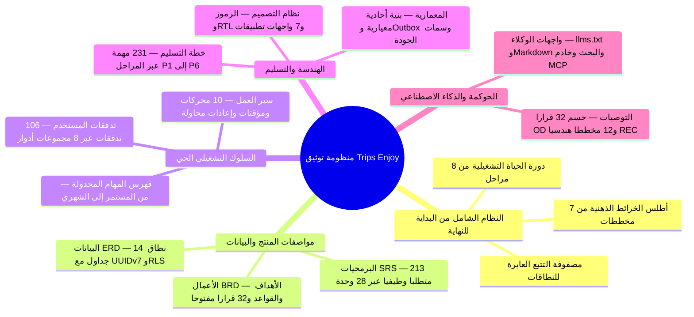

Trips Enjoy هي منصة رحلات جماعية منظَّمة ثنائية اللغة ومتعددة الأدوار: يحجز المسافرون مقاعدهم في رحلات منظَّمة، وتنشر الجهات المنظِّمة هذه الرحلات وتديرها، بينما يقدّم السائقون والمصوّرون والمشرفون التجربة على أرض الواقع. هذه هي مجموعة التوثيق الكاملة للمنتج والهندسة — **213** متطلبًا وظيفيًا موزعة على **28** وحدة، و**14** نطاق بيانات، و**106** تدفقات للأدوار، و**10** عمليات سير عمل في النظام، و**231** مهمة تسليم (**213** وظيفية + **18** تأسيسية للمنصة)، و**32** قرارًا مفتوحًا متتبَّعًا (`OD-*`) مع توصيات عملية مقترحة للحسم.

جميع الصفحات متاحة بواجهتين عربية وإنجليزية؛ وهذا التوثيق مكتوب بالعربية. يمكن للقارئ الجديد البدء من قسم [النظام الشامل](/ar/docs/system) و[أطلس الخرائط الذهنية](/ar/docs/system/mindmaps) لتكوين صورة متكاملة لكيفية ترابط جميع الركائز قبل التعمّق في المواصفات التفصيلية.

<MindmapBlock
  title="مجموعة توثيق Trips Enjoy — خريطة الركائز الكاملة"
  caption="كيف تترابط أهداف العمل والمواصفات الوظيفية وجداول قاعدة البيانات وتدفقات المستخدمين ومحركات سير العمل ومهام المراحل والمعمارية ورموز التصميم والقرارات المقترحة في مخطط واحد قابل للتتبع."
  trace={{
    system: [
      { label: 'النظام الشامل', href: '/ar/docs/system', detail: '8 مراحل' },
      { label: 'رحلة دورة الحياة', href: '/ar/docs/system/lifecycle', detail: 'STAGE-01..08' },
      { label: 'أطلس الخرائط الذهنية', href: '/ar/docs/system/mindmaps', detail: '7 خرائط' },
    ],
    brd: [
      { label: 'مواصفة الأعمال', href: '/ar/docs/brd' },
      { label: 'المتطلبات والقواعد', href: '/ar/docs/brd/requirements', detail: 'BRL-01..30' },
      { label: 'القرارات المفتوحة', href: '/ar/docs/brd/compliance#11-القرارات-المفتوحة', detail: '32 OD-*' },
    ],
    srs: [
      { label: 'مواصفة البرمجيات', href: '/ar/docs/srs', detail: '213 متطلبًا · 28 وحدة' },
      { label: 'آلات الحالات', href: '/ar/docs/srs/state-machines', detail: '10 آلات' },
      { label: 'الجودة وNFRs', href: '/ar/docs/srs/quality' },
    ],
    erd: [
      { label: 'نموذج البيانات', href: '/ar/docs/erd', detail: '14 نطاقًا' },
      { label: 'ACL وRLS', href: '/ar/docs/erd/acl' },
    ],
    userFlows: [
      { label: 'تدفقات الأدوار', href: '/ar/docs/user-flows', detail: '106 UF-*' },
    ],
    workflows: [
      { label: 'سير العمل في النظام', href: '/ar/docs/workflows', detail: '10 عمليات' },
      { label: 'المهام المجدولة', href: '/ar/docs/workflows/scheduled-jobs' },
    ],
    plan: [
      { label: 'خطة التسليم', href: '/ar/docs/plan', detail: '231 مهمة · P1–P6' },
      { label: 'المعالم الرئيسية', href: '/ar/docs/plan/milestones' },
    ],
    architecture: [
      { label: 'معمارية المنصة', href: '/ar/docs/architecture' },
    ],
    design: [
      { label: 'نظام التصميم', href: '/ar/docs/design', detail: 'RTL وWCAG AA' },
    ],
    recommendations: [
      { label: 'مركز التوصيات', href: '/ar/docs/recommendations' },
      { label: 'حسم القرارات المفتوحة', href: '/ar/docs/recommendations/open-decisions', detail: '32 OD + 15 OPEN' },
      { label: 'المعمارية والتشغيل', href: '/ar/docs/recommendations/architecture-and-ops', detail: '12 REC-*' },
    ],
  }}
>

</MindmapBlock>

<Cards>
  <Card title="النظام الشامل" description="دورة الحياة التشغيلية الموحّدة من 8 مراحل من الانضمام حتى التسويات المالية، مع أطلس الخرائط الذهنية (/ar/docs/system/mindmaps)." icon="Layers" href="/ar/docs/system" />
  <Card title="الأعمال (BRD)" description="الأهداف والنطاق وأصحاب المصلحة والنموذج التجاري و30 قاعدة عمل والمخاطر و32 قرارًا مفتوحًا متتبَّعًا (OD-*)." icon="Briefcase" href="/ar/docs/brd" />
  <Card title="البرمجيات (SRS)" description="213 متطلبًا وظيفيًا موزعة على 28 وحدة، ومتطلبات البيانات، و10 آلات حالات ومتطلبات الجودة غير الوظيفية." icon="ClipboardList" href="/ar/docs/srs" />
  <Card title="نموذج البيانات (ERD)" description="14 نطاقًا من جداول PostgreSQL وTimescaleDB، وفهرس الجداول المرجعية، ومسارات أمان مستوى الصف (RLS)." icon="Database" href="/ar/docs/erd" />
  <Card title="تدفقات المستخدم" description="106 تدفقات للأدوار عبر 8 مجموعات: التسجيل والاعتماد والحجز والتشغيل الحي ومفاتيح المرور والسلوكيات المشتركة." icon="Route" href="/ar/docs/user-flows" />
  <Card title="سير العمل في النظام" description="10 عمليات سير عمل في النظام — آلات الحالات والمؤقتات وإعادة المحاولات وكل مهمة مجدولة، مع القصص والمخططات." icon="Cog" href="/ar/docs/workflows" />
  <Card title="خطة التسليم" description="ست مراحل (P1–P6) — 231 مهمة تسليم (213 وظيفية + 18 للمنصة)، كل منها ببطاقة مهمة غنية ومعايير قبول ومعالم وبوابات." icon="ListTodo" href="/ar/docs/plan" />
  <Card title="المعمارية" description="سياق النظام ونموذج البنية الأحادية المعيارية ومعمارية البيانات والتكاملات وطوبولوجيا النشر وسمات الجودة." icon="Network" href="/ar/docs/architecture" />
  <Card title="نظام التصميم" description="الرموز الدلالية ومكوّنات الواجهة المشتركة وقواعد RTL والأرقام الغربية والتزامات الوصول WCAG 2.1 AA لكل الواجهات." icon="Palette" href="/ar/docs/design" />
  <Card title="التوصيات والقرارات المقترحة" description="توصيات عملية لحسم جميع القرارات المفتوحة الـ32 (OD-*) و15 بندًا مفتوحًا [OPEN]، بالإضافة إلى 12 مخططًا للمعمارية والتشغيل." icon="Lightbulb" href="/ar/docs/recommendations" />
  <Card title="لوكلاء الذكاء الاصطناعي" description="ملفا llms.txt وllms-full.txt وMarkdown لكل صفحة وواجهة برمجة للبحث وخادم MCP لعملاء الذكاء الاصطناعي." icon="Bot" href="/ar/docs/ai" />
</Cards>

## كيف تقرأ هذه المجموعة

- ابدأ من قسم [النظام الشامل](/ar/docs/system) و[أطلس الخرائط الذهنية](/ar/docs/system/mindmaps) لتكوين نموذج ذهني بصري لجميع الأدوار الـ9 والوحدات الـ28 ونطاقات البيانات الـ14 وعمليات سير العمل الـ10 ومراحل التسليم الـ6.
- تشير جميع الوثائق إلى بعضها البعض بمعرّفات ثابتة: `BR-*` (تجارية)، و`BRL-*` (قواعد)، و`FR-*` (213 متطلبًا وظيفيًا)، و`D-*` (قرارات محسومة)، و`OD-*` (32 قرارًا متتبَّعًا)، و`UF-*` (106 تدفقات أدوار)، و`T-*` (231 مهمة تسليم مرحلية)، و`REC-*` (12 مخططًا هندسيًا وتشغيليًا).
- تُدرج كل صفحة من متطلبات SRS أولوية MoSCoW ومعرّفات BRD المصدرية التي ترجع إليها، وتقترن حتميًا ببطاقة `<TaskCard />` في [خطة التسليم](/ar/docs/plan).
- العناصر الموسومة بـ `[OPEN]` أو *(عنصر نائب)* تتبع عملية القرار المفتوح في [BRD](/ar/docs/brd/compliance#11-القرارات-المفتوحة)، وتقترن بتوصيات عملية معايَرة لأسواق المنطقة في قسم [التوصيات والقرارات المقترحة](/ar/docs/recommendations/open-decisions).
