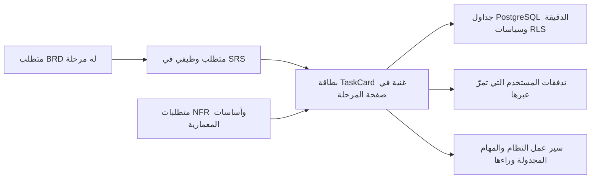
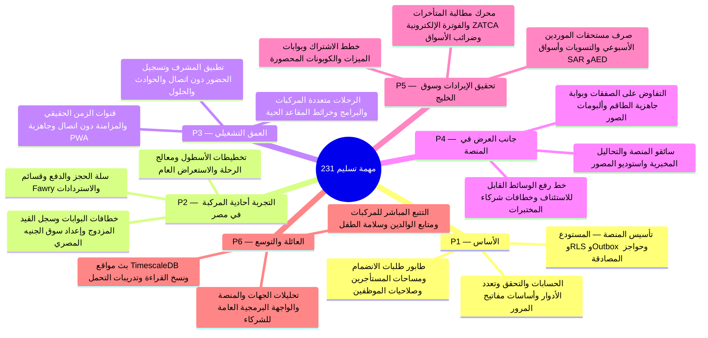

هذه هي نظرة التسليم الشاملة للنظام كله: ست مراحل (`P1`–`P6`) من الأساس إلى التوسع بإجمالي **231 مهمة** (**213 مهمة وظيفية** مولَّدة بنسبة 1 إلى 1 من المتطلبات الوظيفية في SRS بالإضافة إلى **18 مهمة تأسيسية عابرة للمجالات على مستوى المنصة** من `T-P1-PLAT-1` حتى `T-P6-PLAT-3`). لا شيء هنا يُدار يدويًا: فصفحات المراحل والمعالم الرئيسية تُولَّد حتميًا بواسطة `bun scripts/generate-plan.ts` (و`bun scripts/generate-plan-ar.ts` للنسخة العربية) من التوثيق الحي، فلا يمكن للخطة أن تنحرف عن المتطلبات أبدًا.

<TraceBar
  brd={[
    { label: 'مراحل التسليم §3.3', href: '/ar/docs/brd#33-مراحل-التسليم' },
    { label: 'قواعد العمل §7', href: '/ar/docs/brd/requirements#7-قواعد-العمل', detail: 'BRL-01..30' },
    { label: 'القرارات المفتوحة §11', href: '/ar/docs/brd/compliance#11-القرارات-المفتوحة', detail: '32 OD-*' },
  ]}
  srs={[
    { label: 'نظرة عامة على SRS', href: '/ar/docs/srs', detail: '213 متطلبًا · 28 وحدة' },
    { label: 'مصفوفة التتبع', href: '/ar/docs/srs/traceability' },
  ]}
  erd={[
    { label: 'نموذج البيانات', href: '/ar/docs/erd', detail: '14 نطاقًا' },
    { label: 'ACL وRLS', href: '/ar/docs/erd/acl' },
  ]}
  plan={[
    { label: 'دليل البناء', href: '/ar/docs/plan/build-guide' },
    { label: 'المعالم الرئيسية', href: '/ar/docs/plan/milestones' },
    { label: 'استراتيجية الاختبار', href: '/ar/docs/plan/testing' },
  ]}
  workflows={[
    { label: 'سير العمل في النظام', href: '/ar/docs/workflows' },
    { label: 'مصفوفة التغطية', href: '/ar/docs/workflows/coverage', detail: '213/213 FR' },
  ]}
  userFlows={[
    { label: '106 تدفقات أدوار', href: '/ar/docs/user-flows' },
  ]}
  architecture={[
    { label: 'معمارية المنصة', href: '/ar/docs/architecture' },
  ]}
  design={[
    { label: 'نظام التصميم', href: '/ar/docs/design' },
  ]}
  system={[
    { label: 'رحلة دورة الحياة', href: '/ar/docs/system/lifecycle' },
    { label: 'أطلس الخرائط الذهنية', href: '/ar/docs/system/mindmaps' },
  ]}
  recommendations={[
    { label: 'بوابات قرارات المراحل', href: '/ar/docs/recommendations' },
    { label: 'بوابات الإطلاق واختبار الضغط', href: '/ar/docs/recommendations/architecture-and-ops#rec-ops-12', detail: 'REC-OPS-12' },
  ]}
/>

## كيف تتكامل الأجزاء

- تنفِّذ كل **مهمة وظيفية** (`T-P{n}-{MOD}-{seq}`، بإجمالي **213** مهمة) [متطلبًا وظيفيًا](/ar/docs/srs/requirements/auth) واحدًا بالضبط وترث أولويته وفق MoSCoW (`Must`، `Should`، `Could`). وتأتي مرحلتها من تتبع المتطلب التجاري: `FR ← BR ← مرحلة BRD`.
- ترسي كل **مهمة تأسيسية للمنصة** (`T-P{n}-PLAT-{k}`، بإجمالي **18** مهمة — 3 مهام في كل مرحلة) العمود الفقري المشترك للتكامل المستمر، وقاعدة البيانات وسياسات RLS، وبوابات الدفع، والعمال، والرصد، واختبارات التحمّل اللازمة قبل أو بموازاة وحدات المرحلة الوظيفية.
- تُعرَض كل مهمة في بطاقة **`<TaskCard />`** متكاملة تتضمن نص التزام SRS الكامل مضمَّنًا، ومعايير القبول بصيغة Given/When/Then، ومخرجات التنفيذ الملموسة، وواجهات التطبيقات المتأثرة، وأسماء جداول PostgreSQL وTimescaleDB الدقيقة، وسياق الحوكمة المصدري (`BR-*` و`BRL-*` و`OD-*`)، وشريط تتبع **`<TraceBar />`** ملون يربط مباشرةً بين `BRD` و`SRS` و`ERD` و`الخطة` و`سير العمل` و`تدفقات المستخدم` و`المعمارية` و`التصميم` و`التوصيات`.
- لا تحمل المهمات **أي تقديرات زمنية مُختلَقة**. احكم على حجم المرحلة بعدد مهماتها (`231` عبر `P1`–`P6`) وتوزيع أولوياتها (كما يُعرض في كل صفحة وفي [المعالم الرئيسية](/ar/docs/plan/milestones))؛ وتُغلق المرحلة بتعريف الإتمام، لا بتاريخ تقويمي.

## كيف تبني خطوة بخطوة

اعمل مرحلة واحدة في كل مرة؛ ويضمّ [دليل البناء](/ar/docs/plan/build-guide) حلقة العمل وقوائم القراءة لكل مرحلة. لكل مرحلة، اقرأ السلسلة بهذا الترتيب قبل كتابة الشيفرة:

1. **السياق التجاري (BRD)** — [المتطلبات](/ar/docs/brd/requirements) الخاصة بمتطلبات المرحلة التجارية و[قواعد العمل](/ar/docs/brd/requirements#7-قواعد-العمل) ([BRL-01](/ar/docs/brd/requirements#7-قواعد-العمل) إلى [BRL-30](/ar/docs/brd/requirements#7-قواعد-العمل)) التي يجب أن تحترمها كل مهمة.
2. **المتطلبات (SRS)** — تضم كل بطاقة `<TaskCard />` نص التزام المتطلب ومعايير قبوله مباشرةً، وتربط عبر `<TraceBar />` بصفحة الوحدة و[مصفوفة التتبع](/ar/docs/srs/traceability).
3. **نموذج البيانات (ERD)** — تسرد كل بطاقة `<TaskCard />` الجداول الدقيقة في PostgreSQL التي تقرؤها الميزة وتكتب فيها، مع روابط إلى [نطاقات نموذج البيانات](/ar/docs/erd) و[فهرس القيم المرجعية](/ar/docs/erd/reference) و[التحكم بالوصول (RLS)](/ar/docs/erd/acl).
4. **السلوك في الحركة** — اتبع شارات `تدفقات المستخدم` و`سير العمل` في `<TraceBar />` لمراجعة [تدفقات المستخدم](/ar/docs/user-flows) و[سير عمل النظام](/ar/docs/workflows) التي تمرّ عبر المهمة: الحالات والمؤقتات وإعادة المحاولات والوظائف المجدولة.
5. **ابنِ وتحقّق** — نفِّذ مخرجات المهمة عبر الواجهات والجداول المحددة، ثم تحقق من كل معيار قبول مقابل [استراتيجية الاختبار](/ar/docs/plan/testing).
6. **بوابة المرحلة** — راجع القرارات المفتوحة للمرحلة وتوصيات حسمها في [التوصيات والقرارات المقترحة](/ar/docs/recommendations/open-decisions) **قبل** بدء المرحلة، وراجع [سلّم المعالم](/ar/docs/plan/milestones) قبل إعلان المرحلة منتهية.

## المراحل

<MindmapBlock
  title="تدرّج التسليم عبر 6 مراحل — من P1 إلى P6 (231 مهمة)"
  caption="سلّم التسليم المتتابع بدءًا من تأسيس الهوية وعزل المستأجرين وتجربة مصر أحادية المركبة، مرورًا بتسجيل الحضور متعدد المركبات وصفقات الموردين، وصولًا إلى تحقيق الإيرادات في الخليج وتتبع العائلة."
  trace={{
    plan: [
      { label: 'P1 الأساس', href: '/ar/docs/plan/p1' },
      { label: 'P2 تجربة مصر', href: '/ar/docs/plan/p2' },
      { label: 'P3 العمق التشغيلي', href: '/ar/docs/plan/p3' },
      { label: 'P4 جانب العرض', href: '/ar/docs/plan/p4' },
      { label: 'P5 الإيرادات والخليج', href: '/ar/docs/plan/p5' },
      { label: 'P6 العائلة والتوسع', href: '/ar/docs/plan/p6' },
      { label: 'المعالم الرئيسية', href: '/ar/docs/plan/milestones' },
      { label: 'استراتيجية الاختبار', href: '/ar/docs/plan/testing' },
    ],
    recommendations: [
      { label: 'مصفوفة قرارات المراحل', href: '/ar/docs/recommendations' },
    ],
  }}
>

</MindmapBlock>

<Cards>
  <Card title="P1 — الأساس" description="الحسابات، وطلبات الانضمام والاعتماد، ومساحات العمل، مع 3 مهام تأسيسية للمنصة." icon="Milestone" href="/ar/docs/plan/p1" />
  <Card title="P2 — التجربة أحادية المركبة" description="إنشاء الرحلات، والحجز، والمدفوعات بـ EGP والعمود الفقري للسجل المالي." icon="Milestone" href="/ar/docs/plan/p2" />
  <Card title="P3 — العمق التشغيلي" description="رحلات متعددة المركبات، والبرامج، وخريطة المقاعد الحية، وتطبيق المشرف وتسجيل الحضور دون اتصال." icon="Milestone" href="/ar/docs/plan/p3" />
  <Card title="P4 — جانب العرض في المنصة" description="السائقون، والتحاليل المخبرية، والمصوّرون، والصفقات وألبومات الوسائط." icon="Milestone" href="/ar/docs/plan/p4" />
  <Card title="P5 — تحقيق الإيرادات وسوق الخليج" description="الخطط، وبوابات الميزات، والكوبونات، والتسويات، وأسواق الريال (SAR) والدرهم (AED)." icon="Milestone" href="/ar/docs/plan/p5" />
  <Card title="P6 — العائلة والتوسّع" description="التتبع المباشر، ومتابع الوالدين، والتحليلات، وواجهة API العامة." icon="Milestone" href="/ar/docs/plan/p6" />
  <Card title="المعالم الرئيسية" description="سلّم المراحل الست مع أعداد المهام وبواباته والقرارات المطلوب إغلاقها." icon="Flag" href="/ar/docs/plan/milestones" />
  <Card title="استراتيجية الاختبار" description="كيف تتحول معايير القبول المضمّنة إلى هرم الاختبارات الآلية." icon="FlaskConical" href="/ar/docs/plan/testing" />
</Cards>

## قراءة صفحة مرحلة

تفتح كل صفحة مرحلة بمحورها و**تعريف الإتمام** (منقول حرفيًا من القسم 3.3 من BRD) وتوزيع الأولويات، يليها **مخطط ذهني لنطاق المرحلة** وجدول فهرس سريع للانتقال المباشر. ثم تأتي بطاقات `<TaskCard />` الثلاث الخاصة بمهام المنصة العابرة للمجالات (`T-P{n}-PLAT-1..3`)، يليها قسم (epic) لكل وحدة من وحدات SRS يضم بطاقات `<TaskCard />` وشرائط `<TraceBar />` الكاملة، وأخيرًا **القرارات المطلوب إغلاقها** — أي قرارات `OD-*` التي تستشهد بها متطلبات تلك المرحلة، مربوطةً مباشرةً بحالتها في BRD وبالتوصيات المقترحة لحسمها في [التوصيات والقرارات المقترحة](/ar/docs/recommendations/open-decisions).
