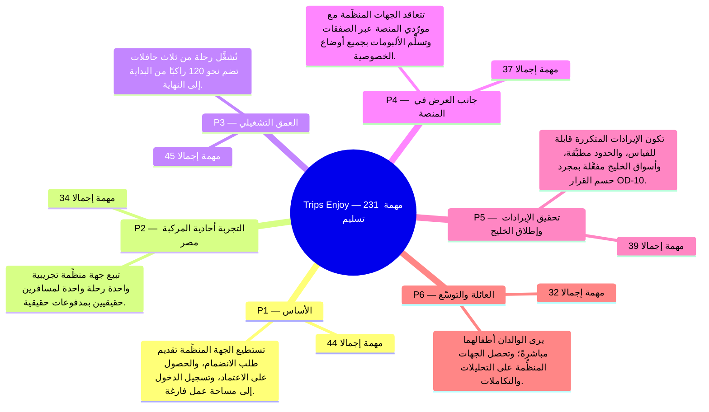

تُغلق كل مرحلة بتحقيق **تعريف الإتمام** الخاص بها ([القسم 3.3 من BRD](/ar/docs/brd#33-مراحل-التسليم)) بعد اجتياز جميع المهام الوظيفية الإلزامية (*Must*) ومهام البنية المشتركة لمعايير القبول. تُحتسب الأعداد (**231** مهمة إجمالًا: **213** وظيفية + **18** بنية منصة) آليًا من [صفحات المراحل المولَّدة](/ar/docs/plan).

<MindmapBlock title="سلّم المعالم للمراحل الست" caption="التدرج من المرحلة الأولى (الأساس) حتى المرحلة السادسة (العائلة والتوسع) مع حجم المهام ومخرج كل مرحلة." trace={{"brd":[{"label":"مراحل التسليم §3.3","href":"/ar/docs/brd#33-مراحل-التسليم"}],"srs":[{"label":"مصفوفة التتبع","href":"/ar/docs/srs/traceability"}],"erd":[{"label":"نموذج البيانات","href":"/ar/docs/erd"}],"plan":[{"label":"نظرة عامة على الخطة","href":"/ar/docs/plan"},{"label":"استراتيجية الاختبار","href":"/ar/docs/plan/testing"}],"workflows":[{"label":"سير عمل النظام","href":"/ar/docs/workflows"}],"architecture":[{"label":"المعمارية","href":"/ar/docs/architecture"}],"design":[{"label":"نظام التصميم","href":"/ar/docs/design"}],"system":[{"label":"النظام الشامل","href":"/ar/docs/system"}],"recommendations":[{"label":"سجل التوصيات","href":"/ar/docs/recommendations"}]}}>

</MindmapBlock>

## سلّم المراحل

| المرحلة | المهام (الوظيفية M/S/C + المنصة) | تعريف الإتمام | القرارات المطلوب حسمها (التوصية المقترحة) |
|---|---|---|---|
| [**P1** — الأساس](/ar/docs/plan/p1) | **44** (41 FR: 41M / 0S / 0C + 3 PLAT) | تستطيع الجهة المنظِّمة تقديم طلب الانضمام، والحصول على الاعتماد، وتسجيل الدخول إلى مساحة عمل فارغة. | [OD-03](/ar/docs/recommendations/open-decisions#od-03), [OD-12](/ar/docs/recommendations/open-decisions#od-12), [OD-21](/ar/docs/recommendations/open-decisions#od-21), [OD-23](/ar/docs/recommendations/open-decisions#od-23) |
| [**P2** — التجربة أحادية المركبة (مصر)](/ar/docs/plan/p2) | **34** (31 FR: 30M / 1S / 0C + 3 PLAT) | تبيع جهة منظِّمة تجريبية واحدة رحلة واحدة لمسافرين حقيقيين بمدفوعات حقيقية. | [OD-07](/ar/docs/recommendations/open-decisions#od-07) |
| [**P3** — العمق التشغيلي](/ar/docs/plan/p3) | **45** (42 FR: 39M / 3S / 0C + 3 PLAT) | تُشغَّل رحلة من ثلاث حافلات تضم نحو 120 راكبًا من البداية إلى النهاية. | [OD-25](/ar/docs/recommendations/open-decisions#od-25) |
| [**P4** — جانب العرض في المنصة](/ar/docs/plan/p4) | **37** (34 FR: 33M / 1S / 0C + 3 PLAT) | تتعاقد الجهات المنظِّمة مع مورّدي المنصة عبر الصفقات وتسلِّم الألبومات بجميع أوضاع الخصوصية. | [OD-13](/ar/docs/recommendations/open-decisions#od-13), [OD-24](/ar/docs/recommendations/open-decisions#od-24) |
| [**P5** — تحقيق الإيرادات وإطلاق الخليج](/ar/docs/plan/p5) | **39** (36 FR: 33M / 3S / 0C + 3 PLAT) | تكون الإيرادات المتكررة قابلة للقياس، والحدود مطبَّقة، وأسواق الخليج مفعَّلة بمجرد حسم القرار OD-10. | [OD-28](/ar/docs/recommendations/open-decisions#od-28) |
| [**P6** — العائلة والتوسّع](/ar/docs/plan/p6) | **32** (29 FR: 19M / 6S / 4C + 3 PLAT) | يرى الوالدان أطفالهما مباشرةً؛ وتحصل الجهات المنظِّمة على التحليلات والتكاملات. | — |

## قراءة السلّم

- **قاعدة إغلاق المرحلة:** لا تُغلق المرحلة إلا باجتياز جميع المهام الإلزامية (*Must*) ومهام البنية المشتركة الثلاث للاختبارات المحددة في [استراتيجية الاختبار](/ar/docs/plan/testing)؛ بينما يجوز ترحيل مهام *Should* و*Could* دون تعطيل الإغلاق.
- **بوابة القرارات المسبقة:** يرتبط كل قرار مفتوح في العمود الأخير مباشرةً بالتوصية المقترحة له في صفحة [حسم القرارات المفتوحة](/ar/docs/recommendations/open-decisions) لاعتماده قبل بدء المرحلة.
- **التحقق الشامل:** يُراجع مخرج كل مرحلة عمليًا مقابل المراحل المقابلة في [دورة حياة النظام الشاملة](/ar/docs/system/lifecycle) قبل الترقية إلى بيئة الإنتاج.
