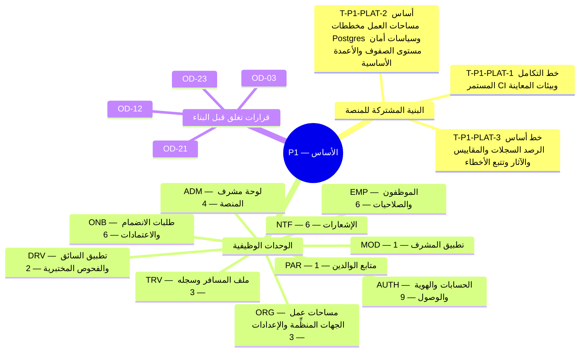

**المحور.** الأساس — الحسابات، وطلبات انضمام الجهات المنظِّمة واعتمادها، ومساحات العمل

**تعريف الإتمام.** تستطيع الجهة المنظِّمة تقديم طلب الانضمام، والحصول على الاعتماد، وتسجيل الدخول إلى مساحة عمل فارغة. *([القسم 3.3 من وثيقة الأعمال](/ar/docs/brd#33-مراحل-التسليم))*

**44 مهمة تسليم** (**41** مهمة وظيفية: **41** إلزامية Must، و**0** مهمة Should، و**0** تحسينية Could + **3** مهام بنية منصة مشتركة) موزعة على **10** وحدات برمجية. تتضمن كل مهمة أدناه المواصفة الكاملة ومخرجات التنفيذ الهندسي ومعايير القبول والجداول المتأثرة وروابط التتبع الشاملة عبر جميع وثائق النظام.

**نموذج البيانات.** تنطبق [اصطلاحات نموذج البيانات](/ar/docs/erd) و[ضوابط الوصول وأمان الصفوف RLS](/ar/docs/erd/acl) و[فهرس القيم المرجعية](/ar/docs/erd/reference) على جميع جداول هذه المرحلة.

<MindmapBlock title="خريطة نطاق المرحلة P1 — الأساس" caption="توزيع مهام البنية المشتركة والوحدات الوظيفية (44 مهمة) وبوابة إغلاق المرحلة P1." trace={{"brd":[{"label":"مراحل التسليم §3.3","href":"/ar/docs/brd#33-مراحل-التسليم"}],"srs":[{"label":"مصفوفة التتبع","href":"/ar/docs/srs/traceability"}],"erd":[{"label":"نموذج البيانات","href":"/ar/docs/erd"}],"plan":[{"label":"المعالم وبوابات المراحل","href":"/ar/docs/plan/milestones"},{"label":"دليل البناء","href":"/ar/docs/plan/build-guide"}],"workflows":[{"label":"تغطية المتطلبات","href":"/ar/docs/workflows/coverage"}],"architecture":[{"label":"معمارية المنصة","href":"/ar/docs/architecture"}],"design":[{"label":"نظام التصميم","href":"/ar/docs/design"}],"system":[{"label":"النظام الشامل","href":"/ar/docs/system/lifecycle"}],"recommendations":[{"label":"حسم القرارات المفتوحة","href":"/ar/docs/recommendations/open-decisions"}]}}>

</MindmapBlock>

## فهرس المهام السريع

| المهمة | الوحدة | المرجع | الأولوية |
|---|---|---|---|
| [T-P1-PLAT-1 — خط التكامل المستمر (CI) وبيئات المعاينة](#t-p1-plat-1) | `PLAT` | [قابلية الصيانة NFR-MNT](/ar/docs/srs/quality#89-قابلية-الصيانة-nfr-mnt) | Must |
| [T-P1-PLAT-2 — أساس مساحات العمل: مخططات Postgres وسياسات أمان مستوى الصفوف والأعمدة الأساسية](#t-p1-plat-2) | `PLAT` | [عزل البيانات DAT](/ar/docs/srs/data#62-عزل-البيانات), [عزل المستأجر NFR-SEC-07](/ar/docs/srs/quality#82-الأمان-nfr-sec) | Must |
| [T-P1-PLAT-3 — خط أساس الرصد: السجلات والمقاييس والآثار وتتبع الأخطاء](#t-p1-plat-3) | `PLAT` | [الرصد NFR-OBS](/ar/docs/srs/quality#86-الرصد-nfr-obs) | Must |
| [T-P1-AUTH-1 — مسارات تسجيل خاصة بكل دور](#t-p1-auth-1) | `AUTH` | [FR-AUTH-01](/ar/docs/srs/requirements/auth#fr-auth-01--مسارات-تسجيل-خاصة-بكل-دور) | Must |
| [T-P1-AUTH-2 — الدولة في كل نموذج تسجيل](#t-p1-auth-2) | `AUTH` | [FR-AUTH-02](/ar/docs/srs/requirements/auth#fr-auth-02--الدولة-في-كل-نموذج-تسجيل) | Must |
| [T-P1-AUTH-3 — التحقق عبر رمز لمرة واحدة](#t-p1-auth-3) | `AUTH` | [FR-AUTH-03](/ar/docs/srs/requirements/auth#fr-auth-03--التحقق-عبر-رمز-لمرة-واحدة) | Must |
| [T-P1-AUTH-4 — طرق تسجيل دخول خاصة بكل دور](#t-p1-auth-4) | `AUTH` | [FR-AUTH-04](/ar/docs/srs/requirements/auth#fr-auth-04--طرق-تسجيل-دخول-خاصة-بكل-دور) | Must |
| [T-P1-AUTH-5 — القفل بعد محاولات دخول فاشلة](#t-p1-auth-5) | `AUTH` | [FR-AUTH-05](/ar/docs/srs/requirements/auth#fr-auth-05--القفل-بعد-محاولات-دخول-فاشلة) | Must |
| [T-P1-AUTH-6 — حسابات متعددة الأدوار](#t-p1-auth-6) | `AUTH` | [FR-AUTH-06](/ar/docs/srs/requirements/auth#fr-auth-06--حسابات-متعددة-الأدوار) | Must |
| [T-P1-AUTH-7 — وصول الموظفين إلى عدة جهات منظِّمة](#t-p1-auth-7) | `AUTH` | [FR-AUTH-07](/ar/docs/srs/requirements/auth#fr-auth-07--وصول-الموظفين-إلى-عدة-جهات-منظِّمة) | Must |
| [T-P1-AUTH-8 — الإيقاف وإعادة التفعيل](#t-p1-auth-8) | `AUTH` | [FR-AUTH-08](/ar/docs/srs/requirements/auth#fr-auth-08--الإيقاف-وإعادة-التفعيل) | Must |
| [T-P1-AUTH-9 — الجلسات والرموز](#t-p1-auth-9) | `AUTH` | [FR-AUTH-10](/ar/docs/srs/requirements/auth#fr-auth-10--الجلسات-والرموز) | Must |
| [T-P1-ONB-1 — طلب الانضمام ووصول المورد](#t-p1-onb-1) | `ONB` | [FR-ONB-01](/ar/docs/srs/requirements/onb#fr-onb-01--طلب-الانضمام-ووصول-المورد) | Must |
| [T-P1-ONB-2 — قائمة انتظار واحدة لمشرف المنصة](#t-p1-onb-2) | `ONB` | [FR-ONB-02](/ar/docs/srs/requirements/onb#fr-onb-02--قائمة-انتظار-واحدة-لمشرف-المنصة) | Must |
| [T-P1-ONB-3 — المدة المستهدفة لاتخاذ القرار](#t-p1-onb-3) | `ONB` | [FR-ONB-03](/ar/docs/srs/requirements/onb#fr-onb-03--المدة-المستهدفة-لاتخاذ-القرار) | Must |
| [T-P1-ONB-4 — التعديلات المطلوبة](#t-p1-onb-4) | `ONB` | [FR-ONB-04](/ar/docs/srs/requirements/onb#fr-onb-04--التعديلات-المطلوبة) | Must |
| [T-P1-ONB-5 — الرفض والتظلم وإعادة التقديم](#t-p1-onb-5) | `ONB` | [FR-ONB-05](/ar/docs/srs/requirements/onb#fr-onb-05--الرفض-والتظلم-وإعادة-التقديم) | Must |
| [T-P1-ONB-6 — إشعارات حالة مقدِّم الطلب](#t-p1-onb-6) | `ONB` | [FR-ONB-09](/ar/docs/srs/requirements/onb#fr-onb-09--إشعارات-حالة-مقدِّم-الطلب) | Must |
| [T-P1-ORG-1 — عزل مساحة العمل](#t-p1-org-1) | `ORG` | [FR-ORG-01](/ar/docs/srs/requirements/org#fr-org-01--عزل-مساحة-العمل) | Must |
| [T-P1-ORG-2 — إنشاء مساحة العمل عند الاعتماد](#t-p1-org-2) | `ORG` | [FR-ORG-02](/ar/docs/srs/requirements/org#fr-org-02--إنشاء-مساحة-العمل-عند-الاعتماد) | Must |
| [T-P1-ORG-3 — سائقون ومصوّرون تابعون للجهة المنظِّمة](#t-p1-org-3) | `ORG` | [FR-ORG-03](/ar/docs/srs/requirements/org#fr-org-03--سائقون-ومصوّرون-تابعون-للجهة-المنظِّمة) | Must |
| [T-P1-EMP-1 — مجموعات الصلاحيات](#t-p1-emp-1) | `EMP` | [FR-EMP-01](/ar/docs/srs/requirements/emp#fr-emp-01--مجموعات-الصلاحيات) | Must |
| [T-P1-EMP-2 — تدقيق تغييرات الصلاحيات](#t-p1-emp-2) | `EMP` | [FR-EMP-02](/ar/docs/srs/requirements/emp#fr-emp-02--تدقيق-تغييرات-الصلاحيات) | Must |
| [T-P1-EMP-3 — حد الموظفين لكل خطة](#t-p1-emp-3) | `EMP` | [FR-EMP-03](/ar/docs/srs/requirements/emp#fr-emp-03--حد-الموظفين-لكل-خطة) | Must |
| [T-P1-EMP-4 — فرض النطاق من جانب الخادم](#t-p1-emp-4) | `EMP` | [FR-EMP-04](/ar/docs/srs/requirements/emp#fr-emp-04--فرض-النطاق-من-جانب-الخادم) | Must |
| [T-P1-EMP-5 — إزالة الموظف](#t-p1-emp-5) | `EMP` | [FR-EMP-05](/ar/docs/srs/requirements/emp#fr-emp-05--إزالة-الموظف) | Must |
| [T-P1-EMP-6 — الدعوة وتسجيل الدخول الأول](#t-p1-emp-6) | `EMP` | [FR-EMP-06](/ar/docs/srs/requirements/emp#fr-emp-06--الدعوة-وتسجيل-الدخول-الأول) | Must |
| [T-P1-MOD-1 — تسجيل دخول المشرف](#t-p1-mod-1) | `MOD` | [FR-MOD-05](/ar/docs/srs/requirements/mod#fr-mod-05--تسجيل-دخول-المشرف) | Must |
| [T-P1-PAR-1 — إشعارات الوالدين](#t-p1-par-1) | `PAR` | [FR-PAR-04](/ar/docs/srs/requirements/par#fr-par-04--إشعارات-الوالدين) | Must |
| [T-P1-DRV-1 — منطقة عمل السائق](#t-p1-drv-1) | `DRV` | [FR-DRV-01](/ar/docs/srs/requirements/drv#fr-drv-01--منطقة-عمل-السائق) | Must |
| [T-P1-DRV-2 — الإيقاف عند تجاوز المهلة](#t-p1-drv-2) | `DRV` | [FR-DRV-06](/ar/docs/srs/requirements/drv#fr-drv-06--الإيقاف-عند-تجاوز-المهلة) | Must |
| [T-P1-ADM-1 — إدارة الحسابات](#t-p1-adm-1) | `ADM` | [FR-ADM-01](/ar/docs/srs/requirements/adm#fr-adm-01--إدارة-الحسابات) | Must |
| [T-P1-ADM-2 — طاقم الإشراف](#t-p1-adm-2) | `ADM` | [FR-ADM-02](/ar/docs/srs/requirements/adm#fr-adm-02--طاقم-الإشراف) | Must |
| [T-P1-ADM-3 — الإعدادات](#t-p1-adm-3) | `ADM` | [FR-ADM-03](/ar/docs/srs/requirements/adm#fr-adm-03--الإعدادات) | Must |
| [T-P1-ADM-4 — سجل تدقيق غير قابل للتغيير](#t-p1-adm-4) | `ADM` | [FR-ADM-05](/ar/docs/srs/requirements/adm#fr-adm-05--سجل-تدقيق-غير-قابل-للتغيير) | Must |
| [T-P1-NTF-1 — القنوات حسب التفضيل](#t-p1-ntf-1) | `NTF` | [FR-NTF-01](/ar/docs/srs/requirements/ntf#fr-ntf-01--القنوات-حسب-التفضيل) | Must |
| [T-P1-NTF-2 — اللغة والتخطيط](#t-p1-ntf-2) | `NTF` | [FR-NTF-02](/ar/docs/srs/requirements/ntf#fr-ntf-02--اللغة-والتخطيط) | Must |
| [T-P1-NTF-3 — قوالب مُدارة بالإصدارات](#t-p1-ntf-3) | `NTF` | [FR-NTF-04](/ar/docs/srs/requirements/ntf#fr-ntf-04--قوالب-مُدارة-بالإصدارات) | Must |
| [T-P1-NTF-4 — سجلات التسليم وإعادة المحاولة](#t-p1-ntf-4) | `NTF` | [FR-NTF-05](/ar/docs/srs/requirements/ntf#fr-ntf-05--سجلات-التسليم-وإعادة-المحاولة) | Must |
| [T-P1-NTF-5 — منع تكرار التسليم](#t-p1-ntf-5) | `NTF` | [FR-NTF-06](/ar/docs/srs/requirements/ntf#fr-ntf-06--منع-تكرار-التسليم) | Must |
| [T-P1-NTF-6 — تذكيرات الرحلات وإشعارات التغييرات](#t-p1-ntf-6) | `NTF` | [FR-NTF-07](/ar/docs/srs/requirements/ntf#fr-ntf-07--تذكيرات-الرحلات-وإشعارات-التغييرات) | Must |
| [T-P1-TRV-1 — الملف الشخصي والتفضيلات](#t-p1-trv-1) | `TRV` | [FR-TRV-01](/ar/docs/srs/requirements/trv#fr-trv-01--الملف-الشخصي-والتفضيلات) | Must |
| [T-P1-TRV-2 — تغييرات الخطة](#t-p1-trv-2) | `TRV` | [FR-TRV-05](/ar/docs/srs/requirements/trv#fr-trv-05--تغييرات-الخطة) | Must |
| [T-P1-TRV-3 — طلب دور المورّد مع بقاء وصول المسافر](#t-p1-trv-3) | `TRV` | [FR-TRV-06](/ar/docs/srs/requirements/trv#fr-trv-06--طلب-دور-المورّد-مع-بقاء-وصول-المسافر) | Must |

## عابرة للمجالات

تُبنى مهام البنية المشتركة هذه بالتوازي مع مهام الوحدات وتُشترط لاجتياز بوابة إغلاق المرحلة.

### T-P1-PLAT-1 — خط التكامل المستمر (CI) وبيئات المعاينة

<TaskCard id="T-P1-PLAT-1" title="خط التكامل المستمر (CI) وبيئات المعاينة" phase="P1" module="PLAT" priority="Must" kind="platform" surfaces={["واجهة API","عمليات الخلفية","تطبيقات الويب"]} tables={["audit_events"]} trace={{"brd":[{"label":"المرحلة P1","href":"/ar/docs/brd#33-مراحل-التسليم"}],"srs":[{"label":"قابلية الصيانة NFR-MNT","href":"/ar/docs/srs/quality#89-قابلية-الصيانة-nfr-mnt"}],"erd":[{"label":"المنصة","href":"/ar/docs/erd/domains/platform"},{"label":"audit_events","href":"/ar/docs/erd/domains/platform#audit_events","detail":"table"},{"label":"أمان الصفوف ACL","href":"/ar/docs/erd/acl"}],"plan":[{"label":"المعالم","href":"/ar/docs/plan/milestones"},{"label":"استراتيجية الاختبار","href":"/ar/docs/plan/testing"}],"workflows":[{"label":"scheduled-jobs","href":"/ar/docs/workflows/scheduled-jobs"}],"userFlows":[{"label":"تدفقات الأدوار","href":"/ar/docs/user-flows"}],"architecture":[{"label":"المعمارية","href":"/ar/docs/architecture#طوبولوجيا-النشر"}],"design":[{"label":"نظام التصميم","href":"/ar/docs/design#الحوكمة"}],"system":[{"label":"STAGE-01","href":"/ar/docs/system/lifecycle#stage-01"}],"recommendations":[{"label":"REC-OPS-12","href":"/ar/docs/recommendations/architecture-and-ops#rec-ops-12"}]}}>

**نطاق البنية المشتركة.** بناء خطوط تكامل ونشر مستمر حتمية تشغِّل فحص الأنواع والتدقيق البرمجي والاختبارات وتجارب ترحيل قاعدة البيانات بنمط التوسيع والتقليص وبيئات المعاينة المعزولة لكل طلب دمج.

**مخرجات التنفيذ الهندسي.**

- بناء صور حاويات موحَّدة لواجهة API وعمليات الخلفية تُرقّى من بيئة الاختبار إلى الإنتاج دون إعادة بناء.
- فحص آلي لترحيلات قاعدة البيانات يفرض وجود مسار تراجع موثَّق وأعلام ميزات لكل مرحلة.

**معايير القبول والتحقق.**

- Given طلب دمج يحتوي على خطأ في الأنواع أو التدقيق أو الترحيل، when يعمل خط CI، then يُمنع الدمج والنشر.
- Given بناء ناجح، when يُنشر في بيئة الاختبار، then تتحقق فحوص الجاهزية من قاعدة البيانات وRedis قبل استقبال الطلبات.

</TaskCard>

### T-P1-PLAT-2 — أساس مساحات العمل: مخططات Postgres وسياسات أمان مستوى الصفوف والأعمدة الأساسية

<TaskCard id="T-P1-PLAT-2" title="أساس مساحات العمل: مخططات Postgres وسياسات أمان مستوى الصفوف والأعمدة الأساسية" phase="P1" module="PLAT" priority="Must" kind="platform" surfaces={["قاعدة البيانات","طبقة المستودعات","وسيط API"]} tables={["organizations","organization_members","lookups","audit_events"]} trace={{"brd":[{"label":"المرحلة P1","href":"/ar/docs/brd#33-مراحل-التسليم"}],"srs":[{"label":"عزل البيانات DAT","href":"/ar/docs/srs/data#62-عزل-البيانات"},{"label":"عزل المستأجر NFR-SEC-07","href":"/ar/docs/srs/quality#82-الأمان-nfr-sec"}],"erd":[{"label":"الجهات المنظِّمة","href":"/ar/docs/erd/domains/organizations"},{"label":"الجداول المرجعية والأسواق","href":"/ar/docs/erd/domains/lookups-and-markets"},{"label":"organizations","href":"/ar/docs/erd/domains/organizations#organizations","detail":"table"},{"label":"organization_members","href":"/ar/docs/erd/domains/organizations#organization_members","detail":"table"},{"label":"lookups","href":"/ar/docs/erd/domains/lookups-and-markets#lookups","detail":"table"},{"label":"audit_events","href":"/ar/docs/erd/domains/platform#audit_events","detail":"table"},{"label":"أمان الصفوف ACL","href":"/ar/docs/erd/acl"}],"plan":[{"label":"المعالم","href":"/ar/docs/plan/milestones"},{"label":"استراتيجية الاختبار","href":"/ar/docs/plan/testing"}],"workflows":[{"label":"applications","href":"/ar/docs/workflows/applications"}],"userFlows":[{"label":"تدفقات الأدوار","href":"/ar/docs/user-flows"}],"architecture":[{"label":"المعمارية","href":"/ar/docs/architecture#معمارية-البيانات"}],"design":[{"label":"نظام التصميم","href":"/ar/docs/design#لوحة-الجهة-المنظِّمة"}],"system":[{"label":"STAGE-02","href":"/ar/docs/system/lifecycle#stage-02"}],"recommendations":[{"label":"REC-DATA-02","href":"/ar/docs/recommendations/architecture-and-ops#rec-data-02"}]}}>

**نطاق البنية المشتركة.** تهيئة قواعد مخطط PostgreSQL وTimescaleDB الأساسية (مفاتيح BIGSERIAL داخلية ومعرّفات UUIDv7 خارجية والحذف الناعم) وسياسات أمان مستوى الصفوف المرتبطة بالمعاملة الجارية.

**مخرجات التنفيذ الهندسي.**

- قوالب ترحيل معيارية تفرض الأعمدة الأساسية والفهارس الجزئية للصفوف النشطة.
- وسيط ضبط المستأجر داخل كل معاملة مع اختبارات اختراق آلية تثبت استحالة تسرب بيانات مستأجر لآخر.

**معايير القبول والتحقق.**

- Given اتصال قاعدة بيانات دون تعيين معرف الجهة الحالي، when يُستعلم عن جدول خاص بمستأجر، then تعود صفر صفوف.
- Given جدول غير قابل للتعديل مثل سجل التدقيق أو دفتر الأستاذ، when تُحاول عملية تعديل أو حذف، then ترفض قاعدة البيانات العملية.

</TaskCard>

### T-P1-PLAT-3 — خط أساس الرصد: السجلات والمقاييس والآثار وتتبع الأخطاء

<TaskCard id="T-P1-PLAT-3" title="خط أساس الرصد: السجلات والمقاييس والآثار وتتبع الأخطاء" phase="P1" module="PLAT" priority="Must" kind="platform" surfaces={["واجهة API","عمليات الخلفية","لوحة مشرف المنصة"]} tables={[]} trace={{"brd":[{"label":"المرحلة P1","href":"/ar/docs/brd#33-مراحل-التسليم"}],"srs":[{"label":"الرصد NFR-OBS","href":"/ar/docs/srs/quality#86-الرصد-nfr-obs"}],"erd":[{"label":"المنصة","href":"/ar/docs/erd/domains/platform"},{"label":"أمان الصفوف ACL","href":"/ar/docs/erd/acl"}],"plan":[{"label":"المعالم","href":"/ar/docs/plan/milestones"},{"label":"استراتيجية الاختبار","href":"/ar/docs/plan/testing"}],"workflows":[{"label":"notifications","href":"/ar/docs/workflows/notifications"}],"userFlows":[{"label":"تدفقات الأدوار","href":"/ar/docs/user-flows"}],"architecture":[{"label":"المعمارية","href":"/ar/docs/architecture#طوبولوجيا-النشر"}],"design":[{"label":"نظام التصميم","href":"/ar/docs/design#لوحة-مشرف-المنصة"}],"system":[{"label":"STAGE-01","href":"/ar/docs/system/lifecycle#stage-01"}],"recommendations":[{"label":"REC-ARCH-01","href":"/ar/docs/recommendations/architecture-and-ops#rec-arch-01"}]}}>

**نطاق البنية المشتركة.** ربط التتبع الموزع عبر OpenTelemetry والسجلات المهيكلة الخالية من البيانات الحساسة ومقاييس الكمون وتنبيهات الأخطاء عبر الواجهة البرمجية وعمليات الخلفية.

**مخرجات التنفيذ الهندسي.**

- تمرير معرّف التتبع من حافة الشبكة مرورًا بصندوق الأحداث الصادرة وحتى مهام الخلفية.
- لوحات مراقبة وتنبيهات لزمن الاستجابة وتأخر الطوابير وفشل الإشعارات.

**معايير القبول والتحقق.**

- Given طلب API ينشئ حدثًا في صندوق الصادر، when تعالجه مهمة الخلفية، then يشترك الاثنان في نفس معرّف التتبع.
- Given سجلات النظام المهيكلة، when تُفحص بحثًا عن رموز التحقق أو كلمات المرور، then تكون محجوبة بالكامل.

</TaskCard>

## AUTH — الحسابات والهوية والوصول

**نموذج البيانات.** [الهوية والوصول](/ar/docs/erd/domains/identity-and-access) — النطاقات والجداول التي تقرؤها وتكتبها متطلبات هذه الوحدة.

### T-P1-AUTH-1 — مسارات تسجيل خاصة بكل دور

<TaskCard id="T-P1-AUTH-1" title="مسارات تسجيل خاصة بكل دور" phase="P1" module="AUTH" priority="Must" surfaces={["واجهة الزوار","تطبيق المسافر","لوحة الجهة المنظِّمة","لوحة مشرف المنصة"]} tables={["users"]} trace={{"brd":[{"label":"BR-AUTH-01","href":"/ar/docs/brd/requirements#61-الحسابات-والوصول-auth","detail":"P1"}],"srs":[{"label":"FR-AUTH-01","href":"/ar/docs/srs/requirements/auth#fr-auth-01--مسارات-تسجيل-خاصة-بكل-دور","detail":"Must"},{"label":"معايير الجودة NFR","href":"/ar/docs/srs/quality"}],"erd":[{"label":"الهوية والوصول","href":"/ar/docs/erd/domains/identity-and-access"},{"label":"users","href":"/ar/docs/erd/domains/identity-and-access#users","detail":"table"}],"plan":[{"label":"معلم P1","href":"/ar/docs/plan/milestones"},{"label":"استراتيجية الاختبار","href":"/ar/docs/plan/testing"}],"workflows":[{"label":"scheduled-jobs","href":"/ar/docs/workflows/scheduled-jobs"}],"userFlows":[{"label":"UF-SHR-01","href":"/ar/docs/user-flows/shared#uf-shr-01-منتقي-التسجيل"},{"label":"UF-TRV-02","href":"/ar/docs/user-flows/traveler#uf-trv-02-التسجيل-والتحقق"}],"architecture":[{"label":"المعمارية","href":"/ar/docs/architecture#نموذج-الخدمات"}],"design":[{"label":"الواجهات والتصميم","href":"/ar/docs/design#النماذج-والتحقق"}],"system":[{"label":"STAGE-01","href":"/ar/docs/system/lifecycle#stage-01"}],"recommendations":[{"label":"REC-SEC-09","href":"/ar/docs/recommendations/architecture-and-ops#rec-sec-09"}]}}>

**المواصفة الوظيفية ([FR-AUTH-01](/ar/docs/srs/requirements/auth#fr-auth-01--مسارات-تسجيل-خاصة-بكل-دور)).** تمنح المنصة كل دور مسار تسجيل خاصًا به (/register/traveler, /register/driver, /register/photographer, /register/organization) ولا تعرض نموذج onboarding موحدًا. يكون تسجيل الجهة المنظِّمة عبر الويب فقط.

**مخرجات التنفيذ الهندسي.**

- **منطق النطاق والواجهة البرمجية:** تنفيذ معالجات المصادقة وتدوير الجلسات والرموز وحدود الإقفال وتبديل سياق الدور والمستأجر مع التسجيل الكامل في سجل التدقيق.
- **التخزين وأمان مستوى الصفوف:** عمليات القراءة والكتابة على الجداول `users` مع الالتزام بالأعمدة الأساسية والحذف الناعم وضوابط الوصول ([ACL](/ar/docs/erd/acl)).
- **التحقق والرصد:** اختبارات آلية تغطي سيناريوهات قبول `FR-AUTH-01` وفق [استراتيجية الاختبار](/ar/docs/plan/testing) مع تسجيل الأحداث والآثار.

**معايير القبول.**

- Given زائر يفتح /register، when يختار الزائر دورًا، then لا يُعرض إلا نموذج ذلك الدور.
- Given تطبيق الجوال، when يختار المستخدم دور الجهة المنظِّمة، then ينقله التطبيق إلى صفحة التسجيل على الويب.

**التتبع التجاري وقواعد العمل الحاكمة.**

- [BR-AUTH-01](/ar/docs/brd/requirements#61-الحسابات-والوصول-auth): يسجِّل كل دور عبر مساره الخاص (المسافر، والسائق، والمصوّر، والجهة المنظِّمة). لا توجد استمارة تسجيل موحَّدة بين الأدوار.

</TaskCard>

### T-P1-AUTH-2 — الدولة في كل نموذج تسجيل

<TaskCard id="T-P1-AUTH-2" title="الدولة في كل نموذج تسجيل" phase="P1" module="AUTH" priority="Must" surfaces={["واجهة الزوار","تطبيق المسافر","لوحة الجهة المنظِّمة","لوحة مشرف المنصة"]} tables={["users"]} trace={{"brd":[{"label":"BR-AUTH-02","href":"/ar/docs/brd/requirements#61-الحسابات-والوصول-auth","detail":"P1"},{"label":"BRL-23","href":"/ar/docs/brd/requirements#7-قواعد-العمل","detail":"قاعدة"},{"label":"BRL-27","href":"/ar/docs/brd/requirements#7-قواعد-العمل","detail":"قاعدة"}],"srs":[{"label":"FR-AUTH-02","href":"/ar/docs/srs/requirements/auth#fr-auth-02--الدولة-في-كل-نموذج-تسجيل","detail":"Must"},{"label":"معايير الجودة NFR","href":"/ar/docs/srs/quality"}],"erd":[{"label":"الهوية والوصول","href":"/ar/docs/erd/domains/identity-and-access"},{"label":"users","href":"/ar/docs/erd/domains/identity-and-access#users","detail":"table"}],"plan":[{"label":"معلم P1","href":"/ar/docs/plan/milestones"},{"label":"استراتيجية الاختبار","href":"/ar/docs/plan/testing"}],"workflows":[{"label":"scheduled-jobs","href":"/ar/docs/workflows/scheduled-jobs"}],"userFlows":[{"label":"UF-TRV-02","href":"/ar/docs/user-flows/traveler#uf-trv-02-التسجيل-والتحقق"}],"architecture":[{"label":"المعمارية","href":"/ar/docs/architecture#نموذج-الخدمات"}],"design":[{"label":"الواجهات والتصميم","href":"/ar/docs/design#النماذج-والتحقق"}],"system":[{"label":"STAGE-01","href":"/ar/docs/system/lifecycle#stage-01"}],"recommendations":[{"label":"REC-SEC-09","href":"/ar/docs/recommendations/architecture-and-ops#rec-sec-09"}]}}>

**المواصفة الوظيفية ([FR-AUTH-02](/ar/docs/srs/requirements/auth#fr-auth-02--الدولة-في-كل-نموذج-تسجيل)).** يجمع كل نموذج تسجيل دولة مقدِّم الطلب ولا يُرسل بدونها. تُحدِّد الدولة سوق الحساب ([FR-MKT-02](/ar/docs/srs/requirements/mkt#fr-mkt-02--السوق-من-بلد-التسجيل)).

**مخرجات التنفيذ الهندسي.**

- **منطق النطاق والواجهة البرمجية:** تنفيذ معالجات المصادقة وتدوير الجلسات والرموز وحدود الإقفال وتبديل سياق الدور والمستأجر مع التسجيل الكامل في سجل التدقيق.
- **التخزين وأمان مستوى الصفوف:** عمليات القراءة والكتابة على الجداول `users` مع الالتزام بالأعمدة الأساسية والحذف الناعم وضوابط الوصول ([ACL](/ar/docs/erd/acl)).
- **التحقق والرصد:** اختبارات آلية تغطي سيناريوهات قبول `FR-AUTH-02` وفق [استراتيجية الاختبار](/ar/docs/plan/testing) مع تسجيل الأحداث والآثار.

**معايير القبول.**

- Given عدم اختيار دولة، when يرسل مقدِّم الطلب النموذج، then يُرفض الإرسال ويُذكَر الحقل المطلوب.

**التتبع التجاري وقواعد العمل الحاكمة.**

- [BR-AUTH-02](/ar/docs/brd/requirements#61-الحسابات-والوصول-auth): تسجِّل كل استمارة تسجيل بلد مقدِّم الطلب.
- [BRL-23](/ar/docs/brd/requirements#7-قواعد-العمل): تسجِّل كل استمارة تسجيل بلد مقدِّم الطلب.
- [BRL-27](/ar/docs/brd/requirements#7-قواعد-العمل): تتبع قيم السوق (العملة، وطرق الدفع، وقواعد الضريبة والفوترة، والمنطقة الزمنية الافتراضية) البلدَ: بلد الجهة المنظِّمة لرحلاتها وفواتيرها، وبلد الحساب لخطته.

</TaskCard>

### T-P1-AUTH-3 — التحقق عبر رمز لمرة واحدة

<TaskCard id="T-P1-AUTH-3" title="التحقق عبر رمز لمرة واحدة" phase="P1" module="AUTH" priority="Must" surfaces={["واجهة الزوار","تطبيق المسافر","لوحة الجهة المنظِّمة","لوحة مشرف المنصة"]} tables={["users"]} trace={{"brd":[{"label":"BR-AUTH-03","href":"/ar/docs/brd/requirements#61-الحسابات-والوصول-auth","detail":"P1"},{"label":"BRL-20","href":"/ar/docs/brd/requirements#7-قواعد-العمل","detail":"قاعدة"},{"label":"OD-23","href":"/ar/docs/brd/compliance#11-القرارات-المفتوحة","detail":"مقرَّر"}],"srs":[{"label":"FR-AUTH-03","href":"/ar/docs/srs/requirements/auth#fr-auth-03--التحقق-عبر-رمز-لمرة-واحدة","detail":"Must"},{"label":"معايير الجودة NFR","href":"/ar/docs/srs/quality"}],"erd":[{"label":"الهوية والوصول","href":"/ar/docs/erd/domains/identity-and-access"},{"label":"users","href":"/ar/docs/erd/domains/identity-and-access#users","detail":"table"}],"plan":[{"label":"معلم P1","href":"/ar/docs/plan/milestones"},{"label":"استراتيجية الاختبار","href":"/ar/docs/plan/testing"}],"workflows":[{"label":"دليل المهام المجدولة","href":"/ar/docs/workflows/scheduled-jobs#العدادات-التنازلية-مؤقّتات-على-مستوى-كل-سجل"}],"userFlows":[{"label":"UF-SHR-02","href":"/ar/docs/user-flows/shared#uf-shr-02-الرمز-لمرة-واحدة"},{"label":"UF-TRV-02","href":"/ar/docs/user-flows/traveler#uf-trv-02-التسجيل-والتحقق"}],"architecture":[{"label":"المعمارية","href":"/ar/docs/architecture#نموذج-الخدمات"}],"design":[{"label":"الواجهات والتصميم","href":"/ar/docs/design#النماذج-والتحقق"}],"system":[{"label":"STAGE-01","href":"/ar/docs/system/lifecycle#stage-01"}],"recommendations":[{"label":"توصية OD-23","href":"/ar/docs/recommendations/open-decisions#od-23--مصفوفة-التحقق-من-جهات-الاتصال-حسب-الدور"},{"label":"REC-SEC-09","href":"/ar/docs/recommendations/architecture-and-ops#rec-sec-09"}]}}>

**المواصفة الوظيفية ([FR-AUTH-03](/ar/docs/srs/requirements/auth#fr-auth-03--التحقق-عبر-رمز-لمرة-واحدة)).** تتحقق الحسابات من بيانات التواصل عبر رمز لمرة واحدة قبل أي إجراء: المسافرون عبر واحد على الأقل من البريد الإلكتروني أو الهاتف؛ والسائقون والمصوّرون ومالكو الجهات المنظِّمة عبر كليهما (D-20). تنتهي صلاحية الرموز بعد 5 دقائق. وبعد 5 رموز خاطئة يتوقف التحقق مؤقتًا لمدة 15 دقيقة. ويُعرض خيار إعادة الإرسال بعد عدّ تنازلي من 45 إلى 60 ثانية. لا تعيد إعادةُ الإرسال تعيينَ عدّاد الرموز الخاطئة. وبعد 3 محاولات إرسال فاشلة يُعرض الرمز على القناة الأخرى (D-58, D-59).

**مخرجات التنفيذ الهندسي.**

- **منطق النطاق والواجهة البرمجية:** تنفيذ معالجات المصادقة وتدوير الجلسات والرموز وحدود الإقفال وتبديل سياق الدور والمستأجر مع التسجيل الكامل في سجل التدقيق.
- **التخزين وأمان مستوى الصفوف:** عمليات القراءة والكتابة على الجداول `users` مع الالتزام بالأعمدة الأساسية والحذف الناعم وضوابط الوصول ([ACL](/ar/docs/erd/acl)).
- **التحقق والرصد:** اختبارات آلية تغطي سيناريوهات قبول `FR-AUTH-03` وفق [استراتيجية الاختبار](/ar/docs/plan/testing) مع تسجيل الأحداث والآثار.

**معايير القبول.**

- Given رمز أقدم من 5 دقائق، when يُدخَل، then يُرفض ويُعرض خيار إعادة الإرسال بعد انتهاء العدّ التنازلي.
- Given خمسة رموز خاطئة، when يُدخَل رمز سادس، then يتوقف التحقق مؤقتًا لمدة 15 دقيقة ويُعرض وقت الاستئناف.
- Given مصوّر لم يتحقق إلا من بريده الإلكتروني، when يرسل طلب الانضمام، then يُرفض الإرسال حتى يتم التحقق من الهاتف.

**التتبع التجاري وقواعد العمل الحاكمة.**

- [BR-AUTH-03](/ar/docs/brd/requirements#61-الحسابات-والوصول-auth): تتحقق الحسابات من بيانات التواصل برمز لمرة واحدة قبل أي إجراء: يتحقق المسافرون من وسيلة واحدة على الأقل من البريد الإلكتروني أو الهاتف؛ ويتحقق السائقون والمصوّرون ومالكو الجهات المنظِّمة من كليهما (D-20).
- [BRL-20](/ar/docs/brd/requirements#7-قواعد-العمل): تنتهي صلاحية رموز التحقق بعد 5 دقائق. وبعد 5 رموز خاطئة يتوقف التحقق لمدة 15 دقيقة. ولا تعيد إعادةُ الإرسال ضبطَ عداد الرموز الخاطئة؛ وبعد 3 محاولات توصيل فاشلة يُرسل الرمز عبر القناة الأخرى (D-58, D-59).
- [OD-23](/ar/docs/brd/compliance#11-القرارات-المفتوحة) (التحقق حسب الدور — مقرَّر) ← راجع [التوصية المقترحة](/ar/docs/recommendations/open-decisions#od-23--مصفوفة-التحقق-من-جهات-الاتصال-حسب-الدور).

</TaskCard>

### T-P1-AUTH-4 — طرق تسجيل دخول خاصة بكل دور

<TaskCard id="T-P1-AUTH-4" title="طرق تسجيل دخول خاصة بكل دور" phase="P1" module="AUTH" priority="Must" surfaces={["واجهة الزوار","تطبيق المسافر","لوحة الجهة المنظِّمة","لوحة مشرف المنصة"]} tables={["users"]} trace={{"brd":[{"label":"BR-AUTH-04","href":"/ar/docs/brd/requirements#61-الحسابات-والوصول-auth","detail":"P1"},{"label":"OD-03","href":"/ar/docs/brd/compliance#11-القرارات-المفتوحة","detail":"مقرَّر"}],"srs":[{"label":"FR-AUTH-04","href":"/ar/docs/srs/requirements/auth#fr-auth-04--طرق-تسجيل-دخول-خاصة-بكل-دور","detail":"Must"},{"label":"معايير الجودة NFR","href":"/ar/docs/srs/quality"}],"erd":[{"label":"الهوية والوصول","href":"/ar/docs/erd/domains/identity-and-access"},{"label":"users","href":"/ar/docs/erd/domains/identity-and-access#users","detail":"table"}],"plan":[{"label":"معلم P1","href":"/ar/docs/plan/milestones"},{"label":"استراتيجية الاختبار","href":"/ar/docs/plan/testing"}],"workflows":[{"label":"scheduled-jobs","href":"/ar/docs/workflows/scheduled-jobs"}],"userFlows":[{"label":"UF-ADM-01","href":"/ar/docs/user-flows/admin#uf-adm-01-تسجيل-الدخول"},{"label":"UF-ORG-21","href":"/ar/docs/user-flows/organization#uf-org-21-أول-تسجيل-دخول-للموظف"},{"label":"UF-SHR-03","href":"/ar/docs/user-flows/shared#uf-shr-03-تسجيل-الدخول"}],"architecture":[{"label":"المعمارية","href":"/ar/docs/architecture#نموذج-الخدمات"}],"design":[{"label":"الواجهات والتصميم","href":"/ar/docs/design#النماذج-والتحقق"}],"system":[{"label":"STAGE-01","href":"/ar/docs/system/lifecycle#stage-01"}],"recommendations":[{"label":"توصية OD-03","href":"/ar/docs/recommendations/open-decisions#od-03--عامل-التحقق-الثاني-الإلزامي-لموظفي-الجهة-المنظِّمة"},{"label":"REC-SEC-09","href":"/ar/docs/recommendations/architecture-and-ops#rec-sec-09"}]}}>

**المواصفة الوظيفية ([FR-AUTH-04](/ar/docs/srs/requirements/auth#fr-auth-04--طرق-تسجيل-دخول-خاصة-بكل-دور)).** يتبع تسجيل الدخول الدورَ: يستخدم مشرفو المنصة البريد الإلكتروني وكلمة المرور مع رمز مصادِق إلزامي؛ ويستخدم موظفو الجهة المنظِّمة البريد الإلكتروني وكلمة المرور مع رمز SMS أو رمز مصادِق عند كل تسجيل دخول (D-48)؛ ويستخدم المسافرون والمورّدون كلمة المرور أو رمزًا لمرة واحدة، وكلاهما معروض (مقترح، لوحة المصادقة)؛ ويستخدم المشرفون رمز طاقم عمل ([FR-MOD-05](/ar/docs/srs/requirements/mod#fr-mod-05--تسجيل-دخول-المشرف)). لا تسجيل دخول بالقياسات الحيوية في المرحلة 1.

**مخرجات التنفيذ الهندسي.**

- **منطق النطاق والواجهة البرمجية:** تنفيذ معالجات المصادقة وتدوير الجلسات والرموز وحدود الإقفال وتبديل سياق الدور والمستأجر مع التسجيل الكامل في سجل التدقيق.
- **التخزين وأمان مستوى الصفوف:** عمليات القراءة والكتابة على الجداول `users` مع الالتزام بالأعمدة الأساسية والحذف الناعم وضوابط الوصول ([ACL](/ar/docs/erd/acl)).
- **التحقق والرصد:** اختبارات آلية تغطي سيناريوهات قبول `FR-AUTH-04` وفق [استراتيجية الاختبار](/ar/docs/plan/testing) مع تسجيل الأحداث والآثار.

**معايير القبول.**

- Given مشرف يُدخل كلمة مرور صحيحة دون رمز، when تُجرى محاولة تسجيل الدخول، then يُرفض الوصول ويُطلب الرمز.
- Given موظف جهة منظِّمة يسجّل الدخول، when لا يُدخَل رمز العامل الثاني، then يُرفض تسجيل الدخول.

**التتبع التجاري وقواعد العمل الحاكمة.**

- [BR-AUTH-04](/ar/docs/brd/requirements#61-الحسابات-والوصول-auth): تتدرج قوة تسجيل الدخول بحسب الدور: يستخدم مشرفو المنصة كلمة المرور مع تطبيق مصادقة؛ ويستخدم موظفو الجهة المنظِّمة كلمة المرور مع رمز SMS أو رمز مصادقة عند كل تسجيل دخول؛ ويستخدم المسافرون والموردون كلمة المرور أو رمزًا لمرة واحدة؛ ويستخدم المشرفون رمز موظفين.
- [OD-03](/ar/docs/brd/compliance#11-القرارات-المفتوحة) (عامل التحقق الثاني لموظفي الجهة المنظِّمة — مقرَّر) ← راجع [التوصية المقترحة](/ar/docs/recommendations/open-decisions#od-03--عامل-التحقق-الثاني-الإلزامي-لموظفي-الجهة-المنظِّمة).

</TaskCard>

### T-P1-AUTH-5 — القفل بعد محاولات دخول فاشلة

<TaskCard id="T-P1-AUTH-5" title="القفل بعد محاولات دخول فاشلة" phase="P1" module="AUTH" priority="Must" surfaces={["واجهة الزوار","تطبيق المسافر","لوحة الجهة المنظِّمة","لوحة مشرف المنصة"]} tables={["users"]} trace={{"brd":[{"label":"BRL-21","href":"/ar/docs/brd/requirements#7-قواعد-العمل","detail":"قاعدة"}],"srs":[{"label":"FR-AUTH-05","href":"/ar/docs/srs/requirements/auth#fr-auth-05--القفل-بعد-محاولات-دخول-فاشلة","detail":"Must"},{"label":"معايير الجودة NFR","href":"/ar/docs/srs/quality"}],"erd":[{"label":"الهوية والوصول","href":"/ar/docs/erd/domains/identity-and-access"},{"label":"users","href":"/ar/docs/erd/domains/identity-and-access#users","detail":"table"}],"plan":[{"label":"معلم P1","href":"/ar/docs/plan/milestones"},{"label":"استراتيجية الاختبار","href":"/ar/docs/plan/testing"}],"workflows":[{"label":"دليل المهام المجدولة","href":"/ar/docs/workflows/scheduled-jobs#العدادات-التنازلية-مؤقّتات-على-مستوى-كل-سجل"}],"userFlows":[{"label":"UF-ADM-01","href":"/ar/docs/user-flows/admin#uf-adm-01-تسجيل-الدخول"},{"label":"UF-SHR-03","href":"/ar/docs/user-flows/shared#uf-shr-03-تسجيل-الدخول"}],"architecture":[{"label":"المعمارية","href":"/ar/docs/architecture#نموذج-الخدمات"}],"design":[{"label":"الواجهات والتصميم","href":"/ar/docs/design#النماذج-والتحقق"}],"system":[{"label":"STAGE-01","href":"/ar/docs/system/lifecycle#stage-01"}],"recommendations":[{"label":"REC-SEC-09","href":"/ar/docs/recommendations/architecture-and-ops#rec-sec-09"}]}}>

**المواصفة الوظيفية ([FR-AUTH-05](/ar/docs/srs/requirements/auth#fr-auth-05--القفل-بعد-محاولات-دخول-فاشلة)).** يقفل النظام أي حساب لمدة 15 دقيقة بعد 5 محاولات تسجيل دخول فاشلة، مهما كان الدور (D-53)، ويحدّ من معدل محاولات تسجيل الدخول بحسب عنوان IP ([NFR-SEC-13](/ar/docs/srs/quality#82-الأمان-nfr-sec)).

**مخرجات التنفيذ الهندسي.**

- **منطق النطاق والواجهة البرمجية:** تنفيذ معالجات المصادقة وتدوير الجلسات والرموز وحدود الإقفال وتبديل سياق الدور والمستأجر مع التسجيل الكامل في سجل التدقيق.
- **التخزين وأمان مستوى الصفوف:** عمليات القراءة والكتابة على الجداول `users` مع الالتزام بالأعمدة الأساسية والحذف الناعم وضوابط الوصول ([ACL](/ar/docs/erd/acl)).
- **التحقق والرصد:** اختبارات آلية تغطي سيناريوهات قبول `FR-AUTH-05` وفق [استراتيجية الاختبار](/ar/docs/plan/testing) مع تسجيل الأحداث والآثار.

**معايير القبول.**

- Given خمس محاولات فاشلة، when تُجرى محاولة سادسة خلال 15 دقيقة، then تُرفض ويُعرض وقت انتهاء القفل.

**التتبع التجاري وقواعد العمل الحاكمة.**

- [BRL-21](/ar/docs/brd/requirements#7-قواعد-العمل): تُقفل الحسابات لمدة 15 دقيقة بعد 5 محاولات تسجيل دخول فاشلة (جميع الأدوار، D-53).

</TaskCard>

### T-P1-AUTH-6 — حسابات متعددة الأدوار

<TaskCard id="T-P1-AUTH-6" title="حسابات متعددة الأدوار" phase="P1" module="AUTH" priority="Must" surfaces={["واجهة الزوار","تطبيق المسافر","لوحة الجهة المنظِّمة","لوحة مشرف المنصة"]} tables={["users","user_roles"]} trace={{"brd":[{"label":"BR-AUTH-05","href":"/ar/docs/brd/requirements#61-الحسابات-والوصول-auth","detail":"P1"}],"srs":[{"label":"FR-AUTH-06","href":"/ar/docs/srs/requirements/auth#fr-auth-06--حسابات-متعددة-الأدوار","detail":"Must"},{"label":"معايير الجودة NFR","href":"/ar/docs/srs/quality"}],"erd":[{"label":"الهوية والوصول","href":"/ar/docs/erd/domains/identity-and-access"},{"label":"users","href":"/ar/docs/erd/domains/identity-and-access#users","detail":"table"},{"label":"user_roles","href":"/ar/docs/erd/domains/identity-and-access#user_roles","detail":"table"}],"plan":[{"label":"معلم P1","href":"/ar/docs/plan/milestones"},{"label":"استراتيجية الاختبار","href":"/ar/docs/plan/testing"}],"workflows":[{"label":"scheduled-jobs","href":"/ar/docs/workflows/scheduled-jobs"}],"userFlows":[{"label":"UF-SHR-05","href":"/ar/docs/user-flows/shared#uf-shr-05-مبدّل-الأدوار-والجهات-المنظِّمة"},{"label":"UF-TRV-11","href":"/ar/docs/user-flows/traveler#uf-trv-11-التقدّم-بطلب-دور-مورّد"}],"architecture":[{"label":"المعمارية","href":"/ar/docs/architecture#نموذج-الخدمات"}],"design":[{"label":"الواجهات والتصميم","href":"/ar/docs/design#النماذج-والتحقق"}],"system":[{"label":"STAGE-01","href":"/ar/docs/system/lifecycle#stage-01"}],"recommendations":[{"label":"REC-SEC-09","href":"/ar/docs/recommendations/architecture-and-ops#rec-sec-09"}]}}>

**المواصفة الوظيفية ([FR-AUTH-06](/ar/docs/srs/requirements/auth#fr-auth-06--حسابات-متعددة-الأدوار)).** يستطيع الشخص الواحد تولّي عدة أدوار والتبديل بينها دون حساب ثانٍ. الدور النشط جزء من الجلسة.

**مخرجات التنفيذ الهندسي.**

- **منطق النطاق والواجهة البرمجية:** تنفيذ معالجات المصادقة وتدوير الجلسات والرموز وحدود الإقفال وتبديل سياق الدور والمستأجر مع التسجيل الكامل في سجل التدقيق.
- **التخزين وأمان مستوى الصفوف:** عمليات القراءة والكتابة على الجداول `users`، `user_roles` مع الالتزام بالأعمدة الأساسية والحذف الناعم وضوابط الوصول ([ACL](/ar/docs/erd/acl)).
- **التحقق والرصد:** اختبارات آلية تغطي سيناريوهات قبول `FR-AUTH-06` وفق [استراتيجية الاختبار](/ar/docs/plan/testing) مع تسجيل الأحداث والآثار.

**معايير القبول.**

- Given شخص يملك دورَي المسافر والمصوّر المعتمد، when يبدّل إلى دور المصوّر، then يُفتح الاستوديو ولا تُعرض بيانات المسافر فيه.

**التتبع التجاري وقواعد العمل الحاكمة.**

- [BR-AUTH-05](/ar/docs/brd/requirements#61-الحسابات-والوصول-auth): يمكن لشخص واحد أن يحمل عدة أدوار (مثلًا مسافر ومصوّر معتمد) وأن يتنقل بينها دون حساب ثانٍ.

</TaskCard>

### T-P1-AUTH-7 — وصول الموظفين إلى عدة جهات منظِّمة

<TaskCard id="T-P1-AUTH-7" title="وصول الموظفين إلى عدة جهات منظِّمة" phase="P1" module="AUTH" priority="Must" surfaces={["واجهة الزوار","تطبيق المسافر","لوحة الجهة المنظِّمة","لوحة مشرف المنصة"]} tables={["users","user_roles"]} trace={{"brd":[{"label":"BR-AUTH-06","href":"/ar/docs/brd/requirements#61-الحسابات-والوصول-auth","detail":"P1"}],"srs":[{"label":"FR-AUTH-07","href":"/ar/docs/srs/requirements/auth#fr-auth-07--وصول-الموظفين-إلى-عدة-جهات-منظِّمة","detail":"Must"},{"label":"معايير الجودة NFR","href":"/ar/docs/srs/quality"}],"erd":[{"label":"الهوية والوصول","href":"/ar/docs/erd/domains/identity-and-access"},{"label":"users","href":"/ar/docs/erd/domains/identity-and-access#users","detail":"table"},{"label":"user_roles","href":"/ar/docs/erd/domains/identity-and-access#user_roles","detail":"table"}],"plan":[{"label":"معلم P1","href":"/ar/docs/plan/milestones"},{"label":"استراتيجية الاختبار","href":"/ar/docs/plan/testing"}],"workflows":[{"label":"scheduled-jobs","href":"/ar/docs/workflows/scheduled-jobs"}],"userFlows":[{"label":"UF-ORG-02","href":"/ar/docs/user-flows/organization#uf-org-02-تبديل-الجهة-المنظِّمة"},{"label":"UF-SHR-05","href":"/ar/docs/user-flows/shared#uf-shr-05-مبدّل-الأدوار-والجهات-المنظِّمة"}],"architecture":[{"label":"المعمارية","href":"/ar/docs/architecture#نموذج-الخدمات"}],"design":[{"label":"الواجهات والتصميم","href":"/ar/docs/design#النماذج-والتحقق"}],"system":[{"label":"STAGE-01","href":"/ar/docs/system/lifecycle#stage-01"}],"recommendations":[{"label":"REC-SEC-09","href":"/ar/docs/recommendations/architecture-and-ops#rec-sec-09"}]}}>

**المواصفة الوظيفية ([FR-AUTH-07](/ar/docs/srs/requirements/auth#fr-auth-07--وصول-الموظفين-إلى-عدة-جهات-منظِّمة)).** يرى موظفو الجهة المنظِّمة الجهاتِ التي يتضمن قائمةَ أعضائها بريدُهم الإلكتروني ويبدّلون بينها، ولا غيرها. يغيّر التبديل سياق المستأجر للجلسة.

**مخرجات التنفيذ الهندسي.**

- **منطق النطاق والواجهة البرمجية:** تنفيذ معالجات المصادقة وتدوير الجلسات والرموز وحدود الإقفال وتبديل سياق الدور والمستأجر مع التسجيل الكامل في سجل التدقيق.
- **التخزين وأمان مستوى الصفوف:** عمليات القراءة والكتابة على الجداول `users`، `user_roles` مع الالتزام بالأعمدة الأساسية والحذف الناعم وضوابط الوصول ([ACL](/ar/docs/erd/acl)).
- **التحقق والرصد:** اختبارات آلية تغطي سيناريوهات قبول `FR-AUTH-07` وفق [استراتيجية الاختبار](/ar/docs/plan/testing) مع تسجيل الأحداث والآثار.

**معايير القبول.**

- Given بريد موظف مدرج لدى جهتين منظِّمتين، when يسجّل الموظف الدخول، then تُدرَج كلتاهما ويُفتح أيٌّ منهما.
- Given جهة منظِّمة لا تُدرج البريد، when يبحث عنها الموظف، then لا تُدرَج.

**التتبع التجاري وقواعد العمل الحاكمة.**

- [BR-AUTH-06](/ar/docs/brd/requirements#61-الحسابات-والوصول-auth): يمكن لموظفي الجهات المنظِّمة التنقل بين الجهات المنظِّمة التي تتضمن قائمة الوصول فيها بريدهم الإلكتروني، ولا يرون أي جهة أخرى.

</TaskCard>

### T-P1-AUTH-8 — الإيقاف وإعادة التفعيل

<TaskCard id="T-P1-AUTH-8" title="الإيقاف وإعادة التفعيل" phase="P1" module="AUTH" priority="Must" surfaces={["واجهة الزوار","تطبيق المسافر","لوحة الجهة المنظِّمة","لوحة مشرف المنصة"]} tables={["users"]} trace={{"brd":[{"label":"BR-AUTH-07","href":"/ar/docs/brd/requirements#61-الحسابات-والوصول-auth","detail":"P1"},{"label":"BR-ADM-02","href":"/ar/docs/brd/requirements#61-الحسابات-والوصول-auth","detail":"P1"}],"srs":[{"label":"FR-AUTH-08","href":"/ar/docs/srs/requirements/auth#fr-auth-08--الإيقاف-وإعادة-التفعيل","detail":"Must"},{"label":"معايير الجودة NFR","href":"/ar/docs/srs/quality"}],"erd":[{"label":"الهوية والوصول","href":"/ar/docs/erd/domains/identity-and-access"},{"label":"users","href":"/ar/docs/erd/domains/identity-and-access#users","detail":"table"}],"plan":[{"label":"معلم P1","href":"/ar/docs/plan/milestones"},{"label":"استراتيجية الاختبار","href":"/ar/docs/plan/testing"}],"workflows":[{"label":"scheduled-jobs","href":"/ar/docs/workflows/scheduled-jobs"}],"userFlows":[{"label":"UF-ADM-04","href":"/ar/docs/user-flows/admin#uf-adm-04-إدارة-حساب"},{"label":"UF-SHR-10","href":"/ar/docs/user-flows/shared#uf-shr-10-الحساب-الموقوف"}],"architecture":[{"label":"المعمارية","href":"/ar/docs/architecture#نموذج-الخدمات"}],"design":[{"label":"الواجهات والتصميم","href":"/ar/docs/design#النماذج-والتحقق"}],"system":[{"label":"STAGE-01","href":"/ar/docs/system/lifecycle#stage-01"}],"recommendations":[{"label":"REC-SEC-09","href":"/ar/docs/recommendations/architecture-and-ops#rec-sec-09"}]}}>

**المواصفة الوظيفية ([FR-AUTH-08](/ar/docs/srs/requirements/auth#fr-auth-08--الإيقاف-وإعادة-التفعيل)).** يوقف مشرف المنصة أي حساب ويعيد تفعيله مصحوبًا برمز سبب (D-234). يفقد الحساب الموقوف الوصول فورًا ويحتفظ ببياناته. يتطلب رفع الإيقاف لأسباب السلامة قبل انتهائه مشرفًا ثانيًا (D-233).

**مخرجات التنفيذ الهندسي.**

- **منطق النطاق والواجهة البرمجية:** تنفيذ معالجات المصادقة وتدوير الجلسات والرموز وحدود الإقفال وتبديل سياق الدور والمستأجر مع التسجيل الكامل في سجل التدقيق.
- **التخزين وأمان مستوى الصفوف:** عمليات القراءة والكتابة على الجداول `users` مع الالتزام بالأعمدة الأساسية والحذف الناعم وضوابط الوصول ([ACL](/ar/docs/erd/acl)).
- **التحقق والرصد:** اختبارات آلية تغطي سيناريوهات قبول `FR-AUTH-08` وفق [استراتيجية الاختبار](/ar/docs/plan/testing) مع تسجيل الأحداث والآثار.

**معايير القبول.**

- Given حساب موقوف، when يسجّل مستخدمه الدخول، then يُرفض الوصول مع رسالة إيقاف ولا تُحذف أي بيانات.

**التتبع التجاري وقواعد العمل الحاكمة.**

- [BR-AUTH-07](/ar/docs/brd/requirements#61-الحسابات-والوصول-auth): يمكن لمشرف المنصة تعليق أي حساب وإعادته. يوقف التعليق الوصول فورًا مع الاحتفاظ بالبيانات.
- [BR-ADM-02](/ar/docs/brd/requirements#61-الحسابات-والوصول-auth): يدير مشرف المنصة أي حساب: التعليق، والإعادة، وإعادة تعيين بيانات الدخول، ومراجعة طلبات الحذف ونسخ البيانات.

</TaskCard>

### T-P1-AUTH-9 — الجلسات والرموز

<TaskCard id="T-P1-AUTH-9" title="الجلسات والرموز" phase="P1" module="AUTH" priority="Must" surfaces={["واجهة الزوار","تطبيق المسافر","لوحة الجهة المنظِّمة","لوحة مشرف المنصة"]} tables={["users"]} trace={{"brd":[{"label":"BRL-22","href":"/ar/docs/brd/requirements#7-قواعد-العمل","detail":"قاعدة"}],"srs":[{"label":"FR-AUTH-10","href":"/ar/docs/srs/requirements/auth#fr-auth-10--الجلسات-والرموز","detail":"Must"},{"label":"معايير الجودة NFR","href":"/ar/docs/srs/quality"}],"erd":[{"label":"الهوية والوصول","href":"/ar/docs/erd/domains/identity-and-access"},{"label":"users","href":"/ar/docs/erd/domains/identity-and-access#users","detail":"table"}],"plan":[{"label":"معلم P1","href":"/ar/docs/plan/milestones"},{"label":"استراتيجية الاختبار","href":"/ar/docs/plan/testing"}],"workflows":[{"label":"دليل المهام المجدولة","href":"/ar/docs/workflows/scheduled-jobs#العدادات-التنازلية-مؤقّتات-على-مستوى-كل-سجل"}],"userFlows":[{"label":"UF-SHR-03","href":"/ar/docs/user-flows/shared#uf-shr-03-تسجيل-الدخول"}],"architecture":[{"label":"المعمارية","href":"/ar/docs/architecture#نموذج-الخدمات"}],"design":[{"label":"الواجهات والتصميم","href":"/ar/docs/design#النماذج-والتحقق"}],"system":[{"label":"STAGE-01","href":"/ar/docs/system/lifecycle#stage-01"}],"recommendations":[{"label":"REC-SEC-09","href":"/ar/docs/recommendations/architecture-and-ops#rec-sec-09"}]}}>

**المواصفة الوظيفية ([FR-AUTH-10](/ar/docs/srs/requirements/auth#fr-auth-10--الجلسات-والرموز)).** تدوم رموز الوصول 15 دقيقة. تتبدل رموز التحديث عند كل استخدام وتدوم 30 يومًا. تنتهي جلسات الويب بعد 12 ساعة؛ وتُحفظ المسودات ([OD-02](/ar/docs/brd/compliance#11-القرارات-المفتوحة)). وتبقى تطبيقات الجوال مسجَّلة الدخول عبر التحديث.

**مخرجات التنفيذ الهندسي.**

- **منطق النطاق والواجهة البرمجية:** تنفيذ معالجات المصادقة وتدوير الجلسات والرموز وحدود الإقفال وتبديل سياق الدور والمستأجر مع التسجيل الكامل في سجل التدقيق.
- **التخزين وأمان مستوى الصفوف:** عمليات القراءة والكتابة على الجداول `users` مع الالتزام بالأعمدة الأساسية والحذف الناعم وضوابط الوصول ([ACL](/ar/docs/erd/acl)).
- **التحقق والرصد:** اختبارات آلية تغطي سيناريوهات قبول `FR-AUTH-10` وفق [استراتيجية الاختبار](/ar/docs/plan/testing) مع تسجيل الأحداث والآثار.

**معايير القبول.**

- Given جلسة ويب قيد الاستخدام منذ 12 ساعة، when يُرسَل الطلب التالي، then يجب على المستخدم تسجيل الدخول من جديد.
- Given مسودة رحلة غير منشورة عند انتهاء الجلسة، when يسجّل المستخدم الدخول مجددًا، then تكون المسودة متاحة.

**التتبع التجاري وقواعد العمل الحاكمة.**

- [BRL-22](/ar/docs/brd/requirements#7-قواعد-العمل): تنتهي جلسات الويب بعد 12 ساعة من الاستخدام. وتُحفظ المسودات.

</TaskCard>

## ONB — طلبات الانضمام والاعتمادات

**نموذج البيانات.** [طلبات الانضمام](/ar/docs/erd/domains/applications), [الموردون](/ar/docs/erd/domains/suppliers) — النطاقات والجداول التي تقرؤها وتكتبها متطلبات هذه الوحدة.

### T-P1-ONB-1 — طلب الانضمام ووصول المورد

<TaskCard id="T-P1-ONB-1" title="طلب الانضمام ووصول المورد" phase="P1" module="ONB" priority="Must" surfaces={["واجهة الزوار","تطبيق السائق","استوديو المصوّر","لوحة مشرف المنصة"]} tables={["applications"]} trace={{"brd":[{"label":"BR-ONB-01","href":"/ar/docs/brd/requirements#62-طلبات-الانضمام-والاعتمادات-onb","detail":"P1"},{"label":"BRL-02","href":"/ar/docs/brd/requirements#7-قواعد-العمل","detail":"قاعدة"}],"srs":[{"label":"FR-ONB-01","href":"/ar/docs/srs/requirements/onb#fr-onb-01--طلب-الانضمام-ووصول-المورد","detail":"Must"},{"label":"آلة حالة الطلب §7.5","href":"/ar/docs/srs/state-machines#75-طلب-الانضمام"},{"label":"معايير الجودة NFR","href":"/ar/docs/srs/quality"}],"erd":[{"label":"طلبات الانضمام","href":"/ar/docs/erd/domains/applications"},{"label":"الموردون","href":"/ar/docs/erd/domains/suppliers"},{"label":"applications","href":"/ar/docs/erd/domains/applications#applications","detail":"table"}],"plan":[{"label":"معلم P1","href":"/ar/docs/plan/milestones"},{"label":"استراتيجية الاختبار","href":"/ar/docs/plan/testing"}],"workflows":[{"label":"طلبات الانضمام","href":"/ar/docs/workflows/applications#المؤقتات-والقواعد"}],"userFlows":[{"label":"UF-DRV-01","href":"/ar/docs/user-flows/driver#uf-drv-01-التسجيل-وتقديم-الطلب"}],"architecture":[{"label":"المعمارية","href":"/ar/docs/architecture#نموذج-الخدمات"}],"design":[{"label":"الواجهات والتصميم","href":"/ar/docs/design#لوحة-مشرف-المنصة"}],"system":[{"label":"STAGE-02","href":"/ar/docs/system/lifecycle#stage-02"}],"recommendations":[{"label":"REC-ARCH-01","href":"/ar/docs/recommendations/architecture-and-ops#rec-arch-01"}]}}>

**المواصفة الوظيفية ([FR-ONB-01](/ar/docs/srs/requirements/onb#fr-onb-01--طلب-الانضمام-ووصول-المورد)).** تقبل المنصة طلبات الانضمام من الجهات المنظِّمة وسائقي المنصة ومصوّري المنصة. ويمكن اختيار الخطة عند التسجيل دون أي رسوم؛ وتُسنَد الخطة عند الاعتماد (D-77). وتُرفَض إجراءات المورد حتى الاعتماد.

**مخرجات التنفيذ الهندسي.**

- **منطق النطاق والواجهة البرمجية:** بناء آلة حالة طلبات الانضمام وطابور مراجعة المشرف ومؤقتات اتفاقية مستوى الخدمة ليومَي عمل ومهلة التعديلات ومسارات الاعتراض.
- **التخزين وأمان مستوى الصفوف:** عمليات القراءة والكتابة على الجداول `applications` مع الالتزام بالأعمدة الأساسية والحذف الناعم وضوابط الوصول ([ACL](/ar/docs/erd/acl)).
- **التحقق والرصد:** اختبارات آلية تغطي سيناريوهات قبول `FR-ONB-01` وفق [استراتيجية الاختبار](/ar/docs/plan/testing) مع تسجيل الأحداث والآثار.

**معايير القبول.**

- بافتراض طلب قيد الانتظار، عندما يحاول مقدِّم الطلب إنشاء رحلة أو قبول صفقة، يُرفَض الإجراء مع رسالة تفيد بأن الاعتماد قيد الانتظار.

**التتبع التجاري وقواعد العمل الحاكمة.**

- [BR-ONB-01](/ar/docs/brd/requirements#62-طلبات-الانضمام-والاعتمادات-onb): تقدِّم الجهات المنظِّمة وسائقو المنصة ومصوّرو المنصة طلبات انضمام قبل أن يتمكنوا من العمل. وتبقى إجراءات المورد معطلة حتى الاعتماد.
- [BRL-02](/ar/docs/brd/requirements#7-قواعد-العمل): يجب أن يحمل كل دور غير المسافر خطة نشطة لاستخدام التطبيق. ويمكن للمسافر دائمًا استخدام التطبيق مجانًا.

</TaskCard>

### T-P1-ONB-2 — قائمة انتظار واحدة لمشرف المنصة

<TaskCard id="T-P1-ONB-2" title="قائمة انتظار واحدة لمشرف المنصة" phase="P1" module="ONB" priority="Must" surfaces={["واجهة الزوار","تطبيق السائق","استوديو المصوّر","لوحة مشرف المنصة"]} tables={["applications"]} trace={{"brd":[{"label":"BR-ONB-02","href":"/ar/docs/brd/requirements#62-طلبات-الانضمام-والاعتمادات-onb","detail":"P1"},{"label":"BR-ADM-01","href":"/ar/docs/brd/requirements#62-طلبات-الانضمام-والاعتمادات-onb","detail":"P1"}],"srs":[{"label":"FR-ONB-02","href":"/ar/docs/srs/requirements/onb#fr-onb-02--قائمة-انتظار-واحدة-لمشرف-المنصة","detail":"Must"},{"label":"آلة حالة الطلب §7.5","href":"/ar/docs/srs/state-machines#75-طلب-الانضمام"},{"label":"معايير الجودة NFR","href":"/ar/docs/srs/quality"}],"erd":[{"label":"طلبات الانضمام","href":"/ar/docs/erd/domains/applications"},{"label":"الموردون","href":"/ar/docs/erd/domains/suppliers"},{"label":"applications","href":"/ar/docs/erd/domains/applications#applications","detail":"table"}],"plan":[{"label":"معلم P1","href":"/ar/docs/plan/milestones"},{"label":"استراتيجية الاختبار","href":"/ar/docs/plan/testing"}],"workflows":[{"label":"applications","href":"/ar/docs/workflows/applications"}],"userFlows":[{"label":"UF-ADM-02","href":"/ar/docs/user-flows/admin#uf-adm-02-مراجعة-طلب-انضمام"}],"architecture":[{"label":"المعمارية","href":"/ar/docs/architecture#نموذج-الخدمات"}],"design":[{"label":"الواجهات والتصميم","href":"/ar/docs/design#لوحة-مشرف-المنصة"}],"system":[{"label":"STAGE-02","href":"/ar/docs/system/lifecycle#stage-02"}],"recommendations":[{"label":"REC-ARCH-01","href":"/ar/docs/recommendations/architecture-and-ops#rec-arch-01"}]}}>

**المواصفة الوظيفية ([FR-ONB-02](/ar/docs/srs/requirements/onb#fr-onb-02--قائمة-انتظار-واحدة-لمشرف-المنصة)).** تعرض لوحة مشرف المنصة جميع الطلبات في قائمة انتظار واحدة مع مستنداتها. ويعتمد مشرف المنصة الطلب أو يطلب تعديلات أو يرفضه. ويتطلب الرفض رمز سبب (D-234) ورسالة بلغة مقدِّم الطلب.

**مخرجات التنفيذ الهندسي.**

- **منطق النطاق والواجهة البرمجية:** بناء آلة حالة طلبات الانضمام وطابور مراجعة المشرف ومؤقتات اتفاقية مستوى الخدمة ليومَي عمل ومهلة التعديلات ومسارات الاعتراض.
- **التخزين وأمان مستوى الصفوف:** عمليات القراءة والكتابة على الجداول `applications` مع الالتزام بالأعمدة الأساسية والحذف الناعم وضوابط الوصول ([ACL](/ar/docs/erd/acl)).
- **التحقق والرصد:** اختبارات آلية تغطي سيناريوهات قبول `FR-ONB-02` وفق [استراتيجية الاختبار](/ar/docs/plan/testing) مع تسجيل الأحداث والآثار.

**معايير القبول.**

- بافتراض رفض دون ذكر سبب، عندما يرسل مشرف المنصة القرار، يُرفَض الإجراء.

**التتبع التجاري وقواعد العمل الحاكمة.**

- [BR-ONB-02](/ar/docs/brd/requirements#62-طلبات-الانضمام-والاعتمادات-onb): تصل جميع الطلبات إلى قائمة انتظار واحدة لدى مشرف المنصة مع مستنداتها. ويمكن لمشرف المنصة الاعتماد أو طلب تعديلات أو الرفض؛ ويتطلب الرفض ذكر سبب.
- [BR-ADM-01](/ar/docs/brd/requirements#62-طلبات-الانضمام-والاعتمادات-onb): يراجع مشرف المنصة جميع الطلبات والتظلمات من قائمة انتظار واحدة.

</TaskCard>

### T-P1-ONB-3 — المدة المستهدفة لاتخاذ القرار

<TaskCard id="T-P1-ONB-3" title="المدة المستهدفة لاتخاذ القرار" phase="P1" module="ONB" priority="Must" surfaces={["واجهة الزوار","تطبيق السائق","استوديو المصوّر","لوحة مشرف المنصة"]} tables={["applications"]} trace={{"brd":[{"label":"BR-ONB-03","href":"/ar/docs/brd/requirements#62-طلبات-الانضمام-والاعتمادات-onb","detail":"P1"}],"srs":[{"label":"FR-ONB-03","href":"/ar/docs/srs/requirements/onb#fr-onb-03--المدة-المستهدفة-لاتخاذ-القرار","detail":"Must"},{"label":"آلة حالة الطلب §7.5","href":"/ar/docs/srs/state-machines#75-طلب-الانضمام"},{"label":"معايير الجودة NFR","href":"/ar/docs/srs/quality"}],"erd":[{"label":"طلبات الانضمام","href":"/ar/docs/erd/domains/applications"},{"label":"الموردون","href":"/ar/docs/erd/domains/suppliers"},{"label":"applications","href":"/ar/docs/erd/domains/applications#applications","detail":"table"}],"plan":[{"label":"معلم P1","href":"/ar/docs/plan/milestones"},{"label":"استراتيجية الاختبار","href":"/ar/docs/plan/testing"}],"workflows":[{"label":"طلبات الانضمام","href":"/ar/docs/workflows/applications#المؤقتات-والقواعد"},{"label":"طلبات الانضمام","href":"/ar/docs/workflows/applications#القصص"}],"userFlows":[{"label":"UF-ADM-02","href":"/ar/docs/user-flows/admin#uf-adm-02-مراجعة-طلب-انضمام"}],"architecture":[{"label":"المعمارية","href":"/ar/docs/architecture#نموذج-الخدمات"}],"design":[{"label":"الواجهات والتصميم","href":"/ar/docs/design#لوحة-مشرف-المنصة"}],"system":[{"label":"STAGE-02","href":"/ar/docs/system/lifecycle#stage-02"}],"recommendations":[{"label":"REC-ARCH-01","href":"/ar/docs/recommendations/architecture-and-ops#rec-arch-01"}]}}>

**المواصفة الوظيفية ([FR-ONB-03](/ar/docs/srs/requirements/onb#fr-onb-03--المدة-المستهدفة-لاتخاذ-القرار)).** تضع قائمة الانتظار علامة على أي طلب يبقى قيد الانتظار أكثر من يومَي عمل.

**مخرجات التنفيذ الهندسي.**

- **منطق النطاق والواجهة البرمجية:** بناء آلة حالة طلبات الانضمام وطابور مراجعة المشرف ومؤقتات اتفاقية مستوى الخدمة ليومَي عمل ومهلة التعديلات ومسارات الاعتراض.
- **التخزين وأمان مستوى الصفوف:** عمليات القراءة والكتابة على الجداول `applications` مع الالتزام بالأعمدة الأساسية والحذف الناعم وضوابط الوصول ([ACL](/ar/docs/erd/acl)).
- **التحقق والرصد:** اختبارات آلية تغطي سيناريوهات قبول `FR-ONB-03` وفق [استراتيجية الاختبار](/ar/docs/plan/testing) مع تسجيل الأحداث والآثار.

**معايير القبول.**

- بافتراض طلب قيد الانتظار منذ 3 أيام عمل، عند فتح قائمة الانتظار، تُوضَع عليه علامة تجاوز المهلة.

**التتبع التجاري وقواعد العمل الحاكمة.**

- [BR-ONB-03](/ar/docs/brd/requirements#62-طلبات-الانضمام-والاعتمادات-onb): المدة الوسيطة لاتخاذ القرار هي يومَي عمل أو أقل؛ وتُوضَع علامة على الطلبات المتجاوزة للمهلة.

</TaskCard>

### T-P1-ONB-4 — التعديلات المطلوبة

<TaskCard id="T-P1-ONB-4" title="التعديلات المطلوبة" phase="P1" module="ONB" priority="Must" surfaces={["واجهة الزوار","تطبيق السائق","استوديو المصوّر","لوحة مشرف المنصة"]} tables={["applications"]} trace={{"brd":[{"label":"BR-ONB-04","href":"/ar/docs/brd/requirements#62-طلبات-الانضمام-والاعتمادات-onb","detail":"P1"}],"srs":[{"label":"FR-ONB-04","href":"/ar/docs/srs/requirements/onb#fr-onb-04--التعديلات-المطلوبة","detail":"Must"},{"label":"آلة حالة الطلب §7.5","href":"/ar/docs/srs/state-machines#75-طلب-الانضمام"},{"label":"معايير الجودة NFR","href":"/ar/docs/srs/quality"}],"erd":[{"label":"طلبات الانضمام","href":"/ar/docs/erd/domains/applications"},{"label":"الموردون","href":"/ar/docs/erd/domains/suppliers"},{"label":"applications","href":"/ar/docs/erd/domains/applications#applications","detail":"table"}],"plan":[{"label":"معلم P1","href":"/ar/docs/plan/milestones"},{"label":"استراتيجية الاختبار","href":"/ar/docs/plan/testing"}],"workflows":[{"label":"طلبات الانضمام","href":"/ar/docs/workflows/applications#المؤقتات-والقواعد"},{"label":"طلبات الانضمام","href":"/ar/docs/workflows/applications#القصص"},{"label":"دليل المهام المجدولة","href":"/ar/docs/workflows/scheduled-jobs#العدادات-التنازلية-مؤقّتات-على-مستوى-كل-سجل"},{"label":"دليل المهام المجدولة","href":"/ar/docs/workflows/scheduled-jobs#المهام-اليومية"}],"userFlows":[{"label":"UF-ADM-02","href":"/ar/docs/user-flows/admin#uf-adm-02-مراجعة-طلب-انضمام"},{"label":"UF-SHR-08","href":"/ar/docs/user-flows/shared#uf-shr-08-حالة-طلب-الانضمام-والتعديلات-والاعتراض"}],"architecture":[{"label":"المعمارية","href":"/ar/docs/architecture#نموذج-الخدمات"}],"design":[{"label":"الواجهات والتصميم","href":"/ar/docs/design#لوحة-مشرف-المنصة"}],"system":[{"label":"STAGE-02","href":"/ar/docs/system/lifecycle#stage-02"}],"recommendations":[{"label":"REC-ARCH-01","href":"/ar/docs/recommendations/architecture-and-ops#rec-arch-01"}]}}>

**المواصفة الوظيفية ([FR-ONB-04](/ar/docs/srs/requirements/onb#fr-onb-04--التعديلات-المطلوبة)).** يملك مقدِّم الطلب 14 يومًا للرد، مع تذكير في اليوم السابع وتمديد واحد مدته 7 أيام عند الطلب (D-235). وتعيد إعادة التقديم الطلب إلى حالة Pending Review. وفي غياب الرد، يُغلَق الطلب [OPEN: يوم الإغلاق عند استخدام التمديد، OD-32].

**مخرجات التنفيذ الهندسي.**

- **منطق النطاق والواجهة البرمجية:** بناء آلة حالة طلبات الانضمام وطابور مراجعة المشرف ومؤقتات اتفاقية مستوى الخدمة ليومَي عمل ومهلة التعديلات ومسارات الاعتراض.
- **التخزين وأمان مستوى الصفوف:** عمليات القراءة والكتابة على الجداول `applications` مع الالتزام بالأعمدة الأساسية والحذف الناعم وضوابط الوصول ([ACL](/ar/docs/erd/acl)).
- **التحقق والرصد:** اختبارات آلية تغطي سيناريوهات قبول `FR-ONB-04` وفق [استراتيجية الاختبار](/ar/docs/plan/testing) مع تسجيل الأحداث والآثار.

**معايير القبول.**

- بافتراض أن التعديلات طُلبت قبل 15 يومًا دون تمديد ودون رد، عندما تعمل المهمة اليومية، يتحول الطلب إلى حالة Closed.

**التتبع التجاري وقواعد العمل الحاكمة.**

- [BR-ONB-04](/ar/docs/brd/requirements#62-طلبات-الانضمام-والاعتمادات-onb): عند طلب تعديلات، يكون أمام مقدِّم الطلب 14 يومًا للرد، مع تذكير في اليوم السابع وتمديد واحد مدته 7 أيام عند الطلب (D-235). وتُغلق الطلبات التي لا يُرد عليها.

</TaskCard>

### T-P1-ONB-5 — الرفض والتظلم وإعادة التقديم

<TaskCard id="T-P1-ONB-5" title="الرفض والتظلم وإعادة التقديم" phase="P1" module="ONB" priority="Must" surfaces={["واجهة الزوار","تطبيق السائق","استوديو المصوّر","لوحة مشرف المنصة"]} tables={["applications"]} trace={{"brd":[{"label":"BR-ONB-05","href":"/ar/docs/brd/requirements#62-طلبات-الانضمام-والاعتمادات-onb","detail":"P1"},{"label":"BRL-06","href":"/ar/docs/brd/requirements#7-قواعد-العمل","detail":"قاعدة"}],"srs":[{"label":"FR-ONB-05","href":"/ar/docs/srs/requirements/onb#fr-onb-05--الرفض-والتظلم-وإعادة-التقديم","detail":"Must"},{"label":"آلة حالة الطلب §7.5","href":"/ar/docs/srs/state-machines#75-طلب-الانضمام"},{"label":"معايير الجودة NFR","href":"/ar/docs/srs/quality"}],"erd":[{"label":"طلبات الانضمام","href":"/ar/docs/erd/domains/applications"},{"label":"الموردون","href":"/ar/docs/erd/domains/suppliers"},{"label":"applications","href":"/ar/docs/erd/domains/applications#applications","detail":"table"}],"plan":[{"label":"معلم P1","href":"/ar/docs/plan/milestones"},{"label":"استراتيجية الاختبار","href":"/ar/docs/plan/testing"}],"workflows":[{"label":"طلبات الانضمام","href":"/ar/docs/workflows/applications#المؤقتات-والقواعد"},{"label":"طلبات الانضمام","href":"/ar/docs/workflows/applications#القصص"},{"label":"دليل المهام المجدولة","href":"/ar/docs/workflows/scheduled-jobs#العدادات-التنازلية-مؤقّتات-على-مستوى-كل-سجل"}],"userFlows":[{"label":"UF-ADM-02","href":"/ar/docs/user-flows/admin#uf-adm-02-مراجعة-طلب-انضمام"},{"label":"UF-ADM-03","href":"/ar/docs/user-flows/admin#uf-adm-03-البتّ-في-تظلم"},{"label":"UF-SHR-08","href":"/ar/docs/user-flows/shared#uf-shr-08-حالة-طلب-الانضمام-والتعديلات-والاعتراض"}],"architecture":[{"label":"المعمارية","href":"/ar/docs/architecture#نموذج-الخدمات"}],"design":[{"label":"الواجهات والتصميم","href":"/ar/docs/design#لوحة-مشرف-المنصة"}],"system":[{"label":"STAGE-02","href":"/ar/docs/system/lifecycle#stage-02"}],"recommendations":[{"label":"REC-ARCH-01","href":"/ar/docs/recommendations/architecture-and-ops#rec-arch-01"}]}}>

**المواصفة الوظيفية ([FR-ONB-05](/ar/docs/srs/requirements/onb#fr-onb-05--الرفض-والتظلم-وإعادة-التقديم)).** يملك مقدِّم الطلب المرفوض التظلم خلال 14 يومًا من الإشعار، مع بيان مكتوب وحتى 5 ملفات؛ وتظلم واحد لكل رفض؛ ويُبت فيه خلال 5 أيام عمل (D-237). وتُسمَح إعادة التقديم بعد 30 يومًا من الرفض؛ ويُحتسب الطلب المغلق مرفوضًا. ويبقى حساب المسافر نشطًا.

**مخرجات التنفيذ الهندسي.**

- **منطق النطاق والواجهة البرمجية:** بناء آلة حالة طلبات الانضمام وطابور مراجعة المشرف ومؤقتات اتفاقية مستوى الخدمة ليومَي عمل ومهلة التعديلات ومسارات الاعتراض.
- **التخزين وأمان مستوى الصفوف:** عمليات القراءة والكتابة على الجداول `applications` مع الالتزام بالأعمدة الأساسية والحذف الناعم وضوابط الوصول ([ACL](/ar/docs/erd/acl)).
- **التحقق والرصد:** اختبارات آلية تغطي سيناريوهات قبول `FR-ONB-05` وفق [استراتيجية الاختبار](/ar/docs/plan/testing) مع تسجيل الأحداث والآثار.

**معايير القبول.**

- بافتراض رفض قبل 12 يومًا، عندما يعيد مقدِّم الطلب التقديم، يُرفض الطلب ويُعرض أقرب تاريخ ممكن.
- بافتراض رفض قبل 15 يومًا، عندما يحاول مقدِّم الطلب التظلم، يُرفض التظلم لانقضاء المهلة.

**التتبع التجاري وقواعد العمل الحاكمة.**

- [BR-ONB-05](/ar/docs/brd/requirements#62-طلبات-الانضمام-والاعتمادات-onb): يمكن لمقدِّم الطلب المرفوض التظلم خلال 14 يومًا من الإشعار (بيان مكتوب وحتى 5 ملفات، ويُبت فيه خلال 5 أيام عمل، وتظلم واحد لكل رفض، D-237) ويمكنه إعادة التقديم بعد 30 يومًا. ويُحتسب الطلب المغلق مرفوضًا. ويظل حساب المسافر يعمل.
- [BRL-06](/ar/docs/brd/requirements#7-قواعد-العمل): يمكن إعادة تقديم طلب المورد أو الجهة المنظِّمة المرفوض بعد 30 يومًا. ويُحتسب الطلب المغلق مرفوضًا. ويظل حساب المسافر يعمل طوال ذلك.

</TaskCard>

### T-P1-ONB-6 — إشعارات حالة مقدِّم الطلب

<TaskCard id="T-P1-ONB-6" title="إشعارات حالة مقدِّم الطلب" phase="P1" module="ONB" priority="Must" surfaces={["واجهة الزوار","تطبيق السائق","استوديو المصوّر","لوحة مشرف المنصة"]} tables={["applications"]} trace={{"brd":[{"label":"BR-ONB-09","href":"/ar/docs/brd/requirements#62-طلبات-الانضمام-والاعتمادات-onb","detail":"P1"},{"label":"BR-NTF-01","href":"/ar/docs/brd/requirements#62-طلبات-الانضمام-والاعتمادات-onb","detail":"P1"}],"srs":[{"label":"FR-ONB-09","href":"/ar/docs/srs/requirements/onb#fr-onb-09--إشعارات-حالة-مقدِّم-الطلب","detail":"Must"},{"label":"آلة حالة الطلب §7.5","href":"/ar/docs/srs/state-machines#75-طلب-الانضمام"},{"label":"معايير الجودة NFR","href":"/ar/docs/srs/quality"}],"erd":[{"label":"طلبات الانضمام","href":"/ar/docs/erd/domains/applications"},{"label":"الموردون","href":"/ar/docs/erd/domains/suppliers"},{"label":"applications","href":"/ar/docs/erd/domains/applications#applications","detail":"table"}],"plan":[{"label":"معلم P1","href":"/ar/docs/plan/milestones"},{"label":"استراتيجية الاختبار","href":"/ar/docs/plan/testing"}],"workflows":[{"label":"طلبات الانضمام","href":"/ar/docs/workflows/applications#المؤقتات-والقواعد"}],"userFlows":[{"label":"admin","href":"/ar/docs/user-flows/admin"}],"architecture":[{"label":"المعمارية","href":"/ar/docs/architecture#نموذج-الخدمات"}],"design":[{"label":"الواجهات والتصميم","href":"/ar/docs/design#لوحة-مشرف-المنصة"}],"system":[{"label":"STAGE-02","href":"/ar/docs/system/lifecycle#stage-02"}],"recommendations":[{"label":"REC-ARCH-01","href":"/ar/docs/recommendations/architecture-and-ops#rec-arch-01"}]}}>

**المواصفة الوظيفية ([FR-ONB-09](/ar/docs/srs/requirements/onb#fr-onb-09--إشعارات-حالة-مقدِّم-الطلب)).** يُخطَر مقدِّم الطلب بكل تغيير في الحالة بلغته عبر قناة مفعّلة واحدة على الأقل.

**مخرجات التنفيذ الهندسي.**

- **منطق النطاق والواجهة البرمجية:** بناء آلة حالة طلبات الانضمام وطابور مراجعة المشرف ومؤقتات اتفاقية مستوى الخدمة ليومَي عمل ومهلة التعديلات ومسارات الاعتراض.
- **التخزين وأمان مستوى الصفوف:** عمليات القراءة والكتابة على الجداول `applications` مع الالتزام بالأعمدة الأساسية والحذف الناعم وضوابط الوصول ([ACL](/ar/docs/erd/acl)).
- **التحقق والرصد:** اختبارات آلية تغطي سيناريوهات قبول `FR-ONB-09` وفق [استراتيجية الاختبار](/ar/docs/plan/testing) مع تسجيل الأحداث والآثار.

**معايير القبول.**

- بافتراض انتقال طلب إلى حالة Approved، عند تغيير الحالة، يُخطَر مقدِّم الطلب بلغته.

**التتبع التجاري وقواعد العمل الحاكمة.**

- [BR-ONB-09](/ar/docs/brd/requirements#62-طلبات-الانضمام-والاعتمادات-onb): يُخطَر مقدِّمو الطلبات بكل تغيير في الحالة بلغتهم.
- [BR-NTF-01](/ar/docs/brd/requirements#62-طلبات-الانضمام-والاعتمادات-onb): تُرسل الإشعارات عبر القنوات التي يفعّلها كل مستخدم لكل فئة: البريد الإلكتروني، وSMS، وWhatsApp، والإشعارات الفورية، وداخل التطبيق.

</TaskCard>

## ORG — مساحات عمل الجهات المنظِّمة والإعدادات

**نموذج البيانات.** [المالية](/ar/docs/erd/domains/finance), [الجهات المنظِّمة](/ar/docs/erd/domains/organizations) — النطاقات والجداول التي تقرؤها وتكتبها متطلبات هذه الوحدة.

### T-P1-ORG-1 — عزل مساحة العمل

<TaskCard id="T-P1-ORG-1" title="عزل مساحة العمل" phase="P1" module="ORG" priority="Must" surfaces={["لوحة الجهة المنظِّمة","لوحة مشرف المنصة"]} tables={["organizations"]} trace={{"brd":[{"label":"BR-ORG-01","href":"/ar/docs/brd/requirements#63-الجهات-المنظِّمة-والموظفون-org","detail":"P1"},{"label":"BRL-01","href":"/ar/docs/brd/requirements#7-قواعد-العمل","detail":"قاعدة"}],"srs":[{"label":"FR-ORG-01","href":"/ar/docs/srs/requirements/org#fr-org-01--عزل-مساحة-العمل","detail":"Must"},{"label":"معايير الجودة NFR","href":"/ar/docs/srs/quality"}],"erd":[{"label":"المالية","href":"/ar/docs/erd/domains/finance"},{"label":"الجهات المنظِّمة","href":"/ar/docs/erd/domains/organizations"},{"label":"organizations","href":"/ar/docs/erd/domains/organizations#organizations","detail":"table"}],"plan":[{"label":"معلم P1","href":"/ar/docs/plan/milestones"},{"label":"استراتيجية الاختبار","href":"/ar/docs/plan/testing"}],"workflows":[{"label":"الأموال","href":"/ar/docs/workflows/money#المؤقّتات-والقواعد"}],"userFlows":[{"label":"organization","href":"/ar/docs/user-flows/organization"}],"architecture":[{"label":"المعمارية","href":"/ar/docs/architecture#معمارية-البيانات"}],"design":[{"label":"الواجهات والتصميم","href":"/ar/docs/design#لوحة-الجهة-المنظِّمة"}],"system":[{"label":"STAGE-02","href":"/ar/docs/system/lifecycle#stage-02"}],"recommendations":[{"label":"REC-DATA-02","href":"/ar/docs/recommendations/architecture-and-ops#rec-data-02"}]}}>

**المواصفة الوظيفية ([FR-ORG-01](/ar/docs/srs/requirements/org#fr-org-01--عزل-مساحة-العمل)).** لا يمكن لأي مستخدم من خارج الجهة المنظِّمة قراءة رحلاتها أو موظفيها أو مورديها أو مركباتها أو كوبوناتها أو فواتيرها أو حساباتها أو تغييرها. وتعيد الطلبات الخاصة بسجلات مساحة عمل أخرى استجابة "غير موجود".

**مخرجات التنفيذ الهندسي.**

- **منطق النطاق والواجهة البرمجية:** فرض عزل المستأجر عبر سياسات RLS في PostgreSQL وتهيئة مساحة العمل فور الاعتماد وحدود الموردين التابعين للجهة وروابط الويب الموقَّعة.
- **التخزين وأمان مستوى الصفوف:** عمليات القراءة والكتابة على الجداول `organizations` مع الالتزام بالأعمدة الأساسية والحذف الناعم وضوابط الوصول ([ACL](/ar/docs/erd/acl)).
- **التحقق والرصد:** اختبارات آلية تغطي سيناريوهات قبول `FR-ORG-01` وفق [استراتيجية الاختبار](/ar/docs/plan/testing) مع تسجيل الأحداث والآثار.

**معايير القبول.**

- بافتراض أن مستخدمًا من الجهة المنظِّمة A يطلب رحلة تخص الجهة المنظِّمة B، عند معالجة الطلب، تكون الاستجابة "غير موجود" دون أي بيانات عن الرحلة.

**التتبع التجاري وقواعد العمل الحاكمة.**

- [BR-ORG-01](/ar/docs/brd/requirements#63-الجهات-المنظِّمة-والموظفون-org): تحصل كل جهة منظِّمة معتمدة على مساحة عمل معزولة لا تستطيع أي جهة أخرى رؤيتها.
- [BRL-01](/ar/docs/brd/requirements#7-قواعد-العمل): سجلات الرحلة معزولة على مستوى المستأجر. ولا يجوز الاطلاع عليها إلا لموظفي الجهة المنظِّمة المالكة، ومشرف المنصة، والأشخاص المرتبطين بحجز ضمن نطاقهم الخاص (المسافر، أو الوالد المرتبط، أو المشرف المسند، أو السائق أو المصوّر).

</TaskCard>

### T-P1-ORG-2 — إنشاء مساحة العمل عند الاعتماد

<TaskCard id="T-P1-ORG-2" title="إنشاء مساحة العمل عند الاعتماد" phase="P1" module="ORG" priority="Must" surfaces={["لوحة الجهة المنظِّمة","لوحة مشرف المنصة"]} tables={["organizations"]} trace={{"brd":[{"label":"BR-ORG-01","href":"/ar/docs/brd/requirements#63-الجهات-المنظِّمة-والموظفون-org","detail":"P1"},{"label":"BRL-02","href":"/ar/docs/brd/requirements#7-قواعد-العمل","detail":"قاعدة"},{"label":"OD-21","href":"/ar/docs/brd/compliance#11-القرارات-المفتوحة","detail":"مقرَّر"}],"srs":[{"label":"FR-ORG-02","href":"/ar/docs/srs/requirements/org#fr-org-02--إنشاء-مساحة-العمل-عند-الاعتماد","detail":"Must"},{"label":"معايير الجودة NFR","href":"/ar/docs/srs/quality"}],"erd":[{"label":"المالية","href":"/ar/docs/erd/domains/finance"},{"label":"الجهات المنظِّمة","href":"/ar/docs/erd/domains/organizations"},{"label":"organizations","href":"/ar/docs/erd/domains/organizations#organizations","detail":"table"}],"plan":[{"label":"معلم P1","href":"/ar/docs/plan/milestones"},{"label":"استراتيجية الاختبار","href":"/ar/docs/plan/testing"}],"workflows":[{"label":"طلبات الانضمام","href":"/ar/docs/workflows/applications#المؤقتات-والقواعد"},{"label":"طلبات الانضمام","href":"/ar/docs/workflows/applications#القصص"}],"userFlows":[{"label":"UF-ORG-01","href":"/ar/docs/user-flows/organization#uf-org-01-أول-تسجيل-دخول-والإعداد"}],"architecture":[{"label":"المعمارية","href":"/ar/docs/architecture#معمارية-البيانات"}],"design":[{"label":"الواجهات والتصميم","href":"/ar/docs/design#لوحة-الجهة-المنظِّمة"}],"system":[{"label":"STAGE-02","href":"/ar/docs/system/lifecycle#stage-02"}],"recommendations":[{"label":"توصية OD-21","href":"/ar/docs/recommendations/open-decisions#od-21--الباقة-الافتراضية-عند-الاعتماد"},{"label":"REC-DATA-02","href":"/ar/docs/recommendations/architecture-and-ops#rec-data-02"}]}}>

**المواصفة الوظيفية ([FR-ORG-02](/ar/docs/srs/requirements/org#fr-org-02--إنشاء-مساحة-العمل-عند-الاعتماد)).** ينشئ الاعتماد مساحة العمل في سوق مقدِّم الطلب، ويسند الخطة المختارة عند التسجيل أو خطة Starter افتراضيًا (D-24, D-77)، ويجعل مقدِّم الطلب المالك، ويرسل دعوة لتسجيل الدخول.

**مخرجات التنفيذ الهندسي.**

- **منطق النطاق والواجهة البرمجية:** فرض عزل المستأجر عبر سياسات RLS في PostgreSQL وتهيئة مساحة العمل فور الاعتماد وحدود الموردين التابعين للجهة وروابط الويب الموقَّعة.
- **التخزين وأمان مستوى الصفوف:** عمليات القراءة والكتابة على الجداول `organizations` مع الالتزام بالأعمدة الأساسية والحذف الناعم وضوابط الوصول ([ACL](/ar/docs/erd/acl)).
- **التحقق والرصد:** اختبارات آلية تغطي سيناريوهات قبول `FR-ORG-02` وفق [استراتيجية الاختبار](/ar/docs/plan/testing) مع تسجيل الأحداث والآثار.

**معايير القبول.**

- بافتراض طلب معتمَد دون اختيار خطة، عند حفظ الاعتماد، تكون مساحة العمل قائمة على خطة Starter ويُدعى المالك.

**التتبع التجاري وقواعد العمل الحاكمة.**

- [BR-ORG-01](/ar/docs/brd/requirements#63-الجهات-المنظِّمة-والموظفون-org): تحصل كل جهة منظِّمة معتمدة على مساحة عمل معزولة لا تستطيع أي جهة أخرى رؤيتها.
- [BRL-02](/ar/docs/brd/requirements#7-قواعد-العمل): يجب أن يحمل كل دور غير المسافر خطة نشطة لاستخدام التطبيق. ويمكن للمسافر دائمًا استخدام التطبيق مجانًا.
- [OD-21](/ar/docs/brd/compliance#11-القرارات-المفتوحة) (الباقة الافتراضية عند الاعتماد — مقرَّر) ← راجع [التوصية المقترحة](/ar/docs/recommendations/open-decisions#od-21--الباقة-الافتراضية-عند-الاعتماد).

</TaskCard>

### T-P1-ORG-3 — سائقون ومصوّرون تابعون للجهة المنظِّمة

<TaskCard id="T-P1-ORG-3" title="سائقون ومصوّرون تابعون للجهة المنظِّمة" phase="P1" module="ORG" priority="Must" surfaces={["لوحة الجهة المنظِّمة","لوحة مشرف المنصة"]} tables={["organizations"]} trace={{"brd":[{"label":"BR-ORG-03","href":"/ar/docs/brd/requirements#63-الجهات-المنظِّمة-والموظفون-org","detail":"P1"},{"label":"BRL-05","href":"/ar/docs/brd/requirements#7-قواعد-العمل","detail":"قاعدة"}],"srs":[{"label":"FR-ORG-03","href":"/ar/docs/srs/requirements/org#fr-org-03--سائقون-ومصوّرون-تابعون-للجهة-المنظِّمة","detail":"Must"},{"label":"معايير الجودة NFR","href":"/ar/docs/srs/quality"}],"erd":[{"label":"المالية","href":"/ar/docs/erd/domains/finance"},{"label":"الجهات المنظِّمة","href":"/ar/docs/erd/domains/organizations"},{"label":"organizations","href":"/ar/docs/erd/domains/organizations#organizations","detail":"table"}],"plan":[{"label":"معلم P1","href":"/ar/docs/plan/milestones"},{"label":"استراتيجية الاختبار","href":"/ar/docs/plan/testing"}],"workflows":[{"label":"دليل المهام المجدولة","href":"/ar/docs/workflows/scheduled-jobs#العدادات-التنازلية-مؤقّتات-على-مستوى-كل-سجل"}],"userFlows":[{"label":"UF-ORG-05","href":"/ar/docs/user-flows/organization#uf-org-05-السائقون-والمصوّرون-الخاصون"},{"label":"UF-ORG-21","href":"/ar/docs/user-flows/organization#uf-org-21-أول-تسجيل-دخول-للموظف"}],"architecture":[{"label":"المعمارية","href":"/ar/docs/architecture#معمارية-البيانات"}],"design":[{"label":"الواجهات والتصميم","href":"/ar/docs/design#لوحة-الجهة-المنظِّمة"}],"system":[{"label":"STAGE-02","href":"/ar/docs/system/lifecycle#stage-02"}],"recommendations":[{"label":"REC-DATA-02","href":"/ar/docs/recommendations/architecture-and-ops#rec-data-02"}]}}>

**المواصفة الوظيفية ([FR-ORG-03](/ar/docs/srs/requirements/org#fr-org-03--سائقون-ومصوّرون-تابعون-للجهة-المنظِّمة)).** تدعو الجهة المنظِّمة سائقيها ومصوّريها الخاصين عبر SMS أو البريد الإلكتروني (الرابط صالح 7 أيام، D-94). ولا يكونون مرئيين إلا لتلك الجهة المنظِّمة، ويُقبَل إسنادهم دون اعتماد مشرف المنصة. وتؤدي إزالة أحدهم إلى تحرير إسناداته المستقبلية وإخطار فريق العمليات.

**مخرجات التنفيذ الهندسي.**

- **منطق النطاق والواجهة البرمجية:** فرض عزل المستأجر عبر سياسات RLS في PostgreSQL وتهيئة مساحة العمل فور الاعتماد وحدود الموردين التابعين للجهة وروابط الويب الموقَّعة.
- **التخزين وأمان مستوى الصفوف:** عمليات القراءة والكتابة على الجداول `organizations` مع الالتزام بالأعمدة الأساسية والحذف الناعم وضوابط الوصول ([ACL](/ar/docs/erd/acl)).
- **التحقق والرصد:** اختبارات آلية تغطي سيناريوهات قبول `FR-ORG-03` وفق [استراتيجية الاختبار](/ar/docs/plan/testing) مع تسجيل الأحداث والآثار.

**معايير القبول.**

- بافتراض أن الجهة المنظِّمة A ضمّت سائقًا، عندما تبحث الجهة المنظِّمة B في مجموعة الموردين، لا يُدرَج ذلك السائق.
- بافتراض أن الجهة المنظِّمة A تسند سائقها الخاص، عند حفظ الإسناد، تصبح الحالة Accepted دون أي خطوة من مشرف المنصة.

**التتبع التجاري وقواعد العمل الحاكمة.**

- [BR-ORG-03](/ar/docs/brd/requirements#63-الجهات-المنظِّمة-والموظفون-org): يمكن للجهات المنظِّمة ضم سائقين ومصوّرين خاصين بها، لا تكون رؤيتهم إلا لها، ويُقبل إسنادهم دون اعتماد مشرف المنصة.
- [BRL-05](/ar/docs/brd/requirements#7-قواعد-العمل): يُقبل السائق أو المصوّر التابع للجهة المنظِّمة عند الإسناد، ولا يكون مرئيًا أبدًا للجهات المنظِّمة الأخرى.

</TaskCard>

## EMP — الموظفون والصلاحيات

**نموذج البيانات.** [الجهات المنظِّمة](/ar/docs/erd/domains/organizations) — النطاقات والجداول التي تقرؤها وتكتبها متطلبات هذه الوحدة.

### T-P1-EMP-1 — مجموعات الصلاحيات

<TaskCard id="T-P1-EMP-1" title="مجموعات الصلاحيات" phase="P1" module="EMP" priority="Must" surfaces={["لوحة الجهة المنظِّمة"]} tables={["organization_members"]} trace={{"brd":[{"label":"BR-ORG-02","href":"/ar/docs/brd/requirements#63-الجهات-المنظِّمة-والموظفون-org","detail":"P1"}],"srs":[{"label":"FR-EMP-01","href":"/ar/docs/srs/requirements/emp#fr-emp-01--مجموعات-الصلاحيات","detail":"Must"},{"label":"معايير الجودة NFR","href":"/ar/docs/srs/quality"}],"erd":[{"label":"الجهات المنظِّمة","href":"/ar/docs/erd/domains/organizations"},{"label":"organization_members","href":"/ar/docs/erd/domains/organizations#organization_members","detail":"table"}],"plan":[{"label":"معلم P1","href":"/ar/docs/plan/milestones"},{"label":"استراتيجية الاختبار","href":"/ar/docs/plan/testing"}],"workflows":[{"label":"applications","href":"/ar/docs/workflows/applications"}],"userFlows":[{"label":"UF-ORG-03","href":"/ar/docs/user-flows/organization#uf-org-03-دعوة-الموظفين-وإدارتهم"}],"architecture":[{"label":"المعمارية","href":"/ar/docs/architecture#معمارية-البيانات"}],"design":[{"label":"الواجهات والتصميم","href":"/ar/docs/design#لوحة-الجهة-المنظِّمة"}],"system":[{"label":"STAGE-02","href":"/ar/docs/system/lifecycle#stage-02"}],"recommendations":[{"label":"REC-DATA-02","href":"/ar/docs/recommendations/architecture-and-ops#rec-data-02"}]}}>

**المواصفة الوظيفية ([FR-EMP-01](/ar/docs/srs/requirements/emp#fr-emp-01--مجموعات-الصلاحيات)).** يدعو المالك الموظفين ويمنح كلًّا منهم مجموعة صلاحيات في المجالات: الرحلات، والحجوزات، والعمليات، والمحاسبة، والكوبونات، والموظفون، والأسطول، والاشتراك، والتكاملات، والتحليلات. وتُتاح قوالب (Operations، Finance، Support، Manager) كنقاط انطلاق.

**مخرجات التنفيذ الهندسي.**

- **منطق النطاق والواجهة البرمجية:** فرض مجموعات الصلاحيات على الخادم وحدود الموظفين حسب الخطة ومسار الدعوات وإبطال الجلسات الفوري عند الإزالة وتسجيل تغييرات الصلاحيات.
- **التخزين وأمان مستوى الصفوف:** عمليات القراءة والكتابة على الجداول `organization_members` مع الالتزام بالأعمدة الأساسية والحذف الناعم وضوابط الوصول ([ACL](/ar/docs/erd/acl)).
- **التحقق والرصد:** اختبارات آلية تغطي سيناريوهات قبول `FR-EMP-01` وفق [استراتيجية الاختبار](/ar/docs/plan/testing) مع تسجيل الأحداث والآثار.

**معايير القبول.**

- بافتراض موظف بلا صلاحية محاسبة، عند فتح المحاسبة، يكون المجال مخفيًا وتُرفض الطلبات المباشرة.

**التتبع التجاري وقواعد العمل الحاكمة.**

- [BR-ORG-02](/ar/docs/brd/requirements#63-الجهات-المنظِّمة-والموظفون-org): يدعو المالك الموظفين ويمنح كلًّا منهم مجموعة صلاحيات (الرحلات، الحجوزات، العمليات، المحاسبة، الكوبونات، الموظفون، الأسطول، الاشتراك، التكاملات، التحليلات). ويخضع عدد الموظفين للخطة.

</TaskCard>

### T-P1-EMP-2 — تدقيق تغييرات الصلاحيات

<TaskCard id="T-P1-EMP-2" title="تدقيق تغييرات الصلاحيات" phase="P1" module="EMP" priority="Must" surfaces={["لوحة الجهة المنظِّمة"]} tables={["organization_members"]} trace={{"brd":[{"label":"BRL-19","href":"/ar/docs/brd/requirements#7-قواعد-العمل","detail":"قاعدة"}],"srs":[{"label":"FR-EMP-02","href":"/ar/docs/srs/requirements/emp#fr-emp-02--تدقيق-تغييرات-الصلاحيات","detail":"Must"},{"label":"معايير الجودة NFR","href":"/ar/docs/srs/quality"}],"erd":[{"label":"الجهات المنظِّمة","href":"/ar/docs/erd/domains/organizations"},{"label":"organization_members","href":"/ar/docs/erd/domains/organizations#organization_members","detail":"table"}],"plan":[{"label":"معلم P1","href":"/ar/docs/plan/milestones"},{"label":"استراتيجية الاختبار","href":"/ar/docs/plan/testing"}],"workflows":[{"label":"applications","href":"/ar/docs/workflows/applications"}],"userFlows":[{"label":"UF-ORG-03","href":"/ar/docs/user-flows/organization#uf-org-03-دعوة-الموظفين-وإدارتهم"},{"label":"UF-ORG-21","href":"/ar/docs/user-flows/organization#uf-org-21-أول-تسجيل-دخول-للموظف"}],"architecture":[{"label":"المعمارية","href":"/ar/docs/architecture#معمارية-البيانات"}],"design":[{"label":"الواجهات والتصميم","href":"/ar/docs/design#لوحة-الجهة-المنظِّمة"}],"system":[{"label":"STAGE-02","href":"/ar/docs/system/lifecycle#stage-02"}],"recommendations":[{"label":"REC-DATA-02","href":"/ar/docs/recommendations/architecture-and-ops#rec-data-02"}]}}>

**المواصفة الوظيفية ([FR-EMP-02](/ar/docs/srs/requirements/emp#fr-emp-02--تدقيق-تغييرات-الصلاحيات)).** يُكتب كل منحٍ أو تغيير أو إزالة في سجل التدقيق مع الفاعل والوقت والقيم قبل التغيير وبعده، ويُعرض في سجل صلاحيات الموظف.

**مخرجات التنفيذ الهندسي.**

- **منطق النطاق والواجهة البرمجية:** فرض مجموعات الصلاحيات على الخادم وحدود الموظفين حسب الخطة ومسار الدعوات وإبطال الجلسات الفوري عند الإزالة وتسجيل تغييرات الصلاحيات.
- **التخزين وأمان مستوى الصفوف:** عمليات القراءة والكتابة على الجداول `organization_members` مع الالتزام بالأعمدة الأساسية والحذف الناعم وضوابط الوصول ([ACL](/ar/docs/erd/acl)).
- **التحقق والرصد:** اختبارات آلية تغطي سيناريوهات قبول `FR-EMP-02` وفق [استراتيجية الاختبار](/ar/docs/plan/testing) مع تسجيل الأحداث والآثار.

**معايير القبول.**

- بافتراض أن المالك يزيل صلاحية، عند الحفظ، يسجّل سجل التدقيق المالكَ والموظفَ والوقتَ والصلاحيةَ المزالة.

**التتبع التجاري وقواعد العمل الحاكمة.**

- [BRL-19](/ar/docs/brd/requirements#7-قواعد-العمل): يُكتب كل إجراء لمشرف المنصة وكل تغيير في الصلاحيات في سجل تدقيق غير قابل للتعديل.

</TaskCard>

### T-P1-EMP-3 — حد الموظفين لكل خطة

<TaskCard id="T-P1-EMP-3" title="حد الموظفين لكل خطة" phase="P1" module="EMP" priority="Must" surfaces={["لوحة الجهة المنظِّمة"]} tables={["organization_members"]} trace={{"brd":[{"label":"BR-ORG-02","href":"/ar/docs/brd/requirements#63-الجهات-المنظِّمة-والموظفون-org","detail":"P1"},{"label":"BR-SUB-02","href":"/ar/docs/brd/requirements#63-الجهات-المنظِّمة-والموظفون-org","detail":"P1"}],"srs":[{"label":"FR-EMP-03","href":"/ar/docs/srs/requirements/emp#fr-emp-03--حد-الموظفين-لكل-خطة","detail":"Must"},{"label":"معايير الجودة NFR","href":"/ar/docs/srs/quality"}],"erd":[{"label":"الجهات المنظِّمة","href":"/ar/docs/erd/domains/organizations"},{"label":"organization_members","href":"/ar/docs/erd/domains/organizations#organization_members","detail":"table"}],"plan":[{"label":"معلم P1","href":"/ar/docs/plan/milestones"},{"label":"استراتيجية الاختبار","href":"/ar/docs/plan/testing"}],"workflows":[{"label":"applications","href":"/ar/docs/workflows/applications"}],"userFlows":[{"label":"UF-ORG-03","href":"/ar/docs/user-flows/organization#uf-org-03-دعوة-الموظفين-وإدارتهم"}],"architecture":[{"label":"المعمارية","href":"/ar/docs/architecture#معمارية-البيانات"}],"design":[{"label":"الواجهات والتصميم","href":"/ar/docs/design#لوحة-الجهة-المنظِّمة"}],"system":[{"label":"STAGE-02","href":"/ar/docs/system/lifecycle#stage-02"}],"recommendations":[{"label":"REC-DATA-02","href":"/ar/docs/recommendations/architecture-and-ops#rec-data-02"}]}}>

**المواصفة الوظيفية ([FR-EMP-03](/ar/docs/srs/requirements/emp#fr-emp-03--حد-الموظفين-لكل-خطة)).** لا يتجاوز عدد الموظفين النشطين حد الخطة (Starter: 5، Growth: 20، Enterprise: غير محدود).

**مخرجات التنفيذ الهندسي.**

- **منطق النطاق والواجهة البرمجية:** فرض مجموعات الصلاحيات على الخادم وحدود الموظفين حسب الخطة ومسار الدعوات وإبطال الجلسات الفوري عند الإزالة وتسجيل تغييرات الصلاحيات.
- **التخزين وأمان مستوى الصفوف:** عمليات القراءة والكتابة على الجداول `organization_members` مع الالتزام بالأعمدة الأساسية والحذف الناعم وضوابط الوصول ([ACL](/ar/docs/erd/acl)).
- **التحقق والرصد:** اختبارات آلية تغطي سيناريوهات قبول `FR-EMP-03` وفق [استراتيجية الاختبار](/ar/docs/plan/testing) مع تسجيل الأحداث والآثار.

**معايير القبول.**

- بافتراض جهة منظِّمة على خطة Starter لديها 5 موظفين نشطين، عند دعوة موظف سادس، يُمنع الإجراء مع مطالبة بالترقية.

**التتبع التجاري وقواعد العمل الحاكمة.**

- [BR-ORG-02](/ar/docs/brd/requirements#63-الجهات-المنظِّمة-والموظفون-org): يدعو المالك الموظفين ويمنح كلًّا منهم مجموعة صلاحيات (الرحلات، الحجوزات، العمليات، المحاسبة، الكوبونات، الموظفون، الأسطول، الاشتراك، التكاملات، التحليلات). ويخضع عدد الموظفين للخطة.
- [BR-SUB-02](/ar/docs/brd/requirements#63-الجهات-المنظِّمة-والموظفون-org): تُفرض حدود الخطة وميزاتها تلقائيًا. ويعرض الإجراء المحجوب رسالة تدعو إلى ترقية الخطة. ويحتاج كل دور غير المسافر إلى خطة نشطة لاستخدام التطبيق ([BRL-02](/ar/docs/brd/requirements#7-قواعد-العمل)).

</TaskCard>

### T-P1-EMP-4 — فرض النطاق من جانب الخادم

<TaskCard id="T-P1-EMP-4" title="فرض النطاق من جانب الخادم" phase="P1" module="EMP" priority="Must" surfaces={["لوحة الجهة المنظِّمة"]} tables={["organization_members"]} trace={{"brd":[{"label":"BR-ORG-02","href":"/ar/docs/brd/requirements#63-الجهات-المنظِّمة-والموظفون-org","detail":"P1"},{"label":"BRL-01","href":"/ar/docs/brd/requirements#7-قواعد-العمل","detail":"قاعدة"}],"srs":[{"label":"FR-EMP-04","href":"/ar/docs/srs/requirements/emp#fr-emp-04--فرض-النطاق-من-جانب-الخادم","detail":"Must"},{"label":"معايير الجودة NFR","href":"/ar/docs/srs/quality"}],"erd":[{"label":"الجهات المنظِّمة","href":"/ar/docs/erd/domains/organizations"},{"label":"organization_members","href":"/ar/docs/erd/domains/organizations#organization_members","detail":"table"}],"plan":[{"label":"معلم P1","href":"/ar/docs/plan/milestones"},{"label":"استراتيجية الاختبار","href":"/ar/docs/plan/testing"}],"workflows":[{"label":"applications","href":"/ar/docs/workflows/applications"}],"userFlows":[{"label":"UF-ORG-03","href":"/ar/docs/user-flows/organization#uf-org-03-دعوة-الموظفين-وإدارتهم"}],"architecture":[{"label":"المعمارية","href":"/ar/docs/architecture#معمارية-البيانات"}],"design":[{"label":"الواجهات والتصميم","href":"/ar/docs/design#لوحة-الجهة-المنظِّمة"}],"system":[{"label":"STAGE-02","href":"/ar/docs/system/lifecycle#stage-02"}],"recommendations":[{"label":"REC-DATA-02","href":"/ar/docs/recommendations/architecture-and-ops#rec-data-02"}]}}>

**المواصفة الوظيفية ([FR-EMP-04](/ar/docs/srs/requirements/emp#fr-emp-04--فرض-النطاق-من-جانب-الخادم)).** تُفرض كل صلاحية من جانب الخادم في كل طلب.

**مخرجات التنفيذ الهندسي.**

- **منطق النطاق والواجهة البرمجية:** فرض مجموعات الصلاحيات على الخادم وحدود الموظفين حسب الخطة ومسار الدعوات وإبطال الجلسات الفوري عند الإزالة وتسجيل تغييرات الصلاحيات.
- **التخزين وأمان مستوى الصفوف:** عمليات القراءة والكتابة على الجداول `organization_members` مع الالتزام بالأعمدة الأساسية والحذف الناعم وضوابط الوصول ([ACL](/ar/docs/erd/acl)).
- **التحقق والرصد:** اختبارات آلية تغطي سيناريوهات قبول `FR-EMP-04` وفق [استراتيجية الاختبار](/ar/docs/plan/testing) مع تسجيل الأحداث والآثار.

**معايير القبول.**

- بافتراض موظف بنطاق الرحلات فقط يستدعي نقطة نهاية محاسبية، عند المعالجة، يُرفض الطلب باعتباره محظورًا.

**التتبع التجاري وقواعد العمل الحاكمة.**

- [BR-ORG-02](/ar/docs/brd/requirements#63-الجهات-المنظِّمة-والموظفون-org): يدعو المالك الموظفين ويمنح كلًّا منهم مجموعة صلاحيات (الرحلات، الحجوزات، العمليات، المحاسبة، الكوبونات، الموظفون، الأسطول، الاشتراك، التكاملات، التحليلات). ويخضع عدد الموظفين للخطة.
- [BRL-01](/ar/docs/brd/requirements#7-قواعد-العمل): سجلات الرحلة معزولة على مستوى المستأجر. ولا يجوز الاطلاع عليها إلا لموظفي الجهة المنظِّمة المالكة، ومشرف المنصة، والأشخاص المرتبطين بحجز ضمن نطاقهم الخاص (المسافر، أو الوالد المرتبط، أو المشرف المسند، أو السائق أو المصوّر).

</TaskCard>

### T-P1-EMP-5 — إزالة الموظف

<TaskCard id="T-P1-EMP-5" title="إزالة الموظف" phase="P1" module="EMP" priority="Must" surfaces={["لوحة الجهة المنظِّمة"]} tables={["organization_members"]} trace={{"brd":[{"label":"BR-ORG-02","href":"/ar/docs/brd/requirements#63-الجهات-المنظِّمة-والموظفون-org","detail":"P1"},{"label":"BR-AUTH-07","href":"/ar/docs/brd/requirements#63-الجهات-المنظِّمة-والموظفون-org","detail":"P1"}],"srs":[{"label":"FR-EMP-05","href":"/ar/docs/srs/requirements/emp#fr-emp-05--إزالة-الموظف","detail":"Must"},{"label":"معايير الجودة NFR","href":"/ar/docs/srs/quality"}],"erd":[{"label":"الجهات المنظِّمة","href":"/ar/docs/erd/domains/organizations"},{"label":"organization_members","href":"/ar/docs/erd/domains/organizations#organization_members","detail":"table"}],"plan":[{"label":"معلم P1","href":"/ar/docs/plan/milestones"},{"label":"استراتيجية الاختبار","href":"/ar/docs/plan/testing"}],"workflows":[{"label":"applications","href":"/ar/docs/workflows/applications"}],"userFlows":[{"label":"UF-ORG-03","href":"/ar/docs/user-flows/organization#uf-org-03-دعوة-الموظفين-وإدارتهم"}],"architecture":[{"label":"المعمارية","href":"/ar/docs/architecture#معمارية-البيانات"}],"design":[{"label":"الواجهات والتصميم","href":"/ar/docs/design#لوحة-الجهة-المنظِّمة"}],"system":[{"label":"STAGE-02","href":"/ar/docs/system/lifecycle#stage-02"}],"recommendations":[{"label":"REC-DATA-02","href":"/ar/docs/recommendations/architecture-and-ops#rec-data-02"}]}}>

**المواصفة الوظيفية ([FR-EMP-05](/ar/docs/srs/requirements/emp#fr-emp-05--إزالة-الموظف)).** تنهي إزالة الموظف وصوله إلى تلك الجهة المنظِّمة فورًا؛ وتبقى الإجراءات السابقة وقيود التدقيق كما هي.

**مخرجات التنفيذ الهندسي.**

- **منطق النطاق والواجهة البرمجية:** فرض مجموعات الصلاحيات على الخادم وحدود الموظفين حسب الخطة ومسار الدعوات وإبطال الجلسات الفوري عند الإزالة وتسجيل تغييرات الصلاحيات.
- **التخزين وأمان مستوى الصفوف:** عمليات القراءة والكتابة على الجداول `organization_members` مع الالتزام بالأعمدة الأساسية والحذف الناعم وضوابط الوصول ([ACL](/ar/docs/erd/acl)).
- **التحقق والرصد:** اختبارات آلية تغطي سيناريوهات قبول `FR-EMP-05` وفق [استراتيجية الاختبار](/ar/docs/plan/testing) مع تسجيل الأحداث والآثار.

**معايير القبول.**

- بافتراض موظف مُزال، عند تسجيل دخوله، لا تُدرَج الجهة المنظِّمة في القائمة، وما تزال قيود التدقيق تعرض اسمه.

**التتبع التجاري وقواعد العمل الحاكمة.**

- [BR-ORG-02](/ar/docs/brd/requirements#63-الجهات-المنظِّمة-والموظفون-org): يدعو المالك الموظفين ويمنح كلًّا منهم مجموعة صلاحيات (الرحلات، الحجوزات، العمليات، المحاسبة، الكوبونات، الموظفون، الأسطول، الاشتراك، التكاملات، التحليلات). ويخضع عدد الموظفين للخطة.
- [BR-AUTH-07](/ar/docs/brd/requirements#63-الجهات-المنظِّمة-والموظفون-org): يمكن لمشرف المنصة تعليق أي حساب وإعادته. يوقف التعليق الوصول فورًا مع الاحتفاظ بالبيانات.

</TaskCard>

### T-P1-EMP-6 — الدعوة وتسجيل الدخول الأول

<TaskCard id="T-P1-EMP-6" title="الدعوة وتسجيل الدخول الأول" phase="P1" module="EMP" priority="Must" surfaces={["لوحة الجهة المنظِّمة"]} tables={["organization_members"]} trace={{"brd":[{"label":"BR-ORG-02","href":"/ar/docs/brd/requirements#63-الجهات-المنظِّمة-والموظفون-org","detail":"P1"},{"label":"BR-AUTH-04","href":"/ar/docs/brd/requirements#63-الجهات-المنظِّمة-والموظفون-org","detail":"P1"}],"srs":[{"label":"FR-EMP-06","href":"/ar/docs/srs/requirements/emp#fr-emp-06--الدعوة-وتسجيل-الدخول-الأول","detail":"Must"},{"label":"معايير الجودة NFR","href":"/ar/docs/srs/quality"}],"erd":[{"label":"الجهات المنظِّمة","href":"/ar/docs/erd/domains/organizations"},{"label":"organization_members","href":"/ar/docs/erd/domains/organizations#organization_members","detail":"table"}],"plan":[{"label":"معلم P1","href":"/ar/docs/plan/milestones"},{"label":"استراتيجية الاختبار","href":"/ar/docs/plan/testing"}],"workflows":[{"label":"applications","href":"/ar/docs/workflows/applications"}],"userFlows":[{"label":"UF-ORG-01","href":"/ar/docs/user-flows/organization#uf-org-01-أول-تسجيل-دخول-والإعداد"},{"label":"UF-ORG-03","href":"/ar/docs/user-flows/organization#uf-org-03-دعوة-الموظفين-وإدارتهم"}],"architecture":[{"label":"المعمارية","href":"/ar/docs/architecture#معمارية-البيانات"}],"design":[{"label":"الواجهات والتصميم","href":"/ar/docs/design#لوحة-الجهة-المنظِّمة"}],"system":[{"label":"STAGE-02","href":"/ar/docs/system/lifecycle#stage-02"}],"recommendations":[{"label":"REC-DATA-02","href":"/ar/docs/recommendations/architecture-and-ops#rec-data-02"}]}}>

**المواصفة الوظيفية ([FR-EMP-06](/ar/docs/srs/requirements/emp#fr-emp-06--الدعوة-وتسجيل-الدخول-الأول)).** يصل رابط الدعوة إلى البريد الإلكتروني للموظف، ويظل صالحًا 7 أيام (D-286). وعند تسجيل الدخول الأول، يحدد الموظف كلمة مرور ويسجّل عامل تحقق ثانيًا (SMS أو تطبيق مصادقة) قبل فتح مساحة العمل.

**مخرجات التنفيذ الهندسي.**

- **منطق النطاق والواجهة البرمجية:** فرض مجموعات الصلاحيات على الخادم وحدود الموظفين حسب الخطة ومسار الدعوات وإبطال الجلسات الفوري عند الإزالة وتسجيل تغييرات الصلاحيات.
- **التخزين وأمان مستوى الصفوف:** عمليات القراءة والكتابة على الجداول `organization_members` مع الالتزام بالأعمدة الأساسية والحذف الناعم وضوابط الوصول ([ACL](/ar/docs/erd/acl)).
- **التحقق والرصد:** اختبارات آلية تغطي سيناريوهات قبول `FR-EMP-06` وفق [استراتيجية الاختبار](/ar/docs/plan/testing) مع تسجيل الأحداث والآثار.

**معايير القبول.**

- بافتراض دعوة مقبولة، عند تسجيل الموظف دخوله للمرة الأولى، يلزم إعداد عامل التحقق الثاني قبل فتح مساحة العمل.

**التتبع التجاري وقواعد العمل الحاكمة.**

- [BR-ORG-02](/ar/docs/brd/requirements#63-الجهات-المنظِّمة-والموظفون-org): يدعو المالك الموظفين ويمنح كلًّا منهم مجموعة صلاحيات (الرحلات، الحجوزات، العمليات، المحاسبة، الكوبونات، الموظفون، الأسطول، الاشتراك، التكاملات، التحليلات). ويخضع عدد الموظفين للخطة.
- [BR-AUTH-04](/ar/docs/brd/requirements#63-الجهات-المنظِّمة-والموظفون-org): تتدرج قوة تسجيل الدخول بحسب الدور: يستخدم مشرفو المنصة كلمة المرور مع تطبيق مصادقة؛ ويستخدم موظفو الجهة المنظِّمة كلمة المرور مع رمز SMS أو رمز مصادقة عند كل تسجيل دخول؛ ويستخدم المسافرون والموردون كلمة المرور أو رمزًا لمرة واحدة؛ ويستخدم المشرفون رمز موظفين.

</TaskCard>

## MOD — تطبيق المشرف

**نموذج البيانات.** [العمليات](/ar/docs/erd/domains/operations) — النطاقات والجداول التي تقرؤها وتكتبها متطلبات هذه الوحدة.

### T-P1-MOD-1 — تسجيل دخول المشرف

<TaskCard id="T-P1-MOD-1" title="تسجيل دخول المشرف" phase="P1" module="MOD" priority="Must" surfaces={["تطبيق المشرف","لوحة الجهة المنظِّمة"]} tables={["checkin_events"]} trace={{"brd":[{"label":"BR-AUTH-04","href":"/ar/docs/brd/requirements#69-تسجيل-الحضور-والمشرفون-والتتبع-chk-mod-trk","detail":"P1"}],"srs":[{"label":"FR-MOD-05","href":"/ar/docs/srs/requirements/mod#fr-mod-05--تسجيل-دخول-المشرف","detail":"Must"},{"label":"معايير الجودة NFR","href":"/ar/docs/srs/quality"}],"erd":[{"label":"العمليات","href":"/ar/docs/erd/domains/operations"},{"label":"checkin_events","href":"/ar/docs/erd/domains/operations#checkin_events","detail":"table"}],"plan":[{"label":"معلم P1","href":"/ar/docs/plan/milestones"},{"label":"استراتيجية الاختبار","href":"/ar/docs/plan/testing"}],"workflows":[{"label":"دليل المهام المجدولة","href":"/ar/docs/workflows/scheduled-jobs#العدادات-التنازلية-مؤقّتات-على-مستوى-كل-سجل"},{"label":"يوم الرحلة","href":"/ar/docs/workflows/trip-day#المؤقّتات-والقواعد"}],"userFlows":[{"label":"UF-MOD-02","href":"/ar/docs/user-flows/moderator#uf-mod-02-تسجيل-الدخول"}],"architecture":[{"label":"المعمارية","href":"/ar/docs/architecture#نموذج-الخدمات"}],"design":[{"label":"الواجهات والتصميم","href":"/ar/docs/design#تطبيق-المشرف"}],"system":[{"label":"STAGE-07","href":"/ar/docs/system/lifecycle#stage-07"}],"recommendations":[{"label":"REC-OFF-06","href":"/ar/docs/recommendations/architecture-and-ops#rec-off-06"}]}}>

**المواصفة الوظيفية ([FR-MOD-05](/ar/docs/srs/requirements/mod#fr-mod-05--تسجيل-دخول-المشرف)).** يسجّل المشرفون الدخول برقم الهاتف ورمز طاقم العمل. ويظل الرمز صالحًا حتى 24 ساعة بعد انتهاء الرحلة، وعلى جهاز واحد في كل مرة (D-107، D-108). وخطة المشرف هي [OPEN: OD-06].

**مخرجات التنفيذ الهندسي.**

- **منطق النطاق والواجهة البرمجية:** تقديم تطبيق المشرف القابل للتثبيت وتسجيل الدخول برمز الطاقم المحدد زمنيًا وقوائم الركاب وبلاغات الحوادث وتقارير ختام الرحلة.
- **التخزين وأمان مستوى الصفوف:** عمليات القراءة والكتابة على الجداول `checkin_events` مع الالتزام بالأعمدة الأساسية والحذف الناعم وضوابط الوصول ([ACL](/ar/docs/erd/acl)).
- **التحقق والرصد:** اختبارات آلية تغطي سيناريوهات قبول `FR-MOD-05` وفق [استراتيجية الاختبار](/ar/docs/plan/testing) مع تسجيل الأحداث والآثار.

**معايير القبول.**

- بافتراض جهاز ثانٍ يسجّل الدخول بالرمز نفسه، عند نجاحه، تنتهي جلسة الجهاز الأول.

**التتبع التجاري وقواعد العمل الحاكمة.**

- [BR-AUTH-04](/ar/docs/brd/requirements#69-تسجيل-الحضور-والمشرفون-والتتبع-chk-mod-trk): تتدرج قوة تسجيل الدخول بحسب الدور: يستخدم مشرفو المنصة كلمة المرور مع تطبيق مصادقة؛ ويستخدم موظفو الجهة المنظِّمة كلمة المرور مع رمز SMS أو رمز مصادقة عند كل تسجيل دخول؛ ويستخدم المسافرون والموردون كلمة المرور أو رمزًا لمرة واحدة؛ ويستخدم المشرفون رمز موظفين.

</TaskCard>

## PAR — متابع الوالدين

**نموذج البيانات.** [العمليات](/ar/docs/erd/domains/operations), [المنصة](/ar/docs/erd/domains/platform) — النطاقات والجداول التي تقرؤها وتكتبها متطلبات هذه الوحدة.

### T-P1-PAR-1 — إشعارات الوالدين

<TaskCard id="T-P1-PAR-1" title="إشعارات الوالدين" phase="P1" module="PAR" priority="Must" surfaces={["متابع الوالدين","تطبيق المسافر"]} tables={["child_links"]} trace={{"brd":[{"label":"BR-PAR-03","href":"/ar/docs/brd/requirements#610-الوالدان-والأبناء-par","detail":"P1"},{"label":"BR-NTF-01","href":"/ar/docs/brd/requirements#610-الوالدان-والأبناء-par","detail":"P1"}],"srs":[{"label":"FR-PAR-04","href":"/ar/docs/srs/requirements/par#fr-par-04--إشعارات-الوالدين","detail":"Must"},{"label":"معايير الجودة NFR","href":"/ar/docs/srs/quality"}],"erd":[{"label":"العمليات","href":"/ar/docs/erd/domains/operations"},{"label":"المنصة","href":"/ar/docs/erd/domains/platform"},{"label":"child_links","href":"/ar/docs/erd/domains/operations#child_links","detail":"table"}],"plan":[{"label":"معلم P1","href":"/ar/docs/plan/milestones"},{"label":"استراتيجية الاختبار","href":"/ar/docs/plan/testing"}],"workflows":[{"label":"trip-day","href":"/ar/docs/workflows/trip-day"}],"userFlows":[{"label":"UF-PAR-04","href":"/ar/docs/user-flows/parent#uf-par-04-الإشعارات"}],"architecture":[{"label":"المعمارية","href":"/ar/docs/architecture#معمارية-البيانات"}],"design":[{"label":"الواجهات والتصميم","href":"/ar/docs/design#متابع-الوالدين"}],"system":[{"label":"STAGE-07","href":"/ar/docs/system/lifecycle#stage-07"}],"recommendations":[{"label":"REC-SEC-09","href":"/ar/docs/recommendations/architecture-and-ops#rec-sec-09"}]}}>

**المواصفة الوظيفية ([FR-PAR-04](/ar/docs/srs/requirements/par#fr-par-04--إشعارات-الوالدين)).** يُخطَر الوالدان عند الصعود، وعند انطلاق الرحلة، وعند كل توقف، وعند نهاية الرحلة.

**مخرجات التنفيذ الهندسي.**

- **منطق النطاق والواجهة البرمجية:** فرض ربط الطفل بالحجز مع إقرار الولاية وبوابات الأهلية المزدوجة وحظر استخدام بيانات القُصَّر تسويقيًا وانتهاء الربط بانتهاء الحجز.
- **التخزين وأمان مستوى الصفوف:** عمليات القراءة والكتابة على الجداول `child_links` مع الالتزام بالأعمدة الأساسية والحذف الناعم وضوابط الوصول ([ACL](/ar/docs/erd/acl)).
- **التحقق والرصد:** اختبارات آلية تغطي سيناريوهات قبول `FR-PAR-04` وفق [استراتيجية الاختبار](/ar/docs/plan/testing) مع تسجيل الأحداث والآثار.

**معايير القبول.**

- بافتراض انطلاق رحلة، عند نشر الحدث، يُخطَر كل والد مرتبط بلغته.

**التتبع التجاري وقواعد العمل الحاكمة.**

- [BR-PAR-03](/ar/docs/brd/requirements#610-الوالدان-والأبناء-par): يُخطَر الوالدان عند تأكيد الصعود وعند بدء الرحلة وعند الوصول إلى كل توقف وعند انتهائها.
- [BR-NTF-01](/ar/docs/brd/requirements#610-الوالدان-والأبناء-par): تُرسل الإشعارات عبر القنوات التي يفعّلها كل مستخدم لكل فئة: البريد الإلكتروني، وSMS، وWhatsApp، والإشعارات الفورية، وداخل التطبيق.

</TaskCard>

## DRV — تطبيق السائق والفحوص المختبرية

**نموذج البيانات.** [الموردون](/ar/docs/erd/domains/suppliers) — النطاقات والجداول التي تقرؤها وتكتبها متطلبات هذه الوحدة.

### T-P1-DRV-1 — منطقة عمل السائق

<TaskCard id="T-P1-DRV-1" title="منطقة عمل السائق" phase="P1" module="DRV" priority="Must" surfaces={["تطبيق السائق","لوحة مشرف المنصة"]} tables={["lab_tests"]} trace={{"brd":[{"label":"BR-ORG-03","href":"/ar/docs/brd/requirements#65-الطاقم-والصفقات-stf","detail":"P1"},{"label":"BR-STF-01","href":"/ar/docs/brd/requirements#65-الطاقم-والصفقات-stf","detail":"P1"}],"srs":[{"label":"FR-DRV-01","href":"/ar/docs/srs/requirements/drv#fr-drv-01--منطقة-عمل-السائق","detail":"Must"},{"label":"آلة حالة الفحص المخبري §7.8","href":"/ar/docs/srs/state-machines#78-فحص-المختبر"},{"label":"معايير الجودة NFR","href":"/ar/docs/srs/quality"}],"erd":[{"label":"الموردون","href":"/ar/docs/erd/domains/suppliers"},{"label":"lab_tests","href":"/ar/docs/erd/domains/suppliers#lab_tests","detail":"table"}],"plan":[{"label":"معلم P1","href":"/ar/docs/plan/milestones"},{"label":"استراتيجية الاختبار","href":"/ar/docs/plan/testing"}],"workflows":[{"label":"scheduled-jobs","href":"/ar/docs/workflows/scheduled-jobs"}],"userFlows":[{"label":"UF-DRV-09","href":"/ar/docs/user-flows/driver#uf-drv-09-الشاشة-الرئيسية-لسائق-الجهة-المنظِّمة"}],"architecture":[{"label":"المعمارية","href":"/ar/docs/architecture#نموذج-الخدمات"}],"design":[{"label":"الواجهات والتصميم","href":"/ar/docs/design#تطبيق-السائق"}],"system":[{"label":"STAGE-02","href":"/ar/docs/system/lifecycle#stage-02"}],"recommendations":[{"label":"REC-SEC-09","href":"/ar/docs/recommendations/architecture-and-ops#rec-sec-09"}]}}>

**المواصفة الوظيفية ([FR-DRV-01](/ar/docs/srs/requirements/drv#fr-drv-01--منطقة-عمل-السائق)).** يرى السائق تعييناته فقط؛ ويرى السائق التابع لجهة منظِّمة رحلات تلك الجهة فقط.

**مخرجات التنفيذ الهندسي.**

- **منطق النطاق والواجهة البرمجية:** بناء مساحة عمل السائق على الجوال وتنفيذ المركبة المعيَّنة وآلة حالة الفحص المخبري وتعليق الحساب عند تجاوز المهلة.
- **التخزين وأمان مستوى الصفوف:** عمليات القراءة والكتابة على الجداول `lab_tests` مع الالتزام بالأعمدة الأساسية والحذف الناعم وضوابط الوصول ([ACL](/ar/docs/erd/acl)).
- **التحقق والرصد:** اختبارات آلية تغطي سيناريوهات قبول `FR-DRV-01` وفق [استراتيجية الاختبار](/ar/docs/plan/testing) مع تسجيل الأحداث والآثار.

**معايير القبول.**

- بافتراض سائق تابع للجهة المنظِّمة A، عند تحميل الرحلات، تظهر رحلات A فقط.

**التتبع التجاري وقواعد العمل الحاكمة.**

- [BR-ORG-03](/ar/docs/brd/requirements#65-الطاقم-والصفقات-stf): يمكن للجهات المنظِّمة ضم سائقين ومصوّرين خاصين بها، لا تكون رؤيتهم إلا لها، ويُقبل إسنادهم دون اعتماد مشرف المنصة.
- [BR-STF-01](/ar/docs/brd/requirements#65-الطاقم-والصفقات-stf): تُقاد كل مركبة إما بسائق تابع للجهة المنظِّمة أو بسائق من المنصة يُتعاقد معه عبر صفقة.

</TaskCard>

### T-P1-DRV-2 — الإيقاف عند تجاوز المهلة

<TaskCard id="T-P1-DRV-2" title="الإيقاف عند تجاوز المهلة" phase="P1" module="DRV" priority="Must" surfaces={["تطبيق السائق","لوحة مشرف المنصة"]} tables={["lab_tests"]} trace={{"brd":[{"label":"BRL-16","href":"/ar/docs/brd/requirements#7-قواعد-العمل","detail":"قاعدة"}],"srs":[{"label":"FR-DRV-06","href":"/ar/docs/srs/requirements/drv#fr-drv-06--الإيقاف-عند-تجاوز-المهلة","detail":"Must"},{"label":"آلة حالة الفحص المخبري §7.8","href":"/ar/docs/srs/state-machines#78-فحص-المختبر"},{"label":"معايير الجودة NFR","href":"/ar/docs/srs/quality"}],"erd":[{"label":"الموردون","href":"/ar/docs/erd/domains/suppliers"},{"label":"lab_tests","href":"/ar/docs/erd/domains/suppliers#lab_tests","detail":"table"}],"plan":[{"label":"معلم P1","href":"/ar/docs/plan/milestones"},{"label":"استراتيجية الاختبار","href":"/ar/docs/plan/testing"}],"workflows":[{"label":"دليل المهام المجدولة","href":"/ar/docs/workflows/scheduled-jobs#المهام-اليومية"}],"userFlows":[{"label":"UF-ADM-06","href":"/ar/docs/user-flows/admin#uf-adm-06-طلب-فحص-مخبري-ومراجعته"},{"label":"UF-DRV-05","href":"/ar/docs/user-flows/driver#uf-drv-05-طلب-تحليل-مخبري"}],"architecture":[{"label":"المعمارية","href":"/ar/docs/architecture#نموذج-الخدمات"}],"design":[{"label":"الواجهات والتصميم","href":"/ar/docs/design#تطبيق-السائق"}],"system":[{"label":"STAGE-02","href":"/ar/docs/system/lifecycle#stage-02"}],"recommendations":[{"label":"REC-SEC-09","href":"/ar/docs/recommendations/architecture-and-ops#rec-sec-09"}]}}>

**المواصفة الوظيفية ([FR-DRV-06](/ar/docs/srs/requirements/drv#fr-drv-06--الإيقاف-عند-تجاوز-المهلة)).** يؤدي تجاوز المهلة إلى إيقاف السائق؛ ويؤدي الإيقاف لأكثر من 30 يومًا إلى إغلاق حساب السائق.

**مخرجات التنفيذ الهندسي.**

- **منطق النطاق والواجهة البرمجية:** بناء مساحة عمل السائق على الجوال وتنفيذ المركبة المعيَّنة وآلة حالة الفحص المخبري وتعليق الحساب عند تجاوز المهلة.
- **التخزين وأمان مستوى الصفوف:** عمليات القراءة والكتابة على الجداول `lab_tests` مع الالتزام بالأعمدة الأساسية والحذف الناعم وضوابط الوصول ([ACL](/ar/docs/erd/acl)).
- **التحقق والرصد:** اختبارات آلية تغطي سيناريوهات قبول `FR-DRV-06` وفق [استراتيجية الاختبار](/ar/docs/plan/testing) مع تسجيل الأحداث والآثار.

**معايير القبول.**

- بافتراض إيقاف لمدة 31 يومًا، عند تشغيل المهمة اليومية، يُغلق الحساب.

**التتبع التجاري وقواعد العمل الحاكمة.**

- [BRL-16](/ar/docs/brd/requirements#7-قواعد-العمل): للفحص المخبري مهلة 3 أيام من الطلب (يمكن لمشرف المنصة تعيينها بين 1 و7 أيام، D-21). ويؤدي تجاوز المهلة إلى تعليق السائق؛ ويؤدي التعليق الأطول من 30 يومًا إلى إغلاق حساب السائق. وتؤدي النتيجة الفاشلة الثانية خلال 12 شهرًا إلى إغلاق الحساب (D-242).

</TaskCard>

## ADM — لوحة مشرف المنصة

**نموذج البيانات.** [المالية](/ar/docs/erd/domains/finance), [المنصة](/ar/docs/erd/domains/platform) — النطاقات والجداول التي تقرؤها وتكتبها متطلبات هذه الوحدة.

### T-P1-ADM-1 — إدارة الحسابات

<TaskCard id="T-P1-ADM-1" title="إدارة الحسابات" phase="P1" module="ADM" priority="Must" surfaces={["لوحة مشرف المنصة"]} tables={["invoices","audit_events"]} trace={{"brd":[{"label":"BR-ADM-02","href":"/ar/docs/brd/requirements#615-إدارة-المنصة-adm","detail":"P1"},{"label":"BR-AUTH-07","href":"/ar/docs/brd/requirements#615-إدارة-المنصة-adm","detail":"P1"}],"srs":[{"label":"FR-ADM-01","href":"/ar/docs/srs/requirements/adm#fr-adm-01--إدارة-الحسابات","detail":"Must"},{"label":"آلة حالة النزاع §7.10","href":"/ar/docs/srs/state-machines#710-النزاع"},{"label":"معايير الجودة NFR","href":"/ar/docs/srs/quality"}],"erd":[{"label":"المالية","href":"/ar/docs/erd/domains/finance"},{"label":"المنصة","href":"/ar/docs/erd/domains/platform"},{"label":"invoices","href":"/ar/docs/erd/domains/finance#invoices","detail":"table"},{"label":"audit_events","href":"/ar/docs/erd/domains/platform#audit_events","detail":"table"}],"plan":[{"label":"معلم P1","href":"/ar/docs/plan/milestones"},{"label":"استراتيجية الاختبار","href":"/ar/docs/plan/testing"}],"workflows":[{"label":"applications","href":"/ar/docs/workflows/applications"}],"userFlows":[{"label":"UF-ADM-04","href":"/ar/docs/user-flows/admin#uf-adm-04-إدارة-حساب"}],"architecture":[{"label":"المعمارية","href":"/ar/docs/architecture#سمات-الجودة"}],"design":[{"label":"الواجهات والتصميم","href":"/ar/docs/design#لوحة-مشرف-المنصة"}],"system":[{"label":"STAGE-08","href":"/ar/docs/system/lifecycle#stage-08"}],"recommendations":[{"label":"REC-SEC-09","href":"/ar/docs/recommendations/architecture-and-ops#rec-sec-09"}]}}>

**المواصفة الوظيفية ([FR-ADM-01](/ar/docs/srs/requirements/adm#fr-adm-01--إدارة-الحسابات)).** يبحث مشرفو المنصة في أي حساب، ويوقفون الحسابات ويعيدون تفعيلها، ويعيدون تعيين بيانات الاعتماد، ويراجعون طلبات الحذف ونسخ البيانات مع مواعيد استحقاقها.

**مخرجات التنفيذ الهندسي.**

- **منطق النطاق والواجهة البرمجية:** تقديم صلاحيات لوحة المشرف واشتراط موافقة مشرفَين لرفع الإيقاف الأمني وإعدادات المنصة وحل النزاعات وسجل التدقيق غير القابل للتعديل.
- **التخزين وأمان مستوى الصفوف:** عمليات القراءة والكتابة على الجداول `invoices`، `audit_events` مع الالتزام بالأعمدة الأساسية والحذف الناعم وضوابط الوصول ([ACL](/ar/docs/erd/acl)).
- **التحقق والرصد:** اختبارات آلية تغطي سيناريوهات قبول `FR-ADM-01` وفق [استراتيجية الاختبار](/ar/docs/plan/testing) مع تسجيل الأحداث والآثار.

**معايير القبول.**

- Given طلب حذف مفتوح، when يُفتح الحساب، then يظهر تاريخ نهاية مهلة السماح.

**التتبع التجاري وقواعد العمل الحاكمة.**

- [BR-ADM-02](/ar/docs/brd/requirements#615-إدارة-المنصة-adm): يدير مشرف المنصة أي حساب: التعليق، والإعادة، وإعادة تعيين بيانات الدخول، ومراجعة طلبات الحذف ونسخ البيانات.
- [BR-AUTH-07](/ar/docs/brd/requirements#615-إدارة-المنصة-adm): يمكن لمشرف المنصة تعليق أي حساب وإعادته. يوقف التعليق الوصول فورًا مع الاحتفاظ بالبيانات.

</TaskCard>

### T-P1-ADM-2 — طاقم الإشراف

<TaskCard id="T-P1-ADM-2" title="طاقم الإشراف" phase="P1" module="ADM" priority="Must" surfaces={["لوحة مشرف المنصة"]} tables={["invoices","audit_events"]} trace={{"brd":[{"label":"BR-AUTH-04","href":"/ar/docs/brd/requirements#615-إدارة-المنصة-adm","detail":"P1"},{"label":"BRL-21","href":"/ar/docs/brd/requirements#7-قواعد-العمل","detail":"قاعدة"},{"label":"OD-12","href":"/ar/docs/brd/compliance#11-القرارات-المفتوحة","detail":"مقرَّر"}],"srs":[{"label":"FR-ADM-02","href":"/ar/docs/srs/requirements/adm#fr-adm-02--طاقم-الإشراف","detail":"Must"},{"label":"آلة حالة النزاع §7.10","href":"/ar/docs/srs/state-machines#710-النزاع"},{"label":"معايير الجودة NFR","href":"/ar/docs/srs/quality"}],"erd":[{"label":"المالية","href":"/ar/docs/erd/domains/finance"},{"label":"المنصة","href":"/ar/docs/erd/domains/platform"},{"label":"invoices","href":"/ar/docs/erd/domains/finance#invoices","detail":"table"},{"label":"audit_events","href":"/ar/docs/erd/domains/platform#audit_events","detail":"table"}],"plan":[{"label":"معلم P1","href":"/ar/docs/plan/milestones"},{"label":"استراتيجية الاختبار","href":"/ar/docs/plan/testing"}],"workflows":[{"label":"دليل المهام المجدولة","href":"/ar/docs/workflows/scheduled-jobs#العدادات-التنازلية-مؤقّتات-على-مستوى-كل-سجل"}],"userFlows":[{"label":"admin","href":"/ar/docs/user-flows/admin"}],"architecture":[{"label":"المعمارية","href":"/ar/docs/architecture#سمات-الجودة"}],"design":[{"label":"الواجهات والتصميم","href":"/ar/docs/design#لوحة-مشرف-المنصة"}],"system":[{"label":"STAGE-08","href":"/ar/docs/system/lifecycle#stage-08"}],"recommendations":[{"label":"توصية OD-12","href":"/ar/docs/recommendations/open-decisions#od-12--تجهيز-حسابات-مشرفي-المنصة-والمصادقة-متعددة-العوامل"},{"label":"REC-SEC-09","href":"/ar/docs/recommendations/architecture-and-ops#rec-sec-09"}]}}>

**المواصفة الوظيفية ([FR-ADM-02](/ar/docs/srs/requirements/adm#fr-adm-02--طاقم-الإشراف)).** يدعو المشرف من مستوى Super admin بقية المشرفين (رابط الدعوة صالح 72 ساعة، D-50) مع تحديد دور لكل منهم: Super admin أو Operations أو Finance (D-49). يُعِدّ المشرفون الجدد المصادِق عند أول تسجيل دخول قبل أن تُفتح اللوحة.

**مخرجات التنفيذ الهندسي.**

- **منطق النطاق والواجهة البرمجية:** تقديم صلاحيات لوحة المشرف واشتراط موافقة مشرفَين لرفع الإيقاف الأمني وإعدادات المنصة وحل النزاعات وسجل التدقيق غير القابل للتعديل.
- **التخزين وأمان مستوى الصفوف:** عمليات القراءة والكتابة على الجداول `invoices`، `audit_events` مع الالتزام بالأعمدة الأساسية والحذف الناعم وضوابط الوصول ([ACL](/ar/docs/erd/acl)).
- **التحقق والرصد:** اختبارات آلية تغطي سيناريوهات قبول `FR-ADM-02` وفق [استراتيجية الاختبار](/ar/docs/plan/testing) مع تسجيل الأحداث والآثار.

**معايير القبول.**

- Given مشرف جديد، when يسجّل الدخول أول مرة، then يكون إعداد المصادِق إلزاميًا.

**التتبع التجاري وقواعد العمل الحاكمة.**

- [BR-AUTH-04](/ar/docs/brd/requirements#615-إدارة-المنصة-adm): تتدرج قوة تسجيل الدخول بحسب الدور: يستخدم مشرفو المنصة كلمة المرور مع تطبيق مصادقة؛ ويستخدم موظفو الجهة المنظِّمة كلمة المرور مع رمز SMS أو رمز مصادقة عند كل تسجيل دخول؛ ويستخدم المسافرون والموردون كلمة المرور أو رمزًا لمرة واحدة؛ ويستخدم المشرفون رمز موظفين.
- [BRL-21](/ar/docs/brd/requirements#7-قواعد-العمل): تُقفل الحسابات لمدة 15 دقيقة بعد 5 محاولات تسجيل دخول فاشلة (جميع الأدوار، D-53).
- [OD-12](/ar/docs/brd/compliance#11-القرارات-المفتوحة) (تجهيز حسابات مشرفي المنصة — مقرَّر) ← راجع [التوصية المقترحة](/ar/docs/recommendations/open-decisions#od-12--تجهيز-حسابات-مشرفي-المنصة-والمصادقة-متعددة-العوامل).

</TaskCard>

### T-P1-ADM-3 — الإعدادات

<TaskCard id="T-P1-ADM-3" title="الإعدادات" phase="P1" module="ADM" priority="Must" surfaces={["لوحة مشرف المنصة"]} tables={["invoices","audit_events"]} trace={{"brd":[{"label":"BR-ADM-06","href":"/ar/docs/brd/requirements#615-إدارة-المنصة-adm","detail":"P1"},{"label":"BRL-19","href":"/ar/docs/brd/requirements#7-قواعد-العمل","detail":"قاعدة"}],"srs":[{"label":"FR-ADM-03","href":"/ar/docs/srs/requirements/adm#fr-adm-03--الإعدادات","detail":"Must"},{"label":"آلة حالة النزاع §7.10","href":"/ar/docs/srs/state-machines#710-النزاع"},{"label":"معايير الجودة NFR","href":"/ar/docs/srs/quality"}],"erd":[{"label":"المالية","href":"/ar/docs/erd/domains/finance"},{"label":"المنصة","href":"/ar/docs/erd/domains/platform"},{"label":"invoices","href":"/ar/docs/erd/domains/finance#invoices","detail":"table"},{"label":"audit_events","href":"/ar/docs/erd/domains/platform#audit_events","detail":"table"}],"plan":[{"label":"معلم P1","href":"/ar/docs/plan/milestones"},{"label":"استراتيجية الاختبار","href":"/ar/docs/plan/testing"}],"workflows":[{"label":"applications","href":"/ar/docs/workflows/applications"}],"userFlows":[{"label":"UF-ADM-13","href":"/ar/docs/user-flows/admin#uf-adm-13-الإعدادات"}],"architecture":[{"label":"المعمارية","href":"/ar/docs/architecture#سمات-الجودة"}],"design":[{"label":"الواجهات والتصميم","href":"/ar/docs/design#لوحة-مشرف-المنصة"}],"system":[{"label":"STAGE-08","href":"/ar/docs/system/lifecycle#stage-08"}],"recommendations":[{"label":"REC-SEC-09","href":"/ar/docs/recommendations/architecture-and-ops#rec-sec-09"}]}}>

**المواصفة الوظيفية ([FR-ADM-03](/ar/docs/srs/requirements/adm#fr-adm-03--الإعدادات)).** يدير مشرفو المنصة الخطط والكوبونات والقوالب ومفاتيح الميزات والأسواق. تُطبَّق التغييرات فورًا وتُسجَّل في التدقيق.

**مخرجات التنفيذ الهندسي.**

- **منطق النطاق والواجهة البرمجية:** تقديم صلاحيات لوحة المشرف واشتراط موافقة مشرفَين لرفع الإيقاف الأمني وإعدادات المنصة وحل النزاعات وسجل التدقيق غير القابل للتعديل.
- **التخزين وأمان مستوى الصفوف:** عمليات القراءة والكتابة على الجداول `invoices`، `audit_events` مع الالتزام بالأعمدة الأساسية والحذف الناعم وضوابط الوصول ([ACL](/ar/docs/erd/acl)).
- **التحقق والرصد:** اختبارات آلية تغطي سيناريوهات قبول `FR-ADM-03` وفق [استراتيجية الاختبار](/ar/docs/plan/testing) مع تسجيل الأحداث والآثار.

**معايير القبول.**

- Given مفتاح ميزة مطفأ، when يُحفظ، then تُخفى الميزة لجميع المستخدمين ويُسجَّل ذلك في التدقيق.

**التتبع التجاري وقواعد العمل الحاكمة.**

- [BR-ADM-06](/ar/docs/brd/requirements#615-إدارة-المنصة-adm): يدير مشرف المنصة الخطط والكوبونات وقوالب الإشعارات ومفاتيح تفعيل الميزات وإعدادات الأسواق.
- [BRL-19](/ar/docs/brd/requirements#7-قواعد-العمل): يُكتب كل إجراء لمشرف المنصة وكل تغيير في الصلاحيات في سجل تدقيق غير قابل للتعديل.

</TaskCard>

### T-P1-ADM-4 — سجل تدقيق غير قابل للتغيير

<TaskCard id="T-P1-ADM-4" title="سجل تدقيق غير قابل للتغيير" phase="P1" module="ADM" priority="Must" surfaces={["لوحة مشرف المنصة"]} tables={["audit_events"]} trace={{"brd":[{"label":"BR-ADM-05","href":"/ar/docs/brd/requirements#615-إدارة-المنصة-adm","detail":"P1"},{"label":"BRL-19","href":"/ar/docs/brd/requirements#7-قواعد-العمل","detail":"قاعدة"}],"srs":[{"label":"FR-ADM-05","href":"/ar/docs/srs/requirements/adm#fr-adm-05--سجل-تدقيق-غير-قابل-للتغيير","detail":"Must"},{"label":"آلة حالة النزاع §7.10","href":"/ar/docs/srs/state-machines#710-النزاع"},{"label":"معايير الجودة NFR","href":"/ar/docs/srs/quality"}],"erd":[{"label":"المالية","href":"/ar/docs/erd/domains/finance"},{"label":"المنصة","href":"/ar/docs/erd/domains/platform"},{"label":"audit_events","href":"/ar/docs/erd/domains/platform#audit_events","detail":"table"}],"plan":[{"label":"معلم P1","href":"/ar/docs/plan/milestones"},{"label":"استراتيجية الاختبار","href":"/ar/docs/plan/testing"}],"workflows":[{"label":"applications","href":"/ar/docs/workflows/applications"}],"userFlows":[{"label":"UF-ADM-14","href":"/ar/docs/user-flows/admin#uf-adm-14-الإشراف-على-الرحلات-وسجل-التدقيق"}],"architecture":[{"label":"المعمارية","href":"/ar/docs/architecture#سمات-الجودة"}],"design":[{"label":"الواجهات والتصميم","href":"/ar/docs/design#لوحة-مشرف-المنصة"}],"system":[{"label":"STAGE-08","href":"/ar/docs/system/lifecycle#stage-08"}],"recommendations":[{"label":"REC-SEC-09","href":"/ar/docs/recommendations/architecture-and-ops#rec-sec-09"}]}}>

**المواصفة الوظيفية ([FR-ADM-05](/ar/docs/srs/requirements/adm#fr-adm-05--سجل-تدقيق-غير-قابل-للتغيير)).** يُكتب كل إجراء لمشرف المنصة وكل تغيير في الأذونات إلى سجل تدقيق لا يستطيع أي دور تعديله أو حذفه، ويُحفظ 7 سنوات.

**مخرجات التنفيذ الهندسي.**

- **منطق النطاق والواجهة البرمجية:** تقديم صلاحيات لوحة المشرف واشتراط موافقة مشرفَين لرفع الإيقاف الأمني وإعدادات المنصة وحل النزاعات وسجل التدقيق غير القابل للتعديل.
- **التخزين وأمان مستوى الصفوف:** عمليات القراءة والكتابة على الجداول `audit_events` مع الالتزام بالأعمدة الأساسية والحذف الناعم وضوابط الوصول ([ACL](/ar/docs/erd/acl)).
- **التحقق والرصد:** اختبارات آلية تغطي سيناريوهات قبول `FR-ADM-05` وفق [استراتيجية الاختبار](/ar/docs/plan/testing) مع تسجيل الأحداث والآثار.

**معايير القبول.**

- Given قيد تدقيق، when يحاول أي أحد تعديله، then يُرفض التغيير.

**التتبع التجاري وقواعد العمل الحاكمة.**

- [BR-ADM-05](/ar/docs/brd/requirements#615-إدارة-المنصة-adm): يُكتب كل إجراء لمشرف المنصة وكل تغيير في الصلاحيات في سجل تدقيق لا يستطيع أحد تعديله.
- [BRL-19](/ar/docs/brd/requirements#7-قواعد-العمل): يُكتب كل إجراء لمشرف المنصة وكل تغيير في الصلاحيات في سجل تدقيق غير قابل للتعديل.

</TaskCard>

## NTF — الإشعارات

**نموذج البيانات.** [المنصة](/ar/docs/erd/domains/platform) — النطاقات والجداول التي تقرؤها وتكتبها متطلبات هذه الوحدة.

### T-P1-NTF-1 — القنوات حسب التفضيل

<TaskCard id="T-P1-NTF-1" title="القنوات حسب التفضيل" phase="P1" module="NTF" priority="Must" surfaces={["تطبيق المسافر","لوحة الجهة المنظِّمة","تطبيق السائق","استوديو المصوّر","تطبيق المشرف"]} tables={[]} trace={{"brd":[{"label":"BR-NTF-01","href":"/ar/docs/brd/requirements#612-الإشعارات-ntf","detail":"P1"}],"srs":[{"label":"FR-NTF-01","href":"/ar/docs/srs/requirements/ntf#fr-ntf-01--القنوات-حسب-التفضيل","detail":"Must"},{"label":"معايير الجودة NFR","href":"/ar/docs/srs/quality"}],"erd":[{"label":"المنصة","href":"/ar/docs/erd/domains/platform"}],"plan":[{"label":"معلم P1","href":"/ar/docs/plan/milestones"},{"label":"استراتيجية الاختبار","href":"/ar/docs/plan/testing"}],"workflows":[{"label":"الإشعارات","href":"/ar/docs/workflows/notifications#المؤقتات-والقواعد"}],"userFlows":[{"label":"UF-SHR-11","href":"/ar/docs/user-flows/shared#uf-shr-11-مركز-الإشعارات"},{"label":"UF-TRV-12","href":"/ar/docs/user-flows/traveler#uf-trv-12-الملف-الشخصي-واللغة-والإشعارات"}],"architecture":[{"label":"المعمارية","href":"/ar/docs/architecture#التكاملات"}],"design":[{"label":"الواجهات والتصميم","href":"/ar/docs/design#أسطح-الإشعارات"}],"system":[{"label":"STAGE-07","href":"/ar/docs/system/lifecycle#stage-07"}],"recommendations":[{"label":"REC-ARCH-01","href":"/ar/docs/recommendations/architecture-and-ops#rec-arch-01"}]}}>

**المواصفة الوظيفية ([FR-NTF-01](/ar/docs/srs/requirements/ntf#fr-ntf-01--القنوات-حسب-التفضيل)).** يُرسَل كل إشعار عبر القنوات التي فعّلها المستخدم لفئته: البريد الإلكتروني، وSMS، وWhatsApp، والإشعارات الفورية، وداخل التطبيق. ولا يمكن تعطيل رسائل أمن الحساب.

**مخرجات التنفيذ الهندسي.**

- **منطق النطاق والواجهة البرمجية:** تنفيذ خط إشعارات موحَّد عبر القنوات الخمس وقوالب ثنائية اللغة مؤرخة وساعات الهدوء المحلية ومنع التكرار وإعادة المحاولة.
- **التحقق والرصد:** اختبارات آلية تغطي سيناريوهات قبول `FR-NTF-01` وفق [استراتيجية الاختبار](/ar/docs/plan/testing) مع تسجيل الأحداث والآثار.

**معايير القبول.**

- بافتراض أن الإشعارات الفورية معطّلة للعروض الترويجية، عندما يُرسَل عرض ترويجي، لا يُسلَّم أي إشعار فوري.

**التتبع التجاري وقواعد العمل الحاكمة.**

- [BR-NTF-01](/ar/docs/brd/requirements#612-الإشعارات-ntf): تُرسل الإشعارات عبر القنوات التي يفعّلها كل مستخدم لكل فئة: البريد الإلكتروني، وSMS، وWhatsApp، والإشعارات الفورية، وداخل التطبيق.

</TaskCard>

### T-P1-NTF-2 — اللغة والتخطيط

<TaskCard id="T-P1-NTF-2" title="اللغة والتخطيط" phase="P1" module="NTF" priority="Must" surfaces={["تطبيق المسافر","لوحة الجهة المنظِّمة","تطبيق السائق","استوديو المصوّر","تطبيق المشرف"]} tables={[]} trace={{"brd":[{"label":"BR-NTF-02","href":"/ar/docs/brd/requirements#612-الإشعارات-ntf","detail":"P1"}],"srs":[{"label":"FR-NTF-02","href":"/ar/docs/srs/requirements/ntf#fr-ntf-02--اللغة-والتخطيط","detail":"Must"},{"label":"معايير الجودة NFR","href":"/ar/docs/srs/quality"}],"erd":[{"label":"المنصة","href":"/ar/docs/erd/domains/platform"}],"plan":[{"label":"معلم P1","href":"/ar/docs/plan/milestones"},{"label":"استراتيجية الاختبار","href":"/ar/docs/plan/testing"}],"workflows":[{"label":"الإشعارات","href":"/ar/docs/workflows/notifications#المؤقتات-والقواعد"}],"userFlows":[{"label":"UF-SHR-15","href":"/ar/docs/user-flows/shared#uf-shr-15-تسليم-الإشعارات-وساعات-الهدوء"}],"architecture":[{"label":"المعمارية","href":"/ar/docs/architecture#التكاملات"}],"design":[{"label":"الواجهات والتصميم","href":"/ar/docs/design#أسطح-الإشعارات"}],"system":[{"label":"STAGE-07","href":"/ar/docs/system/lifecycle#stage-07"}],"recommendations":[{"label":"REC-ARCH-01","href":"/ar/docs/recommendations/architecture-and-ops#rec-arch-01"}]}}>

**المواصفة الوظيفية ([FR-NTF-02](/ar/docs/srs/requirements/ntf#fr-ntf-02--اللغة-والتخطيط)).** تستخدم الإشعارات لغة المستخدم، ومن اليمين إلى اليسار في العربية.

**مخرجات التنفيذ الهندسي.**

- **منطق النطاق والواجهة البرمجية:** تنفيذ خط إشعارات موحَّد عبر القنوات الخمس وقوالب ثنائية اللغة مؤرخة وساعات الهدوء المحلية ومنع التكرار وإعادة المحاولة.
- **التحقق والرصد:** اختبارات آلية تغطي سيناريوهات قبول `FR-NTF-02` وفق [استراتيجية الاختبار](/ar/docs/plan/testing) مع تسجيل الأحداث والآثار.

**معايير القبول.**

- بافتراض مستخدم عربي، عندما يُرسَل بريد إلكتروني للتأكيد، يكون بالعربية ومن اليمين إلى اليسار.

**التتبع التجاري وقواعد العمل الحاكمة.**

- [BR-NTF-02](/ar/docs/brd/requirements#612-الإشعارات-ntf): تُعرض الإشعارات بلغة المستخدم، مع تخطيط من اليمين إلى اليسار للعربية.

</TaskCard>

### T-P1-NTF-3 — قوالب مُدارة بالإصدارات

<TaskCard id="T-P1-NTF-3" title="قوالب مُدارة بالإصدارات" phase="P1" module="NTF" priority="Must" surfaces={["تطبيق المسافر","لوحة الجهة المنظِّمة","تطبيق السائق","استوديو المصوّر","تطبيق المشرف"]} tables={[]} trace={{"brd":[{"label":"BR-ADM-06","href":"/ar/docs/brd/requirements#612-الإشعارات-ntf","detail":"P1"}],"srs":[{"label":"FR-NTF-04","href":"/ar/docs/srs/requirements/ntf#fr-ntf-04--قوالب-مُدارة-بالإصدارات","detail":"Must"},{"label":"معايير الجودة NFR","href":"/ar/docs/srs/quality"}],"erd":[{"label":"المنصة","href":"/ar/docs/erd/domains/platform"}],"plan":[{"label":"معلم P1","href":"/ar/docs/plan/milestones"},{"label":"استراتيجية الاختبار","href":"/ar/docs/plan/testing"}],"workflows":[{"label":"الإشعارات","href":"/ar/docs/workflows/notifications#المؤقتات-والقواعد"},{"label":"الإشعارات","href":"/ar/docs/workflows/notifications#القصص"}],"userFlows":[{"label":"UF-ADM-13","href":"/ar/docs/user-flows/admin#uf-adm-13-الإعدادات"}],"architecture":[{"label":"المعمارية","href":"/ar/docs/architecture#التكاملات"}],"design":[{"label":"الواجهات والتصميم","href":"/ar/docs/design#أسطح-الإشعارات"}],"system":[{"label":"STAGE-07","href":"/ar/docs/system/lifecycle#stage-07"}],"recommendations":[{"label":"REC-ARCH-01","href":"/ar/docs/recommendations/architecture-and-ops#rec-arch-01"}]}}>

**المواصفة الوظيفية ([FR-NTF-04](/ar/docs/srs/requirements/ntf#fr-ntf-04--قوالب-مُدارة-بالإصدارات)).** يأتي النص من قوالب مُدارة بالإصدارات حسب الفئة والقناة واللغة، ويتولى مشرفو المنصة إدارتها.

**مخرجات التنفيذ الهندسي.**

- **منطق النطاق والواجهة البرمجية:** تنفيذ خط إشعارات موحَّد عبر القنوات الخمس وقوالب ثنائية اللغة مؤرخة وساعات الهدوء المحلية ومنع التكرار وإعادة المحاولة.
- **التحقق والرصد:** اختبارات آلية تغطي سيناريوهات قبول `FR-NTF-04` وفق [استراتيجية الاختبار](/ar/docs/plan/testing) مع تسجيل الأحداث والآثار.

**معايير القبول.**

- بافتراض تعديل قالب، عند حفظه، تستخدمه الرسائل الجديدة وتبقى الرسائل المُرسَلة دون تغيير.

**التتبع التجاري وقواعد العمل الحاكمة.**

- [BR-ADM-06](/ar/docs/brd/requirements#612-الإشعارات-ntf): يدير مشرف المنصة الخطط والكوبونات وقوالب الإشعارات ومفاتيح تفعيل الميزات وإعدادات الأسواق.

</TaskCard>

### T-P1-NTF-4 — سجلات التسليم وإعادة المحاولة

<TaskCard id="T-P1-NTF-4" title="سجلات التسليم وإعادة المحاولة" phase="P1" module="NTF" priority="Must" surfaces={["تطبيق المسافر","لوحة الجهة المنظِّمة","تطبيق السائق","استوديو المصوّر","تطبيق المشرف"]} tables={[]} trace={{"brd":[{"label":"BR-NTF-01","href":"/ar/docs/brd/requirements#612-الإشعارات-ntf","detail":"P1"}],"srs":[{"label":"FR-NTF-05","href":"/ar/docs/srs/requirements/ntf#fr-ntf-05--سجلات-التسليم-وإعادة-المحاولة","detail":"Must"},{"label":"معايير الجودة NFR","href":"/ar/docs/srs/quality"}],"erd":[{"label":"المنصة","href":"/ar/docs/erd/domains/platform"}],"plan":[{"label":"معلم P1","href":"/ar/docs/plan/milestones"},{"label":"استراتيجية الاختبار","href":"/ar/docs/plan/testing"}],"workflows":[{"label":"الإشعارات","href":"/ar/docs/workflows/notifications#المؤقتات-والقواعد"},{"label":"دليل المهام المجدولة","href":"/ar/docs/workflows/scheduled-jobs#جداول-إعادة-المحاولة-ملاحقة-كل-إخفاق"}],"userFlows":[{"label":"UF-SHR-15","href":"/ar/docs/user-flows/shared#uf-shr-15-تسليم-الإشعارات-وساعات-الهدوء"}],"architecture":[{"label":"المعمارية","href":"/ar/docs/architecture#التكاملات"}],"design":[{"label":"الواجهات والتصميم","href":"/ar/docs/design#أسطح-الإشعارات"}],"system":[{"label":"STAGE-07","href":"/ar/docs/system/lifecycle#stage-07"}],"recommendations":[{"label":"REC-ARCH-01","href":"/ar/docs/recommendations/architecture-and-ops#rec-arch-01"}]}}>

**المواصفة الوظيفية ([FR-NTF-05](/ar/docs/srs/requirements/ntf#fr-ntf-05--سجلات-التسليم-وإعادة-المحاولة)).** يسجِّل كل تسليم حالته لكل قناة. وتُعاد محاولة عمليات الإخفاق 3 مرات مع تراجع أُسّي (البنية المعمارية 13.2).

**مخرجات التنفيذ الهندسي.**

- **منطق النطاق والواجهة البرمجية:** تنفيذ خط إشعارات موحَّد عبر القنوات الخمس وقوالب ثنائية اللغة مؤرخة وساعات الهدوء المحلية ومنع التكرار وإعادة المحاولة.
- **التحقق والرصد:** اختبارات آلية تغطي سيناريوهات قبول `FR-NTF-05` وفق [استراتيجية الاختبار](/ar/docs/plan/testing) مع تسجيل الأحداث والآثار.

**معايير القبول.**

- بافتراض فشل رسالة SMS، عند تسجيل الفشل، تُجدوَل إعادة محاولة.

**التتبع التجاري وقواعد العمل الحاكمة.**

- [BR-NTF-01](/ar/docs/brd/requirements#612-الإشعارات-ntf): تُرسل الإشعارات عبر القنوات التي يفعّلها كل مستخدم لكل فئة: البريد الإلكتروني، وSMS، وWhatsApp، والإشعارات الفورية، وداخل التطبيق.

</TaskCard>

### T-P1-NTF-5 — منع تكرار التسليم

<TaskCard id="T-P1-NTF-5" title="منع تكرار التسليم" phase="P1" module="NTF" priority="Must" surfaces={["تطبيق المسافر","لوحة الجهة المنظِّمة","تطبيق السائق","استوديو المصوّر","تطبيق المشرف"]} tables={[]} trace={{"brd":[{"label":"BR-NTF-01","href":"/ar/docs/brd/requirements#612-الإشعارات-ntf","detail":"P1"}],"srs":[{"label":"FR-NTF-06","href":"/ar/docs/srs/requirements/ntf#fr-ntf-06--منع-تكرار-التسليم","detail":"Must"},{"label":"معايير الجودة NFR","href":"/ar/docs/srs/quality"}],"erd":[{"label":"المنصة","href":"/ar/docs/erd/domains/platform"}],"plan":[{"label":"معلم P1","href":"/ar/docs/plan/milestones"},{"label":"استراتيجية الاختبار","href":"/ar/docs/plan/testing"}],"workflows":[{"label":"الإشعارات","href":"/ar/docs/workflows/notifications#المؤقتات-والقواعد"},{"label":"الإشعارات","href":"/ar/docs/workflows/notifications#القصص"}],"userFlows":[{"label":"UF-SHR-15","href":"/ar/docs/user-flows/shared#uf-shr-15-تسليم-الإشعارات-وساعات-الهدوء"}],"architecture":[{"label":"المعمارية","href":"/ar/docs/architecture#التكاملات"}],"design":[{"label":"الواجهات والتصميم","href":"/ar/docs/design#أسطح-الإشعارات"}],"system":[{"label":"STAGE-07","href":"/ar/docs/system/lifecycle#stage-07"}],"recommendations":[{"label":"REC-ARCH-01","href":"/ar/docs/recommendations/architecture-and-ops#rec-arch-01"}]}}>

**المواصفة الوظيفية ([FR-NTF-06](/ar/docs/srs/requirements/ntf#fr-ntf-06--منع-تكرار-التسليم)).** ينتج عن الحدث الواحد رسالة واحدة على الأكثر لكل قناة ولكل مستلم.

**مخرجات التنفيذ الهندسي.**

- **منطق النطاق والواجهة البرمجية:** تنفيذ خط إشعارات موحَّد عبر القنوات الخمس وقوالب ثنائية اللغة مؤرخة وساعات الهدوء المحلية ومنع التكرار وإعادة المحاولة.
- **التحقق والرصد:** اختبارات آلية تغطي سيناريوهات قبول `FR-NTF-06` وفق [استراتيجية الاختبار](/ar/docs/plan/testing) مع تسجيل الأحداث والآثار.

**معايير القبول.**

- بافتراض حدث مكرر لانطلاق رحلة، عند معالجته، يتلقى كل والد إشعارًا فوريًا واحدًا.

**التتبع التجاري وقواعد العمل الحاكمة.**

- [BR-NTF-01](/ar/docs/brd/requirements#612-الإشعارات-ntf): تُرسل الإشعارات عبر القنوات التي يفعّلها كل مستخدم لكل فئة: البريد الإلكتروني، وSMS، وWhatsApp، والإشعارات الفورية، وداخل التطبيق.

</TaskCard>

### T-P1-NTF-6 — تذكيرات الرحلات وإشعارات التغييرات

<TaskCard id="T-P1-NTF-6" title="تذكيرات الرحلات وإشعارات التغييرات" phase="P1" module="NTF" priority="Must" surfaces={["تطبيق المسافر","لوحة الجهة المنظِّمة","تطبيق السائق","استوديو المصوّر","تطبيق المشرف"]} tables={[]} trace={{"brd":[{"label":"BR-NTF-01","href":"/ar/docs/brd/requirements#612-الإشعارات-ntf","detail":"P1"}],"srs":[{"label":"FR-NTF-07","href":"/ar/docs/srs/requirements/ntf#fr-ntf-07--تذكيرات-الرحلات-وإشعارات-التغييرات","detail":"Must"},{"label":"معايير الجودة NFR","href":"/ar/docs/srs/quality"}],"erd":[{"label":"المنصة","href":"/ar/docs/erd/domains/platform"}],"plan":[{"label":"معلم P1","href":"/ar/docs/plan/milestones"},{"label":"استراتيجية الاختبار","href":"/ar/docs/plan/testing"}],"workflows":[{"label":"الإشعارات","href":"/ar/docs/workflows/notifications#المؤقتات-والقواعد"},{"label":"دليل المهام المجدولة","href":"/ar/docs/workflows/scheduled-jobs#المهام-الساعية"},{"label":"دورة حياة الرحلة","href":"/ar/docs/workflows/trip-lifecycle#المؤقتات-والقواعد"},{"label":"دورة حياة الرحلة","href":"/ar/docs/workflows/trip-lifecycle#قصص-المستخدم"}],"userFlows":[{"label":"shared","href":"/ar/docs/user-flows/shared"}],"architecture":[{"label":"المعمارية","href":"/ar/docs/architecture#التكاملات"}],"design":[{"label":"الواجهات والتصميم","href":"/ar/docs/design#أسطح-الإشعارات"}],"system":[{"label":"STAGE-07","href":"/ar/docs/system/lifecycle#stage-07"}],"recommendations":[{"label":"REC-ARCH-01","href":"/ar/docs/recommendations/architecture-and-ops#rec-arch-01"}]}}>

**المواصفة الوظيفية ([FR-NTF-07](/ar/docs/srs/requirements/ntf#fr-ntf-07--تذكيرات-الرحلات-وإشعارات-التغييرات)).** يتلقى المسافرون تذكيرًا قبل 24 ساعة من الانطلاق عبر الإشعار الفوري والبريد الإلكتروني، إضافة إلى SMS إذا كانت مفعّلة (D-27). وتُخطَر تغييرات المركبة أو السائق أو الموعد خلال ساعة واحدة (D-186).

**مخرجات التنفيذ الهندسي.**

- **منطق النطاق والواجهة البرمجية:** تنفيذ خط إشعارات موحَّد عبر القنوات الخمس وقوالب ثنائية اللغة مؤرخة وساعات الهدوء المحلية ومنع التكرار وإعادة المحاولة.
- **التحقق والرصد:** اختبارات آلية تغطي سيناريوهات قبول `FR-NTF-07` وفق [استراتيجية الاختبار](/ar/docs/plan/testing) مع تسجيل الأحداث والآثار.

**معايير القبول.**

- بافتراض رحلة تنطلق بعد 24 ساعة، عندما تعمل المهمة المجدولة كل ساعة، يتلقى كل مسافر مؤكَّد التذكير مرة واحدة.

**التتبع التجاري وقواعد العمل الحاكمة.**

- [BR-NTF-01](/ar/docs/brd/requirements#612-الإشعارات-ntf): تُرسل الإشعارات عبر القنوات التي يفعّلها كل مستخدم لكل فئة: البريد الإلكتروني، وSMS، وWhatsApp، والإشعارات الفورية، وداخل التطبيق.

</TaskCard>

## TRV — ملف المسافر وسجله

**نموذج البيانات.** [الهوية والوصول](/ar/docs/erd/domains/identity-and-access) — النطاقات والجداول التي تقرؤها وتكتبها متطلبات هذه الوحدة.

### T-P1-TRV-1 — الملف الشخصي والتفضيلات

<TaskCard id="T-P1-TRV-1" title="الملف الشخصي والتفضيلات" phase="P1" module="TRV" priority="Must" surfaces={["تطبيق المسافر","واجهة الزوار"]} tables={["otp_challenges"]} trace={{"brd":[{"label":"BR-NTF-02","href":"/ar/docs/brd/requirements#61-الحسابات-والوصول-auth","detail":"P1"},{"label":"BR-NTF-01","href":"/ar/docs/brd/requirements#61-الحسابات-والوصول-auth","detail":"P1"}],"srs":[{"label":"FR-TRV-01","href":"/ar/docs/srs/requirements/trv#fr-trv-01--الملف-الشخصي-والتفضيلات","detail":"Must"},{"label":"معايير الجودة NFR","href":"/ar/docs/srs/quality"}],"erd":[{"label":"الهوية والوصول","href":"/ar/docs/erd/domains/identity-and-access"},{"label":"otp_challenges","href":"/ar/docs/erd/domains/identity-and-access#otp_challenges","detail":"table"}],"plan":[{"label":"معلم P1","href":"/ar/docs/plan/milestones"},{"label":"استراتيجية الاختبار","href":"/ar/docs/plan/testing"}],"workflows":[{"label":"booking-payment","href":"/ar/docs/workflows/booking-payment"}],"userFlows":[{"label":"UF-TRV-12","href":"/ar/docs/user-flows/traveler#uf-trv-12-الملف-الشخصي-واللغة-والإشعارات"}],"architecture":[{"label":"المعمارية","href":"/ar/docs/architecture#نموذج-الخدمات"}],"design":[{"label":"الواجهات والتصميم","href":"/ar/docs/design#تطبيق-المسافر"}],"system":[{"label":"STAGE-05","href":"/ar/docs/system/lifecycle#stage-05"}],"recommendations":[{"label":"REC-UX-11","href":"/ar/docs/recommendations/architecture-and-ops#rec-ux-11"}]}}>

**المواصفة الوظيفية ([FR-TRV-01](/ar/docs/srs/requirements/trv#fr-trv-01--الملف-الشخصي-والتفضيلات)).** يدير المسافرون الملف الشخصي واللغة وتفضيلات الإشعارات؛ ويسري تغيير اللغة فورًا.

**مخرجات التنفيذ الهندسي.**

- **منطق النطاق والواجهة البرمجية:** بناء واجهة استكشاف الرحلات والبحث والرفاق المحفوظين وسجل الحجوزات والإيصالات وإدارة خطط المسافر والتقدم لدور مورد.
- **التخزين وأمان مستوى الصفوف:** عمليات القراءة والكتابة على الجداول `otp_challenges` مع الالتزام بالأعمدة الأساسية والحذف الناعم وضوابط الوصول ([ACL](/ar/docs/erd/acl)).
- **التحقق والرصد:** اختبارات آلية تغطي سيناريوهات قبول `FR-TRV-01` وفق [استراتيجية الاختبار](/ar/docs/plan/testing) مع تسجيل الأحداث والآثار.

**معايير القبول.**

- بافتراض التحويل إلى العربية، عندما يُحفظ، تصبح الواجهة والإشعارات اللاحقة بالعربية.

**التتبع التجاري وقواعد العمل الحاكمة.**

- [BR-NTF-02](/ar/docs/brd/requirements#61-الحسابات-والوصول-auth): تُعرض الإشعارات بلغة المستخدم، مع تخطيط من اليمين إلى اليسار للعربية.
- [BR-NTF-01](/ar/docs/brd/requirements#61-الحسابات-والوصول-auth): تُرسل الإشعارات عبر القنوات التي يفعّلها كل مستخدم لكل فئة: البريد الإلكتروني، وSMS، وWhatsApp، والإشعارات الفورية، وداخل التطبيق.

</TaskCard>

### T-P1-TRV-2 — تغييرات الخطة

<TaskCard id="T-P1-TRV-2" title="تغييرات الخطة" phase="P1" module="TRV" priority="Must" surfaces={["تطبيق المسافر","واجهة الزوار"]} tables={["otp_challenges"]} trace={{"brd":[{"label":"BRL-13","href":"/ar/docs/brd/requirements#7-قواعد-العمل","detail":"قاعدة"}],"srs":[{"label":"FR-TRV-05","href":"/ar/docs/srs/requirements/trv#fr-trv-05--تغييرات-الخطة","detail":"Must"},{"label":"معايير الجودة NFR","href":"/ar/docs/srs/quality"}],"erd":[{"label":"الهوية والوصول","href":"/ar/docs/erd/domains/identity-and-access"},{"label":"otp_challenges","href":"/ar/docs/erd/domains/identity-and-access#otp_challenges","detail":"table"}],"plan":[{"label":"معلم P1","href":"/ar/docs/plan/milestones"},{"label":"استراتيجية الاختبار","href":"/ar/docs/plan/testing"}],"workflows":[{"label":"booking-payment","href":"/ar/docs/workflows/booking-payment"}],"userFlows":[{"label":"UF-TRV-10","href":"/ar/docs/user-flows/traveler#uf-trv-10-تغيير-الخطة"}],"architecture":[{"label":"المعمارية","href":"/ar/docs/architecture#نموذج-الخدمات"}],"design":[{"label":"الواجهات والتصميم","href":"/ar/docs/design#تطبيق-المسافر"}],"system":[{"label":"STAGE-05","href":"/ar/docs/system/lifecycle#stage-05"}],"recommendations":[{"label":"REC-UX-11","href":"/ar/docs/recommendations/architecture-and-ops#rec-ux-11"}]}}>

**المواصفة الوظيفية ([FR-TRV-05](/ar/docs/srs/requirements/trv#fr-trv-05--تغييرات-الخطة)).** تسري ترقيات المسافر فورًا مع الاحتساب النسبي؛ وتسري التخفيضات في نهاية الدورة. وتُدفع الخطط على صفحة المتصفح لدى بوابة الدفع، لا عبر الشراء داخل التطبيق.

**مخرجات التنفيذ الهندسي.**

- **منطق النطاق والواجهة البرمجية:** بناء واجهة استكشاف الرحلات والبحث والرفاق المحفوظين وسجل الحجوزات والإيصالات وإدارة خطط المسافر والتقدم لدور مورد.
- **التخزين وأمان مستوى الصفوف:** عمليات القراءة والكتابة على الجداول `otp_challenges` مع الالتزام بالأعمدة الأساسية والحذف الناعم وضوابط الوصول ([ACL](/ar/docs/erd/acl)).
- **التحقق والرصد:** اختبارات آلية تغطي سيناريوهات قبول `FR-TRV-05` وفق [استراتيجية الاختبار](/ar/docs/plan/testing) مع تسجيل الأحداث والآثار.

**معايير القبول.**

- بافتراض تخفيض من Explorer في منتصف الدورة، عندما يُحفظ، تبقى المزايا حتى نهاية الدورة.

**التتبع التجاري وقواعد العمل الحاكمة.**

- [BRL-13](/ar/docs/brd/requirements#7-قواعد-العمل): تسري ترقية الخطة فورًا مع احتساب تناسبي للمبلغ؛ ويسري تخفيض الخطة في نهاية الدورة.

</TaskCard>

### T-P1-TRV-3 — طلب دور المورّد مع بقاء وصول المسافر

<TaskCard id="T-P1-TRV-3" title="طلب دور المورّد مع بقاء وصول المسافر" phase="P1" module="TRV" priority="Must" surfaces={["تطبيق المسافر","واجهة الزوار"]} tables={["otp_challenges"]} trace={{"brd":[{"label":"BR-AUTH-05","href":"/ar/docs/brd/requirements#61-الحسابات-والوصول-auth","detail":"P1"},{"label":"BRL-06","href":"/ar/docs/brd/requirements#7-قواعد-العمل","detail":"قاعدة"}],"srs":[{"label":"FR-TRV-06","href":"/ar/docs/srs/requirements/trv#fr-trv-06--طلب-دور-المورّد-مع-بقاء-وصول-المسافر","detail":"Must"},{"label":"معايير الجودة NFR","href":"/ar/docs/srs/quality"}],"erd":[{"label":"الهوية والوصول","href":"/ar/docs/erd/domains/identity-and-access"},{"label":"otp_challenges","href":"/ar/docs/erd/domains/identity-and-access#otp_challenges","detail":"table"}],"plan":[{"label":"معلم P1","href":"/ar/docs/plan/milestones"},{"label":"استراتيجية الاختبار","href":"/ar/docs/plan/testing"}],"workflows":[{"label":"booking-payment","href":"/ar/docs/workflows/booking-payment"}],"userFlows":[{"label":"UF-TRV-11","href":"/ar/docs/user-flows/traveler#uf-trv-11-التقدّم-بطلب-دور-مورّد"}],"architecture":[{"label":"المعمارية","href":"/ar/docs/architecture#نموذج-الخدمات"}],"design":[{"label":"الواجهات والتصميم","href":"/ar/docs/design#تطبيق-المسافر"}],"system":[{"label":"STAGE-05","href":"/ar/docs/system/lifecycle#stage-05"}],"recommendations":[{"label":"REC-UX-11","href":"/ar/docs/recommendations/architecture-and-ops#rec-ux-11"}]}}>

**المواصفة الوظيفية ([FR-TRV-06](/ar/docs/srs/requirements/trv#fr-trv-06--طلب-دور-المورّد-مع-بقاء-وصول-المسافر)).** يستطيع المسافر التقدّم بطلب دور مورّد مع الاحتفاظ بكامل وصول المسافر، سواء أكان الطلب قيد الانتظار أم بعد رفضه.

**مخرجات التنفيذ الهندسي.**

- **منطق النطاق والواجهة البرمجية:** بناء واجهة استكشاف الرحلات والبحث والرفاق المحفوظين وسجل الحجوزات والإيصالات وإدارة خطط المسافر والتقدم لدور مورد.
- **التخزين وأمان مستوى الصفوف:** عمليات القراءة والكتابة على الجداول `otp_challenges` مع الالتزام بالأعمدة الأساسية والحذف الناعم وضوابط الوصول ([ACL](/ar/docs/erd/acl)).
- **التحقق والرصد:** اختبارات آلية تغطي سيناريوهات قبول `FR-TRV-06` وفق [استراتيجية الاختبار](/ar/docs/plan/testing) مع تسجيل الأحداث والآثار.

**معايير القبول.**

- بافتراض طلب مصوّر قيد الانتظار، عندما يتصفح المسافر، يظل الحجز ممكنًا.

**التتبع التجاري وقواعد العمل الحاكمة.**

- [BR-AUTH-05](/ar/docs/brd/requirements#61-الحسابات-والوصول-auth): يمكن لشخص واحد أن يحمل عدة أدوار (مثلًا مسافر ومصوّر معتمد) وأن يتنقل بينها دون حساب ثانٍ.
- [BRL-06](/ar/docs/brd/requirements#7-قواعد-العمل): يمكن إعادة تقديم طلب المورد أو الجهة المنظِّمة المرفوض بعد 30 يومًا. ويُحتسب الطلب المغلق مرفوضًا. ويظل حساب المسافر يعمل طوال ذلك.

</TaskCard>

## القرارات المطلوب إغلاقها

تُشير متطلبات هذه المرحلة إلى القرارات المفتوحة التالية — يُنصح باعتماد التوصية المقترحة لكل قرار قبل بدء بناء المرحلة:

| المعرّف | الموضوع | الحالة الحالية | المالك | الحل الموصى به |
|---|---|---|---|---|
| [OD-03](/ar/docs/brd/compliance#11-القرارات-المفتوحة) | عامل التحقق الثاني لموظفي الجهة المنظِّمة | مقرَّر | المنتج | [حسم OD-03](/ar/docs/recommendations/open-decisions#od-03--عامل-التحقق-الثاني-الإلزامي-لموظفي-الجهة-المنظِّمة) |
| [OD-12](/ar/docs/brd/compliance#11-القرارات-المفتوحة) | تجهيز حسابات مشرفي المنصة | مقرَّر | المنتج | [حسم OD-12](/ar/docs/recommendations/open-decisions#od-12--تجهيز-حسابات-مشرفي-المنصة-والمصادقة-متعددة-العوامل) |
| [OD-21](/ar/docs/brd/compliance#11-القرارات-المفتوحة) | الباقة الافتراضية عند الاعتماد | مقرَّر | المالية | [حسم OD-21](/ar/docs/recommendations/open-decisions#od-21--الباقة-الافتراضية-عند-الاعتماد) |
| [OD-23](/ar/docs/brd/compliance#11-القرارات-المفتوحة) | التحقق حسب الدور | مقرَّر | المنتج | [حسم OD-23](/ar/docs/recommendations/open-decisions#od-23--مصفوفة-التحقق-من-جهات-الاتصال-حسب-الدور) |

