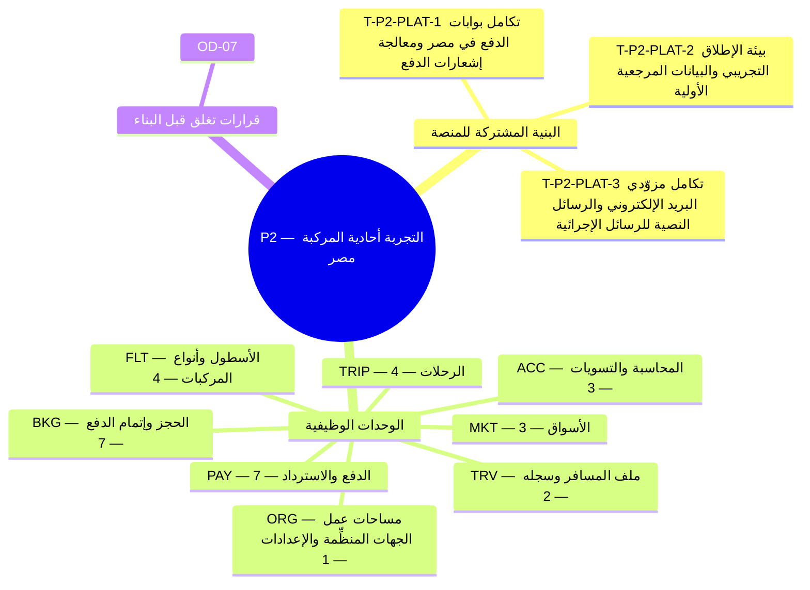

**المحور.** التجربة أحادية المركبة (مصر) — إنشاء الرحلة، وحجز المسافر، والدفع بالجنيه المصري، وأساسيات الإدارة

**تعريف الإتمام.** تبيع جهة منظِّمة تجريبية واحدة رحلة واحدة لمسافرين حقيقيين بمدفوعات حقيقية. *([القسم 3.3 من وثيقة الأعمال](/ar/docs/brd#33-مراحل-التسليم))*

**34 مهمة تسليم** (**31** مهمة وظيفية: **30** إلزامية Must، و**1** مهمة Should، و**0** تحسينية Could + **3** مهام بنية منصة مشتركة) موزعة على **8** وحدات برمجية. تتضمن كل مهمة أدناه المواصفة الكاملة ومخرجات التنفيذ الهندسي ومعايير القبول والجداول المتأثرة وروابط التتبع الشاملة عبر جميع وثائق النظام.

**نموذج البيانات.** تنطبق [اصطلاحات نموذج البيانات](/ar/docs/erd) و[ضوابط الوصول وأمان الصفوف RLS](/ar/docs/erd/acl) و[فهرس القيم المرجعية](/ar/docs/erd/reference) على جميع جداول هذه المرحلة.

<MindmapBlock title="خريطة نطاق المرحلة P2 — التجربة أحادية المركبة (مصر)" caption="توزيع مهام البنية المشتركة والوحدات الوظيفية (34 مهمة) وبوابة إغلاق المرحلة P2." trace={{"brd":[{"label":"مراحل التسليم §3.3","href":"/ar/docs/brd#33-مراحل-التسليم"}],"srs":[{"label":"مصفوفة التتبع","href":"/ar/docs/srs/traceability"}],"erd":[{"label":"نموذج البيانات","href":"/ar/docs/erd"}],"plan":[{"label":"المعالم وبوابات المراحل","href":"/ar/docs/plan/milestones"},{"label":"دليل البناء","href":"/ar/docs/plan/build-guide"}],"workflows":[{"label":"تغطية المتطلبات","href":"/ar/docs/workflows/coverage"}],"architecture":[{"label":"معمارية المنصة","href":"/ar/docs/architecture"}],"design":[{"label":"نظام التصميم","href":"/ar/docs/design"}],"system":[{"label":"النظام الشامل","href":"/ar/docs/system/lifecycle"}],"recommendations":[{"label":"حسم القرارات المفتوحة","href":"/ar/docs/recommendations/open-decisions"}]}}>

</MindmapBlock>

## فهرس المهام السريع

| المهمة | الوحدة | المرجع | الأولوية |
|---|---|---|---|
| [T-P2-PLAT-1 — تكامل بوابات الدفع في مصر ومعالجة إشعارات الدفع](#t-p2-plat-1) | `PLAT` | [التوافر NFR-AVL-03](/ar/docs/srs/quality#83-التوافر-nfr-avl) | Must |
| [T-P2-PLAT-2 — بيئة الإطلاق التجريبي والبيانات المرجعية الأولية](#t-p2-plat-2) | `PLAT` | [التعريب NFR-I18N](/ar/docs/srs/quality#87-التدويل-nfr-i18n) | Must |
| [T-P2-PLAT-3 — تكامل مزوّدي البريد الإلكتروني والرسائل النصية للرسائل الإجرائية](#t-p2-plat-3) | `PLAT` | [التعريب NFR-I18N](/ar/docs/srs/quality#87-التدويل-nfr-i18n) | Must |
| [T-P2-ORG-1 — تسجيل الأسطول](#t-p2-org-1) | `ORG` | [FR-ORG-04](/ar/docs/srs/requirements/org#fr-org-04--تسجيل-الأسطول) | Must |
| [T-P2-TRIP-1 — معالج إنشاء الرحلة](#t-p2-trip-1) | `TRIP` | [FR-TRIP-01](/ar/docs/srs/requirements/trip#fr-trip-01--معالج-إنشاء-الرحلة) | Must |
| [T-P2-TRIP-2 — المسودة والنشر العلني والمستهدف](#t-p2-trip-2) | `TRIP` | [FR-TRIP-02](/ar/docs/srs/requirements/trip#fr-trip-02--المسودة-والنشر-العلني-والمستهدف) | Must |
| [T-P2-TRIP-3 — دورة حياة الرحلة](#t-p2-trip-3) | `TRIP` | [FR-TRIP-05](/ar/docs/srs/requirements/trip#fr-trip-05--دورة-حياة-الرحلة) | Must |
| [T-P2-TRIP-4 — التغييرات التي تمس الحجوزات المؤكدة](#t-p2-trip-4) | `TRIP` | [FR-TRIP-06](/ar/docs/srs/requirements/trip#fr-trip-06--التغييرات-التي-تمس-الحجوزات-المؤكدة) | Must |
| [T-P2-FLT-1 — أنواع المركبات القابلة لإعادة الاستخدام](#t-p2-flt-1) | `FLT` | [FR-FLT-01](/ar/docs/srs/requirements/flt#fr-flt-01--أنواع-المركبات-القابلة-لإعادة-الاستخدام) | Must |
| [T-P2-FLT-2 — سجل المركبات](#t-p2-flt-2) | `FLT` | [FR-FLT-02](/ar/docs/srs/requirements/flt#fr-flt-02--سجل-المركبات) | Must |
| [T-P2-FLT-3 — خريطة المقاعد من نوع المركبة](#t-p2-flt-3) | `FLT` | [FR-FLT-04](/ar/docs/srs/requirements/flt#fr-flt-04--خريطة-المقاعد-من-نوع-المركبة) | Must |
| [T-P2-FLT-4 — أرشفة أنواع المركبات](#t-p2-flt-4) | `FLT` | [FR-FLT-06](/ar/docs/srs/requirements/flt#fr-flt-06--أرشفة-أنواع-المركبات) | Should |
| [T-P2-BKG-1 — تكوين الحجز](#t-p2-bkg-1) | `BKG` | [FR-BKG-01](/ar/docs/srs/requirements/bkg#fr-bkg-01--تكوين-الحجز) | Must |
| [T-P2-BKG-2 — التحويل في إتمام الدفع](#t-p2-bkg-2) | `BKG` | [FR-BKG-02](/ar/docs/srs/requirements/bkg#fr-bkg-02--التحويل-في-إتمام-الدفع) | Must |
| [T-P2-BKG-3 — إعادة المحاولة دون فقدان السلة](#t-p2-bkg-3) | `BKG` | [FR-BKG-03](/ar/docs/srs/requirements/bkg#fr-bkg-03--إعادة-المحاولة-دون-فقدان-السلة) | Must |
| [T-P2-BKG-4 — إلغاء المسافر والاسترداد](#t-p2-bkg-4) | `BKG` | [FR-BKG-04](/ar/docs/srs/requirements/bkg#fr-bkg-04--إلغاء-المسافر-والاسترداد) | Must |
| [T-P2-BKG-5 — الإيصالات والفواتير](#t-p2-bkg-5) | `BKG` | [FR-BKG-05](/ar/docs/srs/requirements/bkg#fr-bkg-05--الإيصالات-والفواتير) | Must |
| [T-P2-BKG-6 — إلغاء الجهة المنظِّمة للرحلة](#t-p2-bkg-6) | `BKG` | [FR-BKG-06](/ar/docs/srs/requirements/bkg#fr-bkg-06--إلغاء-الجهة-المنظِّمة-للرحلة) | Must |
| [T-P2-BKG-7 — حالات الحجز](#t-p2-bkg-7) | `BKG` | [FR-BKG-07](/ar/docs/srs/requirements/bkg#fr-bkg-07--حالات-الحجز) | Must |
| [T-P2-PAY-1 — نتائج الدفع](#t-p2-pay-1) | `PAY` | [FR-PAY-01](/ar/docs/srs/requirements/pay#fr-pay-01--نتائج-الدفع) | Must |
| [T-P2-PAY-2 — معالجة الاستدعاءات الراجعة مرة واحدة](#t-p2-pay-2) | `PAY` | [FR-PAY-02](/ar/docs/srs/requirements/pay#fr-pay-02--معالجة-الاستدعاءات-الراجعة-مرة-واحدة) | Must |
| [T-P2-PAY-3 — تنفيذ الاسترداد](#t-p2-pay-3) | `PAY` | [FR-PAY-03](/ar/docs/srs/requirements/pay#fr-pay-03--تنفيذ-الاسترداد) | Must |
| [T-P2-PAY-4 — مطابقة بوابة الدفع](#t-p2-pay-4) | `PAY` | [FR-PAY-05](/ar/docs/srs/requirements/pay#fr-pay-05--مطابقة-بوابة-الدفع) | Must |
| [T-P2-PAY-5 — وسائل الدفع حسب السوق](#t-p2-pay-5) | `PAY` | [FR-PAY-07](/ar/docs/srs/requirements/pay#fr-pay-07--وسائل-الدفع-حسب-السوق) | Must |
| [T-P2-PAY-6 — الدفع المعلق](#t-p2-pay-6) | `PAY` | [FR-PAY-08](/ar/docs/srs/requirements/pay#fr-pay-08--الدفع-المعلق) | Must |
| [T-P2-PAY-7 — قسائم Fawry النقدية](#t-p2-pay-7) | `PAY` | [FR-PAY-09](/ar/docs/srs/requirements/pay#fr-pay-09--قسائم-fawry-النقدية) | Must |
| [T-P2-ACC-1 — سجل القيد المزدوج](#t-p2-acc-1) | `ACC` | [FR-ACC-01](/ar/docs/srs/requirements/acc#fr-acc-01--سجل-القيد-المزدوج) | Must |
| [T-P2-ACC-2 — تصديرات مطابَقة للسجل](#t-p2-acc-2) | `ACC` | [FR-ACC-07](/ar/docs/srs/requirements/acc#fr-acc-07--تصديرات-مطابَقة-للسجل) | Must |
| [T-P2-ACC-3 — المطابقة اليومية وموجز المالية](#t-p2-acc-3) | `ACC` | [FR-ACC-09](/ar/docs/srs/requirements/acc#fr-acc-09--المطابقة-اليومية-وموجز-المالية) | Must |
| [T-P2-TRV-1 — ظهور الرحلات والوصول المبكر](#t-p2-trv-1) | `TRV` | [FR-TRV-02](/ar/docs/srs/requirements/trv#fr-trv-02--ظهور-الرحلات-والوصول-المبكر) | Must |
| [T-P2-TRV-2 — السجل والإيصالات بحسب الخطة](#t-p2-trv-2) | `TRV` | [FR-TRV-03](/ar/docs/srs/requirements/trv#fr-trv-03--السجل-والإيصالات-بحسب-الخطة) | Must |
| [T-P2-MKT-1 — إعداد السوق](#t-p2-mkt-1) | `MKT` | [FR-MKT-01](/ar/docs/srs/requirements/mkt#fr-mkt-01--إعداد-السوق) | Must |
| [T-P2-MKT-2 — السوق من بلد التسجيل](#t-p2-mkt-2) | `MKT` | [FR-MKT-02](/ar/docs/srs/requirements/mkt#fr-mkt-02--السوق-من-بلد-التسجيل) | Must |
| [T-P2-MKT-3 — التقريب والعرض](#t-p2-mkt-3) | `MKT` | [FR-MKT-05](/ar/docs/srs/requirements/mkt#fr-mkt-05--التقريب-والعرض) | Must |

## عابرة للمجالات

تُبنى مهام البنية المشتركة هذه بالتوازي مع مهام الوحدات وتُشترط لاجتياز بوابة إغلاق المرحلة.

### T-P2-PLAT-1 — تكامل بوابات الدفع في مصر ومعالجة إشعارات الدفع

<TaskCard id="T-P2-PLAT-1" title="تكامل بوابات الدفع في مصر ومعالجة إشعارات الدفع" phase="P2" module="PLAT" priority="Must" kind="platform" surfaces={["واجهة API","عمليات الخلفية","تطبيق المسافر"]} tables={[]} trace={{"brd":[{"label":"المرحلة P2","href":"/ar/docs/brd#33-مراحل-التسليم"}],"srs":[{"label":"التوافر NFR-AVL-03","href":"/ar/docs/srs/quality#83-التوافر-nfr-avl"}],"erd":[{"label":"الحجز والدفع","href":"/ar/docs/erd/domains/booking-and-payment"},{"label":"المنصة","href":"/ar/docs/erd/domains/platform"},{"label":"أمان الصفوف ACL","href":"/ar/docs/erd/acl"}],"plan":[{"label":"المعالم","href":"/ar/docs/plan/milestones"},{"label":"استراتيجية الاختبار","href":"/ar/docs/plan/testing"}],"workflows":[{"label":"booking-payment","href":"/ar/docs/workflows/booking-payment"}],"userFlows":[{"label":"تدفقات الأدوار","href":"/ar/docs/user-flows"}],"architecture":[{"label":"المعمارية","href":"/ar/docs/architecture#التكاملات"}],"design":[{"label":"نظام التصميم","href":"/ar/docs/design#تطبيق-المسافر"}],"system":[{"label":"STAGE-05","href":"/ar/docs/system/lifecycle#stage-05"}],"recommendations":[{"label":"REC-PAY-04","href":"/ar/docs/recommendations/architecture-and-ops#rec-pay-04"}]}}>

**نطاق البنية المشتركة.** ربط بوابات البطاقات البنكية وقسائم فوري النقدية (48 ساعة) بالجنيه المصري بأصغر وحدة نقدية، مع التحقق من التوقيع ومنع التكرار والاستعلام الدوري عن الحالة.

**مخرجات التنفيذ الهندسي.**

- واجهة موحَّدة لبوابات الدفع تدعم الدفع بالبطاقات وتوليد مرجع فوري وتنفيذ الاستردادات واستقبال الإشعارات الموقَّعة.
- طابور متين لحفظ وإعادة معالجة إشعارات الدفع لضمان عدم ضياع أي عملية دفع مؤكدة.

**معايير القبول والتحقق.**

- Given إعادة إرسال نفس إشعار البوابة 3 مرات، when يستقبله الخادم، then يُؤكَّد الحجز ويُقيَّد في الدفتر مرة واحدة فقط.
- Given عملية دفع لم يُرد عليها خلال 30 ثانية، when يعمل المستعلم في الدقائق 1 و5 و10، then تُحسم الحالة أو تُصعَّد للمشرف عند الدقيقة 15.

</TaskCard>

### T-P2-PLAT-2 — بيئة الإطلاق التجريبي والبيانات المرجعية الأولية

<TaskCard id="T-P2-PLAT-2" title="بيئة الإطلاق التجريبي والبيانات المرجعية الأولية" phase="P2" module="PLAT" priority="Must" kind="platform" surfaces={["قاعدة البيانات","لوحة مشرف المنصة","لوحة الجهة المنظِّمة"]} tables={["markets","lookups","lookup_types"]} trace={{"brd":[{"label":"المرحلة P2","href":"/ar/docs/brd#33-مراحل-التسليم"}],"srs":[{"label":"التعريب NFR-I18N","href":"/ar/docs/srs/quality#87-التدويل-nfr-i18n"}],"erd":[{"label":"الجداول المرجعية والأسواق","href":"/ar/docs/erd/domains/lookups-and-markets"},{"label":"الخطط والاشتراكات","href":"/ar/docs/erd/domains/plans-and-subscriptions"},{"label":"markets","href":"/ar/docs/erd/domains/lookups-and-markets#markets","detail":"table"},{"label":"lookups","href":"/ar/docs/erd/domains/lookups-and-markets#lookups","detail":"table"},{"label":"lookup_types","href":"/ar/docs/erd/domains/lookups-and-markets#lookup_types","detail":"table"},{"label":"أمان الصفوف ACL","href":"/ar/docs/erd/acl"}],"plan":[{"label":"المعالم","href":"/ar/docs/plan/milestones"},{"label":"استراتيجية الاختبار","href":"/ar/docs/plan/testing"}],"workflows":[{"label":"booking-payment","href":"/ar/docs/workflows/booking-payment"}],"userFlows":[{"label":"تدفقات الأدوار","href":"/ar/docs/user-flows"}],"architecture":[{"label":"المعمارية","href":"/ar/docs/architecture#طوبولوجيا-النشر"}],"design":[{"label":"نظام التصميم","href":"/ar/docs/design#rtl-والتعريب"}],"system":[{"label":"STAGE-01","href":"/ar/docs/system/lifecycle#stage-01"}],"recommendations":[{"label":"REC-OPS-12","href":"/ar/docs/recommendations/architecture-and-ops#rec-ops-12"}]}}>

**نطاق البنية المشتركة.** تهيئة إعدادات السوق المصري (الجنيه المصري وتوقيت القاهرة) وفهارس القيم المرجعية ثنائية اللغة وقوالب المركبات الأولية لبيئة الإطلاق التجريبي.

**مخرجات التنفيذ الهندسي.**

- أداة تهيئة حتمية تغذّي الجداول المرجعية بالعربية والإنجليزية وإعدادات السوق المصري والخطط الافتراضية.
- اختبار دخان شامل يحاكي اعتماد الجهة ونشر رحلة وحجز مقعد والدفع والاسترداد.

**معايير القبول والتحقق.**

- Given تشغيل أداة البذر مرتين متتاليتين، when تنتهي، then لا تتكرر السجلات المرجعية ولا تتغير معرفاتها.
- Given إعدادات سوق مصر، when يُعرض أي سعر أو إيصال، then يظهر بالجنيه المصري وتوقيت القاهرة وبأرقام غربية.

</TaskCard>

### T-P2-PLAT-3 — تكامل مزوّدي البريد الإلكتروني والرسائل النصية للرسائل الإجرائية

<TaskCard id="T-P2-PLAT-3" title="تكامل مزوّدي البريد الإلكتروني والرسائل النصية للرسائل الإجرائية" phase="P2" module="PLAT" priority="Must" kind="platform" surfaces={["عمليات الخلفية","خط أنابيب الإشعارات"]} tables={[]} trace={{"brd":[{"label":"المرحلة P2","href":"/ar/docs/brd#33-مراحل-التسليم"}],"srs":[{"label":"التعريب NFR-I18N","href":"/ar/docs/srs/quality#87-التدويل-nfr-i18n"}],"erd":[{"label":"المنصة","href":"/ar/docs/erd/domains/platform"},{"label":"أمان الصفوف ACL","href":"/ar/docs/erd/acl"}],"plan":[{"label":"المعالم","href":"/ar/docs/plan/milestones"},{"label":"استراتيجية الاختبار","href":"/ar/docs/plan/testing"}],"workflows":[{"label":"notifications","href":"/ar/docs/workflows/notifications"}],"userFlows":[{"label":"تدفقات الأدوار","href":"/ar/docs/user-flows"}],"architecture":[{"label":"المعمارية","href":"/ar/docs/architecture#التكاملات"}],"design":[{"label":"نظام التصميم","href":"/ar/docs/design#أسطح-الإشعارات"}],"system":[{"label":"STAGE-07","href":"/ar/docs/system/lifecycle#stage-07"}],"recommendations":[{"label":"REC-UX-11","href":"/ar/docs/recommendations/architecture-and-ops#rec-ux-11"}]}}>

**نطاق البنية المشتركة.** ربط مزوّدي الرسائل النصية والواتساب والبريد الإجرائي خلف واجهة إشعارات موحَّدة مع تتبع حالة التسليم والتبديل التلقائي للقناة عند فشل رمز التحقق.

**مخرجات التنفيذ الهندسي.**

- محولات مزوّدين تدعم إعادة المحاولة الأسيّة لثلاث مرات ومفاتيح منع التكرار وتحديثات حالة التسليم.
- قوالب رسائل عربية وإنجليزية لرموز التحقق وتأكيدات الحجز وقسائم فوري وتذكيرات الرحلات.

**معايير القبول والتحقق.**

- Given فشل إرسال رمز التحقق عبر SMS ثلاث مرات، when يطلب المستخدم الرمز، then يعرض النظام الإرسال عبر القناة البديلة.
- Given إشعار غير عاجل صدر الساعة 02:00 بتوقيت المستلم، when يُجدول، then يُؤجَّل إرساله حتى الساعة 07:00 صباحًا.

</TaskCard>

## ORG — مساحات عمل الجهات المنظِّمة والإعدادات

**نموذج البيانات.** [المالية](/ar/docs/erd/domains/finance), [الجهات المنظِّمة](/ar/docs/erd/domains/organizations) — النطاقات والجداول التي تقرؤها وتكتبها متطلبات هذه الوحدة.

### T-P2-ORG-1 — تسجيل الأسطول

<TaskCard id="T-P2-ORG-1" title="تسجيل الأسطول" phase="P2" module="ORG" priority="Must" surfaces={["لوحة الجهة المنظِّمة","لوحة مشرف المنصة"]} tables={["organizations"]} trace={{"brd":[{"label":"BR-ORG-04","href":"/ar/docs/brd/requirements#63-الجهات-المنظِّمة-والموظفون-org","detail":"P2"}],"srs":[{"label":"FR-ORG-04","href":"/ar/docs/srs/requirements/org#fr-org-04--تسجيل-الأسطول","detail":"Must"},{"label":"معايير الجودة NFR","href":"/ar/docs/srs/quality"}],"erd":[{"label":"المالية","href":"/ar/docs/erd/domains/finance"},{"label":"الجهات المنظِّمة","href":"/ar/docs/erd/domains/organizations"},{"label":"organizations","href":"/ar/docs/erd/domains/organizations#organizations","detail":"table"}],"plan":[{"label":"معلم P2","href":"/ar/docs/plan/milestones"},{"label":"استراتيجية الاختبار","href":"/ar/docs/plan/testing"}],"workflows":[{"label":"applications","href":"/ar/docs/workflows/applications"}],"userFlows":[{"label":"UF-ORG-23","href":"/ar/docs/user-flows/organization#uf-org-23-الأسطول-أثناء-دورة-الحياة"}],"architecture":[{"label":"المعمارية","href":"/ar/docs/architecture#معمارية-البيانات"}],"design":[{"label":"الواجهات والتصميم","href":"/ar/docs/design#لوحة-الجهة-المنظِّمة"}],"system":[{"label":"STAGE-02","href":"/ar/docs/system/lifecycle#stage-02"}],"recommendations":[{"label":"REC-DATA-02","href":"/ar/docs/recommendations/architecture-and-ops#rec-data-02"}]}}>

**المواصفة الوظيفية ([FR-ORG-04](/ar/docs/srs/requirements/org#fr-org-04--تسجيل-الأسطول)).** تسجِّل الجهة المنظِّمة المركبات برقم اللوحة والموديل وسنة الصنع ونوع المركبة وعدد المقاعد وحالة رخصة السير.

**مخرجات التنفيذ الهندسي.**

- **منطق النطاق والواجهة البرمجية:** فرض عزل المستأجر عبر سياسات RLS في PostgreSQL وتهيئة مساحة العمل فور الاعتماد وحدود الموردين التابعين للجهة وروابط الويب الموقَّعة.
- **التخزين وأمان مستوى الصفوف:** عمليات القراءة والكتابة على الجداول `organizations` مع الالتزام بالأعمدة الأساسية والحذف الناعم وضوابط الوصول ([ACL](/ar/docs/erd/acl)).
- **التحقق والرصد:** اختبارات آلية تغطي سيناريوهات قبول `FR-ORG-04` وفق [استراتيجية الاختبار](/ar/docs/plan/testing) مع تسجيل الأحداث والآثار.

**معايير القبول.**

- بافتراض مركبة يختلف عدد مقاعدها عن المحدد لنوعها، عند حفظها، يُرفض الحفظ مع بيان عدم التطابق.

**التتبع التجاري وقواعد العمل الحاكمة.**

- [BR-ORG-04](/ar/docs/brd/requirements#63-الجهات-المنظِّمة-والموظفون-org): تسجِّل الجهات المنظِّمة مركباتها (رقم اللوحة، الموديل، سنة الصنع، المقاعد، حالة رخصة السير).

</TaskCard>

## TRIP — الرحلات

**نموذج البيانات.** [الأسطول والرحلات](/ar/docs/erd/domains/fleet-and-trips) — النطاقات والجداول التي تقرؤها وتكتبها متطلبات هذه الوحدة.

### T-P2-TRIP-1 — معالج إنشاء الرحلة

<TaskCard id="T-P2-TRIP-1" title="معالج إنشاء الرحلة" phase="P2" module="TRIP" priority="Must" surfaces={["لوحة الجهة المنظِّمة","تطبيق المسافر","لوحة مشرف المنصة"]} tables={["trips"]} trace={{"brd":[{"label":"BR-TRIP-01","href":"/ar/docs/brd/requirements#64-الرحلات-والبرامج-والأسطول-trip-prg-flt","detail":"P2"}],"srs":[{"label":"FR-TRIP-01","href":"/ar/docs/srs/requirements/trip#fr-trip-01--معالج-إنشاء-الرحلة","detail":"Must"},{"label":"آلة حالة الرحلة §7.1","href":"/ar/docs/srs/state-machines#71-دورة-حياة-الرحلة"},{"label":"معايير الجودة NFR","href":"/ar/docs/srs/quality"}],"erd":[{"label":"الأسطول والرحلات","href":"/ar/docs/erd/domains/fleet-and-trips"},{"label":"trips","href":"/ar/docs/erd/domains/fleet-and-trips#trips","detail":"table"}],"plan":[{"label":"معلم P2","href":"/ar/docs/plan/milestones"},{"label":"استراتيجية الاختبار","href":"/ar/docs/plan/testing"}],"workflows":[{"label":"trip-lifecycle","href":"/ar/docs/workflows/trip-lifecycle"}],"userFlows":[{"label":"UF-ORG-06","href":"/ar/docs/user-flows/organization#uf-org-06-إنشاء-رحلة-معالج-إرشادي"}],"architecture":[{"label":"المعمارية","href":"/ar/docs/architecture#نموذج-الخدمات"}],"design":[{"label":"الواجهات والتصميم","href":"/ar/docs/design#لوحة-الجهة-المنظِّمة"}],"system":[{"label":"STAGE-04","href":"/ar/docs/system/lifecycle#stage-04"}],"recommendations":[{"label":"REC-ARCH-01","href":"/ar/docs/recommendations/architecture-and-ops#rec-arch-01"}]}}>

**المواصفة الوظيفية ([FR-TRIP-01](/ar/docs/srs/requirements/trip#fr-trip-01--معالج-إنشاء-الرحلة)).** تنشئ الجهة المنظِّمة الرحلة عبر معالج إرشادي: الأساسيات، والمواعيد والمسار، والمركبات، والطاقم، والبرامج، والمقاعد، والتسعير والطاقة الاستيعابية، والنشر. ويُحجب النشر حتى تكتمل الخطوات المطلوبة. وتُحفظ المسودات تلقائيًا.

**مخرجات التنفيذ الهندسي.**

- **منطق النطاق والواجهة البرمجية:** تنفيذ معالج إنشاء الرحلة متعدد الخطوات وحراس آلة حالة الرحلة وتحولات السعة ومعالجات التعديلات بعد الحجز وقواعد الإلغاء والأرشفة.
- **التخزين وأمان مستوى الصفوف:** عمليات القراءة والكتابة على الجداول `trips` مع الالتزام بالأعمدة الأساسية والحذف الناعم وضوابط الوصول ([ACL](/ar/docs/erd/acl)).
- **التحقق والرصد:** اختبارات آلية تغطي سيناريوهات قبول `FR-TRIP-01` وفق [استراتيجية الاختبار](/ar/docs/plan/testing) مع تسجيل الأحداث والآثار.

**معايير القبول.**

- بافتراض أن خطوة المركبات غير مكتملة، عندما تنشر الجهة المنظِّمة، يُحجب النشر وتُحدَّد الخطوة بالاسم.

**التتبع التجاري وقواعد العمل الحاكمة.**

- [BR-TRIP-01](/ar/docs/brd/requirements#64-الرحلات-والبرامج-والأسطول-trip-prg-flt): تنشئ الجهات المنظِّمة الرحلات عبر معالج إرشادي: الأساسيات، المواعيد والمسار، المركبات، الطاقم، البرامج، المقاعد، التسعير والطاقة الاستيعابية، النشر.

</TaskCard>

### T-P2-TRIP-2 — المسودة والنشر العلني والمستهدف

<TaskCard id="T-P2-TRIP-2" title="المسودة والنشر العلني والمستهدف" phase="P2" module="TRIP" priority="Must" surfaces={["لوحة الجهة المنظِّمة","تطبيق المسافر","لوحة مشرف المنصة"]} tables={["trips"]} trace={{"brd":[{"label":"BR-TRIP-02","href":"/ar/docs/brd/requirements#64-الرحلات-والبرامج-والأسطول-trip-prg-flt","detail":"P2"}],"srs":[{"label":"FR-TRIP-02","href":"/ar/docs/srs/requirements/trip#fr-trip-02--المسودة-والنشر-العلني-والمستهدف","detail":"Must"},{"label":"آلة حالة الرحلة §7.1","href":"/ar/docs/srs/state-machines#71-دورة-حياة-الرحلة"},{"label":"معايير الجودة NFR","href":"/ar/docs/srs/quality"}],"erd":[{"label":"الأسطول والرحلات","href":"/ar/docs/erd/domains/fleet-and-trips"},{"label":"trips","href":"/ar/docs/erd/domains/fleet-and-trips#trips","detail":"table"}],"plan":[{"label":"معلم P2","href":"/ar/docs/plan/milestones"},{"label":"استراتيجية الاختبار","href":"/ar/docs/plan/testing"}],"workflows":[{"label":"دورة حياة الرحلة","href":"/ar/docs/workflows/trip-lifecycle#المؤقتات-والقواعد"}],"userFlows":[{"label":"UF-ORG-06","href":"/ar/docs/user-flows/organization#uf-org-06-إنشاء-رحلة-معالج-إرشادي"},{"label":"UF-TRV-01","href":"/ar/docs/user-flows/traveler#uf-trv-01-التصفح-كزائر"}],"architecture":[{"label":"المعمارية","href":"/ar/docs/architecture#نموذج-الخدمات"}],"design":[{"label":"الواجهات والتصميم","href":"/ar/docs/design#لوحة-الجهة-المنظِّمة"}],"system":[{"label":"STAGE-04","href":"/ar/docs/system/lifecycle#stage-04"}],"recommendations":[{"label":"REC-ARCH-01","href":"/ar/docs/recommendations/architecture-and-ops#rec-arch-01"}]}}>

**المواصفة الوظيفية ([FR-TRIP-02](/ar/docs/srs/requirements/trip#fr-trip-02--المسودة-والنشر-العلني-والمستهدف)).** تُحفظ الرحلة مسودة مخفية، أو تُنشر علنًا، أو تُنشر لقائمة مسافرين مستهدفة.

**مخرجات التنفيذ الهندسي.**

- **منطق النطاق والواجهة البرمجية:** تنفيذ معالج إنشاء الرحلة متعدد الخطوات وحراس آلة حالة الرحلة وتحولات السعة ومعالجات التعديلات بعد الحجز وقواعد الإلغاء والأرشفة.
- **التخزين وأمان مستوى الصفوف:** عمليات القراءة والكتابة على الجداول `trips` مع الالتزام بالأعمدة الأساسية والحذف الناعم وضوابط الوصول ([ACL](/ar/docs/erd/acl)).
- **التحقق والرصد:** اختبارات آلية تغطي سيناريوهات قبول `FR-TRIP-02` وفق [استراتيجية الاختبار](/ar/docs/plan/testing) مع تسجيل الأحداث والآثار.

**معايير القبول.**

- بافتراض مسودة، عندما يبحث المسافرون، لا تظهر الرحلة.
- بافتراض رحلة مستهدفة، عندما يتصفح مسافر ليس على القائمة، لا تظهر الرحلة.

**التتبع التجاري وقواعد العمل الحاكمة.**

- [BR-TRIP-02](/ar/docs/brd/requirements#64-الرحلات-والبرامج-والأسطول-trip-prg-flt): يمكن حفظ الرحلة كمسودة مخفية، أو نشرها علنًا، أو نشرها لمسافرين مستهدفين فقط.

</TaskCard>

### T-P2-TRIP-3 — دورة حياة الرحلة

<TaskCard id="T-P2-TRIP-3" title="دورة حياة الرحلة" phase="P2" module="TRIP" priority="Must" surfaces={["لوحة الجهة المنظِّمة","تطبيق المسافر","لوحة مشرف المنصة"]} tables={["trips"]} trace={{"brd":[{"label":"BR-TRIP-02","href":"/ar/docs/brd/requirements#64-الرحلات-والبرامج-والأسطول-trip-prg-flt","detail":"P2"},{"label":"BRL-07","href":"/ar/docs/brd/requirements#7-قواعد-العمل","detail":"قاعدة"},{"label":"BRL-30","href":"/ar/docs/brd/requirements#7-قواعد-العمل","detail":"قاعدة"}],"srs":[{"label":"FR-TRIP-05","href":"/ar/docs/srs/requirements/trip#fr-trip-05--دورة-حياة-الرحلة","detail":"Must"},{"label":"آلة حالة الرحلة §7.1","href":"/ar/docs/srs/state-machines#71-دورة-حياة-الرحلة"},{"label":"معايير الجودة NFR","href":"/ar/docs/srs/quality"}],"erd":[{"label":"الأسطول والرحلات","href":"/ar/docs/erd/domains/fleet-and-trips"},{"label":"trips","href":"/ar/docs/erd/domains/fleet-and-trips#trips","detail":"table"}],"plan":[{"label":"معلم P2","href":"/ar/docs/plan/milestones"},{"label":"استراتيجية الاختبار","href":"/ar/docs/plan/testing"}],"workflows":[{"label":"trip-lifecycle","href":"/ar/docs/workflows/trip-lifecycle"}],"userFlows":[{"label":"UF-ADM-14","href":"/ar/docs/user-flows/admin#uf-adm-14-الإشراف-على-الرحلات-وسجل-التدقيق"}],"architecture":[{"label":"المعمارية","href":"/ar/docs/architecture#نموذج-الخدمات"}],"design":[{"label":"الواجهات والتصميم","href":"/ar/docs/design#لوحة-الجهة-المنظِّمة"}],"system":[{"label":"STAGE-06","href":"/ar/docs/system/lifecycle#stage-06"}],"recommendations":[{"label":"REC-ARCH-01","href":"/ar/docs/recommendations/architecture-and-ops#rec-arch-01"}]}}>

**المواصفة الوظيفية ([FR-TRIP-05](/ar/docs/srs/requirements/trip#fr-trip-05--دورة-حياة-الرحلة)).** لا تنتقل الرحلة إلا عبر الانتقالات الموضحة في القسم 7.1. ولا يمكن إلغاء رحلة هي In Progress (D-25, [OD-22](/ar/docs/brd/compliance#11-القرارات-المفتوحة)).

**مخرجات التنفيذ الهندسي.**

- **منطق النطاق والواجهة البرمجية:** تنفيذ معالج إنشاء الرحلة متعدد الخطوات وحراس آلة حالة الرحلة وتحولات السعة ومعالجات التعديلات بعد الحجز وقواعد الإلغاء والأرشفة.
- **التخزين وأمان مستوى الصفوف:** عمليات القراءة والكتابة على الجداول `trips` مع الالتزام بالأعمدة الأساسية والحذف الناعم وضوابط الوصول ([ACL](/ar/docs/erd/acl)).
- **التحقق والرصد:** اختبارات آلية تغطي سيناريوهات قبول `FR-TRIP-05` وفق [استراتيجية الاختبار](/ar/docs/plan/testing) مع تسجيل الأحداث والآثار.

**معايير القبول.**

- بافتراض رحلة في حالة Draft، عندما يُطلب الانتقال إلى In Progress، يُرفض الانتقال.

**التتبع التجاري وقواعد العمل الحاكمة.**

- [BR-TRIP-02](/ar/docs/brd/requirements#64-الرحلات-والبرامج-والأسطول-trip-prg-flt): يمكن حفظ الرحلة كمسودة مخفية، أو نشرها علنًا، أو نشرها لمسافرين مستهدفين فقط.
- [BRL-07](/ar/docs/brd/requirements#7-قواعد-العمل): لا يمكن أن تنتقل الرحلة إلى Ready حتى يكون لكل مركبة سائق ومشرف وتكون كل صفقات المنصة منجزة نهائيًا.
- [BRL-30](/ar/docs/brd/requirements#7-قواعد-العمل): عندما تلغي الجهة المنظِّمة رحلة، يُسترد كامل مبلغ كل حجز مؤكد وتُعكس استخدامات الكوبونات (D-150). ولا يمكن إلغاء رحلة هي In Progress؛ بل تُعامل كحادثة (D-25, [OD-22](/ar/docs/brd/compliance#11-القرارات-المفتوحة)).

</TaskCard>

### T-P2-TRIP-4 — التغييرات التي تمس الحجوزات المؤكدة

<TaskCard id="T-P2-TRIP-4" title="التغييرات التي تمس الحجوزات المؤكدة" phase="P2" module="TRIP" priority="Must" surfaces={["لوحة الجهة المنظِّمة","تطبيق المسافر","لوحة مشرف المنصة"]} tables={["trips"]} trace={{"brd":[{"label":"BRL-24","href":"/ar/docs/brd/requirements#7-قواعد-العمل","detail":"قاعدة"}],"srs":[{"label":"FR-TRIP-06","href":"/ar/docs/srs/requirements/trip#fr-trip-06--التغييرات-التي-تمس-الحجوزات-المؤكدة","detail":"Must"},{"label":"آلة حالة الرحلة §7.1","href":"/ar/docs/srs/state-machines#71-دورة-حياة-الرحلة"},{"label":"معايير الجودة NFR","href":"/ar/docs/srs/quality"}],"erd":[{"label":"الأسطول والرحلات","href":"/ar/docs/erd/domains/fleet-and-trips"},{"label":"trips","href":"/ar/docs/erd/domains/fleet-and-trips#trips","detail":"table"}],"plan":[{"label":"معلم P2","href":"/ar/docs/plan/milestones"},{"label":"استراتيجية الاختبار","href":"/ar/docs/plan/testing"}],"workflows":[{"label":"الاستردادات","href":"/ar/docs/workflows/refunds#المؤقتات-والقواعد"},{"label":"دليل المهام المجدولة","href":"/ar/docs/workflows/scheduled-jobs#العدادات-التنازلية-مؤقّتات-على-مستوى-كل-سجل"},{"label":"دورة حياة الرحلة","href":"/ar/docs/workflows/trip-lifecycle#المؤقتات-والقواعد"},{"label":"دورة حياة الرحلة","href":"/ar/docs/workflows/trip-lifecycle#قصص-المستخدم"}],"userFlows":[{"label":"UF-ORG-10","href":"/ar/docs/user-flows/organization#uf-org-10-تغيير-رحلة-بعد-وجود-حجوزات"},{"label":"UF-TRV-07","href":"/ar/docs/user-flows/traveler#uf-trv-07-اختيار-الحل-بعد-تغيير-في-الرحلة"}],"architecture":[{"label":"المعمارية","href":"/ar/docs/architecture#نموذج-الخدمات"}],"design":[{"label":"الواجهات والتصميم","href":"/ar/docs/design#لوحة-الجهة-المنظِّمة"}],"system":[{"label":"STAGE-06","href":"/ar/docs/system/lifecycle#stage-06"}],"recommendations":[{"label":"REC-ARCH-01","href":"/ar/docs/recommendations/architecture-and-ops#rec-arch-01"}]}}>

**المواصفة الوظيفية ([FR-TRIP-06](/ar/docs/srs/requirements/trip#fr-trip-06--التغييرات-التي-تمس-الحجوزات-المؤكدة)).** أي تغيير في البرامج أو وضع المقاعد أو المركبات أو المواعيد من شأنه أن يُفسد حجزًا مؤكدًا يُخطِر كل مسافر متأثر ويقدّم له المعالجات (الإبقاء مع التغيير، أو التبديل إلى خيار آخر، أو الإلغاء مع استرداد كامل) قبل سريانه. وللمسافر 7 أيام للاختيار؛ ثم تُحال الحالة إلى مشرف المنصة (D-148). وتُبلَّغ تغييرات المركبة أو السائق خلال ساعة واحدة (D-186).

**مخرجات التنفيذ الهندسي.**

- **منطق النطاق والواجهة البرمجية:** تنفيذ معالج إنشاء الرحلة متعدد الخطوات وحراس آلة حالة الرحلة وتحولات السعة ومعالجات التعديلات بعد الحجز وقواعد الإلغاء والأرشفة.
- **التخزين وأمان مستوى الصفوف:** عمليات القراءة والكتابة على الجداول `trips` مع الالتزام بالأعمدة الأساسية والحذف الناعم وضوابط الوصول ([ACL](/ar/docs/erd/acl)).
- **التحقق والرصد:** اختبارات آلية تغطي سيناريوهات قبول `FR-TRIP-06` وفق [استراتيجية الاختبار](/ar/docs/plan/testing) مع تسجيل الأحداث والآثار.

**معايير القبول.**

- بافتراض حجز مؤكد يتضمن برنامجًا ستُزال، عندما يُؤكَّد التغيير، يُخطَر المسافر وتُعرض عليه المعالجات قبل سريان الإزالة.

**التتبع التجاري وقواعد العمل الحاكمة.**

- [BRL-24](/ar/docs/brd/requirements#7-قواعد-العمل): لا يمكن تغيير برامج الرحلة أو وضع المقاعد أو مركباتها بطريقة تُفسد حجزًا مؤكدًا حتى يُخطَر المسافر وتُعرض عليه معالجة. وله 7 أيام للاختيار؛ ثم تُحال الحالة إلى مشرف المنصة (D-148).

</TaskCard>

## FLT — الأسطول وأنواع المركبات

**نموذج البيانات.** [الأسطول والرحلات](/ar/docs/erd/domains/fleet-and-trips) — النطاقات والجداول التي تقرؤها وتكتبها متطلبات هذه الوحدة.

### T-P2-FLT-1 — أنواع المركبات القابلة لإعادة الاستخدام

<TaskCard id="T-P2-FLT-1" title="أنواع المركبات القابلة لإعادة الاستخدام" phase="P2" module="FLT" priority="Must" surfaces={["لوحة الجهة المنظِّمة","تطبيق السائق"]} tables={[]} trace={{"brd":[{"label":"BR-FLT-01","href":"/ar/docs/brd/requirements#64-الرحلات-والبرامج-والأسطول-trip-prg-flt","detail":"P2"}],"srs":[{"label":"FR-FLT-01","href":"/ar/docs/srs/requirements/flt#fr-flt-01--أنواع-المركبات-القابلة-لإعادة-الاستخدام","detail":"Must"},{"label":"معايير الجودة NFR","href":"/ar/docs/srs/quality"}],"erd":[{"label":"الأسطول والرحلات","href":"/ar/docs/erd/domains/fleet-and-trips"}],"plan":[{"label":"معلم P2","href":"/ar/docs/plan/milestones"},{"label":"استراتيجية الاختبار","href":"/ar/docs/plan/testing"}],"workflows":[{"label":"trip-lifecycle","href":"/ar/docs/workflows/trip-lifecycle"}],"userFlows":[{"label":"UF-ORG-04","href":"/ar/docs/user-flows/organization#uf-org-04-الأسطول"}],"architecture":[{"label":"المعمارية","href":"/ar/docs/architecture#معمارية-البيانات"}],"design":[{"label":"الواجهات والتصميم","href":"/ar/docs/design#لوحة-الجهة-المنظِّمة"}],"system":[{"label":"STAGE-03","href":"/ar/docs/system/lifecycle#stage-03"}],"recommendations":[{"label":"REC-BOOK-03","href":"/ar/docs/recommendations/architecture-and-ops#rec-book-03"}]}}>

**المواصفة الوظيفية ([FR-FLT-01](/ar/docs/srs/requirements/flt#fr-flt-01--أنواع-المركبات-القابلة-لإعادة-الاستخدام)).** يحدد نوع المركبة تخطيط مقاعد بمقاعد معنونة، قابلًا لإعادة الاستخدام عبر الرحلات.

**مخرجات التنفيذ الهندسي.**

- **منطق النطاق والواجهة البرمجية:** إدارة أنواع المركبات القابلة لإعادة الاستخدام وهندسة مخططات المقاعد وتخصيص المركبات المتعددة للرحلة وضوابط استبدال المركبات.
- **التحقق والرصد:** اختبارات آلية تغطي سيناريوهات قبول `FR-FLT-01` وفق [استراتيجية الاختبار](/ar/docs/plan/testing) مع تسجيل الأحداث والآثار.

**معايير القبول.**

- بافتراض نوع بـ 48 مقعدًا، عند اختياره في رحلة جديدة، تستخدم الرحلة المقاعد المعنونة الـ 48 نفسها.

**التتبع التجاري وقواعد العمل الحاكمة.**

- [BR-FLT-01](/ar/docs/brd/requirements#64-الرحلات-والبرامج-والأسطول-trip-prg-flt): أنواع المركبات هي تخطيطات مقاعد قابلة لإعادة الاستخدام بمقاعد معنونة.

</TaskCard>

### T-P2-FLT-2 — سجل المركبات

<TaskCard id="T-P2-FLT-2" title="سجل المركبات" phase="P2" module="FLT" priority="Must" surfaces={["لوحة الجهة المنظِّمة","تطبيق السائق"]} tables={[]} trace={{"brd":[{"label":"BR-ORG-04","href":"/ar/docs/brd/requirements#64-الرحلات-والبرامج-والأسطول-trip-prg-flt","detail":"P2"},{"label":"BR-FLT-01","href":"/ar/docs/brd/requirements#64-الرحلات-والبرامج-والأسطول-trip-prg-flt","detail":"P2"}],"srs":[{"label":"FR-FLT-02","href":"/ar/docs/srs/requirements/flt#fr-flt-02--سجل-المركبات","detail":"Must"},{"label":"معايير الجودة NFR","href":"/ar/docs/srs/quality"}],"erd":[{"label":"الأسطول والرحلات","href":"/ar/docs/erd/domains/fleet-and-trips"}],"plan":[{"label":"معلم P2","href":"/ar/docs/plan/milestones"},{"label":"استراتيجية الاختبار","href":"/ar/docs/plan/testing"}],"workflows":[{"label":"trip-lifecycle","href":"/ar/docs/workflows/trip-lifecycle"}],"userFlows":[{"label":"UF-ORG-04","href":"/ar/docs/user-flows/organization#uf-org-04-الأسطول"}],"architecture":[{"label":"المعمارية","href":"/ar/docs/architecture#معمارية-البيانات"}],"design":[{"label":"الواجهات والتصميم","href":"/ar/docs/design#لوحة-الجهة-المنظِّمة"}],"system":[{"label":"STAGE-03","href":"/ar/docs/system/lifecycle#stage-03"}],"recommendations":[{"label":"REC-BOOK-03","href":"/ar/docs/recommendations/architecture-and-ops#rec-book-03"}]}}>

**المواصفة الوظيفية ([FR-FLT-02](/ar/docs/srs/requirements/flt#fr-flt-02--سجل-المركبات)).** تستخدم المركبة نوع مركبة واحدًا، ويجب أن يطابق عدد مقاعدها ذلك النوع.

**مخرجات التنفيذ الهندسي.**

- **منطق النطاق والواجهة البرمجية:** إدارة أنواع المركبات القابلة لإعادة الاستخدام وهندسة مخططات المقاعد وتخصيص المركبات المتعددة للرحلة وضوابط استبدال المركبات.
- **التحقق والرصد:** اختبارات آلية تغطي سيناريوهات قبول `FR-FLT-02` وفق [استراتيجية الاختبار](/ar/docs/plan/testing) مع تسجيل الأحداث والآثار.

**معايير القبول.**

- بافتراض نوع بـ 48 مقعدًا ومركبة مذكور لها 50 مقعدًا، عند الحفظ، يُرفض الإجراء.

**التتبع التجاري وقواعد العمل الحاكمة.**

- [BR-ORG-04](/ar/docs/brd/requirements#64-الرحلات-والبرامج-والأسطول-trip-prg-flt): تسجِّل الجهات المنظِّمة مركباتها (رقم اللوحة، الموديل، سنة الصنع، المقاعد، حالة رخصة السير).
- [BR-FLT-01](/ar/docs/brd/requirements#64-الرحلات-والبرامج-والأسطول-trip-prg-flt): أنواع المركبات هي تخطيطات مقاعد قابلة لإعادة الاستخدام بمقاعد معنونة.

</TaskCard>

### T-P2-FLT-3 — خريطة المقاعد من نوع المركبة

<TaskCard id="T-P2-FLT-3" title="خريطة المقاعد من نوع المركبة" phase="P2" module="FLT" priority="Must" surfaces={["لوحة الجهة المنظِّمة","تطبيق السائق"]} tables={[]} trace={{"brd":[{"label":"BR-FLT-01","href":"/ar/docs/brd/requirements#64-الرحلات-والبرامج-والأسطول-trip-prg-flt","detail":"P2"},{"label":"BR-SEAT-02","href":"/ar/docs/brd/requirements#64-الرحلات-والبرامج-والأسطول-trip-prg-flt","detail":"P2"}],"srs":[{"label":"FR-FLT-04","href":"/ar/docs/srs/requirements/flt#fr-flt-04--خريطة-المقاعد-من-نوع-المركبة","detail":"Must"},{"label":"معايير الجودة NFR","href":"/ar/docs/srs/quality"}],"erd":[{"label":"الأسطول والرحلات","href":"/ar/docs/erd/domains/fleet-and-trips"}],"plan":[{"label":"معلم P2","href":"/ar/docs/plan/milestones"},{"label":"استراتيجية الاختبار","href":"/ar/docs/plan/testing"}],"workflows":[{"label":"trip-lifecycle","href":"/ar/docs/workflows/trip-lifecycle"}],"userFlows":[{"label":"UF-ORG-23","href":"/ar/docs/user-flows/organization#uf-org-23-الأسطول-أثناء-دورة-الحياة"}],"architecture":[{"label":"المعمارية","href":"/ar/docs/architecture#معمارية-البيانات"}],"design":[{"label":"الواجهات والتصميم","href":"/ar/docs/design#لوحة-الجهة-المنظِّمة"}],"system":[{"label":"STAGE-03","href":"/ar/docs/system/lifecycle#stage-03"}],"recommendations":[{"label":"REC-BOOK-03","href":"/ar/docs/recommendations/architecture-and-ops#rec-book-03"}]}}>

**المواصفة الوظيفية ([FR-FLT-04](/ar/docs/srs/requirements/flt#fr-flt-04--خريطة-المقاعد-من-نوع-المركبة)).** تنبثق خريطة مقاعد كل مركبة في الرحلة من نوع مركبتها، وتعرض عنونة كل مقعد وحالته.

**مخرجات التنفيذ الهندسي.**

- **منطق النطاق والواجهة البرمجية:** إدارة أنواع المركبات القابلة لإعادة الاستخدام وهندسة مخططات المقاعد وتخصيص المركبات المتعددة للرحلة وضوابط استبدال المركبات.
- **التحقق والرصد:** اختبارات آلية تغطي سيناريوهات قبول `FR-FLT-04` وفق [استراتيجية الاختبار](/ar/docs/plan/testing) مع تسجيل الأحداث والآثار.

**معايير القبول.**

- بافتراض أن المقعد 12B محجوز، عند عرض المسافر للخريطة، يظهر 12B غير متاح.

**التتبع التجاري وقواعد العمل الحاكمة.**

- [BR-FLT-01](/ar/docs/brd/requirements#64-الرحلات-والبرامج-والأسطول-trip-prg-flt): أنواع المركبات هي تخطيطات مقاعد قابلة لإعادة الاستخدام بمقاعد معنونة.
- [BR-SEAT-02](/ar/docs/brd/requirements#64-الرحلات-والبرامج-والأسطول-trip-prg-flt): عند تفعيل الاختيار الذاتي، يرى المسافرون خريطة مقاعد لحظية تظهر فيها المقاعد المحجوزة غير متاحة على الفور.

</TaskCard>

### T-P2-FLT-4 — أرشفة أنواع المركبات

<TaskCard id="T-P2-FLT-4" title="أرشفة أنواع المركبات" phase="P2" module="FLT" priority="Should" surfaces={["لوحة الجهة المنظِّمة","تطبيق السائق"]} tables={[]} trace={{"brd":[{"label":"BR-FLT-01","href":"/ar/docs/brd/requirements#64-الرحلات-والبرامج-والأسطول-trip-prg-flt","detail":"P2"}],"srs":[{"label":"FR-FLT-06","href":"/ar/docs/srs/requirements/flt#fr-flt-06--أرشفة-أنواع-المركبات","detail":"Should"},{"label":"معايير الجودة NFR","href":"/ar/docs/srs/quality"}],"erd":[{"label":"الأسطول والرحلات","href":"/ar/docs/erd/domains/fleet-and-trips"}],"plan":[{"label":"معلم P2","href":"/ar/docs/plan/milestones"},{"label":"استراتيجية الاختبار","href":"/ar/docs/plan/testing"}],"workflows":[{"label":"trip-lifecycle","href":"/ar/docs/workflows/trip-lifecycle"}],"userFlows":[{"label":"UF-ORG-04","href":"/ar/docs/user-flows/organization#uf-org-04-الأسطول"}],"architecture":[{"label":"المعمارية","href":"/ar/docs/architecture#معمارية-البيانات"}],"design":[{"label":"الواجهات والتصميم","href":"/ar/docs/design#لوحة-الجهة-المنظِّمة"}],"system":[{"label":"STAGE-03","href":"/ar/docs/system/lifecycle#stage-03"}],"recommendations":[{"label":"REC-BOOK-03","href":"/ar/docs/recommendations/architecture-and-ops#rec-book-03"}]}}>

**المواصفة الوظيفية ([FR-FLT-06](/ar/docs/srs/requirements/flt#fr-flt-06--أرشفة-أنواع-المركبات)).** لا يُعرض النوع المؤرشف للرحلات الجديدة؛ وتحتفظ الرحلات القائمة بتخطيطها.

**مخرجات التنفيذ الهندسي.**

- **منطق النطاق والواجهة البرمجية:** إدارة أنواع المركبات القابلة لإعادة الاستخدام وهندسة مخططات المقاعد وتخصيص المركبات المتعددة للرحلة وضوابط استبدال المركبات.
- **التحقق والرصد:** اختبارات آلية تغطي سيناريوهات قبول `FR-FLT-06` وفق [استراتيجية الاختبار](/ar/docs/plan/testing) مع تسجيل الأحداث والآثار.

**معايير القبول.**

- بافتراض نوع مؤرشف، عند إنشاء رحلة جديدة، لا يُعرض ذلك النوع.

**التتبع التجاري وقواعد العمل الحاكمة.**

- [BR-FLT-01](/ar/docs/brd/requirements#64-الرحلات-والبرامج-والأسطول-trip-prg-flt): أنواع المركبات هي تخطيطات مقاعد قابلة لإعادة الاستخدام بمقاعد معنونة.

</TaskCard>

## BKG — الحجز وإتمام الدفع

**نموذج البيانات.** [الحجز والدفع](/ar/docs/erd/domains/booking-and-payment), [المالية](/ar/docs/erd/domains/finance) — النطاقات والجداول التي تقرؤها وتكتبها متطلبات هذه الوحدة.

### T-P2-BKG-1 — تكوين الحجز

<TaskCard id="T-P2-BKG-1" title="تكوين الحجز" phase="P2" module="BKG" priority="Must" surfaces={["تطبيق المسافر","لوحة الجهة المنظِّمة","لوحة مشرف المنصة"]} tables={["bookings"]} trace={{"brd":[{"label":"BR-BKG-01","href":"/ar/docs/brd/requirements#67-الحجز-والدفع-bkg","detail":"P2"}],"srs":[{"label":"FR-BKG-01","href":"/ar/docs/srs/requirements/bkg#fr-bkg-01--تكوين-الحجز","detail":"Must"},{"label":"آلة حالة الحجز §7.2","href":"/ar/docs/srs/state-machines#72-الحجز"},{"label":"معايير الجودة NFR","href":"/ar/docs/srs/quality"}],"erd":[{"label":"الحجز والدفع","href":"/ar/docs/erd/domains/booking-and-payment"},{"label":"المالية","href":"/ar/docs/erd/domains/finance"},{"label":"bookings","href":"/ar/docs/erd/domains/booking-and-payment#bookings","detail":"table"}],"plan":[{"label":"معلم P2","href":"/ar/docs/plan/milestones"},{"label":"استراتيجية الاختبار","href":"/ar/docs/plan/testing"}],"workflows":[{"label":"booking-payment","href":"/ar/docs/workflows/booking-payment"}],"userFlows":[{"label":"UF-TRV-03","href":"/ar/docs/user-flows/traveler#uf-trv-03-حجز-رحلة"}],"architecture":[{"label":"المعمارية","href":"/ar/docs/architecture#نموذج-الخدمات"}],"design":[{"label":"الواجهات والتصميم","href":"/ar/docs/design#تطبيق-المسافر"}],"system":[{"label":"STAGE-05","href":"/ar/docs/system/lifecycle#stage-05"}],"recommendations":[{"label":"REC-BOOK-03","href":"/ar/docs/recommendations/architecture-and-ops#rec-book-03"}]}}>

**المواصفة الوظيفية ([FR-BKG-01](/ar/docs/srs/requirements/bkg#fr-bkg-01--تكوين-الحجز)).** يضم الحجز الركاب (مع وسم طفل)، واختيارات البرامج، والمقاعد حيث يُسمح بها، وكوبونًا واحدًا على الأكثر ما لم يكن قابلًا للتراكب، ورقمًا ضريبيًا اختياريًا للمشتري، وطريقة دفع.

**مخرجات التنفيذ الهندسي.**

- **منطق النطاق والواجهة البرمجية:** تنفيذ تجميع السلة وبيانات المسافرين وتثبيت السعر عند حجز المقعد وتحولات حالة الحجز وسياسة الإلغاء الزمنية وتذاكر QR.
- **التخزين وأمان مستوى الصفوف:** عمليات القراءة والكتابة على الجداول `bookings` مع الالتزام بالأعمدة الأساسية والحذف الناعم وضوابط الوصول ([ACL](/ar/docs/erd/acl)).
- **التحقق والرصد:** اختبارات آلية تغطي سيناريوهات قبول `FR-BKG-01` وفق [استراتيجية الاختبار](/ar/docs/plan/testing) مع تسجيل الأحداث والآثار.

**معايير القبول.**

- Given كوبون واحد غير قابل للتراكب، when يُدخَل كوبون ثانٍ، then يُرفض ويُحتفظ بالأول.

**التتبع التجاري وقواعد العمل الحاكمة.**

- [BR-BKG-01](/ar/docs/brd/requirements#67-الحجز-والدفع-bkg): يتضمن الحجز المسافرين والبرامج المختارة والمقاعد حيث يُسمح بذلك، وكوبونًا واحدًا على الأكثر ما لم يكن الكوبون قابلًا للتجميع، وطريقة الدفع.

</TaskCard>

### T-P2-BKG-2 — التحويل في إتمام الدفع

<TaskCard id="T-P2-BKG-2" title="التحويل في إتمام الدفع" phase="P2" module="BKG" priority="Must" surfaces={["تطبيق المسافر","لوحة الجهة المنظِّمة","لوحة مشرف المنصة"]} tables={["bookings"]} trace={{"brd":[{"label":"BR-BKG-02","href":"/ar/docs/brd/requirements#67-الحجز-والدفع-bkg","detail":"P2"}],"srs":[{"label":"FR-BKG-02","href":"/ar/docs/srs/requirements/bkg#fr-bkg-02--التحويل-في-إتمام-الدفع","detail":"Must"},{"label":"آلة حالة الحجز §7.2","href":"/ar/docs/srs/state-machines#72-الحجز"},{"label":"معايير الجودة NFR","href":"/ar/docs/srs/quality"}],"erd":[{"label":"الحجز والدفع","href":"/ar/docs/erd/domains/booking-and-payment"},{"label":"المالية","href":"/ar/docs/erd/domains/finance"},{"label":"bookings","href":"/ar/docs/erd/domains/booking-and-payment#bookings","detail":"table"}],"plan":[{"label":"معلم P2","href":"/ar/docs/plan/milestones"},{"label":"استراتيجية الاختبار","href":"/ar/docs/plan/testing"}],"workflows":[{"label":"booking-payment","href":"/ar/docs/workflows/booking-payment"}],"userFlows":[{"label":"UF-TRV-03","href":"/ar/docs/user-flows/traveler#uf-trv-03-حجز-رحلة"}],"architecture":[{"label":"المعمارية","href":"/ar/docs/architecture#نموذج-الخدمات"}],"design":[{"label":"الواجهات والتصميم","href":"/ar/docs/design#تطبيق-المسافر"}],"system":[{"label":"STAGE-05","href":"/ar/docs/system/lifecycle#stage-05"}],"recommendations":[{"label":"REC-BOOK-03","href":"/ar/docs/recommendations/architecture-and-ops#rec-book-03"}]}}>

**المواصفة الوظيفية ([FR-BKG-02](/ar/docs/srs/requirements/bkg#fr-bkg-02--التحويل-في-إتمام-الدفع)).** تُدخَل بيانات البطاقة في صفحة بوابة الدفع أو في SDK فقط، وباستخدام طرق الدفع المعتمدة في سوق الرحلة ([FR-MKT-03](/ar/docs/srs/requirements/mkt#fr-mkt-03--التصفح-عبر-الأسواق)). لا تصل بيانات البطاقة إلى Trips Enjoy إطلاقًا.

**مخرجات التنفيذ الهندسي.**

- **منطق النطاق والواجهة البرمجية:** تنفيذ تجميع السلة وبيانات المسافرين وتثبيت السعر عند حجز المقعد وتحولات حالة الحجز وسياسة الإلغاء الزمنية وتذاكر QR.
- **التخزين وأمان مستوى الصفوف:** عمليات القراءة والكتابة على الجداول `bookings` مع الالتزام بالأعمدة الأساسية والحذف الناعم وضوابط الوصول ([ACL](/ar/docs/erd/acl)).
- **التحقق والرصد:** اختبارات آلية تغطي سيناريوهات قبول `FR-BKG-02` وفق [استراتيجية الاختبار](/ar/docs/plan/testing) مع تسجيل الأحداث والآثار.

**معايير القبول.**

- Given وصول إتمام الدفع إلى مرحلة الدفع، when يدفع المسافر، then لا يظهر رقم البطاقة ولا تاريخ انتهائها ولا رمز الأمان في سجلات المنصة أو مخازن بياناتها.

**التتبع التجاري وقواعد العمل الحاكمة.**

- [BR-BKG-02](/ar/docs/brd/requirements#67-الحجز-والدفع-bkg): يدفع المسافرون على صفحة بوابة الدفع نفسها أو من خلال SDK الخاص بها، وبوسائل الدفع الخاصة بسوق الجهة المنظِّمة. ولا تصل بيانات البطاقات إلى Trips Enjoy أبدًا.

</TaskCard>

### T-P2-BKG-3 — إعادة المحاولة دون فقدان السلة

<TaskCard id="T-P2-BKG-3" title="إعادة المحاولة دون فقدان السلة" phase="P2" module="BKG" priority="Must" surfaces={["تطبيق المسافر","لوحة الجهة المنظِّمة","لوحة مشرف المنصة"]} tables={["bookings"]} trace={{"brd":[{"label":"BR-BKG-03","href":"/ar/docs/brd/requirements#67-الحجز-والدفع-bkg","detail":"P2"},{"label":"BRL-08","href":"/ar/docs/brd/requirements#7-قواعد-العمل","detail":"قاعدة"}],"srs":[{"label":"FR-BKG-03","href":"/ar/docs/srs/requirements/bkg#fr-bkg-03--إعادة-المحاولة-دون-فقدان-السلة","detail":"Must"},{"label":"آلة حالة الحجز §7.2","href":"/ar/docs/srs/state-machines#72-الحجز"},{"label":"معايير الجودة NFR","href":"/ar/docs/srs/quality"}],"erd":[{"label":"الحجز والدفع","href":"/ar/docs/erd/domains/booking-and-payment"},{"label":"المالية","href":"/ar/docs/erd/domains/finance"},{"label":"bookings","href":"/ar/docs/erd/domains/booking-and-payment#bookings","detail":"table"}],"plan":[{"label":"معلم P2","href":"/ar/docs/plan/milestones"},{"label":"استراتيجية الاختبار","href":"/ar/docs/plan/testing"}],"workflows":[{"label":"الحجز والدفع","href":"/ar/docs/workflows/booking-payment#المؤقتات-والقواعد"},{"label":"دليل المهام المجدولة","href":"/ar/docs/workflows/scheduled-jobs#العدادات-التنازلية-مؤقّتات-على-مستوى-كل-سجل"}],"userFlows":[{"label":"UF-TRV-03","href":"/ar/docs/user-flows/traveler#uf-trv-03-حجز-رحلة"},{"label":"UF-TRV-15","href":"/ar/docs/user-flows/traveler#uf-trv-15-نتيجة-الدفع-ومعالجة-الحالة-المعلّقة"}],"architecture":[{"label":"المعمارية","href":"/ar/docs/architecture#نموذج-الخدمات"}],"design":[{"label":"الواجهات والتصميم","href":"/ar/docs/design#تطبيق-المسافر"}],"system":[{"label":"STAGE-05","href":"/ar/docs/system/lifecycle#stage-05"}],"recommendations":[{"label":"REC-BOOK-03","href":"/ar/docs/recommendations/architecture-and-ops#rec-book-03"}]}}>

**المواصفة الوظيفية ([FR-BKG-03](/ar/docs/srs/requirements/bkg#fr-bkg-03--إعادة-المحاولة-دون-فقدان-السلة)).** يمكن إعادة محاولة الدفع الفاشل ما دام الحجز المؤقت قائمًا، حتى 3 محاولات لكل حجز مؤقت؛ وبعد الثالثة يبقى الحجز في حالة Payment Failed حتى انتهاء الحجز المؤقت (D-197). تحافظ إعادة المحاولة بعد انتهائه على السلة، وتتحقق من المقاعد من جديد، وتبدأ حجزًا مؤقتًا جديدًا مدته 15 دقيقة فقط إذا كانت المقاعد لا تزال متاحة (D-191).

**مخرجات التنفيذ الهندسي.**

- **منطق النطاق والواجهة البرمجية:** تنفيذ تجميع السلة وبيانات المسافرين وتثبيت السعر عند حجز المقعد وتحولات حالة الحجز وسياسة الإلغاء الزمنية وتذاكر QR.
- **التخزين وأمان مستوى الصفوف:** عمليات القراءة والكتابة على الجداول `bookings` مع الالتزام بالأعمدة الأساسية والحذف الناعم وضوابط الوصول ([ACL](/ar/docs/erd/acl)).
- **التحقق والرصد:** اختبارات آلية تغطي سيناريوهات قبول `FR-BKG-03` وفق [استراتيجية الاختبار](/ar/docs/plan/testing) مع تسجيل الأحداث والآثار.

**معايير القبول.**

- Given فشل الدفع بعد 10 دقائق من بدء الحجز المؤقت، when يعيد المسافر المحاولة، then تُحفظ السلة والمقاعد للـ 5 دقائق المتبقية.
- Given انتهاء الحجز المؤقت وشغل المقعد 4A في تلك الأثناء، when يعيد المسافر المحاولة، then تُحفظ السلة ويُطلب من المسافر اختيار مقعد آخر.

**التتبع التجاري وقواعد العمل الحاكمة.**

- [BR-BKG-03](/ar/docs/brd/requirements#67-الحجز-والدفع-bkg): يمكن إعادة محاولة الدفع الفاشل دون فقدان سلة الحجز طوال مدة الحجز المؤقت، بحد أقصى 3 محاولات لكل حجز مؤقت (D-197). وتتحقق إعادة المحاولة بعد انتهاء الحجز المؤقت من توفر المقاعد من جديد وتبدأ حجزًا مؤقتًا جديدًا فقط إذا كانت متاحة (D-191).
- [BRL-08](/ar/docs/brd/requirements#7-قواعد-العمل): يستمر الحجز المؤقت للمقعد 15 دقيقة ويُتحرر تلقائيًا عند انتهائه. الاستثناء: قسيمة Fawry النقدية تحجز المقاعد طوال نافذة القسيمة البالغة 48 ساعة (D-31, D-41).

</TaskCard>

### T-P2-BKG-4 — إلغاء المسافر والاسترداد

<TaskCard id="T-P2-BKG-4" title="إلغاء المسافر والاسترداد" phase="P2" module="BKG" priority="Must" surfaces={["تطبيق المسافر","لوحة الجهة المنظِّمة","لوحة مشرف المنصة"]} tables={["bookings"]} trace={{"brd":[{"label":"BR-BKG-04","href":"/ar/docs/brd/requirements#67-الحجز-والدفع-bkg","detail":"P2"},{"label":"BRL-11","href":"/ar/docs/brd/requirements#7-قواعد-العمل","detail":"قاعدة"},{"label":"BRL-12","href":"/ar/docs/brd/requirements#7-قواعد-العمل","detail":"قاعدة"},{"label":"OD-07","href":"/ar/docs/brd/compliance#11-القرارات-المفتوحة","detail":"مقترح"}],"srs":[{"label":"FR-BKG-04","href":"/ar/docs/srs/requirements/bkg#fr-bkg-04--إلغاء-المسافر-والاسترداد","detail":"Must"},{"label":"آلة حالة الحجز §7.2","href":"/ar/docs/srs/state-machines#72-الحجز"},{"label":"معايير الجودة NFR","href":"/ar/docs/srs/quality"}],"erd":[{"label":"الحجز والدفع","href":"/ar/docs/erd/domains/booking-and-payment"},{"label":"المالية","href":"/ar/docs/erd/domains/finance"},{"label":"bookings","href":"/ar/docs/erd/domains/booking-and-payment#bookings","detail":"table"}],"plan":[{"label":"معلم P2","href":"/ar/docs/plan/milestones"},{"label":"استراتيجية الاختبار","href":"/ar/docs/plan/testing"}],"workflows":[{"label":"الاستردادات","href":"/ar/docs/workflows/refunds#المؤقتات-والقواعد"},{"label":"الاستردادات","href":"/ar/docs/workflows/refunds#قصص-المستخدم"}],"userFlows":[{"label":"UF-ORG-09","href":"/ar/docs/user-flows/organization#uf-org-09-إدارة-الحجوزات-والمقاعد"},{"label":"UF-TRV-03","href":"/ar/docs/user-flows/traveler#uf-trv-03-حجز-رحلة"},{"label":"UF-TRV-06","href":"/ar/docs/user-flows/traveler#uf-trv-06-إلغاء-حجز"}],"architecture":[{"label":"المعمارية","href":"/ar/docs/architecture#نموذج-الخدمات"}],"design":[{"label":"الواجهات والتصميم","href":"/ar/docs/design#تطبيق-المسافر"}],"system":[{"label":"STAGE-06","href":"/ar/docs/system/lifecycle#stage-06"}],"recommendations":[{"label":"توصية OD-07","href":"/ar/docs/recommendations/open-decisions#od-07"},{"label":"REC-BOOK-03","href":"/ar/docs/recommendations/architecture-and-ops#rec-book-03"}]}}>

**المواصفة الوظيفية ([FR-BKG-04](/ar/docs/srs/requirements/bkg#fr-bkg-04--إلغاء-المسافر-والاسترداد)).** يستطيع المسافر إلغاء حجز مؤكد قبل انطلاق الرحلة. يتبع الاسترداد [BRL-12](/ar/docs/brd/requirements#7-قواعد-العمل) (قيمة مؤقتة: 80 بالمئة عند 48 ساعة أو أكثر، و50 بالمئة من 24 ساعة إلى ما دون 48 ساعة، ولا شيء دون 24 ساعة). تذهب الطلبات بعد الموعد النهائي إلى الجهة المنظِّمة التي تبت فيها خلال يومي عمل، ثم إلى مشرف المنصة (D-151). لا يتاح الإلغاء بعد انطلاق الرحلة أو بعد تسجيل الحضور؛ وتتحول تلك الحالات إلى نزاعات (D-152, D-153). تعرض المعاينة مبلغ الاسترداد قبل التأكيد.

**مخرجات التنفيذ الهندسي.**

- **منطق النطاق والواجهة البرمجية:** تنفيذ تجميع السلة وبيانات المسافرين وتثبيت السعر عند حجز المقعد وتحولات حالة الحجز وسياسة الإلغاء الزمنية وتذاكر QR.
- **التخزين وأمان مستوى الصفوف:** عمليات القراءة والكتابة على الجداول `bookings` مع الالتزام بالأعمدة الأساسية والحذف الناعم وضوابط الوصول ([ACL](/ar/docs/erd/acl)).
- **التحقق والرصد:** اختبارات آلية تغطي سيناريوهات قبول `FR-BKG-04` وفق [استراتيجية الاختبار](/ar/docs/plan/testing) مع تسجيل الأحداث والآثار.

**معايير القبول.**

- Given إلغاء قبل 50 ساعة من الانطلاق، when يُؤكَّد، then يُسترد 80 بالمئة ويُعكس استبدال الكوبون.
- Given راكب سجّل حضوره، when تُجرى محاولة الإلغاء، then يُرفض الإلغاء ويُعرض فتح نزاع.

**التتبع التجاري وقواعد العمل الحاكمة.**

- [BR-BKG-04](/ar/docs/brd/requirements#67-الحجز-والدفع-bkg): يمكن للمسافرين إلغاء الحجز واستلام المبلغ المسترد وفق سياسة الإلغاء ([BRL-12](/ar/docs/brd/requirements#7-قواعد-العمل)). وتُحال الطلبات بعد الموعد النهائي إلى الجهة المنظِّمة التي تبت فيها خلال يومي عمل، ثم إلى مشرف المنصة (D-151). ولا إلغاء بعد الانطلاق أو بعد تسجيل الحضور (D-152, D-153).
- [BRL-11](/ar/docs/brd/requirements#7-قواعد-العمل): يعكس الاسترداد استخدام الكوبون ويحرر حد الاستخدام لكل مستخدم الخاص بالمسافر.
- [BRL-12](/ar/docs/brd/requirements#7-قواعد-العمل): يعتمد مبلغ الاسترداد عند الإلغاء على الوقت المتبقي قبل الانطلاق: 80 بالمئة عند 48 ساعة أو أكثر، و50 بالمئة من 24 ساعة إلى ما دون 48 ساعة، ولا شيء دون 24 ساعة (قيمة مؤقتة، D-07, [OD-07](/ar/docs/brd/compliance#11-القرارات-المفتوحة)). وجميع الرسوم قابلة للاسترداد إلى حين تحديد رسوم غير قابلة للاسترداد (D-156).
- [OD-07](/ar/docs/brd/compliance#11-القرارات-المفتوحة) (جدول الاسترداد والرسوم غير القابلة للاسترداد — مقترح) ← راجع [التوصية المقترحة](/ar/docs/recommendations/open-decisions#od-07).

</TaskCard>

### T-P2-BKG-5 — الإيصالات والفواتير

<TaskCard id="T-P2-BKG-5" title="الإيصالات والفواتير" phase="P2" module="BKG" priority="Must" surfaces={["تطبيق المسافر","لوحة الجهة المنظِّمة","لوحة مشرف المنصة"]} tables={["bookings","invoices"]} trace={{"brd":[{"label":"BR-BKG-05","href":"/ar/docs/brd/requirements#67-الحجز-والدفع-bkg","detail":"P2"}],"srs":[{"label":"FR-BKG-05","href":"/ar/docs/srs/requirements/bkg#fr-bkg-05--الإيصالات-والفواتير","detail":"Must"},{"label":"آلة حالة الحجز §7.2","href":"/ar/docs/srs/state-machines#72-الحجز"},{"label":"معايير الجودة NFR","href":"/ar/docs/srs/quality"}],"erd":[{"label":"الحجز والدفع","href":"/ar/docs/erd/domains/booking-and-payment"},{"label":"المالية","href":"/ar/docs/erd/domains/finance"},{"label":"bookings","href":"/ar/docs/erd/domains/booking-and-payment#bookings","detail":"table"},{"label":"invoices","href":"/ar/docs/erd/domains/finance#invoices","detail":"table"}],"plan":[{"label":"معلم P2","href":"/ar/docs/plan/milestones"},{"label":"استراتيجية الاختبار","href":"/ar/docs/plan/testing"}],"workflows":[{"label":"booking-payment","href":"/ar/docs/workflows/booking-payment"}],"userFlows":[{"label":"UF-TRV-03","href":"/ar/docs/user-flows/traveler#uf-trv-03-حجز-رحلة"},{"label":"UF-TRV-05","href":"/ar/docs/user-flows/traveler#uf-trv-05-إدارة-الحجوزات"}],"architecture":[{"label":"المعمارية","href":"/ar/docs/architecture#نموذج-الخدمات"}],"design":[{"label":"الواجهات والتصميم","href":"/ar/docs/design#تطبيق-المسافر"}],"system":[{"label":"STAGE-05","href":"/ar/docs/system/lifecycle#stage-05"}],"recommendations":[{"label":"REC-BOOK-03","href":"/ar/docs/recommendations/architecture-and-ops#rec-book-03"}]}}>

**المواصفة الوظيفية ([FR-BKG-05](/ar/docs/srs/requirements/bkg#fr-bkg-05--الإيصالات-والفواتير)).** ينتج عن كل حجز مؤكد إيصال وفاتورة ([FR-ORG-07](/ar/docs/srs/requirements/org#fr-org-07--فواتير-b2b-وb2c)) يظهران في سجل حجوزات المسافر.

**مخرجات التنفيذ الهندسي.**

- **منطق النطاق والواجهة البرمجية:** تنفيذ تجميع السلة وبيانات المسافرين وتثبيت السعر عند حجز المقعد وتحولات حالة الحجز وسياسة الإلغاء الزمنية وتذاكر QR.
- **التخزين وأمان مستوى الصفوف:** عمليات القراءة والكتابة على الجداول `bookings`، `invoices` مع الالتزام بالأعمدة الأساسية والحذف الناعم وضوابط الوصول ([ACL](/ar/docs/erd/acl)).
- **التحقق والرصد:** اختبارات آلية تغطي سيناريوهات قبول `FR-BKG-05` وفق [استراتيجية الاختبار](/ar/docs/plan/testing) مع تسجيل الأحداث والآثار.

**معايير القبول.**

- Given حجز أصبح Confirmed، when يُسجَّل الدفع، then يظهر الإيصال والفاتورة.

**التتبع التجاري وقواعد العمل الحاكمة.**

- [BR-BKG-05](/ar/docs/brd/requirements#67-الحجز-والدفع-bkg): ينتج عن كل حجز مؤكد إيصال وفاتورة يمكن للمسافر الاطلاع عليهما. ويحصل المسافر الذي يُدخل رقمًا ضريبيًا عند إتمام الدفع على فاتورة B2B ([BRL-28](/ar/docs/brd/requirements#7-قواعد-العمل)).

</TaskCard>

### T-P2-BKG-6 — إلغاء الجهة المنظِّمة للرحلة

<TaskCard id="T-P2-BKG-6" title="إلغاء الجهة المنظِّمة للرحلة" phase="P2" module="BKG" priority="Must" surfaces={["تطبيق المسافر","لوحة الجهة المنظِّمة","لوحة مشرف المنصة"]} tables={["bookings"]} trace={{"brd":[{"label":"BR-BKG-04","href":"/ar/docs/brd/requirements#67-الحجز-والدفع-bkg","detail":"P2"},{"label":"BRL-24","href":"/ar/docs/brd/requirements#7-قواعد-العمل","detail":"قاعدة"},{"label":"BRL-30","href":"/ar/docs/brd/requirements#7-قواعد-العمل","detail":"قاعدة"}],"srs":[{"label":"FR-BKG-06","href":"/ar/docs/srs/requirements/bkg#fr-bkg-06--إلغاء-الجهة-المنظِّمة-للرحلة","detail":"Must"},{"label":"آلة حالة الحجز §7.2","href":"/ar/docs/srs/state-machines#72-الحجز"},{"label":"معايير الجودة NFR","href":"/ar/docs/srs/quality"}],"erd":[{"label":"الحجز والدفع","href":"/ar/docs/erd/domains/booking-and-payment"},{"label":"المالية","href":"/ar/docs/erd/domains/finance"},{"label":"bookings","href":"/ar/docs/erd/domains/booking-and-payment#bookings","detail":"table"}],"plan":[{"label":"معلم P2","href":"/ar/docs/plan/milestones"},{"label":"استراتيجية الاختبار","href":"/ar/docs/plan/testing"}],"workflows":[{"label":"الاستردادات","href":"/ar/docs/workflows/refunds#المؤقتات-والقواعد"},{"label":"دورة حياة الرحلة","href":"/ar/docs/workflows/trip-lifecycle#المؤقتات-والقواعد"}],"userFlows":[{"label":"UF-ORG-11","href":"/ar/docs/user-flows/organization#uf-org-11-إلغاء-رحلة"}],"architecture":[{"label":"المعمارية","href":"/ar/docs/architecture#نموذج-الخدمات"}],"design":[{"label":"الواجهات والتصميم","href":"/ar/docs/design#تطبيق-المسافر"}],"system":[{"label":"STAGE-06","href":"/ar/docs/system/lifecycle#stage-06"}],"recommendations":[{"label":"REC-BOOK-03","href":"/ar/docs/recommendations/architecture-and-ops#rec-book-03"}]}}>

**المواصفة الوظيفية ([FR-BKG-06](/ar/docs/srs/requirements/bkg#fr-bkg-06--إلغاء-الجهة-المنظِّمة-للرحلة)).** عندما تلغي الجهة المنظِّمة رحلةً، تنتقل كل الحجوزات المؤكدة إلى حالة Cancelled ويُسترد كامل المبلغ، مع عكس استبدالات الكوبونات (D-150، [BRL-30](/ar/docs/brd/requirements#7-قواعد-العمل)).

**مخرجات التنفيذ الهندسي.**

- **منطق النطاق والواجهة البرمجية:** تنفيذ تجميع السلة وبيانات المسافرين وتثبيت السعر عند حجز المقعد وتحولات حالة الحجز وسياسة الإلغاء الزمنية وتذاكر QR.
- **التخزين وأمان مستوى الصفوف:** عمليات القراءة والكتابة على الجداول `bookings` مع الالتزام بالأعمدة الأساسية والحذف الناعم وضوابط الوصول ([ACL](/ar/docs/erd/acl)).
- **التحقق والرصد:** اختبارات آلية تغطي سيناريوهات قبول `FR-BKG-06` وفق [استراتيجية الاختبار](/ar/docs/plan/testing) مع تسجيل الأحداث والآثار.

**معايير القبول.**

- Given إلغاء رحلة تضم 40 حجزًا مؤكدًا، when يُحفظ الإلغاء، then تُدرَج 40 عملية استرداد كاملة في قائمة التنفيذ.

**التتبع التجاري وقواعد العمل الحاكمة.**

- [BR-BKG-04](/ar/docs/brd/requirements#67-الحجز-والدفع-bkg): يمكن للمسافرين إلغاء الحجز واستلام المبلغ المسترد وفق سياسة الإلغاء ([BRL-12](/ar/docs/brd/requirements#7-قواعد-العمل)). وتُحال الطلبات بعد الموعد النهائي إلى الجهة المنظِّمة التي تبت فيها خلال يومي عمل، ثم إلى مشرف المنصة (D-151). ولا إلغاء بعد الانطلاق أو بعد تسجيل الحضور (D-152, D-153).
- [BRL-24](/ar/docs/brd/requirements#7-قواعد-العمل): لا يمكن تغيير برامج الرحلة أو وضع المقاعد أو مركباتها بطريقة تُفسد حجزًا مؤكدًا حتى يُخطَر المسافر وتُعرض عليه معالجة. وله 7 أيام للاختيار؛ ثم تُحال الحالة إلى مشرف المنصة (D-148).
- [BRL-30](/ar/docs/brd/requirements#7-قواعد-العمل): عندما تلغي الجهة المنظِّمة رحلة، يُسترد كامل مبلغ كل حجز مؤكد وتُعكس استخدامات الكوبونات (D-150). ولا يمكن إلغاء رحلة هي In Progress؛ بل تُعامل كحادثة (D-25, [OD-22](/ar/docs/brd/compliance#11-القرارات-المفتوحة)).

</TaskCard>

### T-P2-BKG-7 — حالات الحجز

<TaskCard id="T-P2-BKG-7" title="حالات الحجز" phase="P2" module="BKG" priority="Must" surfaces={["تطبيق المسافر","لوحة الجهة المنظِّمة","لوحة مشرف المنصة"]} tables={["bookings"]} trace={{"brd":[{"label":"BR-BKG-03","href":"/ar/docs/brd/requirements#67-الحجز-والدفع-bkg","detail":"P2"}],"srs":[{"label":"FR-BKG-07","href":"/ar/docs/srs/requirements/bkg#fr-bkg-07--حالات-الحجز","detail":"Must"},{"label":"آلة حالة الحجز §7.2","href":"/ar/docs/srs/state-machines#72-الحجز"},{"label":"معايير الجودة NFR","href":"/ar/docs/srs/quality"}],"erd":[{"label":"الحجز والدفع","href":"/ar/docs/erd/domains/booking-and-payment"},{"label":"المالية","href":"/ar/docs/erd/domains/finance"},{"label":"bookings","href":"/ar/docs/erd/domains/booking-and-payment#bookings","detail":"table"}],"plan":[{"label":"معلم P2","href":"/ar/docs/plan/milestones"},{"label":"استراتيجية الاختبار","href":"/ar/docs/plan/testing"}],"workflows":[{"label":"الحجز والدفع","href":"/ar/docs/workflows/booking-payment#المؤقتات-والقواعد"}],"userFlows":[{"label":"traveler","href":"/ar/docs/user-flows/traveler"}],"architecture":[{"label":"المعمارية","href":"/ar/docs/architecture#نموذج-الخدمات"}],"design":[{"label":"الواجهات والتصميم","href":"/ar/docs/design#تطبيق-المسافر"}],"system":[{"label":"STAGE-05","href":"/ar/docs/system/lifecycle#stage-05"}],"recommendations":[{"label":"REC-BOOK-03","href":"/ar/docs/recommendations/architecture-and-ops#rec-book-03"}]}}>

**المواصفة الوظيفية ([FR-BKG-07](/ar/docs/srs/requirements/bkg#fr-bkg-07--حالات-الحجز)).** لا تنتقل الحجوزات إلا عبر الحالات الواردة في القسم 7.2.

**مخرجات التنفيذ الهندسي.**

- **منطق النطاق والواجهة البرمجية:** تنفيذ تجميع السلة وبيانات المسافرين وتثبيت السعر عند حجز المقعد وتحولات حالة الحجز وسياسة الإلغاء الزمنية وتذاكر QR.
- **التخزين وأمان مستوى الصفوف:** عمليات القراءة والكتابة على الجداول `bookings` مع الالتزام بالأعمدة الأساسية والحذف الناعم وضوابط الوصول ([ACL](/ar/docs/erd/acl)).
- **التحقق والرصد:** اختبارات آلية تغطي سيناريوهات قبول `FR-BKG-07` وفق [استراتيجية الاختبار](/ar/docs/plan/testing) مع تسجيل الأحداث والآثار.

**معايير القبول.**

- Given حجز في حالة Cart، when يُضبط على Checked In، then يُرفض.

**التتبع التجاري وقواعد العمل الحاكمة.**

- [BR-BKG-03](/ar/docs/brd/requirements#67-الحجز-والدفع-bkg): يمكن إعادة محاولة الدفع الفاشل دون فقدان سلة الحجز طوال مدة الحجز المؤقت، بحد أقصى 3 محاولات لكل حجز مؤقت (D-197). وتتحقق إعادة المحاولة بعد انتهاء الحجز المؤقت من توفر المقاعد من جديد وتبدأ حجزًا مؤقتًا جديدًا فقط إذا كانت متاحة (D-191).

</TaskCard>

## PAY — الدفع والاسترداد

**نموذج البيانات.** [الحجز والدفع](/ar/docs/erd/domains/booking-and-payment), [المالية](/ar/docs/erd/domains/finance) — النطاقات والجداول التي تقرؤها وتكتبها متطلبات هذه الوحدة.

### T-P2-PAY-1 — نتائج الدفع

<TaskCard id="T-P2-PAY-1" title="نتائج الدفع" phase="P2" module="PAY" priority="Must" surfaces={["تطبيق المسافر","لوحة الجهة المنظِّمة","لوحة مشرف المنصة"]} tables={["trip_seats"]} trace={{"brd":[{"label":"BR-BKG-02","href":"/ar/docs/brd/requirements#67-الحجز-والدفع-bkg","detail":"P2"},{"label":"BRL-18","href":"/ar/docs/brd/requirements#7-قواعد-العمل","detail":"قاعدة"}],"srs":[{"label":"FR-PAY-01","href":"/ar/docs/srs/requirements/pay#fr-pay-01--نتائج-الدفع","detail":"Must"},{"label":"آلة حالة الحجز §7.2","href":"/ar/docs/srs/state-machines#72-الحجز"},{"label":"معايير الجودة NFR","href":"/ar/docs/srs/quality"}],"erd":[{"label":"الحجز والدفع","href":"/ar/docs/erd/domains/booking-and-payment"},{"label":"المالية","href":"/ar/docs/erd/domains/finance"},{"label":"trip_seats","href":"/ar/docs/erd/domains/booking-and-payment#trip_seats","detail":"table"}],"plan":[{"label":"معلم P2","href":"/ar/docs/plan/milestones"},{"label":"استراتيجية الاختبار","href":"/ar/docs/plan/testing"}],"workflows":[{"label":"الحجز والدفع","href":"/ar/docs/workflows/booking-payment#المؤقتات-والقواعد"}],"userFlows":[{"label":"UF-TRV-15","href":"/ar/docs/user-flows/traveler#uf-trv-15-نتيجة-الدفع-ومعالجة-الحالة-المعلّقة"}],"architecture":[{"label":"المعمارية","href":"/ar/docs/architecture#التكاملات"}],"design":[{"label":"الواجهات والتصميم","href":"/ar/docs/design#تطبيق-المسافر"}],"system":[{"label":"STAGE-05","href":"/ar/docs/system/lifecycle#stage-05"}],"recommendations":[{"label":"REC-PAY-04","href":"/ar/docs/recommendations/architecture-and-ops#rec-pay-04"}]}}>

**المواصفة الوظيفية ([FR-PAY-01](/ar/docs/srs/requirements/pay#fr-pay-01--نتائج-الدفع)).** تسجِّل المنصة كل نتيجة من بوابة الدفع مع مرجعها. ينقل النجاح الحجز إلى حالة Confirmed ويقيّده في السجل؛ وينقل الفشل الحجز إلى حالة Payment Failed.

**مخرجات التنفيذ الهندسي.**

- **منطق النطاق والواجهة البرمجية:** ربط بوابات الدفع الإقليمية مع قسائم فوري لمدة 48 ساعة ومعالجة الإشعارات الموقَّعة غير المتكررة والاستعلام الدوري والاسترداد الآلي.
- **التخزين وأمان مستوى الصفوف:** عمليات القراءة والكتابة على الجداول `trip_seats` مع الالتزام بالأعمدة الأساسية والحذف الناعم وضوابط الوصول ([ACL](/ar/docs/erd/acl)).
- **التحقق والرصد:** اختبارات آلية تغطي سيناريوهات قبول `FR-PAY-01` وفق [استراتيجية الاختبار](/ar/docs/plan/testing) مع تسجيل الأحداث والآثار.

**معايير القبول.**

- بافتراض استدعاء راجع ناجح، عند معالجته، تكون حالة الحجز Confirmed وتوجد عملية دفع واحدة في السجل.

**التتبع التجاري وقواعد العمل الحاكمة.**

- [BR-BKG-02](/ar/docs/brd/requirements#67-الحجز-والدفع-bkg): يدفع المسافرون على صفحة بوابة الدفع نفسها أو من خلال SDK الخاص بها، وبوسائل الدفع الخاصة بسوق الجهة المنظِّمة. ولا تصل بيانات البطاقات إلى Trips Enjoy أبدًا.
- [BRL-18](/ar/docs/brd/requirements#7-قواعد-العمل): يُكتب كل حدث مالي (حجز، أو استرداد، أو كوبون، أو رسوم اشتراك، أو صرف مستحقات، أو تكلفة صفقة، أو عمولة، أو فاتورة) في سجل بقيد مزدوج.

</TaskCard>

### T-P2-PAY-2 — معالجة الاستدعاءات الراجعة مرة واحدة

<TaskCard id="T-P2-PAY-2" title="معالجة الاستدعاءات الراجعة مرة واحدة" phase="P2" module="PAY" priority="Must" surfaces={["تطبيق المسافر","لوحة الجهة المنظِّمة","لوحة مشرف المنصة"]} tables={["trip_seats"]} trace={{"brd":[{"label":"BR-BKG-02","href":"/ar/docs/brd/requirements#67-الحجز-والدفع-bkg","detail":"P2"},{"label":"BRL-18","href":"/ar/docs/brd/requirements#7-قواعد-العمل","detail":"قاعدة"}],"srs":[{"label":"FR-PAY-02","href":"/ar/docs/srs/requirements/pay#fr-pay-02--معالجة-الاستدعاءات-الراجعة-مرة-واحدة","detail":"Must"},{"label":"آلة حالة الحجز §7.2","href":"/ar/docs/srs/state-machines#72-الحجز"},{"label":"معايير الجودة NFR","href":"/ar/docs/srs/quality"}],"erd":[{"label":"الحجز والدفع","href":"/ar/docs/erd/domains/booking-and-payment"},{"label":"المالية","href":"/ar/docs/erd/domains/finance"},{"label":"trip_seats","href":"/ar/docs/erd/domains/booking-and-payment#trip_seats","detail":"table"}],"plan":[{"label":"معلم P2","href":"/ar/docs/plan/milestones"},{"label":"استراتيجية الاختبار","href":"/ar/docs/plan/testing"}],"workflows":[{"label":"الحجز والدفع","href":"/ar/docs/workflows/booking-payment#المؤقتات-والقواعد"},{"label":"دليل المهام المجدولة","href":"/ar/docs/workflows/scheduled-jobs#جداول-إعادة-المحاولة-ملاحقة-كل-إخفاق"}],"userFlows":[{"label":"UF-TRV-15","href":"/ar/docs/user-flows/traveler#uf-trv-15-نتيجة-الدفع-ومعالجة-الحالة-المعلّقة"}],"architecture":[{"label":"المعمارية","href":"/ar/docs/architecture#التكاملات"}],"design":[{"label":"الواجهات والتصميم","href":"/ar/docs/design#تطبيق-المسافر"}],"system":[{"label":"STAGE-06","href":"/ar/docs/system/lifecycle#stage-06"}],"recommendations":[{"label":"REC-PAY-04","href":"/ar/docs/recommendations/architecture-and-ops#rec-pay-04"}]}}>

**المواصفة الوظيفية ([FR-PAY-02](/ar/docs/srs/requirements/pay#fr-pay-02--معالجة-الاستدعاءات-الراجعة-مرة-واحدة)).** يُتحقَق من الاستدعاءات الراجعة وتُعالَج مرة واحدة على الأكثر لكل معرّف حدث لدى بوابة الدفع.

**مخرجات التنفيذ الهندسي.**

- **منطق النطاق والواجهة البرمجية:** ربط بوابات الدفع الإقليمية مع قسائم فوري لمدة 48 ساعة ومعالجة الإشعارات الموقَّعة غير المتكررة والاستعلام الدوري والاسترداد الآلي.
- **التخزين وأمان مستوى الصفوف:** عمليات القراءة والكتابة على الجداول `trip_seats` مع الالتزام بالأعمدة الأساسية والحذف الناعم وضوابط الوصول ([ACL](/ar/docs/erd/acl)).
- **التحقق والرصد:** اختبارات آلية تغطي سيناريوهات قبول `FR-PAY-02` وفق [استراتيجية الاختبار](/ar/docs/plan/testing) مع تسجيل الأحداث والآثار.

**معايير القبول.**

- بافتراض ورود الاستدعاء الراجع الناجح نفسه مرتين، عند معالجة الاثنين، يوجد قيد دفع واحد.

**التتبع التجاري وقواعد العمل الحاكمة.**

- [BR-BKG-02](/ar/docs/brd/requirements#67-الحجز-والدفع-bkg): يدفع المسافرون على صفحة بوابة الدفع نفسها أو من خلال SDK الخاص بها، وبوسائل الدفع الخاصة بسوق الجهة المنظِّمة. ولا تصل بيانات البطاقات إلى Trips Enjoy أبدًا.
- [BRL-18](/ar/docs/brd/requirements#7-قواعد-العمل): يُكتب كل حدث مالي (حجز، أو استرداد، أو كوبون، أو رسوم اشتراك، أو صرف مستحقات، أو تكلفة صفقة، أو عمولة، أو فاتورة) في سجل بقيد مزدوج.

</TaskCard>

### T-P2-PAY-3 — تنفيذ الاسترداد

<TaskCard id="T-P2-PAY-3" title="تنفيذ الاسترداد" phase="P2" module="PAY" priority="Must" surfaces={["تطبيق المسافر","لوحة الجهة المنظِّمة","لوحة مشرف المنصة"]} tables={["trip_seats"]} trace={{"brd":[{"label":"BR-BKG-04","href":"/ar/docs/brd/requirements#67-الحجز-والدفع-bkg","detail":"P2"},{"label":"BRL-18","href":"/ar/docs/brd/requirements#7-قواعد-العمل","detail":"قاعدة"}],"srs":[{"label":"FR-PAY-03","href":"/ar/docs/srs/requirements/pay#fr-pay-03--تنفيذ-الاسترداد","detail":"Must"},{"label":"آلة حالة الحجز §7.2","href":"/ar/docs/srs/state-machines#72-الحجز"},{"label":"معايير الجودة NFR","href":"/ar/docs/srs/quality"}],"erd":[{"label":"الحجز والدفع","href":"/ar/docs/erd/domains/booking-and-payment"},{"label":"المالية","href":"/ar/docs/erd/domains/finance"},{"label":"trip_seats","href":"/ar/docs/erd/domains/booking-and-payment#trip_seats","detail":"table"}],"plan":[{"label":"معلم P2","href":"/ar/docs/plan/milestones"},{"label":"استراتيجية الاختبار","href":"/ar/docs/plan/testing"}],"workflows":[{"label":"الاستردادات","href":"/ar/docs/workflows/refunds#المؤقتات-والقواعد"},{"label":"الاستردادات","href":"/ar/docs/workflows/refunds#قصص-المستخدم"},{"label":"دليل المهام المجدولة","href":"/ar/docs/workflows/scheduled-jobs#جداول-إعادة-المحاولة-ملاحقة-كل-إخفاق"}],"userFlows":[{"label":"UF-TRV-06","href":"/ar/docs/user-flows/traveler#uf-trv-06-إلغاء-حجز"}],"architecture":[{"label":"المعمارية","href":"/ar/docs/architecture#التكاملات"}],"design":[{"label":"الواجهات والتصميم","href":"/ar/docs/design#تطبيق-المسافر"}],"system":[{"label":"STAGE-06","href":"/ar/docs/system/lifecycle#stage-06"}],"recommendations":[{"label":"REC-PAY-04","href":"/ar/docs/recommendations/architecture-and-ops#rec-pay-04"}]}}>

**المواصفة الوظيفية ([FR-PAY-03](/ar/docs/srs/requirements/pay#fr-pay-03--تنفيذ-الاسترداد)).** يُرسَل الاسترداد المعتمَد إلى بوابة الدفع خلال يومَي عمل ويظهر بحالة "استرداد قيد التنفيذ". ولا يصبح Refunded إلا بعد تأكيد البوابة؛ وعندها يعكس السجل الإيراد والعمولة والرسوم. وتُعاد محاولة عمليات الاسترداد الفاشلة 3 مرات، ثم تبقى بحالة Refund Pending لمراجعتها لدى الإدارة المالية (D-149, D-35, D-322).

**مخرجات التنفيذ الهندسي.**

- **منطق النطاق والواجهة البرمجية:** ربط بوابات الدفع الإقليمية مع قسائم فوري لمدة 48 ساعة ومعالجة الإشعارات الموقَّعة غير المتكررة والاستعلام الدوري والاسترداد الآلي.
- **التخزين وأمان مستوى الصفوف:** عمليات القراءة والكتابة على الجداول `trip_seats` مع الالتزام بالأعمدة الأساسية والحذف الناعم وضوابط الوصول ([ACL](/ar/docs/erd/acl)).
- **التحقق والرصد:** اختبارات آلية تغطي سيناريوهات قبول `FR-PAY-03` وفق [استراتيجية الاختبار](/ar/docs/plan/testing) مع تسجيل الأحداث والآثار.

**معايير القبول.**

- بافتراض استرداد مُرسَل لم يُؤكَّد بعد، عند اطلاع المسافر على الحجز، تظهر الحالة Refund Pending ولا يُقيَّد أي عكس في السجل.

**التتبع التجاري وقواعد العمل الحاكمة.**

- [BR-BKG-04](/ar/docs/brd/requirements#67-الحجز-والدفع-bkg): يمكن للمسافرين إلغاء الحجز واستلام المبلغ المسترد وفق سياسة الإلغاء ([BRL-12](/ar/docs/brd/requirements#7-قواعد-العمل)). وتُحال الطلبات بعد الموعد النهائي إلى الجهة المنظِّمة التي تبت فيها خلال يومي عمل، ثم إلى مشرف المنصة (D-151). ولا إلغاء بعد الانطلاق أو بعد تسجيل الحضور (D-152, D-153).
- [BRL-18](/ar/docs/brd/requirements#7-قواعد-العمل): يُكتب كل حدث مالي (حجز، أو استرداد، أو كوبون، أو رسوم اشتراك، أو صرف مستحقات، أو تكلفة صفقة، أو عمولة، أو فاتورة) في سجل بقيد مزدوج.

</TaskCard>

### T-P2-PAY-4 — مطابقة بوابة الدفع

<TaskCard id="T-P2-PAY-4" title="مطابقة بوابة الدفع" phase="P2" module="PAY" priority="Must" surfaces={["تطبيق المسافر","لوحة الجهة المنظِّمة","لوحة مشرف المنصة"]} tables={["trip_seats","invoices"]} trace={{"brd":[{"label":"BR-ACC-05","href":"/ar/docs/brd/requirements#67-الحجز-والدفع-bkg","detail":"P2"}],"srs":[{"label":"FR-PAY-05","href":"/ar/docs/srs/requirements/pay#fr-pay-05--مطابقة-بوابة-الدفع","detail":"Must"},{"label":"آلة حالة الحجز §7.2","href":"/ar/docs/srs/state-machines#72-الحجز"},{"label":"معايير الجودة NFR","href":"/ar/docs/srs/quality"}],"erd":[{"label":"الحجز والدفع","href":"/ar/docs/erd/domains/booking-and-payment"},{"label":"المالية","href":"/ar/docs/erd/domains/finance"},{"label":"trip_seats","href":"/ar/docs/erd/domains/booking-and-payment#trip_seats","detail":"table"},{"label":"invoices","href":"/ar/docs/erd/domains/finance#invoices","detail":"table"}],"plan":[{"label":"معلم P2","href":"/ar/docs/plan/milestones"},{"label":"استراتيجية الاختبار","href":"/ar/docs/plan/testing"}],"workflows":[{"label":"الأموال","href":"/ar/docs/workflows/money#المؤقّتات-والقواعد"},{"label":"دليل المهام المجدولة","href":"/ar/docs/workflows/scheduled-jobs#المهام-اليومية"}],"userFlows":[{"label":"traveler","href":"/ar/docs/user-flows/traveler"}],"architecture":[{"label":"المعمارية","href":"/ar/docs/architecture#التكاملات"}],"design":[{"label":"الواجهات والتصميم","href":"/ar/docs/design#تطبيق-المسافر"}],"system":[{"label":"STAGE-05","href":"/ar/docs/system/lifecycle#stage-05"}],"recommendations":[{"label":"REC-PAY-04","href":"/ar/docs/recommendations/architecture-and-ops#rec-pay-04"}]}}>

**المواصفة الوظيفية ([FR-PAY-05](/ar/docs/srs/requirements/pay#fr-pay-05--مطابقة-بوابة-الدفع)).** تقارن المنصة تقارير تسوية بوابة الدفع بالسجل يوميًا وتدرج كل اختلاف كاستثناء (D-29).

**مخرجات التنفيذ الهندسي.**

- **منطق النطاق والواجهة البرمجية:** ربط بوابات الدفع الإقليمية مع قسائم فوري لمدة 48 ساعة ومعالجة الإشعارات الموقَّعة غير المتكررة والاستعلام الدوري والاسترداد الآلي.
- **التخزين وأمان مستوى الصفوف:** عمليات القراءة والكتابة على الجداول `trip_seats`، `invoices` مع الالتزام بالأعمدة الأساسية والحذف الناعم وضوابط الوصول ([ACL](/ar/docs/erd/acl)).
- **التحقق والرصد:** اختبارات آلية تغطي سيناريوهات قبول `FR-PAY-05` وفق [استراتيجية الاختبار](/ar/docs/plan/testing) مع تسجيل الأحداث والآثار.

**معايير القبول.**

- بافتراض دفعة من البوابة غير موجودة في السجل، عند تشغيل المطابقة، تُدرَج كاستثناء.

**التتبع التجاري وقواعد العمل الحاكمة.**

- [BR-ACC-05](/ar/docs/brd/requirements#67-الحجز-والدفع-bkg): يُسجَّل كل حدث مالي في سجل بقيد مزدوج ويُطابَق يوميًا مع سجلات بوابة الدفع (D-29).

</TaskCard>

### T-P2-PAY-5 — وسائل الدفع حسب السوق

<TaskCard id="T-P2-PAY-5" title="وسائل الدفع حسب السوق" phase="P2" module="PAY" priority="Must" surfaces={["تطبيق المسافر","لوحة الجهة المنظِّمة","لوحة مشرف المنصة"]} tables={["trip_seats"]} trace={{"brd":[{"label":"BR-BKG-02","href":"/ar/docs/brd/requirements#67-الحجز-والدفع-bkg","detail":"P2"},{"label":"BR-MKT-01","href":"/ar/docs/brd/requirements#67-الحجز-والدفع-bkg","detail":"P2"}],"srs":[{"label":"FR-PAY-07","href":"/ar/docs/srs/requirements/pay#fr-pay-07--وسائل-الدفع-حسب-السوق","detail":"Must"},{"label":"آلة حالة الحجز §7.2","href":"/ar/docs/srs/state-machines#72-الحجز"},{"label":"معايير الجودة NFR","href":"/ar/docs/srs/quality"}],"erd":[{"label":"الحجز والدفع","href":"/ar/docs/erd/domains/booking-and-payment"},{"label":"المالية","href":"/ar/docs/erd/domains/finance"},{"label":"trip_seats","href":"/ar/docs/erd/domains/booking-and-payment#trip_seats","detail":"table"}],"plan":[{"label":"معلم P2","href":"/ar/docs/plan/milestones"},{"label":"استراتيجية الاختبار","href":"/ar/docs/plan/testing"}],"workflows":[{"label":"booking-payment","href":"/ar/docs/workflows/booking-payment"}],"userFlows":[{"label":"UF-TRV-03","href":"/ar/docs/user-flows/traveler#uf-trv-03-حجز-رحلة"}],"architecture":[{"label":"المعمارية","href":"/ar/docs/architecture#التكاملات"}],"design":[{"label":"الواجهات والتصميم","href":"/ar/docs/design#تطبيق-المسافر"}],"system":[{"label":"STAGE-05","href":"/ar/docs/system/lifecycle#stage-05"}],"recommendations":[{"label":"REC-PAY-04","href":"/ar/docs/recommendations/architecture-and-ops#rec-pay-04"}]}}>

**المواصفة الوظيفية ([FR-PAY-07](/ar/docs/srs/requirements/pay#fr-pay-07--وسائل-الدفع-حسب-السوق)).** يعرض إتمام الدفع وسائل الدفع المخصصة لسوق الرحلة: في مصر، بطاقات ومحافظ Stripe، والبطاقات المحلية عبر Paymob أو Tap، والدفع النقدي عبر Fawry؛ وتُؤكَّد وسائل الدفع في دول الخليج عند الإطلاق ([OD-11](/ar/docs/brd/compliance#11-القرارات-المفتوحة)).

**مخرجات التنفيذ الهندسي.**

- **منطق النطاق والواجهة البرمجية:** ربط بوابات الدفع الإقليمية مع قسائم فوري لمدة 48 ساعة ومعالجة الإشعارات الموقَّعة غير المتكررة والاستعلام الدوري والاسترداد الآلي.
- **التخزين وأمان مستوى الصفوف:** عمليات القراءة والكتابة على الجداول `trip_seats` مع الالتزام بالأعمدة الأساسية والحذف الناعم وضوابط الوصول ([ACL](/ar/docs/erd/acl)).
- **التحقق والرصد:** اختبارات آلية تغطي سيناريوهات قبول `FR-PAY-07` وفق [استراتيجية الاختبار](/ar/docs/plan/testing) مع تسجيل الأحداث والآثار.

**معايير القبول.**

- بافتراض رحلة في مصر، عند وصول المسافر إلى خطوة الدفع، يُعرَض خيار الدفع النقدي عبر Fawry.

**التتبع التجاري وقواعد العمل الحاكمة.**

- [BR-BKG-02](/ar/docs/brd/requirements#67-الحجز-والدفع-bkg): يدفع المسافرون على صفحة بوابة الدفع نفسها أو من خلال SDK الخاص بها، وبوسائل الدفع الخاصة بسوق الجهة المنظِّمة. ولا تصل بيانات البطاقات إلى Trips Enjoy أبدًا.
- [BR-MKT-01](/ar/docs/brd/requirements#67-الحجز-والدفع-bkg): يضبط مشرف المنصة كل سوق: العملة، وطرق الدفع وبوابات الدفع المفعلة، وقواعد الضريبة وتنسيق الفاتورة، والمنطقة الزمنية الافتراضية، وأسعار الخطط.

</TaskCard>

### T-P2-PAY-6 — الدفع المعلق

<TaskCard id="T-P2-PAY-6" title="الدفع المعلق" phase="P2" module="PAY" priority="Must" surfaces={["تطبيق المسافر","لوحة الجهة المنظِّمة","لوحة مشرف المنصة"]} tables={["trip_seats","invoices"]} trace={{"brd":[{"label":"BR-BKG-02","href":"/ar/docs/brd/requirements#67-الحجز-والدفع-bkg","detail":"P2"}],"srs":[{"label":"FR-PAY-08","href":"/ar/docs/srs/requirements/pay#fr-pay-08--الدفع-المعلق","detail":"Must"},{"label":"آلة حالة الحجز §7.2","href":"/ar/docs/srs/state-machines#72-الحجز"},{"label":"معايير الجودة NFR","href":"/ar/docs/srs/quality"}],"erd":[{"label":"الحجز والدفع","href":"/ar/docs/erd/domains/booking-and-payment"},{"label":"المالية","href":"/ar/docs/erd/domains/finance"},{"label":"trip_seats","href":"/ar/docs/erd/domains/booking-and-payment#trip_seats","detail":"table"},{"label":"invoices","href":"/ar/docs/erd/domains/finance#invoices","detail":"table"}],"plan":[{"label":"معلم P2","href":"/ar/docs/plan/milestones"},{"label":"استراتيجية الاختبار","href":"/ar/docs/plan/testing"}],"workflows":[{"label":"الحجز والدفع","href":"/ar/docs/workflows/booking-payment#المؤقتات-والقواعد"},{"label":"الحجز والدفع","href":"/ar/docs/workflows/booking-payment#قصص-المستخدم"},{"label":"دليل المهام المجدولة","href":"/ar/docs/workflows/scheduled-jobs#العدادات-التنازلية-مؤقّتات-على-مستوى-كل-سجل"}],"userFlows":[{"label":"UF-ADM-12","href":"/ar/docs/user-flows/admin#uf-adm-12-تصعيد-الدفع"},{"label":"UF-TRV-03","href":"/ar/docs/user-flows/traveler#uf-trv-03-حجز-رحلة"},{"label":"UF-TRV-15","href":"/ar/docs/user-flows/traveler#uf-trv-15-نتيجة-الدفع-ومعالجة-الحالة-المعلّقة"}],"architecture":[{"label":"المعمارية","href":"/ar/docs/architecture#التكاملات"}],"design":[{"label":"الواجهات والتصميم","href":"/ar/docs/design#تطبيق-المسافر"}],"system":[{"label":"STAGE-05","href":"/ar/docs/system/lifecycle#stage-05"}],"recommendations":[{"label":"REC-PAY-04","href":"/ar/docs/recommendations/architecture-and-ops#rec-pay-04"}]}}>

**المواصفة الوظيفية ([FR-PAY-08](/ar/docs/srs/requirements/pay#fr-pay-08--الدفع-المعلق)).** إذا لم تُجب البوابة خلال 30 ثانية، يبقى الحجز في حالة Payment Pending مع رسالة "جارٍ تأكيد الدفع". وتتحقق المنصة من الحالة عند الدقيقة 1 و5 و10، وتصعّد إلى مشرف المنصة عند الدقيقة 15. وتبقى المقاعد محجوزة ما دامت الحالة معلقة (D-30, D-201).

**مخرجات التنفيذ الهندسي.**

- **منطق النطاق والواجهة البرمجية:** ربط بوابات الدفع الإقليمية مع قسائم فوري لمدة 48 ساعة ومعالجة الإشعارات الموقَّعة غير المتكررة والاستعلام الدوري والاسترداد الآلي.
- **التخزين وأمان مستوى الصفوف:** عمليات القراءة والكتابة على الجداول `trip_seats`، `invoices` مع الالتزام بالأعمدة الأساسية والحذف الناعم وضوابط الوصول ([ACL](/ar/docs/erd/acl)).
- **التحقق والرصد:** اختبارات آلية تغطي سيناريوهات قبول `FR-PAY-08` وفق [استراتيجية الاختبار](/ar/docs/plan/testing) مع تسجيل الأحداث والآثار.

**معايير القبول.**

- بافتراض انتهاء مهلة البوابة، عند مرور 15 دقيقة دون نتيجة، تظهر الحالة في قائمة انتظار مشرف المنصة ويُخطَر المسافر بأن الدفع قيد التحقق.

**التتبع التجاري وقواعد العمل الحاكمة.**

- [BR-BKG-02](/ar/docs/brd/requirements#67-الحجز-والدفع-bkg): يدفع المسافرون على صفحة بوابة الدفع نفسها أو من خلال SDK الخاص بها، وبوسائل الدفع الخاصة بسوق الجهة المنظِّمة. ولا تصل بيانات البطاقات إلى Trips Enjoy أبدًا.

</TaskCard>

### T-P2-PAY-7 — قسائم Fawry النقدية

<TaskCard id="T-P2-PAY-7" title="قسائم Fawry النقدية" phase="P2" module="PAY" priority="Must" surfaces={["تطبيق المسافر","لوحة الجهة المنظِّمة","لوحة مشرف المنصة"]} tables={["trip_seats","invoices"]} trace={{"brd":[{"label":"BR-BKG-02","href":"/ar/docs/brd/requirements#67-الحجز-والدفع-bkg","detail":"P2"},{"label":"BRL-08","href":"/ar/docs/brd/requirements#7-قواعد-العمل","detail":"قاعدة"}],"srs":[{"label":"FR-PAY-09","href":"/ar/docs/srs/requirements/pay#fr-pay-09--قسائم-fawry-النقدية","detail":"Must"},{"label":"آلة حالة الحجز §7.2","href":"/ar/docs/srs/state-machines#72-الحجز"},{"label":"معايير الجودة NFR","href":"/ar/docs/srs/quality"}],"erd":[{"label":"الحجز والدفع","href":"/ar/docs/erd/domains/booking-and-payment"},{"label":"المالية","href":"/ar/docs/erd/domains/finance"},{"label":"trip_seats","href":"/ar/docs/erd/domains/booking-and-payment#trip_seats","detail":"table"},{"label":"invoices","href":"/ar/docs/erd/domains/finance#invoices","detail":"table"}],"plan":[{"label":"معلم P2","href":"/ar/docs/plan/milestones"},{"label":"استراتيجية الاختبار","href":"/ar/docs/plan/testing"}],"workflows":[{"label":"الحجز والدفع","href":"/ar/docs/workflows/booking-payment#المؤقتات-والقواعد"},{"label":"الحجز والدفع","href":"/ar/docs/workflows/booking-payment#قصص-المستخدم"},{"label":"دليل المهام المجدولة","href":"/ar/docs/workflows/scheduled-jobs#العدادات-التنازلية-مؤقّتات-على-مستوى-كل-سجل"}],"userFlows":[{"label":"UF-TRV-03","href":"/ar/docs/user-flows/traveler#uf-trv-03-حجز-رحلة"}],"architecture":[{"label":"المعمارية","href":"/ar/docs/architecture#التكاملات"}],"design":[{"label":"الواجهات والتصميم","href":"/ar/docs/design#تطبيق-المسافر"}],"system":[{"label":"STAGE-05","href":"/ar/docs/system/lifecycle#stage-05"}],"recommendations":[{"label":"REC-PAY-04","href":"/ar/docs/recommendations/architecture-and-ops#rec-pay-04"}]}}>

**المواصفة الوظيفية ([FR-PAY-09](/ar/docs/srs/requirements/pay#fr-pay-09--قسائم-fawry-النقدية)).** ينتج عن اختيار Fawry إصدار قسيمة صالحة لمدة 48 ساعة مع حجز المقاعد طوال هذه المدة. وتنتهي صلاحية القسيمة غير المدفوعة وتُحرَّر المقاعد (D-31, D-41).

**مخرجات التنفيذ الهندسي.**

- **منطق النطاق والواجهة البرمجية:** ربط بوابات الدفع الإقليمية مع قسائم فوري لمدة 48 ساعة ومعالجة الإشعارات الموقَّعة غير المتكررة والاستعلام الدوري والاسترداد الآلي.
- **التخزين وأمان مستوى الصفوف:** عمليات القراءة والكتابة على الجداول `trip_seats`، `invoices` مع الالتزام بالأعمدة الأساسية والحذف الناعم وضوابط الوصول ([ACL](/ar/docs/erd/acl)).
- **التحقق والرصد:** اختبارات آلية تغطي سيناريوهات قبول `FR-PAY-09` وفق [استراتيجية الاختبار](/ar/docs/plan/testing) مع تسجيل الأحداث والآثار.

**معايير القبول.**

- بافتراض قسيمة غير مدفوعة عند بلوغ 48 ساعة، عند انتهاء صلاحيتها، تعود المقاعد إلى حالة Available ويُخطَر المسافر.

**التتبع التجاري وقواعد العمل الحاكمة.**

- [BR-BKG-02](/ar/docs/brd/requirements#67-الحجز-والدفع-bkg): يدفع المسافرون على صفحة بوابة الدفع نفسها أو من خلال SDK الخاص بها، وبوسائل الدفع الخاصة بسوق الجهة المنظِّمة. ولا تصل بيانات البطاقات إلى Trips Enjoy أبدًا.
- [BRL-08](/ar/docs/brd/requirements#7-قواعد-العمل): يستمر الحجز المؤقت للمقعد 15 دقيقة ويُتحرر تلقائيًا عند انتهائه. الاستثناء: قسيمة Fawry النقدية تحجز المقاعد طوال نافذة القسيمة البالغة 48 ساعة (D-31, D-41).

</TaskCard>

## ACC — المحاسبة والتسويات

**نموذج البيانات.** [المالية](/ar/docs/erd/domains/finance) — النطاقات والجداول التي تقرؤها وتكتبها متطلبات هذه الوحدة.

### T-P2-ACC-1 — سجل القيد المزدوج

<TaskCard id="T-P2-ACC-1" title="سجل القيد المزدوج" phase="P2" module="ACC" priority="Must" surfaces={["لوحة الجهة المنظِّمة","تطبيق السائق","استوديو المصوّر","لوحة مشرف المنصة"]} tables={["invoices"]} trace={{"brd":[{"label":"BR-ACC-05","href":"/ar/docs/brd/requirements#614-المحاسبة-والفواتير-والتسويات-acc","detail":"P2"},{"label":"BRL-18","href":"/ar/docs/brd/requirements#7-قواعد-العمل","detail":"قاعدة"}],"srs":[{"label":"FR-ACC-01","href":"/ar/docs/srs/requirements/acc#fr-acc-01--سجل-القيد-المزدوج","detail":"Must"},{"label":"آلة حالة التسوية §7.9","href":"/ar/docs/srs/state-machines#79-التسوية"},{"label":"معايير الجودة NFR","href":"/ar/docs/srs/quality"}],"erd":[{"label":"المالية","href":"/ar/docs/erd/domains/finance"},{"label":"invoices","href":"/ar/docs/erd/domains/finance#invoices","detail":"table"}],"plan":[{"label":"معلم P2","href":"/ar/docs/plan/milestones"},{"label":"استراتيجية الاختبار","href":"/ar/docs/plan/testing"}],"workflows":[{"label":"الأموال","href":"/ar/docs/workflows/money#المؤقّتات-والقواعد"}],"userFlows":[{"label":"organization","href":"/ar/docs/user-flows/organization"}],"architecture":[{"label":"المعمارية","href":"/ar/docs/architecture#معمارية-البيانات"}],"design":[{"label":"الواجهات والتصميم","href":"/ar/docs/design#لوحة-الجهة-المنظِّمة"}],"system":[{"label":"STAGE-08","href":"/ar/docs/system/lifecycle#stage-08"}],"recommendations":[{"label":"REC-FIN-10","href":"/ar/docs/recommendations/architecture-and-ops#rec-fin-10"}]}}>

**المواصفة الوظيفية ([FR-ACC-01](/ar/docs/srs/requirements/acc#fr-acc-01--سجل-القيد-المزدوج)).** يُسجَّل كل حدث مالي كحركة متوازنة في السجل.

**مخرجات التنفيذ الهندسي.**

- **منطق النطاق والواجهة البرمجية:** فرض توازن قيود دفتر الأستاذ المزدوج وفواتير الضريبة B2B/B2C وإشعارات الدائن وصرف المستحقات الأسبوعي والمطابقة اليومية والتسويات.
- **التخزين وأمان مستوى الصفوف:** عمليات القراءة والكتابة على الجداول `invoices` مع الالتزام بالأعمدة الأساسية والحذف الناعم وضوابط الوصول ([ACL](/ar/docs/erd/acl)).
- **التحقق والرصد:** اختبارات آلية تغطي سيناريوهات قبول `FR-ACC-01` وفق [استراتيجية الاختبار](/ar/docs/plan/testing) مع تسجيل الأحداث والآثار.

**معايير القبول.**

- Given حجز مؤكد، when يُفحص السجل، then تتوازن قيوده إلى صفر.

**التتبع التجاري وقواعد العمل الحاكمة.**

- [BR-ACC-05](/ar/docs/brd/requirements#614-المحاسبة-والفواتير-والتسويات-acc): يُسجَّل كل حدث مالي في سجل بقيد مزدوج ويُطابَق يوميًا مع سجلات بوابة الدفع (D-29).
- [BRL-18](/ar/docs/brd/requirements#7-قواعد-العمل): يُكتب كل حدث مالي (حجز، أو استرداد، أو كوبون، أو رسوم اشتراك، أو صرف مستحقات، أو تكلفة صفقة، أو عمولة، أو فاتورة) في سجل بقيد مزدوج.

</TaskCard>

### T-P2-ACC-2 — تصديرات مطابَقة للسجل

<TaskCard id="T-P2-ACC-2" title="تصديرات مطابَقة للسجل" phase="P2" module="ACC" priority="Must" surfaces={["لوحة الجهة المنظِّمة","تطبيق السائق","استوديو المصوّر","لوحة مشرف المنصة"]} tables={["invoices"]} trace={{"brd":[{"label":"BR-ACC-05","href":"/ar/docs/brd/requirements#614-المحاسبة-والفواتير-والتسويات-acc","detail":"P2"},{"label":"BRL-18","href":"/ar/docs/brd/requirements#7-قواعد-العمل","detail":"قاعدة"}],"srs":[{"label":"FR-ACC-07","href":"/ar/docs/srs/requirements/acc#fr-acc-07--تصديرات-مطابَقة-للسجل","detail":"Must"},{"label":"آلة حالة التسوية §7.9","href":"/ar/docs/srs/state-machines#79-التسوية"},{"label":"معايير الجودة NFR","href":"/ar/docs/srs/quality"}],"erd":[{"label":"المالية","href":"/ar/docs/erd/domains/finance"},{"label":"invoices","href":"/ar/docs/erd/domains/finance#invoices","detail":"table"}],"plan":[{"label":"معلم P2","href":"/ar/docs/plan/milestones"},{"label":"استراتيجية الاختبار","href":"/ar/docs/plan/testing"}],"workflows":[{"label":"money","href":"/ar/docs/workflows/money"}],"userFlows":[{"label":"UF-ORG-15","href":"/ar/docs/user-flows/organization#uf-org-15-المحاسبة-والتسويات"}],"architecture":[{"label":"المعمارية","href":"/ar/docs/architecture#معمارية-البيانات"}],"design":[{"label":"الواجهات والتصميم","href":"/ar/docs/design#لوحة-الجهة-المنظِّمة"}],"system":[{"label":"STAGE-08","href":"/ar/docs/system/lifecycle#stage-08"}],"recommendations":[{"label":"REC-FIN-10","href":"/ar/docs/recommendations/architecture-and-ops#rec-fin-10"}]}}>

**المواصفة الوظيفية ([FR-ACC-07](/ar/docs/srs/requirements/acc#fr-acc-07--تصديرات-مطابَقة-للسجل)).** يطابق كلُّ تصدير السجلَّ عن الفترة نفسها وبالمرشِّحات نفسها.

**مخرجات التنفيذ الهندسي.**

- **منطق النطاق والواجهة البرمجية:** فرض توازن قيود دفتر الأستاذ المزدوج وفواتير الضريبة B2B/B2C وإشعارات الدائن وصرف المستحقات الأسبوعي والمطابقة اليومية والتسويات.
- **التخزين وأمان مستوى الصفوف:** عمليات القراءة والكتابة على الجداول `invoices` مع الالتزام بالأعمدة الأساسية والحذف الناعم وضوابط الوصول ([ACL](/ar/docs/erd/acl)).
- **التحقق والرصد:** اختبارات آلية تغطي سيناريوهات قبول `FR-ACC-07` وفق [استراتيجية الاختبار](/ar/docs/plan/testing) مع تسجيل الأحداث والآثار.

**معايير القبول.**

- Given تصدير الإيرادات الشهرية، when تتم مقارنته بالسجل، then تتطابق الإجماليات.

**التتبع التجاري وقواعد العمل الحاكمة.**

- [BR-ACC-05](/ar/docs/brd/requirements#614-المحاسبة-والفواتير-والتسويات-acc): يُسجَّل كل حدث مالي في سجل بقيد مزدوج ويُطابَق يوميًا مع سجلات بوابة الدفع (D-29).
- [BRL-18](/ar/docs/brd/requirements#7-قواعد-العمل): يُكتب كل حدث مالي (حجز، أو استرداد، أو كوبون، أو رسوم اشتراك، أو صرف مستحقات، أو تكلفة صفقة، أو عمولة، أو فاتورة) في سجل بقيد مزدوج.

</TaskCard>

### T-P2-ACC-3 — المطابقة اليومية وموجز المالية

<TaskCard id="T-P2-ACC-3" title="المطابقة اليومية وموجز المالية" phase="P2" module="ACC" priority="Must" surfaces={["لوحة الجهة المنظِّمة","تطبيق السائق","استوديو المصوّر","لوحة مشرف المنصة"]} tables={["invoices"]} trace={{"brd":[{"label":"BR-ACC-05","href":"/ar/docs/brd/requirements#614-المحاسبة-والفواتير-والتسويات-acc","detail":"P2"}],"srs":[{"label":"FR-ACC-09","href":"/ar/docs/srs/requirements/acc#fr-acc-09--المطابقة-اليومية-وموجز-المالية","detail":"Must"},{"label":"آلة حالة التسوية §7.9","href":"/ar/docs/srs/state-machines#79-التسوية"},{"label":"معايير الجودة NFR","href":"/ar/docs/srs/quality"}],"erd":[{"label":"المالية","href":"/ar/docs/erd/domains/finance"},{"label":"invoices","href":"/ar/docs/erd/domains/finance#invoices","detail":"table"}],"plan":[{"label":"معلم P2","href":"/ar/docs/plan/milestones"},{"label":"استراتيجية الاختبار","href":"/ar/docs/plan/testing"}],"workflows":[{"label":"الأموال","href":"/ar/docs/workflows/money#المؤقّتات-والقواعد"},{"label":"الأموال","href":"/ar/docs/workflows/money#قصص-المستخدم"},{"label":"دليل المهام المجدولة","href":"/ar/docs/workflows/scheduled-jobs#المهام-اليومية"}],"userFlows":[{"label":"UF-ADM-11","href":"/ar/docs/user-flows/admin#uf-adm-11-العمليات-المالية"}],"architecture":[{"label":"المعمارية","href":"/ar/docs/architecture#معمارية-البيانات"}],"design":[{"label":"الواجهات والتصميم","href":"/ar/docs/design#لوحة-الجهة-المنظِّمة"}],"system":[{"label":"STAGE-08","href":"/ar/docs/system/lifecycle#stage-08"}],"recommendations":[{"label":"REC-FIN-10","href":"/ar/docs/recommendations/architecture-and-ops#rec-fin-10"}]}}>

**المواصفة الوظيفية ([FR-ACC-09](/ar/docs/srs/requirements/acc#fr-acc-09--المطابقة-اليومية-وموجز-المالية)).** تعمل المطابقة يوميًا ([FR-PAY-05](/ar/docs/srs/requirements/pay#fr-pay-05--مطابقة-بوابة-الدفع)). ويُرسل موجز استثناءات المالية يوميًا الساعة 08:00 بتوقيت القاهرة (D-176). وتحذّر لوحات المعلومات عندما يزيد عمر البيانات على 26 ساعة (D-250).

**مخرجات التنفيذ الهندسي.**

- **منطق النطاق والواجهة البرمجية:** فرض توازن قيود دفتر الأستاذ المزدوج وفواتير الضريبة B2B/B2C وإشعارات الدائن وصرف المستحقات الأسبوعي والمطابقة اليومية والتسويات.
- **التخزين وأمان مستوى الصفوف:** عمليات القراءة والكتابة على الجداول `invoices` مع الالتزام بالأعمدة الأساسية والحذف الناعم وضوابط الوصول ([ACL](/ar/docs/erd/acl)).
- **التحقق والرصد:** اختبارات آلية تغطي سيناريوهات قبول `FR-ACC-09` وفق [استراتيجية الاختبار](/ar/docs/plan/testing) مع تسجيل الأحداث والآثار.

**معايير القبول.**

- Given عثرت المطابقة على استثناءين، when تحل الساعة 08:00 بتوقيت القاهرة، then يستلم مشرفو المالية الموجز متضمنًا كليهما.

**التتبع التجاري وقواعد العمل الحاكمة.**

- [BR-ACC-05](/ar/docs/brd/requirements#614-المحاسبة-والفواتير-والتسويات-acc): يُسجَّل كل حدث مالي في سجل بقيد مزدوج ويُطابَق يوميًا مع سجلات بوابة الدفع (D-29).

</TaskCard>

## TRV — ملف المسافر وسجله

**نموذج البيانات.** [الهوية والوصول](/ar/docs/erd/domains/identity-and-access) — النطاقات والجداول التي تقرؤها وتكتبها متطلبات هذه الوحدة.

### T-P2-TRV-1 — ظهور الرحلات والوصول المبكر

<TaskCard id="T-P2-TRV-1" title="ظهور الرحلات والوصول المبكر" phase="P2" module="TRV" priority="Must" surfaces={["تطبيق المسافر","واجهة الزوار"]} tables={["otp_challenges"]} trace={{"brd":[{"label":"BR-TRIP-02","href":"/ar/docs/brd/requirements#61-الحسابات-والوصول-auth","detail":"P2"}],"srs":[{"label":"FR-TRV-02","href":"/ar/docs/srs/requirements/trv#fr-trv-02--ظهور-الرحلات-والوصول-المبكر","detail":"Must"},{"label":"معايير الجودة NFR","href":"/ar/docs/srs/quality"}],"erd":[{"label":"الهوية والوصول","href":"/ar/docs/erd/domains/identity-and-access"},{"label":"otp_challenges","href":"/ar/docs/erd/domains/identity-and-access#otp_challenges","detail":"table"}],"plan":[{"label":"معلم P2","href":"/ar/docs/plan/milestones"},{"label":"استراتيجية الاختبار","href":"/ar/docs/plan/testing"}],"workflows":[{"label":"دورة حياة الرحلة","href":"/ar/docs/workflows/trip-lifecycle#المؤقتات-والقواعد"}],"userFlows":[{"label":"UF-TRV-01","href":"/ar/docs/user-flows/traveler#uf-trv-01-التصفح-كزائر"}],"architecture":[{"label":"المعمارية","href":"/ar/docs/architecture#نموذج-الخدمات"}],"design":[{"label":"الواجهات والتصميم","href":"/ar/docs/design#تطبيق-المسافر"}],"system":[{"label":"STAGE-05","href":"/ar/docs/system/lifecycle#stage-05"}],"recommendations":[{"label":"REC-UX-11","href":"/ar/docs/recommendations/architecture-and-ops#rec-ux-11"}]}}>

**المواصفة الوظيفية ([FR-TRV-02](/ar/docs/srs/requirements/trv#fr-trv-02--ظهور-الرحلات-والوصول-المبكر)).** يرى المسافرون الرحلات العامة والرحلات المستهدفة إليهم. ويرى مسافرو VIP الرحلات خلال نافذة الوصول المبكر قبل غيرهم [OPEN: النافذة، D-146، [OD-09](/ar/docs/brd/compliance#11-القرارات-المفتوحة)].

**مخرجات التنفيذ الهندسي.**

- **منطق النطاق والواجهة البرمجية:** بناء واجهة استكشاف الرحلات والبحث والرفاق المحفوظين وسجل الحجوزات والإيصالات وإدارة خطط المسافر والتقدم لدور مورد.
- **التخزين وأمان مستوى الصفوف:** عمليات القراءة والكتابة على الجداول `otp_challenges` مع الالتزام بالأعمدة الأساسية والحذف الناعم وضوابط الوصول ([ACL](/ar/docs/erd/acl)).
- **التحقق والرصد:** اختبارات آلية تغطي سيناريوهات قبول `FR-TRV-02` وفق [استراتيجية الاختبار](/ar/docs/plan/testing) مع تسجيل الأحداث والآثار.

**معايير القبول.**

- بافتراض نافذة وصول مبكر، عندما يتصفح مسافر Free، تبقى الرحلة مخفية حتى تُغلق النافذة.

**التتبع التجاري وقواعد العمل الحاكمة.**

- [BR-TRIP-02](/ar/docs/brd/requirements#61-الحسابات-والوصول-auth): يمكن حفظ الرحلة كمسودة مخفية، أو نشرها علنًا، أو نشرها لمسافرين مستهدفين فقط.

</TaskCard>

### T-P2-TRV-2 — السجل والإيصالات بحسب الخطة

<TaskCard id="T-P2-TRV-2" title="السجل والإيصالات بحسب الخطة" phase="P2" module="TRV" priority="Must" surfaces={["تطبيق المسافر","واجهة الزوار"]} tables={["otp_challenges"]} trace={{"brd":[{"label":"BR-BKG-05","href":"/ar/docs/brd/requirements#61-الحسابات-والوصول-auth","detail":"P2"},{"label":"BR-SUB-02","href":"/ar/docs/brd/requirements#61-الحسابات-والوصول-auth","detail":"P2"}],"srs":[{"label":"FR-TRV-03","href":"/ar/docs/srs/requirements/trv#fr-trv-03--السجل-والإيصالات-بحسب-الخطة","detail":"Must"},{"label":"معايير الجودة NFR","href":"/ar/docs/srs/quality"}],"erd":[{"label":"الهوية والوصول","href":"/ar/docs/erd/domains/identity-and-access"},{"label":"otp_challenges","href":"/ar/docs/erd/domains/identity-and-access#otp_challenges","detail":"table"}],"plan":[{"label":"معلم P2","href":"/ar/docs/plan/milestones"},{"label":"استراتيجية الاختبار","href":"/ar/docs/plan/testing"}],"workflows":[{"label":"booking-payment","href":"/ar/docs/workflows/booking-payment"}],"userFlows":[{"label":"UF-TRV-05","href":"/ar/docs/user-flows/traveler#uf-trv-05-إدارة-الحجوزات"}],"architecture":[{"label":"المعمارية","href":"/ar/docs/architecture#نموذج-الخدمات"}],"design":[{"label":"الواجهات والتصميم","href":"/ar/docs/design#تطبيق-المسافر"}],"system":[{"label":"STAGE-05","href":"/ar/docs/system/lifecycle#stage-05"}],"recommendations":[{"label":"REC-UX-11","href":"/ar/docs/recommendations/architecture-and-ops#rec-ux-11"}]}}>

**المواصفة الوظيفية ([FR-TRV-03](/ar/docs/srs/requirements/trv#fr-trv-03--السجل-والإيصالات-بحسب-الخطة)).** يتبع السجل والإيصالات الخطة: أساسي (12 شهرًا، مقترح) على Free، وكامل على Explorer، وكامل مع التصدير على VIP.

**مخرجات التنفيذ الهندسي.**

- **منطق النطاق والواجهة البرمجية:** بناء واجهة استكشاف الرحلات والبحث والرفاق المحفوظين وسجل الحجوزات والإيصالات وإدارة خطط المسافر والتقدم لدور مورد.
- **التخزين وأمان مستوى الصفوف:** عمليات القراءة والكتابة على الجداول `otp_challenges` مع الالتزام بالأعمدة الأساسية والحذف الناعم وضوابط الوصول ([ACL](/ar/docs/erd/acl)).
- **التحقق والرصد:** اختبارات آلية تغطي سيناريوهات قبول `FR-TRV-03` وفق [استراتيجية الاختبار](/ar/docs/plan/testing) مع تسجيل الأحداث والآثار.

**معايير القبول.**

- بافتراض مسافر على خطة Free، عندما يُفتح إيصال، لا يُعرض التصدير.

**التتبع التجاري وقواعد العمل الحاكمة.**

- [BR-BKG-05](/ar/docs/brd/requirements#61-الحسابات-والوصول-auth): ينتج عن كل حجز مؤكد إيصال وفاتورة يمكن للمسافر الاطلاع عليهما. ويحصل المسافر الذي يُدخل رقمًا ضريبيًا عند إتمام الدفع على فاتورة B2B ([BRL-28](/ar/docs/brd/requirements#7-قواعد-العمل)).
- [BR-SUB-02](/ar/docs/brd/requirements#61-الحسابات-والوصول-auth): تُفرض حدود الخطة وميزاتها تلقائيًا. ويعرض الإجراء المحجوب رسالة تدعو إلى ترقية الخطة. ويحتاج كل دور غير المسافر إلى خطة نشطة لاستخدام التطبيق ([BRL-02](/ar/docs/brd/requirements#7-قواعد-العمل)).

</TaskCard>

## MKT — الأسواق

**نموذج البيانات.** [الجداول المرجعية والأسواق](/ar/docs/erd/domains/lookups-and-markets) — النطاقات والجداول التي تقرؤها وتكتبها متطلبات هذه الوحدة.

### T-P2-MKT-1 — إعداد السوق

<TaskCard id="T-P2-MKT-1" title="إعداد السوق" phase="P2" module="MKT" priority="Must" surfaces={["واجهة الزوار","تطبيق المسافر","لوحة الجهة المنظِّمة","لوحة مشرف المنصة"]} tables={["markets"]} trace={{"brd":[{"label":"BR-MKT-01","href":"/ar/docs/brd/requirements#616-الأسواق-mkt","detail":"P2"}],"srs":[{"label":"FR-MKT-01","href":"/ar/docs/srs/requirements/mkt#fr-mkt-01--إعداد-السوق","detail":"Must"},{"label":"معايير الجودة NFR","href":"/ar/docs/srs/quality"}],"erd":[{"label":"الجداول المرجعية والأسواق","href":"/ar/docs/erd/domains/lookups-and-markets"},{"label":"markets","href":"/ar/docs/erd/domains/lookups-and-markets#markets","detail":"table"}],"plan":[{"label":"معلم P2","href":"/ar/docs/plan/milestones"},{"label":"استراتيجية الاختبار","href":"/ar/docs/plan/testing"}],"workflows":[{"label":"money","href":"/ar/docs/workflows/money"}],"userFlows":[{"label":"UF-ADM-13","href":"/ar/docs/user-flows/admin#uf-adm-13-الإعدادات"}],"architecture":[{"label":"المعمارية","href":"/ar/docs/architecture#معمارية-البيانات"}],"design":[{"label":"الواجهات والتصميم","href":"/ar/docs/design#rtl-والتعريب"}],"system":[{"label":"STAGE-01","href":"/ar/docs/system/lifecycle#stage-01"}],"recommendations":[{"label":"REC-TAX-05","href":"/ar/docs/recommendations/architecture-and-ops#rec-tax-05"}]}}>

**المواصفة الوظيفية ([FR-MKT-01](/ar/docs/srs/requirements/mkt#fr-mkt-01--إعداد-السوق)).** يضبط مشرفو المنصة كل سوق: العملة، وأساليب الدفع والبوابات للحجوزات وللخطط، ونسب الضريبة وقواعد الفواتير، والمنطقة الزمنية الافتراضية، ونسبة العمولة (قيمة مؤقتة 10 بالمئة)، وأسعار الخطط وحالة السوق (مسودة، مباشر، موقوف مؤقتًا).

**مخرجات التنفيذ الهندسي.**

- **منطق النطاق والواجهة البرمجية:** فرض تحديد السوق حسب الدولة (جنيه مصري، ريال سعودي، درهم إماراتي) وعرض العملة الصريح وطرق الدفع المحلية وقواعد الضريبة.
- **التخزين وأمان مستوى الصفوف:** عمليات القراءة والكتابة على الجداول `markets` مع الالتزام بالأعمدة الأساسية والحذف الناعم وضوابط الوصول ([ACL](/ar/docs/erd/acl)).
- **التحقق والرصد:** اختبارات آلية تغطي سيناريوهات قبول `FR-MKT-01` وفق [استراتيجية الاختبار](/ar/docs/plan/testing) مع تسجيل الأحداث والآثار.

**معايير القبول.**

- بافتراض سوق مصر، عند إضافة مشرف المنصة أسلوب Fawry للحجوزات، تعرض صفحات الدفع المصرية هذا الأسلوب.

**التتبع التجاري وقواعد العمل الحاكمة.**

- [BR-MKT-01](/ar/docs/brd/requirements#616-الأسواق-mkt): يضبط مشرف المنصة كل سوق: العملة، وطرق الدفع وبوابات الدفع المفعلة، وقواعد الضريبة وتنسيق الفاتورة، والمنطقة الزمنية الافتراضية، وأسعار الخطط.

</TaskCard>

### T-P2-MKT-2 — السوق من بلد التسجيل

<TaskCard id="T-P2-MKT-2" title="السوق من بلد التسجيل" phase="P2" module="MKT" priority="Must" surfaces={["واجهة الزوار","تطبيق المسافر","لوحة الجهة المنظِّمة","لوحة مشرف المنصة"]} tables={["markets"]} trace={{"brd":[{"label":"BR-MKT-02","href":"/ar/docs/brd/requirements#616-الأسواق-mkt","detail":"P2"},{"label":"BRL-27","href":"/ar/docs/brd/requirements#7-قواعد-العمل","detail":"قاعدة"}],"srs":[{"label":"FR-MKT-02","href":"/ar/docs/srs/requirements/mkt#fr-mkt-02--السوق-من-بلد-التسجيل","detail":"Must"},{"label":"معايير الجودة NFR","href":"/ar/docs/srs/quality"}],"erd":[{"label":"الجداول المرجعية والأسواق","href":"/ar/docs/erd/domains/lookups-and-markets"},{"label":"markets","href":"/ar/docs/erd/domains/lookups-and-markets#markets","detail":"table"}],"plan":[{"label":"معلم P2","href":"/ar/docs/plan/milestones"},{"label":"استراتيجية الاختبار","href":"/ar/docs/plan/testing"}],"workflows":[{"label":"الأموال","href":"/ar/docs/workflows/money#المؤقّتات-والقواعد"}],"userFlows":[{"label":"admin","href":"/ar/docs/user-flows/admin"}],"architecture":[{"label":"المعمارية","href":"/ar/docs/architecture#معمارية-البيانات"}],"design":[{"label":"الواجهات والتصميم","href":"/ar/docs/design#rtl-والتعريب"}],"system":[{"label":"STAGE-01","href":"/ar/docs/system/lifecycle#stage-01"}],"recommendations":[{"label":"REC-TAX-05","href":"/ar/docs/recommendations/architecture-and-ops#rec-tax-05"}]}}>

**المواصفة الوظيفية ([FR-MKT-02](/ar/docs/srs/requirements/mkt#fr-mkt-02--السوق-من-بلد-التسجيل)).** ينبثق سوق الحساب من بلد تسجيله؛ ويحدد سوق الجهة المنظِّمة عملة رحلاتها وأساليب الدفع فيها وقواعد الضريبة ([BRL-27](/ar/docs/brd/requirements#7-قواعد-العمل)). ويتطلب تغيير بلد الجهة المنظِّمة بعد الاعتماد تدخلًا من مشرف المنصة.

**مخرجات التنفيذ الهندسي.**

- **منطق النطاق والواجهة البرمجية:** فرض تحديد السوق حسب الدولة (جنيه مصري، ريال سعودي، درهم إماراتي) وعرض العملة الصريح وطرق الدفع المحلية وقواعد الضريبة.
- **التخزين وأمان مستوى الصفوف:** عمليات القراءة والكتابة على الجداول `markets` مع الالتزام بالأعمدة الأساسية والحذف الناعم وضوابط الوصول ([ACL](/ar/docs/erd/acl)).
- **التحقق والرصد:** اختبارات آلية تغطي سيناريوهات قبول `FR-MKT-02` وفق [استراتيجية الاختبار](/ar/docs/plan/testing) مع تسجيل الأحداث والآثار.

**معايير القبول.**

- بافتراض جهة منظِّمة مسجلة في مصر، عند إنشائها رحلة، تكون عملة الرحلة EGP.

**التتبع التجاري وقواعد العمل الحاكمة.**

- [BR-MKT-02](/ar/docs/brd/requirements#616-الأسواق-mkt): يُحدد سوق الحساب من البلد الذي سُجِّل به. ويحدد سوق الجهة المنظِّمة عملة رحلاتها وطرق الدفع فيها وقواعد الضريبة.
- [BRL-27](/ar/docs/brd/requirements#7-قواعد-العمل): تتبع قيم السوق (العملة، وطرق الدفع، وقواعد الضريبة والفوترة، والمنطقة الزمنية الافتراضية) البلدَ: بلد الجهة المنظِّمة لرحلاتها وفواتيرها، وبلد الحساب لخطته.

</TaskCard>

### T-P2-MKT-3 — التقريب والعرض

<TaskCard id="T-P2-MKT-3" title="التقريب والعرض" phase="P2" module="MKT" priority="Must" surfaces={["واجهة الزوار","تطبيق المسافر","لوحة الجهة المنظِّمة","لوحة مشرف المنصة"]} tables={["markets"]} trace={{"brd":[{"label":"BR-MKT-01","href":"/ar/docs/brd/requirements#616-الأسواق-mkt","detail":"P2"}],"srs":[{"label":"FR-MKT-05","href":"/ar/docs/srs/requirements/mkt#fr-mkt-05--التقريب-والعرض","detail":"Must"},{"label":"معايير الجودة NFR","href":"/ar/docs/srs/quality"}],"erd":[{"label":"الجداول المرجعية والأسواق","href":"/ar/docs/erd/domains/lookups-and-markets"},{"label":"markets","href":"/ar/docs/erd/domains/lookups-and-markets#markets","detail":"table"}],"plan":[{"label":"معلم P2","href":"/ar/docs/plan/milestones"},{"label":"استراتيجية الاختبار","href":"/ar/docs/plan/testing"}],"workflows":[{"label":"الأموال","href":"/ar/docs/workflows/money#المؤقّتات-والقواعد"}],"userFlows":[{"label":"admin","href":"/ar/docs/user-flows/admin"}],"architecture":[{"label":"المعمارية","href":"/ar/docs/architecture#معمارية-البيانات"}],"design":[{"label":"الواجهات والتصميم","href":"/ar/docs/design#rtl-والتعريب"}],"system":[{"label":"STAGE-01","href":"/ar/docs/system/lifecycle#stage-01"}],"recommendations":[{"label":"REC-TAX-05","href":"/ar/docs/recommendations/architecture-and-ops#rec-tax-05"}]}}>

**المواصفة الوظيفية ([FR-MKT-05](/ar/docs/srs/requirements/mkt#fr-mkt-05--التقريب-والعرض)).** تُحسب المبالغ بالوحدات الصغرى، وتُقرَّب للأعلى عند النصف في كل سطر، على أن يكون الإجمالي مجموع السطور المقرَّبة (D-157)، وتُعرض مع رمز العملة وبالأرقام الغربية.

**مخرجات التنفيذ الهندسي.**

- **منطق النطاق والواجهة البرمجية:** فرض تحديد السوق حسب الدولة (جنيه مصري، ريال سعودي، درهم إماراتي) وعرض العملة الصريح وطرق الدفع المحلية وقواعد الضريبة.
- **التخزين وأمان مستوى الصفوف:** عمليات القراءة والكتابة على الجداول `markets` مع الالتزام بالأعمدة الأساسية والحذف الناعم وضوابط الوصول ([ACL](/ar/docs/erd/acl)).
- **التحقق والرصد:** اختبارات آلية تغطي سيناريوهات قبول `FR-MKT-05` وفق [استراتيجية الاختبار](/ar/docs/plan/testing) مع تسجيل الأحداث والآثار.

**معايير القبول.**

- بافتراض ثلاثة سطور بقيمة 33.335 EGP لكل منها، عند حساب الإجمالي، يُقرَّب كل سطر إلى 33.34 ويصبح الإجمالي 100.02.

**التتبع التجاري وقواعد العمل الحاكمة.**

- [BR-MKT-01](/ar/docs/brd/requirements#616-الأسواق-mkt): يضبط مشرف المنصة كل سوق: العملة، وطرق الدفع وبوابات الدفع المفعلة، وقواعد الضريبة وتنسيق الفاتورة، والمنطقة الزمنية الافتراضية، وأسعار الخطط.

</TaskCard>

## القرارات المطلوب إغلاقها

تُشير متطلبات هذه المرحلة إلى القرارات المفتوحة التالية — يُنصح باعتماد التوصية المقترحة لكل قرار قبل بدء بناء المرحلة:

| المعرّف | الموضوع | الحالة الحالية | المالك | الحل الموصى به |
|---|---|---|---|---|
| [OD-07](/ar/docs/brd/compliance#11-القرارات-المفتوحة) | جدول الاسترداد والرسوم غير القابلة للاسترداد | مقترح | العمليات | [حسم OD-07](/ar/docs/recommendations/open-decisions#od-07) |

