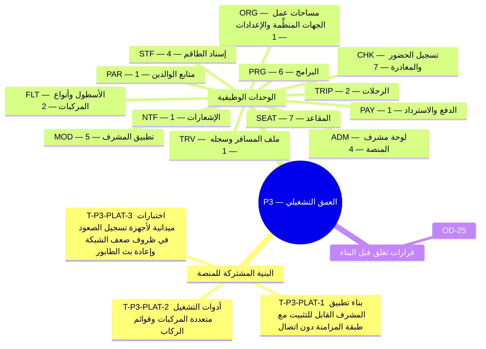

**المحور.** العمق التشغيلي — الرحلات متعددة المركبات، والبرامج، وأوضاع المقاعد، وتطبيق المشرف، وتسجيل الصعود

**تعريف الإتمام.** تُشغَّل رحلة من ثلاث حافلات تضم نحو 120 راكبًا من البداية إلى النهاية. *([القسم 3.3 من وثيقة الأعمال](/ar/docs/brd#33-مراحل-التسليم))*

**45 مهمة تسليم** (**42** مهمة وظيفية: **39** إلزامية Must، و**3** مهمة Should، و**0** تحسينية Could + **3** مهام بنية منصة مشتركة) موزعة على **13** وحدات برمجية. تتضمن كل مهمة أدناه المواصفة الكاملة ومخرجات التنفيذ الهندسي ومعايير القبول والجداول المتأثرة وروابط التتبع الشاملة عبر جميع وثائق النظام.

**نموذج البيانات.** تنطبق [اصطلاحات نموذج البيانات](/ar/docs/erd) و[ضوابط الوصول وأمان الصفوف RLS](/ar/docs/erd/acl) و[فهرس القيم المرجعية](/ar/docs/erd/reference) على جميع جداول هذه المرحلة.

<MindmapBlock title="خريطة نطاق المرحلة P3 — العمق التشغيلي" caption="توزيع مهام البنية المشتركة والوحدات الوظيفية (45 مهمة) وبوابة إغلاق المرحلة P3." trace={{"brd":[{"label":"مراحل التسليم §3.3","href":"/ar/docs/brd#33-مراحل-التسليم"}],"srs":[{"label":"مصفوفة التتبع","href":"/ar/docs/srs/traceability"}],"erd":[{"label":"نموذج البيانات","href":"/ar/docs/erd"}],"plan":[{"label":"المعالم وبوابات المراحل","href":"/ar/docs/plan/milestones"},{"label":"دليل البناء","href":"/ar/docs/plan/build-guide"}],"workflows":[{"label":"تغطية المتطلبات","href":"/ar/docs/workflows/coverage"}],"architecture":[{"label":"معمارية المنصة","href":"/ar/docs/architecture"}],"design":[{"label":"نظام التصميم","href":"/ar/docs/design"}],"system":[{"label":"النظام الشامل","href":"/ar/docs/system/lifecycle"}],"recommendations":[{"label":"حسم القرارات المفتوحة","href":"/ar/docs/recommendations/open-decisions"}]}}>

</MindmapBlock>

## فهرس المهام السريع

| المهمة | الوحدة | المرجع | الأولوية |
|---|---|---|---|
| [T-P3-PLAT-1 — بناء تطبيق المشرف القابل للتثبيت مع طبقة المزامنة دون اتصال](#t-p3-plat-1) | `PLAT` | [الأداء NFR-PERF](/ar/docs/srs/quality#81-الأداء-nfr-perf) | Must |
| [T-P3-PLAT-2 — أدوات التشغيل متعددة المركبات وقوائم الركاب](#t-p3-plat-2) | `PLAT` | [التوسع NFR-SCL](/ar/docs/srs/quality#84-قابلية-التوسع-nfr-scl) | Must |
| [T-P3-PLAT-3 — اختبارات ميدانية لأجهزة تسجيل الصعود في ظروف ضعف الشبكة وإعادة بث الطابور](#t-p3-plat-3) | `PLAT` | [الأداء NFR-PERF](/ar/docs/srs/quality#81-الأداء-nfr-perf) | Must |
| [T-P3-ORG-1 — إعداد الاختيار الذاتي للمقاعد](#t-p3-org-1) | `ORG` | [FR-ORG-05](/ar/docs/srs/requirements/org#fr-org-05--إعداد-الاختيار-الذاتي-للمقاعد) | Must |
| [T-P3-TRIP-1 — الرحلات متعددة المركبات](#t-p3-trip-1) | `TRIP` | [FR-TRIP-03](/ar/docs/srs/requirements/trip#fr-trip-03--الرحلات-متعددة-المركبات) | Must |
| [T-P3-TRIP-2 — تغييرات البرامج حتى الانطلاق](#t-p3-trip-2) | `TRIP` | [FR-TRIP-04](/ar/docs/srs/requirements/trip#fr-trip-04--تغييرات-البرامج-حتى-الانطلاق) | Must |
| [T-P3-PRG-1 — نماذج التسعير](#t-p3-prg-1) | `PRG` | [FR-PRG-01](/ar/docs/srs/requirements/prg#fr-prg-01--نماذج-التسعير) | Must |
| [T-P3-PRG-2 — أنواع البرامج](#t-p3-prg-2) | `PRG` | [FR-PRG-02](/ar/docs/srs/requirements/prg#fr-prg-02--أنواع-البرامج) | Must |
| [T-P3-PRG-3 — ملخص الحجز الحي](#t-p3-prg-3) | `PRG` | [FR-PRG-03](/ar/docs/srs/requirements/prg#fr-prg-03--ملخص-الحجز-الحي) | Must |
| [T-P3-PRG-4 — تقرير التسجيل](#t-p3-prg-4) | `PRG` | [FR-PRG-04](/ar/docs/srs/requirements/prg#fr-prg-04--تقرير-التسجيل) | Must |
| [T-P3-PRG-5 — سعة البرنامج](#t-p3-prg-5) | `PRG` | [FR-PRG-05](/ar/docs/srs/requirements/prg#fr-prg-05--سعة-البرنامج) | Must |
| [T-P3-PRG-6 — حد عدد البرامج](#t-p3-prg-6) | `PRG` | [FR-PRG-06](/ar/docs/srs/requirements/prg#fr-prg-06--حد-عدد-البرامج) | Must |
| [T-P3-FLT-1 — حد المركبات لكل رحلة](#t-p3-flt-1) | `FLT` | [FR-FLT-03](/ar/docs/srs/requirements/flt#fr-flt-03--حد-المركبات-لكل-رحلة) | Must |
| [T-P3-FLT-2 — إزالة المركبة بعد وجود حجوزات](#t-p3-flt-2) | `FLT` | [FR-FLT-05](/ar/docs/srs/requirements/flt#fr-flt-05--إزالة-المركبة-بعد-وجود-حجوزات) | Must |
| [T-P3-STF-1 — مسارا السائق](#t-p3-stf-1) | `STF` | [FR-STF-01](/ar/docs/srs/requirements/stf#fr-stf-01--مسارا-السائق) | Must |
| [T-P3-STF-2 — بوابة الجاهزية (Ready)](#t-p3-stf-2) | `STF` | [FR-STF-03](/ar/docs/srs/requirements/stf#fr-stf-03--بوابة-الجاهزية-ready) | Must |
| [T-P3-STF-3 — إسناد المشرف](#t-p3-stf-3) | `STF` | [FR-STF-05](/ar/docs/srs/requirements/stf#fr-stf-05--إسناد-المشرف) | Must |
| [T-P3-STF-4 — مهلة إعادة الإسناد](#t-p3-stf-4) | `STF` | [FR-STF-07](/ar/docs/srs/requirements/stf#fr-stf-07--مهلة-إعادة-الإسناد) | Must |
| [T-P3-SEAT-1 — التعيين من الجهة افتراضيًا](#t-p3-seat-1) | `SEAT` | [FR-SEAT-01](/ar/docs/srs/requirements/seat#fr-seat-01--التعيين-من-الجهة-افتراضيًا) | Must |
| [T-P3-SEAT-2 — خريطة المقاعد الحية](#t-p3-seat-2) | `SEAT` | [FR-SEAT-02](/ar/docs/srs/requirements/seat#fr-seat-02--خريطة-المقاعد-الحية) | Must |
| [T-P3-SEAT-3 — نافذة الأولوية](#t-p3-seat-3) | `SEAT` | [FR-SEAT-03](/ar/docs/srs/requirements/seat#fr-seat-03--نافذة-الأولوية) | Should |
| [T-P3-SEAT-4 — الحجز المؤقت للمقعد](#t-p3-seat-4) | `SEAT` | [FR-SEAT-04](/ar/docs/srs/requirements/seat#fr-seat-04--الحجز-المؤقت-للمقعد) | Must |
| [T-P3-SEAT-5 — حالات المقعد](#t-p3-seat-5) | `SEAT` | [FR-SEAT-05](/ar/docs/srs/requirements/seat#fr-seat-05--حالات-المقعد) | Must |
| [T-P3-SEAT-6 — إسناد المقاعد من الموظفين](#t-p3-seat-6) | `SEAT` | [FR-SEAT-06](/ar/docs/srs/requirements/seat#fr-seat-06--إسناد-المقاعد-من-الموظفين) | Must |
| [T-P3-SEAT-7 — الاختيار الذاتي بحسب الخطة](#t-p3-seat-7) | `SEAT` | [FR-SEAT-07](/ar/docs/srs/requirements/seat#fr-seat-07--الاختيار-الذاتي-بحسب-الخطة) | Must |
| [T-P3-PAY-1 — الاسترداد خارج السياسة](#t-p3-pay-1) | `PAY` | [FR-PAY-04](/ar/docs/srs/requirements/pay#fr-pay-04--الاسترداد-خارج-السياسة) | Must |
| [T-P3-CHK-1 — تسجيل الحضور عند الصعود](#t-p3-chk-1) | `CHK` | [FR-CHK-01](/ar/docs/srs/requirements/chk#fr-chk-01--تسجيل-الحضور-عند-الصعود) | Must |
| [T-P3-CHK-2 — مطابقة المركبة](#t-p3-chk-2) | `CHK` | [FR-CHK-02](/ar/docs/srs/requirements/chk#fr-chk-02--مطابقة-المركبة) | Must |
| [T-P3-CHK-3 — سجل الحدث](#t-p3-chk-3) | `CHK` | [FR-CHK-03](/ar/docs/srs/requirements/chk#fr-chk-03--سجل-الحدث) | Must |
| [T-P3-CHK-4 — تسجيل المغادرة عند المحطات](#t-p3-chk-4) | `CHK` | [FR-CHK-04](/ar/docs/srs/requirements/chk#fr-chk-04--تسجيل-المغادرة-عند-المحطات) | Must |
| [T-P3-CHK-5 — قائمة الانتظار دون اتصال](#t-p3-chk-5) | `CHK` | [FR-CHK-05](/ar/docs/srs/requirements/chk#fr-chk-05--قائمة-الانتظار-دون-اتصال) | Must |
| [T-P3-CHK-6 — الإبلاغ عن الحوادث](#t-p3-chk-6) | `CHK` | [FR-CHK-06](/ar/docs/srs/requirements/chk#fr-chk-06--الإبلاغ-عن-الحوادث) | Should |
| [T-P3-CHK-7 — الإشغال](#t-p3-chk-7) | `CHK` | [FR-CHK-07](/ar/docs/srs/requirements/chk#fr-chk-07--الإشغال) | Must |
| [T-P3-MOD-1 — الوصول المقيَّد بالمركبة](#t-p3-mod-1) | `MOD` | [FR-MOD-01](/ar/docs/srs/requirements/mod#fr-mod-01--الوصول-المقيَّد-بالمركبة) | Must |
| [T-P3-MOD-2 — تقرير نهاية الرحلة](#t-p3-mod-2) | `MOD` | [FR-MOD-02](/ar/docs/srs/requirements/mod#fr-mod-02--تقرير-نهاية-الرحلة) | Must |
| [T-P3-MOD-3 — إبطال الوصول](#t-p3-mod-3) | `MOD` | [FR-MOD-03](/ar/docs/srs/requirements/mod#fr-mod-03--إبطال-الوصول) | Must |
| [T-P3-MOD-4 — تطبيق قابل للتثبيت](#t-p3-mod-4) | `MOD` | [FR-MOD-04](/ar/docs/srs/requirements/mod#fr-mod-04--تطبيق-قابل-للتثبيت) | Must |
| [T-P3-MOD-5 — قفل التقرير](#t-p3-mod-5) | `MOD` | [FR-MOD-06](/ar/docs/srs/requirements/mod#fr-mod-06--قفل-التقرير) | Must |
| [T-P3-PAR-1 — الإبلاغ عن سلامة الأبناء](#t-p3-par-1) | `PAR` | [FR-PAR-07](/ar/docs/srs/requirements/par#fr-par-07--الإبلاغ-عن-سلامة-الأبناء) | Must |
| [T-P3-ADM-1 — نتائج النزاعات والاستردادات](#t-p3-adm-1) | `ADM` | [FR-ADM-04](/ar/docs/srs/requirements/adm#fr-adm-04--نتائج-النزاعات-والاستردادات) | Must |
| [T-P3-ADM-2 — معالجة النزاعات](#t-p3-adm-2) | `ADM` | [FR-ADM-08](/ar/docs/srs/requirements/adm#fr-adm-08--معالجة-النزاعات) | Must |
| [T-P3-ADM-3 — سجل حدث التدقيق](#t-p3-adm-3) | `ADM` | [FR-ADM-10](/ar/docs/srs/requirements/adm#fr-adm-10--سجل-حدث-التدقيق) | Must |
| [T-P3-ADM-4 — عرض الاستعلام عن التدقيق](#t-p3-adm-4) | `ADM` | [FR-ADM-11](/ar/docs/srs/requirements/adm#fr-adm-11--عرض-الاستعلام-عن-التدقيق) | Must |
| [T-P3-NTF-1 — ساعات الهدوء](#t-p3-ntf-1) | `NTF` | [FR-NTF-03](/ar/docs/srs/requirements/ntf#fr-ntf-03--ساعات-الهدوء) | Should |
| [T-P3-TRV-1 — خصومات البرامج](#t-p3-trv-1) | `TRV` | [FR-TRV-04](/ar/docs/srs/requirements/trv#fr-trv-04--خصومات-البرامج) | Must |

## عابرة للمجالات

تُبنى مهام البنية المشتركة هذه بالتوازي مع مهام الوحدات وتُشترط لاجتياز بوابة إغلاق المرحلة.

### T-P3-PLAT-1 — بناء تطبيق المشرف القابل للتثبيت مع طبقة المزامنة دون اتصال

<TaskCard id="T-P3-PLAT-1" title="بناء تطبيق المشرف القابل للتثبيت مع طبقة المزامنة دون اتصال" phase="P3" module="PLAT" priority="Must" kind="platform" surfaces={["تطبيق المشرف","واجهة API"]} tables={["checkin_events","trip_vehicles","bookings"]} trace={{"brd":[{"label":"المرحلة P3","href":"/ar/docs/brd#33-مراحل-التسليم"}],"srs":[{"label":"الأداء NFR-PERF","href":"/ar/docs/srs/quality#81-الأداء-nfr-perf"}],"erd":[{"label":"العمليات","href":"/ar/docs/erd/domains/operations"},{"label":"الحجز والدفع","href":"/ar/docs/erd/domains/booking-and-payment"},{"label":"checkin_events","href":"/ar/docs/erd/domains/operations#checkin_events","detail":"table"},{"label":"trip_vehicles","href":"/ar/docs/erd/domains/fleet-and-trips#trip_vehicles","detail":"table"},{"label":"bookings","href":"/ar/docs/erd/domains/booking-and-payment#bookings","detail":"table"},{"label":"أمان الصفوف ACL","href":"/ar/docs/erd/acl"}],"plan":[{"label":"المعالم","href":"/ar/docs/plan/milestones"},{"label":"استراتيجية الاختبار","href":"/ar/docs/plan/testing"}],"workflows":[{"label":"trip-day","href":"/ar/docs/workflows/trip-day"}],"userFlows":[{"label":"تدفقات الأدوار","href":"/ar/docs/user-flows"}],"architecture":[{"label":"المعمارية","href":"/ar/docs/architecture#معمارية-البيانات"}],"design":[{"label":"نظام التصميم","href":"/ar/docs/design#تطبيق-المشرف"}],"system":[{"label":"STAGE-07","href":"/ar/docs/system/lifecycle#stage-07"}],"recommendations":[{"label":"REC-OFF-06","href":"/ar/docs/recommendations/architecture-and-ops#rec-off-06"}]}}>

**نطاق البنية المشتركة.** بناء تطبيق المشرف القابل للتثبيت على الهواتف مع التخزين المحلي لقائمة الركاب وطابور تسجيل الصعود والنزول دون اتصال والمزامنة التلقائية فور عودة الشبكة.

**مخرجات التنفيذ الهندسي.**

- تطبيق ويب تقدمي قابل للتثبيت مع قاعدة بيانات محلية تحفظ رموز QR للركاب وطابور المسح دون إنترنت.
- نقطة مزامنة دفعية تمنع تكرار الأحداث بمعرّف الحدث المحلي وتحافظ على وقت الصعود الأصلي.

**معايير القبول والتحقق.**

- Given انقطاع الشبكة في هاتف المشرف، when يمسح 40 راكبًا رموزهم، then تظهر نتيجة التحقق فورًا وتُحفظ الأحداث محليًا.
- Given عودة الاتصال بالإنترنت، when تعمل المزامنة التلقائية، then تصل جميع الأحداث إلى الخادم خلال 60 ثانية.

</TaskCard>

### T-P3-PLAT-2 — أدوات التشغيل متعددة المركبات وقوائم الركاب

<TaskCard id="T-P3-PLAT-2" title="أدوات التشغيل متعددة المركبات وقوائم الركاب" phase="P3" module="PLAT" priority="Must" kind="platform" surfaces={["لوحة الجهة المنظِّمة","تطبيق المشرف"]} tables={["trips","trip_vehicles","trip_seats","trip_staff_assignments"]} trace={{"brd":[{"label":"المرحلة P3","href":"/ar/docs/brd#33-مراحل-التسليم"}],"srs":[{"label":"التوسع NFR-SCL","href":"/ar/docs/srs/quality#84-قابلية-التوسع-nfr-scl"}],"erd":[{"label":"الأسطول والرحلات","href":"/ar/docs/erd/domains/fleet-and-trips"},{"label":"العمليات","href":"/ar/docs/erd/domains/operations"},{"label":"trips","href":"/ar/docs/erd/domains/fleet-and-trips#trips","detail":"table"},{"label":"trip_vehicles","href":"/ar/docs/erd/domains/fleet-and-trips#trip_vehicles","detail":"table"},{"label":"trip_seats","href":"/ar/docs/erd/domains/booking-and-payment#trip_seats","detail":"table"},{"label":"trip_staff_assignments","href":"/ar/docs/erd/domains/fleet-and-trips#trip_staff_assignments","detail":"table"},{"label":"أمان الصفوف ACL","href":"/ar/docs/erd/acl"}],"plan":[{"label":"المعالم","href":"/ar/docs/plan/milestones"},{"label":"استراتيجية الاختبار","href":"/ar/docs/plan/testing"}],"workflows":[{"label":"trip-day","href":"/ar/docs/workflows/trip-day"}],"userFlows":[{"label":"تدفقات الأدوار","href":"/ar/docs/user-flows"}],"architecture":[{"label":"المعمارية","href":"/ar/docs/architecture#معمارية-البيانات"}],"design":[{"label":"نظام التصميم","href":"/ar/docs/design#لوحة-الجهة-المنظِّمة"}],"system":[{"label":"STAGE-07","href":"/ar/docs/system/lifecycle#stage-07"}],"recommendations":[{"label":"REC-OPS-12","href":"/ar/docs/recommendations/architecture-and-ops#rec-ops-12"}]}}>

**نطاق البنية المشتركة.** توفير لوحة قيادة للرحلات متعددة المركبات وقوائم ركاب ثنائية اللغة للطباعة والعمل دون اتصال وتقسيم جدول أحداث الصعود عبر TimescaleDB.

**مخرجات التنفيذ الهندسي.**

- تهيئة جدول TimescaleDB المقسَّم زمنيًا لأحداث الصعود مع سياسة الاحتفاظ لمدة عام واحد.
- لوحة عمليات متعددة الحافلات تعرض إحصاءات الصعود والغياب والنزول لكل مركبة لحظيًا.

**معايير القبول والتحقق.**

- Given رحلة تضم 3 حافلات و120 راكبًا، when تكتمل عملية صعود الحافلة الثانية، then تُحدَّث عدادات وحالة كل حافلة باستقلالية تامة.

</TaskCard>

### T-P3-PLAT-3 — اختبارات ميدانية لأجهزة تسجيل الصعود في ظروف ضعف الشبكة وإعادة بث الطابور

<TaskCard id="T-P3-PLAT-3" title="اختبارات ميدانية لأجهزة تسجيل الصعود في ظروف ضعف الشبكة وإعادة بث الطابور" phase="P3" module="PLAT" priority="Must" kind="platform" surfaces={["تطبيق المشرف","واجهة API"]} tables={["checkin_events"]} trace={{"brd":[{"label":"المرحلة P3","href":"/ar/docs/brd#33-مراحل-التسليم"}],"srs":[{"label":"الأداء NFR-PERF","href":"/ar/docs/srs/quality#81-الأداء-nfr-perf"}],"erd":[{"label":"العمليات","href":"/ar/docs/erd/domains/operations"},{"label":"checkin_events","href":"/ar/docs/erd/domains/operations#checkin_events","detail":"table"},{"label":"أمان الصفوف ACL","href":"/ar/docs/erd/acl"}],"plan":[{"label":"المعالم","href":"/ar/docs/plan/milestones"},{"label":"استراتيجية الاختبار","href":"/ar/docs/plan/testing"}],"workflows":[{"label":"trip-day","href":"/ar/docs/workflows/trip-day"}],"userFlows":[{"label":"تدفقات الأدوار","href":"/ar/docs/user-flows"}],"architecture":[{"label":"المعمارية","href":"/ar/docs/architecture#سمات-الجودة"}],"design":[{"label":"نظام التصميم","href":"/ar/docs/design#تطبيق-المشرف"}],"system":[{"label":"STAGE-07","href":"/ar/docs/system/lifecycle#stage-07"}],"recommendations":[{"label":"REC-OFF-06","href":"/ar/docs/recommendations/architecture-and-ops#rec-off-06"}]}}>

**نطاق البنية المشتركة.** تنفيذ اختبارات محاكاة لضعف الشبكة وانقطاعها مع 3 مشرفين يمسحون تذاكر 120 راكبًا بالتوازي مع فحص التكرار وفروق التوقيت.

**مخرجات التنفيذ الهندسي.**

- حزمة اختبارات محاكاة لثلاث حافلات تتحقق من عدم ضياع أو تكرار أي عملية صعود وتفريغ الطابور خلال 60 ثانية.
- اعتماد دليل التصعيد الفوري لبلاغات سلامة الأطفال قبل بدء المرحلة التجريبية الثالثة.

**معايير القبول والتحقق.**

- Given فقدان حزم بنسبة 50% وإعادة إرسال الدفعات، when تُفرَّغ 120 عملية مسح، then يُسجَّل 120 حدثًا فريدًا فقط بترتيبها الزمني الصحيح.

</TaskCard>

## ORG — مساحات عمل الجهات المنظِّمة والإعدادات

**نموذج البيانات.** [المالية](/ar/docs/erd/domains/finance), [الجهات المنظِّمة](/ar/docs/erd/domains/organizations) — النطاقات والجداول التي تقرؤها وتكتبها متطلبات هذه الوحدة.

### T-P3-ORG-1 — إعداد الاختيار الذاتي للمقاعد

<TaskCard id="T-P3-ORG-1" title="إعداد الاختيار الذاتي للمقاعد" phase="P3" module="ORG" priority="Must" surfaces={["لوحة الجهة المنظِّمة","لوحة مشرف المنصة"]} tables={["organizations"]} trace={{"brd":[{"label":"BR-ORG-05","href":"/ar/docs/brd/requirements#63-الجهات-المنظِّمة-والموظفون-org","detail":"P3"},{"label":"BR-SEAT-01","href":"/ar/docs/brd/requirements#63-الجهات-المنظِّمة-والموظفون-org","detail":"P3"}],"srs":[{"label":"FR-ORG-05","href":"/ar/docs/srs/requirements/org#fr-org-05--إعداد-الاختيار-الذاتي-للمقاعد","detail":"Must"},{"label":"معايير الجودة NFR","href":"/ar/docs/srs/quality"}],"erd":[{"label":"المالية","href":"/ar/docs/erd/domains/finance"},{"label":"الجهات المنظِّمة","href":"/ar/docs/erd/domains/organizations"},{"label":"organizations","href":"/ar/docs/erd/domains/organizations#organizations","detail":"table"}],"plan":[{"label":"معلم P3","href":"/ar/docs/plan/milestones"},{"label":"استراتيجية الاختبار","href":"/ar/docs/plan/testing"}],"workflows":[{"label":"applications","href":"/ar/docs/workflows/applications"}],"userFlows":[{"label":"UF-ORG-06","href":"/ar/docs/user-flows/organization#uf-org-06-إنشاء-رحلة-معالج-إرشادي"}],"architecture":[{"label":"المعمارية","href":"/ar/docs/architecture#معمارية-البيانات"}],"design":[{"label":"الواجهات والتصميم","href":"/ar/docs/design#لوحة-الجهة-المنظِّمة"}],"system":[{"label":"STAGE-02","href":"/ar/docs/system/lifecycle#stage-02"}],"recommendations":[{"label":"REC-DATA-02","href":"/ar/docs/recommendations/architecture-and-ops#rec-data-02"}]}}>

**المواصفة الوظيفية ([FR-ORG-05](/ar/docs/srs/requirements/org#fr-org-05--إعداد-الاختيار-الذاتي-للمقاعد)).** تفعّل الجهة المنظِّمة اختيار المسافرين لمقاعدهم بأنفسهم أو تعطّله لكل رحلة على حدة أو كإعداد افتراضي للحساب، وفقط على الخطط التي تشمل هذه الميزة.

**مخرجات التنفيذ الهندسي.**

- **منطق النطاق والواجهة البرمجية:** فرض عزل المستأجر عبر سياسات RLS في PostgreSQL وتهيئة مساحة العمل فور الاعتماد وحدود الموردين التابعين للجهة وروابط الويب الموقَّعة.
- **التخزين وأمان مستوى الصفوف:** عمليات القراءة والكتابة على الجداول `organizations` مع الالتزام بالأعمدة الأساسية والحذف الناعم وضوابط الوصول ([ACL](/ar/docs/erd/acl)).
- **التحقق والرصد:** اختبارات آلية تغطي سيناريوهات قبول `FR-ORG-05` وفق [استراتيجية الاختبار](/ar/docs/plan/testing) مع تسجيل الأحداث والآثار.

**معايير القبول.**

- بافتراض جهة منظِّمة على خطة Starter، عندما تحاول تفعيل الاختيار الذاتي، يُمنع الإجراء مع مطالبة بالترقية.

**التتبع التجاري وقواعد العمل الحاكمة.**

- [BR-ORG-05](/ar/docs/brd/requirements#63-الجهات-المنظِّمة-والموظفون-org): تختار الجهات المنظِّمة ما إذا كان المسافرون يستطيعون اختيار مقاعدهم بأنفسهم، لكل رحلة أو على مستوى الحساب، حيث تسمح الخطة بذلك.
- [BR-SEAT-01](/ar/docs/brd/requirements#63-الجهات-المنظِّمة-والموظفون-org): يكون إسناد المقاعد من الجهة المنظِّمة افتراضيًا. ولا يتاح الاختيار الذاتي إلا على خطتي Growth وEnterprise وفقط حيث تفعّله الجهة المنظِّمة.

</TaskCard>

## TRIP — الرحلات

**نموذج البيانات.** [الأسطول والرحلات](/ar/docs/erd/domains/fleet-and-trips) — النطاقات والجداول التي تقرؤها وتكتبها متطلبات هذه الوحدة.

### T-P3-TRIP-1 — الرحلات متعددة المركبات

<TaskCard id="T-P3-TRIP-1" title="الرحلات متعددة المركبات" phase="P3" module="TRIP" priority="Must" surfaces={["لوحة الجهة المنظِّمة","تطبيق المسافر","لوحة مشرف المنصة"]} tables={["trips","trip_vehicles"]} trace={{"brd":[{"label":"BR-TRIP-03","href":"/ar/docs/brd/requirements#64-الرحلات-والبرامج-والأسطول-trip-prg-flt","detail":"P3"},{"label":"BRL-07","href":"/ar/docs/brd/requirements#7-قواعد-العمل","detail":"قاعدة"}],"srs":[{"label":"FR-TRIP-03","href":"/ar/docs/srs/requirements/trip#fr-trip-03--الرحلات-متعددة-المركبات","detail":"Must"},{"label":"آلة حالة الرحلة §7.1","href":"/ar/docs/srs/state-machines#71-دورة-حياة-الرحلة"},{"label":"معايير الجودة NFR","href":"/ar/docs/srs/quality"}],"erd":[{"label":"الأسطول والرحلات","href":"/ar/docs/erd/domains/fleet-and-trips"},{"label":"trips","href":"/ar/docs/erd/domains/fleet-and-trips#trips","detail":"table"},{"label":"trip_vehicles","href":"/ar/docs/erd/domains/fleet-and-trips#trip_vehicles","detail":"table"}],"plan":[{"label":"معلم P3","href":"/ar/docs/plan/milestones"},{"label":"استراتيجية الاختبار","href":"/ar/docs/plan/testing"}],"workflows":[{"label":"trip-lifecycle","href":"/ar/docs/workflows/trip-lifecycle"}],"userFlows":[{"label":"UF-ORG-06","href":"/ar/docs/user-flows/organization#uf-org-06-إنشاء-رحلة-معالج-إرشادي"}],"architecture":[{"label":"المعمارية","href":"/ar/docs/architecture#نموذج-الخدمات"}],"design":[{"label":"الواجهات والتصميم","href":"/ar/docs/design#لوحة-الجهة-المنظِّمة"}],"system":[{"label":"STAGE-04","href":"/ar/docs/system/lifecycle#stage-04"}],"recommendations":[{"label":"REC-ARCH-01","href":"/ar/docs/recommendations/architecture-and-ops#rec-arch-01"}]}}>

**المواصفة الوظيفية ([FR-TRIP-03](/ar/docs/srs/requirements/trip#fr-trip-03--الرحلات-متعددة-المركبات)).** تدعم الرحلة عدة مركبات، لكل منها نوع مركبة واحد وسائق واحد ومشرف واحد، حتى حد المركبات في الخطة.

**مخرجات التنفيذ الهندسي.**

- **منطق النطاق والواجهة البرمجية:** تنفيذ معالج إنشاء الرحلة متعدد الخطوات وحراس آلة حالة الرحلة وتحولات السعة ومعالجات التعديلات بعد الحجز وقواعد الإلغاء والأرشفة.
- **التخزين وأمان مستوى الصفوف:** عمليات القراءة والكتابة على الجداول `trips`، `trip_vehicles` مع الالتزام بالأعمدة الأساسية والحذف الناعم وضوابط الوصول ([ACL](/ar/docs/erd/acl)).
- **التحقق والرصد:** اختبارات آلية تغطي سيناريوهات قبول `FR-TRIP-03` وفق [استراتيجية الاختبار](/ar/docs/plan/testing) مع تسجيل الأحداث والآثار.

**معايير القبول.**

- بافتراض مركبة بلا مشرف، عندما يُطلب الانتقال إلى Ready، يُرفض الطلب وتُحدَّد المركبة بالاسم.

**التتبع التجاري وقواعد العمل الحاكمة.**

- [BR-TRIP-03](/ar/docs/brd/requirements#64-الرحلات-والبرامج-والأسطول-trip-prg-flt): يمكن أن تعمل الرحلة بعدة مركبات في وقت واحد، لكل منها نوع مركبة واحد وسائق واحد ومشرف واحد. ويخضع عدد المركبات للخطة.
- [BRL-07](/ar/docs/brd/requirements#7-قواعد-العمل): لا يمكن أن تنتقل الرحلة إلى Ready حتى يكون لكل مركبة سائق ومشرف وتكون كل صفقات المنصة منجزة نهائيًا.

</TaskCard>

### T-P3-TRIP-2 — تغييرات البرامج حتى الانطلاق

<TaskCard id="T-P3-TRIP-2" title="تغييرات البرامج حتى الانطلاق" phase="P3" module="TRIP" priority="Must" surfaces={["لوحة الجهة المنظِّمة","تطبيق المسافر","لوحة مشرف المنصة"]} tables={["trips"]} trace={{"brd":[{"label":"BR-TRIP-04","href":"/ar/docs/brd/requirements#64-الرحلات-والبرامج-والأسطول-trip-prg-flt","detail":"P3"}],"srs":[{"label":"FR-TRIP-04","href":"/ar/docs/srs/requirements/trip#fr-trip-04--تغييرات-البرامج-حتى-الانطلاق","detail":"Must"},{"label":"آلة حالة الرحلة §7.1","href":"/ar/docs/srs/state-machines#71-دورة-حياة-الرحلة"},{"label":"معايير الجودة NFR","href":"/ar/docs/srs/quality"}],"erd":[{"label":"الأسطول والرحلات","href":"/ar/docs/erd/domains/fleet-and-trips"},{"label":"trips","href":"/ar/docs/erd/domains/fleet-and-trips#trips","detail":"table"}],"plan":[{"label":"معلم P3","href":"/ar/docs/plan/milestones"},{"label":"استراتيجية الاختبار","href":"/ar/docs/plan/testing"}],"workflows":[{"label":"دورة حياة الرحلة","href":"/ar/docs/workflows/trip-lifecycle#المؤقتات-والقواعد"}],"userFlows":[{"label":"organization","href":"/ar/docs/user-flows/organization"}],"architecture":[{"label":"المعمارية","href":"/ar/docs/architecture#نموذج-الخدمات"}],"design":[{"label":"الواجهات والتصميم","href":"/ar/docs/design#لوحة-الجهة-المنظِّمة"}],"system":[{"label":"STAGE-04","href":"/ar/docs/system/lifecycle#stage-04"}],"recommendations":[{"label":"REC-ARCH-01","href":"/ar/docs/recommendations/architecture-and-ops#rec-arch-01"}]}}>

**المواصفة الوظيفية ([FR-TRIP-04](/ar/docs/srs/requirements/trip#fr-trip-04--تغييرات-البرامج-حتى-الانطلاق)).** يمكن إضافة البرامج وتعديلها وإزالتها حتى تبدأ الرحلة، رهنًا بـ[FR-TRIP-06](/ar/docs/srs/requirements/trip#fr-trip-06--التغييرات-التي-تمس-الحجوزات-المؤكدة).

**مخرجات التنفيذ الهندسي.**

- **منطق النطاق والواجهة البرمجية:** تنفيذ معالج إنشاء الرحلة متعدد الخطوات وحراس آلة حالة الرحلة وتحولات السعة ومعالجات التعديلات بعد الحجز وقواعد الإلغاء والأرشفة.
- **التخزين وأمان مستوى الصفوف:** عمليات القراءة والكتابة على الجداول `trips` مع الالتزام بالأعمدة الأساسية والحذف الناعم وضوابط الوصول ([ACL](/ar/docs/erd/acl)).
- **التحقق والرصد:** اختبارات آلية تغطي سيناريوهات قبول `FR-TRIP-04` وفق [استراتيجية الاختبار](/ar/docs/plan/testing) مع تسجيل الأحداث والآثار.

**معايير القبول.**

- بافتراض أن الرحلة بدأت، عندما يُضاف برنامج، يُرفض الطلب.

**التتبع التجاري وقواعد العمل الحاكمة.**

- [BR-TRIP-04](/ar/docs/brd/requirements#64-الرحلات-والبرامج-والأسطول-trip-prg-flt): يمكن إضافة البرامج وتعديلها وإزالتها حتى تبدأ الرحلة.

</TaskCard>

## PRG — البرامج

**نموذج البيانات.** [الأسطول والرحلات](/ar/docs/erd/domains/fleet-and-trips) — النطاقات والجداول التي تقرؤها وتكتبها متطلبات هذه الوحدة.

### T-P3-PRG-1 — نماذج التسعير

<TaskCard id="T-P3-PRG-1" title="نماذج التسعير" phase="P3" module="PRG" priority="Must" surfaces={["لوحة الجهة المنظِّمة","تطبيق المسافر","تطبيق المشرف"]} tables={["programs"]} trace={{"brd":[{"label":"BR-PRG-01","href":"/ar/docs/brd/requirements#64-الرحلات-والبرامج-والأسطول-trip-prg-flt","detail":"P3"}],"srs":[{"label":"FR-PRG-01","href":"/ar/docs/srs/requirements/prg#fr-prg-01--نماذج-التسعير","detail":"Must"},{"label":"معايير الجودة NFR","href":"/ar/docs/srs/quality"}],"erd":[{"label":"الأسطول والرحلات","href":"/ar/docs/erd/domains/fleet-and-trips"},{"label":"programs","href":"/ar/docs/erd/domains/fleet-and-trips#programs","detail":"table"}],"plan":[{"label":"معلم P3","href":"/ar/docs/plan/milestones"},{"label":"استراتيجية الاختبار","href":"/ar/docs/plan/testing"}],"workflows":[{"label":"trip-lifecycle","href":"/ar/docs/workflows/trip-lifecycle"}],"userFlows":[{"label":"UF-ORG-06","href":"/ar/docs/user-flows/organization#uf-org-06-إنشاء-رحلة-معالج-إرشادي"}],"architecture":[{"label":"المعمارية","href":"/ar/docs/architecture#نموذج-الخدمات"}],"design":[{"label":"الواجهات والتصميم","href":"/ar/docs/design#لوحة-الجهة-المنظِّمة"}],"system":[{"label":"STAGE-04","href":"/ar/docs/system/lifecycle#stage-04"}],"recommendations":[{"label":"REC-BOOK-03","href":"/ar/docs/recommendations/architecture-and-ops#rec-book-03"}]}}>

**المواصفة الوظيفية ([FR-PRG-01](/ar/docs/srs/requirements/prg#fr-prg-01--نماذج-التسعير)).** يكون لكل برنامج نموذج تسعير واحد بالضبط: مجاني، أو لكل شخص، أو حسب الكمية، أو لكل مجموعة، أو متدرج.

**مخرجات التنفيذ الهندسي.**

- **منطق النطاق والواجهة البرمجية:** بناء برامج الرحلة الإلزامية والاختيارية والتسعير المستقل أو المدمج وأقفال سعة البرامج وقوائم المشرفين.
- **التخزين وأمان مستوى الصفوف:** عمليات القراءة والكتابة على الجداول `programs` مع الالتزام بالأعمدة الأساسية والحذف الناعم وضوابط الوصول ([ACL](/ar/docs/erd/acl)).
- **التحقق والرصد:** اختبارات آلية تغطي سيناريوهات قبول `FR-PRG-01` وفق [استراتيجية الاختبار](/ar/docs/plan/testing) مع تسجيل الأحداث والآثار.

**معايير القبول.**

- بافتراض برنامج بنموذجَي تسعير، عندما يُحفظ، يُرفض.

**التتبع التجاري وقواعد العمل الحاكمة.**

- [BR-PRG-01](/ar/docs/brd/requirements#64-الرحلات-والبرامج-والأسطول-trip-prg-flt): لكل برنامج نموذج تسعير واحد: مجاني، أو لكل شخص، أو حسب الكمية، أو لكل مجموعة، أو متدرج. ويخضع عدد البرامج للخطة.

</TaskCard>

### T-P3-PRG-2 — أنواع البرامج

<TaskCard id="T-P3-PRG-2" title="أنواع البرامج" phase="P3" module="PRG" priority="Must" surfaces={["لوحة الجهة المنظِّمة","تطبيق المسافر","تطبيق المشرف"]} tables={["programs"]} trace={{"brd":[{"label":"BR-PRG-02","href":"/ar/docs/brd/requirements#64-الرحلات-والبرامج-والأسطول-trip-prg-flt","detail":"P3"}],"srs":[{"label":"FR-PRG-02","href":"/ar/docs/srs/requirements/prg#fr-prg-02--أنواع-البرامج","detail":"Must"},{"label":"معايير الجودة NFR","href":"/ar/docs/srs/quality"}],"erd":[{"label":"الأسطول والرحلات","href":"/ar/docs/erd/domains/fleet-and-trips"},{"label":"programs","href":"/ar/docs/erd/domains/fleet-and-trips#programs","detail":"table"}],"plan":[{"label":"معلم P3","href":"/ar/docs/plan/milestones"},{"label":"استراتيجية الاختبار","href":"/ar/docs/plan/testing"}],"workflows":[{"label":"trip-lifecycle","href":"/ar/docs/workflows/trip-lifecycle"}],"userFlows":[{"label":"UF-ORG-06","href":"/ar/docs/user-flows/organization#uf-org-06-إنشاء-رحلة-معالج-إرشادي"},{"label":"UF-TRV-03","href":"/ar/docs/user-flows/traveler#uf-trv-03-حجز-رحلة"}],"architecture":[{"label":"المعمارية","href":"/ar/docs/architecture#نموذج-الخدمات"}],"design":[{"label":"الواجهات والتصميم","href":"/ar/docs/design#لوحة-الجهة-المنظِّمة"}],"system":[{"label":"STAGE-04","href":"/ar/docs/system/lifecycle#stage-04"}],"recommendations":[{"label":"REC-BOOK-03","href":"/ar/docs/recommendations/architecture-and-ops#rec-book-03"}]}}>

**المواصفة الوظيفية ([FR-PRG-02](/ar/docs/srs/requirements/prg#fr-prg-02--أنواع-البرامج)).** يكون البرنامج اختياريًا، أو مطلوبًا مسبقًا (يُضم تلقائيًا ولا يمكن إزالته)، أو محدود السعة، أو حصريًا لفئة VIP.

**مخرجات التنفيذ الهندسي.**

- **منطق النطاق والواجهة البرمجية:** بناء برامج الرحلة الإلزامية والاختيارية والتسعير المستقل أو المدمج وأقفال سعة البرامج وقوائم المشرفين.
- **التخزين وأمان مستوى الصفوف:** عمليات القراءة والكتابة على الجداول `programs` مع الالتزام بالأعمدة الأساسية والحذف الناعم وضوابط الوصول ([ACL](/ar/docs/erd/acl)).
- **التحقق والرصد:** اختبارات آلية تغطي سيناريوهات قبول `FR-PRG-02` وفق [استراتيجية الاختبار](/ar/docs/plan/testing) مع تسجيل الأحداث والآثار.

**معايير القبول.**

- بافتراض برنامج مطلوب مسبقًا، عندما يحجز المسافر، يُضم تلقائيًا ولا يمكن إزالته.
- بافتراض برنامج حصري لفئة VIP، عندما يفتحه مسافر على خطة Free أو Explorer، يظهر مقفلًا مع رسالة تدعو إلى ترقية الخطة.

**التتبع التجاري وقواعد العمل الحاكمة.**

- [BR-PRG-02](/ar/docs/brd/requirements#64-الرحلات-والبرامج-والأسطول-trip-prg-flt): يمكن أن يكون البرنامج اختياريًا، أو مطلوبًا مسبقًا (يُضم تلقائيًا)، أو محدود السعة، أو حصريًا لفئة VIP.

</TaskCard>

### T-P3-PRG-3 — ملخص الحجز الحي

<TaskCard id="T-P3-PRG-3" title="ملخص الحجز الحي" phase="P3" module="PRG" priority="Must" surfaces={["لوحة الجهة المنظِّمة","تطبيق المسافر","تطبيق المشرف"]} tables={["programs"]} trace={{"brd":[{"label":"BR-PRG-03","href":"/ar/docs/brd/requirements#64-الرحلات-والبرامج-والأسطول-trip-prg-flt","detail":"P3"}],"srs":[{"label":"FR-PRG-03","href":"/ar/docs/srs/requirements/prg#fr-prg-03--ملخص-الحجز-الحي","detail":"Must"},{"label":"معايير الجودة NFR","href":"/ar/docs/srs/quality"}],"erd":[{"label":"الأسطول والرحلات","href":"/ar/docs/erd/domains/fleet-and-trips"},{"label":"programs","href":"/ar/docs/erd/domains/fleet-and-trips#programs","detail":"table"}],"plan":[{"label":"معلم P3","href":"/ar/docs/plan/milestones"},{"label":"استراتيجية الاختبار","href":"/ar/docs/plan/testing"}],"workflows":[{"label":"trip-lifecycle","href":"/ar/docs/workflows/trip-lifecycle"}],"userFlows":[{"label":"UF-ORG-06","href":"/ar/docs/user-flows/organization#uf-org-06-إنشاء-رحلة-معالج-إرشادي"},{"label":"UF-TRV-03","href":"/ar/docs/user-flows/traveler#uf-trv-03-حجز-رحلة"}],"architecture":[{"label":"المعمارية","href":"/ar/docs/architecture#نموذج-الخدمات"}],"design":[{"label":"الواجهات والتصميم","href":"/ar/docs/design#لوحة-الجهة-المنظِّمة"}],"system":[{"label":"STAGE-04","href":"/ar/docs/system/lifecycle#stage-04"}],"recommendations":[{"label":"REC-BOOK-03","href":"/ar/docs/recommendations/architecture-and-ops#rec-book-03"}]}}>

**المواصفة الوظيفية ([FR-PRG-03](/ar/docs/srs/requirements/prg#fr-prg-03--ملخص-الحجز-الحي)).** يحدِّث ملخص الحجز الإجمالي كلما تغيّرت البرامج والكميات قبل الانتقال إلى الخطوة التالية، بما في ذلك خصم البرامج المضمَّن في الخطة.

**مخرجات التنفيذ الهندسي.**

- **منطق النطاق والواجهة البرمجية:** بناء برامج الرحلة الإلزامية والاختيارية والتسعير المستقل أو المدمج وأقفال سعة البرامج وقوائم المشرفين.
- **التخزين وأمان مستوى الصفوف:** عمليات القراءة والكتابة على الجداول `programs` مع الالتزام بالأعمدة الأساسية والحذف الناعم وضوابط الوصول ([ACL](/ar/docs/erd/acl)).
- **التحقق والرصد:** اختبارات آلية تغطي سيناريوهات قبول `FR-PRG-03` وفق [استراتيجية الاختبار](/ar/docs/plan/testing) مع تسجيل الأحداث والآثار.

**معايير القبول.**

- بافتراض برنامج بتسعير لكل شخص لراكبَين اثنين، عندما يُضاف، يرتفع الإجمالي بمقدار السعر مضروبًا في 2 قبل الانتقال إلى الخطوة التالية.

**التتبع التجاري وقواعد العمل الحاكمة.**

- [BR-PRG-03](/ar/docs/brd/requirements#64-الرحلات-والبرامج-والأسطول-trip-prg-flt): يرى المسافرون إجمالي الحجز لحظيًا أثناء إضافة البرامج أو إزالتها، بما في ذلك خصم البرامج في خطتهم.

</TaskCard>

### T-P3-PRG-4 — تقرير التسجيل

<TaskCard id="T-P3-PRG-4" title="تقرير التسجيل" phase="P3" module="PRG" priority="Must" surfaces={["لوحة الجهة المنظِّمة","تطبيق المسافر","تطبيق المشرف"]} tables={["programs"]} trace={{"brd":[{"label":"BR-PRG-04","href":"/ar/docs/brd/requirements#64-الرحلات-والبرامج-والأسطول-trip-prg-flt","detail":"P3"},{"label":"OD-25","href":"/ar/docs/brd/compliance#11-القرارات-المفتوحة","detail":"مفتوح"}],"srs":[{"label":"FR-PRG-04","href":"/ar/docs/srs/requirements/prg#fr-prg-04--تقرير-التسجيل","detail":"Must"},{"label":"معايير الجودة NFR","href":"/ar/docs/srs/quality"}],"erd":[{"label":"الأسطول والرحلات","href":"/ar/docs/erd/domains/fleet-and-trips"},{"label":"programs","href":"/ar/docs/erd/domains/fleet-and-trips#programs","detail":"table"}],"plan":[{"label":"معلم P3","href":"/ar/docs/plan/milestones"},{"label":"استراتيجية الاختبار","href":"/ar/docs/plan/testing"}],"workflows":[{"label":"trip-lifecycle","href":"/ar/docs/workflows/trip-lifecycle"}],"userFlows":[{"label":"UF-ORG-06","href":"/ar/docs/user-flows/organization#uf-org-06-إنشاء-رحلة-معالج-إرشادي"}],"architecture":[{"label":"المعمارية","href":"/ar/docs/architecture#نموذج-الخدمات"}],"design":[{"label":"الواجهات والتصميم","href":"/ar/docs/design#لوحة-الجهة-المنظِّمة"}],"system":[{"label":"STAGE-04","href":"/ar/docs/system/lifecycle#stage-04"}],"recommendations":[{"label":"توصية OD-25","href":"/ar/docs/recommendations/open-decisions#od-25"},{"label":"REC-BOOK-03","href":"/ar/docs/recommendations/architecture-and-ops#rec-book-03"}]}}>

**المواصفة الوظيفية ([FR-PRG-04](/ar/docs/srs/requirements/prg#fr-prg-04--تقرير-التسجيل)).** ترى الجهة المنظِّمة لكل برنامج من اختاره والكميات والإيرادات. ولا توجد بوابة خطة حتى يُحسم [OD-25](/ar/docs/brd/compliance#11-القرارات-المفتوحة).

**مخرجات التنفيذ الهندسي.**

- **منطق النطاق والواجهة البرمجية:** بناء برامج الرحلة الإلزامية والاختيارية والتسعير المستقل أو المدمج وأقفال سعة البرامج وقوائم المشرفين.
- **التخزين وأمان مستوى الصفوف:** عمليات القراءة والكتابة على الجداول `programs` مع الالتزام بالأعمدة الأساسية والحذف الناعم وضوابط الوصول ([ACL](/ar/docs/erd/acl)).
- **التحقق والرصد:** اختبارات آلية تغطي سيناريوهات قبول `FR-PRG-04` وفق [استراتيجية الاختبار](/ar/docs/plan/testing) مع تسجيل الأحداث والآثار.

**معايير القبول.**

- بافتراض كميتين 2 و3 على برنامج واحد، عندما يُفتح التقرير، يظهر الصفان مع إجمالي 5.

**التتبع التجاري وقواعد العمل الحاكمة.**

- [BR-PRG-04](/ar/docs/brd/requirements#64-الرحلات-والبرامج-والأسطول-trip-prg-flt): ترى الجهات المنظِّمة من اختار كل برنامج والكميات والإيرادات. عمق التقارير بحسب الخطة موضح في [OD-25](/ar/docs/brd/compliance#11-القرارات-المفتوحة).
- [OD-25](/ar/docs/brd/compliance#11-القرارات-المفتوحة) (ربط تقرير التسجيل في البرنامج بالخطة — مفتوح) ← راجع [التوصية المقترحة](/ar/docs/recommendations/open-decisions#od-25).

</TaskCard>

### T-P3-PRG-5 — سعة البرنامج

<TaskCard id="T-P3-PRG-5" title="سعة البرنامج" phase="P3" module="PRG" priority="Must" surfaces={["لوحة الجهة المنظِّمة","تطبيق المسافر","تطبيق المشرف"]} tables={["programs"]} trace={{"brd":[{"label":"BR-PRG-02","href":"/ar/docs/brd/requirements#64-الرحلات-والبرامج-والأسطول-trip-prg-flt","detail":"P3"}],"srs":[{"label":"FR-PRG-05","href":"/ar/docs/srs/requirements/prg#fr-prg-05--سعة-البرنامج","detail":"Must"},{"label":"معايير الجودة NFR","href":"/ar/docs/srs/quality"}],"erd":[{"label":"الأسطول والرحلات","href":"/ar/docs/erd/domains/fleet-and-trips"},{"label":"programs","href":"/ar/docs/erd/domains/fleet-and-trips#programs","detail":"table"}],"plan":[{"label":"معلم P3","href":"/ar/docs/plan/milestones"},{"label":"استراتيجية الاختبار","href":"/ar/docs/plan/testing"}],"workflows":[{"label":"trip-lifecycle","href":"/ar/docs/workflows/trip-lifecycle"}],"userFlows":[{"label":"UF-ORG-06","href":"/ar/docs/user-flows/organization#uf-org-06-إنشاء-رحلة-معالج-إرشادي"}],"architecture":[{"label":"المعمارية","href":"/ar/docs/architecture#نموذج-الخدمات"}],"design":[{"label":"الواجهات والتصميم","href":"/ar/docs/design#لوحة-الجهة-المنظِّمة"}],"system":[{"label":"STAGE-04","href":"/ar/docs/system/lifecycle#stage-04"}],"recommendations":[{"label":"REC-BOOK-03","href":"/ar/docs/recommendations/architecture-and-ops#rec-book-03"}]}}>

**المواصفة الوظيفية ([FR-PRG-05](/ar/docs/srs/requirements/prg#fr-prg-05--سعة-البرنامج)).** يتوقف البرنامج محدود السعة عن قبول الاختيارات عند بلوغ سقفه ويظهر بوصفه غير متاح.

**مخرجات التنفيذ الهندسي.**

- **منطق النطاق والواجهة البرمجية:** بناء برامج الرحلة الإلزامية والاختيارية والتسعير المستقل أو المدمج وأقفال سعة البرامج وقوائم المشرفين.
- **التخزين وأمان مستوى الصفوف:** عمليات القراءة والكتابة على الجداول `programs` مع الالتزام بالأعمدة الأساسية والحذف الناعم وضوابط الوصول ([ACL](/ar/docs/erd/acl)).
- **التحقق والرصد:** اختبارات آلية تغطي سيناريوهات قبول `FR-PRG-05` وفق [استراتيجية الاختبار](/ar/docs/plan/testing) مع تسجيل الأحداث والآثار.

**معايير القبول.**

- بافتراض سقف 20 مع 20 اختيارًا، عندما يفتحه المسافر رقم 21، يظهر غير متاح.

**التتبع التجاري وقواعد العمل الحاكمة.**

- [BR-PRG-02](/ar/docs/brd/requirements#64-الرحلات-والبرامج-والأسطول-trip-prg-flt): يمكن أن يكون البرنامج اختياريًا، أو مطلوبًا مسبقًا (يُضم تلقائيًا)، أو محدود السعة، أو حصريًا لفئة VIP.

</TaskCard>

### T-P3-PRG-6 — حد عدد البرامج

<TaskCard id="T-P3-PRG-6" title="حد عدد البرامج" phase="P3" module="PRG" priority="Must" surfaces={["لوحة الجهة المنظِّمة","تطبيق المسافر","تطبيق المشرف"]} tables={["programs"]} trace={{"brd":[{"label":"BR-SUB-02","href":"/ar/docs/brd/requirements#64-الرحلات-والبرامج-والأسطول-trip-prg-flt","detail":"P3"},{"label":"BR-PRG-01","href":"/ar/docs/brd/requirements#64-الرحلات-والبرامج-والأسطول-trip-prg-flt","detail":"P3"}],"srs":[{"label":"FR-PRG-06","href":"/ar/docs/srs/requirements/prg#fr-prg-06--حد-عدد-البرامج","detail":"Must"},{"label":"معايير الجودة NFR","href":"/ar/docs/srs/quality"}],"erd":[{"label":"الأسطول والرحلات","href":"/ar/docs/erd/domains/fleet-and-trips"},{"label":"programs","href":"/ar/docs/erd/domains/fleet-and-trips#programs","detail":"table"}],"plan":[{"label":"معلم P3","href":"/ar/docs/plan/milestones"},{"label":"استراتيجية الاختبار","href":"/ar/docs/plan/testing"}],"workflows":[{"label":"trip-lifecycle","href":"/ar/docs/workflows/trip-lifecycle"}],"userFlows":[{"label":"UF-ORG-06","href":"/ar/docs/user-flows/organization#uf-org-06-إنشاء-رحلة-معالج-إرشادي"}],"architecture":[{"label":"المعمارية","href":"/ar/docs/architecture#نموذج-الخدمات"}],"design":[{"label":"الواجهات والتصميم","href":"/ar/docs/design#لوحة-الجهة-المنظِّمة"}],"system":[{"label":"STAGE-04","href":"/ar/docs/system/lifecycle#stage-04"}],"recommendations":[{"label":"REC-BOOK-03","href":"/ar/docs/recommendations/architecture-and-ops#rec-book-03"}]}}>

**المواصفة الوظيفية ([FR-PRG-06](/ar/docs/srs/requirements/prg#fr-prg-06--حد-عدد-البرامج)).** لا يتجاوز عدد البرامج لكل رحلة حد الخطة (3 لخطة Starter، و15 لخطة Growth، وبلا حدود لخطة Enterprise).

**مخرجات التنفيذ الهندسي.**

- **منطق النطاق والواجهة البرمجية:** بناء برامج الرحلة الإلزامية والاختيارية والتسعير المستقل أو المدمج وأقفال سعة البرامج وقوائم المشرفين.
- **التخزين وأمان مستوى الصفوف:** عمليات القراءة والكتابة على الجداول `programs` مع الالتزام بالأعمدة الأساسية والحذف الناعم وضوابط الوصول ([ACL](/ar/docs/erd/acl)).
- **التحقق والرصد:** اختبارات آلية تغطي سيناريوهات قبول `FR-PRG-06` وفق [استراتيجية الاختبار](/ar/docs/plan/testing) مع تسجيل الأحداث والآثار.

**معايير القبول.**

- بافتراض رحلة على خطة Starter بها 3 برامج، عندما يُضاف برنامج رابع، يُحجب مع رسالة تدعو إلى ترقية الخطة.

**التتبع التجاري وقواعد العمل الحاكمة.**

- [BR-SUB-02](/ar/docs/brd/requirements#64-الرحلات-والبرامج-والأسطول-trip-prg-flt): تُفرض حدود الخطة وميزاتها تلقائيًا. ويعرض الإجراء المحجوب رسالة تدعو إلى ترقية الخطة. ويحتاج كل دور غير المسافر إلى خطة نشطة لاستخدام التطبيق ([BRL-02](/ar/docs/brd/requirements#7-قواعد-العمل)).
- [BR-PRG-01](/ar/docs/brd/requirements#64-الرحلات-والبرامج-والأسطول-trip-prg-flt): لكل برنامج نموذج تسعير واحد: مجاني، أو لكل شخص، أو حسب الكمية، أو لكل مجموعة، أو متدرج. ويخضع عدد البرامج للخطة.

</TaskCard>

## FLT — الأسطول وأنواع المركبات

**نموذج البيانات.** [الأسطول والرحلات](/ar/docs/erd/domains/fleet-and-trips) — النطاقات والجداول التي تقرؤها وتكتبها متطلبات هذه الوحدة.

### T-P3-FLT-1 — حد المركبات لكل رحلة

<TaskCard id="T-P3-FLT-1" title="حد المركبات لكل رحلة" phase="P3" module="FLT" priority="Must" surfaces={["لوحة الجهة المنظِّمة","تطبيق السائق"]} tables={[]} trace={{"brd":[{"label":"BR-TRIP-03","href":"/ar/docs/brd/requirements#64-الرحلات-والبرامج-والأسطول-trip-prg-flt","detail":"P3"},{"label":"BR-SUB-02","href":"/ar/docs/brd/requirements#64-الرحلات-والبرامج-والأسطول-trip-prg-flt","detail":"P3"}],"srs":[{"label":"FR-FLT-03","href":"/ar/docs/srs/requirements/flt#fr-flt-03--حد-المركبات-لكل-رحلة","detail":"Must"},{"label":"معايير الجودة NFR","href":"/ar/docs/srs/quality"}],"erd":[{"label":"الأسطول والرحلات","href":"/ar/docs/erd/domains/fleet-and-trips"}],"plan":[{"label":"معلم P3","href":"/ar/docs/plan/milestones"},{"label":"استراتيجية الاختبار","href":"/ar/docs/plan/testing"}],"workflows":[{"label":"trip-lifecycle","href":"/ar/docs/workflows/trip-lifecycle"}],"userFlows":[{"label":"UF-ORG-23","href":"/ar/docs/user-flows/organization#uf-org-23-الأسطول-أثناء-دورة-الحياة"}],"architecture":[{"label":"المعمارية","href":"/ar/docs/architecture#معمارية-البيانات"}],"design":[{"label":"الواجهات والتصميم","href":"/ar/docs/design#لوحة-الجهة-المنظِّمة"}],"system":[{"label":"STAGE-03","href":"/ar/docs/system/lifecycle#stage-03"}],"recommendations":[{"label":"REC-BOOK-03","href":"/ar/docs/recommendations/architecture-and-ops#rec-book-03"}]}}>

**المواصفة الوظيفية ([FR-FLT-03](/ar/docs/srs/requirements/flt#fr-flt-03--حد-المركبات-لكل-رحلة)).** لا يتجاوز عدد المركبات في الرحلة حد الخطة (Starter: 2، Growth: 10، Enterprise: غير محدود).

**مخرجات التنفيذ الهندسي.**

- **منطق النطاق والواجهة البرمجية:** إدارة أنواع المركبات القابلة لإعادة الاستخدام وهندسة مخططات المقاعد وتخصيص المركبات المتعددة للرحلة وضوابط استبدال المركبات.
- **التحقق والرصد:** اختبارات آلية تغطي سيناريوهات قبول `FR-FLT-03` وفق [استراتيجية الاختبار](/ar/docs/plan/testing) مع تسجيل الأحداث والآثار.

**معايير القبول.**

- بافتراض رحلة ضمن خطة Starter بها مركبتان، عند إضافة مركبة ثالثة، يُمنع الإجراء مع مطالبة بالترقية.

**التتبع التجاري وقواعد العمل الحاكمة.**

- [BR-TRIP-03](/ar/docs/brd/requirements#64-الرحلات-والبرامج-والأسطول-trip-prg-flt): يمكن أن تعمل الرحلة بعدة مركبات في وقت واحد، لكل منها نوع مركبة واحد وسائق واحد ومشرف واحد. ويخضع عدد المركبات للخطة.
- [BR-SUB-02](/ar/docs/brd/requirements#64-الرحلات-والبرامج-والأسطول-trip-prg-flt): تُفرض حدود الخطة وميزاتها تلقائيًا. ويعرض الإجراء المحجوب رسالة تدعو إلى ترقية الخطة. ويحتاج كل دور غير المسافر إلى خطة نشطة لاستخدام التطبيق ([BRL-02](/ar/docs/brd/requirements#7-قواعد-العمل)).

</TaskCard>

### T-P3-FLT-2 — إزالة المركبة بعد وجود حجوزات

<TaskCard id="T-P3-FLT-2" title="إزالة المركبة بعد وجود حجوزات" phase="P3" module="FLT" priority="Must" surfaces={["لوحة الجهة المنظِّمة","تطبيق السائق"]} tables={[]} trace={{"brd":[{"label":"BR-TRIP-03","href":"/ar/docs/brd/requirements#64-الرحلات-والبرامج-والأسطول-trip-prg-flt","detail":"P3"},{"label":"BRL-24","href":"/ar/docs/brd/requirements#7-قواعد-العمل","detail":"قاعدة"}],"srs":[{"label":"FR-FLT-05","href":"/ar/docs/srs/requirements/flt#fr-flt-05--إزالة-المركبة-بعد-وجود-حجوزات","detail":"Must"},{"label":"معايير الجودة NFR","href":"/ar/docs/srs/quality"}],"erd":[{"label":"الأسطول والرحلات","href":"/ar/docs/erd/domains/fleet-and-trips"}],"plan":[{"label":"معلم P3","href":"/ar/docs/plan/milestones"},{"label":"استراتيجية الاختبار","href":"/ar/docs/plan/testing"}],"workflows":[{"label":"trip-lifecycle","href":"/ar/docs/workflows/trip-lifecycle"}],"userFlows":[{"label":"UF-ORG-23","href":"/ar/docs/user-flows/organization#uf-org-23-الأسطول-أثناء-دورة-الحياة"}],"architecture":[{"label":"المعمارية","href":"/ar/docs/architecture#معمارية-البيانات"}],"design":[{"label":"الواجهات والتصميم","href":"/ar/docs/design#لوحة-الجهة-المنظِّمة"}],"system":[{"label":"STAGE-03","href":"/ar/docs/system/lifecycle#stage-03"}],"recommendations":[{"label":"REC-BOOK-03","href":"/ar/docs/recommendations/architecture-and-ops#rec-book-03"}]}}>

**المواصفة الوظيفية ([FR-FLT-05](/ar/docs/srs/requirements/flt#fr-flt-05--إزالة-المركبة-بعد-وجود-حجوزات)).** لا تُزال المركبة ذات الحجوزات المؤكدة حتى يُعاد تعيين تلك الحجوزات أو تُسوّى وفق [FR-TRIP-06](/ar/docs/srs/requirements/trip#fr-trip-06--التغييرات-التي-تمس-الحجوزات-المؤكدة).

**مخرجات التنفيذ الهندسي.**

- **منطق النطاق والواجهة البرمجية:** إدارة أنواع المركبات القابلة لإعادة الاستخدام وهندسة مخططات المقاعد وتخصيص المركبات المتعددة للرحلة وضوابط استبدال المركبات.
- **التحقق والرصد:** اختبارات آلية تغطي سيناريوهات قبول `FR-FLT-05` وفق [استراتيجية الاختبار](/ar/docs/plan/testing) مع تسجيل الأحداث والآثار.

**معايير القبول.**

- بافتراض مركبة ذات حجوزات مؤكدة، عند محاولة الإزالة، يُرفض الإجراء مع عرض العدد.

**التتبع التجاري وقواعد العمل الحاكمة.**

- [BR-TRIP-03](/ar/docs/brd/requirements#64-الرحلات-والبرامج-والأسطول-trip-prg-flt): يمكن أن تعمل الرحلة بعدة مركبات في وقت واحد، لكل منها نوع مركبة واحد وسائق واحد ومشرف واحد. ويخضع عدد المركبات للخطة.
- [BRL-24](/ar/docs/brd/requirements#7-قواعد-العمل): لا يمكن تغيير برامج الرحلة أو وضع المقاعد أو مركباتها بطريقة تُفسد حجزًا مؤكدًا حتى يُخطَر المسافر وتُعرض عليه معالجة. وله 7 أيام للاختيار؛ ثم تُحال الحالة إلى مشرف المنصة (D-148).

</TaskCard>

## STF — إسناد الطاقم

**نموذج البيانات.** [الأسطول والرحلات](/ar/docs/erd/domains/fleet-and-trips) — النطاقات والجداول التي تقرؤها وتكتبها متطلبات هذه الوحدة.

### T-P3-STF-1 — مسارا السائق

<TaskCard id="T-P3-STF-1" title="مسارا السائق" phase="P3" module="STF" priority="Must" surfaces={["لوحة الجهة المنظِّمة","تطبيق السائق","استوديو المصوّر","تطبيق المشرف"]} tables={["trip_staff_assignments"]} trace={{"brd":[{"label":"BR-STF-01","href":"/ar/docs/brd/requirements#65-الطاقم-والصفقات-stf","detail":"P3"}],"srs":[{"label":"FR-STF-01","href":"/ar/docs/srs/requirements/stf#fr-stf-01--مسارا-السائق","detail":"Must"},{"label":"معايير الجودة NFR","href":"/ar/docs/srs/quality"}],"erd":[{"label":"الأسطول والرحلات","href":"/ar/docs/erd/domains/fleet-and-trips"},{"label":"trip_staff_assignments","href":"/ar/docs/erd/domains/fleet-and-trips#trip_staff_assignments","detail":"table"}],"plan":[{"label":"معلم P3","href":"/ar/docs/plan/milestones"},{"label":"استراتيجية الاختبار","href":"/ar/docs/plan/testing"}],"workflows":[{"label":"دورة حياة الرحلة","href":"/ar/docs/workflows/trip-lifecycle#المؤقتات-والقواعد"}],"userFlows":[{"label":"organization","href":"/ar/docs/user-flows/organization"}],"architecture":[{"label":"المعمارية","href":"/ar/docs/architecture#نموذج-الخدمات"}],"design":[{"label":"الواجهات والتصميم","href":"/ar/docs/design#لوحة-الجهة-المنظِّمة"}],"system":[{"label":"STAGE-03","href":"/ar/docs/system/lifecycle#stage-03"}],"recommendations":[{"label":"REC-ARCH-01","href":"/ar/docs/recommendations/architecture-and-ops#rec-arch-01"}]}}>

**المواصفة الوظيفية ([FR-STF-01](/ar/docs/srs/requirements/stf#fr-stf-01--مسارا-السائق)).** تُقاد كل مركبة إما بسائق تابع للجهة المنظِّمة أو بسائق من المنصة عبر صفقة منجزة نهائيًا.

**مخرجات التنفيذ الهندسي.**

- **منطق النطاق والواجهة البرمجية:** فرض جاهزية السائق والمشرف لكل مركبة (BRL-07) وكشف تعارض المواعيد ومسارات الاستبدال الطارئ للموردين.
- **التخزين وأمان مستوى الصفوف:** عمليات القراءة والكتابة على الجداول `trip_staff_assignments` مع الالتزام بالأعمدة الأساسية والحذف الناعم وضوابط الوصول ([ACL](/ar/docs/erd/acl)).
- **التحقق والرصد:** اختبارات آلية تغطي سيناريوهات قبول `FR-STF-01` وفق [استراتيجية الاختبار](/ar/docs/plan/testing) مع تسجيل الأحداث والآثار.

**معايير القبول.**

- بافتراض مركبة يجري إسناد طاقمها، عندما يُختار سائق، لا يُعرض سوى هذين الخيارين.

**التتبع التجاري وقواعد العمل الحاكمة.**

- [BR-STF-01](/ar/docs/brd/requirements#65-الطاقم-والصفقات-stf): تُقاد كل مركبة إما بسائق تابع للجهة المنظِّمة أو بسائق من المنصة يُتعاقد معه عبر صفقة.

</TaskCard>

### T-P3-STF-2 — بوابة الجاهزية (Ready)

<TaskCard id="T-P3-STF-2" title="بوابة الجاهزية (Ready)" phase="P3" module="STF" priority="Must" surfaces={["لوحة الجهة المنظِّمة","تطبيق السائق","استوديو المصوّر","تطبيق المشرف"]} tables={["trip_staff_assignments"]} trace={{"brd":[{"label":"BR-STF-05","href":"/ar/docs/brd/requirements#65-الطاقم-والصفقات-stf","detail":"P3"},{"label":"BRL-07","href":"/ar/docs/brd/requirements#7-قواعد-العمل","detail":"قاعدة"}],"srs":[{"label":"FR-STF-03","href":"/ar/docs/srs/requirements/stf#fr-stf-03--بوابة-الجاهزية-ready","detail":"Must"},{"label":"معايير الجودة NFR","href":"/ar/docs/srs/quality"}],"erd":[{"label":"الأسطول والرحلات","href":"/ar/docs/erd/domains/fleet-and-trips"},{"label":"trip_staff_assignments","href":"/ar/docs/erd/domains/fleet-and-trips#trip_staff_assignments","detail":"table"}],"plan":[{"label":"معلم P3","href":"/ar/docs/plan/milestones"},{"label":"استراتيجية الاختبار","href":"/ar/docs/plan/testing"}],"workflows":[{"label":"دورة حياة الرحلة","href":"/ar/docs/workflows/trip-lifecycle#المؤقتات-والقواعد"}],"userFlows":[{"label":"UF-ORG-08","href":"/ar/docs/user-flows/organization#uf-org-08-نقل-رحلة-إلى-حالة-ready"}],"architecture":[{"label":"المعمارية","href":"/ar/docs/architecture#نموذج-الخدمات"}],"design":[{"label":"الواجهات والتصميم","href":"/ar/docs/design#لوحة-الجهة-المنظِّمة"}],"system":[{"label":"STAGE-03","href":"/ar/docs/system/lifecycle#stage-03"}],"recommendations":[{"label":"REC-ARCH-01","href":"/ar/docs/recommendations/architecture-and-ops#rec-arch-01"}]}}>

**المواصفة الوظيفية ([FR-STF-03](/ar/docs/srs/requirements/stf#fr-stf-03--بوابة-الجاهزية-ready)).** لا تنتقل الرحلة إلى Ready حتى يكون لكل مركبة سائق مؤكد ومشرف وتكون كل صفقات المنصة منجزة نهائيًا. ويسرد النظام كل فجوة.

**مخرجات التنفيذ الهندسي.**

- **منطق النطاق والواجهة البرمجية:** فرض جاهزية السائق والمشرف لكل مركبة (BRL-07) وكشف تعارض المواعيد ومسارات الاستبدال الطارئ للموردين.
- **التخزين وأمان مستوى الصفوف:** عمليات القراءة والكتابة على الجداول `trip_staff_assignments` مع الالتزام بالأعمدة الأساسية والحذف الناعم وضوابط الوصول ([ACL](/ar/docs/erd/acl)).
- **التحقق والرصد:** اختبارات آلية تغطي سيناريوهات قبول `FR-STF-03` وفق [استراتيجية الاختبار](/ar/docs/plan/testing) مع تسجيل الأحداث والآثار.

**معايير القبول.**

- بافتراض أن المركبة 3 بلا مشرف، عندما يُطلب الانتقال إلى Ready، يُرفض الطلب وتُدرَج المركبة 3.

**التتبع التجاري وقواعد العمل الحاكمة.**

- [BR-STF-05](/ar/docs/brd/requirements#65-الطاقم-والصفقات-stf): لا تكون الرحلة Ready إلا عندما يكون لكل مركبة سائق ومشرف مؤكدان وتكون كل صفقات المنصة قد أُنجزت نهائيًا.
- [BRL-07](/ar/docs/brd/requirements#7-قواعد-العمل): لا يمكن أن تنتقل الرحلة إلى Ready حتى يكون لكل مركبة سائق ومشرف وتكون كل صفقات المنصة منجزة نهائيًا.

</TaskCard>

### T-P3-STF-3 — إسناد المشرف

<TaskCard id="T-P3-STF-3" title="إسناد المشرف" phase="P3" module="STF" priority="Must" surfaces={["لوحة الجهة المنظِّمة","تطبيق السائق","استوديو المصوّر","تطبيق المشرف"]} tables={["trip_staff_assignments"]} trace={{"brd":[{"label":"BR-STF-05","href":"/ar/docs/brd/requirements#65-الطاقم-والصفقات-stf","detail":"P3"},{"label":"BR-CHK-04","href":"/ar/docs/brd/requirements#65-الطاقم-والصفقات-stf","detail":"P3"}],"srs":[{"label":"FR-STF-05","href":"/ar/docs/srs/requirements/stf#fr-stf-05--إسناد-المشرف","detail":"Must"},{"label":"معايير الجودة NFR","href":"/ar/docs/srs/quality"}],"erd":[{"label":"الأسطول والرحلات","href":"/ar/docs/erd/domains/fleet-and-trips"},{"label":"trip_staff_assignments","href":"/ar/docs/erd/domains/fleet-and-trips#trip_staff_assignments","detail":"table"}],"plan":[{"label":"معلم P3","href":"/ar/docs/plan/milestones"},{"label":"استراتيجية الاختبار","href":"/ar/docs/plan/testing"}],"workflows":[{"label":"يوم الرحلة","href":"/ar/docs/workflows/trip-day#المؤقّتات-والقواعد"}],"userFlows":[{"label":"organization","href":"/ar/docs/user-flows/organization"}],"architecture":[{"label":"المعمارية","href":"/ar/docs/architecture#نموذج-الخدمات"}],"design":[{"label":"الواجهات والتصميم","href":"/ar/docs/design#لوحة-الجهة-المنظِّمة"}],"system":[{"label":"STAGE-03","href":"/ar/docs/system/lifecycle#stage-03"}],"recommendations":[{"label":"REC-ARCH-01","href":"/ar/docs/recommendations/architecture-and-ops#rec-arch-01"}]}}>

**المواصفة الوظيفية ([FR-STF-05](/ar/docs/srs/requirements/stf#fr-stf-05--إسناد-المشرف)).** تسند الجهة المنظِّمة مشرفًا واحدًا لكل مركبة، مع رقم هاتف (D-107). ويُقصَر الوصول على تلك المركبة في تلك الرحلة حتى مرور 24 ساعة على انتهاء الرحلة.

**مخرجات التنفيذ الهندسي.**

- **منطق النطاق والواجهة البرمجية:** فرض جاهزية السائق والمشرف لكل مركبة (BRL-07) وكشف تعارض المواعيد ومسارات الاستبدال الطارئ للموردين.
- **التخزين وأمان مستوى الصفوف:** عمليات القراءة والكتابة على الجداول `trip_staff_assignments` مع الالتزام بالأعمدة الأساسية والحذف الناعم وضوابط الوصول ([ACL](/ar/docs/erd/acl)).
- **التحقق والرصد:** اختبارات آلية تغطي سيناريوهات قبول `FR-STF-05` وفق [استراتيجية الاختبار](/ar/docs/plan/testing) مع تسجيل الأحداث والآثار.

**معايير القبول.**

- بافتراض المشرف A على المركبة 1، عندما يفتح A التطبيق، لا تظهر سوى المركبة 1.

**التتبع التجاري وقواعد العمل الحاكمة.**

- [BR-STF-05](/ar/docs/brd/requirements#65-الطاقم-والصفقات-stf): لا تكون الرحلة Ready إلا عندما يكون لكل مركبة سائق ومشرف مؤكدان وتكون كل صفقات المنصة قد أُنجزت نهائيًا.
- [BR-CHK-04](/ar/docs/brd/requirements#65-الطاقم-والصفقات-stf): لا يرى المشرف ولا يتصرف إلا في المركبة المسندة إليه.

</TaskCard>

### T-P3-STF-4 — مهلة إعادة الإسناد

<TaskCard id="T-P3-STF-4" title="مهلة إعادة الإسناد" phase="P3" module="STF" priority="Must" surfaces={["لوحة الجهة المنظِّمة","تطبيق السائق","استوديو المصوّر","تطبيق المشرف"]} tables={["trip_staff_assignments"]} trace={{"brd":[{"label":"BR-STF-05","href":"/ar/docs/brd/requirements#65-الطاقم-والصفقات-stf","detail":"P3"},{"label":"BRL-17","href":"/ar/docs/brd/requirements#7-قواعد-العمل","detail":"قاعدة"}],"srs":[{"label":"FR-STF-07","href":"/ar/docs/srs/requirements/stf#fr-stf-07--مهلة-إعادة-الإسناد","detail":"Must"},{"label":"معايير الجودة NFR","href":"/ar/docs/srs/quality"}],"erd":[{"label":"الأسطول والرحلات","href":"/ar/docs/erd/domains/fleet-and-trips"},{"label":"trip_staff_assignments","href":"/ar/docs/erd/domains/fleet-and-trips#trip_staff_assignments","detail":"table"}],"plan":[{"label":"معلم P3","href":"/ar/docs/plan/milestones"},{"label":"استراتيجية الاختبار","href":"/ar/docs/plan/testing"}],"workflows":[{"label":"دليل المهام المجدولة","href":"/ar/docs/workflows/scheduled-jobs#العدادات-التنازلية-مؤقّتات-على-مستوى-كل-سجل"}],"userFlows":[{"label":"UF-ORG-08","href":"/ar/docs/user-flows/organization#uf-org-08-نقل-رحلة-إلى-حالة-ready"}],"architecture":[{"label":"المعمارية","href":"/ar/docs/architecture#نموذج-الخدمات"}],"design":[{"label":"الواجهات والتصميم","href":"/ar/docs/design#لوحة-الجهة-المنظِّمة"}],"system":[{"label":"STAGE-03","href":"/ar/docs/system/lifecycle#stage-03"}],"recommendations":[{"label":"REC-ARCH-01","href":"/ar/docs/recommendations/architecture-and-ops#rec-arch-01"}]}}>

**المواصفة الوظيفية ([FR-STF-07](/ar/docs/srs/requirements/stf#fr-stf-07--مهلة-إعادة-الإسناد)).** عندما ينسحب المورّد أو يُوقَف، تستطيع الجهة المنظِّمة إعادة الإسناد حتى 24 ساعة قبل الانطلاق؛ وبعد ذلك تعرض الرحلة "مطلوب سائق" ويُنبَّه فريق العمليات. وتُرسَل رسالة بريد إلكتروني عن فجوة الطاقم قبل الانطلاق بـ48 ساعة (D-185, D-187).

**مخرجات التنفيذ الهندسي.**

- **منطق النطاق والواجهة البرمجية:** فرض جاهزية السائق والمشرف لكل مركبة (BRL-07) وكشف تعارض المواعيد ومسارات الاستبدال الطارئ للموردين.
- **التخزين وأمان مستوى الصفوف:** عمليات القراءة والكتابة على الجداول `trip_staff_assignments` مع الالتزام بالأعمدة الأساسية والحذف الناعم وضوابط الوصول ([ACL](/ar/docs/erd/acl)).
- **التحقق والرصد:** اختبارات آلية تغطي سيناريوهات قبول `FR-STF-07` وفق [استراتيجية الاختبار](/ar/docs/plan/testing) مع تسجيل الأحداث والآثار.

**معايير القبول.**

- بافتراض مركبة بلا سائق قبل الانطلاق بـ48 ساعة، عندما تعمل المهمة، تُخطَر الجهة المنظِّمة بالبريد الإلكتروني بالفجوة.

**التتبع التجاري وقواعد العمل الحاكمة.**

- [BR-STF-05](/ar/docs/brd/requirements#65-الطاقم-والصفقات-stf): لا تكون الرحلة Ready إلا عندما يكون لكل مركبة سائق ومشرف مؤكدان وتكون كل صفقات المنصة قد أُنجزت نهائيًا.
- [BRL-17](/ar/docs/brd/requirements#7-قواعد-العمل): يوقف السائق المطلوب منه فحص مخبري فورًا. وتعود الرحلات القادمة إلى منظِّميها. وتُدفع مستحقات الرحلات المكتملة؛ وتُحتجز مستحقات الرحلات التي لم تكتمل بعد (D-175).

</TaskCard>

## SEAT — المقاعد

**نموذج البيانات.** [الحجز والدفع](/ar/docs/erd/domains/booking-and-payment) — النطاقات والجداول التي تقرؤها وتكتبها متطلبات هذه الوحدة.

### T-P3-SEAT-1 — التعيين من الجهة افتراضيًا

<TaskCard id="T-P3-SEAT-1" title="التعيين من الجهة افتراضيًا" phase="P3" module="SEAT" priority="Must" surfaces={["تطبيق المسافر","لوحة الجهة المنظِّمة"]} tables={["trip_seats"]} trace={{"brd":[{"label":"BR-SEAT-01","href":"/ar/docs/brd/requirements#66-المقاعد-seat","detail":"P3"}],"srs":[{"label":"FR-SEAT-01","href":"/ar/docs/srs/requirements/seat#fr-seat-01--التعيين-من-الجهة-افتراضيًا","detail":"Must"},{"label":"آلة حالة المقعد §7.3","href":"/ar/docs/srs/state-machines#73-المقعد"},{"label":"معايير الجودة NFR","href":"/ar/docs/srs/quality"}],"erd":[{"label":"الحجز والدفع","href":"/ar/docs/erd/domains/booking-and-payment"},{"label":"trip_seats","href":"/ar/docs/erd/domains/booking-and-payment#trip_seats","detail":"table"}],"plan":[{"label":"معلم P3","href":"/ar/docs/plan/milestones"},{"label":"استراتيجية الاختبار","href":"/ar/docs/plan/testing"}],"workflows":[{"label":"الحجز والدفع","href":"/ar/docs/workflows/booking-payment#المؤقتات-والقواعد"}],"userFlows":[{"label":"UF-ORG-23","href":"/ar/docs/user-flows/organization#uf-org-23-الأسطول-أثناء-دورة-الحياة"}],"architecture":[{"label":"المعمارية","href":"/ar/docs/architecture#نموذج-الخدمات"}],"design":[{"label":"الواجهات والتصميم","href":"/ar/docs/design#إمكانية-الوصول"}],"system":[{"label":"STAGE-05","href":"/ar/docs/system/lifecycle#stage-05"}],"recommendations":[{"label":"REC-BOOK-03","href":"/ar/docs/recommendations/architecture-and-ops#rec-book-03"}]}}>

**المواصفة الوظيفية ([FR-SEAT-01](/ar/docs/srs/requirements/seat#fr-seat-01--التعيين-من-الجهة-افتراضيًا)).** تعتمد كل مركبة تعيين المقاعد من الجهة ما لم يكن الاختيار الذاتي مُفعَّلًا لتلك الرحلة.

**مخرجات التنفيذ الهندسي.**

- **منطق النطاق والواجهة البرمجية:** تقديم خريطة المقاعد اللحظية والقائمة البديلة الميسَّرة وحجز المقاعد الذري لمدة 15 دقيقة ونوافذ أولوية المقاعد.
- **التخزين وأمان مستوى الصفوف:** عمليات القراءة والكتابة على الجداول `trip_seats` مع الالتزام بالأعمدة الأساسية والحذف الناعم وضوابط الوصول ([ACL](/ar/docs/erd/acl)).
- **التحقق والرصد:** اختبارات آلية تغطي سيناريوهات قبول `FR-SEAT-01` وفق [استراتيجية الاختبار](/ar/docs/plan/testing) مع تسجيل الأحداث والآثار.

**معايير القبول.**

- بافتراض أن الاختيار الذاتي معطَّل، عندما يحجز المسافر، لا تظهر أداة اختيار المقاعد ويعرض الحجز "يُعيَّن المقعد لاحقًا".

**التتبع التجاري وقواعد العمل الحاكمة.**

- [BR-SEAT-01](/ar/docs/brd/requirements#66-المقاعد-seat): يكون إسناد المقاعد من الجهة المنظِّمة افتراضيًا. ولا يتاح الاختيار الذاتي إلا على خطتي Growth وEnterprise وفقط حيث تفعّله الجهة المنظِّمة.

</TaskCard>

### T-P3-SEAT-2 — خريطة المقاعد الحية

<TaskCard id="T-P3-SEAT-2" title="خريطة المقاعد الحية" phase="P3" module="SEAT" priority="Must" surfaces={["تطبيق المسافر","لوحة الجهة المنظِّمة"]} tables={["trip_seats"]} trace={{"brd":[{"label":"BR-SEAT-02","href":"/ar/docs/brd/requirements#66-المقاعد-seat","detail":"P3"}],"srs":[{"label":"FR-SEAT-02","href":"/ar/docs/srs/requirements/seat#fr-seat-02--خريطة-المقاعد-الحية","detail":"Must"},{"label":"آلة حالة المقعد §7.3","href":"/ar/docs/srs/state-machines#73-المقعد"},{"label":"معايير الجودة NFR","href":"/ar/docs/srs/quality"}],"erd":[{"label":"الحجز والدفع","href":"/ar/docs/erd/domains/booking-and-payment"},{"label":"trip_seats","href":"/ar/docs/erd/domains/booking-and-payment#trip_seats","detail":"table"}],"plan":[{"label":"معلم P3","href":"/ar/docs/plan/milestones"},{"label":"استراتيجية الاختبار","href":"/ar/docs/plan/testing"}],"workflows":[{"label":"دليل المهام المجدولة","href":"/ar/docs/workflows/scheduled-jobs#خطوط-المعالجة-المستمرة"},{"label":"يوم الرحلة","href":"/ar/docs/workflows/trip-day#المؤقّتات-والقواعد"}],"userFlows":[{"label":"UF-TRV-03","href":"/ar/docs/user-flows/traveler#uf-trv-03-حجز-رحلة"}],"architecture":[{"label":"المعمارية","href":"/ar/docs/architecture#نموذج-الخدمات"}],"design":[{"label":"الواجهات والتصميم","href":"/ar/docs/design#إمكانية-الوصول"}],"system":[{"label":"STAGE-05","href":"/ar/docs/system/lifecycle#stage-05"}],"recommendations":[{"label":"REC-BOOK-03","href":"/ar/docs/recommendations/architecture-and-ops#rec-book-03"}]}}>

**المواصفة الوظيفية ([FR-SEAT-02](/ar/docs/srs/requirements/seat#fr-seat-02--خريطة-المقاعد-الحية)).** عند تفعيل الاختيار الذاتي، تعرض الخريطة حالة كل مقعد وتتحدَّث خلال 500 مللي ثانية عندما يأخذ مسافر آخر مقعدًا أو يتركه. وتتوفر طريقة عرض قائمة لقارئات الشاشة.

**مخرجات التنفيذ الهندسي.**

- **منطق النطاق والواجهة البرمجية:** تقديم خريطة المقاعد اللحظية والقائمة البديلة الميسَّرة وحجز المقاعد الذري لمدة 15 دقيقة ونوافذ أولوية المقاعد.
- **التخزين وأمان مستوى الصفوف:** عمليات القراءة والكتابة على الجداول `trip_seats` مع الالتزام بالأعمدة الأساسية والحذف الناعم وضوابط الوصول ([ACL](/ar/docs/erd/acl)).
- **التحقق والرصد:** اختبارات آلية تغطي سيناريوهات قبول `FR-SEAT-02` وفق [استراتيجية الاختبار](/ar/docs/plan/testing) مع تسجيل الأحداث والآثار.

**معايير القبول.**

- بافتراض مستخدمَين، عندما يحتفظ أحدهما بالمقعد 7A، يرى الآخر 7A غير متاح خلال 500 مللي ثانية.

**التتبع التجاري وقواعد العمل الحاكمة.**

- [BR-SEAT-02](/ar/docs/brd/requirements#66-المقاعد-seat): عند تفعيل الاختيار الذاتي، يرى المسافرون خريطة مقاعد لحظية تظهر فيها المقاعد المحجوزة غير متاحة على الفور.

</TaskCard>

### T-P3-SEAT-3 — نافذة الأولوية

<TaskCard id="T-P3-SEAT-3" title="نافذة الأولوية" phase="P3" module="SEAT" priority="Should" surfaces={["تطبيق المسافر","لوحة الجهة المنظِّمة"]} tables={["trip_seats"]} trace={{"brd":[{"label":"BR-SEAT-03","href":"/ar/docs/brd/requirements#66-المقاعد-seat","detail":"P3"}],"srs":[{"label":"FR-SEAT-03","href":"/ar/docs/srs/requirements/seat#fr-seat-03--نافذة-الأولوية","detail":"Should"},{"label":"آلة حالة المقعد §7.3","href":"/ar/docs/srs/state-machines#73-المقعد"},{"label":"معايير الجودة NFR","href":"/ar/docs/srs/quality"}],"erd":[{"label":"الحجز والدفع","href":"/ar/docs/erd/domains/booking-and-payment"},{"label":"trip_seats","href":"/ar/docs/erd/domains/booking-and-payment#trip_seats","detail":"table"}],"plan":[{"label":"معلم P3","href":"/ar/docs/plan/milestones"},{"label":"استراتيجية الاختبار","href":"/ar/docs/plan/testing"}],"workflows":[{"label":"booking-payment","href":"/ar/docs/workflows/booking-payment"}],"userFlows":[{"label":"UF-TRV-03","href":"/ar/docs/user-flows/traveler#uf-trv-03-حجز-رحلة"}],"architecture":[{"label":"المعمارية","href":"/ar/docs/architecture#نموذج-الخدمات"}],"design":[{"label":"الواجهات والتصميم","href":"/ar/docs/design#إمكانية-الوصول"}],"system":[{"label":"STAGE-05","href":"/ar/docs/system/lifecycle#stage-05"}],"recommendations":[{"label":"REC-BOOK-03","href":"/ar/docs/recommendations/architecture-and-ops#rec-book-03"}]}}>

**المواصفة الوظيفية ([FR-SEAT-03](/ar/docs/srs/requirements/seat#fr-seat-03--نافذة-الأولوية)).** يحصل مسافرو Explorer وVIP على نافذة أولوية لاختيار المقعد قبل غيرهم [OPEN: مدة النافذة، D-316، [OD-08](/ar/docs/brd/compliance#11-القرارات-المفتوحة)].

**مخرجات التنفيذ الهندسي.**

- **منطق النطاق والواجهة البرمجية:** تقديم خريطة المقاعد اللحظية والقائمة البديلة الميسَّرة وحجز المقاعد الذري لمدة 15 دقيقة ونوافذ أولوية المقاعد.
- **التخزين وأمان مستوى الصفوف:** عمليات القراءة والكتابة على الجداول `trip_seats` مع الالتزام بالأعمدة الأساسية والحذف الناعم وضوابط الوصول ([ACL](/ar/docs/erd/acl)).
- **التحقق والرصد:** اختبارات آلية تغطي سيناريوهات قبول `FR-SEAT-03` وفق [استراتيجية الاختبار](/ar/docs/plan/testing) مع تسجيل الأحداث والآثار.

**معايير القبول.**

- بافتراض أن النافذة مفتوحة، عندما يفتح مسافر Free الخريطة، يُعطَّل الاختيار حتى تُغلق النافذة.

**التتبع التجاري وقواعد العمل الحاكمة.**

- [BR-SEAT-03](/ar/docs/brd/requirements#66-المقاعد-seat): يحصل مسافرو Explorer وVIP على نافذة أولوية لاختيار المقاعد (المدة [OPEN: D-316]).

</TaskCard>

### T-P3-SEAT-4 — الحجز المؤقت للمقعد

<TaskCard id="T-P3-SEAT-4" title="الحجز المؤقت للمقعد" phase="P3" module="SEAT" priority="Must" surfaces={["تطبيق المسافر","لوحة الجهة المنظِّمة"]} tables={["trip_seats"]} trace={{"brd":[{"label":"BR-SEAT-04","href":"/ar/docs/brd/requirements#66-المقاعد-seat","detail":"P3"},{"label":"BRL-08","href":"/ar/docs/brd/requirements#7-قواعد-العمل","detail":"قاعدة"}],"srs":[{"label":"FR-SEAT-04","href":"/ar/docs/srs/requirements/seat#fr-seat-04--الحجز-المؤقت-للمقعد","detail":"Must"},{"label":"آلة حالة المقعد §7.3","href":"/ar/docs/srs/state-machines#73-المقعد"},{"label":"معايير الجودة NFR","href":"/ar/docs/srs/quality"}],"erd":[{"label":"الحجز والدفع","href":"/ar/docs/erd/domains/booking-and-payment"},{"label":"trip_seats","href":"/ar/docs/erd/domains/booking-and-payment#trip_seats","detail":"table"}],"plan":[{"label":"معلم P3","href":"/ar/docs/plan/milestones"},{"label":"استراتيجية الاختبار","href":"/ar/docs/plan/testing"}],"workflows":[{"label":"الحجز والدفع","href":"/ar/docs/workflows/booking-payment#المؤقتات-والقواعد"},{"label":"الحجز والدفع","href":"/ar/docs/workflows/booking-payment#قصص-المستخدم"},{"label":"دليل المهام المجدولة","href":"/ar/docs/workflows/scheduled-jobs#العدادات-التنازلية-مؤقّتات-على-مستوى-كل-سجل"}],"userFlows":[{"label":"UF-TRV-03","href":"/ar/docs/user-flows/traveler#uf-trv-03-حجز-رحلة"}],"architecture":[{"label":"المعمارية","href":"/ar/docs/architecture#نموذج-الخدمات"}],"design":[{"label":"الواجهات والتصميم","href":"/ar/docs/design#إمكانية-الوصول"}],"system":[{"label":"STAGE-05","href":"/ar/docs/system/lifecycle#stage-05"}],"recommendations":[{"label":"REC-BOOK-03","href":"/ar/docs/recommendations/architecture-and-ops#rec-book-03"}]}}>

**المواصفة الوظيفية ([FR-SEAT-04](/ar/docs/srs/requirements/seat#fr-seat-04--الحجز-المؤقت-للمقعد)).** يُحتفظ بالمقعد المختار عند إتمام الشراء لمدة 15 دقيقة ويُفرَج عنه تلقائيًا عند انتهاء مدة الحجز المؤقت أو عدم اكتمال الدفع. ويُقفَل السعر عند بدء الحجز المؤقت (D-192). وتحجز قسائم Fawry النقدية المقاعد طوال نافذة القسيمة ([FR-PAY-09](/ar/docs/srs/requirements/pay#fr-pay-09--قسائم-fawry-النقدية)).

**مخرجات التنفيذ الهندسي.**

- **منطق النطاق والواجهة البرمجية:** تقديم خريطة المقاعد اللحظية والقائمة البديلة الميسَّرة وحجز المقاعد الذري لمدة 15 دقيقة ونوافذ أولوية المقاعد.
- **التخزين وأمان مستوى الصفوف:** عمليات القراءة والكتابة على الجداول `trip_seats` مع الالتزام بالأعمدة الأساسية والحذف الناعم وضوابط الوصول ([ACL](/ar/docs/erd/acl)).
- **التحقق والرصد:** اختبارات آلية تغطي سيناريوهات قبول `FR-SEAT-04` وفق [استراتيجية الاختبار](/ar/docs/plan/testing) مع تسجيل الأحداث والآثار.

**معايير القبول.**

- بافتراض حجز مؤقت دون اكتمال الدفع بعد 15 دقيقة، عندما تنتهي مدته، يعود المقعد إلى حالة Available.

**التتبع التجاري وقواعد العمل الحاكمة.**

- [BR-SEAT-04](/ar/docs/brd/requirements#66-المقاعد-seat): يُحجز المقعد المختار عند إتمام الدفع لمدة 15 دقيقة ويُتحرر تلقائيًا إذا لم تكتمل عملية الدفع.
- [BRL-08](/ar/docs/brd/requirements#7-قواعد-العمل): يستمر الحجز المؤقت للمقعد 15 دقيقة ويُتحرر تلقائيًا عند انتهائه. الاستثناء: قسيمة Fawry النقدية تحجز المقاعد طوال نافذة القسيمة البالغة 48 ساعة (D-31, D-41).

</TaskCard>

### T-P3-SEAT-5 — حالات المقعد

<TaskCard id="T-P3-SEAT-5" title="حالات المقعد" phase="P3" module="SEAT" priority="Must" surfaces={["تطبيق المسافر","لوحة الجهة المنظِّمة"]} tables={["trip_seats"]} trace={{"brd":[{"label":"BR-SEAT-04","href":"/ar/docs/brd/requirements#66-المقاعد-seat","detail":"P3"},{"label":"BR-CHK-03","href":"/ar/docs/brd/requirements#66-المقاعد-seat","detail":"P3"}],"srs":[{"label":"FR-SEAT-05","href":"/ar/docs/srs/requirements/seat#fr-seat-05--حالات-المقعد","detail":"Must"},{"label":"آلة حالة المقعد §7.3","href":"/ar/docs/srs/state-machines#73-المقعد"},{"label":"معايير الجودة NFR","href":"/ar/docs/srs/quality"}],"erd":[{"label":"الحجز والدفع","href":"/ar/docs/erd/domains/booking-and-payment"},{"label":"trip_seats","href":"/ar/docs/erd/domains/booking-and-payment#trip_seats","detail":"table"}],"plan":[{"label":"معلم P3","href":"/ar/docs/plan/milestones"},{"label":"استراتيجية الاختبار","href":"/ar/docs/plan/testing"}],"workflows":[{"label":"الحجز والدفع","href":"/ar/docs/workflows/booking-payment#المؤقتات-والقواعد"}],"userFlows":[{"label":"traveler","href":"/ar/docs/user-flows/traveler"}],"architecture":[{"label":"المعمارية","href":"/ar/docs/architecture#نموذج-الخدمات"}],"design":[{"label":"الواجهات والتصميم","href":"/ar/docs/design#إمكانية-الوصول"}],"system":[{"label":"STAGE-05","href":"/ar/docs/system/lifecycle#stage-05"}],"recommendations":[{"label":"REC-BOOK-03","href":"/ar/docs/recommendations/architecture-and-ops#rec-book-03"}]}}>

**المواصفة الوظيفية ([FR-SEAT-05](/ar/docs/srs/requirements/seat#fr-seat-05--حالات-المقعد)).** لا تنتقل المقاعد إلا عبر الحالات الموضحة في القسم 7.3.

**مخرجات التنفيذ الهندسي.**

- **منطق النطاق والواجهة البرمجية:** تقديم خريطة المقاعد اللحظية والقائمة البديلة الميسَّرة وحجز المقاعد الذري لمدة 15 دقيقة ونوافذ أولوية المقاعد.
- **التخزين وأمان مستوى الصفوف:** عمليات القراءة والكتابة على الجداول `trip_seats` مع الالتزام بالأعمدة الأساسية والحذف الناعم وضوابط الوصول ([ACL](/ar/docs/erd/acl)).
- **التحقق والرصد:** اختبارات آلية تغطي سيناريوهات قبول `FR-SEAT-05` وفق [استراتيجية الاختبار](/ar/docs/plan/testing) مع تسجيل الأحداث والآثار.

**معايير القبول.**

- بافتراض مقعد في حالة Checked In، عندما تُجرى محاولة تغييره، تُرفض.

**التتبع التجاري وقواعد العمل الحاكمة.**

- [BR-SEAT-04](/ar/docs/brd/requirements#66-المقاعد-seat): يُحجز المقعد المختار عند إتمام الدفع لمدة 15 دقيقة ويُتحرر تلقائيًا إذا لم تكتمل عملية الدفع.
- [BR-CHK-03](/ar/docs/brd/requirements#66-المقاعد-seat): يسجِّل كل تسجيل حضور ومغادرة الوقت والمشرف والمركبة والموقع حيث يُسمح بذلك، ويصل إلى المنصة خلال 60 ثانية، بما في ذلك بعد انقطاع اتصال قصير.

</TaskCard>

### T-P3-SEAT-6 — إسناد المقاعد من الموظفين

<TaskCard id="T-P3-SEAT-6" title="إسناد المقاعد من الموظفين" phase="P3" module="SEAT" priority="Must" surfaces={["تطبيق المسافر","لوحة الجهة المنظِّمة"]} tables={["trip_seats"]} trace={{"brd":[{"label":"BR-SEAT-01","href":"/ar/docs/brd/requirements#66-المقاعد-seat","detail":"P3"}],"srs":[{"label":"FR-SEAT-06","href":"/ar/docs/srs/requirements/seat#fr-seat-06--إسناد-المقاعد-من-الموظفين","detail":"Must"},{"label":"آلة حالة المقعد §7.3","href":"/ar/docs/srs/state-machines#73-المقعد"},{"label":"معايير الجودة NFR","href":"/ar/docs/srs/quality"}],"erd":[{"label":"الحجز والدفع","href":"/ar/docs/erd/domains/booking-and-payment"},{"label":"trip_seats","href":"/ar/docs/erd/domains/booking-and-payment#trip_seats","detail":"table"}],"plan":[{"label":"معلم P3","href":"/ar/docs/plan/milestones"},{"label":"استراتيجية الاختبار","href":"/ar/docs/plan/testing"}],"workflows":[{"label":"booking-payment","href":"/ar/docs/workflows/booking-payment"}],"userFlows":[{"label":"UF-ORG-09","href":"/ar/docs/user-flows/organization#uf-org-09-إدارة-الحجوزات-والمقاعد"}],"architecture":[{"label":"المعمارية","href":"/ar/docs/architecture#نموذج-الخدمات"}],"design":[{"label":"الواجهات والتصميم","href":"/ar/docs/design#إمكانية-الوصول"}],"system":[{"label":"STAGE-05","href":"/ar/docs/system/lifecycle#stage-05"}],"recommendations":[{"label":"REC-BOOK-03","href":"/ar/docs/recommendations/architecture-and-ops#rec-book-03"}]}}>

**المواصفة الوظيفية ([FR-SEAT-06](/ar/docs/srs/requirements/seat#fr-seat-06--إسناد-المقاعد-من-الموظفين)).** في وضع التعيين من الجهة، يسند الموظفون الذين يملكون إذن العمليات المقاعد ويعيدون إسنادها. ولا يمكن منح مقعد محجوز لراكب ثانٍ.

**مخرجات التنفيذ الهندسي.**

- **منطق النطاق والواجهة البرمجية:** تقديم خريطة المقاعد اللحظية والقائمة البديلة الميسَّرة وحجز المقاعد الذري لمدة 15 دقيقة ونوافذ أولوية المقاعد.
- **التخزين وأمان مستوى الصفوف:** عمليات القراءة والكتابة على الجداول `trip_seats` مع الالتزام بالأعمدة الأساسية والحذف الناعم وضوابط الوصول ([ACL](/ar/docs/erd/acl)).
- **التحقق والرصد:** اختبارات آلية تغطي سيناريوهات قبول `FR-SEAT-06` وفق [استراتيجية الاختبار](/ar/docs/plan/testing) مع تسجيل الأحداث والآثار.

**معايير القبول.**

- بافتراض أن المقعد 9C محجوز لراكب واحد، عندما يُسند إلى راكب آخر، يُرفض بوصفه تعارضًا.

**التتبع التجاري وقواعد العمل الحاكمة.**

- [BR-SEAT-01](/ar/docs/brd/requirements#66-المقاعد-seat): يكون إسناد المقاعد من الجهة المنظِّمة افتراضيًا. ولا يتاح الاختيار الذاتي إلا على خطتي Growth وEnterprise وفقط حيث تفعّله الجهة المنظِّمة.

</TaskCard>

### T-P3-SEAT-7 — الاختيار الذاتي بحسب الخطة

<TaskCard id="T-P3-SEAT-7" title="الاختيار الذاتي بحسب الخطة" phase="P3" module="SEAT" priority="Must" surfaces={["تطبيق المسافر","لوحة الجهة المنظِّمة"]} tables={["trip_seats"]} trace={{"brd":[{"label":"BR-SEAT-01","href":"/ar/docs/brd/requirements#66-المقاعد-seat","detail":"P3"},{"label":"BR-ORG-05","href":"/ar/docs/brd/requirements#66-المقاعد-seat","detail":"P3"}],"srs":[{"label":"FR-SEAT-07","href":"/ar/docs/srs/requirements/seat#fr-seat-07--الاختيار-الذاتي-بحسب-الخطة","detail":"Must"},{"label":"آلة حالة المقعد §7.3","href":"/ar/docs/srs/state-machines#73-المقعد"},{"label":"معايير الجودة NFR","href":"/ar/docs/srs/quality"}],"erd":[{"label":"الحجز والدفع","href":"/ar/docs/erd/domains/booking-and-payment"},{"label":"trip_seats","href":"/ar/docs/erd/domains/booking-and-payment#trip_seats","detail":"table"}],"plan":[{"label":"معلم P3","href":"/ar/docs/plan/milestones"},{"label":"استراتيجية الاختبار","href":"/ar/docs/plan/testing"}],"workflows":[{"label":"الحجز والدفع","href":"/ar/docs/workflows/booking-payment#المؤقتات-والقواعد"}],"userFlows":[{"label":"UF-ORG-06","href":"/ar/docs/user-flows/organization#uf-org-06-إنشاء-رحلة-معالج-إرشادي"}],"architecture":[{"label":"المعمارية","href":"/ar/docs/architecture#نموذج-الخدمات"}],"design":[{"label":"الواجهات والتصميم","href":"/ar/docs/design#إمكانية-الوصول"}],"system":[{"label":"STAGE-05","href":"/ar/docs/system/lifecycle#stage-05"}],"recommendations":[{"label":"REC-BOOK-03","href":"/ar/docs/recommendations/architecture-and-ops#rec-book-03"}]}}>

**المواصفة الوظيفية ([FR-SEAT-07](/ar/docs/srs/requirements/seat#fr-seat-07--الاختيار-الذاتي-بحسب-الخطة)).** لا يتاح الاختيار الذاتي إلا على خطتي Growth وEnterprise.

**مخرجات التنفيذ الهندسي.**

- **منطق النطاق والواجهة البرمجية:** تقديم خريطة المقاعد اللحظية والقائمة البديلة الميسَّرة وحجز المقاعد الذري لمدة 15 دقيقة ونوافذ أولوية المقاعد.
- **التخزين وأمان مستوى الصفوف:** عمليات القراءة والكتابة على الجداول `trip_seats` مع الالتزام بالأعمدة الأساسية والحذف الناعم وضوابط الوصول ([ACL](/ar/docs/erd/acl)).
- **التحقق والرصد:** اختبارات آلية تغطي سيناريوهات قبول `FR-SEAT-07` وفق [استراتيجية الاختبار](/ar/docs/plan/testing) مع تسجيل الأحداث والآثار.

**معايير القبول.**

- بافتراض جهة منظِّمة على خطة Starter، عندما تفتح الإعداد، يظهر مقفلًا مع رسالة تدعو إلى ترقية الخطة.

**التتبع التجاري وقواعد العمل الحاكمة.**

- [BR-SEAT-01](/ar/docs/brd/requirements#66-المقاعد-seat): يكون إسناد المقاعد من الجهة المنظِّمة افتراضيًا. ولا يتاح الاختيار الذاتي إلا على خطتي Growth وEnterprise وفقط حيث تفعّله الجهة المنظِّمة.
- [BR-ORG-05](/ar/docs/brd/requirements#66-المقاعد-seat): تختار الجهات المنظِّمة ما إذا كان المسافرون يستطيعون اختيار مقاعدهم بأنفسهم، لكل رحلة أو على مستوى الحساب، حيث تسمح الخطة بذلك.

</TaskCard>

## PAY — الدفع والاسترداد

**نموذج البيانات.** [الحجز والدفع](/ar/docs/erd/domains/booking-and-payment), [المالية](/ar/docs/erd/domains/finance) — النطاقات والجداول التي تقرؤها وتكتبها متطلبات هذه الوحدة.

### T-P3-PAY-1 — الاسترداد خارج السياسة

<TaskCard id="T-P3-PAY-1" title="الاسترداد خارج السياسة" phase="P3" module="PAY" priority="Must" surfaces={["تطبيق المسافر","لوحة الجهة المنظِّمة","لوحة مشرف المنصة"]} tables={["trip_seats"]} trace={{"brd":[{"label":"BR-ADM-04","href":"/ar/docs/brd/requirements#67-الحجز-والدفع-bkg","detail":"P3"},{"label":"BRL-19","href":"/ar/docs/brd/requirements#7-قواعد-العمل","detail":"قاعدة"}],"srs":[{"label":"FR-PAY-04","href":"/ar/docs/srs/requirements/pay#fr-pay-04--الاسترداد-خارج-السياسة","detail":"Must"},{"label":"آلة حالة الحجز §7.2","href":"/ar/docs/srs/state-machines#72-الحجز"},{"label":"معايير الجودة NFR","href":"/ar/docs/srs/quality"}],"erd":[{"label":"الحجز والدفع","href":"/ar/docs/erd/domains/booking-and-payment"},{"label":"المالية","href":"/ar/docs/erd/domains/finance"},{"label":"trip_seats","href":"/ar/docs/erd/domains/booking-and-payment#trip_seats","detail":"table"}],"plan":[{"label":"معلم P3","href":"/ar/docs/plan/milestones"},{"label":"استراتيجية الاختبار","href":"/ar/docs/plan/testing"}],"workflows":[{"label":"الاستردادات","href":"/ar/docs/workflows/refunds#المؤقتات-والقواعد"}],"userFlows":[{"label":"UF-ADM-10","href":"/ar/docs/user-flows/admin#uf-adm-10-النزاعات"},{"label":"UF-ADM-16","href":"/ar/docs/user-flows/admin#uf-adm-16-الاسترداد-خارج-السياسة"}],"architecture":[{"label":"المعمارية","href":"/ar/docs/architecture#التكاملات"}],"design":[{"label":"الواجهات والتصميم","href":"/ar/docs/design#تطبيق-المسافر"}],"system":[{"label":"STAGE-06","href":"/ar/docs/system/lifecycle#stage-06"}],"recommendations":[{"label":"REC-PAY-04","href":"/ar/docs/recommendations/architecture-and-ops#rec-pay-04"}]}}>

**المواصفة الوظيفية ([FR-PAY-04](/ar/docs/srs/requirements/pay#fr-pay-04--الاسترداد-خارج-السياسة)).** يصدر مشرف المنصة الاستردادات خارج السياسة مع تسجيل السبب في سجل التدقيق.

**مخرجات التنفيذ الهندسي.**

- **منطق النطاق والواجهة البرمجية:** ربط بوابات الدفع الإقليمية مع قسائم فوري لمدة 48 ساعة ومعالجة الإشعارات الموقَّعة غير المتكررة والاستعلام الدوري والاسترداد الآلي.
- **التخزين وأمان مستوى الصفوف:** عمليات القراءة والكتابة على الجداول `trip_seats` مع الالتزام بالأعمدة الأساسية والحذف الناعم وضوابط الوصول ([ACL](/ar/docs/erd/acl)).
- **التحقق والرصد:** اختبارات آلية تغطي سيناريوهات قبول `FR-PAY-04` وفق [استراتيجية الاختبار](/ar/docs/plan/testing) مع تسجيل الأحداث والآثار.

**معايير القبول.**

- بافتراض استرداد خارج السياسة، عند الحفظ، يُدوَّن السبب والمشرف في سجل التدقيق.

**التتبع التجاري وقواعد العمل الحاكمة.**

- [BR-ADM-04](/ar/docs/brd/requirements#67-الحجز-والدفع-bkg): يسجِّل مشرف المنصة النزاعات ويبت في نتائجها ويصدر الاستردادات، بما في ذلك الاستردادات خارج السياسة مع ذكر سبب.
- [BRL-19](/ar/docs/brd/requirements#7-قواعد-العمل): يُكتب كل إجراء لمشرف المنصة وكل تغيير في الصلاحيات في سجل تدقيق غير قابل للتعديل.

</TaskCard>

## CHK — تسجيل الحضور والمغادرة

**نموذج البيانات.** [العمليات](/ar/docs/erd/domains/operations) — النطاقات والجداول التي تقرؤها وتكتبها متطلبات هذه الوحدة.

### T-P3-CHK-1 — تسجيل الحضور عند الصعود

<TaskCard id="T-P3-CHK-1" title="تسجيل الحضور عند الصعود" phase="P3" module="CHK" priority="Must" surfaces={["تطبيق المشرف","لوحة الجهة المنظِّمة"]} tables={["checkin_events"]} trace={{"brd":[{"label":"BR-CHK-01","href":"/ar/docs/brd/requirements#69-تسجيل-الحضور-والمشرفون-والتتبع-chk-mod-trk","detail":"P3"}],"srs":[{"label":"FR-CHK-01","href":"/ar/docs/srs/requirements/chk#fr-chk-01--تسجيل-الحضور-عند-الصعود","detail":"Must"},{"label":"معايير الجودة NFR","href":"/ar/docs/srs/quality"}],"erd":[{"label":"العمليات","href":"/ar/docs/erd/domains/operations"},{"label":"checkin_events","href":"/ar/docs/erd/domains/operations#checkin_events","detail":"table"}],"plan":[{"label":"معلم P3","href":"/ar/docs/plan/milestones"},{"label":"استراتيجية الاختبار","href":"/ar/docs/plan/testing"}],"workflows":[{"label":"trip-day","href":"/ar/docs/workflows/trip-day"}],"userFlows":[{"label":"UF-MOD-04","href":"/ar/docs/user-flows/moderator#uf-mod-04-تسجيل-حضور-راكب"}],"architecture":[{"label":"المعمارية","href":"/ar/docs/architecture#معمارية-البيانات"}],"design":[{"label":"الواجهات والتصميم","href":"/ar/docs/design#تطبيق-المشرف"}],"system":[{"label":"STAGE-07","href":"/ar/docs/system/lifecycle#stage-07"}],"recommendations":[{"label":"REC-OFF-06","href":"/ar/docs/recommendations/architecture-and-ops#rec-off-06"}]}}>

**المواصفة الوظيفية ([FR-CHK-01](/ar/docs/srs/requirements/chk#fr-chk-01--تسجيل-الحضور-عند-الصعود)).** يقوم المشرف بتسجيل حضور كل راكب عبر مسح رمز الحجز أو البحث في قائمة الركاب.

**مخرجات التنفيذ الهندسي.**

- **منطق النطاق والواجهة البرمجية:** تنفيذ تسجيل الصعود والنزول عبر رمز QR أو يدويًا ورفض المركبة الخاطئة وطابور العمل دون اتصال مع الطوابع الزمنية الأصلية.
- **التخزين وأمان مستوى الصفوف:** عمليات القراءة والكتابة على الجداول `checkin_events` مع الالتزام بالأعمدة الأساسية والحذف الناعم وضوابط الوصول ([ACL](/ar/docs/erd/acl)).
- **التحقق والرصد:** اختبارات آلية تغطي سيناريوهات قبول `FR-CHK-01` وفق [استراتيجية الاختبار](/ar/docs/plan/testing) مع تسجيل الأحداث والآثار.

**معايير القبول.**

- بافتراض أن الراكب P على المركبة 2، عندما يسجّل المشرف 2 حضور P، يُسجَّل الحدث ويظهر P على متن المركبة.

**التتبع التجاري وقواعد العمل الحاكمة.**

- [BR-CHK-01](/ar/docs/brd/requirements#69-تسجيل-الحضور-والمشرفون-والتتبع-chk-mod-trk): يسجِّل المشرفون حضور كل مسافر عند الصعود ومغادرته عند كل توقف وعند الوجهة.

</TaskCard>

### T-P3-CHK-2 — مطابقة المركبة

<TaskCard id="T-P3-CHK-2" title="مطابقة المركبة" phase="P3" module="CHK" priority="Must" surfaces={["تطبيق المشرف","لوحة الجهة المنظِّمة"]} tables={["checkin_events"]} trace={{"brd":[{"label":"BR-CHK-02","href":"/ar/docs/brd/requirements#69-تسجيل-الحضور-والمشرفون-والتتبع-chk-mod-trk","detail":"P3"},{"label":"BRL-09","href":"/ar/docs/brd/requirements#7-قواعد-العمل","detail":"قاعدة"}],"srs":[{"label":"FR-CHK-02","href":"/ar/docs/srs/requirements/chk#fr-chk-02--مطابقة-المركبة","detail":"Must"},{"label":"معايير الجودة NFR","href":"/ar/docs/srs/quality"}],"erd":[{"label":"العمليات","href":"/ar/docs/erd/domains/operations"},{"label":"checkin_events","href":"/ar/docs/erd/domains/operations#checkin_events","detail":"table"}],"plan":[{"label":"معلم P3","href":"/ar/docs/plan/milestones"},{"label":"استراتيجية الاختبار","href":"/ar/docs/plan/testing"}],"workflows":[{"label":"trip-day","href":"/ar/docs/workflows/trip-day"}],"userFlows":[{"label":"UF-MOD-04","href":"/ar/docs/user-flows/moderator#uf-mod-04-تسجيل-حضور-راكب"}],"architecture":[{"label":"المعمارية","href":"/ar/docs/architecture#معمارية-البيانات"}],"design":[{"label":"الواجهات والتصميم","href":"/ar/docs/design#تطبيق-المشرف"}],"system":[{"label":"STAGE-07","href":"/ar/docs/system/lifecycle#stage-07"}],"recommendations":[{"label":"REC-OFF-06","href":"/ar/docs/recommendations/architecture-and-ops#rec-off-06"}]}}>

**المواصفة الوظيفية ([FR-CHK-02](/ar/docs/srs/requirements/chk#fr-chk-02--مطابقة-المركبة)).** لا يُقبل تسجيل الحضور إلا للمركبة المخصصة للراكب. وفي غير ذلك، يعرض التطبيق رقم المركبة الصحيحة فقط، دون أسماء أو مشرفين آخرين.

**مخرجات التنفيذ الهندسي.**

- **منطق النطاق والواجهة البرمجية:** تنفيذ تسجيل الصعود والنزول عبر رمز QR أو يدويًا ورفض المركبة الخاطئة وطابور العمل دون اتصال مع الطوابع الزمنية الأصلية.
- **التخزين وأمان مستوى الصفوف:** عمليات القراءة والكتابة على الجداول `checkin_events` مع الالتزام بالأعمدة الأساسية والحذف الناعم وضوابط الوصول ([ACL](/ar/docs/erd/acl)).
- **التحقق والرصد:** اختبارات آلية تغطي سيناريوهات قبول `FR-CHK-02` وفق [استراتيجية الاختبار](/ar/docs/plan/testing) مع تسجيل الأحداث والآثار.

**معايير القبول.**

- بافتراض أن P على المركبة 2، عندما يمسح المشرف 1 رمز P، يُرفض الإجراء ويُعرض "المركبة 2".

**التتبع التجاري وقواعد العمل الحاكمة.**

- [BR-CHK-02](/ar/docs/brd/requirements#69-تسجيل-الحضور-والمشرفون-والتتبع-chk-mod-trk): لا يمكن تسجيل حضور مسافر إلا في المركبة المسندة إليه.
- [BRL-09](/ar/docs/brd/requirements#7-قواعد-العمل): لا يستطيع المشرف تسجيل حضور مسافر إلا في المركبة المسندة إلى ذلك المسافر في تلك الرحلة.

</TaskCard>

### T-P3-CHK-3 — سجل الحدث

<TaskCard id="T-P3-CHK-3" title="سجل الحدث" phase="P3" module="CHK" priority="Must" surfaces={["تطبيق المشرف","لوحة الجهة المنظِّمة"]} tables={["checkin_events"]} trace={{"brd":[{"label":"BR-CHK-03","href":"/ar/docs/brd/requirements#69-تسجيل-الحضور-والمشرفون-والتتبع-chk-mod-trk","detail":"P3"}],"srs":[{"label":"FR-CHK-03","href":"/ar/docs/srs/requirements/chk#fr-chk-03--سجل-الحدث","detail":"Must"},{"label":"معايير الجودة NFR","href":"/ar/docs/srs/quality"}],"erd":[{"label":"العمليات","href":"/ar/docs/erd/domains/operations"},{"label":"checkin_events","href":"/ar/docs/erd/domains/operations#checkin_events","detail":"table"}],"plan":[{"label":"معلم P3","href":"/ar/docs/plan/milestones"},{"label":"استراتيجية الاختبار","href":"/ar/docs/plan/testing"}],"workflows":[{"label":"دليل المهام المجدولة","href":"/ar/docs/workflows/scheduled-jobs#خطوط-المعالجة-المستمرة"},{"label":"يوم الرحلة","href":"/ar/docs/workflows/trip-day#المؤقّتات-والقواعد"}],"userFlows":[{"label":"UF-MOD-04","href":"/ar/docs/user-flows/moderator#uf-mod-04-تسجيل-حضور-راكب"}],"architecture":[{"label":"المعمارية","href":"/ar/docs/architecture#معمارية-البيانات"}],"design":[{"label":"الواجهات والتصميم","href":"/ar/docs/design#تطبيق-المشرف"}],"system":[{"label":"STAGE-07","href":"/ar/docs/system/lifecycle#stage-07"}],"recommendations":[{"label":"REC-OFF-06","href":"/ar/docs/recommendations/architecture-and-ops#rec-off-06"}]}}>

**المواصفة الوظيفية ([FR-CHK-03](/ar/docs/srs/requirements/chk#fr-chk-03--سجل-الحدث)).** يخزِّن كل حدث وقت الحدث، ووقت الاستلام لدى الخادم، والمشرف، والمركبة، والمحطة، والموقع حيث يُسمح بذلك، ويظهر في سجل حركة الركاب.

**مخرجات التنفيذ الهندسي.**

- **منطق النطاق والواجهة البرمجية:** تنفيذ تسجيل الصعود والنزول عبر رمز QR أو يدويًا ورفض المركبة الخاطئة وطابور العمل دون اتصال مع الطوابع الزمنية الأصلية.
- **التخزين وأمان مستوى الصفوف:** عمليات القراءة والكتابة على الجداول `checkin_events` مع الالتزام بالأعمدة الأساسية والحذف الناعم وضوابط الوصول ([ACL](/ar/docs/erd/acl)).
- **التحقق والرصد:** اختبارات آلية تغطي سيناريوهات قبول `FR-CHK-03` وفق [استراتيجية الاختبار](/ar/docs/plan/testing) مع تسجيل الأحداث والآثار.

**معايير القبول.**

- بافتراض تسجيل حضور، عند قراءة السجل، يُظهر الوقت والمشرف والمركبة والموقع إن سُمح بذلك.

**التتبع التجاري وقواعد العمل الحاكمة.**

- [BR-CHK-03](/ar/docs/brd/requirements#69-تسجيل-الحضور-والمشرفون-والتتبع-chk-mod-trk): يسجِّل كل تسجيل حضور ومغادرة الوقت والمشرف والمركبة والموقع حيث يُسمح بذلك، ويصل إلى المنصة خلال 60 ثانية، بما في ذلك بعد انقطاع اتصال قصير.

</TaskCard>

### T-P3-CHK-4 — تسجيل المغادرة عند المحطات

<TaskCard id="T-P3-CHK-4" title="تسجيل المغادرة عند المحطات" phase="P3" module="CHK" priority="Must" surfaces={["تطبيق المشرف","لوحة الجهة المنظِّمة"]} tables={["checkin_events"]} trace={{"brd":[{"label":"BR-CHK-01","href":"/ar/docs/brd/requirements#69-تسجيل-الحضور-والمشرفون-والتتبع-chk-mod-trk","detail":"P3"}],"srs":[{"label":"FR-CHK-04","href":"/ar/docs/srs/requirements/chk#fr-chk-04--تسجيل-المغادرة-عند-المحطات","detail":"Must"},{"label":"معايير الجودة NFR","href":"/ar/docs/srs/quality"}],"erd":[{"label":"العمليات","href":"/ar/docs/erd/domains/operations"},{"label":"checkin_events","href":"/ar/docs/erd/domains/operations#checkin_events","detail":"table"}],"plan":[{"label":"معلم P3","href":"/ar/docs/plan/milestones"},{"label":"استراتيجية الاختبار","href":"/ar/docs/plan/testing"}],"workflows":[{"label":"يوم الرحلة","href":"/ar/docs/workflows/trip-day#المؤقّتات-والقواعد"}],"userFlows":[{"label":"UF-MOD-05","href":"/ar/docs/user-flows/moderator#uf-mod-05-تسجيل-الخروج-عند-توقف-أو-وجهة"}],"architecture":[{"label":"المعمارية","href":"/ar/docs/architecture#معمارية-البيانات"}],"design":[{"label":"الواجهات والتصميم","href":"/ar/docs/design#تطبيق-المشرف"}],"system":[{"label":"STAGE-07","href":"/ar/docs/system/lifecycle#stage-07"}],"recommendations":[{"label":"REC-OFF-06","href":"/ar/docs/recommendations/architecture-and-ops#rec-off-06"}]}}>

**المواصفة الوظيفية ([FR-CHK-04](/ar/docs/srs/requirements/chk#fr-chk-04--تسجيل-المغادرة-عند-المحطات)).** يسجّل المشرف مغادرة الركاب عند المحطات وعند الوجهة النهائية. يمكن إعادة تسجيل حضور الراكب الذي سُجّلت مغادرته عند محطة وسيطة على المركبة نفسها (مقترح، سير العمل 16.2).

**مخرجات التنفيذ الهندسي.**

- **منطق النطاق والواجهة البرمجية:** تنفيذ تسجيل الصعود والنزول عبر رمز QR أو يدويًا ورفض المركبة الخاطئة وطابور العمل دون اتصال مع الطوابع الزمنية الأصلية.
- **التخزين وأمان مستوى الصفوف:** عمليات القراءة والكتابة على الجداول `checkin_events` مع الالتزام بالأعمدة الأساسية والحذف الناعم وضوابط الوصول ([ACL](/ar/docs/erd/acl)).
- **التحقق والرصد:** اختبارات آلية تغطي سيناريوهات قبول `FR-CHK-04` وفق [استراتيجية الاختبار](/ar/docs/plan/testing) مع تسجيل الأحداث والآثار.

**معايير القبول.**

- بافتراض أن P سُجّلت مغادرته عند المحطة 3، عندما يعود P إلى الصعود، يُقبل تسجيل حضور جديد على المركبة نفسها.

**التتبع التجاري وقواعد العمل الحاكمة.**

- [BR-CHK-01](/ar/docs/brd/requirements#69-تسجيل-الحضور-والمشرفون-والتتبع-chk-mod-trk): يسجِّل المشرفون حضور كل مسافر عند الصعود ومغادرته عند كل توقف وعند الوجهة.

</TaskCard>

### T-P3-CHK-5 — قائمة الانتظار دون اتصال

<TaskCard id="T-P3-CHK-5" title="قائمة الانتظار دون اتصال" phase="P3" module="CHK" priority="Must" surfaces={["تطبيق المشرف","لوحة الجهة المنظِّمة"]} tables={["checkin_events"]} trace={{"brd":[{"label":"BR-CHK-03","href":"/ar/docs/brd/requirements#69-تسجيل-الحضور-والمشرفون-والتتبع-chk-mod-trk","detail":"P3"}],"srs":[{"label":"FR-CHK-05","href":"/ar/docs/srs/requirements/chk#fr-chk-05--قائمة-الانتظار-دون-اتصال","detail":"Must"},{"label":"معايير الجودة NFR","href":"/ar/docs/srs/quality"}],"erd":[{"label":"العمليات","href":"/ar/docs/erd/domains/operations"},{"label":"checkin_events","href":"/ar/docs/erd/domains/operations#checkin_events","detail":"table"}],"plan":[{"label":"معلم P3","href":"/ar/docs/plan/milestones"},{"label":"استراتيجية الاختبار","href":"/ar/docs/plan/testing"}],"workflows":[{"label":"دليل المهام المجدولة","href":"/ar/docs/workflows/scheduled-jobs#جداول-إعادة-المحاولة-ملاحقة-كل-إخفاق"},{"label":"يوم الرحلة","href":"/ar/docs/workflows/trip-day#المؤقّتات-والقواعد"},{"label":"يوم الرحلة","href":"/ar/docs/workflows/trip-day#قصص-المستخدم"}],"userFlows":[{"label":"UF-MOD-06","href":"/ar/docs/user-flows/moderator#uf-mod-06-قائمة-الانتظار-دون-اتصال"}],"architecture":[{"label":"المعمارية","href":"/ar/docs/architecture#معمارية-البيانات"}],"design":[{"label":"الواجهات والتصميم","href":"/ar/docs/design#تطبيق-المشرف"}],"system":[{"label":"STAGE-07","href":"/ar/docs/system/lifecycle#stage-07"}],"recommendations":[{"label":"REC-OFF-06","href":"/ar/docs/recommendations/architecture-and-ops#rec-off-06"}]}}>

**المواصفة الوظيفية ([FR-CHK-05](/ar/docs/srs/requirements/chk#fr-chk-05--قائمة-الانتظار-دون-اتصال)).** في غياب الاتصال، تُرتَّب الأحداث في قائمة انتظار على الجهاز (حتى 1,000 حدث؛ وتحذير عند 800)، وتُعاد المحاولة كل 30 ثانية، وتصل الأحداث إلى الخادم بالترتيب مع الطوابع الزمنية الأصلية (D-117). وتُتجاهَل عمليات إعادة الإرسال المكررة استنادًا إلى معرّف الحدث لدى العميل.

**مخرجات التنفيذ الهندسي.**

- **منطق النطاق والواجهة البرمجية:** تنفيذ تسجيل الصعود والنزول عبر رمز QR أو يدويًا ورفض المركبة الخاطئة وطابور العمل دون اتصال مع الطوابع الزمنية الأصلية.
- **التخزين وأمان مستوى الصفوف:** عمليات القراءة والكتابة على الجداول `checkin_events` مع الالتزام بالأعمدة الأساسية والحذف الناعم وضوابط الوصول ([ACL](/ar/docs/erd/acl)).
- **التحقق والرصد:** اختبارات آلية تغطي سيناريوهات قبول `FR-CHK-05` وفق [استراتيجية الاختبار](/ar/docs/plan/testing) مع تسجيل الأحداث والآثار.

**معايير القبول.**

- بافتراض 3 دقائق دون اتصال وخمس عمليات تسجيل حضور، عند عودة الاتصال، تصل الأحداث الخمسة بالترتيب مع الأوقات الأصلية.

**التتبع التجاري وقواعد العمل الحاكمة.**

- [BR-CHK-03](/ar/docs/brd/requirements#69-تسجيل-الحضور-والمشرفون-والتتبع-chk-mod-trk): يسجِّل كل تسجيل حضور ومغادرة الوقت والمشرف والمركبة والموقع حيث يُسمح بذلك، ويصل إلى المنصة خلال 60 ثانية، بما في ذلك بعد انقطاع اتصال قصير.

</TaskCard>

### T-P3-CHK-6 — الإبلاغ عن الحوادث

<TaskCard id="T-P3-CHK-6" title="الإبلاغ عن الحوادث" phase="P3" module="CHK" priority="Should" surfaces={["تطبيق المشرف","لوحة الجهة المنظِّمة"]} tables={["checkin_events"]} trace={{"brd":[{"label":"BR-CHK-05","href":"/ar/docs/brd/requirements#69-تسجيل-الحضور-والمشرفون-والتتبع-chk-mod-trk","detail":"P3"}],"srs":[{"label":"FR-CHK-06","href":"/ar/docs/srs/requirements/chk#fr-chk-06--الإبلاغ-عن-الحوادث","detail":"Should"},{"label":"معايير الجودة NFR","href":"/ar/docs/srs/quality"}],"erd":[{"label":"العمليات","href":"/ar/docs/erd/domains/operations"},{"label":"checkin_events","href":"/ar/docs/erd/domains/operations#checkin_events","detail":"table"}],"plan":[{"label":"معلم P3","href":"/ar/docs/plan/milestones"},{"label":"استراتيجية الاختبار","href":"/ar/docs/plan/testing"}],"workflows":[{"label":"trip-day","href":"/ar/docs/workflows/trip-day"}],"userFlows":[{"label":"UF-MOD-07","href":"/ar/docs/user-flows/moderator#uf-mod-07-الإبلاغ-عن-حادث"},{"label":"UF-ORG-12","href":"/ar/docs/user-flows/organization#uf-org-12-العمليات-المباشرة"}],"architecture":[{"label":"المعمارية","href":"/ar/docs/architecture#معمارية-البيانات"}],"design":[{"label":"الواجهات والتصميم","href":"/ar/docs/design#تطبيق-المشرف"}],"system":[{"label":"STAGE-07","href":"/ar/docs/system/lifecycle#stage-07"}],"recommendations":[{"label":"REC-OFF-06","href":"/ar/docs/recommendations/architecture-and-ops#rec-off-06"}]}}>

**المواصفة الوظيفية ([FR-CHK-06](/ar/docs/srs/requirements/chk#fr-chk-06--الإبلاغ-عن-الحوادث)).** يبلّغ المشرفون عن الحوادث مع تصنيف (السلامة، الطبية، عطل في المركبة، مسافر مفقود، السلوك، أخرى؛ D-331)، ووصف، وصورة، وموقع. وتصل التقارير إلى واجهة العمليات لدى الجهة المنظِّمة في الوقت الفعلي.

**مخرجات التنفيذ الهندسي.**

- **منطق النطاق والواجهة البرمجية:** تنفيذ تسجيل الصعود والنزول عبر رمز QR أو يدويًا ورفض المركبة الخاطئة وطابور العمل دون اتصال مع الطوابع الزمنية الأصلية.
- **التخزين وأمان مستوى الصفوف:** عمليات القراءة والكتابة على الجداول `checkin_events` مع الالتزام بالأعمدة الأساسية والحذف الناعم وضوابط الوصول ([ACL](/ar/docs/erd/acl)).
- **التحقق والرصد:** اختبارات آلية تغطي سيناريوهات قبول `FR-CHK-06` وفق [استراتيجية الاختبار](/ar/docs/plan/testing) مع تسجيل الأحداث والآثار.

**معايير القبول.**

- بافتراض إرسال بلاغ عن حادث، عند حفظه، يراه مستخدم العمليات دون تحديث الصفحة.

**التتبع التجاري وقواعد العمل الحاكمة.**

- [BR-CHK-05](/ar/docs/brd/requirements#69-تسجيل-الحضور-والمشرفون-والتتبع-chk-mod-trk): يمكن للمشرفين والوالدين والموظفين الإبلاغ عن الحوادث ومخاوف سلامة الأبناء، فتصل فورًا إلى فريق العمليات لدى الجهة المنظِّمة. فئات الحوادث: السلامة، الطبية، عطل في المركبة، مسافر مفقود، السلوك، أخرى (D-331).

</TaskCard>

### T-P3-CHK-7 — الإشغال

<TaskCard id="T-P3-CHK-7" title="الإشغال" phase="P3" module="CHK" priority="Must" surfaces={["تطبيق المشرف","لوحة الجهة المنظِّمة"]} tables={["checkin_events"]} trace={{"brd":[{"label":"BR-CHK-01","href":"/ar/docs/brd/requirements#69-تسجيل-الحضور-والمشرفون-والتتبع-chk-mod-trk","detail":"P3"},{"label":"BR-TRK-01","href":"/ar/docs/brd/requirements#69-تسجيل-الحضور-والمشرفون-والتتبع-chk-mod-trk","detail":"P3"}],"srs":[{"label":"FR-CHK-07","href":"/ar/docs/srs/requirements/chk#fr-chk-07--الإشغال","detail":"Must"},{"label":"معايير الجودة NFR","href":"/ar/docs/srs/quality"}],"erd":[{"label":"العمليات","href":"/ar/docs/erd/domains/operations"},{"label":"checkin_events","href":"/ar/docs/erd/domains/operations#checkin_events","detail":"table"}],"plan":[{"label":"معلم P3","href":"/ar/docs/plan/milestones"},{"label":"استراتيجية الاختبار","href":"/ar/docs/plan/testing"}],"workflows":[{"label":"يوم الرحلة","href":"/ar/docs/workflows/trip-day#المؤقّتات-والقواعد"}],"userFlows":[{"label":"UF-MOD-03","href":"/ar/docs/user-flows/moderator#uf-mod-03-الشاشة-الرئيسية-للمركبة-وقائمة-الركاب"},{"label":"UF-ORG-12","href":"/ar/docs/user-flows/organization#uf-org-12-العمليات-المباشرة"}],"architecture":[{"label":"المعمارية","href":"/ar/docs/architecture#معمارية-البيانات"}],"design":[{"label":"الواجهات والتصميم","href":"/ar/docs/design#تطبيق-المشرف"}],"system":[{"label":"STAGE-07","href":"/ar/docs/system/lifecycle#stage-07"}],"recommendations":[{"label":"REC-OFF-06","href":"/ar/docs/recommendations/architecture-and-ops#rec-off-06"}]}}>

**المواصفة الوظيفية ([FR-CHK-07](/ar/docs/srs/requirements/chk#fr-chk-07--الإشغال)).** تعرض كل مركبة عدد الركاب الذين سُجّل حضورهم مقابل المقاعد، مع تحديث في الوقت الفعلي.

**مخرجات التنفيذ الهندسي.**

- **منطق النطاق والواجهة البرمجية:** تنفيذ تسجيل الصعود والنزول عبر رمز QR أو يدويًا ورفض المركبة الخاطئة وطابور العمل دون اتصال مع الطوابع الزمنية الأصلية.
- **التخزين وأمان مستوى الصفوف:** عمليات القراءة والكتابة على الجداول `checkin_events` مع الالتزام بالأعمدة الأساسية والحذف الناعم وضوابط الوصول ([ACL](/ar/docs/erd/acl)).
- **التحقق والرصد:** اختبارات آلية تغطي سيناريوهات قبول `FR-CHK-07` وفق [استراتيجية الاختبار](/ar/docs/plan/testing) مع تسجيل الأحداث والآثار.

**معايير القبول.**

- بافتراض أن 40 من أصل 48 راكبًا سُجّل حضورهم، عندما تفتح العمليات الرحلة، تعرض المركبة 2 عدد 40 من 48.

**التتبع التجاري وقواعد العمل الحاكمة.**

- [BR-CHK-01](/ar/docs/brd/requirements#69-تسجيل-الحضور-والمشرفون-والتتبع-chk-mod-trk): يسجِّل المشرفون حضور كل مسافر عند الصعود ومغادرته عند كل توقف وعند الوجهة.
- [BR-TRK-01](/ar/docs/brd/requirements#69-تسجيل-الحضور-والمشرفون-والتتبع-chk-mod-trk): يرى موظفو العمليات موقع كل مركبة مباشرة وفي أي مركبة يوجد كل مسافر. ولا يرى المسافرون موقع المركبة المباشر أبدًا ([BRL-29](/ar/docs/brd/requirements#7-قواعد-العمل)).

</TaskCard>

## MOD — تطبيق المشرف

**نموذج البيانات.** [العمليات](/ar/docs/erd/domains/operations) — النطاقات والجداول التي تقرؤها وتكتبها متطلبات هذه الوحدة.

### T-P3-MOD-1 — الوصول المقيَّد بالمركبة

<TaskCard id="T-P3-MOD-1" title="الوصول المقيَّد بالمركبة" phase="P3" module="MOD" priority="Must" surfaces={["تطبيق المشرف","لوحة الجهة المنظِّمة"]} tables={["checkin_events"]} trace={{"brd":[{"label":"BR-CHK-04","href":"/ar/docs/brd/requirements#69-تسجيل-الحضور-والمشرفون-والتتبع-chk-mod-trk","detail":"P3"}],"srs":[{"label":"FR-MOD-01","href":"/ar/docs/srs/requirements/mod#fr-mod-01--الوصول-المقيَّد-بالمركبة","detail":"Must"},{"label":"معايير الجودة NFR","href":"/ar/docs/srs/quality"}],"erd":[{"label":"العمليات","href":"/ar/docs/erd/domains/operations"},{"label":"checkin_events","href":"/ar/docs/erd/domains/operations#checkin_events","detail":"table"}],"plan":[{"label":"معلم P3","href":"/ar/docs/plan/milestones"},{"label":"استراتيجية الاختبار","href":"/ar/docs/plan/testing"}],"workflows":[{"label":"trip-day","href":"/ar/docs/workflows/trip-day"}],"userFlows":[{"label":"UF-MOD-03","href":"/ar/docs/user-flows/moderator#uf-mod-03-الشاشة-الرئيسية-للمركبة-وقائمة-الركاب"}],"architecture":[{"label":"المعمارية","href":"/ar/docs/architecture#نموذج-الخدمات"}],"design":[{"label":"الواجهات والتصميم","href":"/ar/docs/design#تطبيق-المشرف"}],"system":[{"label":"STAGE-07","href":"/ar/docs/system/lifecycle#stage-07"}],"recommendations":[{"label":"REC-OFF-06","href":"/ar/docs/recommendations/architecture-and-ops#rec-off-06"}]}}>

**المواصفة الوظيفية ([FR-MOD-01](/ar/docs/srs/requirements/mod#fr-mod-01--الوصول-المقيَّد-بالمركبة)).** لا يرى المشرف إلا المركبة المعيَّنة له، ولا يتخذ إجراءات إلا عليها.

**مخرجات التنفيذ الهندسي.**

- **منطق النطاق والواجهة البرمجية:** تقديم تطبيق المشرف القابل للتثبيت وتسجيل الدخول برمز الطاقم المحدد زمنيًا وقوائم الركاب وبلاغات الحوادث وتقارير ختام الرحلة.
- **التخزين وأمان مستوى الصفوف:** عمليات القراءة والكتابة على الجداول `checkin_events` مع الالتزام بالأعمدة الأساسية والحذف الناعم وضوابط الوصول ([ACL](/ar/docs/erd/acl)).
- **التحقق والرصد:** اختبارات آلية تغطي سيناريوهات قبول `FR-MOD-01` وفق [استراتيجية الاختبار](/ar/docs/plan/testing) مع تسجيل الأحداث والآثار.

**معايير القبول.**

- بافتراض أن المشرف A على المركبة 1 يستدعي تسجيل حضور للمركبة 2، عند المعالجة، يُرفض الطلب باعتباره محظورًا.

**التتبع التجاري وقواعد العمل الحاكمة.**

- [BR-CHK-04](/ar/docs/brd/requirements#69-تسجيل-الحضور-والمشرفون-والتتبع-chk-mod-trk): لا يرى المشرف ولا يتصرف إلا في المركبة المسندة إليه.

</TaskCard>

### T-P3-MOD-2 — تقرير نهاية الرحلة

<TaskCard id="T-P3-MOD-2" title="تقرير نهاية الرحلة" phase="P3" module="MOD" priority="Must" surfaces={["تطبيق المشرف","لوحة الجهة المنظِّمة"]} tables={["checkin_events"]} trace={{"brd":[{"label":"BR-MOD-01","href":"/ar/docs/brd/requirements#69-تسجيل-الحضور-والمشرفون-والتتبع-chk-mod-trk","detail":"P3"}],"srs":[{"label":"FR-MOD-02","href":"/ar/docs/srs/requirements/mod#fr-mod-02--تقرير-نهاية-الرحلة","detail":"Must"},{"label":"معايير الجودة NFR","href":"/ar/docs/srs/quality"}],"erd":[{"label":"العمليات","href":"/ar/docs/erd/domains/operations"},{"label":"checkin_events","href":"/ar/docs/erd/domains/operations#checkin_events","detail":"table"}],"plan":[{"label":"معلم P3","href":"/ar/docs/plan/milestones"},{"label":"استراتيجية الاختبار","href":"/ar/docs/plan/testing"}],"workflows":[{"label":"يوم الرحلة","href":"/ar/docs/workflows/trip-day#المؤقّتات-والقواعد"}],"userFlows":[{"label":"UF-MOD-08","href":"/ar/docs/user-flows/moderator#uf-mod-08-تقرير-نهاية-الرحلة-وانتهاء-الوصول"}],"architecture":[{"label":"المعمارية","href":"/ar/docs/architecture#نموذج-الخدمات"}],"design":[{"label":"الواجهات والتصميم","href":"/ar/docs/design#تطبيق-المشرف"}],"system":[{"label":"STAGE-07","href":"/ar/docs/system/lifecycle#stage-07"}],"recommendations":[{"label":"REC-OFF-06","href":"/ar/docs/recommendations/architecture-and-ops#rec-off-06"}]}}>

**المواصفة الوظيفية ([FR-MOD-02](/ar/docs/srs/requirements/mod#fr-mod-02--تقرير-نهاية-الرحلة)).** يقدّم المشرف تقريرًا يتضمن العدد النهائي للركاب؛ ويتطلب العددُ المخالف لعدد المسجَّل حضورهم تحديدَ سبب.

**مخرجات التنفيذ الهندسي.**

- **منطق النطاق والواجهة البرمجية:** تقديم تطبيق المشرف القابل للتثبيت وتسجيل الدخول برمز الطاقم المحدد زمنيًا وقوائم الركاب وبلاغات الحوادث وتقارير ختام الرحلة.
- **التخزين وأمان مستوى الصفوف:** عمليات القراءة والكتابة على الجداول `checkin_events` مع الالتزام بالأعمدة الأساسية والحذف الناعم وضوابط الوصول ([ACL](/ar/docs/erd/acl)).
- **التحقق والرصد:** اختبارات آلية تغطي سيناريوهات قبول `FR-MOD-02` وفق [استراتيجية الاختبار](/ar/docs/plan/testing) مع تسجيل الأحداث والآثار.

**معايير القبول.**

- بافتراض أن 47 راكبًا سُجّل حضورهم وأُدخل 46 دون سبب، عند الإرسال، يُرفض الإجراء.

**التتبع التجاري وقواعد العمل الحاكمة.**

- [BR-MOD-01](/ar/docs/brd/requirements#69-تسجيل-الحضور-والمشرفون-والتتبع-chk-mod-trk): في نهاية الرحلة يقدِّم كل مشرف تقريرًا يتضمن العدّ النهائي للمسافرين؛ ويتطلب أي اختلاف ذكر سبب.

</TaskCard>

### T-P3-MOD-3 — إبطال الوصول

<TaskCard id="T-P3-MOD-3" title="إبطال الوصول" phase="P3" module="MOD" priority="Must" surfaces={["تطبيق المشرف","لوحة الجهة المنظِّمة"]} tables={["checkin_events"]} trace={{"brd":[{"label":"BR-CHK-04","href":"/ar/docs/brd/requirements#69-تسجيل-الحضور-والمشرفون-والتتبع-chk-mod-trk","detail":"P3"},{"label":"BRL-09","href":"/ar/docs/brd/requirements#7-قواعد-العمل","detail":"قاعدة"}],"srs":[{"label":"FR-MOD-03","href":"/ar/docs/srs/requirements/mod#fr-mod-03--إبطال-الوصول","detail":"Must"},{"label":"معايير الجودة NFR","href":"/ar/docs/srs/quality"}],"erd":[{"label":"العمليات","href":"/ar/docs/erd/domains/operations"},{"label":"checkin_events","href":"/ar/docs/erd/domains/operations#checkin_events","detail":"table"}],"plan":[{"label":"معلم P3","href":"/ar/docs/plan/milestones"},{"label":"استراتيجية الاختبار","href":"/ar/docs/plan/testing"}],"workflows":[{"label":"يوم الرحلة","href":"/ar/docs/workflows/trip-day#المؤقّتات-والقواعد"},{"label":"يوم الرحلة","href":"/ar/docs/workflows/trip-day#قصص-المستخدم"}],"userFlows":[{"label":"UF-MOD-08","href":"/ar/docs/user-flows/moderator#uf-mod-08-تقرير-نهاية-الرحلة-وانتهاء-الوصول"}],"architecture":[{"label":"المعمارية","href":"/ar/docs/architecture#نموذج-الخدمات"}],"design":[{"label":"الواجهات والتصميم","href":"/ar/docs/design#تطبيق-المشرف"}],"system":[{"label":"STAGE-07","href":"/ar/docs/system/lifecycle#stage-07"}],"recommendations":[{"label":"REC-OFF-06","href":"/ar/docs/recommendations/architecture-and-ops#rec-off-06"}]}}>

**المواصفة الوظيفية ([FR-MOD-03](/ar/docs/srs/requirements/mod#fr-mod-03--إبطال-الوصول)).** ينتهي وصول المشرف فورًا عند استبداله أو بعد 24 ساعة من انتهاء الرحلة، وتُعرض شاشة انتهاء الوصول.

**مخرجات التنفيذ الهندسي.**

- **منطق النطاق والواجهة البرمجية:** تقديم تطبيق المشرف القابل للتثبيت وتسجيل الدخول برمز الطاقم المحدد زمنيًا وقوائم الركاب وبلاغات الحوادث وتقارير ختام الرحلة.
- **التخزين وأمان مستوى الصفوف:** عمليات القراءة والكتابة على الجداول `checkin_events` مع الالتزام بالأعمدة الأساسية والحذف الناعم وضوابط الوصول ([ACL](/ar/docs/erd/acl)).
- **التحقق والرصد:** اختبارات آلية تغطي سيناريوهات قبول `FR-MOD-03` وفق [استراتيجية الاختبار](/ar/docs/plan/testing) مع تسجيل الأحداث والآثار.

**معايير القبول.**

- بافتراض استبدال A على المركبة 1، عند الحفظ، تعرض جلسة A انتهاء الوصول وتُرفض طلبات A.

**التتبع التجاري وقواعد العمل الحاكمة.**

- [BR-CHK-04](/ar/docs/brd/requirements#69-تسجيل-الحضور-والمشرفون-والتتبع-chk-mod-trk): لا يرى المشرف ولا يتصرف إلا في المركبة المسندة إليه.
- [BRL-09](/ar/docs/brd/requirements#7-قواعد-العمل): لا يستطيع المشرف تسجيل حضور مسافر إلا في المركبة المسندة إلى ذلك المسافر في تلك الرحلة.

</TaskCard>

### T-P3-MOD-4 — تطبيق قابل للتثبيت

<TaskCard id="T-P3-MOD-4" title="تطبيق قابل للتثبيت" phase="P3" module="MOD" priority="Must" surfaces={["تطبيق المشرف","لوحة الجهة المنظِّمة"]} tables={["checkin_events"]} trace={{"brd":[{"label":"BR-CHK-03","href":"/ar/docs/brd/requirements#69-تسجيل-الحضور-والمشرفون-والتتبع-chk-mod-trk","detail":"P3"}],"srs":[{"label":"FR-MOD-04","href":"/ar/docs/srs/requirements/mod#fr-mod-04--تطبيق-قابل-للتثبيت","detail":"Must"},{"label":"معايير الجودة NFR","href":"/ar/docs/srs/quality"}],"erd":[{"label":"العمليات","href":"/ar/docs/erd/domains/operations"},{"label":"checkin_events","href":"/ar/docs/erd/domains/operations#checkin_events","detail":"table"}],"plan":[{"label":"معلم P3","href":"/ar/docs/plan/milestones"},{"label":"استراتيجية الاختبار","href":"/ar/docs/plan/testing"}],"workflows":[{"label":"trip-day","href":"/ar/docs/workflows/trip-day"}],"userFlows":[{"label":"UF-MOD-01","href":"/ar/docs/user-flows/moderator#uf-mod-01-التثبيت-والفتح-الأول"}],"architecture":[{"label":"المعمارية","href":"/ar/docs/architecture#نموذج-الخدمات"}],"design":[{"label":"الواجهات والتصميم","href":"/ar/docs/design#تطبيق-المشرف"}],"system":[{"label":"STAGE-07","href":"/ar/docs/system/lifecycle#stage-07"}],"recommendations":[{"label":"REC-OFF-06","href":"/ar/docs/recommendations/architecture-and-ops#rec-off-06"}]}}>

**المواصفة الوظيفية ([FR-MOD-04](/ar/docs/srs/requirements/mod#fr-mod-04--تطبيق-قابل-للتثبيت)).** يكون تطبيق المشرف تطبيق ويب قابلًا للتثبيت يفتح على واجهة المركبة.

**مخرجات التنفيذ الهندسي.**

- **منطق النطاق والواجهة البرمجية:** تقديم تطبيق المشرف القابل للتثبيت وتسجيل الدخول برمز الطاقم المحدد زمنيًا وقوائم الركاب وبلاغات الحوادث وتقارير ختام الرحلة.
- **التخزين وأمان مستوى الصفوف:** عمليات القراءة والكتابة على الجداول `checkin_events` مع الالتزام بالأعمدة الأساسية والحذف الناعم وضوابط الوصول ([ACL](/ar/docs/erd/acl)).
- **التحقق والرصد:** اختبارات آلية تغطي سيناريوهات قبول `FR-MOD-04` وفق [استراتيجية الاختبار](/ar/docs/plan/testing) مع تسجيل الأحداث والآثار.

**معايير القبول.**

- بافتراض إضافة التطبيق إلى الشاشة الرئيسية، عند فتحه، ينفتح على واجهة المركبة.

**التتبع التجاري وقواعد العمل الحاكمة.**

- [BR-CHK-03](/ar/docs/brd/requirements#69-تسجيل-الحضور-والمشرفون-والتتبع-chk-mod-trk): يسجِّل كل تسجيل حضور ومغادرة الوقت والمشرف والمركبة والموقع حيث يُسمح بذلك، ويصل إلى المنصة خلال 60 ثانية، بما في ذلك بعد انقطاع اتصال قصير.

</TaskCard>

### T-P3-MOD-5 — قفل التقرير

<TaskCard id="T-P3-MOD-5" title="قفل التقرير" phase="P3" module="MOD" priority="Must" surfaces={["تطبيق المشرف","لوحة الجهة المنظِّمة"]} tables={["checkin_events"]} trace={{"brd":[{"label":"BR-MOD-01","href":"/ar/docs/brd/requirements#69-تسجيل-الحضور-والمشرفون-والتتبع-chk-mod-trk","detail":"P3"}],"srs":[{"label":"FR-MOD-06","href":"/ar/docs/srs/requirements/mod#fr-mod-06--قفل-التقرير","detail":"Must"},{"label":"معايير الجودة NFR","href":"/ar/docs/srs/quality"}],"erd":[{"label":"العمليات","href":"/ar/docs/erd/domains/operations"},{"label":"checkin_events","href":"/ar/docs/erd/domains/operations#checkin_events","detail":"table"}],"plan":[{"label":"معلم P3","href":"/ar/docs/plan/milestones"},{"label":"استراتيجية الاختبار","href":"/ar/docs/plan/testing"}],"workflows":[{"label":"يوم الرحلة","href":"/ar/docs/workflows/trip-day#المؤقّتات-والقواعد"}],"userFlows":[{"label":"UF-MOD-08","href":"/ar/docs/user-flows/moderator#uf-mod-08-تقرير-نهاية-الرحلة-وانتهاء-الوصول"},{"label":"UF-ORG-12","href":"/ar/docs/user-flows/organization#uf-org-12-العمليات-المباشرة"}],"architecture":[{"label":"المعمارية","href":"/ar/docs/architecture#نموذج-الخدمات"}],"design":[{"label":"الواجهات والتصميم","href":"/ar/docs/design#تطبيق-المشرف"}],"system":[{"label":"STAGE-07","href":"/ar/docs/system/lifecycle#stage-07"}],"recommendations":[{"label":"REC-OFF-06","href":"/ar/docs/recommendations/architecture-and-ops#rec-off-06"}]}}>

**المواصفة الوظيفية ([FR-MOD-06](/ar/docs/srs/requirements/mod#fr-mod-06--قفل-التقرير)).** يكون التقرير المُرسل متاحًا للقراءة فقط بالنسبة إلى المشرف؛ ويمكن للجهة المنظِّمة إضافة ملاحظة.

**مخرجات التنفيذ الهندسي.**

- **منطق النطاق والواجهة البرمجية:** تقديم تطبيق المشرف القابل للتثبيت وتسجيل الدخول برمز الطاقم المحدد زمنيًا وقوائم الركاب وبلاغات الحوادث وتقارير ختام الرحلة.
- **التخزين وأمان مستوى الصفوف:** عمليات القراءة والكتابة على الجداول `checkin_events` مع الالتزام بالأعمدة الأساسية والحذف الناعم وضوابط الوصول ([ACL](/ar/docs/erd/acl)).
- **التحقق والرصد:** اختبارات آلية تغطي سيناريوهات قبول `FR-MOD-06` وفق [استراتيجية الاختبار](/ar/docs/plan/testing) مع تسجيل الأحداث والآثار.

**معايير القبول.**

- بافتراض تقرير مُرسل، عند تعديل المشرف له، يُرفض الإجراء.

**التتبع التجاري وقواعد العمل الحاكمة.**

- [BR-MOD-01](/ar/docs/brd/requirements#69-تسجيل-الحضور-والمشرفون-والتتبع-chk-mod-trk): في نهاية الرحلة يقدِّم كل مشرف تقريرًا يتضمن العدّ النهائي للمسافرين؛ ويتطلب أي اختلاف ذكر سبب.

</TaskCard>

## PAR — متابع الوالدين

**نموذج البيانات.** [العمليات](/ar/docs/erd/domains/operations), [المنصة](/ar/docs/erd/domains/platform) — النطاقات والجداول التي تقرؤها وتكتبها متطلبات هذه الوحدة.

### T-P3-PAR-1 — الإبلاغ عن سلامة الأبناء

<TaskCard id="T-P3-PAR-1" title="الإبلاغ عن سلامة الأبناء" phase="P3" module="PAR" priority="Must" surfaces={["متابع الوالدين","تطبيق المسافر"]} tables={["child_links"]} trace={{"brd":[{"label":"BR-CHK-05","href":"/ar/docs/brd/requirements#610-الوالدان-والأبناء-par","detail":"P3"},{"label":"BR-PAR-01","href":"/ar/docs/brd/requirements#610-الوالدان-والأبناء-par","detail":"P3"}],"srs":[{"label":"FR-PAR-07","href":"/ar/docs/srs/requirements/par#fr-par-07--الإبلاغ-عن-سلامة-الأبناء","detail":"Must"},{"label":"معايير الجودة NFR","href":"/ar/docs/srs/quality"}],"erd":[{"label":"العمليات","href":"/ar/docs/erd/domains/operations"},{"label":"المنصة","href":"/ar/docs/erd/domains/platform"},{"label":"child_links","href":"/ar/docs/erd/domains/operations#child_links","detail":"table"}],"plan":[{"label":"معلم P3","href":"/ar/docs/plan/milestones"},{"label":"استراتيجية الاختبار","href":"/ar/docs/plan/testing"}],"workflows":[{"label":"trip-day","href":"/ar/docs/workflows/trip-day"}],"userFlows":[{"label":"UF-ORG-19","href":"/ar/docs/user-flows/organization#uf-org-19-تقارير-سلامة-الأطفال"},{"label":"UF-PAR-05","href":"/ar/docs/user-flows/parent#uf-par-05-الإبلاغ-عن-مشكلة-تتعلق-بسلامة-الطفل"}],"architecture":[{"label":"المعمارية","href":"/ar/docs/architecture#معمارية-البيانات"}],"design":[{"label":"الواجهات والتصميم","href":"/ar/docs/design#متابع-الوالدين"}],"system":[{"label":"STAGE-07","href":"/ar/docs/system/lifecycle#stage-07"}],"recommendations":[{"label":"REC-SEC-09","href":"/ar/docs/recommendations/architecture-and-ops#rec-sec-09"}]}}>

**المواصفة الوظيفية ([FR-PAR-07](/ar/docs/srs/requirements/par#fr-par-07--الإبلاغ-عن-سلامة-الأبناء)).** يبلّغ الوالدان وموظفو الجهة المنظِّمة عن أي قلق يتعلق بسلامة طفل، فتُنشَأ حالة تُحال إلى جهة الاتصال المخصصة للتصعيد [OPEN: جهات الاتصال والإجراء، D-68].

**مخرجات التنفيذ الهندسي.**

- **منطق النطاق والواجهة البرمجية:** فرض ربط الطفل بالحجز مع إقرار الولاية وبوابات الأهلية المزدوجة وحظر استخدام بيانات القُصَّر تسويقيًا وانتهاء الربط بانتهاء الحجز.
- **التخزين وأمان مستوى الصفوف:** عمليات القراءة والكتابة على الجداول `child_links` مع الالتزام بالأعمدة الأساسية والحذف الناعم وضوابط الوصول ([ACL](/ar/docs/erd/acl)).
- **التحقق والرصد:** اختبارات آلية تغطي سيناريوهات قبول `FR-PAR-07` وفق [استراتيجية الاختبار](/ar/docs/plan/testing) مع تسجيل الأحداث والآثار.

**معايير القبول.**

- بافتراض بلاغ والد، عند حفظه، توجد حالة وتُخطَر جهة الاتصال للتصعيد.

**التتبع التجاري وقواعد العمل الحاكمة.**

- [BR-CHK-05](/ar/docs/brd/requirements#610-الوالدان-والأبناء-par): يمكن للمشرفين والوالدين والموظفين الإبلاغ عن الحوادث ومخاوف سلامة الأبناء، فتصل فورًا إلى فريق العمليات لدى الجهة المنظِّمة. فئات الحوادث: السلامة، الطبية، عطل في المركبة، مسافر مفقود، السلوك، أخرى (D-331).
- [BR-PAR-01](/ar/docs/brd/requirements#610-الوالدان-والأبناء-par): يرى الوالدان أبناءهما المرتبطين فقط: المركبة والمقعد وحالة تسجيل الحضور والبرامج. ولا تُستخدم بيانات الأبناء أبدًا للتسويق أو الإعلانات أو تدريب النماذج.

</TaskCard>

## ADM — لوحة مشرف المنصة

**نموذج البيانات.** [المالية](/ar/docs/erd/domains/finance), [المنصة](/ar/docs/erd/domains/platform) — النطاقات والجداول التي تقرؤها وتكتبها متطلبات هذه الوحدة.

### T-P3-ADM-1 — نتائج النزاعات والاستردادات

<TaskCard id="T-P3-ADM-1" title="نتائج النزاعات والاستردادات" phase="P3" module="ADM" priority="Must" surfaces={["لوحة مشرف المنصة"]} tables={["invoices"]} trace={{"brd":[{"label":"BR-ADM-04","href":"/ar/docs/brd/requirements#615-إدارة-المنصة-adm","detail":"P3"},{"label":"BRL-11","href":"/ar/docs/brd/requirements#7-قواعد-العمل","detail":"قاعدة"}],"srs":[{"label":"FR-ADM-04","href":"/ar/docs/srs/requirements/adm#fr-adm-04--نتائج-النزاعات-والاستردادات","detail":"Must"},{"label":"آلة حالة النزاع §7.10","href":"/ar/docs/srs/state-machines#710-النزاع"},{"label":"معايير الجودة NFR","href":"/ar/docs/srs/quality"}],"erd":[{"label":"المالية","href":"/ar/docs/erd/domains/finance"},{"label":"المنصة","href":"/ar/docs/erd/domains/platform"},{"label":"invoices","href":"/ar/docs/erd/domains/finance#invoices","detail":"table"}],"plan":[{"label":"معلم P3","href":"/ar/docs/plan/milestones"},{"label":"استراتيجية الاختبار","href":"/ar/docs/plan/testing"}],"workflows":[{"label":"applications","href":"/ar/docs/workflows/applications"}],"userFlows":[{"label":"UF-ADM-10","href":"/ar/docs/user-flows/admin#uf-adm-10-النزاعات"},{"label":"UF-ADM-16","href":"/ar/docs/user-flows/admin#uf-adm-16-الاسترداد-خارج-السياسة"}],"architecture":[{"label":"المعمارية","href":"/ar/docs/architecture#سمات-الجودة"}],"design":[{"label":"الواجهات والتصميم","href":"/ar/docs/design#لوحة-مشرف-المنصة"}],"system":[{"label":"STAGE-08","href":"/ar/docs/system/lifecycle#stage-08"}],"recommendations":[{"label":"REC-SEC-09","href":"/ar/docs/recommendations/architecture-and-ops#rec-sec-09"}]}}>

**المواصفة الوظيفية ([FR-ADM-04](/ar/docs/srs/requirements/adm#fr-adm-04--نتائج-النزاعات-والاستردادات)).** يسجّل مشرفو المنصة النزاعات، ويقررون نتائجها، ويصدرون الاستردادات من النزاع، سواء ضمن السياسة أو خارجها ([FR-PAY-04](/ar/docs/srs/requirements/pay#fr-pay-04--الاسترداد-خارج-السياسة)).

**مخرجات التنفيذ الهندسي.**

- **منطق النطاق والواجهة البرمجية:** تقديم صلاحيات لوحة المشرف واشتراط موافقة مشرفَين لرفع الإيقاف الأمني وإعدادات المنصة وحل النزاعات وسجل التدقيق غير القابل للتعديل.
- **التخزين وأمان مستوى الصفوف:** عمليات القراءة والكتابة على الجداول `invoices` مع الالتزام بالأعمدة الأساسية والحذف الناعم وضوابط الوصول ([ACL](/ar/docs/erd/acl)).
- **التحقق والرصد:** اختبارات آلية تغطي سيناريوهات قبول `FR-ADM-04` وفق [استراتيجية الاختبار](/ar/docs/plan/testing) مع تسجيل الأحداث والآثار.

**معايير القبول.**

- Given نزاع حُلَّ مع استرداد، when يُحفظ، then يرتبط الاسترداد بالنزاع وبالحجز.

**التتبع التجاري وقواعد العمل الحاكمة.**

- [BR-ADM-04](/ar/docs/brd/requirements#615-إدارة-المنصة-adm): يسجِّل مشرف المنصة النزاعات ويبت في نتائجها ويصدر الاستردادات، بما في ذلك الاستردادات خارج السياسة مع ذكر سبب.
- [BRL-11](/ar/docs/brd/requirements#7-قواعد-العمل): يعكس الاسترداد استخدام الكوبون ويحرر حد الاستخدام لكل مستخدم الخاص بالمسافر.

</TaskCard>

### T-P3-ADM-2 — معالجة النزاعات

<TaskCard id="T-P3-ADM-2" title="معالجة النزاعات" phase="P3" module="ADM" priority="Must" surfaces={["لوحة مشرف المنصة"]} tables={["invoices"]} trace={{"brd":[{"label":"BR-ADM-07","href":"/ar/docs/brd/requirements#615-إدارة-المنصة-adm","detail":"P3"}],"srs":[{"label":"FR-ADM-08","href":"/ar/docs/srs/requirements/adm#fr-adm-08--معالجة-النزاعات","detail":"Must"},{"label":"آلة حالة النزاع §7.10","href":"/ar/docs/srs/state-machines#710-النزاع"},{"label":"معايير الجودة NFR","href":"/ar/docs/srs/quality"}],"erd":[{"label":"المالية","href":"/ar/docs/erd/domains/finance"},{"label":"المنصة","href":"/ar/docs/erd/domains/platform"},{"label":"invoices","href":"/ar/docs/erd/domains/finance#invoices","detail":"table"}],"plan":[{"label":"معلم P3","href":"/ar/docs/plan/milestones"},{"label":"استراتيجية الاختبار","href":"/ar/docs/plan/testing"}],"workflows":[{"label":"دليل المهام المجدولة","href":"/ar/docs/workflows/scheduled-jobs#العدادات-التنازلية-مؤقّتات-على-مستوى-كل-سجل"}],"userFlows":[{"label":"UF-ADM-10","href":"/ar/docs/user-flows/admin#uf-adm-10-النزاعات"},{"label":"UF-TRV-14","href":"/ar/docs/user-flows/traveler#uf-trv-14-فتح-نزاع"}],"architecture":[{"label":"المعمارية","href":"/ar/docs/architecture#سمات-الجودة"}],"design":[{"label":"الواجهات والتصميم","href":"/ar/docs/design#لوحة-مشرف-المنصة"}],"system":[{"label":"STAGE-08","href":"/ar/docs/system/lifecycle#stage-08"}],"recommendations":[{"label":"REC-SEC-09","href":"/ar/docs/recommendations/architecture-and-ops#rec-sec-09"}]}}>

**المواصفة الوظيفية ([FR-ADM-08](/ar/docs/srs/requirements/adm#fr-adm-08--معالجة-النزاعات)).** لكل نزاع نوع (حجز، دفع، استرداد، سلوك مورّد، سلوك جهة منظِّمة، أخرى) وحالات كما في القسم 7.10. يُقرّ باستلام النزاعات خلال يومي عمل وتُحل خلال 10 أيام؛ وتُجاب طلبات المعلومات خلال 5 أيام عمل. ويمكن إرفاق ما يصل إلى 5 ملفات بحجم 10 MB (D-32, D-254, D-256, D-259).

**مخرجات التنفيذ الهندسي.**

- **منطق النطاق والواجهة البرمجية:** تقديم صلاحيات لوحة المشرف واشتراط موافقة مشرفَين لرفع الإيقاف الأمني وإعدادات المنصة وحل النزاعات وسجل التدقيق غير القابل للتعديل.
- **التخزين وأمان مستوى الصفوف:** عمليات القراءة والكتابة على الجداول `invoices` مع الالتزام بالأعمدة الأساسية والحذف الناعم وضوابط الوصول ([ACL](/ar/docs/erd/acl)).
- **التحقق والرصد:** اختبارات آلية تغطي سيناريوهات قبول `FR-ADM-08` وفق [استراتيجية الاختبار](/ar/docs/plan/testing) مع تسجيل الأحداث والآثار.

**معايير القبول.**

- Given نزاع مفتوح منذ 3 أيام عمل دون إقرار بالاستلام، when تُفتح قائمة الانتظار، then يُشار إليه بأنه متأخر.

**التتبع التجاري وقواعد العمل الحاكمة.**

- [BR-ADM-07](/ar/docs/brd/requirements#615-إدارة-المنصة-adm): يُقر باستلام النزاعات خلال يومي عمل وتُحل خلال 10 أيام عمل؛ وتُجاب طلبات المعلومات خلال 5 أيام عمل. الأنواع: الحجز، الدفع، الاسترداد، سلوك المورد، سلوك الجهة المنظِّمة، أخرى (D-32, D-254).

</TaskCard>

### T-P3-ADM-3 — سجل حدث التدقيق

<TaskCard id="T-P3-ADM-3" title="سجل حدث التدقيق" phase="P3" module="ADM" priority="Must" surfaces={["لوحة مشرف المنصة"]} tables={["audit_events"]} trace={{"brd":[{"label":"BR-ADM-08","href":"/ar/docs/brd/requirements#615-إدارة-المنصة-adm","detail":"P3"},{"label":"BRL-19","href":"/ar/docs/brd/requirements#7-قواعد-العمل","detail":"قاعدة"}],"srs":[{"label":"FR-ADM-10","href":"/ar/docs/srs/requirements/adm#fr-adm-10--سجل-حدث-التدقيق","detail":"Must"},{"label":"آلة حالة النزاع §7.10","href":"/ar/docs/srs/state-machines#710-النزاع"},{"label":"معايير الجودة NFR","href":"/ar/docs/srs/quality"}],"erd":[{"label":"المالية","href":"/ar/docs/erd/domains/finance"},{"label":"المنصة","href":"/ar/docs/erd/domains/platform"},{"label":"audit_events","href":"/ar/docs/erd/domains/platform#audit_events","detail":"table"}],"plan":[{"label":"معلم P3","href":"/ar/docs/plan/milestones"},{"label":"استراتيجية الاختبار","href":"/ar/docs/plan/testing"}],"workflows":[{"label":"applications","href":"/ar/docs/workflows/applications"}],"userFlows":[{"label":"UF-ADM-15","href":"/ar/docs/user-flows/admin#uf-adm-15-تحليلات-المنصة-والتدقيق"}],"architecture":[{"label":"المعمارية","href":"/ar/docs/architecture#سمات-الجودة"}],"design":[{"label":"الواجهات والتصميم","href":"/ar/docs/design#لوحة-مشرف-المنصة"}],"system":[{"label":"STAGE-08","href":"/ar/docs/system/lifecycle#stage-08"}],"recommendations":[{"label":"REC-SEC-09","href":"/ar/docs/recommendations/architecture-and-ops#rec-sec-09"}]}}>

**المواصفة الوظيفية ([FR-ADM-10](/ar/docs/srs/requirements/adm#fr-adm-10--سجل-حدث-التدقيق)).** تُكتب كل إجراءات الإدارة والمالية والإجراءات الحساسة في سجل حدث تدقيق يلتقط من فعل، وما الذي تغيّر، ومتى حدث، وقيم الحالتين قبل وبعد. السجل غير قابل للتغيير وفق مبادئ الإضافة فقط: لا يستطيع أي دور تعديله أو حذفه.

**مخرجات التنفيذ الهندسي.**

- **منطق النطاق والواجهة البرمجية:** تقديم صلاحيات لوحة المشرف واشتراط موافقة مشرفَين لرفع الإيقاف الأمني وإعدادات المنصة وحل النزاعات وسجل التدقيق غير القابل للتعديل.
- **التخزين وأمان مستوى الصفوف:** عمليات القراءة والكتابة على الجداول `audit_events` مع الالتزام بالأعمدة الأساسية والحذف الناعم وضوابط الوصول ([ACL](/ar/docs/erd/acl)).
- **التحقق والرصد:** اختبارات آلية تغطي سيناريوهات قبول `FR-ADM-10` وفق [استراتيجية الاختبار](/ar/docs/plan/testing) مع تسجيل الأحداث والآثار.

**معايير القبول.**

- Given استرداد أصدره مشرف المنصة، when يكتمل، then يحمل سجل التدقيق الفاعل والإجراء والكيان وقيم الحالتين قبل وبعد.
- Given سجل تدقيق، when يحاول أي دور تعديله أو حذفه، then يُرفض التغيير.

**التتبع التجاري وقواعد العمل الحاكمة.**

- [BR-ADM-08](/ar/docs/brd/requirements#615-إدارة-المنصة-adm): تُكتب إجراءات الإدارة والمالية والإجراءات الحساسة في سجل تدقيق غير قابل للتغيير وفق مبادئ الإضافة فقط، لا يستطيع أحد تعديله ([BRL-19](/ar/docs/brd/requirements#7-قواعد-العمل)).
- [BRL-19](/ar/docs/brd/requirements#7-قواعد-العمل): يُكتب كل إجراء لمشرف المنصة وكل تغيير في الصلاحيات في سجل تدقيق غير قابل للتعديل.

</TaskCard>

### T-P3-ADM-4 — عرض الاستعلام عن التدقيق

<TaskCard id="T-P3-ADM-4" title="عرض الاستعلام عن التدقيق" phase="P3" module="ADM" priority="Must" surfaces={["لوحة مشرف المنصة"]} tables={["invoices","audit_events"]} trace={{"brd":[{"label":"BR-ADM-09","href":"/ar/docs/brd/requirements#615-إدارة-المنصة-adm","detail":"P3"}],"srs":[{"label":"FR-ADM-11","href":"/ar/docs/srs/requirements/adm#fr-adm-11--عرض-الاستعلام-عن-التدقيق","detail":"Must"},{"label":"آلة حالة النزاع §7.10","href":"/ar/docs/srs/state-machines#710-النزاع"},{"label":"معايير الجودة NFR","href":"/ar/docs/srs/quality"}],"erd":[{"label":"المالية","href":"/ar/docs/erd/domains/finance"},{"label":"المنصة","href":"/ar/docs/erd/domains/platform"},{"label":"invoices","href":"/ar/docs/erd/domains/finance#invoices","detail":"table"},{"label":"audit_events","href":"/ar/docs/erd/domains/platform#audit_events","detail":"table"}],"plan":[{"label":"معلم P3","href":"/ar/docs/plan/milestones"},{"label":"استراتيجية الاختبار","href":"/ar/docs/plan/testing"}],"workflows":[{"label":"applications","href":"/ar/docs/workflows/applications"}],"userFlows":[{"label":"UF-ADM-15","href":"/ar/docs/user-flows/admin#uf-adm-15-تحليلات-المنصة-والتدقيق"}],"architecture":[{"label":"المعمارية","href":"/ar/docs/architecture#سمات-الجودة"}],"design":[{"label":"الواجهات والتصميم","href":"/ar/docs/design#لوحة-مشرف-المنصة"}],"system":[{"label":"STAGE-08","href":"/ar/docs/system/lifecycle#stage-08"}],"recommendations":[{"label":"REC-SEC-09","href":"/ar/docs/recommendations/architecture-and-ops#rec-sec-09"}]}}>

**المواصفة الوظيفية ([FR-ADM-11](/ar/docs/srs/requirements/adm#fr-adm-11--عرض-الاستعلام-عن-التدقيق)).** يستعلم مشرفو المنصة عن سجلات التدقيق بمرشحات للفاعل والإجراء والكيان والجهة المنظِّمة والنطاق الزمني، ويصدِّرون النتيجة المُرشَّحة. يتبع الاحتفاظ [BR-ADM-09](/ar/docs/brd/requirements#615-إدارة-المنصة-adm): 7 سنوات.

**مخرجات التنفيذ الهندسي.**

- **منطق النطاق والواجهة البرمجية:** تقديم صلاحيات لوحة المشرف واشتراط موافقة مشرفَين لرفع الإيقاف الأمني وإعدادات المنصة وحل النزاعات وسجل التدقيق غير القابل للتعديل.
- **التخزين وأمان مستوى الصفوف:** عمليات القراءة والكتابة على الجداول `invoices`، `audit_events` مع الالتزام بالأعمدة الأساسية والحذف الناعم وضوابط الوصول ([ACL](/ar/docs/erd/acl)).
- **التحقق والرصد:** اختبارات آلية تغطي سيناريوهات قبول `FR-ADM-11` وفق [استراتيجية الاختبار](/ar/docs/plan/testing) مع تسجيل الأحداث والآثار.

**معايير القبول.**

- Given مشرف يرشِّح سجلات التدقيق بالكيان والنطاق الزمني، when يُشغَّل الاستعلام، then تعود السجلات المطابقة فقط.
- Given نتيجة مُرشَّحة، when يصدِّرها مشرف المنصة، then يحمل التصدير السجلات والمرشحات نفسها.

**التتبع التجاري وقواعد العمل الحاكمة.**

- [BR-ADM-09](/ar/docs/brd/requirements#615-إدارة-المنصة-adm): تُحفظ سجلات التدقيق 7 سنوات وقابلة للتصدير من مشرفي المنصة.

</TaskCard>

## NTF — الإشعارات

**نموذج البيانات.** [المنصة](/ar/docs/erd/domains/platform) — النطاقات والجداول التي تقرؤها وتكتبها متطلبات هذه الوحدة.

### T-P3-NTF-1 — ساعات الهدوء

<TaskCard id="T-P3-NTF-1" title="ساعات الهدوء" phase="P3" module="NTF" priority="Should" surfaces={["تطبيق المسافر","لوحة الجهة المنظِّمة","تطبيق السائق","استوديو المصوّر","تطبيق المشرف"]} tables={[]} trace={{"brd":[{"label":"BR-NTF-03","href":"/ar/docs/brd/requirements#612-الإشعارات-ntf","detail":"P3"}],"srs":[{"label":"FR-NTF-03","href":"/ar/docs/srs/requirements/ntf#fr-ntf-03--ساعات-الهدوء","detail":"Should"},{"label":"معايير الجودة NFR","href":"/ar/docs/srs/quality"}],"erd":[{"label":"المنصة","href":"/ar/docs/erd/domains/platform"}],"plan":[{"label":"معلم P3","href":"/ar/docs/plan/milestones"},{"label":"استراتيجية الاختبار","href":"/ar/docs/plan/testing"}],"workflows":[{"label":"الإشعارات","href":"/ar/docs/workflows/notifications#المؤقتات-والقواعد"},{"label":"الإشعارات","href":"/ar/docs/workflows/notifications#القصص"},{"label":"دليل المهام المجدولة","href":"/ar/docs/workflows/scheduled-jobs#المهام-اليومية"}],"userFlows":[{"label":"UF-SHR-15","href":"/ar/docs/user-flows/shared#uf-shr-15-تسليم-الإشعارات-وساعات-الهدوء"}],"architecture":[{"label":"المعمارية","href":"/ar/docs/architecture#التكاملات"}],"design":[{"label":"الواجهات والتصميم","href":"/ar/docs/design#أسطح-الإشعارات"}],"system":[{"label":"STAGE-07","href":"/ar/docs/system/lifecycle#stage-07"}],"recommendations":[{"label":"REC-ARCH-01","href":"/ar/docs/recommendations/architecture-and-ops#rec-arch-01"}]}}>

**المواصفة الوظيفية ([FR-NTF-03](/ar/docs/srs/requirements/ntf#fr-ntf-03--ساعات-الهدوء)).** لا تُرسَل رسائل SMS والإشعارات الفورية بين 22:00 و07:00 بالتوقيت المحلي للمستلم ما لم تكن عاجلة (قائمة D-289). وتُرسَل الرسائل المؤجلة عند الساعة 07:00؛ وتُهمَل أحداث يوم الرحلة الأقدم من ساعتين (D-290).

**مخرجات التنفيذ الهندسي.**

- **منطق النطاق والواجهة البرمجية:** تنفيذ خط إشعارات موحَّد عبر القنوات الخمس وقوالب ثنائية اللغة مؤرخة وساعات الهدوء المحلية ومنع التكرار وإعادة المحاولة.
- **التحقق والرصد:** اختبارات آلية تغطي سيناريوهات قبول `FR-NTF-03` وفق [استراتيجية الاختبار](/ar/docs/plan/testing) مع تسجيل الأحداث والآثار.

**معايير القبول.**

- بافتراض إشعار فوري غير عاجل مستحق في الساعة 22:30، عند معالجته، يُرسَل عند الساعة 07:00.

**التتبع التجاري وقواعد العمل الحاكمة.**

- [BR-NTF-03](/ar/docs/brd/requirements#612-الإشعارات-ntf): تراعي رسائل SMS والإشعارات الفورية ساعات الهدوء من 22:00 إلى 07:00 بالتوقيت المحلي، باستثناء الرسائل العاجلة؛ وتُرسل الرسائل المؤجلة عند 07:00، وتُهمل أحداث يوم الرحلة الأقدم من ساعتين (D-290).

</TaskCard>

## TRV — ملف المسافر وسجله

**نموذج البيانات.** [الهوية والوصول](/ar/docs/erd/domains/identity-and-access) — النطاقات والجداول التي تقرؤها وتكتبها متطلبات هذه الوحدة.

### T-P3-TRV-1 — خصومات البرامج

<TaskCard id="T-P3-TRV-1" title="خصومات البرامج" phase="P3" module="TRV" priority="Must" surfaces={["تطبيق المسافر","واجهة الزوار"]} tables={["otp_challenges"]} trace={{"brd":[{"label":"BR-PRG-03","href":"/ar/docs/brd/requirements#61-الحسابات-والوصول-auth","detail":"P3"}],"srs":[{"label":"FR-TRV-04","href":"/ar/docs/srs/requirements/trv#fr-trv-04--خصومات-البرامج","detail":"Must"},{"label":"معايير الجودة NFR","href":"/ar/docs/srs/quality"}],"erd":[{"label":"الهوية والوصول","href":"/ar/docs/erd/domains/identity-and-access"},{"label":"otp_challenges","href":"/ar/docs/erd/domains/identity-and-access#otp_challenges","detail":"table"}],"plan":[{"label":"معلم P3","href":"/ar/docs/plan/milestones"},{"label":"استراتيجية الاختبار","href":"/ar/docs/plan/testing"}],"workflows":[{"label":"الحجز والدفع","href":"/ar/docs/workflows/booking-payment#المؤقتات-والقواعد"}],"userFlows":[{"label":"traveler","href":"/ar/docs/user-flows/traveler"}],"architecture":[{"label":"المعمارية","href":"/ar/docs/architecture#نموذج-الخدمات"}],"design":[{"label":"الواجهات والتصميم","href":"/ar/docs/design#تطبيق-المسافر"}],"system":[{"label":"STAGE-05","href":"/ar/docs/system/lifecycle#stage-05"}],"recommendations":[{"label":"REC-UX-11","href":"/ar/docs/recommendations/architecture-and-ops#rec-ux-11"}]}}>

**المواصفة الوظيفية ([FR-TRV-04](/ar/docs/srs/requirements/trv#fr-trv-04--خصومات-البرامج)).** يحصل مسافرو Explorer على خصم 5 بالمئة، ومسافرو VIP على خصم 10 بالمئة، على أسعار البرامج؛ ولا يُطبَّق خصم على الأسعار الأساسية للرحلة.

**مخرجات التنفيذ الهندسي.**

- **منطق النطاق والواجهة البرمجية:** بناء واجهة استكشاف الرحلات والبحث والرفاق المحفوظين وسجل الحجوزات والإيصالات وإدارة خطط المسافر والتقدم لدور مورد.
- **التخزين وأمان مستوى الصفوف:** عمليات القراءة والكتابة على الجداول `otp_challenges` مع الالتزام بالأعمدة الأساسية والحذف الناعم وضوابط الوصول ([ACL](/ar/docs/erd/acl)).
- **التحقق والرصد:** اختبارات آلية تغطي سيناريوهات قبول `FR-TRV-04` وفق [استراتيجية الاختبار](/ar/docs/plan/testing) مع تسجيل الأحداث والآثار.

**معايير القبول.**

- بافتراض VIP وبرنامج بسعر 200 EGP، عندما يظهر الملخص، يكون السطر 180 EGP.

**التتبع التجاري وقواعد العمل الحاكمة.**

- [BR-PRG-03](/ar/docs/brd/requirements#61-الحسابات-والوصول-auth): يرى المسافرون إجمالي الحجز لحظيًا أثناء إضافة البرامج أو إزالتها، بما في ذلك خصم البرامج في خطتهم.

</TaskCard>

## القرارات المطلوب إغلاقها

تُشير متطلبات هذه المرحلة إلى القرارات المفتوحة التالية — يُنصح باعتماد التوصية المقترحة لكل قرار قبل بدء بناء المرحلة:

| المعرّف | الموضوع | الحالة الحالية | المالك | الحل الموصى به |
|---|---|---|---|---|
| [OD-25](/ar/docs/brd/compliance#11-القرارات-المفتوحة) | ربط تقرير التسجيل في البرنامج بالخطة | مفتوح | المنتج | [حسم OD-25](/ar/docs/recommendations/open-decisions#od-25) |

