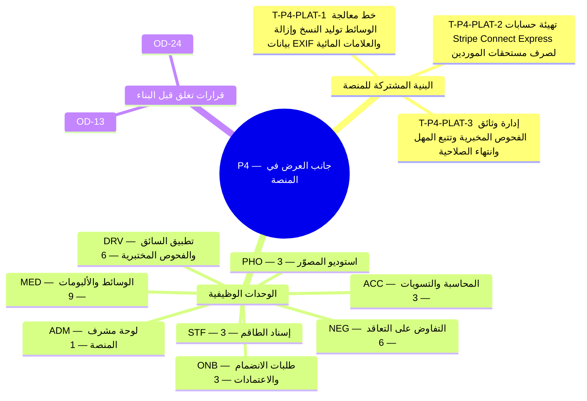

**المحور.** جانب العرض في المنصة — سائقو ومصوّرو المنصة، والفحوص المخبرية، والتفاوض، والوسائط

**تعريف الإتمام.** تتعاقد الجهات المنظِّمة مع مورّدي المنصة عبر الصفقات وتسلِّم الألبومات بجميع أوضاع الخصوصية. *([القسم 3.3 من وثيقة الأعمال](/ar/docs/brd#33-مراحل-التسليم))*

**37 مهمة تسليم** (**34** مهمة وظيفية: **33** إلزامية Must، و**1** مهمة Should، و**0** تحسينية Could + **3** مهام بنية منصة مشتركة) موزعة على **8** وحدات برمجية. تتضمن كل مهمة أدناه المواصفة الكاملة ومخرجات التنفيذ الهندسي ومعايير القبول والجداول المتأثرة وروابط التتبع الشاملة عبر جميع وثائق النظام.

**نموذج البيانات.** تنطبق [اصطلاحات نموذج البيانات](/ar/docs/erd) و[ضوابط الوصول وأمان الصفوف RLS](/ar/docs/erd/acl) و[فهرس القيم المرجعية](/ar/docs/erd/reference) على جميع جداول هذه المرحلة.

<MindmapBlock title="خريطة نطاق المرحلة P4 — جانب العرض في المنصة" caption="توزيع مهام البنية المشتركة والوحدات الوظيفية (37 مهمة) وبوابة إغلاق المرحلة P4." trace={{"brd":[{"label":"مراحل التسليم §3.3","href":"/ar/docs/brd#33-مراحل-التسليم"}],"srs":[{"label":"مصفوفة التتبع","href":"/ar/docs/srs/traceability"}],"erd":[{"label":"نموذج البيانات","href":"/ar/docs/erd"}],"plan":[{"label":"المعالم وبوابات المراحل","href":"/ar/docs/plan/milestones"},{"label":"دليل البناء","href":"/ar/docs/plan/build-guide"}],"workflows":[{"label":"تغطية المتطلبات","href":"/ar/docs/workflows/coverage"}],"architecture":[{"label":"معمارية المنصة","href":"/ar/docs/architecture"}],"design":[{"label":"نظام التصميم","href":"/ar/docs/design"}],"system":[{"label":"النظام الشامل","href":"/ar/docs/system/lifecycle"}],"recommendations":[{"label":"حسم القرارات المفتوحة","href":"/ar/docs/recommendations/open-decisions"}]}}>

</MindmapBlock>

## فهرس المهام السريع

| المهمة | الوحدة | المرجع | الأولوية |
|---|---|---|---|
| [T-P4-PLAT-1 — خط معالجة الوسائط: توليد النسخ وإزالة بيانات EXIF والعلامات المائية](#t-p4-plat-1) | `PLAT` | [الأمان NFR-SEC](/ar/docs/srs/quality#82-الأمان-nfr-sec) | Must |
| [T-P4-PLAT-2 — تهيئة حسابات Stripe Connect Express لصرف مستحقات الموردين](#t-p4-plat-2) | `PLAT` | [الأمان NFR-SEC](/ar/docs/srs/quality#82-الأمان-nfr-sec) | Must |
| [T-P4-PLAT-3 — إدارة وثائق الفحوص المخبرية وتتبع المهل وانتهاء الصلاحية](#t-p4-plat-3) | `PLAT` | [الامتثال NFR-COM](/ar/docs/srs/quality#810-الامتثال-nfr-com) | Must |
| [T-P4-ONB-1 — الحد الأدنى لمعرض أعمال المصوّر](#t-p4-onb-1) | `ONB` | [FR-ONB-06](/ar/docs/srs/requirements/onb#fr-onb-06--الحد-الأدنى-لمعرض-أعمال-المصوّر) | Must |
| [T-P4-ONB-2 — بيانات مركبة السائق وتأمينه](#t-p4-onb-2) | `ONB` | [FR-ONB-07](/ar/docs/srs/requirements/onb#fr-onb-07--بيانات-مركبة-السائق-وتأمينه) | Must |
| [T-P4-ONB-3 — الموافقة على الفحوصات المخبرية والنتيجة المبدئية](#t-p4-onb-3) | `ONB` | [FR-ONB-08](/ar/docs/srs/requirements/onb#fr-onb-08--الموافقة-على-الفحوصات-المخبرية-والنتيجة-المبدئية) | Must |
| [T-P4-STF-1 — مسارا المصوّر](#t-p4-stf-1) | `STF` | [FR-STF-02](/ar/docs/srs/requirements/stf#fr-stf-02--مسارا-المصوّر) | Must |
| [T-P4-STF-2 — الإسناد بعد إنهاء الصفقة](#t-p4-stf-2) | `STF` | [FR-STF-04](/ar/docs/srs/requirements/stf#fr-stf-04--الإسناد-بعد-إنهاء-الصفقة) | Must |
| [T-P4-STF-3 — ظهور طلب الصفقة](#t-p4-stf-3) | `STF` | [FR-STF-06](/ar/docs/srs/requirements/stf#fr-stf-06--ظهور-طلب-الصفقة) | Must |
| [T-P4-NEG-1 — عرض التعاقد](#t-p4-neg-1) | `NEG` | [FR-NEG-01](/ar/docs/srs/requirements/neg#fr-neg-01--عرض-التعاقد) | Must |
| [T-P4-NEG-2 — العروض المضادة وانتهاء الصلاحية](#t-p4-neg-2) | `NEG` | [FR-NEG-02](/ar/docs/srs/requirements/neg#fr-neg-02--العروض-المضادة-وانتهاء-الصلاحية) | Must |
| [T-P4-NEG-3 — القبول المتبادل](#t-p4-neg-3) | `NEG` | [FR-NEG-03](/ar/docs/srs/requirements/neg#fr-neg-03--القبول-المتبادل) | Must |
| [T-P4-NEG-4 — الرفض](#t-p4-neg-4) | `NEG` | [FR-NEG-04](/ar/docs/srs/requirements/neg#fr-neg-04--الرفض) | Must |
| [T-P4-NEG-5 — إتمام التعاقد](#t-p4-neg-5) | `NEG` | [FR-NEG-05](/ar/docs/srs/requirements/neg#fr-neg-05--إتمام-التعاقد) | Must |
| [T-P4-NEG-6 — التفاوض حسب الخطة](#t-p4-neg-6) | `NEG` | [FR-NEG-07](/ar/docs/srs/requirements/neg#fr-neg-07--التفاوض-حسب-الخطة) | Must |
| [T-P4-MED-1 — نافذة إنشاء الألبوم](#t-p4-med-1) | `MED` | [FR-MED-01](/ar/docs/srs/requirements/med#fr-med-01--نافذة-إنشاء-الألبوم) | Must |
| [T-P4-MED-2 — الرفع الدفعي القابل للاستئناف](#t-p4-med-2) | `MED` | [FR-MED-02](/ar/docs/srs/requirements/med#fr-med-02--الرفع-الدفعي-القابل-للاستئناف) | Must |
| [T-P4-MED-3 — أوضاع الخصوصية حسب الخطة](#t-p4-med-3) | `MED` | [FR-MED-03](/ar/docs/srs/requirements/med#fr-med-03--أوضاع-الخصوصية-حسب-الخطة) | Must |
| [T-P4-MED-4 — الروابط المشتركة](#t-p4-med-4) | `MED` | [FR-MED-04](/ar/docs/srs/requirements/med#fr-med-04--الروابط-المشتركة) | Must |
| [T-P4-MED-5 — وصول المستخدمين المختارين](#t-p4-med-5) | `MED` | [FR-MED-05](/ar/docs/srs/requirements/med#fr-med-05--وصول-المستخدمين-المختارين) | Must |
| [T-P4-MED-6 — العلامة المائية](#t-p4-med-6) | `MED` | [FR-MED-06](/ar/docs/srs/requirements/med#fr-med-06--العلامة-المائية) | Should |
| [T-P4-MED-7 — وصول المسافر والتنزيل](#t-p4-med-7) | `MED` | [FR-MED-07](/ar/docs/srs/requirements/med#fr-med-07--وصول-المسافر-والتنزيل) | Must |
| [T-P4-MED-8 — عدد الألبومات لكل رحلة حسب الخطة](#t-p4-med-8) | `MED` | [FR-MED-08](/ar/docs/srs/requirements/med#fr-med-08--عدد-الألبومات-لكل-رحلة-حسب-الخطة) | Must |
| [T-P4-MED-9 — دورة حياة الملفات وتنظيف الملفات اليتيمة](#t-p4-med-9) | `MED` | [FR-MED-09](/ar/docs/srs/requirements/med#fr-med-09--دورة-حياة-الملفات-وتنظيف-الملفات-اليتيمة) | Must |
| [T-P4-PHO-1 — معرض الأعمال](#t-p4-pho-1) | `PHO` | [FR-PHO-01](/ar/docs/srs/requirements/pho#fr-pho-01--معرض-الأعمال) | Must |
| [T-P4-PHO-2 — الأسعار والتوافر](#t-p4-pho-2) | `PHO` | [FR-PHO-02](/ar/docs/srs/requirements/pho#fr-pho-02--الأسعار-والتوافر) | Must |
| [T-P4-PHO-3 — الأرباح](#t-p4-pho-3) | `PHO` | [FR-PHO-03](/ar/docs/srs/requirements/pho#fr-pho-03--الأرباح) | Must |
| [T-P4-DRV-1 — الرد على طلبات التعاقد](#t-p4-drv-1) | `DRV` | [FR-DRV-02](/ar/docs/srs/requirements/drv#fr-drv-02--الرد-على-طلبات-التعاقد) | Must |
| [T-P4-DRV-2 — الإيقاف مؤقتًا لأجل الفحص المختبري](#t-p4-drv-2) | `DRV` | [FR-DRV-03](/ar/docs/srs/requirements/drv#fr-drv-03--الإيقاف-مؤقتًا-لأجل-الفحص-المختبري) | Must |
| [T-P4-DRV-3 — مهلة الفحص المختبري ونتيجته](#t-p4-drv-3) | `DRV` | [FR-DRV-04](/ar/docs/srs/requirements/drv#fr-drv-04--مهلة-الفحص-المختبري-ونتيجته) | Must |
| [T-P4-DRV-4 — تحقق مشرف المنصة](#t-p4-drv-4) | `DRV` | [FR-DRV-05](/ar/docs/srs/requirements/drv#fr-drv-05--تحقق-مشرف-المنصة) | Must |
| [T-P4-DRV-5 — الأرباح وصرف المستحقات](#t-p4-drv-5) | `DRV` | [FR-DRV-07](/ar/docs/srs/requirements/drv#fr-drv-07--الأرباح-وصرف-المستحقات) | Must |
| [T-P4-DRV-6 — إتاحة السائق](#t-p4-drv-6) | `DRV` | [FR-DRV-08](/ar/docs/srs/requirements/drv#fr-drv-08--إتاحة-السائق) | Must |
| [T-P4-ADM-1 — طلبات الفحص المخبري](#t-p4-adm-1) | `ADM` | [FR-ADM-09](/ar/docs/srs/requirements/adm#fr-adm-09--طلبات-الفحص-المخبري) | Must |
| [T-P4-ACC-1 — أرباح المورّدين وصرف المستحقات](#t-p4-acc-1) | `ACC` | [FR-ACC-03](/ar/docs/srs/requirements/acc#fr-acc-03--أرباح-المورّدين-وصرف-المستحقات) | Must |
| [T-P4-ACC-2 — التسويات](#t-p4-acc-2) | `ACC` | [FR-ACC-05](/ar/docs/srs/requirements/acc#fr-acc-05--التسويات) | Must |
| [T-P4-ACC-3 — الأرشفة بعد التسوية](#t-p4-acc-3) | `ACC` | [FR-ACC-10](/ar/docs/srs/requirements/acc#fr-acc-10--الأرشفة-بعد-التسوية) | Must |

## عابرة للمجالات

تُبنى مهام البنية المشتركة هذه بالتوازي مع مهام الوحدات وتُشترط لاجتياز بوابة إغلاق المرحلة.

### T-P4-PLAT-1 — خط معالجة الوسائط: توليد النسخ وإزالة بيانات EXIF والعلامات المائية

<TaskCard id="T-P4-PLAT-1" title="خط معالجة الوسائط: توليد النسخ وإزالة بيانات EXIF والعلامات المائية" phase="P4" module="PLAT" priority="Must" kind="platform" surfaces={["تخزين الكائنات","عمليات الخلفية","شبكة CDN","استوديو المصوّر"]} tables={[]} trace={{"brd":[{"label":"المرحلة P4","href":"/ar/docs/brd#33-مراحل-التسليم"}],"srs":[{"label":"الأمان NFR-SEC","href":"/ar/docs/srs/quality#82-الأمان-nfr-sec"}],"erd":[{"label":"الوسائط","href":"/ar/docs/erd/domains/media"},{"label":"أمان الصفوف ACL","href":"/ar/docs/erd/acl"}],"plan":[{"label":"المعالم","href":"/ar/docs/plan/milestones"},{"label":"استراتيجية الاختبار","href":"/ar/docs/plan/testing"}],"workflows":[{"label":"media","href":"/ar/docs/workflows/media"}],"userFlows":[{"label":"تدفقات الأدوار","href":"/ar/docs/user-flows"}],"architecture":[{"label":"المعمارية","href":"/ar/docs/architecture#التكاملات"}],"design":[{"label":"نظام التصميم","href":"/ar/docs/design#تطبيق-المصوّر"}],"system":[{"label":"STAGE-08","href":"/ar/docs/system/lifecycle#stage-08"}],"recommendations":[{"label":"REC-MED-08","href":"/ar/docs/recommendations/architecture-and-ops#rec-med-08"}]}}>

**نطاق البنية المشتركة.** بناء عمال معالجة وسائط معزولين للرفع المتعدد الأجزاء وإزالة بيانات الموقع والكاميرا EXIF وتوليد النسخ المصغرة والعلامات المائية وحذف الملفات غير المرتبطة بعد 24 ساعة.

**مخرجات التنفيذ الهندسي.**

- خدمة رفع قابل للاستئناف مع عامل معالجة صور يولِّد النسخ المصغرة والمعاينات خارج مسار طلبات API.
- روابط CDN موقَّعة قصيرة الصلاحية تفرض أوضاع خصوصية الألبومات الثلاثة بدقة.

**معايير القبول والتحقق.**

- Given صورة خام تحتوي على إحداثيات GPS في بيانات EXIF، when تكتمل المعالجة، then تخلو جميع النسخ المخدَّمة من بيانات EXIF.
- Given ملف مرفوع لم يُربط بأي سجل، when تمر 24 ساعة، then تحذف المهمة المجدولة الملف الأصلي وجميع نسخه المشتقة.

</TaskCard>

### T-P4-PLAT-2 — تهيئة حسابات Stripe Connect Express لصرف مستحقات الموردين

<TaskCard id="T-P4-PLAT-2" title="تهيئة حسابات Stripe Connect Express لصرف مستحقات الموردين" phase="P4" module="PLAT" priority="Must" kind="platform" surfaces={["تطبيق السائق","استوديو المصوّر","لوحة مشرف المنصة"]} tables={[]} trace={{"brd":[{"label":"المرحلة P4","href":"/ar/docs/brd#33-مراحل-التسليم"}],"srs":[{"label":"الأمان NFR-SEC","href":"/ar/docs/srs/quality#82-الأمان-nfr-sec"}],"erd":[{"label":"الموردون","href":"/ar/docs/erd/domains/suppliers"},{"label":"المالية","href":"/ar/docs/erd/domains/finance"},{"label":"أمان الصفوف ACL","href":"/ar/docs/erd/acl"}],"plan":[{"label":"المعالم","href":"/ar/docs/plan/milestones"},{"label":"استراتيجية الاختبار","href":"/ar/docs/plan/testing"}],"workflows":[{"label":"money","href":"/ar/docs/workflows/money"}],"userFlows":[{"label":"تدفقات الأدوار","href":"/ar/docs/user-flows"}],"architecture":[{"label":"المعمارية","href":"/ar/docs/architecture#التكاملات"}],"design":[{"label":"نظام التصميم","href":"/ar/docs/design#تطبيق-السائق"}],"system":[{"label":"STAGE-08","href":"/ar/docs/system/lifecycle#stage-08"}],"recommendations":[{"label":"REC-FIN-10","href":"/ar/docs/recommendations/architecture-and-ops#rec-fin-10"}]}}>

**نطاق البنية المشتركة.** ربط حسابات Stripe Connect Express وقنوات التحويل البنكي المحلية للسائقين والمصوّرين، مع تتبع حالة التحقق وجدولة الصرف الأسبوعي يوم الاثنين.

**مخرجات التنفيذ الهندسي.**

- مسار تهيئة حساب استلام المستحقات ومزامنة حالة التحقق عبر الويب هوك قبل قبول الصفقات.
- مهمة الصرف الأسبوعي غير المتكررة التي تقيِّد التحويلات في دفتر الأستاذ المزدوج.

**معايير القبول والتحقق.**

- Given مورد معلَّق لفحص مخبري أو غير مكتمل التحقق البنكي، when تعمل مهمة الصرف الأسبوعي، then تُطبَّق قواعد احتجاز وصرف المستحقات بدقة.

</TaskCard>

### T-P4-PLAT-3 — إدارة وثائق الفحوص المخبرية وتتبع المهل وانتهاء الصلاحية

<TaskCard id="T-P4-PLAT-3" title="إدارة وثائق الفحوص المخبرية وتتبع المهل وانتهاء الصلاحية" phase="P4" module="PLAT" priority="Must" kind="platform" surfaces={["لوحة مشرف المنصة","تطبيق السائق","تخزين الكائنات"]} tables={["lab_tests","driver_profiles","audit_events"]} trace={{"brd":[{"label":"المرحلة P4","href":"/ar/docs/brd#33-مراحل-التسليم"}],"srs":[{"label":"الامتثال NFR-COM","href":"/ar/docs/srs/quality#810-الامتثال-nfr-com"}],"erd":[{"label":"الموردون","href":"/ar/docs/erd/domains/suppliers"},{"label":"المنصة","href":"/ar/docs/erd/domains/platform"},{"label":"lab_tests","href":"/ar/docs/erd/domains/suppliers#lab_tests","detail":"table"},{"label":"driver_profiles","href":"/ar/docs/erd/domains/suppliers#driver_profiles","detail":"table"},{"label":"audit_events","href":"/ar/docs/erd/domains/platform#audit_events","detail":"table"},{"label":"أمان الصفوف ACL","href":"/ar/docs/erd/acl"}],"plan":[{"label":"المعالم","href":"/ar/docs/plan/milestones"},{"label":"استراتيجية الاختبار","href":"/ar/docs/plan/testing"}],"workflows":[{"label":"scheduled-jobs","href":"/ar/docs/workflows/scheduled-jobs"}],"userFlows":[{"label":"تدفقات الأدوار","href":"/ar/docs/user-flows"}],"architecture":[{"label":"المعمارية","href":"/ar/docs/architecture#معمارية-البيانات"}],"design":[{"label":"نظام التصميم","href":"/ar/docs/design#لوحة-مشرف-المنصة"}],"system":[{"label":"STAGE-02","href":"/ar/docs/system/lifecycle#stage-02"}],"recommendations":[{"label":"REC-SEC-09","href":"/ar/docs/recommendations/architecture-and-ops#rec-sec-09"}]}}>

**نطاق البنية المشتركة.** بناء تخزين مشفَّر لوثائق الفحوص المخبرية مقصور على مشرفي المنصة مع مفاتيح التفعيل القانونية لكل سوق ومؤقتات المهلة اليومية.

**مخرجات التنفيذ الهندسي.**

- مسار تخزين مشفَّر خاص مع قصر الصلاحية على المشرفين وتسجيل كل اطلاع في سجل التدقيق.
- مهمة يومية تفرض التعليق عند تجاوز مهلة 3 أيام وإغلاق الحساب بعد 30 يومًا من التعليق.

**معايير القبول والتحقق.**

- Given سوق لم يُفعَّل فيه الاعتماد القانوني للفحوص، when يحاول المشرف طلب فحص فيه، then يمنع النظام الإجراء.
- Given مالك جهة منظِّمة يستعرض ملف سائق معيَّن، when يفتح الملف، then لا تظهر له وثائق الهوية أو نتائج المختبر أبدًا.

</TaskCard>

## ONB — طلبات الانضمام والاعتمادات

**نموذج البيانات.** [طلبات الانضمام](/ar/docs/erd/domains/applications), [الموردون](/ar/docs/erd/domains/suppliers) — النطاقات والجداول التي تقرؤها وتكتبها متطلبات هذه الوحدة.

### T-P4-ONB-1 — الحد الأدنى لمعرض أعمال المصوّر

<TaskCard id="T-P4-ONB-1" title="الحد الأدنى لمعرض أعمال المصوّر" phase="P4" module="ONB" priority="Must" surfaces={["واجهة الزوار","تطبيق السائق","استوديو المصوّر","لوحة مشرف المنصة"]} tables={["applications"]} trace={{"brd":[{"label":"BR-ONB-06","href":"/ar/docs/brd/requirements#62-طلبات-الانضمام-والاعتمادات-onb","detail":"P4"}],"srs":[{"label":"FR-ONB-06","href":"/ar/docs/srs/requirements/onb#fr-onb-06--الحد-الأدنى-لمعرض-أعمال-المصوّر","detail":"Must"},{"label":"آلة حالة الطلب §7.5","href":"/ar/docs/srs/state-machines#75-طلب-الانضمام"},{"label":"معايير الجودة NFR","href":"/ar/docs/srs/quality"}],"erd":[{"label":"طلبات الانضمام","href":"/ar/docs/erd/domains/applications"},{"label":"الموردون","href":"/ar/docs/erd/domains/suppliers"},{"label":"applications","href":"/ar/docs/erd/domains/applications#applications","detail":"table"}],"plan":[{"label":"معلم P4","href":"/ar/docs/plan/milestones"},{"label":"استراتيجية الاختبار","href":"/ar/docs/plan/testing"}],"workflows":[{"label":"applications","href":"/ar/docs/workflows/applications"}],"userFlows":[{"label":"UF-PHO-01","href":"/ar/docs/user-flows/photographer#uf-pho-01-التسجيل-وتقديم-الطلب"}],"architecture":[{"label":"المعمارية","href":"/ar/docs/architecture#نموذج-الخدمات"}],"design":[{"label":"الواجهات والتصميم","href":"/ar/docs/design#لوحة-مشرف-المنصة"}],"system":[{"label":"STAGE-02","href":"/ar/docs/system/lifecycle#stage-02"}],"recommendations":[{"label":"REC-ARCH-01","href":"/ar/docs/recommendations/architecture-and-ops#rec-arch-01"}]}}>

**المواصفة الوظيفية ([FR-ONB-06](/ar/docs/srs/requirements/onb#fr-onb-06--الحد-الأدنى-لمعرض-أعمال-المصوّر)).** يشترط طلب انضمام المصوّر 8 صور على الأقل في معرض الأعمال (JPEG أو PNG أو HEIC، وبحد 25 MB لكل صورة، D-81).

**مخرجات التنفيذ الهندسي.**

- **منطق النطاق والواجهة البرمجية:** بناء آلة حالة طلبات الانضمام وطابور مراجعة المشرف ومؤقتات اتفاقية مستوى الخدمة ليومَي عمل ومهلة التعديلات ومسارات الاعتراض.
- **التخزين وأمان مستوى الصفوف:** عمليات القراءة والكتابة على الجداول `applications` مع الالتزام بالأعمدة الأساسية والحذف الناعم وضوابط الوصول ([ACL](/ar/docs/erd/acl)).
- **التحقق والرصد:** اختبارات آلية تغطي سيناريوهات قبول `FR-ONB-06` وفق [استراتيجية الاختبار](/ar/docs/plan/testing) مع تسجيل الأحداث والآثار.

**معايير القبول.**

- بافتراض 7 صور مرفوعة، عندما يرسل المصوّر الطلب، يُرفض الإرسال ويُعرض العدد المطلوب.

**التتبع التجاري وقواعد العمل الحاكمة.**

- [BR-ONB-06](/ar/docs/brd/requirements#62-طلبات-الانضمام-والاعتمادات-onb): تتضمن طلبات المصوّرين 8 صور على الأقل من معرض الأعمال.

</TaskCard>

### T-P4-ONB-2 — بيانات مركبة السائق وتأمينه

<TaskCard id="T-P4-ONB-2" title="بيانات مركبة السائق وتأمينه" phase="P4" module="ONB" priority="Must" surfaces={["واجهة الزوار","تطبيق السائق","استوديو المصوّر","لوحة مشرف المنصة"]} tables={["applications","driver_profiles"]} trace={{"brd":[{"label":"BR-ONB-07","href":"/ar/docs/brd/requirements#62-طلبات-الانضمام-والاعتمادات-onb","detail":"P4"}],"srs":[{"label":"FR-ONB-07","href":"/ar/docs/srs/requirements/onb#fr-onb-07--بيانات-مركبة-السائق-وتأمينه","detail":"Must"},{"label":"آلة حالة الطلب §7.5","href":"/ar/docs/srs/state-machines#75-طلب-الانضمام"},{"label":"معايير الجودة NFR","href":"/ar/docs/srs/quality"}],"erd":[{"label":"طلبات الانضمام","href":"/ar/docs/erd/domains/applications"},{"label":"الموردون","href":"/ar/docs/erd/domains/suppliers"},{"label":"applications","href":"/ar/docs/erd/domains/applications#applications","detail":"table"},{"label":"driver_profiles","href":"/ar/docs/erd/domains/suppliers#driver_profiles","detail":"table"}],"plan":[{"label":"معلم P4","href":"/ar/docs/plan/milestones"},{"label":"استراتيجية الاختبار","href":"/ar/docs/plan/testing"}],"workflows":[{"label":"طلبات الانضمام","href":"/ar/docs/workflows/applications#المؤقتات-والقواعد"}],"userFlows":[{"label":"UF-DRV-01","href":"/ar/docs/user-flows/driver#uf-drv-01-التسجيل-وتقديم-الطلب"}],"architecture":[{"label":"المعمارية","href":"/ar/docs/architecture#نموذج-الخدمات"}],"design":[{"label":"الواجهات والتصميم","href":"/ar/docs/design#لوحة-مشرف-المنصة"}],"system":[{"label":"STAGE-02","href":"/ar/docs/system/lifecycle#stage-02"}],"recommendations":[{"label":"REC-ARCH-01","href":"/ar/docs/recommendations/architecture-and-ops#rec-arch-01"}]}}>

**المواصفة الوظيفية ([FR-ONB-07](/ar/docs/srs/requirements/onb#fr-onb-07--بيانات-مركبة-السائق-وتأمينه)).** يقدِّم السائق الذي يستخدم مركبته الخاصة رقم اللوحة والموديل وسنة الصنع وعدد المقاعد ورخصة السير والتأمين الساريين لمدة 3 أشهر إضافية على الأقل. وتكون المستندات بصيغة PDF أو JPG أو PNG وبحجم أقصاه 10 MB (D-80).

**مخرجات التنفيذ الهندسي.**

- **منطق النطاق والواجهة البرمجية:** بناء آلة حالة طلبات الانضمام وطابور مراجعة المشرف ومؤقتات اتفاقية مستوى الخدمة ليومَي عمل ومهلة التعديلات ومسارات الاعتراض.
- **التخزين وأمان مستوى الصفوف:** عمليات القراءة والكتابة على الجداول `applications`، `driver_profiles` مع الالتزام بالأعمدة الأساسية والحذف الناعم وضوابط الوصول ([ACL](/ar/docs/erd/acl)).
- **التحقق والرصد:** اختبارات آلية تغطي سيناريوهات قبول `FR-ONB-07` وفق [استراتيجية الاختبار](/ar/docs/plan/testing) مع تسجيل الأحداث والآثار.

**معايير القبول.**

- بافتراض تأمين تنتهي صلاحيته بعد شهرين، عندما يرسل السائق الطلب، يُرفض الإرسال مع بيان الحد الأدنى.

**التتبع التجاري وقواعد العمل الحاكمة.**

- [BR-ONB-07](/ar/docs/brd/requirements#62-طلبات-الانضمام-والاعتمادات-onb): يقدِّم السائقون الذين يستخدمون مركبتهم الخاصة رقم اللوحة والموديل وسنة الصنع وعدد المقاعد ورخصة السير والتأمين الساريين لمدة 3 أشهر إضافية على الأقل.

</TaskCard>

### T-P4-ONB-3 — الموافقة على الفحوصات المخبرية والنتيجة المبدئية

<TaskCard id="T-P4-ONB-3" title="الموافقة على الفحوصات المخبرية والنتيجة المبدئية" phase="P4" module="ONB" priority="Must" surfaces={["واجهة الزوار","تطبيق السائق","استوديو المصوّر","لوحة مشرف المنصة"]} tables={["applications"]} trace={{"brd":[{"label":"BR-ONB-08","href":"/ar/docs/brd/requirements#62-طلبات-الانضمام-والاعتمادات-onb","detail":"P4"}],"srs":[{"label":"FR-ONB-08","href":"/ar/docs/srs/requirements/onb#fr-onb-08--الموافقة-على-الفحوصات-المخبرية-والنتيجة-المبدئية","detail":"Must"},{"label":"آلة حالة الطلب §7.5","href":"/ar/docs/srs/state-machines#75-طلب-الانضمام"},{"label":"معايير الجودة NFR","href":"/ar/docs/srs/quality"}],"erd":[{"label":"طلبات الانضمام","href":"/ar/docs/erd/domains/applications"},{"label":"الموردون","href":"/ar/docs/erd/domains/suppliers"},{"label":"applications","href":"/ar/docs/erd/domains/applications#applications","detail":"table"}],"plan":[{"label":"معلم P4","href":"/ar/docs/plan/milestones"},{"label":"استراتيجية الاختبار","href":"/ar/docs/plan/testing"}],"workflows":[{"label":"طلبات الانضمام","href":"/ar/docs/workflows/applications#المؤقتات-والقواعد"}],"userFlows":[{"label":"UF-DRV-01","href":"/ar/docs/user-flows/driver#uf-drv-01-التسجيل-وتقديم-الطلب"}],"architecture":[{"label":"المعمارية","href":"/ar/docs/architecture#نموذج-الخدمات"}],"design":[{"label":"الواجهات والتصميم","href":"/ar/docs/design#لوحة-مشرف-المنصة"}],"system":[{"label":"STAGE-02","href":"/ar/docs/system/lifecycle#stage-02"}],"recommendations":[{"label":"REC-ARCH-01","href":"/ar/docs/recommendations/architecture-and-ops#rec-arch-01"}]}}>

**المواصفة الوظيفية ([FR-ONB-08](/ar/docs/srs/requirements/onb#fr-onb-08--الموافقة-على-الفحوصات-المخبرية-والنتيجة-المبدئية)).** يسجِّل طلب السائق الموافقة على الفحوصات المخبرية ([NFR-DAT-05](/ar/docs/srs/quality#85-البيانات-nfr-dat)) ويتضمن نتيجة فحص مخبري مبدئية بتاريخ لا يتجاوز آخر 30 يومًا.

**مخرجات التنفيذ الهندسي.**

- **منطق النطاق والواجهة البرمجية:** بناء آلة حالة طلبات الانضمام وطابور مراجعة المشرف ومؤقتات اتفاقية مستوى الخدمة ليومَي عمل ومهلة التعديلات ومسارات الاعتراض.
- **التخزين وأمان مستوى الصفوف:** عمليات القراءة والكتابة على الجداول `applications` مع الالتزام بالأعمدة الأساسية والحذف الناعم وضوابط الوصول ([ACL](/ar/docs/erd/acl)).
- **التحقق والرصد:** اختبارات آلية تغطي سيناريوهات قبول `FR-ONB-08` وفق [استراتيجية الاختبار](/ar/docs/plan/testing) مع تسجيل الأحداث والآثار.

**معايير القبول.**

- بافتراض نتيجة فحص مخبري بتاريخ يعود إلى 31 يومًا قبل الإرسال، عندما يرسل السائق الطلب، يُرفض الإرسال.

**التتبع التجاري وقواعد العمل الحاكمة.**

- [BR-ONB-08](/ar/docs/brd/requirements#62-طلبات-الانضمام-والاعتمادات-onb): تسجِّل طلبات السائقين الموافقة على الفحوصات المخبرية وتتضمن نتيجة فحص مخبري مبدئية بتاريخ لا يتجاوز آخر 30 يومًا.

</TaskCard>

## STF — إسناد الطاقم

**نموذج البيانات.** [الأسطول والرحلات](/ar/docs/erd/domains/fleet-and-trips) — النطاقات والجداول التي تقرؤها وتكتبها متطلبات هذه الوحدة.

### T-P4-STF-1 — مسارا المصوّر

<TaskCard id="T-P4-STF-1" title="مسارا المصوّر" phase="P4" module="STF" priority="Must" surfaces={["لوحة الجهة المنظِّمة","تطبيق السائق","استوديو المصوّر","تطبيق المشرف"]} tables={["trip_staff_assignments"]} trace={{"brd":[{"label":"BR-STF-02","href":"/ar/docs/brd/requirements#65-الطاقم-والصفقات-stf","detail":"P4"}],"srs":[{"label":"FR-STF-02","href":"/ar/docs/srs/requirements/stf#fr-stf-02--مسارا-المصوّر","detail":"Must"},{"label":"معايير الجودة NFR","href":"/ar/docs/srs/quality"}],"erd":[{"label":"الأسطول والرحلات","href":"/ar/docs/erd/domains/fleet-and-trips"},{"label":"trip_staff_assignments","href":"/ar/docs/erd/domains/fleet-and-trips#trip_staff_assignments","detail":"table"}],"plan":[{"label":"معلم P4","href":"/ar/docs/plan/milestones"},{"label":"استراتيجية الاختبار","href":"/ar/docs/plan/testing"}],"workflows":[{"label":"trip-lifecycle","href":"/ar/docs/workflows/trip-lifecycle"}],"userFlows":[{"label":"UF-PHO-03","href":"/ar/docs/user-flows/photographer#uf-pho-03-الرد-على-صفقة"}],"architecture":[{"label":"المعمارية","href":"/ar/docs/architecture#نموذج-الخدمات"}],"design":[{"label":"الواجهات والتصميم","href":"/ar/docs/design#لوحة-الجهة-المنظِّمة"}],"system":[{"label":"STAGE-03","href":"/ar/docs/system/lifecycle#stage-03"}],"recommendations":[{"label":"REC-ARCH-01","href":"/ar/docs/recommendations/architecture-and-ops#rec-arch-01"}]}}>

**المواصفة الوظيفية ([FR-STF-02](/ar/docs/srs/requirements/stf#fr-stf-02--مسارا-المصوّر)).** يكون مصوّر الرحلة إما تابعًا للجهة المنظِّمة أو مصوّرًا من المنصة عبر صفقة منجزة نهائيًا.

**مخرجات التنفيذ الهندسي.**

- **منطق النطاق والواجهة البرمجية:** فرض جاهزية السائق والمشرف لكل مركبة (BRL-07) وكشف تعارض المواعيد ومسارات الاستبدال الطارئ للموردين.
- **التخزين وأمان مستوى الصفوف:** عمليات القراءة والكتابة على الجداول `trip_staff_assignments` مع الالتزام بالأعمدة الأساسية والحذف الناعم وضوابط الوصول ([ACL](/ar/docs/erd/acl)).
- **التحقق والرصد:** اختبارات آلية تغطي سيناريوهات قبول `FR-STF-02` وفق [استراتيجية الاختبار](/ar/docs/plan/testing) مع تسجيل الأحداث والآثار.

**معايير القبول.**

- بافتراض اختيار مصوّر من المنصة، عندما تتابع الجهة المنظِّمة الإجراء، تبدأ صفقة ولا يتم أي إسناد حتى تُنجَز نهائيًا.

**التتبع التجاري وقواعد العمل الحاكمة.**

- [BR-STF-02](/ar/docs/brd/requirements#65-الطاقم-والصفقات-stf): مصوّر الرحلة إما تابع للجهة المنظِّمة أو مصوّر من المنصة يُتعاقد معه عبر صفقة.

</TaskCard>

### T-P4-STF-2 — الإسناد بعد إنهاء الصفقة

<TaskCard id="T-P4-STF-2" title="الإسناد بعد إنهاء الصفقة" phase="P4" module="STF" priority="Must" surfaces={["لوحة الجهة المنظِّمة","تطبيق السائق","استوديو المصوّر","تطبيق المشرف"]} tables={["trip_staff_assignments"]} trace={{"brd":[{"label":"BR-STF-04","href":"/ar/docs/brd/requirements#65-الطاقم-والصفقات-stf","detail":"P4"},{"label":"BRL-04","href":"/ar/docs/brd/requirements#7-قواعد-العمل","detail":"قاعدة"}],"srs":[{"label":"FR-STF-04","href":"/ar/docs/srs/requirements/stf#fr-stf-04--الإسناد-بعد-إنهاء-الصفقة","detail":"Must"},{"label":"معايير الجودة NFR","href":"/ar/docs/srs/quality"}],"erd":[{"label":"الأسطول والرحلات","href":"/ar/docs/erd/domains/fleet-and-trips"},{"label":"trip_staff_assignments","href":"/ar/docs/erd/domains/fleet-and-trips#trip_staff_assignments","detail":"table"}],"plan":[{"label":"معلم P4","href":"/ar/docs/plan/milestones"},{"label":"استراتيجية الاختبار","href":"/ar/docs/plan/testing"}],"workflows":[{"label":"دورة حياة الرحلة","href":"/ar/docs/workflows/trip-lifecycle#المؤقتات-والقواعد"}],"userFlows":[{"label":"organization","href":"/ar/docs/user-flows/organization"}],"architecture":[{"label":"المعمارية","href":"/ar/docs/architecture#نموذج-الخدمات"}],"design":[{"label":"الواجهات والتصميم","href":"/ar/docs/design#لوحة-الجهة-المنظِّمة"}],"system":[{"label":"STAGE-03","href":"/ar/docs/system/lifecycle#stage-03"}],"recommendations":[{"label":"REC-ARCH-01","href":"/ar/docs/recommendations/architecture-and-ops#rec-arch-01"}]}}>

**المواصفة الوظيفية ([FR-STF-04](/ar/docs/srs/requirements/stf#fr-stf-04--الإسناد-بعد-إنهاء-الصفقة)).** لا يُسند مورد المنصة إلا بعد أن يقبل الطرفان الشروط نفسها.

**مخرجات التنفيذ الهندسي.**

- **منطق النطاق والواجهة البرمجية:** فرض جاهزية السائق والمشرف لكل مركبة (BRL-07) وكشف تعارض المواعيد ومسارات الاستبدال الطارئ للموردين.
- **التخزين وأمان مستوى الصفوف:** عمليات القراءة والكتابة على الجداول `trip_staff_assignments` مع الالتزام بالأعمدة الأساسية والحذف الناعم وضوابط الوصول ([ACL](/ar/docs/erd/acl)).
- **التحقق والرصد:** اختبارات آلية تغطي سيناريوهات قبول `FR-STF-04` وفق [استراتيجية الاختبار](/ar/docs/plan/testing) مع تسجيل الأحداث والآثار.

**معايير القبول.**

- بافتراض صفقة في حالة Countered by Provider، عندما تُجرى محاولة إسناد، تُرفض.

**التتبع التجاري وقواعد العمل الحاكمة.**

- [BR-STF-04](/ar/docs/brd/requirements#65-الطاقم-والصفقات-stf): لا يُسند مورد المنصة إلا بعد قبول الطرفين الشروط نفسها.
- [BRL-04](/ar/docs/brd/requirements#7-قواعد-العمل): لا يُسند سائق أو مصوّر من المنصة إلا بعد صفقة منجزة نهائيًا يقبلها الطرفان.

</TaskCard>

### T-P4-STF-3 — ظهور طلب الصفقة

<TaskCard id="T-P4-STF-3" title="ظهور طلب الصفقة" phase="P4" module="STF" priority="Must" surfaces={["لوحة الجهة المنظِّمة","تطبيق السائق","استوديو المصوّر","تطبيق المشرف"]} tables={["trip_staff_assignments"]} trace={{"brd":[{"label":"BR-STF-06","href":"/ar/docs/brd/requirements#65-الطاقم-والصفقات-stf","detail":"P4"}],"srs":[{"label":"FR-STF-06","href":"/ar/docs/srs/requirements/stf#fr-stf-06--ظهور-طلب-الصفقة","detail":"Must"},{"label":"معايير الجودة NFR","href":"/ar/docs/srs/quality"}],"erd":[{"label":"الأسطول والرحلات","href":"/ar/docs/erd/domains/fleet-and-trips"},{"label":"trip_staff_assignments","href":"/ar/docs/erd/domains/fleet-and-trips#trip_staff_assignments","detail":"table"}],"plan":[{"label":"معلم P4","href":"/ar/docs/plan/milestones"},{"label":"استراتيجية الاختبار","href":"/ar/docs/plan/testing"}],"workflows":[{"label":"trip-lifecycle","href":"/ar/docs/workflows/trip-lifecycle"}],"userFlows":[{"label":"UF-DRV-03","href":"/ar/docs/user-flows/driver#uf-drv-03-الرد-على-صفقة"}],"architecture":[{"label":"المعمارية","href":"/ar/docs/architecture#نموذج-الخدمات"}],"design":[{"label":"الواجهات والتصميم","href":"/ar/docs/design#لوحة-الجهة-المنظِّمة"}],"system":[{"label":"STAGE-03","href":"/ar/docs/system/lifecycle#stage-03"}],"recommendations":[{"label":"REC-ARCH-01","href":"/ar/docs/recommendations/architecture-and-ops#rec-arch-01"}]}}>

**المواصفة الوظيفية ([FR-STF-06](/ar/docs/srs/requirements/stf#fr-stf-06--ظهور-طلب-الصفقة)).** يرى المورّد الرحلة والمسار والتاريخ والمركبة والأجر قبل الرد.

**مخرجات التنفيذ الهندسي.**

- **منطق النطاق والواجهة البرمجية:** فرض جاهزية السائق والمشرف لكل مركبة (BRL-07) وكشف تعارض المواعيد ومسارات الاستبدال الطارئ للموردين.
- **التخزين وأمان مستوى الصفوف:** عمليات القراءة والكتابة على الجداول `trip_staff_assignments` مع الالتزام بالأعمدة الأساسية والحذف الناعم وضوابط الوصول ([ACL](/ar/docs/erd/acl)).
- **التحقق والرصد:** اختبارات آلية تغطي سيناريوهات قبول `FR-STF-06` وفق [استراتيجية الاختبار](/ar/docs/plan/testing) مع تسجيل الأحداث والآثار.

**معايير القبول.**

- بافتراض طلب صفقة مفتوح، عندما يفتحه المورّد، تظهر تلك التفاصيل قبل تفعيل خياري القبول أو العرض المضاد.

**التتبع التجاري وقواعد العمل الحاكمة.**

- [BR-STF-06](/ar/docs/brd/requirements#65-الطاقم-والصفقات-stf): يرى الموردون الرحلة والمسار والتاريخ والأجر قبل الرد على صفقة.

</TaskCard>

## NEG — التفاوض على التعاقد

**نموذج البيانات.** [الصفقات](/ar/docs/erd/domains/deals) — النطاقات والجداول التي تقرؤها وتكتبها متطلبات هذه الوحدة.

### T-P4-NEG-1 — عرض التعاقد

<TaskCard id="T-P4-NEG-1" title="عرض التعاقد" phase="P4" module="NEG" priority="Must" surfaces={["لوحة الجهة المنظِّمة","تطبيق السائق","استوديو المصوّر"]} tables={["deals"]} trace={{"brd":[{"label":"BR-STF-03","href":"/ar/docs/brd/requirements#65-الطاقم-والصفقات-stf","detail":"P4"}],"srs":[{"label":"FR-NEG-01","href":"/ar/docs/srs/requirements/neg#fr-neg-01--عرض-التعاقد","detail":"Must"},{"label":"آلة حالة الصفقة §7.4","href":"/ar/docs/srs/state-machines#74-الصفقة"},{"label":"معايير الجودة NFR","href":"/ar/docs/srs/quality"}],"erd":[{"label":"الصفقات","href":"/ar/docs/erd/domains/deals"},{"label":"deals","href":"/ar/docs/erd/domains/deals#deals","detail":"table"}],"plan":[{"label":"معلم P4","href":"/ar/docs/plan/milestones"},{"label":"استراتيجية الاختبار","href":"/ar/docs/plan/testing"}],"workflows":[{"label":"trip-lifecycle","href":"/ar/docs/workflows/trip-lifecycle"}],"userFlows":[{"label":"UF-DRV-03","href":"/ar/docs/user-flows/driver#uf-drv-03-الرد-على-صفقة"},{"label":"UF-ORG-07","href":"/ar/docs/user-flows/organization#uf-org-07-التعاقد-مع-مورّد-من-المنصة-صفقة"},{"label":"UF-PHO-03","href":"/ar/docs/user-flows/photographer#uf-pho-03-الرد-على-صفقة"}],"architecture":[{"label":"المعمارية","href":"/ar/docs/architecture#نموذج-الخدمات"}],"design":[{"label":"الواجهات والتصميم","href":"/ar/docs/design#تطبيق-السائق"}],"system":[{"label":"STAGE-03","href":"/ar/docs/system/lifecycle#stage-03"}],"recommendations":[{"label":"REC-FIN-10","href":"/ar/docs/recommendations/architecture-and-ops#rec-fin-10"}]}}>

**المواصفة الوظيفية ([FR-NEG-01](/ar/docs/srs/requirements/neg#fr-neg-01--عرض-التعاقد)).** يمكن لأي من الطرفين اقتراح سعر لمركبة محددة أو لرحلة محددة.

**مخرجات التنفيذ الهندسي.**

- **منطق النطاق والواجهة البرمجية:** تنفيذ تحولات آلة حالة الصفقة وسجل العروض المضادة وانتهاء الصلاحية بعد 72 ساعة (BRL-26) وتثبيت السعر بموافقة الطرفين.
- **التخزين وأمان مستوى الصفوف:** عمليات القراءة والكتابة على الجداول `deals` مع الالتزام بالأعمدة الأساسية والحذف الناعم وضوابط الوصول ([ACL](/ar/docs/erd/acl)).
- **التحقق والرصد:** اختبارات آلية تغطي سيناريوهات قبول `FR-NEG-01` وفق [استراتيجية الاختبار](/ar/docs/plan/testing) مع تسجيل الأحداث والآثار.

**معايير القبول.**

- بافتراض أن جهة منظِّمة تقترح سعرًا للمركبة 2، عند الحفظ، يتلقى مزوّد الخدمة الطلب مع السعر.

**التتبع التجاري وقواعد العمل الحاكمة.**

- [BR-STF-03](/ar/docs/brd/requirements#65-الطاقم-والصفقات-stf): تتفاوض الجهات المنظِّمة وموردو المنصة على سعر الصفقة: يقترح أي طرف أو يقدّم عرضًا مضادًا أو يرفض، دون حد لعدد الجولات. وتنتهي صلاحية العرض بعد 72 ساعة من آخر عرض مضاد ([BRL-26](/ar/docs/brd/requirements#7-قواعد-العمل)). ولا يتاح موردو المنصة إلا على الخطط التي تشملهم.

</TaskCard>

### T-P4-NEG-2 — العروض المضادة وانتهاء الصلاحية

<TaskCard id="T-P4-NEG-2" title="العروض المضادة وانتهاء الصلاحية" phase="P4" module="NEG" priority="Must" surfaces={["لوحة الجهة المنظِّمة","تطبيق السائق","استوديو المصوّر"]} tables={["deals"]} trace={{"brd":[{"label":"BR-STF-03","href":"/ar/docs/brd/requirements#65-الطاقم-والصفقات-stf","detail":"P4"},{"label":"BRL-26","href":"/ar/docs/brd/requirements#7-قواعد-العمل","detail":"قاعدة"},{"label":"OD-13","href":"/ar/docs/brd/compliance#11-القرارات-المفتوحة","detail":"مقرَّر"}],"srs":[{"label":"FR-NEG-02","href":"/ar/docs/srs/requirements/neg#fr-neg-02--العروض-المضادة-وانتهاء-الصلاحية","detail":"Must"},{"label":"آلة حالة الصفقة §7.4","href":"/ar/docs/srs/state-machines#74-الصفقة"},{"label":"معايير الجودة NFR","href":"/ar/docs/srs/quality"}],"erd":[{"label":"الصفقات","href":"/ar/docs/erd/domains/deals"},{"label":"deals","href":"/ar/docs/erd/domains/deals#deals","detail":"table"}],"plan":[{"label":"معلم P4","href":"/ar/docs/plan/milestones"},{"label":"استراتيجية الاختبار","href":"/ar/docs/plan/testing"}],"workflows":[{"label":"دليل المهام المجدولة","href":"/ar/docs/workflows/scheduled-jobs#العدادات-التنازلية-مؤقّتات-على-مستوى-كل-سجل"}],"userFlows":[{"label":"UF-DRV-03","href":"/ar/docs/user-flows/driver#uf-drv-03-الرد-على-صفقة"},{"label":"UF-ORG-07","href":"/ar/docs/user-flows/organization#uf-org-07-التعاقد-مع-مورّد-من-المنصة-صفقة"},{"label":"UF-PHO-03","href":"/ar/docs/user-flows/photographer#uf-pho-03-الرد-على-صفقة"}],"architecture":[{"label":"المعمارية","href":"/ar/docs/architecture#نموذج-الخدمات"}],"design":[{"label":"الواجهات والتصميم","href":"/ar/docs/design#تطبيق-السائق"}],"system":[{"label":"STAGE-03","href":"/ar/docs/system/lifecycle#stage-03"}],"recommendations":[{"label":"توصية OD-13","href":"/ar/docs/recommendations/open-decisions#od-13"},{"label":"REC-FIN-10","href":"/ar/docs/recommendations/architecture-and-ops#rec-fin-10"}]}}>

**المواصفة الوظيفية ([FR-NEG-02](/ar/docs/srs/requirements/neg#fr-neg-02--العروض-المضادة-وانتهاء-الصلاحية)).** يمكن لأي من الطرفين تقديم عرض مضاد دون حد لعدد الجولات. وتنتهي صلاحية العرض بعد 72 ساعة من آخر عرض مضاد؛ وعندها ينتهي التعاقد بحالة Rejected بسبب انتهاء الصلاحية ([BRL-26](/ar/docs/brd/requirements#7-قواعد-العمل)).

**مخرجات التنفيذ الهندسي.**

- **منطق النطاق والواجهة البرمجية:** تنفيذ تحولات آلة حالة الصفقة وسجل العروض المضادة وانتهاء الصلاحية بعد 72 ساعة (BRL-26) وتثبيت السعر بموافقة الطرفين.
- **التخزين وأمان مستوى الصفوف:** عمليات القراءة والكتابة على الجداول `deals` مع الالتزام بالأعمدة الأساسية والحذف الناعم وضوابط الوصول ([ACL](/ar/docs/erd/acl)).
- **التحقق والرصد:** اختبارات آلية تغطي سيناريوهات قبول `FR-NEG-02` وفق [استراتيجية الاختبار](/ar/docs/plan/testing) مع تسجيل الأحداث والآثار.

**معايير القبول.**

- بافتراض عرض مضاد من مزوّد الخدمة، عند الحفظ، تصبح الحالة Countered by Provider ويُبلَّغ الجهة المنظِّمة.
- بافتراض مرور 72 ساعة على آخر عرض مضاد دون استجابة، عند تشغيل المهمة، يصبح التعاقد Rejected بسبب انتهاء الصلاحية.

**التتبع التجاري وقواعد العمل الحاكمة.**

- [BR-STF-03](/ar/docs/brd/requirements#65-الطاقم-والصفقات-stf): تتفاوض الجهات المنظِّمة وموردو المنصة على سعر الصفقة: يقترح أي طرف أو يقدّم عرضًا مضادًا أو يرفض، دون حد لعدد الجولات. وتنتهي صلاحية العرض بعد 72 ساعة من آخر عرض مضاد ([BRL-26](/ar/docs/brd/requirements#7-قواعد-العمل)). ولا يتاح موردو المنصة إلا على الخطط التي تشملهم.
- [BRL-26](/ar/docs/brd/requirements#7-قواعد-العمل): تنتهي صلاحية عرض الصفقة بعد 72 ساعة من آخر عرض مضاد، وتنتهي الصفقة بحالة Rejected بسبب "expired" (D-14).
- [OD-13](/ar/docs/brd/compliance#11-القرارات-المفتوحة) (حد التفاوض ومدة انتهائه — مقرَّر) ← راجع [التوصية المقترحة](/ar/docs/recommendations/open-decisions#od-13).

</TaskCard>

### T-P4-NEG-3 — القبول المتبادل

<TaskCard id="T-P4-NEG-3" title="القبول المتبادل" phase="P4" module="NEG" priority="Must" surfaces={["لوحة الجهة المنظِّمة","تطبيق السائق","استوديو المصوّر"]} tables={["deals"]} trace={{"brd":[{"label":"BR-STF-03","href":"/ar/docs/brd/requirements#65-الطاقم-والصفقات-stf","detail":"P4"},{"label":"BRL-04","href":"/ar/docs/brd/requirements#7-قواعد-العمل","detail":"قاعدة"}],"srs":[{"label":"FR-NEG-03","href":"/ar/docs/srs/requirements/neg#fr-neg-03--القبول-المتبادل","detail":"Must"},{"label":"آلة حالة الصفقة §7.4","href":"/ar/docs/srs/state-machines#74-الصفقة"},{"label":"معايير الجودة NFR","href":"/ar/docs/srs/quality"}],"erd":[{"label":"الصفقات","href":"/ar/docs/erd/domains/deals"},{"label":"deals","href":"/ar/docs/erd/domains/deals#deals","detail":"table"}],"plan":[{"label":"معلم P4","href":"/ar/docs/plan/milestones"},{"label":"استراتيجية الاختبار","href":"/ar/docs/plan/testing"}],"workflows":[{"label":"trip-lifecycle","href":"/ar/docs/workflows/trip-lifecycle"}],"userFlows":[{"label":"UF-DRV-03","href":"/ar/docs/user-flows/driver#uf-drv-03-الرد-على-صفقة"},{"label":"UF-ORG-07","href":"/ar/docs/user-flows/organization#uf-org-07-التعاقد-مع-مورّد-من-المنصة-صفقة"},{"label":"UF-PHO-03","href":"/ar/docs/user-flows/photographer#uf-pho-03-الرد-على-صفقة"}],"architecture":[{"label":"المعمارية","href":"/ar/docs/architecture#نموذج-الخدمات"}],"design":[{"label":"الواجهات والتصميم","href":"/ar/docs/design#تطبيق-السائق"}],"system":[{"label":"STAGE-03","href":"/ar/docs/system/lifecycle#stage-03"}],"recommendations":[{"label":"REC-FIN-10","href":"/ar/docs/recommendations/architecture-and-ops#rec-fin-10"}]}}>

**المواصفة الوظيفية ([FR-NEG-03](/ar/docs/srs/requirements/neg#fr-neg-03--القبول-المتبادل)).** لا يُستكمل التعاقد إلا بقبول الطرفين الشروط نفسها. ويُبطل أي عرض مضاد يأتي بعد قبول ذلك القبول.

**مخرجات التنفيذ الهندسي.**

- **منطق النطاق والواجهة البرمجية:** تنفيذ تحولات آلة حالة الصفقة وسجل العروض المضادة وانتهاء الصلاحية بعد 72 ساعة (BRL-26) وتثبيت السعر بموافقة الطرفين.
- **التخزين وأمان مستوى الصفوف:** عمليات القراءة والكتابة على الجداول `deals` مع الالتزام بالأعمدة الأساسية والحذف الناعم وضوابط الوصول ([ACL](/ar/docs/erd/acl)).
- **التحقق والرصد:** اختبارات آلية تغطي سيناريوهات قبول `FR-NEG-03` وفق [استراتيجية الاختبار](/ar/docs/plan/testing) مع تسجيل الأحداث والآثار.

**معايير القبول.**

- بافتراض أن مزوّد الخدمة قبل، عند تقديم الجهة المنظِّمة عرضًا مضادًا، يصبح القبول لاغيًا وتكون الحالة Countered by Organization.

**التتبع التجاري وقواعد العمل الحاكمة.**

- [BR-STF-03](/ar/docs/brd/requirements#65-الطاقم-والصفقات-stf): تتفاوض الجهات المنظِّمة وموردو المنصة على سعر الصفقة: يقترح أي طرف أو يقدّم عرضًا مضادًا أو يرفض، دون حد لعدد الجولات. وتنتهي صلاحية العرض بعد 72 ساعة من آخر عرض مضاد ([BRL-26](/ar/docs/brd/requirements#7-قواعد-العمل)). ولا يتاح موردو المنصة إلا على الخطط التي تشملهم.
- [BRL-04](/ar/docs/brd/requirements#7-قواعد-العمل): لا يُسند سائق أو مصوّر من المنصة إلا بعد صفقة منجزة نهائيًا يقبلها الطرفان.

</TaskCard>

### T-P4-NEG-4 — الرفض

<TaskCard id="T-P4-NEG-4" title="الرفض" phase="P4" module="NEG" priority="Must" surfaces={["لوحة الجهة المنظِّمة","تطبيق السائق","استوديو المصوّر"]} tables={["deals"]} trace={{"brd":[{"label":"BR-STF-03","href":"/ar/docs/brd/requirements#65-الطاقم-والصفقات-stf","detail":"P4"}],"srs":[{"label":"FR-NEG-04","href":"/ar/docs/srs/requirements/neg#fr-neg-04--الرفض","detail":"Must"},{"label":"آلة حالة الصفقة §7.4","href":"/ar/docs/srs/state-machines#74-الصفقة"},{"label":"معايير الجودة NFR","href":"/ar/docs/srs/quality"}],"erd":[{"label":"الصفقات","href":"/ar/docs/erd/domains/deals"},{"label":"deals","href":"/ar/docs/erd/domains/deals#deals","detail":"table"}],"plan":[{"label":"معلم P4","href":"/ar/docs/plan/milestones"},{"label":"استراتيجية الاختبار","href":"/ar/docs/plan/testing"}],"workflows":[{"label":"trip-lifecycle","href":"/ar/docs/workflows/trip-lifecycle"}],"userFlows":[{"label":"UF-DRV-03","href":"/ar/docs/user-flows/driver#uf-drv-03-الرد-على-صفقة"},{"label":"UF-ORG-07","href":"/ar/docs/user-flows/organization#uf-org-07-التعاقد-مع-مورّد-من-المنصة-صفقة"},{"label":"UF-PHO-03","href":"/ar/docs/user-flows/photographer#uf-pho-03-الرد-على-صفقة"}],"architecture":[{"label":"المعمارية","href":"/ar/docs/architecture#نموذج-الخدمات"}],"design":[{"label":"الواجهات والتصميم","href":"/ar/docs/design#تطبيق-السائق"}],"system":[{"label":"STAGE-03","href":"/ar/docs/system/lifecycle#stage-03"}],"recommendations":[{"label":"REC-FIN-10","href":"/ar/docs/recommendations/architecture-and-ops#rec-fin-10"}]}}>

**المواصفة الوظيفية ([FR-NEG-04](/ar/docs/srs/requirements/neg#fr-neg-04--الرفض)).** يمكن لأي من الطرفين رفض التعاقد. ويظل شاغر المركبة متاحًا لمزوّد خدمة آخر.

**مخرجات التنفيذ الهندسي.**

- **منطق النطاق والواجهة البرمجية:** تنفيذ تحولات آلة حالة الصفقة وسجل العروض المضادة وانتهاء الصلاحية بعد 72 ساعة (BRL-26) وتثبيت السعر بموافقة الطرفين.
- **التخزين وأمان مستوى الصفوف:** عمليات القراءة والكتابة على الجداول `deals` مع الالتزام بالأعمدة الأساسية والحذف الناعم وضوابط الوصول ([ACL](/ar/docs/erd/acl)).
- **التحقق والرصد:** اختبارات آلية تغطي سيناريوهات قبول `FR-NEG-04` وفق [استراتيجية الاختبار](/ar/docs/plan/testing) مع تسجيل الأحداث والآثار.

**معايير القبول.**

- بافتراض تعاقد مرفوض، عند الحفظ، تستطيع الجهة المنظِّمة بدء تعاقد جديد مع مزوّد خدمة مختلف.

**التتبع التجاري وقواعد العمل الحاكمة.**

- [BR-STF-03](/ar/docs/brd/requirements#65-الطاقم-والصفقات-stf): تتفاوض الجهات المنظِّمة وموردو المنصة على سعر الصفقة: يقترح أي طرف أو يقدّم عرضًا مضادًا أو يرفض، دون حد لعدد الجولات. وتنتهي صلاحية العرض بعد 72 ساعة من آخر عرض مضاد ([BRL-26](/ar/docs/brd/requirements#7-قواعد-العمل)). ولا يتاح موردو المنصة إلا على الخطط التي تشملهم.

</TaskCard>

### T-P4-NEG-5 — إتمام التعاقد

<TaskCard id="T-P4-NEG-5" title="إتمام التعاقد" phase="P4" module="NEG" priority="Must" surfaces={["لوحة الجهة المنظِّمة","تطبيق السائق","استوديو المصوّر"]} tables={["deals"]} trace={{"brd":[{"label":"BR-STF-04","href":"/ar/docs/brd/requirements#65-الطاقم-والصفقات-stf","detail":"P4"},{"label":"BRL-18","href":"/ar/docs/brd/requirements#7-قواعد-العمل","detail":"قاعدة"}],"srs":[{"label":"FR-NEG-05","href":"/ar/docs/srs/requirements/neg#fr-neg-05--إتمام-التعاقد","detail":"Must"},{"label":"آلة حالة الصفقة §7.4","href":"/ar/docs/srs/state-machines#74-الصفقة"},{"label":"معايير الجودة NFR","href":"/ar/docs/srs/quality"}],"erd":[{"label":"الصفقات","href":"/ar/docs/erd/domains/deals"},{"label":"deals","href":"/ar/docs/erd/domains/deals#deals","detail":"table"}],"plan":[{"label":"معلم P4","href":"/ar/docs/plan/milestones"},{"label":"استراتيجية الاختبار","href":"/ar/docs/plan/testing"}],"workflows":[{"label":"الأموال","href":"/ar/docs/workflows/money#المؤقّتات-والقواعد"}],"userFlows":[{"label":"UF-ORG-07","href":"/ar/docs/user-flows/organization#uf-org-07-التعاقد-مع-مورّد-من-المنصة-صفقة"}],"architecture":[{"label":"المعمارية","href":"/ar/docs/architecture#نموذج-الخدمات"}],"design":[{"label":"الواجهات والتصميم","href":"/ar/docs/design#تطبيق-السائق"}],"system":[{"label":"STAGE-03","href":"/ar/docs/system/lifecycle#stage-03"}],"recommendations":[{"label":"REC-FIN-10","href":"/ar/docs/recommendations/architecture-and-ops#rec-fin-10"}]}}>

**المواصفة الوظيفية ([FR-NEG-05](/ar/docs/srs/requirements/neg#fr-neg-05--إتمام-التعاقد)).** يعيّن التعاقد المُتمّ مزوّد الخدمة، ويسجّل المبلغ المتفق عليه تكلفةَ تعاقد في السجل، مع العمولة وفق [OD-15](/ar/docs/brd/compliance#11-القرارات-المفتوحة) (قيمة مؤقتة 10 بالمئة).

**مخرجات التنفيذ الهندسي.**

- **منطق النطاق والواجهة البرمجية:** تنفيذ تحولات آلة حالة الصفقة وسجل العروض المضادة وانتهاء الصلاحية بعد 72 ساعة (BRL-26) وتثبيت السعر بموافقة الطرفين.
- **التخزين وأمان مستوى الصفوف:** عمليات القراءة والكتابة على الجداول `deals` مع الالتزام بالأعمدة الأساسية والحذف الناعم وضوابط الوصول ([ACL](/ar/docs/erd/acl)).
- **التحقق والرصد:** اختبارات آلية تغطي سيناريوهات قبول `FR-NEG-05` وفق [استراتيجية الاختبار](/ar/docs/plan/testing) مع تسجيل الأحداث والآثار.

**معايير القبول.**

- بافتراض تعاقد مُتمّ، عند الحفظ، يتضمن السجل معاملة تكلفة تعاقد واحدة مرتبطة بالرحلة.

**التتبع التجاري وقواعد العمل الحاكمة.**

- [BR-STF-04](/ar/docs/brd/requirements#65-الطاقم-والصفقات-stf): لا يُسند مورد المنصة إلا بعد قبول الطرفين الشروط نفسها.
- [BRL-18](/ar/docs/brd/requirements#7-قواعد-العمل): يُكتب كل حدث مالي (حجز، أو استرداد، أو كوبون، أو رسوم اشتراك، أو صرف مستحقات، أو تكلفة صفقة، أو عمولة، أو فاتورة) في سجل بقيد مزدوج.

</TaskCard>

### T-P4-NEG-6 — التفاوض حسب الخطة

<TaskCard id="T-P4-NEG-6" title="التفاوض حسب الخطة" phase="P4" module="NEG" priority="Must" surfaces={["لوحة الجهة المنظِّمة","تطبيق السائق","استوديو المصوّر"]} tables={["deals"]} trace={{"brd":[{"label":"BR-SUB-02","href":"/ar/docs/brd/requirements#65-الطاقم-والصفقات-stf","detail":"P4"},{"label":"BR-STF-03","href":"/ar/docs/brd/requirements#65-الطاقم-والصفقات-stf","detail":"P4"}],"srs":[{"label":"FR-NEG-07","href":"/ar/docs/srs/requirements/neg#fr-neg-07--التفاوض-حسب-الخطة","detail":"Must"},{"label":"آلة حالة الصفقة §7.4","href":"/ar/docs/srs/state-machines#74-الصفقة"},{"label":"معايير الجودة NFR","href":"/ar/docs/srs/quality"}],"erd":[{"label":"الصفقات","href":"/ar/docs/erd/domains/deals"},{"label":"deals","href":"/ar/docs/erd/domains/deals#deals","detail":"table"}],"plan":[{"label":"معلم P4","href":"/ar/docs/plan/milestones"},{"label":"استراتيجية الاختبار","href":"/ar/docs/plan/testing"}],"workflows":[{"label":"trip-lifecycle","href":"/ar/docs/workflows/trip-lifecycle"}],"userFlows":[{"label":"UF-ORG-07","href":"/ar/docs/user-flows/organization#uf-org-07-التعاقد-مع-مورّد-من-المنصة-صفقة"}],"architecture":[{"label":"المعمارية","href":"/ar/docs/architecture#نموذج-الخدمات"}],"design":[{"label":"الواجهات والتصميم","href":"/ar/docs/design#تطبيق-السائق"}],"system":[{"label":"STAGE-03","href":"/ar/docs/system/lifecycle#stage-03"}],"recommendations":[{"label":"REC-FIN-10","href":"/ar/docs/recommendations/architecture-and-ops#rec-fin-10"}]}}>

**المواصفة الوظيفية ([FR-NEG-07](/ar/docs/srs/requirements/neg#fr-neg-07--التفاوض-حسب-الخطة)).** تتفاوض الجهات المنظِّمة مع مزودي خدمة المنصة على خطتي Growth وEnterprise فقط. أما مزوّدو خدمة المنصة فيتفاوضون على كل المستويات.

**مخرجات التنفيذ الهندسي.**

- **منطق النطاق والواجهة البرمجية:** تنفيذ تحولات آلة حالة الصفقة وسجل العروض المضادة وانتهاء الصلاحية بعد 72 ساعة (BRL-26) وتثبيت السعر بموافقة الطرفين.
- **التخزين وأمان مستوى الصفوف:** عمليات القراءة والكتابة على الجداول `deals` مع الالتزام بالأعمدة الأساسية والحذف الناعم وضوابط الوصول ([ACL](/ar/docs/erd/acl)).
- **التحقق والرصد:** اختبارات آلية تغطي سيناريوهات قبول `FR-NEG-07` وفق [استراتيجية الاختبار](/ar/docs/plan/testing) مع تسجيل الأحداث والآثار.

**معايير القبول.**

- بافتراض جهة منظِّمة على خطة Starter، عند بدئها تعاقدًا، يُمنع الإجراء مع مطالبة بالترقية.

**التتبع التجاري وقواعد العمل الحاكمة.**

- [BR-SUB-02](/ar/docs/brd/requirements#65-الطاقم-والصفقات-stf): تُفرض حدود الخطة وميزاتها تلقائيًا. ويعرض الإجراء المحجوب رسالة تدعو إلى ترقية الخطة. ويحتاج كل دور غير المسافر إلى خطة نشطة لاستخدام التطبيق ([BRL-02](/ar/docs/brd/requirements#7-قواعد-العمل)).
- [BR-STF-03](/ar/docs/brd/requirements#65-الطاقم-والصفقات-stf): تتفاوض الجهات المنظِّمة وموردو المنصة على سعر الصفقة: يقترح أي طرف أو يقدّم عرضًا مضادًا أو يرفض، دون حد لعدد الجولات. وتنتهي صلاحية العرض بعد 72 ساعة من آخر عرض مضاد ([BRL-26](/ar/docs/brd/requirements#7-قواعد-العمل)). ولا يتاح موردو المنصة إلا على الخطط التي تشملهم.

</TaskCard>

## MED — الوسائط والألبومات

**نموذج البيانات.** [الوسائط](/ar/docs/erd/domains/media) — النطاقات والجداول التي تقرؤها وتكتبها متطلبات هذه الوحدة.

### T-P4-MED-1 — نافذة إنشاء الألبوم

<TaskCard id="T-P4-MED-1" title="نافذة إنشاء الألبوم" phase="P4" module="MED" priority="Must" surfaces={["استوديو المصوّر","لوحة الجهة المنظِّمة","تطبيق المسافر"]} tables={[]} trace={{"brd":[{"label":"BR-MED-01","href":"/ar/docs/brd/requirements#611-الوسائط-والمصوّرون-med-pho","detail":"P4"}],"srs":[{"label":"FR-MED-01","href":"/ar/docs/srs/requirements/med#fr-med-01--نافذة-إنشاء-الألبوم","detail":"Must"},{"label":"معايير الجودة NFR","href":"/ar/docs/srs/quality"}],"erd":[{"label":"الوسائط","href":"/ar/docs/erd/domains/media"}],"plan":[{"label":"معلم P4","href":"/ar/docs/plan/milestones"},{"label":"استراتيجية الاختبار","href":"/ar/docs/plan/testing"}],"workflows":[{"label":"الوسائط","href":"/ar/docs/workflows/media#المؤقّتات-والقواعد"},{"label":"الوسائط","href":"/ar/docs/workflows/media#قصص-المستخدم"},{"label":"دليل المهام المجدولة","href":"/ar/docs/workflows/scheduled-jobs#العدادات-التنازلية-مؤقّتات-على-مستوى-كل-سجل"},{"label":"دليل المهام المجدولة","href":"/ar/docs/workflows/scheduled-jobs#مهام-الأرشفة-والاحتفاظ-بالبيانات"}],"userFlows":[{"label":"UF-PHO-04","href":"/ar/docs/user-flows/photographer#uf-pho-04-موجز-الرحلة-المُسندة"},{"label":"UF-PHO-05","href":"/ar/docs/user-flows/photographer#uf-pho-05-إنشاء-ألبوم-ورفعه"}],"architecture":[{"label":"المعمارية","href":"/ar/docs/architecture#التكاملات"}],"design":[{"label":"الواجهات والتصميم","href":"/ar/docs/design#تطبيق-المصوّر"}],"system":[{"label":"STAGE-08","href":"/ar/docs/system/lifecycle#stage-08"}],"recommendations":[{"label":"REC-MED-08","href":"/ar/docs/recommendations/architecture-and-ops#rec-med-08"}]}}>

**المواصفة الوظيفية ([FR-MED-01](/ar/docs/srs/requirements/med#fr-med-01--نافذة-إنشاء-الألبوم)).** يمكن للمصوّر إنشاء ألبومات لرحلة فقط بعد أن تصبح حالتها Completed وضمن 14 يومًا؛ وتُؤرشف الألبومات بعد 30 يومًا من إغلاق النافذة (D-267، D-268).

**مخرجات التنفيذ الهندسي.**

- **منطق النطاق والواجهة البرمجية:** بناء خدمة تخزين الوسائط وحذف الملفات اليتيمة بعد 24 ساعة وإزالة بيانات EXIF وتوليد النسخ وأوضاع خصوصية الألبومات الثلاثة.
- **التحقق والرصد:** اختبارات آلية تغطي سيناريوهات قبول `FR-MED-01` وفق [استراتيجية الاختبار](/ar/docs/plan/testing) مع تسجيل الأحداث والآثار.

**معايير القبول.**

- بافتراض رحلة حالتها In Progress، عند إنشاء ألبوم، يُرفض الإجراء.

**التتبع التجاري وقواعد العمل الحاكمة.**

- [BR-MED-01](/ar/docs/brd/requirements#611-الوسائط-والمصوّرون-med-pho): يرفع المصوّرون الألبومات بعد أن تصبح الرحلة Completed، خلال 14 يومًا (D-267). ويخضع عدد الألبومات لكل رحلة للخطة.

</TaskCard>

### T-P4-MED-2 — الرفع الدفعي القابل للاستئناف

<TaskCard id="T-P4-MED-2" title="الرفع الدفعي القابل للاستئناف" phase="P4" module="MED" priority="Must" surfaces={["استوديو المصوّر","لوحة الجهة المنظِّمة","تطبيق المسافر"]} tables={[]} trace={{"brd":[{"label":"BR-MED-01","href":"/ar/docs/brd/requirements#611-الوسائط-والمصوّرون-med-pho","detail":"P4"}],"srs":[{"label":"FR-MED-02","href":"/ar/docs/srs/requirements/med#fr-med-02--الرفع-الدفعي-القابل-للاستئناف","detail":"Must"},{"label":"معايير الجودة NFR","href":"/ar/docs/srs/quality"}],"erd":[{"label":"الوسائط","href":"/ar/docs/erd/domains/media"}],"plan":[{"label":"معلم P4","href":"/ar/docs/plan/milestones"},{"label":"استراتيجية الاختبار","href":"/ar/docs/plan/testing"}],"workflows":[{"label":"الوسائط","href":"/ar/docs/workflows/media#المؤقّتات-والقواعد"},{"label":"الوسائط","href":"/ar/docs/workflows/media#قصص-المستخدم"},{"label":"دليل المهام المجدولة","href":"/ar/docs/workflows/scheduled-jobs#خطوط-المعالجة-المستمرة"}],"userFlows":[{"label":"UF-PHO-05","href":"/ar/docs/user-flows/photographer#uf-pho-05-إنشاء-ألبوم-ورفعه"}],"architecture":[{"label":"المعمارية","href":"/ar/docs/architecture#التكاملات"}],"design":[{"label":"الواجهات والتصميم","href":"/ar/docs/design#تطبيق-المصوّر"}],"system":[{"label":"STAGE-08","href":"/ar/docs/system/lifecycle#stage-08"}],"recommendations":[{"label":"REC-MED-08","href":"/ar/docs/recommendations/architecture-and-ops#rec-med-08"}]}}>

**المواصفة الوظيفية ([FR-MED-02](/ar/docs/srs/requirements/med#fr-med-02--الرفع-الدفعي-القابل-للاستئناف)).** تُرفع الصور مباشرة إلى التخزين عبر روابط موقّعة مسبقًا (presigned URL) على دفعات؛ وتُستأنف الدفعة المتقطعة دون إعادة رفع الملفات المكتملة. وتكتمل معالجة 95 بالمئة من الصور خلال 5 دقائق (D-274).

**مخرجات التنفيذ الهندسي.**

- **منطق النطاق والواجهة البرمجية:** بناء خدمة تخزين الوسائط وحذف الملفات اليتيمة بعد 24 ساعة وإزالة بيانات EXIF وتوليد النسخ وأوضاع خصوصية الألبومات الثلاثة.
- **التحقق والرصد:** اختبارات آلية تغطي سيناريوهات قبول `FR-MED-02` وفق [استراتيجية الاختبار](/ar/docs/plan/testing) مع تسجيل الأحداث والآثار.

**معايير القبول.**

- بافتراض 300 صورة انقطع الرفع بعد 120 منها، عند الاستئناف، لا تُرفع الصور الـ 120 مرة أخرى.

**التتبع التجاري وقواعد العمل الحاكمة.**

- [BR-MED-01](/ar/docs/brd/requirements#611-الوسائط-والمصوّرون-med-pho): يرفع المصوّرون الألبومات بعد أن تصبح الرحلة Completed، خلال 14 يومًا (D-267). ويخضع عدد الألبومات لكل رحلة للخطة.

</TaskCard>

### T-P4-MED-3 — أوضاع الخصوصية حسب الخطة

<TaskCard id="T-P4-MED-3" title="أوضاع الخصوصية حسب الخطة" phase="P4" module="MED" priority="Must" surfaces={["استوديو المصوّر","لوحة الجهة المنظِّمة","تطبيق المسافر"]} tables={[]} trace={{"brd":[{"label":"BR-MED-02","href":"/ar/docs/brd/requirements#611-الوسائط-والمصوّرون-med-pho","detail":"P4"},{"label":"BR-SUB-02","href":"/ar/docs/brd/requirements#611-الوسائط-والمصوّرون-med-pho","detail":"P4"}],"srs":[{"label":"FR-MED-03","href":"/ar/docs/srs/requirements/med#fr-med-03--أوضاع-الخصوصية-حسب-الخطة","detail":"Must"},{"label":"معايير الجودة NFR","href":"/ar/docs/srs/quality"}],"erd":[{"label":"الوسائط","href":"/ar/docs/erd/domains/media"}],"plan":[{"label":"معلم P4","href":"/ar/docs/plan/milestones"},{"label":"استراتيجية الاختبار","href":"/ar/docs/plan/testing"}],"workflows":[{"label":"media","href":"/ar/docs/workflows/media"}],"userFlows":[{"label":"UF-PHO-06","href":"/ar/docs/user-flows/photographer#uf-pho-06-الخصوصية-والمشاركة"}],"architecture":[{"label":"المعمارية","href":"/ar/docs/architecture#التكاملات"}],"design":[{"label":"الواجهات والتصميم","href":"/ar/docs/design#تطبيق-المصوّر"}],"system":[{"label":"STAGE-08","href":"/ar/docs/system/lifecycle#stage-08"}],"recommendations":[{"label":"REC-MED-08","href":"/ar/docs/recommendations/architecture-and-ops#rec-med-08"}]}}>

**المواصفة الوظيفية ([FR-MED-03](/ar/docs/srs/requirements/med#fr-med-03--أوضاع-الخصوصية-حسب-الخطة)).** يكون الألبوم عامًا للمشاركين في الرحلة، أو مشتركًا عبر رابط (Studio، Pro)، أو لمستخدمين مختارين (Pro).

**مخرجات التنفيذ الهندسي.**

- **منطق النطاق والواجهة البرمجية:** بناء خدمة تخزين الوسائط وحذف الملفات اليتيمة بعد 24 ساعة وإزالة بيانات EXIF وتوليد النسخ وأوضاع خصوصية الألبومات الثلاثة.
- **التحقق والرصد:** اختبارات آلية تغطي سيناريوهات قبول `FR-MED-03` وفق [استراتيجية الاختبار](/ar/docs/plan/testing) مع تسجيل الأحداث والآثار.

**معايير القبول.**

- بافتراض مصوّر على خطة Basic، عند عرض خيارات الخصوصية، يُعرض الخيار العام فقط.

**التتبع التجاري وقواعد العمل الحاكمة.**

- [BR-MED-02](/ar/docs/brd/requirements#611-الوسائط-والمصوّرون-med-pho): تستخدم الألبومات أحد أوضاع الخصوصية الثلاثة التي تسمح بها خطة المصوّر: عام لمشاركي الرحلة، أو رابط مشاركة، أو مستخدمون مختارون.
- [BR-SUB-02](/ar/docs/brd/requirements#611-الوسائط-والمصوّرون-med-pho): تُفرض حدود الخطة وميزاتها تلقائيًا. ويعرض الإجراء المحجوب رسالة تدعو إلى ترقية الخطة. ويحتاج كل دور غير المسافر إلى خطة نشطة لاستخدام التطبيق ([BRL-02](/ar/docs/brd/requirements#7-قواعد-العمل)).

</TaskCard>

### T-P4-MED-4 — الروابط المشتركة

<TaskCard id="T-P4-MED-4" title="الروابط المشتركة" phase="P4" module="MED" priority="Must" surfaces={["استوديو المصوّر","لوحة الجهة المنظِّمة","تطبيق المسافر"]} tables={[]} trace={{"brd":[{"label":"BR-MED-02","href":"/ar/docs/brd/requirements#611-الوسائط-والمصوّرون-med-pho","detail":"P4"}],"srs":[{"label":"FR-MED-04","href":"/ar/docs/srs/requirements/med#fr-med-04--الروابط-المشتركة","detail":"Must"},{"label":"معايير الجودة NFR","href":"/ar/docs/srs/quality"}],"erd":[{"label":"الوسائط","href":"/ar/docs/erd/domains/media"}],"plan":[{"label":"معلم P4","href":"/ar/docs/plan/milestones"},{"label":"استراتيجية الاختبار","href":"/ar/docs/plan/testing"}],"workflows":[{"label":"الوسائط","href":"/ar/docs/workflows/media#المؤقّتات-والقواعد"},{"label":"الوسائط","href":"/ar/docs/workflows/media#قصص-المستخدم"}],"userFlows":[{"label":"UF-PHO-06","href":"/ar/docs/user-flows/photographer#uf-pho-06-الخصوصية-والمشاركة"}],"architecture":[{"label":"المعمارية","href":"/ar/docs/architecture#التكاملات"}],"design":[{"label":"الواجهات والتصميم","href":"/ar/docs/design#تطبيق-المصوّر"}],"system":[{"label":"STAGE-08","href":"/ar/docs/system/lifecycle#stage-08"}],"recommendations":[{"label":"REC-MED-08","href":"/ar/docs/recommendations/architecture-and-ops#rec-med-08"}]}}>

**المواصفة الوظيفية ([FR-MED-04](/ar/docs/srs/requirements/med#fr-med-04--الروابط-المشتركة)).** يستخدم الرابط المشترك رمزًا من 32 حرفًا ويكون قابلًا للإبطال؛ ويعيد الرابط المُبطَل استجابة "غير موجود".

**مخرجات التنفيذ الهندسي.**

- **منطق النطاق والواجهة البرمجية:** بناء خدمة تخزين الوسائط وحذف الملفات اليتيمة بعد 24 ساعة وإزالة بيانات EXIF وتوليد النسخ وأوضاع خصوصية الألبومات الثلاثة.
- **التحقق والرصد:** اختبارات آلية تغطي سيناريوهات قبول `FR-MED-04` وفق [استراتيجية الاختبار](/ar/docs/plan/testing) مع تسجيل الأحداث والآثار.

**معايير القبول.**

- بافتراض رابط مُبطَل، عند فتحه، تكون الاستجابة "غير موجود".

**التتبع التجاري وقواعد العمل الحاكمة.**

- [BR-MED-02](/ar/docs/brd/requirements#611-الوسائط-والمصوّرون-med-pho): تستخدم الألبومات أحد أوضاع الخصوصية الثلاثة التي تسمح بها خطة المصوّر: عام لمشاركي الرحلة، أو رابط مشاركة، أو مستخدمون مختارون.

</TaskCard>

### T-P4-MED-5 — وصول المستخدمين المختارين

<TaskCard id="T-P4-MED-5" title="وصول المستخدمين المختارين" phase="P4" module="MED" priority="Must" surfaces={["استوديو المصوّر","لوحة الجهة المنظِّمة","تطبيق المسافر"]} tables={[]} trace={{"brd":[{"label":"BR-MED-02","href":"/ar/docs/brd/requirements#611-الوسائط-والمصوّرون-med-pho","detail":"P4"}],"srs":[{"label":"FR-MED-05","href":"/ar/docs/srs/requirements/med#fr-med-05--وصول-المستخدمين-المختارين","detail":"Must"},{"label":"معايير الجودة NFR","href":"/ar/docs/srs/quality"}],"erd":[{"label":"الوسائط","href":"/ar/docs/erd/domains/media"}],"plan":[{"label":"معلم P4","href":"/ar/docs/plan/milestones"},{"label":"استراتيجية الاختبار","href":"/ar/docs/plan/testing"}],"workflows":[{"label":"media","href":"/ar/docs/workflows/media"}],"userFlows":[{"label":"UF-PHO-06","href":"/ar/docs/user-flows/photographer#uf-pho-06-الخصوصية-والمشاركة"},{"label":"UF-TRV-09","href":"/ar/docs/user-flows/traveler#uf-trv-09-الألبومات"}],"architecture":[{"label":"المعمارية","href":"/ar/docs/architecture#التكاملات"}],"design":[{"label":"الواجهات والتصميم","href":"/ar/docs/design#تطبيق-المصوّر"}],"system":[{"label":"STAGE-08","href":"/ar/docs/system/lifecycle#stage-08"}],"recommendations":[{"label":"REC-MED-08","href":"/ar/docs/recommendations/architecture-and-ops#rec-med-08"}]}}>

**المواصفة الوظيفية ([FR-MED-05](/ar/docs/srs/requirements/med#fr-med-05--وصول-المستخدمين-المختارين)).** يكون ألبوم المستخدمين المختارين مرئيًا فقط للمستخدمين المدرجين في قائمته.

**مخرجات التنفيذ الهندسي.**

- **منطق النطاق والواجهة البرمجية:** بناء خدمة تخزين الوسائط وحذف الملفات اليتيمة بعد 24 ساعة وإزالة بيانات EXIF وتوليد النسخ وأوضاع خصوصية الألبومات الثلاثة.
- **التحقق والرصد:** اختبارات آلية تغطي سيناريوهات قبول `FR-MED-05` وفق [استراتيجية الاختبار](/ar/docs/plan/testing) مع تسجيل الأحداث والآثار.

**معايير القبول.**

- بافتراض مسافر غير مدرج في القائمة، عند فتحه ألبومات الرحلة، لا يُعرض الألبوم.

**التتبع التجاري وقواعد العمل الحاكمة.**

- [BR-MED-02](/ar/docs/brd/requirements#611-الوسائط-والمصوّرون-med-pho): تستخدم الألبومات أحد أوضاع الخصوصية الثلاثة التي تسمح بها خطة المصوّر: عام لمشاركي الرحلة، أو رابط مشاركة، أو مستخدمون مختارون.

</TaskCard>

### T-P4-MED-6 — العلامة المائية

<TaskCard id="T-P4-MED-6" title="العلامة المائية" phase="P4" module="MED" priority="Should" surfaces={["استوديو المصوّر","لوحة الجهة المنظِّمة","تطبيق المسافر"]} tables={[]} trace={{"brd":[{"label":"BR-MED-03","href":"/ar/docs/brd/requirements#611-الوسائط-والمصوّرون-med-pho","detail":"P4"}],"srs":[{"label":"FR-MED-06","href":"/ar/docs/srs/requirements/med#fr-med-06--العلامة-المائية","detail":"Should"},{"label":"معايير الجودة NFR","href":"/ar/docs/srs/quality"}],"erd":[{"label":"الوسائط","href":"/ar/docs/erd/domains/media"}],"plan":[{"label":"معلم P4","href":"/ar/docs/plan/milestones"},{"label":"استراتيجية الاختبار","href":"/ar/docs/plan/testing"}],"workflows":[{"label":"الوسائط","href":"/ar/docs/workflows/media#المؤقّتات-والقواعد"}],"userFlows":[{"label":"UF-PHO-07","href":"/ar/docs/user-flows/photographer#uf-pho-07-العلامة-المائية"}],"architecture":[{"label":"المعمارية","href":"/ar/docs/architecture#التكاملات"}],"design":[{"label":"الواجهات والتصميم","href":"/ar/docs/design#تطبيق-المصوّر"}],"system":[{"label":"STAGE-08","href":"/ar/docs/system/lifecycle#stage-08"}],"recommendations":[{"label":"REC-MED-08","href":"/ar/docs/recommendations/architecture-and-ops#rec-med-08"}]}}>

**المواصفة الوظيفية ([FR-MED-06](/ar/docs/srs/requirements/med#fr-med-06--العلامة-المائية)).** يضع مصوّرو Studio وPro علامة مائية على النسخ العامة في الزاوية اليمنى السفلية، بهامش داخلي قدره 3 بالمئة من العرض، وعتامة 30 بالمئة (D-275). وتبقى النسخ الأصلية دون تغيير.

**مخرجات التنفيذ الهندسي.**

- **منطق النطاق والواجهة البرمجية:** بناء خدمة تخزين الوسائط وحذف الملفات اليتيمة بعد 24 ساعة وإزالة بيانات EXIF وتوليد النسخ وأوضاع خصوصية الألبومات الثلاثة.
- **التحقق والرصد:** اختبارات آلية تغطي سيناريوهات قبول `FR-MED-06` وفق [استراتيجية الاختبار](/ar/docs/plan/testing) مع تسجيل الأحداث والآثار.

**معايير القبول.**

- بافتراض تفعيل العلامة المائية، عند عرض المسافر لصورة، تُقدَّم النسخة التي تحمل العلامة المائية.

**التتبع التجاري وقواعد العمل الحاكمة.**

- [BR-MED-03](/ar/docs/brd/requirements#611-الوسائط-والمصوّرون-med-pho): يمكن للمصوّرين من فئتي Studio وPro وضع علامة مائية على النسخ العامة (أسفل اليمين، بهامش 3 بالمئة، وشفافية 30 بالمئة، D-275).

</TaskCard>

### T-P4-MED-7 — وصول المسافر والتنزيل

<TaskCard id="T-P4-MED-7" title="وصول المسافر والتنزيل" phase="P4" module="MED" priority="Must" surfaces={["استوديو المصوّر","لوحة الجهة المنظِّمة","تطبيق المسافر"]} tables={[]} trace={{"brd":[{"label":"BR-MED-04","href":"/ar/docs/brd/requirements#611-الوسائط-والمصوّرون-med-pho","detail":"P4"}],"srs":[{"label":"FR-MED-07","href":"/ar/docs/srs/requirements/med#fr-med-07--وصول-المسافر-والتنزيل","detail":"Must"},{"label":"معايير الجودة NFR","href":"/ar/docs/srs/quality"}],"erd":[{"label":"الوسائط","href":"/ar/docs/erd/domains/media"}],"plan":[{"label":"معلم P4","href":"/ar/docs/plan/milestones"},{"label":"استراتيجية الاختبار","href":"/ar/docs/plan/testing"}],"workflows":[{"label":"media","href":"/ar/docs/workflows/media"}],"userFlows":[{"label":"UF-PHO-06","href":"/ar/docs/user-flows/photographer#uf-pho-06-الخصوصية-والمشاركة"},{"label":"UF-TRV-09","href":"/ar/docs/user-flows/traveler#uf-trv-09-الألبومات"}],"architecture":[{"label":"المعمارية","href":"/ar/docs/architecture#التكاملات"}],"design":[{"label":"الواجهات والتصميم","href":"/ar/docs/design#تطبيق-المصوّر"}],"system":[{"label":"STAGE-08","href":"/ar/docs/system/lifecycle#stage-08"}],"recommendations":[{"label":"REC-MED-08","href":"/ar/docs/recommendations/architecture-and-ops#rec-med-08"}]}}>

**المواصفة الوظيفية ([FR-MED-07](/ar/docs/srs/requirements/med#fr-med-07--وصول-المسافر-والتنزيل)).** يستطيع المسافرون المسجِّلون دخولهم الذين شاركوا في الرحلة عرض الألبومات المسموح بها. وتسمح الألبومات العامة بتنزيل النسخة ذات العلامة المائية أو النسخة المتوسطة. ولا تعرض ألبومات الروابط المشتركة والمستخدمين المختارين زر تنزيل. ويتطلب التنزيل تسجيل الدخول ويُسجَّل في السجلات (D-264، D-266).

**مخرجات التنفيذ الهندسي.**

- **منطق النطاق والواجهة البرمجية:** بناء خدمة تخزين الوسائط وحذف الملفات اليتيمة بعد 24 ساعة وإزالة بيانات EXIF وتوليد النسخ وأوضاع خصوصية الألبومات الثلاثة.
- **التحقق والرصد:** اختبارات آلية تغطي سيناريوهات قبول `FR-MED-07` وفق [استراتيجية الاختبار](/ar/docs/plan/testing) مع تسجيل الأحداث والآثار.

**معايير القبول.**

- بافتراض ألبوم برابط مشترك، عند فتحه، لا يظهر زر التنزيل.

**التتبع التجاري وقواعد العمل الحاكمة.**

- [BR-MED-04](/ar/docs/brd/requirements#611-الوسائط-والمصوّرون-med-pho): يستطيع المسافرون المسجِّلون دخولهم والذين شاركوا في الرحلة عرض الألبومات المسموح لهم برؤيتها. وتتيح الألبومات العامة تنزيل النسخة ذات العلامة المائية أو النسخة المتوسطة؛ ولا تتيح ألبومات الرابط المشارك والمستخدمين المختارين التنزيل (D-264, D-266).

</TaskCard>

### T-P4-MED-8 — عدد الألبومات لكل رحلة حسب الخطة

<TaskCard id="T-P4-MED-8" title="عدد الألبومات لكل رحلة حسب الخطة" phase="P4" module="MED" priority="Must" surfaces={["استوديو المصوّر","لوحة الجهة المنظِّمة","تطبيق المسافر"]} tables={[]} trace={{"brd":[{"label":"BR-SUB-02","href":"/ar/docs/brd/requirements#611-الوسائط-والمصوّرون-med-pho","detail":"P4"},{"label":"BR-MED-01","href":"/ar/docs/brd/requirements#611-الوسائط-والمصوّرون-med-pho","detail":"P4"}],"srs":[{"label":"FR-MED-08","href":"/ar/docs/srs/requirements/med#fr-med-08--عدد-الألبومات-لكل-رحلة-حسب-الخطة","detail":"Must"},{"label":"معايير الجودة NFR","href":"/ar/docs/srs/quality"}],"erd":[{"label":"الوسائط","href":"/ar/docs/erd/domains/media"}],"plan":[{"label":"معلم P4","href":"/ar/docs/plan/milestones"},{"label":"استراتيجية الاختبار","href":"/ar/docs/plan/testing"}],"workflows":[{"label":"الوسائط","href":"/ar/docs/workflows/media#المؤقّتات-والقواعد"}],"userFlows":[{"label":"UF-PHO-05","href":"/ar/docs/user-flows/photographer#uf-pho-05-إنشاء-ألبوم-ورفعه"}],"architecture":[{"label":"المعمارية","href":"/ar/docs/architecture#التكاملات"}],"design":[{"label":"الواجهات والتصميم","href":"/ar/docs/design#تطبيق-المصوّر"}],"system":[{"label":"STAGE-08","href":"/ar/docs/system/lifecycle#stage-08"}],"recommendations":[{"label":"REC-MED-08","href":"/ar/docs/recommendations/architecture-and-ops#rec-med-08"}]}}>

**المواصفة الوظيفية ([FR-MED-08](/ar/docs/srs/requirements/med#fr-med-08--عدد-الألبومات-لكل-رحلة-حسب-الخطة)).** لا يتجاوز عدد الألبومات لكل رحلة حد الخطة (Basic: 1، Studio: 5، Pro: غير محدود).

**مخرجات التنفيذ الهندسي.**

- **منطق النطاق والواجهة البرمجية:** بناء خدمة تخزين الوسائط وحذف الملفات اليتيمة بعد 24 ساعة وإزالة بيانات EXIF وتوليد النسخ وأوضاع خصوصية الألبومات الثلاثة.
- **التحقق والرصد:** اختبارات آلية تغطي سيناريوهات قبول `FR-MED-08` وفق [استراتيجية الاختبار](/ar/docs/plan/testing) مع تسجيل الأحداث والآثار.

**معايير القبول.**

- بافتراض مصوّر على خطة Basic لديه ألبوم واحد، عند إنشاء ألبوم ثانٍ، يُمنع الإجراء مع مطالبة بالترقية.

**التتبع التجاري وقواعد العمل الحاكمة.**

- [BR-SUB-02](/ar/docs/brd/requirements#611-الوسائط-والمصوّرون-med-pho): تُفرض حدود الخطة وميزاتها تلقائيًا. ويعرض الإجراء المحجوب رسالة تدعو إلى ترقية الخطة. ويحتاج كل دور غير المسافر إلى خطة نشطة لاستخدام التطبيق ([BRL-02](/ar/docs/brd/requirements#7-قواعد-العمل)).
- [BR-MED-01](/ar/docs/brd/requirements#611-الوسائط-والمصوّرون-med-pho): يرفع المصوّرون الألبومات بعد أن تصبح الرحلة Completed، خلال 14 يومًا (D-267). ويخضع عدد الألبومات لكل رحلة للخطة.

</TaskCard>

### T-P4-MED-9 — دورة حياة الملفات وتنظيف الملفات اليتيمة

<TaskCard id="T-P4-MED-9" title="دورة حياة الملفات وتنظيف الملفات اليتيمة" phase="P4" module="MED" priority="Must" surfaces={["استوديو المصوّر","لوحة الجهة المنظِّمة","تطبيق المسافر"]} tables={[]} trace={{"brd":[{"label":"BR-MED-05","href":"/ar/docs/brd/requirements#611-الوسائط-والمصوّرون-med-pho","detail":"P4"},{"label":"BRL-31","href":"/ar/docs/brd/requirements#7-قواعد-العمل","detail":"قاعدة"}],"srs":[{"label":"FR-MED-09","href":"/ar/docs/srs/requirements/med#fr-med-09--دورة-حياة-الملفات-وتنظيف-الملفات-اليتيمة","detail":"Must"},{"label":"معايير الجودة NFR","href":"/ar/docs/srs/quality"}],"erd":[{"label":"الوسائط","href":"/ar/docs/erd/domains/media"}],"plan":[{"label":"معلم P4","href":"/ar/docs/plan/milestones"},{"label":"استراتيجية الاختبار","href":"/ar/docs/plan/testing"}],"workflows":[{"label":"الوسائط","href":"/ar/docs/workflows/media"},{"label":"الوسائط","href":"/ar/docs/workflows/media#المؤقّتات-والقواعد"},{"label":"دليل المهام المجدولة","href":"/ar/docs/workflows/scheduled-jobs#المهام-الساعية"}],"userFlows":[{"label":"photographer","href":"/ar/docs/user-flows/photographer"}],"architecture":[{"label":"المعمارية","href":"/ar/docs/architecture#التكاملات"}],"design":[{"label":"الواجهات والتصميم","href":"/ar/docs/design#تطبيق-المصوّر"}],"system":[{"label":"STAGE-08","href":"/ar/docs/system/lifecycle#stage-08"}],"recommendations":[{"label":"REC-MED-08","href":"/ar/docs/recommendations/architecture-and-ops#rec-med-08"}]}}>

**المواصفة الوظيفية ([FR-MED-09](/ar/docs/srs/requirements/med#fr-med-09--دورة-حياة-الملفات-وتنظيف-الملفات-اليتيمة)).** تُعد الوسائط مخزن الملفات الوحيد للمنصة لرفع كل النطاقات (مستندات طلبات الانضمام، صور الأعمال الفنية، صور الألبومات، وغيرها من الملفات). ويلزم ربط الملف بكيانه المالك قبل استخدامه، والملف الذي لا يكون مرتبطًا بأي كيان ولم تُنشئه المنصة يُحذف تلقائيًا، مع نسخه المشتقة، بعد 24 ساعة من الرفع ([BRL-31](/ar/docs/brd/requirements#7-قواعد-العمل)).

**مخرجات التنفيذ الهندسي.**

- **منطق النطاق والواجهة البرمجية:** بناء خدمة تخزين الوسائط وحذف الملفات اليتيمة بعد 24 ساعة وإزالة بيانات EXIF وتوليد النسخ وأوضاع خصوصية الألبومات الثلاثة.
- **التحقق والرصد:** اختبارات آلية تغطي سيناريوهات قبول `FR-MED-09` وفق [استراتيجية الاختبار](/ar/docs/plan/testing) مع تسجيل الأحداث والآثار.

**معايير القبول.**

- بافتراض دفعة رفع أُهملت قبل إنشاء الألبوم، عند مرور 24 ساعة، تُحذف الملفات ونسخها المشتقة.
- بافتراض أن مهمة نظام أنشأت ملف تصدير، عند مرور 24 ساعة، يبقى الملف موجودًا.
- بافتراض ملف مرتبط بألبوم منشور، عند مرور 24 ساعة، لا يُحذف الملف.

**التتبع التجاري وقواعد العمل الحاكمة.**

- [BR-MED-05](/ar/docs/brd/requirements#611-الوسائط-والمصوّرون-med-pho): الوسائط هي مخزن الملفات الوحيد للمنصة لرفع كل النطاقات (مستندات طلبات الانضمام، صور الأعمال الفنية، صور الألبومات، وغيرها من الملفات). والملف الذي لا يكون مرتبطًا بكيانه المالك ولم تُنشئه المنصة يُحذف تلقائيًا، مع نسخه المشتقة، بعد 24 ساعة من الرفع ([BRL-31](/ar/docs/brd/requirements#7-قواعد-العمل)).
- [BRL-31](/ar/docs/brd/requirements#7-قواعد-العمل): الوسائط هي مخزن الملفات لكل المنصة. يبقى الملف المخزَّن فقط ما دام مرتبطًا بكيانه المالك أو مُنشأً من المنصة؛ والملف الذي ليس كذلك يُحذف تلقائيًا، مع نسخه المشتقة، بعد 24 ساعة من الرفع.

</TaskCard>

## PHO — استوديو المصوّر

**نموذج البيانات.** [الموردون](/ar/docs/erd/domains/suppliers) — النطاقات والجداول التي تقرؤها وتكتبها متطلبات هذه الوحدة.

### T-P4-PHO-1 — معرض الأعمال

<TaskCard id="T-P4-PHO-1" title="معرض الأعمال" phase="P4" module="PHO" priority="Must" surfaces={["استوديو المصوّر","لوحة الجهة المنظِّمة"]} tables={["driver_profiles"]} trace={{"brd":[{"label":"BR-PHO-01","href":"/ar/docs/brd/requirements#611-الوسائط-والمصوّرون-med-pho","detail":"P4"},{"label":"BR-ONB-06","href":"/ar/docs/brd/requirements#611-الوسائط-والمصوّرون-med-pho","detail":"P4"}],"srs":[{"label":"FR-PHO-01","href":"/ar/docs/srs/requirements/pho#fr-pho-01--معرض-الأعمال","detail":"Must"},{"label":"معايير الجودة NFR","href":"/ar/docs/srs/quality"}],"erd":[{"label":"الموردون","href":"/ar/docs/erd/domains/suppliers"},{"label":"driver_profiles","href":"/ar/docs/erd/domains/suppliers#driver_profiles","detail":"table"}],"plan":[{"label":"معلم P4","href":"/ar/docs/plan/milestones"},{"label":"استراتيجية الاختبار","href":"/ar/docs/plan/testing"}],"workflows":[{"label":"media","href":"/ar/docs/workflows/media"}],"userFlows":[{"label":"UF-PHO-02","href":"/ar/docs/user-flows/photographer#uf-pho-02-ملف-الأعمال-والملف-الشخصي-والإتاحة"}],"architecture":[{"label":"المعمارية","href":"/ar/docs/architecture#نموذج-الخدمات"}],"design":[{"label":"الواجهات والتصميم","href":"/ar/docs/design#تطبيق-المصوّر"}],"system":[{"label":"STAGE-08","href":"/ar/docs/system/lifecycle#stage-08"}],"recommendations":[{"label":"REC-MED-08","href":"/ar/docs/recommendations/architecture-and-ops#rec-med-08"}]}}>

**المواصفة الوظيفية ([FR-PHO-01](/ar/docs/srs/requirements/pho#fr-pho-01--معرض-الأعمال)).** يدير المصوّرون معرض أعمالهم ضمن الحد المسموح به في الخطة (10 لخطة Basic، و50 لخطة Studio، وغير محدود لخطة Pro).

**مخرجات التنفيذ الهندسي.**

- **منطق النطاق والواجهة البرمجية:** تقديم استوديو المصوّر المتجاوب وإدارة الأعمال والأسعار وصندوق الصفقات ونافذة الرفع القابل للاستئناف لمدة 14 يومًا بعد الرحلة.
- **التخزين وأمان مستوى الصفوف:** عمليات القراءة والكتابة على الجداول `driver_profiles` مع الالتزام بالأعمدة الأساسية والحذف الناعم وضوابط الوصول ([ACL](/ar/docs/erd/acl)).
- **التحقق والرصد:** اختبارات آلية تغطي سيناريوهات قبول `FR-PHO-01` وفق [استراتيجية الاختبار](/ar/docs/plan/testing) مع تسجيل الأحداث والآثار.

**معايير القبول.**

- بافتراض 10 صور على خطة Basic، عند رفع صورة أخرى، يُمنع الإجراء مع مطالبة بالترقية.

**التتبع التجاري وقواعد العمل الحاكمة.**

- [BR-PHO-01](/ar/docs/brd/requirements#611-الوسائط-والمصوّرون-med-pho): يدير المصوّرون معرض الأعمال والأسعار والتوافر (تواريخ ونطاقات، دون قواعد أسبوعية، D-89) ويرون الأرباح وصرف المستحقات.
- [BR-ONB-06](/ar/docs/brd/requirements#611-الوسائط-والمصوّرون-med-pho): تتضمن طلبات المصوّرين 8 صور على الأقل من معرض الأعمال.

</TaskCard>

### T-P4-PHO-2 — الأسعار والتوافر

<TaskCard id="T-P4-PHO-2" title="الأسعار والتوافر" phase="P4" module="PHO" priority="Must" surfaces={["استوديو المصوّر","لوحة الجهة المنظِّمة"]} tables={["driver_profiles"]} trace={{"brd":[{"label":"BR-PHO-01","href":"/ar/docs/brd/requirements#611-الوسائط-والمصوّرون-med-pho","detail":"P4"}],"srs":[{"label":"FR-PHO-02","href":"/ar/docs/srs/requirements/pho#fr-pho-02--الأسعار-والتوافر","detail":"Must"},{"label":"معايير الجودة NFR","href":"/ar/docs/srs/quality"}],"erd":[{"label":"الموردون","href":"/ar/docs/erd/domains/suppliers"},{"label":"driver_profiles","href":"/ar/docs/erd/domains/suppliers#driver_profiles","detail":"table"}],"plan":[{"label":"معلم P4","href":"/ar/docs/plan/milestones"},{"label":"استراتيجية الاختبار","href":"/ar/docs/plan/testing"}],"workflows":[{"label":"media","href":"/ar/docs/workflows/media"}],"userFlows":[{"label":"UF-PHO-02","href":"/ar/docs/user-flows/photographer#uf-pho-02-ملف-الأعمال-والملف-الشخصي-والإتاحة"}],"architecture":[{"label":"المعمارية","href":"/ar/docs/architecture#نموذج-الخدمات"}],"design":[{"label":"الواجهات والتصميم","href":"/ar/docs/design#تطبيق-المصوّر"}],"system":[{"label":"STAGE-08","href":"/ar/docs/system/lifecycle#stage-08"}],"recommendations":[{"label":"REC-MED-08","href":"/ar/docs/recommendations/architecture-and-ops#rec-med-08"}]}}>

**المواصفة الوظيفية ([FR-PHO-02](/ar/docs/srs/requirements/pho#fr-pho-02--الأسعار-والتوافر)).** يحدد المصوّرون أسعارهم ويعلّمون التواريخ والفترات المتاحة وغير المتاحة (دون قواعد أسبوعية، D-89). وتُرفَض الصفقات الخاصة بالتواريخ غير المتاحة.

**مخرجات التنفيذ الهندسي.**

- **منطق النطاق والواجهة البرمجية:** تقديم استوديو المصوّر المتجاوب وإدارة الأعمال والأسعار وصندوق الصفقات ونافذة الرفع القابل للاستئناف لمدة 14 يومًا بعد الرحلة.
- **التخزين وأمان مستوى الصفوف:** عمليات القراءة والكتابة على الجداول `driver_profiles` مع الالتزام بالأعمدة الأساسية والحذف الناعم وضوابط الوصول ([ACL](/ar/docs/erd/acl)).
- **التحقق والرصد:** اختبارات آلية تغطي سيناريوهات قبول `FR-PHO-02` وفق [استراتيجية الاختبار](/ar/docs/plan/testing) مع تسجيل الأحداث والآثار.

**معايير القبول.**

- بافتراض تاريخ معلَّم غير متاح، عندما تقترح الجهة المنظِّمة صفقة فيه، يُرفَض الاقتراح.

**التتبع التجاري وقواعد العمل الحاكمة.**

- [BR-PHO-01](/ar/docs/brd/requirements#611-الوسائط-والمصوّرون-med-pho): يدير المصوّرون معرض الأعمال والأسعار والتوافر (تواريخ ونطاقات، دون قواعد أسبوعية، D-89) ويرون الأرباح وصرف المستحقات.

</TaskCard>

### T-P4-PHO-3 — الأرباح

<TaskCard id="T-P4-PHO-3" title="الأرباح" phase="P4" module="PHO" priority="Must" surfaces={["استوديو المصوّر","لوحة الجهة المنظِّمة"]} tables={["driver_profiles"]} trace={{"brd":[{"label":"BR-PHO-01","href":"/ar/docs/brd/requirements#611-الوسائط-والمصوّرون-med-pho","detail":"P4"},{"label":"BR-ACC-03","href":"/ar/docs/brd/requirements#611-الوسائط-والمصوّرون-med-pho","detail":"P4"}],"srs":[{"label":"FR-PHO-03","href":"/ar/docs/srs/requirements/pho#fr-pho-03--الأرباح","detail":"Must"},{"label":"معايير الجودة NFR","href":"/ar/docs/srs/quality"}],"erd":[{"label":"الموردون","href":"/ar/docs/erd/domains/suppliers"},{"label":"driver_profiles","href":"/ar/docs/erd/domains/suppliers#driver_profiles","detail":"table"}],"plan":[{"label":"معلم P4","href":"/ar/docs/plan/milestones"},{"label":"استراتيجية الاختبار","href":"/ar/docs/plan/testing"}],"workflows":[{"label":"media","href":"/ar/docs/workflows/media"}],"userFlows":[{"label":"UF-PHO-08","href":"/ar/docs/user-flows/photographer#uf-pho-08-الأرباح-والكوبونات-والخطة"}],"architecture":[{"label":"المعمارية","href":"/ar/docs/architecture#نموذج-الخدمات"}],"design":[{"label":"الواجهات والتصميم","href":"/ar/docs/design#تطبيق-المصوّر"}],"system":[{"label":"STAGE-08","href":"/ar/docs/system/lifecycle#stage-08"}],"recommendations":[{"label":"REC-MED-08","href":"/ar/docs/recommendations/architecture-and-ops#rec-med-08"}]}}>

**المواصفة الوظيفية ([FR-PHO-03](/ar/docs/srs/requirements/pho#fr-pho-03--الأرباح)).** يرى المصوّرون أرباحهم وكشوفهم وصرف مستحقاتهم؛ وتظهر العمولة كبند في السجل دون عرض النسبة حتى يُبت في [OD-15](/ar/docs/brd/compliance#11-القرارات-المفتوحة).

**مخرجات التنفيذ الهندسي.**

- **منطق النطاق والواجهة البرمجية:** تقديم استوديو المصوّر المتجاوب وإدارة الأعمال والأسعار وصندوق الصفقات ونافذة الرفع القابل للاستئناف لمدة 14 يومًا بعد الرحلة.
- **التخزين وأمان مستوى الصفوف:** عمليات القراءة والكتابة على الجداول `driver_profiles` مع الالتزام بالأعمدة الأساسية والحذف الناعم وضوابط الوصول ([ACL](/ar/docs/erd/acl)).
- **التحقق والرصد:** اختبارات آلية تغطي سيناريوهات قبول `FR-PHO-03` وفق [استراتيجية الاختبار](/ar/docs/plan/testing) مع تسجيل الأحداث والآثار.

**معايير القبول.**

- بافتراض عملية صرف مستحقات أُنجزت، عند فتح الأرباح، تظهر بمبلغها وتاريخها.

**التتبع التجاري وقواعد العمل الحاكمة.**

- [BR-PHO-01](/ar/docs/brd/requirements#611-الوسائط-والمصوّرون-med-pho): يدير المصوّرون معرض الأعمال والأسعار والتوافر (تواريخ ونطاقات، دون قواعد أسبوعية، D-89) ويرون الأرباح وصرف المستحقات.
- [BR-ACC-03](/ar/docs/brd/requirements#611-الوسائط-والمصوّرون-med-pho): يرى الموردون أرباحهم ويتلقون صرف المستحقات أسبوعيًا. ويُخصم الرصيد السالب من صرف المستحقات التالي بالعملة نفسها (D-173).

</TaskCard>

## DRV — تطبيق السائق والفحوص المختبرية

**نموذج البيانات.** [الموردون](/ar/docs/erd/domains/suppliers) — النطاقات والجداول التي تقرؤها وتكتبها متطلبات هذه الوحدة.

### T-P4-DRV-1 — الرد على طلبات التعاقد

<TaskCard id="T-P4-DRV-1" title="الرد على طلبات التعاقد" phase="P4" module="DRV" priority="Must" surfaces={["تطبيق السائق","لوحة مشرف المنصة"]} tables={["lab_tests"]} trace={{"brd":[{"label":"BR-STF-06","href":"/ar/docs/brd/requirements#65-الطاقم-والصفقات-stf","detail":"P4"},{"label":"BR-STF-03","href":"/ar/docs/brd/requirements#65-الطاقم-والصفقات-stf","detail":"P4"}],"srs":[{"label":"FR-DRV-02","href":"/ar/docs/srs/requirements/drv#fr-drv-02--الرد-على-طلبات-التعاقد","detail":"Must"},{"label":"آلة حالة الفحص المخبري §7.8","href":"/ar/docs/srs/state-machines#78-فحص-المختبر"},{"label":"معايير الجودة NFR","href":"/ar/docs/srs/quality"}],"erd":[{"label":"الموردون","href":"/ar/docs/erd/domains/suppliers"},{"label":"lab_tests","href":"/ar/docs/erd/domains/suppliers#lab_tests","detail":"table"}],"plan":[{"label":"معلم P4","href":"/ar/docs/plan/milestones"},{"label":"استراتيجية الاختبار","href":"/ar/docs/plan/testing"}],"workflows":[{"label":"scheduled-jobs","href":"/ar/docs/workflows/scheduled-jobs"}],"userFlows":[{"label":"UF-DRV-03","href":"/ar/docs/user-flows/driver#uf-drv-03-الرد-على-صفقة"}],"architecture":[{"label":"المعمارية","href":"/ar/docs/architecture#نموذج-الخدمات"}],"design":[{"label":"الواجهات والتصميم","href":"/ar/docs/design#تطبيق-السائق"}],"system":[{"label":"STAGE-02","href":"/ar/docs/system/lifecycle#stage-02"}],"recommendations":[{"label":"REC-SEC-09","href":"/ar/docs/recommendations/architecture-and-ops#rec-sec-09"}]}}>

**المواصفة الوظيفية ([FR-DRV-02](/ar/docs/srs/requirements/drv#fr-drv-02--الرد-على-طلبات-التعاقد)).** يمكن لسائق المنصة قبول طلبات التعاقد أو تقديم عرض مضاد أو رفضها بعد الاطلاع على الرحلة والمسار والتاريخ والمركبة والأجر.

**مخرجات التنفيذ الهندسي.**

- **منطق النطاق والواجهة البرمجية:** بناء مساحة عمل السائق على الجوال وتنفيذ المركبة المعيَّنة وآلة حالة الفحص المخبري وتعليق الحساب عند تجاوز المهلة.
- **التخزين وأمان مستوى الصفوف:** عمليات القراءة والكتابة على الجداول `lab_tests` مع الالتزام بالأعمدة الأساسية والحذف الناعم وضوابط الوصول ([ACL](/ar/docs/erd/acl)).
- **التحقق والرصد:** اختبارات آلية تغطي سيناريوهات قبول `FR-DRV-02` وفق [استراتيجية الاختبار](/ar/docs/plan/testing) مع تسجيل الأحداث والآثار.

**معايير القبول.**

- بافتراض عرض مضاد، عند إرساله، تصبح الحالة Countered by Provider ويُبلَّغ الجهة المنظِّمة.

**التتبع التجاري وقواعد العمل الحاكمة.**

- [BR-STF-06](/ar/docs/brd/requirements#65-الطاقم-والصفقات-stf): يرى الموردون الرحلة والمسار والتاريخ والأجر قبل الرد على صفقة.
- [BR-STF-03](/ar/docs/brd/requirements#65-الطاقم-والصفقات-stf): تتفاوض الجهات المنظِّمة وموردو المنصة على سعر الصفقة: يقترح أي طرف أو يقدّم عرضًا مضادًا أو يرفض، دون حد لعدد الجولات. وتنتهي صلاحية العرض بعد 72 ساعة من آخر عرض مضاد ([BRL-26](/ar/docs/brd/requirements#7-قواعد-العمل)). ولا يتاح موردو المنصة إلا على الخطط التي تشملهم.

</TaskCard>

### T-P4-DRV-2 — الإيقاف مؤقتًا لأجل الفحص المختبري

<TaskCard id="T-P4-DRV-2" title="الإيقاف مؤقتًا لأجل الفحص المختبري" phase="P4" module="DRV" priority="Must" surfaces={["تطبيق السائق","لوحة مشرف المنصة"]} tables={["lab_tests"]} trace={{"brd":[{"label":"BR-ADM-03","href":"/ar/docs/brd/requirements#65-الطاقم-والصفقات-stf","detail":"P4"},{"label":"BRL-17","href":"/ar/docs/brd/requirements#7-قواعد-العمل","detail":"قاعدة"}],"srs":[{"label":"FR-DRV-03","href":"/ar/docs/srs/requirements/drv#fr-drv-03--الإيقاف-مؤقتًا-لأجل-الفحص-المختبري","detail":"Must"},{"label":"آلة حالة الفحص المخبري §7.8","href":"/ar/docs/srs/state-machines#78-فحص-المختبر"},{"label":"معايير الجودة NFR","href":"/ar/docs/srs/quality"}],"erd":[{"label":"الموردون","href":"/ar/docs/erd/domains/suppliers"},{"label":"lab_tests","href":"/ar/docs/erd/domains/suppliers#lab_tests","detail":"table"}],"plan":[{"label":"معلم P4","href":"/ar/docs/plan/milestones"},{"label":"استراتيجية الاختبار","href":"/ar/docs/plan/testing"}],"workflows":[{"label":"scheduled-jobs","href":"/ar/docs/workflows/scheduled-jobs"}],"userFlows":[{"label":"UF-ADM-06","href":"/ar/docs/user-flows/admin#uf-adm-06-طلب-فحص-مخبري-ومراجعته"},{"label":"UF-DRV-05","href":"/ar/docs/user-flows/driver#uf-drv-05-طلب-تحليل-مخبري"},{"label":"UF-DRV-10","href":"/ar/docs/user-flows/driver#uf-drv-10-الدعم"}],"architecture":[{"label":"المعمارية","href":"/ar/docs/architecture#نموذج-الخدمات"}],"design":[{"label":"الواجهات والتصميم","href":"/ar/docs/design#تطبيق-السائق"}],"system":[{"label":"STAGE-02","href":"/ar/docs/system/lifecycle#stage-02"}],"recommendations":[{"label":"REC-SEC-09","href":"/ar/docs/recommendations/architecture-and-ops#rec-sec-09"}]}}>

**المواصفة الوظيفية ([FR-DRV-03](/ar/docs/srs/requirements/drv#fr-drv-03--الإيقاف-مؤقتًا-لأجل-الفحص-المختبري)).** عند طلب فحص مختبري، يُوقف السائق مؤقتًا فورًا. ولا يسمح التطبيق إلا بما يلي: حجز موعد المختبر، ورفع النتيجة، والتواصل مع الدعم، وتسجيل الخروج. وتنتهي التعاقدات المفتوحة بسبب "إيقاف مزوّد الخدمة مؤقتًا"؛ وتعود التعيينات القادمة إلى الجهات المنظِّمة لها، التي يُبلَّغ بضرورة إعادة التعيين.

**مخرجات التنفيذ الهندسي.**

- **منطق النطاق والواجهة البرمجية:** بناء مساحة عمل السائق على الجوال وتنفيذ المركبة المعيَّنة وآلة حالة الفحص المخبري وتعليق الحساب عند تجاوز المهلة.
- **التخزين وأمان مستوى الصفوف:** عمليات القراءة والكتابة على الجداول `lab_tests` مع الالتزام بالأعمدة الأساسية والحذف الناعم وضوابط الوصول ([ACL](/ar/docs/erd/acl)).
- **التحقق والرصد:** اختبارات آلية تغطي سيناريوهات قبول `FR-DRV-03` وفق [استراتيجية الاختبار](/ar/docs/plan/testing) مع تسجيل الأحداث والآثار.

**معايير القبول.**

- بافتراض فحص مطلوب، عندما يفتح السائق التطبيق، تكون الإجراءات الأربعة فقط متاحة.

**التتبع التجاري وقواعد العمل الحاكمة.**

- [BR-ADM-03](/ar/docs/brd/requirements#65-الطاقم-والصفقات-stf): يمكن لمشرف المنصة أن يطلب من أي سائق معتمد إجراء فحص مخبري في أي وقت؛ ويوقف السائق حتى تُقبل النتيجة ([BRL-16](/ar/docs/brd/requirements#7-قواعد-العمل), [BRL-17](/ar/docs/brd/requirements#7-قواعد-العمل)). وتنطبق الفحوصات المخبرية على السائقين فقط (D-98).
- [BRL-17](/ar/docs/brd/requirements#7-قواعد-العمل): يوقف السائق المطلوب منه فحص مخبري فورًا. وتعود الرحلات القادمة إلى منظِّميها. وتُدفع مستحقات الرحلات المكتملة؛ وتُحتجز مستحقات الرحلات التي لم تكتمل بعد (D-175).

</TaskCard>

### T-P4-DRV-3 — مهلة الفحص المختبري ونتيجته

<TaskCard id="T-P4-DRV-3" title="مهلة الفحص المختبري ونتيجته" phase="P4" module="DRV" priority="Must" surfaces={["تطبيق السائق","لوحة مشرف المنصة"]} tables={["lab_tests"]} trace={{"brd":[{"label":"BR-ADM-03","href":"/ar/docs/brd/requirements#65-الطاقم-والصفقات-stf","detail":"P4"},{"label":"BRL-16","href":"/ar/docs/brd/requirements#7-قواعد-العمل","detail":"قاعدة"},{"label":"OD-24","href":"/ar/docs/brd/compliance#11-القرارات-المفتوحة","detail":"مقرَّر"}],"srs":[{"label":"FR-DRV-04","href":"/ar/docs/srs/requirements/drv#fr-drv-04--مهلة-الفحص-المختبري-ونتيجته","detail":"Must"},{"label":"آلة حالة الفحص المخبري §7.8","href":"/ar/docs/srs/state-machines#78-فحص-المختبر"},{"label":"معايير الجودة NFR","href":"/ar/docs/srs/quality"}],"erd":[{"label":"الموردون","href":"/ar/docs/erd/domains/suppliers"},{"label":"lab_tests","href":"/ar/docs/erd/domains/suppliers#lab_tests","detail":"table"}],"plan":[{"label":"معلم P4","href":"/ar/docs/plan/milestones"},{"label":"استراتيجية الاختبار","href":"/ar/docs/plan/testing"}],"workflows":[{"label":"دليل المهام المجدولة","href":"/ar/docs/workflows/scheduled-jobs#العدادات-التنازلية-مؤقّتات-على-مستوى-كل-سجل"}],"userFlows":[{"label":"UF-ADM-06","href":"/ar/docs/user-flows/admin#uf-adm-06-طلب-فحص-مخبري-ومراجعته"},{"label":"UF-DRV-05","href":"/ar/docs/user-flows/driver#uf-drv-05-طلب-تحليل-مخبري"}],"architecture":[{"label":"المعمارية","href":"/ar/docs/architecture#نموذج-الخدمات"}],"design":[{"label":"الواجهات والتصميم","href":"/ar/docs/design#تطبيق-السائق"}],"system":[{"label":"STAGE-02","href":"/ar/docs/system/lifecycle#stage-02"}],"recommendations":[{"label":"توصية OD-24","href":"/ar/docs/recommendations/open-decisions#od-24"},{"label":"REC-SEC-09","href":"/ar/docs/recommendations/architecture-and-ops#rec-sec-09"}]}}>

**المواصفة الوظيفية ([FR-DRV-04](/ar/docs/srs/requirements/drv#fr-drv-04--مهلة-الفحص-المختبري-ونتيجته)).** تكون المهلة الافتراضية 3 أيام من تاريخ الطلب؛ ويمكن للمشرفين تعيينها من يوم واحد إلى 7 أيام (D-21). وتصل النتائج من المختبر الشريك، أو برفعها من السائق كخيار احتياطي.

**مخرجات التنفيذ الهندسي.**

- **منطق النطاق والواجهة البرمجية:** بناء مساحة عمل السائق على الجوال وتنفيذ المركبة المعيَّنة وآلة حالة الفحص المخبري وتعليق الحساب عند تجاوز المهلة.
- **التخزين وأمان مستوى الصفوف:** عمليات القراءة والكتابة على الجداول `lab_tests` مع الالتزام بالأعمدة الأساسية والحذف الناعم وضوابط الوصول ([ACL](/ar/docs/erd/acl)).
- **التحقق والرصد:** اختبارات آلية تغطي سيناريوهات قبول `FR-DRV-04` وفق [استراتيجية الاختبار](/ar/docs/plan/testing) مع تسجيل الأحداث والآثار.

**معايير القبول.**

- بافتراض مرور 3 أيام دون نتيجة، عند انقضاء المهلة، يصبح الفحص Missed ويُوقف السائق.

**التتبع التجاري وقواعد العمل الحاكمة.**

- [BR-ADM-03](/ar/docs/brd/requirements#65-الطاقم-والصفقات-stf): يمكن لمشرف المنصة أن يطلب من أي سائق معتمد إجراء فحص مخبري في أي وقت؛ ويوقف السائق حتى تُقبل النتيجة ([BRL-16](/ar/docs/brd/requirements#7-قواعد-العمل), [BRL-17](/ar/docs/brd/requirements#7-قواعد-العمل)). وتنطبق الفحوصات المخبرية على السائقين فقط (D-98).
- [BRL-16](/ar/docs/brd/requirements#7-قواعد-العمل): للفحص المخبري مهلة 3 أيام من الطلب (يمكن لمشرف المنصة تعيينها بين 1 و7 أيام، D-21). ويؤدي تجاوز المهلة إلى تعليق السائق؛ ويؤدي التعليق الأطول من 30 يومًا إلى إغلاق حساب السائق. وتؤدي النتيجة الفاشلة الثانية خلال 12 شهرًا إلى إغلاق الحساب (D-242).
- [OD-24](/ar/docs/brd/compliance#11-القرارات-المفتوحة) (الموعد النهائي للتحاليل المخبرية — مقرَّر) ← راجع [التوصية المقترحة](/ar/docs/recommendations/open-decisions#od-24).

</TaskCard>

### T-P4-DRV-4 — تحقق مشرف المنصة

<TaskCard id="T-P4-DRV-4" title="تحقق مشرف المنصة" phase="P4" module="DRV" priority="Must" surfaces={["تطبيق السائق","لوحة مشرف المنصة"]} tables={["lab_tests"]} trace={{"brd":[{"label":"BR-ADM-03","href":"/ar/docs/brd/requirements#65-الطاقم-والصفقات-stf","detail":"P4"}],"srs":[{"label":"FR-DRV-05","href":"/ar/docs/srs/requirements/drv#fr-drv-05--تحقق-مشرف-المنصة","detail":"Must"},{"label":"آلة حالة الفحص المخبري §7.8","href":"/ar/docs/srs/state-machines#78-فحص-المختبر"},{"label":"معايير الجودة NFR","href":"/ar/docs/srs/quality"}],"erd":[{"label":"الموردون","href":"/ar/docs/erd/domains/suppliers"},{"label":"lab_tests","href":"/ar/docs/erd/domains/suppliers#lab_tests","detail":"table"}],"plan":[{"label":"معلم P4","href":"/ar/docs/plan/milestones"},{"label":"استراتيجية الاختبار","href":"/ar/docs/plan/testing"}],"workflows":[{"label":"scheduled-jobs","href":"/ar/docs/workflows/scheduled-jobs"}],"userFlows":[{"label":"UF-ADM-06","href":"/ar/docs/user-flows/admin#uf-adm-06-طلب-فحص-مخبري-ومراجعته"},{"label":"UF-DRV-05","href":"/ar/docs/user-flows/driver#uf-drv-05-طلب-تحليل-مخبري"}],"architecture":[{"label":"المعمارية","href":"/ar/docs/architecture#نموذج-الخدمات"}],"design":[{"label":"الواجهات والتصميم","href":"/ar/docs/design#تطبيق-السائق"}],"system":[{"label":"STAGE-02","href":"/ar/docs/system/lifecycle#stage-02"}],"recommendations":[{"label":"REC-SEC-09","href":"/ar/docs/recommendations/architecture-and-ops#rec-sec-09"}]}}>

**المواصفة الوظيفية ([FR-DRV-05](/ar/docs/srs/requirements/drv#fr-drv-05--تحقق-مشرف-المنصة)).** يضع المشرفون لكل نتيجة علامة Passed أو Failed. وتُراجع النتائج المتأخرة خلال يومَي عمل (D-243). ويؤدي النجاح إلى إلغاء الإيقاف المؤقت عن السائق؛ ويتطلب رفع الإيقاف مبكرًا نتيجة ناجحة ومشرفًا ثانيًا (D-239). ويبقى السائق الذي رسب موقوفًا مؤقتًا؛ ويؤدي الفشل الثاني خلال 12 شهرًا إلى إغلاق الحساب (D-242).

**مخرجات التنفيذ الهندسي.**

- **منطق النطاق والواجهة البرمجية:** بناء مساحة عمل السائق على الجوال وتنفيذ المركبة المعيَّنة وآلة حالة الفحص المخبري وتعليق الحساب عند تجاوز المهلة.
- **التخزين وأمان مستوى الصفوف:** عمليات القراءة والكتابة على الجداول `lab_tests` مع الالتزام بالأعمدة الأساسية والحذف الناعم وضوابط الوصول ([ACL](/ar/docs/erd/acl)).
- **التحقق والرصد:** اختبارات آلية تغطي سيناريوهات قبول `FR-DRV-05` وفق [استراتيجية الاختبار](/ar/docs/plan/testing) مع تسجيل الأحداث والآثار.

**معايير القبول.**

- بافتراض نتيجة Passed، عند حفظها، يُلغى الإيقاف المؤقت عن السائق ويُسجَّل التغيير في التدقيق.
- بافتراض فشل ثانٍ خلال 12 شهرًا، عند الحفظ، يُغلق حساب السائق.

**التتبع التجاري وقواعد العمل الحاكمة.**

- [BR-ADM-03](/ar/docs/brd/requirements#65-الطاقم-والصفقات-stf): يمكن لمشرف المنصة أن يطلب من أي سائق معتمد إجراء فحص مخبري في أي وقت؛ ويوقف السائق حتى تُقبل النتيجة ([BRL-16](/ar/docs/brd/requirements#7-قواعد-العمل), [BRL-17](/ar/docs/brd/requirements#7-قواعد-العمل)). وتنطبق الفحوصات المخبرية على السائقين فقط (D-98).

</TaskCard>

### T-P4-DRV-5 — الأرباح وصرف المستحقات

<TaskCard id="T-P4-DRV-5" title="الأرباح وصرف المستحقات" phase="P4" module="DRV" priority="Must" surfaces={["تطبيق السائق","لوحة مشرف المنصة"]} tables={["lab_tests"]} trace={{"brd":[{"label":"BR-ACC-03","href":"/ar/docs/brd/requirements#65-الطاقم-والصفقات-stf","detail":"P4"}],"srs":[{"label":"FR-DRV-07","href":"/ar/docs/srs/requirements/drv#fr-drv-07--الأرباح-وصرف-المستحقات","detail":"Must"},{"label":"آلة حالة الفحص المخبري §7.8","href":"/ar/docs/srs/state-machines#78-فحص-المختبر"},{"label":"معايير الجودة NFR","href":"/ar/docs/srs/quality"}],"erd":[{"label":"الموردون","href":"/ar/docs/erd/domains/suppliers"},{"label":"lab_tests","href":"/ar/docs/erd/domains/suppliers#lab_tests","detail":"table"}],"plan":[{"label":"معلم P4","href":"/ar/docs/plan/milestones"},{"label":"استراتيجية الاختبار","href":"/ar/docs/plan/testing"}],"workflows":[{"label":"scheduled-jobs","href":"/ar/docs/workflows/scheduled-jobs"}],"userFlows":[{"label":"UF-DRV-06","href":"/ar/docs/user-flows/driver#uf-drv-06-الأرباح-وصرف-المستحقات"}],"architecture":[{"label":"المعمارية","href":"/ar/docs/architecture#نموذج-الخدمات"}],"design":[{"label":"الواجهات والتصميم","href":"/ar/docs/design#تطبيق-السائق"}],"system":[{"label":"STAGE-02","href":"/ar/docs/system/lifecycle#stage-02"}],"recommendations":[{"label":"REC-SEC-09","href":"/ar/docs/recommendations/architecture-and-ops#rec-sec-09"}]}}>

**المواصفة الوظيفية ([FR-DRV-07](/ar/docs/srs/requirements/drv#fr-drv-07--الأرباح-وصرف-المستحقات)).** يرى السائقون أرباحهم ويتلقون صرف المستحقات أسبوعيًا أيام الاثنين الساعة 06:00. وأثناء الإيقاف المؤقت، تُدفع الرحلات المكتملة وتُحتجز الرحلات غير المكتملة (D-28، D-175).

**مخرجات التنفيذ الهندسي.**

- **منطق النطاق والواجهة البرمجية:** بناء مساحة عمل السائق على الجوال وتنفيذ المركبة المعيَّنة وآلة حالة الفحص المخبري وتعليق الحساب عند تجاوز المهلة.
- **التخزين وأمان مستوى الصفوف:** عمليات القراءة والكتابة على الجداول `lab_tests` مع الالتزام بالأعمدة الأساسية والحذف الناعم وضوابط الوصول ([ACL](/ar/docs/erd/acl)).
- **التحقق والرصد:** اختبارات آلية تغطي سيناريوهات قبول `FR-DRV-07` وفق [استراتيجية الاختبار](/ar/docs/plan/testing) مع تسجيل الأحداث والآثار.

**معايير القبول.**

- بافتراض تشغيل أسبوعي، عند اكتماله، يظهر صرف مستحقات الأسبوع ضمن الأرباح.

**التتبع التجاري وقواعد العمل الحاكمة.**

- [BR-ACC-03](/ar/docs/brd/requirements#65-الطاقم-والصفقات-stf): يرى الموردون أرباحهم ويتلقون صرف المستحقات أسبوعيًا. ويُخصم الرصيد السالب من صرف المستحقات التالي بالعملة نفسها (D-173).

</TaskCard>

### T-P4-DRV-6 — إتاحة السائق

<TaskCard id="T-P4-DRV-6" title="إتاحة السائق" phase="P4" module="DRV" priority="Must" surfaces={["تطبيق السائق","لوحة مشرف المنصة"]} tables={["lab_tests"]} trace={{"brd":[{"label":"BR-STF-06","href":"/ar/docs/brd/requirements#65-الطاقم-والصفقات-stf","detail":"P4"}],"srs":[{"label":"FR-DRV-08","href":"/ar/docs/srs/requirements/drv#fr-drv-08--إتاحة-السائق","detail":"Must"},{"label":"آلة حالة الفحص المخبري §7.8","href":"/ar/docs/srs/state-machines#78-فحص-المختبر"},{"label":"معايير الجودة NFR","href":"/ar/docs/srs/quality"}],"erd":[{"label":"الموردون","href":"/ar/docs/erd/domains/suppliers"},{"label":"lab_tests","href":"/ar/docs/erd/domains/suppliers#lab_tests","detail":"table"}],"plan":[{"label":"معلم P4","href":"/ar/docs/plan/milestones"},{"label":"استراتيجية الاختبار","href":"/ar/docs/plan/testing"}],"workflows":[{"label":"scheduled-jobs","href":"/ar/docs/workflows/scheduled-jobs"}],"userFlows":[{"label":"UF-DRV-02","href":"/ar/docs/user-flows/driver#uf-drv-02-تحديد-الإتاحة-والملف-الشخصي"}],"architecture":[{"label":"المعمارية","href":"/ar/docs/architecture#نموذج-الخدمات"}],"design":[{"label":"الواجهات والتصميم","href":"/ar/docs/design#تطبيق-السائق"}],"system":[{"label":"STAGE-02","href":"/ar/docs/system/lifecycle#stage-02"}],"recommendations":[{"label":"REC-SEC-09","href":"/ar/docs/recommendations/architecture-and-ops#rec-sec-09"}]}}>

**المواصفة الوظيفية ([FR-DRV-08](/ar/docs/srs/requirements/drv#fr-drv-08--إتاحة-السائق)).** يحدد السائقون التواريخ والنطاقات المتاحة وغير المتاحة (دون قواعد أسبوعية، D-89)؛ وتُظهر التعاقدات المتعارضة مع تعيين قائم تحذيرَ تعارض.

**مخرجات التنفيذ الهندسي.**

- **منطق النطاق والواجهة البرمجية:** بناء مساحة عمل السائق على الجوال وتنفيذ المركبة المعيَّنة وآلة حالة الفحص المخبري وتعليق الحساب عند تجاوز المهلة.
- **التخزين وأمان مستوى الصفوف:** عمليات القراءة والكتابة على الجداول `lab_tests` مع الالتزام بالأعمدة الأساسية والحذف الناعم وضوابط الوصول ([ACL](/ar/docs/erd/acl)).
- **التحقق والرصد:** اختبارات آلية تغطي سيناريوهات قبول `FR-DRV-08` وفق [استراتيجية الاختبار](/ar/docs/plan/testing) مع تسجيل الأحداث والآثار.

**معايير القبول.**

- بافتراض تعيين قائم في 10 مارس، عند فتح تعاقد آخر لنفس التاريخ، يظهر تحذير تعارض.

**التتبع التجاري وقواعد العمل الحاكمة.**

- [BR-STF-06](/ar/docs/brd/requirements#65-الطاقم-والصفقات-stf): يرى الموردون الرحلة والمسار والتاريخ والأجر قبل الرد على صفقة.

</TaskCard>

## ADM — لوحة مشرف المنصة

**نموذج البيانات.** [المالية](/ar/docs/erd/domains/finance), [المنصة](/ar/docs/erd/domains/platform) — النطاقات والجداول التي تقرؤها وتكتبها متطلبات هذه الوحدة.

### T-P4-ADM-1 — طلبات الفحص المخبري

<TaskCard id="T-P4-ADM-1" title="طلبات الفحص المخبري" phase="P4" module="ADM" priority="Must" surfaces={["لوحة مشرف المنصة"]} tables={["invoices","audit_events"]} trace={{"brd":[{"label":"BR-ADM-03","href":"/ar/docs/brd/requirements#615-إدارة-المنصة-adm","detail":"P4"}],"srs":[{"label":"FR-ADM-09","href":"/ar/docs/srs/requirements/adm#fr-adm-09--طلبات-الفحص-المخبري","detail":"Must"},{"label":"آلة حالة النزاع §7.10","href":"/ar/docs/srs/state-machines#710-النزاع"},{"label":"معايير الجودة NFR","href":"/ar/docs/srs/quality"}],"erd":[{"label":"المالية","href":"/ar/docs/erd/domains/finance"},{"label":"المنصة","href":"/ar/docs/erd/domains/platform"},{"label":"invoices","href":"/ar/docs/erd/domains/finance#invoices","detail":"table"},{"label":"audit_events","href":"/ar/docs/erd/domains/platform#audit_events","detail":"table"}],"plan":[{"label":"معلم P4","href":"/ar/docs/plan/milestones"},{"label":"استراتيجية الاختبار","href":"/ar/docs/plan/testing"}],"workflows":[{"label":"applications","href":"/ar/docs/workflows/applications"}],"userFlows":[{"label":"UF-ADM-06","href":"/ar/docs/user-flows/admin#uf-adm-06-طلب-فحص-مخبري-ومراجعته"}],"architecture":[{"label":"المعمارية","href":"/ar/docs/architecture#سمات-الجودة"}],"design":[{"label":"الواجهات والتصميم","href":"/ar/docs/design#لوحة-مشرف-المنصة"}],"system":[{"label":"STAGE-08","href":"/ar/docs/system/lifecycle#stage-08"}],"recommendations":[{"label":"REC-SEC-09","href":"/ar/docs/recommendations/architecture-and-ops#rec-sec-09"}]}}>

**المواصفة الوظيفية ([FR-ADM-09](/ar/docs/srs/requirements/adm#fr-adm-09--طلبات-الفحص-المخبري)).** يطلب مشرفو المنصة فحصًا مخبريًا لأي سائق معتمد في أي وقت، ويختارون نوع الفحص وموعده النهائي، ويرون كل الفحوصات حسب الحالة والموعد النهائي. لا تنطبق الفحوصات المخبرية على المصوّرين (D-98).

**مخرجات التنفيذ الهندسي.**

- **منطق النطاق والواجهة البرمجية:** تقديم صلاحيات لوحة المشرف واشتراط موافقة مشرفَين لرفع الإيقاف الأمني وإعدادات المنصة وحل النزاعات وسجل التدقيق غير القابل للتعديل.
- **التخزين وأمان مستوى الصفوف:** عمليات القراءة والكتابة على الجداول `invoices`، `audit_events` مع الالتزام بالأعمدة الأساسية والحذف الناعم وضوابط الوصول ([ACL](/ar/docs/erd/acl)).
- **التحقق والرصد:** اختبارات آلية تغطي سيناريوهات قبول `FR-ADM-09` وفق [استراتيجية الاختبار](/ar/docs/plan/testing) مع تسجيل الأحداث والآثار.

**معايير القبول.**

- Given سائق معتمد، when يطلب مشرف المنصة فحصًا، then يُوقف السائق مؤقتًا ويظهر الفحص في قائمة الانتظار مع موعده النهائي.

**التتبع التجاري وقواعد العمل الحاكمة.**

- [BR-ADM-03](/ar/docs/brd/requirements#615-إدارة-المنصة-adm): يمكن لمشرف المنصة أن يطلب من أي سائق معتمد إجراء فحص مخبري في أي وقت؛ ويوقف السائق حتى تُقبل النتيجة ([BRL-16](/ar/docs/brd/requirements#7-قواعد-العمل), [BRL-17](/ar/docs/brd/requirements#7-قواعد-العمل)). وتنطبق الفحوصات المخبرية على السائقين فقط (D-98).

</TaskCard>

## ACC — المحاسبة والتسويات

**نموذج البيانات.** [المالية](/ar/docs/erd/domains/finance) — النطاقات والجداول التي تقرؤها وتكتبها متطلبات هذه الوحدة.

### T-P4-ACC-1 — أرباح المورّدين وصرف المستحقات

<TaskCard id="T-P4-ACC-1" title="أرباح المورّدين وصرف المستحقات" phase="P4" module="ACC" priority="Must" surfaces={["لوحة الجهة المنظِّمة","تطبيق السائق","استوديو المصوّر","لوحة مشرف المنصة"]} tables={["invoices"]} trace={{"brd":[{"label":"BR-ACC-03","href":"/ar/docs/brd/requirements#614-المحاسبة-والفواتير-والتسويات-acc","detail":"P4"}],"srs":[{"label":"FR-ACC-03","href":"/ar/docs/srs/requirements/acc#fr-acc-03--أرباح-المورّدين-وصرف-المستحقات","detail":"Must"},{"label":"آلة حالة التسوية §7.9","href":"/ar/docs/srs/state-machines#79-التسوية"},{"label":"معايير الجودة NFR","href":"/ar/docs/srs/quality"}],"erd":[{"label":"المالية","href":"/ar/docs/erd/domains/finance"},{"label":"invoices","href":"/ar/docs/erd/domains/finance#invoices","detail":"table"}],"plan":[{"label":"معلم P4","href":"/ar/docs/plan/milestones"},{"label":"استراتيجية الاختبار","href":"/ar/docs/plan/testing"}],"workflows":[{"label":"الأموال","href":"/ar/docs/workflows/money#المؤقّتات-والقواعد"},{"label":"الأموال","href":"/ar/docs/workflows/money#قصص-المستخدم"},{"label":"دليل المهام المجدولة","href":"/ar/docs/workflows/scheduled-jobs#المهام-الأسبوعية"}],"userFlows":[{"label":"UF-ADM-11","href":"/ar/docs/user-flows/admin#uf-adm-11-العمليات-المالية"},{"label":"UF-DRV-06","href":"/ar/docs/user-flows/driver#uf-drv-06-الأرباح-وصرف-المستحقات"}],"architecture":[{"label":"المعمارية","href":"/ar/docs/architecture#معمارية-البيانات"}],"design":[{"label":"الواجهات والتصميم","href":"/ar/docs/design#لوحة-الجهة-المنظِّمة"}],"system":[{"label":"STAGE-08","href":"/ar/docs/system/lifecycle#stage-08"}],"recommendations":[{"label":"REC-FIN-10","href":"/ar/docs/recommendations/architecture-and-ops#rec-fin-10"}]}}>

**المواصفة الوظيفية ([FR-ACC-03](/ar/docs/srs/requirements/acc#fr-acc-03--أرباح-المورّدين-وصرف-المستحقات)).** تحسب المنصة أرباح المورّدين وتُنشئ دورات صرف أسبوعية للمستحقات يوم الاثنين الساعة 06:00 (D-28). ويُخصم الرصيد السالب من عملية الصرف التالية بالعملة نفسها، ولا تُنفَّذ أي دورة صرف ما دام الرصيد سالبًا (D-173).

**مخرجات التنفيذ الهندسي.**

- **منطق النطاق والواجهة البرمجية:** فرض توازن قيود دفتر الأستاذ المزدوج وفواتير الضريبة B2B/B2C وإشعارات الدائن وصرف المستحقات الأسبوعي والمطابقة اليومية والتسويات.
- **التخزين وأمان مستوى الصفوف:** عمليات القراءة والكتابة على الجداول `invoices` مع الالتزام بالأعمدة الأساسية والحذف الناعم وضوابط الوصول ([ACL](/ar/docs/erd/acl)).
- **التحقق والرصد:** اختبارات آلية تغطي سيناريوهات قبول `FR-ACC-03` وفق [استراتيجية الاختبار](/ar/docs/plan/testing) مع تسجيل الأحداث والآثار.

**معايير القبول.**

- Given مورّد رصيده سالب، when تُنفَّذ دورة الصرف، then لا تُصرف أي مستحقات ويُرحَّل الرصيد.

**التتبع التجاري وقواعد العمل الحاكمة.**

- [BR-ACC-03](/ar/docs/brd/requirements#614-المحاسبة-والفواتير-والتسويات-acc): يرى الموردون أرباحهم ويتلقون صرف المستحقات أسبوعيًا. ويُخصم الرصيد السالب من صرف المستحقات التالي بالعملة نفسها (D-173).

</TaskCard>

### T-P4-ACC-2 — التسويات

<TaskCard id="T-P4-ACC-2" title="التسويات" phase="P4" module="ACC" priority="Must" surfaces={["لوحة الجهة المنظِّمة","تطبيق السائق","استوديو المصوّر","لوحة مشرف المنصة"]} tables={["invoices"]} trace={{"brd":[{"label":"BR-ACC-06","href":"/ar/docs/brd/requirements#614-المحاسبة-والفواتير-والتسويات-acc","detail":"P4"}],"srs":[{"label":"FR-ACC-05","href":"/ar/docs/srs/requirements/acc#fr-acc-05--التسويات","detail":"Must"},{"label":"آلة حالة التسوية §7.9","href":"/ar/docs/srs/state-machines#79-التسوية"},{"label":"معايير الجودة NFR","href":"/ar/docs/srs/quality"}],"erd":[{"label":"المالية","href":"/ar/docs/erd/domains/finance"},{"label":"invoices","href":"/ar/docs/erd/domains/finance#invoices","detail":"table"}],"plan":[{"label":"معلم P4","href":"/ar/docs/plan/milestones"},{"label":"استراتيجية الاختبار","href":"/ar/docs/plan/testing"}],"workflows":[{"label":"الأموال","href":"/ar/docs/workflows/money#المؤقّتات-والقواعد"}],"userFlows":[{"label":"UF-ADM-11","href":"/ar/docs/user-flows/admin#uf-adm-11-العمليات-المالية"},{"label":"UF-ORG-15","href":"/ar/docs/user-flows/organization#uf-org-15-المحاسبة-والتسويات"}],"architecture":[{"label":"المعمارية","href":"/ar/docs/architecture#معمارية-البيانات"}],"design":[{"label":"الواجهات والتصميم","href":"/ar/docs/design#لوحة-الجهة-المنظِّمة"}],"system":[{"label":"STAGE-08","href":"/ar/docs/system/lifecycle#stage-08"}],"recommendations":[{"label":"REC-FIN-10","href":"/ar/docs/recommendations/architecture-and-ops#rec-fin-10"}]}}>

**المواصفة الوظيفية ([FR-ACC-05](/ar/docs/srs/requirements/acc#fr-acc-05--التسويات)).** تُفتح التسوية عندما تصبح حالة الرحلة Completed، وتُغلق عندما تُصرف كل المستحقات ولا يوجد أي نزاع مفتوح (D-174). يذكر كل سطر الطرف الدافع والطرف المستلم والسبب والمبلغ.

**مخرجات التنفيذ الهندسي.**

- **منطق النطاق والواجهة البرمجية:** فرض توازن قيود دفتر الأستاذ المزدوج وفواتير الضريبة B2B/B2C وإشعارات الدائن وصرف المستحقات الأسبوعي والمطابقة اليومية والتسويات.
- **التخزين وأمان مستوى الصفوف:** عمليات القراءة والكتابة على الجداول `invoices` مع الالتزام بالأعمدة الأساسية والحذف الناعم وضوابط الوصول ([ACL](/ar/docs/erd/acl)).
- **التحقق والرصد:** اختبارات آلية تغطي سيناريوهات قبول `FR-ACC-05` وفق [استراتيجية الاختبار](/ar/docs/plan/testing) مع تسجيل الأحداث والآثار.

**معايير القبول.**

- Given رحلة مكتملة مع نزاع مفتوح، when تُصرف كل المستحقات، then تبقى التسوية مفتوحة حتى يُغلق النزاع.

**التتبع التجاري وقواعد العمل الحاكمة.**

- [BR-ACC-06](/ar/docs/brd/requirements#614-المحاسبة-والفواتير-والتسويات-acc): تسجِّل المنصة المبالغ المستحقة بينها وبين الجهات المنظِّمة والموردين لكل رحلة وتتابع كل تسوية حتى اكتمالها. وتُفتح التسوية عندما تصبح الرحلة Completed وتُغلق عند صرف كل المستحقات وعدم وجود أي نزاع مفتوح (D-174).

</TaskCard>

### T-P4-ACC-3 — الأرشفة بعد التسوية

<TaskCard id="T-P4-ACC-3" title="الأرشفة بعد التسوية" phase="P4" module="ACC" priority="Must" surfaces={["لوحة الجهة المنظِّمة","تطبيق السائق","استوديو المصوّر","لوحة مشرف المنصة"]} tables={["invoices"]} trace={{"brd":[{"label":"BR-ACC-06","href":"/ar/docs/brd/requirements#614-المحاسبة-والفواتير-والتسويات-acc","detail":"P4"},{"label":"BRL-25","href":"/ar/docs/brd/requirements#7-قواعد-العمل","detail":"قاعدة"}],"srs":[{"label":"FR-ACC-10","href":"/ar/docs/srs/requirements/acc#fr-acc-10--الأرشفة-بعد-التسوية","detail":"Must"},{"label":"آلة حالة التسوية §7.9","href":"/ar/docs/srs/state-machines#79-التسوية"},{"label":"معايير الجودة NFR","href":"/ar/docs/srs/quality"}],"erd":[{"label":"المالية","href":"/ar/docs/erd/domains/finance"},{"label":"invoices","href":"/ar/docs/erd/domains/finance#invoices","detail":"table"}],"plan":[{"label":"معلم P4","href":"/ar/docs/plan/milestones"},{"label":"استراتيجية الاختبار","href":"/ar/docs/plan/testing"}],"workflows":[{"label":"دليل المهام المجدولة","href":"/ar/docs/workflows/scheduled-jobs#مهام-الأرشفة-والاحتفاظ-بالبيانات"},{"label":"دورة حياة الرحلة","href":"/ar/docs/workflows/trip-lifecycle#المؤقتات-والقواعد"},{"label":"دورة حياة الرحلة","href":"/ar/docs/workflows/trip-lifecycle#قصص-المستخدم"}],"userFlows":[{"label":"organization","href":"/ar/docs/user-flows/organization"}],"architecture":[{"label":"المعمارية","href":"/ar/docs/architecture#معمارية-البيانات"}],"design":[{"label":"الواجهات والتصميم","href":"/ar/docs/design#لوحة-الجهة-المنظِّمة"}],"system":[{"label":"STAGE-08","href":"/ar/docs/system/lifecycle#stage-08"}],"recommendations":[{"label":"REC-FIN-10","href":"/ar/docs/recommendations/architecture-and-ops#rec-fin-10"}]}}>

**المواصفة الوظيفية ([FR-ACC-10](/ar/docs/srs/requirements/acc#fr-acc-10--الأرشفة-بعد-التسوية)).** تُؤرشف الرحلة بعد 30 يومًا من اكتمالها، ولا يحدث ذلك إلا بعد إغلاق تسويتها ([BRL-25](/ar/docs/brd/requirements#7-قواعد-العمل)).

**مخرجات التنفيذ الهندسي.**

- **منطق النطاق والواجهة البرمجية:** فرض توازن قيود دفتر الأستاذ المزدوج وفواتير الضريبة B2B/B2C وإشعارات الدائن وصرف المستحقات الأسبوعي والمطابقة اليومية والتسويات.
- **التخزين وأمان مستوى الصفوف:** عمليات القراءة والكتابة على الجداول `invoices` مع الالتزام بالأعمدة الأساسية والحذف الناعم وضوابط الوصول ([ACL](/ar/docs/erd/acl)).
- **التحقق والرصد:** اختبارات آلية تغطي سيناريوهات قبول `FR-ACC-10` وفق [استراتيجية الاختبار](/ar/docs/plan/testing) مع تسجيل الأحداث والآثار.

**معايير القبول.**

- Given رحلة اكتملت قبل 40 يومًا وتسويتها مفتوحة، when تُشغَّل مهمة الأرشفة، then لا تُؤرشف الرحلة.

**التتبع التجاري وقواعد العمل الحاكمة.**

- [BR-ACC-06](/ar/docs/brd/requirements#614-المحاسبة-والفواتير-والتسويات-acc): تسجِّل المنصة المبالغ المستحقة بينها وبين الجهات المنظِّمة والموردين لكل رحلة وتتابع كل تسوية حتى اكتمالها. وتُفتح التسوية عندما تصبح الرحلة Completed وتُغلق عند صرف كل المستحقات وعدم وجود أي نزاع مفتوح (D-174).
- [BRL-25](/ar/docs/brd/requirements#7-قواعد-العمل): تُؤرشف الرحلة بعد 30 يومًا من أن تصبح Completed، وفقط عند إغلاق تسويتها (D-26).

</TaskCard>

## القرارات المطلوب إغلاقها

تُشير متطلبات هذه المرحلة إلى القرارات المفتوحة التالية — يُنصح باعتماد التوصية المقترحة لكل قرار قبل بدء بناء المرحلة:

| المعرّف | الموضوع | الحالة الحالية | المالك | الحل الموصى به |
|---|---|---|---|---|
| [OD-13](/ar/docs/brd/compliance#11-القرارات-المفتوحة) | حد التفاوض ومدة انتهائه | مقرَّر | المنتج | [حسم OD-13](/ar/docs/recommendations/open-decisions#od-13) |
| [OD-24](/ar/docs/brd/compliance#11-القرارات-المفتوحة) | الموعد النهائي للتحاليل المخبرية | مقرَّر | العمليات | [حسم OD-24](/ar/docs/recommendations/open-decisions#od-24) |

