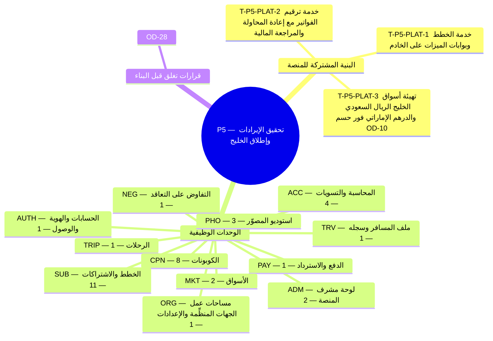

**المحور.** تحقيق الإيرادات وإطلاق الخليج — خطط جميع الأدوار، وبوابات الميزات، والكوبونات، والمحاسبة الكاملة، والفواتير؛ والسعودية (SAR) والإمارات (AED)

**تعريف الإتمام.** تكون الإيرادات المتكررة قابلة للقياس، والحدود مطبَّقة، وأسواق الخليج مفعَّلة بمجرد حسم القرار OD-10. *([القسم 3.3 من وثيقة الأعمال](/ar/docs/brd#33-مراحل-التسليم))*

**39 مهمة تسليم** (**36** مهمة وظيفية: **33** إلزامية Must، و**3** مهمة Should، و**0** تحسينية Could + **3** مهام بنية منصة مشتركة) موزعة على **12** وحدات برمجية. تتضمن كل مهمة أدناه المواصفة الكاملة ومخرجات التنفيذ الهندسي ومعايير القبول والجداول المتأثرة وروابط التتبع الشاملة عبر جميع وثائق النظام.

**نموذج البيانات.** تنطبق [اصطلاحات نموذج البيانات](/ar/docs/erd) و[ضوابط الوصول وأمان الصفوف RLS](/ar/docs/erd/acl) و[فهرس القيم المرجعية](/ar/docs/erd/reference) على جميع جداول هذه المرحلة.

<MindmapBlock title="خريطة نطاق المرحلة P5 — تحقيق الإيرادات وإطلاق الخليج" caption="توزيع مهام البنية المشتركة والوحدات الوظيفية (39 مهمة) وبوابة إغلاق المرحلة P5." trace={{"brd":[{"label":"مراحل التسليم §3.3","href":"/ar/docs/brd#33-مراحل-التسليم"}],"srs":[{"label":"مصفوفة التتبع","href":"/ar/docs/srs/traceability"}],"erd":[{"label":"نموذج البيانات","href":"/ar/docs/erd"}],"plan":[{"label":"المعالم وبوابات المراحل","href":"/ar/docs/plan/milestones"},{"label":"دليل البناء","href":"/ar/docs/plan/build-guide"}],"workflows":[{"label":"تغطية المتطلبات","href":"/ar/docs/workflows/coverage"}],"architecture":[{"label":"معمارية المنصة","href":"/ar/docs/architecture"}],"design":[{"label":"نظام التصميم","href":"/ar/docs/design"}],"system":[{"label":"النظام الشامل","href":"/ar/docs/system/lifecycle"}],"recommendations":[{"label":"حسم القرارات المفتوحة","href":"/ar/docs/recommendations/open-decisions"}]}}>

</MindmapBlock>

## فهرس المهام السريع

| المهمة | الوحدة | المرجع | الأولوية |
|---|---|---|---|
| [T-P5-PLAT-1 — خدمة الخطط وبوابات الميزات على الخادم](#t-p5-plat-1) | `PLAT` | [التوافر NFR-AVL](/ar/docs/srs/quality#83-التوافر-nfr-avl) | Must |
| [T-P5-PLAT-2 — خدمة ترقيم الفواتير مع إعادة المحاولة والمراجعة المالية](#t-p5-plat-2) | `PLAT` | [الامتثال NFR-COM](/ar/docs/srs/quality#810-الامتثال-nfr-com) | Must |
| [T-P5-PLAT-3 — تهيئة أسواق الخليج (الريال السعودي والدرهم الإماراتي) فور حسم OD-10](#t-p5-plat-3) | `PLAT` | [إقامة البيانات NFR-DAT-04](/ar/docs/srs/quality#85-البيانات-nfr-dat), [التعريب NFR-I18N](/ar/docs/srs/quality#87-التدويل-nfr-i18n) | Must |
| [T-P5-AUTH-1 — حذف الحساب مع مهلة سماح مدتها 30 يومًا](#t-p5-auth-1) | `AUTH` | [FR-AUTH-09](/ar/docs/srs/requirements/auth#fr-auth-09--حذف-الحساب-مع-مهلة-سماح-مدتها-30-يومًا) | Must |
| [T-P5-ORG-1 — فواتير B2B وB2C](#t-p5-org-1) | `ORG` | [FR-ORG-07](/ar/docs/srs/requirements/org#fr-org-07--فواتير-b2b-وb2c) | Must |
| [T-P5-TRIP-1 — حد الرحلات النشطة](#t-p5-trip-1) | `TRIP` | [FR-TRIP-07](/ar/docs/srs/requirements/trip#fr-trip-07--حد-الرحلات-النشطة) | Must |
| [T-P5-NEG-1 — تدقيق التعاقد](#t-p5-neg-1) | `NEG` | [FR-NEG-06](/ar/docs/srs/requirements/neg#fr-neg-06--تدقيق-التعاقد) | Must |
| [T-P5-PAY-1 — رسوم الاشتراك وتحصيل المتأخرات](#t-p5-pay-1) | `PAY` | [FR-PAY-06](/ar/docs/srs/requirements/pay#fr-pay-06--رسوم-الاشتراك-وتحصيل-المتأخرات) | Must |
| [T-P5-CPN-1 — نطاق المُنشئ](#t-p5-cpn-1) | `CPN` | [FR-CPN-01](/ar/docs/srs/requirements/cpn#fr-cpn-01--نطاق-المُنشئ) | Must |
| [T-P5-CPN-2 — رفض الاستخدام عبر الجهات](#t-p5-cpn-2) | `CPN` | [FR-CPN-02](/ar/docs/srs/requirements/cpn#fr-cpn-02--رفض-الاستخدام-عبر-الجهات) | Must |
| [T-P5-CPN-3 — التحقق في الوقت الفعلي](#t-p5-cpn-3) | `CPN` | [FR-CPN-03](/ar/docs/srs/requirements/cpn#fr-cpn-03--التحقق-في-الوقت-الفعلي) | Must |
| [T-P5-CPN-4 — أنواع الكوبونات](#t-p5-cpn-4) | `CPN` | [FR-CPN-04](/ar/docs/srs/requirements/cpn#fr-cpn-04--أنواع-الكوبونات) | Must |
| [T-P5-CPN-5 — دورة الحياة وعناصر التحكم](#t-p5-cpn-5) | `CPN` | [FR-CPN-05](/ar/docs/srs/requirements/cpn#fr-cpn-05--دورة-الحياة-وعناصر-التحكم) | Must |
| [T-P5-CPN-6 — الاستبدال والإلغاء العكسي](#t-p5-cpn-6) | `CPN` | [FR-CPN-06](/ar/docs/srs/requirements/cpn#fr-cpn-06--الاستبدال-والإلغاء-العكسي) | Must |
| [T-P5-CPN-7 — التحليلات وإشارات إساءة الاستخدام](#t-p5-cpn-7) | `CPN` | [FR-CPN-07](/ar/docs/srs/requirements/cpn#fr-cpn-07--التحليلات-وإشارات-إساءة-الاستخدام) | Must |
| [T-P5-CPN-8 — عدد الكوبونات حسب الخطة](#t-p5-cpn-8) | `CPN` | [FR-CPN-08](/ar/docs/srs/requirements/cpn#fr-cpn-08--عدد-الكوبونات-حسب-الخطة) | Must |
| [T-P5-SUB-1 — كتالوج الخطط](#t-p5-sub-1) | `SUB` | [FR-SUB-01](/ar/docs/srs/requirements/sub#fr-sub-01--كتالوج-الخطط) | Must |
| [T-P5-SUB-2 — بوابات الميزات](#t-p5-sub-2) | `SUB` | [FR-SUB-02](/ar/docs/srs/requirements/sub#fr-sub-02--بوابات-الميزات) | Must |
| [T-P5-SUB-3 — فترة السماح](#t-p5-sub-3) | `SUB` | [FR-SUB-03](/ar/docs/srs/requirements/sub#fr-sub-03--فترة-السماح) | Must |
| [T-P5-SUB-4 — الترقية والتخفيض والإلغاء](#t-p5-sub-4) | `SUB` | [FR-SUB-04](/ar/docs/srs/requirements/sub#fr-sub-04--الترقية-والتخفيض-والإلغاء) | Must |
| [T-P5-SUB-5 — تجاوزات مشرف المنصة](#t-p5-sub-5) | `SUB` | [FR-SUB-05](/ar/docs/srs/requirements/sub#fr-sub-05--تجاوزات-مشرف-المنصة) | Must |
| [T-P5-SUB-6 — تقارير الإيرادات](#t-p5-sub-6) | `SUB` | [FR-SUB-06](/ar/docs/srs/requirements/sub#fr-sub-06--تقارير-الإيرادات) | Must |
| [T-P5-SUB-7 — التجارب المجانية](#t-p5-sub-7) | `SUB` | [FR-SUB-07](/ar/docs/srs/requirements/sub#fr-sub-07--التجارب-المجانية) | Must |
| [T-P5-SUB-8 — المطالبة بعد الفشل (Dunning)](#t-p5-sub-8) | `SUB` | [FR-SUB-08](/ar/docs/srs/requirements/sub#fr-sub-08--المطالبة-بعد-الفشل-dunning) | Must |
| [T-P5-SUB-9 — الحدود بعد التخفيض](#t-p5-sub-9) | `SUB` | [FR-SUB-09](/ar/docs/srs/requirements/sub#fr-sub-09--الحدود-بعد-التخفيض) | Must |
| [T-P5-SUB-10 — تصفير العدادات](#t-p5-sub-10) | `SUB` | [FR-SUB-10](/ar/docs/srs/requirements/sub#fr-sub-10--تصفير-العدادات) | Must |
| [T-P5-SUB-11 — فشل خدمة الخطط](#t-p5-sub-11) | `SUB` | [FR-SUB-11](/ar/docs/srs/requirements/sub#fr-sub-11--فشل-خدمة-الخطط) | Must |
| [T-P5-PHO-1 — الحجوزات النشطة حسب الخطة](#t-p5-pho-1) | `PHO` | [FR-PHO-04](/ar/docs/srs/requirements/pho#fr-pho-04--الحجوزات-النشطة-حسب-الخطة) | Must |
| [T-P5-PHO-2 — كوبونات المصوّر](#t-p5-pho-2) | `PHO` | [FR-PHO-05](/ar/docs/srs/requirements/pho#fr-pho-05--كوبونات-المصوّر) | Must |
| [T-P5-PHO-3 — الظهور والشارة](#t-p5-pho-3) | `PHO` | [FR-PHO-06](/ar/docs/srs/requirements/pho#fr-pho-06--الظهور-والشارة) | Should |
| [T-P5-ADM-1 — كوبونات على مستوى المنصة](#t-p5-adm-1) | `ADM` | [FR-ADM-06](/ar/docs/srs/requirements/adm#fr-adm-06--كوبونات-على-مستوى-المنصة) | Must |
| [T-P5-ADM-2 — إشارات إساءة الاستخدام](#t-p5-adm-2) | `ADM` | [FR-ADM-07](/ar/docs/srs/requirements/adm#fr-adm-07--إشارات-إساءة-الاستخدام) | Should |
| [T-P5-ACC-1 — محاسبة الجهة المنظِّمة لكل رحلة](#t-p5-acc-1) | `ACC` | [FR-ACC-02](/ar/docs/srs/requirements/acc#fr-acc-02--محاسبة-الجهة-المنظِّمة-لكل-رحلة) | Must |
| [T-P5-ACC-2 — العرض المالي للمنصة](#t-p5-acc-2) | `ACC` | [FR-ACC-04](/ar/docs/srs/requirements/acc#fr-acc-04--العرض-المالي-للمنصة) | Must |
| [T-P5-ACC-3 — التصديرات بحسب الخطة](#t-p5-acc-3) | `ACC` | [FR-ACC-06](/ar/docs/srs/requirements/acc#fr-acc-06--التصديرات-بحسب-الخطة) | Must |
| [T-P5-ACC-4 — فواتير لجميع الأطراف](#t-p5-acc-4) | `ACC` | [FR-ACC-08](/ar/docs/srs/requirements/acc#fr-acc-08--فواتير-لجميع-الأطراف) | Must |
| [T-P5-TRV-1 — نسخ البيانات وحذفها](#t-p5-trv-1) | `TRV` | [FR-TRV-07](/ar/docs/srs/requirements/trv#fr-trv-07--نسخ-البيانات-وحذفها) | Must |
| [T-P5-MKT-1 — التصفح عبر الأسواق](#t-p5-mkt-1) | `MKT` | [FR-MKT-03](/ar/docs/srs/requirements/mkt#fr-mkt-03--التصفح-عبر-الأسواق) | Must |
| [T-P5-MKT-2 — تبديل حالة السوق](#t-p5-mkt-2) | `MKT` | [FR-MKT-04](/ar/docs/srs/requirements/mkt#fr-mkt-04--تبديل-حالة-السوق) | Should |

## عابرة للمجالات

تُبنى مهام البنية المشتركة هذه بالتوازي مع مهام الوحدات وتُشترط لاجتياز بوابة إغلاق المرحلة.

### T-P5-PLAT-1 — خدمة الخطط وبوابات الميزات على الخادم

<TaskCard id="T-P5-PLAT-1" title="خدمة الخطط وبوابات الميزات على الخادم" phase="P5" module="PLAT" priority="Must" kind="platform" surfaces={["وسيط API","خادم Redis","لوحة الجهة المنظِّمة","تطبيق المسافر"]} tables={["subscriptions"]} trace={{"brd":[{"label":"المرحلة P5","href":"/ar/docs/brd#33-مراحل-التسليم"}],"srs":[{"label":"التوافر NFR-AVL","href":"/ar/docs/srs/quality#83-التوافر-nfr-avl"}],"erd":[{"label":"الخطط والاشتراكات","href":"/ar/docs/erd/domains/plans-and-subscriptions"},{"label":"subscriptions","href":"/ar/docs/erd/domains/plans-and-subscriptions#subscriptions","detail":"table"},{"label":"أمان الصفوف ACL","href":"/ar/docs/erd/acl"}],"plan":[{"label":"المعالم","href":"/ar/docs/plan/milestones"},{"label":"استراتيجية الاختبار","href":"/ar/docs/plan/testing"}],"workflows":[{"label":"subscriptions","href":"/ar/docs/workflows/subscriptions"}],"userFlows":[{"label":"تدفقات الأدوار","href":"/ar/docs/user-flows"}],"architecture":[{"label":"المعمارية","href":"/ar/docs/architecture#نموذج-الخدمات"}],"design":[{"label":"نظام التصميم","href":"/ar/docs/design#لوحة-الجهة-المنظِّمة"}],"system":[{"label":"STAGE-02","href":"/ar/docs/system/lifecycle#stage-02"}],"recommendations":[{"label":"REC-FIN-10","href":"/ar/docs/recommendations/architecture-and-ops#rec-fin-10"}]}}>

**نطاق البنية المشتركة.** نشر محرك مركزي للخطط والحصص يتحقق من الاشتراكات النشطة والحدود وتجاوزات المشرف وفترة السماح لسبعة أيام بنمط الإغلاق الآمن على الخادم.

**مخرجات التنفيذ الهندسي.**

- حارس صلاحيات وحصص على الخادم يتحقق ذريًا من سقوف الخطة دون الاعتماد على إخفاء عناصر الواجهة.
- مهمة إعادة محاولة التحصيل في الأيام 1 و3 و5 و7 ومهمة تصفير العدادات الشهرية.

**معايير القبول والتحقق.**

- Given تعذر الوصول إلى خدمة تقييم الخطط، when يُطلب إجراء مقيد بخطة، then يرفض الخادم الطلب بأمان دون تعطيل تشغيل الرحلات الجارية.

</TaskCard>

### T-P5-PLAT-2 — خدمة ترقيم الفواتير مع إعادة المحاولة والمراجعة المالية

<TaskCard id="T-P5-PLAT-2" title="خدمة ترقيم الفواتير مع إعادة المحاولة والمراجعة المالية" phase="P5" module="PLAT" priority="Must" kind="platform" surfaces={["عمليات الخلفية","وحدة المالية","لوحة مشرف المنصة"]} tables={["invoices"]} trace={{"brd":[{"label":"المرحلة P5","href":"/ar/docs/brd#33-مراحل-التسليم"}],"srs":[{"label":"الامتثال NFR-COM","href":"/ar/docs/srs/quality#810-الامتثال-nfr-com"}],"erd":[{"label":"المالية","href":"/ar/docs/erd/domains/finance"},{"label":"invoices","href":"/ar/docs/erd/domains/finance#invoices","detail":"table"},{"label":"أمان الصفوف ACL","href":"/ar/docs/erd/acl"}],"plan":[{"label":"المعالم","href":"/ar/docs/plan/milestones"},{"label":"استراتيجية الاختبار","href":"/ar/docs/plan/testing"}],"workflows":[{"label":"money","href":"/ar/docs/workflows/money"}],"userFlows":[{"label":"تدفقات الأدوار","href":"/ar/docs/user-flows"}],"architecture":[{"label":"المعمارية","href":"/ar/docs/architecture#معمارية-البيانات"}],"design":[{"label":"نظام التصميم","href":"/ar/docs/design#لوحة-مشرف-المنصة"}],"system":[{"label":"STAGE-05","href":"/ar/docs/system/lifecycle#stage-05"}],"recommendations":[{"label":"REC-TAX-05","href":"/ar/docs/recommendations/architecture-and-ops#rec-tax-05"}]}}>

**نطاق البنية المشتركة.** بناء خدمة التسلسل الخالي من الفجوات للفواتير الضريبية B2B/B2C وإشعارات الدائن مع 3 محاولات آلية والإحالة للمراجعة المالية عند التعذر دون إلغاء الحجز المؤكد.

**مخرجات التنفيذ الهندسي.**

- مولِّد أرقام متسلسلة داخل المعاملة لكل سوق وسنة مالية ونوع مستند مع مخرج PDF/XML غير قابل للتعديل.
- محول امتثال ضريبي معياري جاهز لمتطلبات الفوترة الإلكترونية السعودية ZATCA.

**معايير القبول والتحقق.**

- Given فشل تخصيص رقم الفاتورة 3 مرات متتالية، when ينجح الدفع، then يبقى الحجز مؤكدًا وتُفتح حالة مراجعة مالية دون إصدار فاتورة ناقصة.
- Given فاتورة صادرة تحتاج إلى تعديل، when تُصحَّح، then تبقى الفاتورة الأصلية دون مساس ويصدر إشعار دائن مرتبط بها.

</TaskCard>

### T-P5-PLAT-3 — تهيئة أسواق الخليج (الريال السعودي والدرهم الإماراتي) فور حسم OD-10

<TaskCard id="T-P5-PLAT-3" title="تهيئة أسواق الخليج (الريال السعودي والدرهم الإماراتي) فور حسم OD-10" phase="P5" module="PLAT" priority="Must" kind="platform" surfaces={["لوحة مشرف المنصة","تطبيق المسافر","لوحة الجهة المنظِّمة"]} tables={["markets"]} trace={{"brd":[{"label":"المرحلة P5","href":"/ar/docs/brd#33-مراحل-التسليم"}],"srs":[{"label":"إقامة البيانات NFR-DAT-04","href":"/ar/docs/srs/quality#85-البيانات-nfr-dat"},{"label":"التعريب NFR-I18N","href":"/ar/docs/srs/quality#87-التدويل-nfr-i18n"}],"erd":[{"label":"الجداول المرجعية والأسواق","href":"/ar/docs/erd/domains/lookups-and-markets"},{"label":"المالية","href":"/ar/docs/erd/domains/finance"},{"label":"markets","href":"/ar/docs/erd/domains/lookups-and-markets#markets","detail":"table"},{"label":"أمان الصفوف ACL","href":"/ar/docs/erd/acl"}],"plan":[{"label":"المعالم","href":"/ar/docs/plan/milestones"},{"label":"استراتيجية الاختبار","href":"/ar/docs/plan/testing"}],"workflows":[{"label":"money","href":"/ar/docs/workflows/money"}],"userFlows":[{"label":"تدفقات الأدوار","href":"/ar/docs/user-flows"}],"architecture":[{"label":"المعمارية","href":"/ar/docs/architecture#طوبولوجيا-النشر"}],"design":[{"label":"نظام التصميم","href":"/ar/docs/design#rtl-والتعريب"}],"system":[{"label":"STAGE-01","href":"/ar/docs/system/lifecycle#stage-01"}],"recommendations":[{"label":"REC-PAY-04","href":"/ar/docs/recommendations/architecture-and-ops#rec-pay-04"}]}}>

**نطاق البنية المشتركة.** تفعيل إعدادات سوقَي السعودية (ريال سعودي وضريبة 15%) والإمارات (درهم إماراتي وضريبة 5%) وبوابات الدفع الخليجية وتقاويم أيام العمل والامتثال لنظام حماية البيانات.

**مخرجات التنفيذ الهندسي.**

- توجيه المدفوعات لعملتَي الريال السعودي (مدى وApple Pay) والدرهم الإماراتي مع عزل القيود المحاسبية لكل عملة.
- تقاويم أيام العمل الرسمية لكل سوق لحساب اتفاقيات مستوى الخدمة (يومي عمل).

**معايير القبول والتحقق.**

- Given جهة منظِّمة سعودية ومسافر مصري، when يستعرض المسافر رحلة الجهة، then تتبع العملة والضريبة والفاتورة سوق الجهة المنظِّمة (الريال السعودي).

</TaskCard>

## AUTH — الحسابات والهوية والوصول

**نموذج البيانات.** [الهوية والوصول](/ar/docs/erd/domains/identity-and-access) — النطاقات والجداول التي تقرؤها وتكتبها متطلبات هذه الوحدة.

### T-P5-AUTH-1 — حذف الحساب مع مهلة سماح مدتها 30 يومًا

<TaskCard id="T-P5-AUTH-1" title="حذف الحساب مع مهلة سماح مدتها 30 يومًا" phase="P5" module="AUTH" priority="Must" surfaces={["واجهة الزوار","تطبيق المسافر","لوحة الجهة المنظِّمة","لوحة مشرف المنصة"]} tables={["users"]} trace={{"brd":[{"label":"BR-AUTH-08","href":"/ar/docs/brd/requirements#61-الحسابات-والوصول-auth","detail":"P5"},{"label":"BRL-15","href":"/ar/docs/brd/requirements#7-قواعد-العمل","detail":"قاعدة"}],"srs":[{"label":"FR-AUTH-09","href":"/ar/docs/srs/requirements/auth#fr-auth-09--حذف-الحساب-مع-مهلة-سماح-مدتها-30-يومًا","detail":"Must"},{"label":"معايير الجودة NFR","href":"/ar/docs/srs/quality"}],"erd":[{"label":"الهوية والوصول","href":"/ar/docs/erd/domains/identity-and-access"},{"label":"users","href":"/ar/docs/erd/domains/identity-and-access#users","detail":"table"}],"plan":[{"label":"معلم P5","href":"/ar/docs/plan/milestones"},{"label":"استراتيجية الاختبار","href":"/ar/docs/plan/testing"}],"workflows":[{"label":"دليل المهام المجدولة","href":"/ar/docs/workflows/scheduled-jobs#العدادات-التنازلية-مؤقّتات-على-مستوى-كل-سجل"},{"label":"دليل المهام المجدولة","href":"/ar/docs/workflows/scheduled-jobs#المهام-اليومية"}],"userFlows":[{"label":"UF-ADM-05","href":"/ar/docs/user-flows/admin#uf-adm-05-طلبات-الخصوصية"},{"label":"UF-SHR-09","href":"/ar/docs/user-flows/shared#uf-shr-09-حذف-الحساب"},{"label":"UF-TRV-13","href":"/ar/docs/user-flows/traveler#uf-trv-13-طلبات-الخصوصية"}],"architecture":[{"label":"المعمارية","href":"/ar/docs/architecture#نموذج-الخدمات"}],"design":[{"label":"الواجهات والتصميم","href":"/ar/docs/design#النماذج-والتحقق"}],"system":[{"label":"STAGE-01","href":"/ar/docs/system/lifecycle#stage-01"}],"recommendations":[{"label":"REC-SEC-09","href":"/ar/docs/recommendations/architecture-and-ops#rec-sec-09"}]}}>

**المواصفة الوظيفية ([FR-AUTH-09](/ar/docs/srs/requirements/auth#fr-auth-09--حذف-الحساب-مع-مهلة-سماح-مدتها-30-يومًا)).** يستطيع المستخدم طلب حذف حسابه. خلال مهلة السماح التي تدوم 30 يومًا لا يُسمح بأي حجز أو دفع، ويعيد تسجيلُ الدخول الحسابَ إلى حالته. وفي اليوم 31 يصبح الحذف نهائيًا بموجب [DAT-03](/ar/docs/srs/data#62-عزل-البيانات). ولا يستطيع مالك الجهة المنظِّمة حذف الحساب ما دامت أي رحلة من رحلات الجهة في حالة In Progress (D-168).

**مخرجات التنفيذ الهندسي.**

- **منطق النطاق والواجهة البرمجية:** تنفيذ معالجات المصادقة وتدوير الجلسات والرموز وحدود الإقفال وتبديل سياق الدور والمستأجر مع التسجيل الكامل في سجل التدقيق.
- **التخزين وأمان مستوى الصفوف:** عمليات القراءة والكتابة على الجداول `users` مع الالتزام بالأعمدة الأساسية والحذف الناعم وضوابط الوصول ([ACL](/ar/docs/erd/acl)).
- **التحقق والرصد:** اختبارات آلية تغطي سيناريوهات قبول `FR-AUTH-09` وفق [استراتيجية الاختبار](/ar/docs/plan/testing) مع تسجيل الأحداث والآثار.

**معايير القبول.**

- Given طلب حذف قُدِّم قبل 10 أيام، when يسجّل المستخدم الدخول، then يُستعاد الحساب ويُلغى الطلب.
- Given مرور 30 يومًا، when تُشغَّل المهمة الليلية، then يُحذف الحساب وفق القسم 6.4.

**التتبع التجاري وقواعد العمل الحاكمة.**

- [BR-AUTH-08](/ar/docs/brd/requirements#61-الحسابات-والوصول-auth): يمكن للمستخدم طلب حذف حسابه، مع فترة سماح مدتها 30 يومًا يُستعاد خلالها الحساب بمجرد تسجيل الدخول.
- [BRL-15](/ar/docs/brd/requirements#7-قواعد-العمل): يصبح حذف الحساب نهائيًا بعد فترة سماح مدتها 30 يومًا. وتُحفظ سجلات الرحلات 5 سنوات بعد الحذف. وتُلغى الحجوزات المستقبلية ويُسترد مبلغها؛ وتُدفع الأرباح المتبقية في موعد صرف المستحقات التالي. ولا يُسمح بأي حجز أو دفع خلال فترة السماح.

</TaskCard>

## ORG — مساحات عمل الجهات المنظِّمة والإعدادات

**نموذج البيانات.** [المالية](/ar/docs/erd/domains/finance), [الجهات المنظِّمة](/ar/docs/erd/domains/organizations) — النطاقات والجداول التي تقرؤها وتكتبها متطلبات هذه الوحدة.

### T-P5-ORG-1 — فواتير B2B وB2C

<TaskCard id="T-P5-ORG-1" title="فواتير B2B وB2C" phase="P5" module="ORG" priority="Must" surfaces={["لوحة الجهة المنظِّمة","لوحة مشرف المنصة"]} tables={["invoices","organizations"]} trace={{"brd":[{"label":"BR-ORG-07","href":"/ar/docs/brd/requirements#63-الجهات-المنظِّمة-والموظفون-org","detail":"P5"},{"label":"BRL-18","href":"/ar/docs/brd/requirements#7-قواعد-العمل","detail":"قاعدة"},{"label":"BRL-28","href":"/ar/docs/brd/requirements#7-قواعد-العمل","detail":"قاعدة"}],"srs":[{"label":"FR-ORG-07","href":"/ar/docs/srs/requirements/org#fr-org-07--فواتير-b2b-وb2c","detail":"Must"},{"label":"معايير الجودة NFR","href":"/ar/docs/srs/quality"}],"erd":[{"label":"المالية","href":"/ar/docs/erd/domains/finance"},{"label":"الجهات المنظِّمة","href":"/ar/docs/erd/domains/organizations"},{"label":"invoices","href":"/ar/docs/erd/domains/finance#invoices","detail":"table"},{"label":"organizations","href":"/ar/docs/erd/domains/organizations#organizations","detail":"table"}],"plan":[{"label":"معلم P5","href":"/ar/docs/plan/milestones"},{"label":"استراتيجية الاختبار","href":"/ar/docs/plan/testing"}],"workflows":[{"label":"الأموال","href":"/ar/docs/workflows/money#المؤقّتات-والقواعد"},{"label":"دليل المهام المجدولة","href":"/ar/docs/workflows/scheduled-jobs#جداول-إعادة-المحاولة-ملاحقة-كل-إخفاق"}],"userFlows":[{"label":"UF-ADM-11","href":"/ar/docs/user-flows/admin#uf-adm-11-العمليات-المالية"},{"label":"UF-ORG-14","href":"/ar/docs/user-flows/organization#uf-org-14-الفواتير"}],"architecture":[{"label":"المعمارية","href":"/ar/docs/architecture#معمارية-البيانات"}],"design":[{"label":"الواجهات والتصميم","href":"/ar/docs/design#لوحة-الجهة-المنظِّمة"}],"system":[{"label":"STAGE-02","href":"/ar/docs/system/lifecycle#stage-02"}],"recommendations":[{"label":"REC-DATA-02","href":"/ar/docs/recommendations/architecture-and-ops#rec-data-02"}]}}>

**المواصفة الوظيفية ([FR-ORG-07](/ar/docs/srs/requirements/org#fr-org-07--فواتير-b2b-وb2c)).** تصدر الجهة المنظِّمة فواتير لرحلاتها على كل خطة (D-178). وتكون الفاتورة B2B عندما يقدِّم المشتري رقمًا ضريبيًا، وإلا فهي B2C. ولا تُعدَّل الفاتورة الصادرة أبدًا؛ بل تُجرى التصحيحات بإشعار دائن يشير إلى الفاتورة الأصلية. وإذا فشل الترقيم، لا تُصدَر أي فاتورة، ويبقى الحجز في حالة Confirmed، وتُعاد محاولة الترقيم 3 مرات، ثم تُحال الحالة إلى مراجعة الإدارة المالية (D-179 إلى D-181). وتظل الفوترة الإلكترونية عبر ZATCA خارج النطاق حتى يُبت في [OD-10](/ar/docs/brd/compliance#11-القرارات-المفتوحة).

**مخرجات التنفيذ الهندسي.**

- **منطق النطاق والواجهة البرمجية:** فرض عزل المستأجر عبر سياسات RLS في PostgreSQL وتهيئة مساحة العمل فور الاعتماد وحدود الموردين التابعين للجهة وروابط الويب الموقَّعة.
- **التخزين وأمان مستوى الصفوف:** عمليات القراءة والكتابة على الجداول `invoices`، `organizations` مع الالتزام بالأعمدة الأساسية والحذف الناعم وضوابط الوصول ([ACL](/ar/docs/erd/acl)).
- **التحقق والرصد:** اختبارات آلية تغطي سيناريوهات قبول `FR-ORG-07` وفق [استراتيجية الاختبار](/ar/docs/plan/testing) مع تسجيل الأحداث والآثار.

**معايير القبول.**

- بافتراض أن مشتريًا أدخل رقمًا ضريبيًا عند إتمام الدفع، عند تأكيد الحجز، تُصدَر فاتورة B2B وتُقيَّد في السجل.
- بافتراض أن فاتورة صادرة تحتاج إلى تصحيح، عندما تصحّحها الإدارة المالية، يُصدَر إشعار دائن يشير إلى رقم الفاتورة الأصلية وتبقى الفاتورة الأصلية دون تغيير.

**التتبع التجاري وقواعد العمل الحاكمة.**

- [BR-ORG-07](/ar/docs/brd/requirements#63-الجهات-المنظِّمة-والموظفون-org): تصدر الجهات المنظِّمة فواتير B2B وB2C لرحلاتها؛ وتُجرى التصحيحات بإشعار دائن.
- [BRL-18](/ar/docs/brd/requirements#7-قواعد-العمل): يُكتب كل حدث مالي (حجز، أو استرداد، أو كوبون، أو رسوم اشتراك، أو صرف مستحقات، أو تكلفة صفقة، أو عمولة، أو فاتورة) في سجل بقيد مزدوج.
- [BRL-28](/ar/docs/brd/requirements#7-قواعد-العمل): تكون الفاتورة B2B عندما يقدِّم المشتري رقمًا ضريبيًا، وإلا فهي B2C (D-180). ولا تُعدَّل الفاتورة الصادرة أبدًا؛ ويكون التصحيح بإشعار دائن يشير إليها (D-181).

</TaskCard>

## TRIP — الرحلات

**نموذج البيانات.** [الأسطول والرحلات](/ar/docs/erd/domains/fleet-and-trips) — النطاقات والجداول التي تقرؤها وتكتبها متطلبات هذه الوحدة.

### T-P5-TRIP-1 — حد الرحلات النشطة

<TaskCard id="T-P5-TRIP-1" title="حد الرحلات النشطة" phase="P5" module="TRIP" priority="Must" surfaces={["لوحة الجهة المنظِّمة","تطبيق المسافر","لوحة مشرف المنصة"]} tables={["trips"]} trace={{"brd":[{"label":"BR-SUB-02","href":"/ar/docs/brd/requirements#64-الرحلات-والبرامج-والأسطول-trip-prg-flt","detail":"P5"},{"label":"BRL-02","href":"/ar/docs/brd/requirements#7-قواعد-العمل","detail":"قاعدة"}],"srs":[{"label":"FR-TRIP-07","href":"/ar/docs/srs/requirements/trip#fr-trip-07--حد-الرحلات-النشطة","detail":"Must"},{"label":"آلة حالة الرحلة §7.1","href":"/ar/docs/srs/state-machines#71-دورة-حياة-الرحلة"},{"label":"معايير الجودة NFR","href":"/ar/docs/srs/quality"}],"erd":[{"label":"الأسطول والرحلات","href":"/ar/docs/erd/domains/fleet-and-trips"},{"label":"trips","href":"/ar/docs/erd/domains/fleet-and-trips#trips","detail":"table"}],"plan":[{"label":"معلم P5","href":"/ar/docs/plan/milestones"},{"label":"استراتيجية الاختبار","href":"/ar/docs/plan/testing"}],"workflows":[{"label":"trip-lifecycle","href":"/ar/docs/workflows/trip-lifecycle"}],"userFlows":[{"label":"UF-ORG-06","href":"/ar/docs/user-flows/organization#uf-org-06-إنشاء-رحلة-معالج-إرشادي"}],"architecture":[{"label":"المعمارية","href":"/ar/docs/architecture#نموذج-الخدمات"}],"design":[{"label":"الواجهات والتصميم","href":"/ar/docs/design#لوحة-الجهة-المنظِّمة"}],"system":[{"label":"STAGE-04","href":"/ar/docs/system/lifecycle#stage-04"}],"recommendations":[{"label":"REC-ARCH-01","href":"/ar/docs/recommendations/architecture-and-ops#rec-arch-01"}]}}>

**المواصفة الوظيفية ([FR-TRIP-07](/ar/docs/srs/requirements/trip#fr-trip-07--حد-الرحلات-النشطة)).** تُحتسب الرحلات المنشأة في الدورة الحالية التي تبلغ Published وحتى Completed مقابل الحد الشهري للخطة (D-143). وبعد تجاوز الحد، يُحجب النشر مع رسالة تدعو إلى ترقية الخطة.

**مخرجات التنفيذ الهندسي.**

- **منطق النطاق والواجهة البرمجية:** تنفيذ معالج إنشاء الرحلة متعدد الخطوات وحراس آلة حالة الرحلة وتحولات السعة ومعالجات التعديلات بعد الحجز وقواعد الإلغاء والأرشفة.
- **التخزين وأمان مستوى الصفوف:** عمليات القراءة والكتابة على الجداول `trips` مع الالتزام بالأعمدة الأساسية والحذف الناعم وضوابط الوصول ([ACL](/ar/docs/erd/acl)).
- **التحقق والرصد:** اختبارات آلية تغطي سيناريوهات قبول `FR-TRIP-07` وفق [استراتيجية الاختبار](/ar/docs/plan/testing) مع تسجيل الأحداث والآثار.

**معايير القبول.**

- بافتراض جهة منظِّمة على خطة Starter بها 5 رحلات محسوبة هذا الشهر، عندما تنشر رحلة سادسة، يُحجب النشر مع رسالة تدعو إلى ترقية الخطة.

**التتبع التجاري وقواعد العمل الحاكمة.**

- [BR-SUB-02](/ar/docs/brd/requirements#64-الرحلات-والبرامج-والأسطول-trip-prg-flt): تُفرض حدود الخطة وميزاتها تلقائيًا. ويعرض الإجراء المحجوب رسالة تدعو إلى ترقية الخطة. ويحتاج كل دور غير المسافر إلى خطة نشطة لاستخدام التطبيق ([BRL-02](/ar/docs/brd/requirements#7-قواعد-العمل)).
- [BRL-02](/ar/docs/brd/requirements#7-قواعد-العمل): يجب أن يحمل كل دور غير المسافر خطة نشطة لاستخدام التطبيق. ويمكن للمسافر دائمًا استخدام التطبيق مجانًا.

</TaskCard>

## NEG — التفاوض على التعاقد

**نموذج البيانات.** [الصفقات](/ar/docs/erd/domains/deals) — النطاقات والجداول التي تقرؤها وتكتبها متطلبات هذه الوحدة.

### T-P5-NEG-1 — تدقيق التعاقد

<TaskCard id="T-P5-NEG-1" title="تدقيق التعاقد" phase="P5" module="NEG" priority="Must" surfaces={["لوحة الجهة المنظِّمة","تطبيق السائق","استوديو المصوّر"]} tables={["deals"]} trace={{"brd":[{"label":"BR-ACC-02","href":"/ar/docs/brd/requirements#65-الطاقم-والصفقات-stf","detail":"P5"},{"label":"BRL-18","href":"/ar/docs/brd/requirements#7-قواعد-العمل","detail":"قاعدة"}],"srs":[{"label":"FR-NEG-06","href":"/ar/docs/srs/requirements/neg#fr-neg-06--تدقيق-التعاقد","detail":"Must"},{"label":"آلة حالة الصفقة §7.4","href":"/ar/docs/srs/state-machines#74-الصفقة"},{"label":"معايير الجودة NFR","href":"/ar/docs/srs/quality"}],"erd":[{"label":"الصفقات","href":"/ar/docs/erd/domains/deals"},{"label":"deals","href":"/ar/docs/erd/domains/deals#deals","detail":"table"}],"plan":[{"label":"معلم P5","href":"/ar/docs/plan/milestones"},{"label":"استراتيجية الاختبار","href":"/ar/docs/plan/testing"}],"workflows":[{"label":"trip-lifecycle","href":"/ar/docs/workflows/trip-lifecycle"}],"userFlows":[{"label":"UF-ADM-09","href":"/ar/docs/user-flows/admin#uf-adm-09-تدقيق-الصفقات"},{"label":"UF-ORG-07","href":"/ar/docs/user-flows/organization#uf-org-07-التعاقد-مع-مورّد-من-المنصة-صفقة"}],"architecture":[{"label":"المعمارية","href":"/ar/docs/architecture#نموذج-الخدمات"}],"design":[{"label":"الواجهات والتصميم","href":"/ar/docs/design#تطبيق-السائق"}],"system":[{"label":"STAGE-03","href":"/ar/docs/system/lifecycle#stage-03"}],"recommendations":[{"label":"REC-FIN-10","href":"/ar/docs/recommendations/architecture-and-ops#rec-fin-10"}]}}>

**المواصفة الوظيفية ([FR-NEG-06](/ar/docs/srs/requirements/neg#fr-neg-06--تدقيق-التعاقد)).** يُسجَّل كل تغيير حالة وكل عرض، ويكون مرئيًا للمشرفين. ويمكن للمشرفين وضع إشارة على تعاقد مع ذكر السبب؛ ويمكن أن تؤدي الإشارة إلى إيقافه مؤقتًا (D-252).

**مخرجات التنفيذ الهندسي.**

- **منطق النطاق والواجهة البرمجية:** تنفيذ تحولات آلة حالة الصفقة وسجل العروض المضادة وانتهاء الصلاحية بعد 72 ساعة (BRL-26) وتثبيت السعر بموافقة الطرفين.
- **التخزين وأمان مستوى الصفوف:** عمليات القراءة والكتابة على الجداول `deals` مع الالتزام بالأعمدة الأساسية والحذف الناعم وضوابط الوصول ([ACL](/ar/docs/erd/acl)).
- **التحقق والرصد:** اختبارات آلية تغطي سيناريوهات قبول `FR-NEG-06` وفق [استراتيجية الاختبار](/ar/docs/plan/testing) مع تسجيل الأحداث والآثار.

**معايير القبول.**

- بافتراض تعاقد بخمسة عروض مضادة، عند فتح المشرف له، تظهر العروض الخمسة كلها بالترتيب مع الفاعل والوقت.

**التتبع التجاري وقواعد العمل الحاكمة.**

- [BR-ACC-02](/ar/docs/brd/requirements#65-الطاقم-والصفقات-stf): يرى مشرف المنصة المالية على مستوى النظام كله: إيرادات الاشتراكات، والعمولة، وتدقيق الصفقات، واستخدامات الكوبونات، والنزاعات، وصرف المستحقات.
- [BRL-18](/ar/docs/brd/requirements#7-قواعد-العمل): يُكتب كل حدث مالي (حجز، أو استرداد، أو كوبون، أو رسوم اشتراك، أو صرف مستحقات، أو تكلفة صفقة، أو عمولة، أو فاتورة) في سجل بقيد مزدوج.

</TaskCard>

## PAY — الدفع والاسترداد

**نموذج البيانات.** [الحجز والدفع](/ar/docs/erd/domains/booking-and-payment), [المالية](/ar/docs/erd/domains/finance) — النطاقات والجداول التي تقرؤها وتكتبها متطلبات هذه الوحدة.

### T-P5-PAY-1 — رسوم الاشتراك وتحصيل المتأخرات

<TaskCard id="T-P5-PAY-1" title="رسوم الاشتراك وتحصيل المتأخرات" phase="P5" module="PAY" priority="Must" surfaces={["تطبيق المسافر","لوحة الجهة المنظِّمة","لوحة مشرف المنصة"]} tables={["trip_seats"]} trace={{"brd":[{"label":"BR-SUB-03","href":"/ar/docs/brd/requirements#67-الحجز-والدفع-bkg","detail":"P5"}],"srs":[{"label":"FR-PAY-06","href":"/ar/docs/srs/requirements/pay#fr-pay-06--رسوم-الاشتراك-وتحصيل-المتأخرات","detail":"Must"},{"label":"آلة حالة الحجز §7.2","href":"/ar/docs/srs/state-machines#72-الحجز"},{"label":"معايير الجودة NFR","href":"/ar/docs/srs/quality"}],"erd":[{"label":"الحجز والدفع","href":"/ar/docs/erd/domains/booking-and-payment"},{"label":"المالية","href":"/ar/docs/erd/domains/finance"},{"label":"trip_seats","href":"/ar/docs/erd/domains/booking-and-payment#trip_seats","detail":"table"}],"plan":[{"label":"معلم P5","href":"/ar/docs/plan/milestones"},{"label":"استراتيجية الاختبار","href":"/ar/docs/plan/testing"}],"workflows":[{"label":"دليل المهام المجدولة","href":"/ar/docs/workflows/scheduled-jobs#جداول-إعادة-المحاولة-ملاحقة-كل-إخفاق"},{"label":"الاشتراكات","href":"/ar/docs/workflows/subscriptions#المؤقتات-والقواعد"}],"userFlows":[{"label":"UF-SHR-16","href":"/ar/docs/user-flows/shared#uf-shr-16-من-الفترة-التجريبية-إلى-المدفوعة"}],"architecture":[{"label":"المعمارية","href":"/ar/docs/architecture#التكاملات"}],"design":[{"label":"الواجهات والتصميم","href":"/ar/docs/design#تطبيق-المسافر"}],"system":[{"label":"STAGE-05","href":"/ar/docs/system/lifecycle#stage-05"}],"recommendations":[{"label":"REC-PAY-04","href":"/ar/docs/recommendations/architecture-and-ops#rec-pay-04"}]}}>

**المواصفة الوظيفية ([FR-PAY-06](/ar/docs/srs/requirements/pay#fr-pay-06--رسوم-الاشتراك-وتحصيل-المتأخرات)).** تُنفَّذ رسوم الخطط عبر منتج الفوترة الخاص ببوابة الدفع. ويبدأ السحب الفاشل دورة تحصيل المتأخرات ([FR-SUB-08](/ar/docs/srs/requirements/sub#fr-sub-08--المطالبة-بعد-الفشل-dunning)) وفترة السماح ([FR-SUB-03](/ar/docs/srs/requirements/sub#fr-sub-03--فترة-السماح)).

**مخرجات التنفيذ الهندسي.**

- **منطق النطاق والواجهة البرمجية:** ربط بوابات الدفع الإقليمية مع قسائم فوري لمدة 48 ساعة ومعالجة الإشعارات الموقَّعة غير المتكررة والاستعلام الدوري والاسترداد الآلي.
- **التخزين وأمان مستوى الصفوف:** عمليات القراءة والكتابة على الجداول `trip_seats` مع الالتزام بالأعمدة الأساسية والحذف الناعم وضوابط الوصول ([ACL](/ar/docs/erd/acl)).
- **التحقق والرصد:** اختبارات آلية تغطي سيناريوهات قبول `FR-PAY-06` وفق [استراتيجية الاختبار](/ar/docs/plan/testing) مع تسجيل الأحداث والآثار.

**معايير القبول.**

- بافتراض فشل تجديد اشتراك، عند استلام إشعار الفشل، يُرسَل تذكير وتبدأ فترة السماح.

**التتبع التجاري وقواعد العمل الحاكمة.**

- [BR-SUB-03](/ar/docs/brd/requirements#67-الحجز-والدفع-bkg): تؤدي عمليات التجديد الفاشلة إلى بدء إجراءات التحصيل (dunning) وفترة سماح مدتها 7 أيام قبل أن يفقد الحساب ميزات الخطة.

</TaskCard>

## CPN — الكوبونات

**نموذج البيانات.** [الكوبونات](/ar/docs/erd/domains/coupons) — النطاقات والجداول التي تقرؤها وتكتبها متطلبات هذه الوحدة.

### T-P5-CPN-1 — نطاق المُنشئ

<TaskCard id="T-P5-CPN-1" title="نطاق المُنشئ" phase="P5" module="CPN" priority="Must" surfaces={["لوحة الجهة المنظِّمة","تطبيق المسافر","لوحة مشرف المنصة"]} tables={["coupons"]} trace={{"brd":[{"label":"BR-CPN-01","href":"/ar/docs/brd/requirements#68-الكوبونات-cpn","detail":"P5"},{"label":"BRL-03","href":"/ar/docs/brd/requirements#7-قواعد-العمل","detail":"قاعدة"}],"srs":[{"label":"FR-CPN-01","href":"/ar/docs/srs/requirements/cpn#fr-cpn-01--نطاق-المُنشئ","detail":"Must"},{"label":"آلة حالة الكوبون §7.7","href":"/ar/docs/srs/state-machines#77-الكوبون"},{"label":"معايير الجودة NFR","href":"/ar/docs/srs/quality"}],"erd":[{"label":"الكوبونات","href":"/ar/docs/erd/domains/coupons"},{"label":"coupons","href":"/ar/docs/erd/domains/coupons#coupons","detail":"table"}],"plan":[{"label":"معلم P5","href":"/ar/docs/plan/milestones"},{"label":"استراتيجية الاختبار","href":"/ar/docs/plan/testing"}],"workflows":[{"label":"refunds","href":"/ar/docs/workflows/refunds"}],"userFlows":[{"label":"UF-DRV-07","href":"/ar/docs/user-flows/driver#uf-drv-07-الكوبونات"},{"label":"UF-ORG-13","href":"/ar/docs/user-flows/organization#uf-org-13-الكوبونات"}],"architecture":[{"label":"المعمارية","href":"/ar/docs/architecture#نموذج-الخدمات"}],"design":[{"label":"الواجهات والتصميم","href":"/ar/docs/design#لوحة-الجهة-المنظِّمة"}],"system":[{"label":"STAGE-04","href":"/ar/docs/system/lifecycle#stage-04"}],"recommendations":[{"label":"REC-FIN-10","href":"/ar/docs/recommendations/architecture-and-ops#rec-fin-10"}]}}>

**المواصفة الوظيفية ([FR-CPN-01](/ar/docs/srs/requirements/cpn#fr-cpn-01--نطاق-المُنشئ)).** يسري الكوبون فقط داخل نطاق مُنشئه: كوبونات مشرف المنصة على أي رحلة (مع إمكانية حصرها بسوق معين)؛ وكوبونات الجهة المنظِّمة على رحلاتها فقط؛ وكوبونات السائق والمصوّر على الحجوزات التي يُعيَّن فيها ذلك المزوّد.

**مخرجات التنفيذ الهندسي.**

- **منطق النطاق والواجهة البرمجية:** بناء قواعد نطاق الكوبونات وعدادات الاستخدام الذرية والرسائل الموحَّدة وعكس الاستخدام عند الإلغاء وكشف إساءة الاستخدام.
- **التخزين وأمان مستوى الصفوف:** عمليات القراءة والكتابة على الجداول `coupons` مع الالتزام بالأعمدة الأساسية والحذف الناعم وضوابط الوصول ([ACL](/ar/docs/erd/acl)).
- **التحقق والرصد:** اختبارات آلية تغطي سيناريوهات قبول `FR-CPN-01` وفق [استراتيجية الاختبار](/ar/docs/plan/testing) مع تسجيل الأحداث والآثار.

**معايير القبول.**

- بافتراض كوبون سائق وحجز لا يشمل ذلك السائق، عند تطبيقه، يُرفض.

**التتبع التجاري وقواعد العمل الحاكمة.**

- [BR-CPN-01](/ar/docs/brd/requirements#68-الكوبونات-cpn): ينشئ مشرفو المنصة والجهات المنظِّمة والسائقون والمصوّرون كوبونات تعمل داخل نطاقهم الخاص فقط.
- [BRL-03](/ar/docs/brd/requirements#7-قواعد-العمل): يعمل الكوبون داخل نطاق منشئه فقط: مشرف المنصة في أي رحلة؛ والجهة المنظِّمة في رحلاتها؛ والسائق أو المصوّر في الحجوزات المسندة إليهما. ويُرفض الاستخدام عبر الكيانات.

</TaskCard>

### T-P5-CPN-2 — رفض الاستخدام عبر الجهات

<TaskCard id="T-P5-CPN-2" title="رفض الاستخدام عبر الجهات" phase="P5" module="CPN" priority="Must" surfaces={["لوحة الجهة المنظِّمة","تطبيق المسافر","لوحة مشرف المنصة"]} tables={["coupons"]} trace={{"brd":[{"label":"BR-CPN-02","href":"/ar/docs/brd/requirements#68-الكوبونات-cpn","detail":"P5"},{"label":"BRL-03","href":"/ar/docs/brd/requirements#7-قواعد-العمل","detail":"قاعدة"}],"srs":[{"label":"FR-CPN-02","href":"/ar/docs/srs/requirements/cpn#fr-cpn-02--رفض-الاستخدام-عبر-الجهات","detail":"Must"},{"label":"آلة حالة الكوبون §7.7","href":"/ar/docs/srs/state-machines#77-الكوبون"},{"label":"معايير الجودة NFR","href":"/ar/docs/srs/quality"}],"erd":[{"label":"الكوبونات","href":"/ar/docs/erd/domains/coupons"},{"label":"coupons","href":"/ar/docs/erd/domains/coupons#coupons","detail":"table"}],"plan":[{"label":"معلم P5","href":"/ar/docs/plan/milestones"},{"label":"استراتيجية الاختبار","href":"/ar/docs/plan/testing"}],"workflows":[{"label":"refunds","href":"/ar/docs/workflows/refunds"}],"userFlows":[{"label":"UF-TRV-04","href":"/ar/docs/user-flows/traveler#uf-trv-04-تطبيق-كوبون"}],"architecture":[{"label":"المعمارية","href":"/ar/docs/architecture#نموذج-الخدمات"}],"design":[{"label":"الواجهات والتصميم","href":"/ar/docs/design#لوحة-الجهة-المنظِّمة"}],"system":[{"label":"STAGE-04","href":"/ar/docs/system/lifecycle#stage-04"}],"recommendations":[{"label":"REC-FIN-10","href":"/ar/docs/recommendations/architecture-and-ops#rec-fin-10"}]}}>

**المواصفة الوظيفية ([FR-CPN-02](/ar/docs/srs/requirements/cpn#fr-cpn-02--رفض-الاستخدام-عبر-الجهات)).** يُرفض الاستخدام عبر الجهات دائمًا برسالة "غير قابل للتطبيق على هذا الحجز"، دون ذكر الجهة الأخرى ([OD-20](/ar/docs/brd/compliance#11-القرارات-المفتوحة)).

**مخرجات التنفيذ الهندسي.**

- **منطق النطاق والواجهة البرمجية:** بناء قواعد نطاق الكوبونات وعدادات الاستخدام الذرية والرسائل الموحَّدة وعكس الاستخدام عند الإلغاء وكشف إساءة الاستخدام.
- **التخزين وأمان مستوى الصفوف:** عمليات القراءة والكتابة على الجداول `coupons` مع الالتزام بالأعمدة الأساسية والحذف الناعم وضوابط الوصول ([ACL](/ar/docs/erd/acl)).
- **التحقق والرصد:** اختبارات آلية تغطي سيناريوهات قبول `FR-CPN-02` وفق [استراتيجية الاختبار](/ar/docs/plan/testing) مع تسجيل الأحداث والآثار.

**معايير القبول.**

- بافتراض كوبون الجهة المنظِّمة A على رحلة الجهة المنظِّمة B، عند التحقق منه، تظهر الرسالة العامة.

**التتبع التجاري وقواعد العمل الحاكمة.**

- [BR-CPN-02](/ar/docs/brd/requirements#68-الكوبونات-cpn): يُرفض دائمًا استخدام الكوبون عبر حدود الكيانات برسالة عامة لا تذكر الكيان الآخر ([OD-20](/ar/docs/brd/compliance#11-القرارات-المفتوحة)).
- [BRL-03](/ar/docs/brd/requirements#7-قواعد-العمل): يعمل الكوبون داخل نطاق منشئه فقط: مشرف المنصة في أي رحلة؛ والجهة المنظِّمة في رحلاتها؛ والسائق أو المصوّر في الحجوزات المسندة إليهما. ويُرفض الاستخدام عبر الكيانات.

</TaskCard>

### T-P5-CPN-3 — التحقق في الوقت الفعلي

<TaskCard id="T-P5-CPN-3" title="التحقق في الوقت الفعلي" phase="P5" module="CPN" priority="Must" surfaces={["لوحة الجهة المنظِّمة","تطبيق المسافر","لوحة مشرف المنصة"]} tables={["coupons"]} trace={{"brd":[{"label":"BR-CPN-03","href":"/ar/docs/brd/requirements#68-الكوبونات-cpn","detail":"P5"}],"srs":[{"label":"FR-CPN-03","href":"/ar/docs/srs/requirements/cpn#fr-cpn-03--التحقق-في-الوقت-الفعلي","detail":"Must"},{"label":"آلة حالة الكوبون §7.7","href":"/ar/docs/srs/state-machines#77-الكوبون"},{"label":"معايير الجودة NFR","href":"/ar/docs/srs/quality"}],"erd":[{"label":"الكوبونات","href":"/ar/docs/erd/domains/coupons"},{"label":"coupons","href":"/ar/docs/erd/domains/coupons#coupons","detail":"table"}],"plan":[{"label":"معلم P5","href":"/ar/docs/plan/milestones"},{"label":"استراتيجية الاختبار","href":"/ar/docs/plan/testing"}],"workflows":[{"label":"refunds","href":"/ar/docs/workflows/refunds"}],"userFlows":[{"label":"UF-TRV-04","href":"/ar/docs/user-flows/traveler#uf-trv-04-تطبيق-كوبون"}],"architecture":[{"label":"المعمارية","href":"/ar/docs/architecture#نموذج-الخدمات"}],"design":[{"label":"الواجهات والتصميم","href":"/ar/docs/design#لوحة-الجهة-المنظِّمة"}],"system":[{"label":"STAGE-04","href":"/ar/docs/system/lifecycle#stage-04"}],"recommendations":[{"label":"REC-FIN-10","href":"/ar/docs/recommendations/architecture-and-ops#rec-fin-10"}]}}>

**المواصفة الوظيفية ([FR-CPN-03](/ar/docs/srs/requirements/cpn#fr-cpn-03--التحقق-في-الوقت-الفعلي)).** يفحص التحققُ الوجود، والحالة، ونافذة الصلاحية، والنطاق، وحد الاستخدام، وحد الاستخدام لكل مستخدم، والحد الأدنى للإنفاق، بهذا الترتيب، ويعيد سبب الفشل الأول الوارد.

**مخرجات التنفيذ الهندسي.**

- **منطق النطاق والواجهة البرمجية:** بناء قواعد نطاق الكوبونات وعدادات الاستخدام الذرية والرسائل الموحَّدة وعكس الاستخدام عند الإلغاء وكشف إساءة الاستخدام.
- **التخزين وأمان مستوى الصفوف:** عمليات القراءة والكتابة على الجداول `coupons` مع الالتزام بالأعمدة الأساسية والحذف الناعم وضوابط الوصول ([ACL](/ar/docs/erd/acl)).
- **التحقق والرصد:** اختبارات آلية تغطي سيناريوهات قبول `FR-CPN-03` وفق [استراتيجية الاختبار](/ar/docs/plan/testing) مع تسجيل الأحداث والآثار.

**معايير القبول.**

- بافتراض كوبون انتهت صلاحيته أمس، عند تطبيقه، يكون السبب "منتهي الصلاحية".
- بافتراض إجمالي أقل من الحد الأدنى للإنفاق، عند تطبيقه، يكون السبب "عدم استيفاء الحد الأدنى للإنفاق".

**التتبع التجاري وقواعد العمل الحاكمة.**

- [BR-CPN-03](/ar/docs/brd/requirements#68-الكوبونات-cpn): تدعم الكوبونات أنواع المبلغ الثابت، والنسبة المئوية، والخاص ببرنامج، والبرنامج المجاني، وأول حجز، والحد الأدنى للإنفاق، ويجري التحقق منها في الوقت الفعلي عند إتمام الدفع.

</TaskCard>

### T-P5-CPN-4 — أنواع الكوبونات

<TaskCard id="T-P5-CPN-4" title="أنواع الكوبونات" phase="P5" module="CPN" priority="Must" surfaces={["لوحة الجهة المنظِّمة","تطبيق المسافر","لوحة مشرف المنصة"]} tables={["coupons"]} trace={{"brd":[{"label":"BR-CPN-03","href":"/ar/docs/brd/requirements#68-الكوبونات-cpn","detail":"P5"}],"srs":[{"label":"FR-CPN-04","href":"/ar/docs/srs/requirements/cpn#fr-cpn-04--أنواع-الكوبونات","detail":"Must"},{"label":"آلة حالة الكوبون §7.7","href":"/ar/docs/srs/state-machines#77-الكوبون"},{"label":"معايير الجودة NFR","href":"/ar/docs/srs/quality"}],"erd":[{"label":"الكوبونات","href":"/ar/docs/erd/domains/coupons"},{"label":"coupons","href":"/ar/docs/erd/domains/coupons#coupons","detail":"table"}],"plan":[{"label":"معلم P5","href":"/ar/docs/plan/milestones"},{"label":"استراتيجية الاختبار","href":"/ar/docs/plan/testing"}],"workflows":[{"label":"refunds","href":"/ar/docs/workflows/refunds"}],"userFlows":[{"label":"UF-ORG-22","href":"/ar/docs/user-flows/organization#uf-org-22-دورة-حياة-الكوبون"}],"architecture":[{"label":"المعمارية","href":"/ar/docs/architecture#نموذج-الخدمات"}],"design":[{"label":"الواجهات والتصميم","href":"/ar/docs/design#لوحة-الجهة-المنظِّمة"}],"system":[{"label":"STAGE-04","href":"/ar/docs/system/lifecycle#stage-04"}],"recommendations":[{"label":"REC-FIN-10","href":"/ar/docs/recommendations/architecture-and-ops#rec-fin-10"}]}}>

**المواصفة الوظيفية ([FR-CPN-04](/ar/docs/srs/requirements/cpn#fr-cpn-04--أنواع-الكوبونات)).** تدعم الكوبونات المبلغ الثابت، والنسبة المئوية، والكوبون المخصص لبرنامج معين، والبرنامج المجاني، وأول حجز، والحد الأدنى للإنفاق.

**مخرجات التنفيذ الهندسي.**

- **منطق النطاق والواجهة البرمجية:** بناء قواعد نطاق الكوبونات وعدادات الاستخدام الذرية والرسائل الموحَّدة وعكس الاستخدام عند الإلغاء وكشف إساءة الاستخدام.
- **التخزين وأمان مستوى الصفوف:** عمليات القراءة والكتابة على الجداول `coupons` مع الالتزام بالأعمدة الأساسية والحذف الناعم وضوابط الوصول ([ACL](/ar/docs/erd/acl)).
- **التحقق والرصد:** اختبارات آلية تغطي سيناريوهات قبول `FR-CPN-04` وفق [استراتيجية الاختبار](/ar/docs/plan/testing) مع تسجيل الأحداث والآثار.

**معايير القبول.**

- بافتراض كوبون أول حجز، عندما يطبّقه مسافر لديه حجز مؤكد مع تلك الجهة، يُرفض.

**التتبع التجاري وقواعد العمل الحاكمة.**

- [BR-CPN-03](/ar/docs/brd/requirements#68-الكوبونات-cpn): تدعم الكوبونات أنواع المبلغ الثابت، والنسبة المئوية، والخاص ببرنامج، والبرنامج المجاني، وأول حجز، والحد الأدنى للإنفاق، ويجري التحقق منها في الوقت الفعلي عند إتمام الدفع.

</TaskCard>

### T-P5-CPN-5 — دورة الحياة وعناصر التحكم

<TaskCard id="T-P5-CPN-5" title="دورة الحياة وعناصر التحكم" phase="P5" module="CPN" priority="Must" surfaces={["لوحة الجهة المنظِّمة","تطبيق المسافر","لوحة مشرف المنصة"]} tables={["coupons"]} trace={{"brd":[{"label":"BR-CPN-01","href":"/ar/docs/brd/requirements#68-الكوبونات-cpn","detail":"P5"}],"srs":[{"label":"FR-CPN-05","href":"/ar/docs/srs/requirements/cpn#fr-cpn-05--دورة-الحياة-وعناصر-التحكم","detail":"Must"},{"label":"آلة حالة الكوبون §7.7","href":"/ar/docs/srs/state-machines#77-الكوبون"},{"label":"معايير الجودة NFR","href":"/ar/docs/srs/quality"}],"erd":[{"label":"الكوبونات","href":"/ar/docs/erd/domains/coupons"},{"label":"coupons","href":"/ar/docs/erd/domains/coupons#coupons","detail":"table"}],"plan":[{"label":"معلم P5","href":"/ar/docs/plan/milestones"},{"label":"استراتيجية الاختبار","href":"/ar/docs/plan/testing"}],"workflows":[{"label":"refunds","href":"/ar/docs/workflows/refunds"}],"userFlows":[{"label":"UF-ORG-22","href":"/ar/docs/user-flows/organization#uf-org-22-دورة-حياة-الكوبون"}],"architecture":[{"label":"المعمارية","href":"/ar/docs/architecture#نموذج-الخدمات"}],"design":[{"label":"الواجهات والتصميم","href":"/ar/docs/design#لوحة-الجهة-المنظِّمة"}],"system":[{"label":"STAGE-06","href":"/ar/docs/system/lifecycle#stage-06"}],"recommendations":[{"label":"REC-FIN-10","href":"/ar/docs/recommendations/architecture-and-ops#rec-fin-10"}]}}>

**المواصفة الوظيفية ([FR-CPN-05](/ar/docs/srs/requirements/cpn#fr-cpn-05--دورة-الحياة-وعناصر-التحكم)).** تستخدم الكوبونات الحالات الموضحة في القسم 7.7. يمكن للمُنشئين إيقاف كوبوناتهم مؤقتًا واستئنافها وإلغاءها؛ ويمكن لمشرفي المنصة إلغاء أي كوبون.

**مخرجات التنفيذ الهندسي.**

- **منطق النطاق والواجهة البرمجية:** بناء قواعد نطاق الكوبونات وعدادات الاستخدام الذرية والرسائل الموحَّدة وعكس الاستخدام عند الإلغاء وكشف إساءة الاستخدام.
- **التخزين وأمان مستوى الصفوف:** عمليات القراءة والكتابة على الجداول `coupons` مع الالتزام بالأعمدة الأساسية والحذف الناعم وضوابط الوصول ([ACL](/ar/docs/erd/acl)).
- **التحقق والرصد:** اختبارات آلية تغطي سيناريوهات قبول `FR-CPN-05` وفق [استراتيجية الاختبار](/ar/docs/plan/testing) مع تسجيل الأحداث والآثار.

**معايير القبول.**

- بافتراض كوبون موقوف مؤقتًا، عند تطبيقه، يُرفض بسبب "موقوف مؤقتًا".

**التتبع التجاري وقواعد العمل الحاكمة.**

- [BR-CPN-01](/ar/docs/brd/requirements#68-الكوبونات-cpn): ينشئ مشرفو المنصة والجهات المنظِّمة والسائقون والمصوّرون كوبونات تعمل داخل نطاقهم الخاص فقط.

</TaskCard>

### T-P5-CPN-6 — الاستبدال والإلغاء العكسي

<TaskCard id="T-P5-CPN-6" title="الاستبدال والإلغاء العكسي" phase="P5" module="CPN" priority="Must" surfaces={["لوحة الجهة المنظِّمة","تطبيق المسافر","لوحة مشرف المنصة"]} tables={["coupons"]} trace={{"brd":[{"label":"BR-CPN-04","href":"/ar/docs/brd/requirements#68-الكوبونات-cpn","detail":"P5"},{"label":"BRL-11","href":"/ar/docs/brd/requirements#7-قواعد-العمل","detail":"قاعدة"}],"srs":[{"label":"FR-CPN-06","href":"/ar/docs/srs/requirements/cpn#fr-cpn-06--الاستبدال-والإلغاء-العكسي","detail":"Must"},{"label":"آلة حالة الكوبون §7.7","href":"/ar/docs/srs/state-machines#77-الكوبون"},{"label":"معايير الجودة NFR","href":"/ar/docs/srs/quality"}],"erd":[{"label":"الكوبونات","href":"/ar/docs/erd/domains/coupons"},{"label":"coupons","href":"/ar/docs/erd/domains/coupons#coupons","detail":"table"}],"plan":[{"label":"معلم P5","href":"/ar/docs/plan/milestones"},{"label":"استراتيجية الاختبار","href":"/ar/docs/plan/testing"}],"workflows":[{"label":"الاستردادات","href":"/ar/docs/workflows/refunds#المؤقتات-والقواعد"},{"label":"الاستردادات","href":"/ar/docs/workflows/refunds#قصص-المستخدم"}],"userFlows":[{"label":"UF-ORG-22","href":"/ar/docs/user-flows/organization#uf-org-22-دورة-حياة-الكوبون"}],"architecture":[{"label":"المعمارية","href":"/ar/docs/architecture#نموذج-الخدمات"}],"design":[{"label":"الواجهات والتصميم","href":"/ar/docs/design#لوحة-الجهة-المنظِّمة"}],"system":[{"label":"STAGE-06","href":"/ar/docs/system/lifecycle#stage-06"}],"recommendations":[{"label":"REC-FIN-10","href":"/ar/docs/recommendations/architecture-and-ops#rec-fin-10"}]}}>

**المواصفة الوظيفية ([FR-CPN-06](/ar/docs/srs/requirements/cpn#fr-cpn-06--الاستبدال-والإلغاء-العكسي)).** يُسجَّل كل استبدال مقابل حجزه. يقوم الاسترداد بإلغاء الاستبدال عكسيًا، ويحرِّر استخدام المسافر ضمن حده لكل مستخدم، ويخفض عدد الاستخدامات الإجمالي (البنية المعمارية 10.6)؛ ويعود الكوبون المستنفَد إلى الحالة النشطة إذا كان لا يزال داخل نافذة صلاحيته.

**مخرجات التنفيذ الهندسي.**

- **منطق النطاق والواجهة البرمجية:** بناء قواعد نطاق الكوبونات وعدادات الاستخدام الذرية والرسائل الموحَّدة وعكس الاستخدام عند الإلغاء وكشف إساءة الاستخدام.
- **التخزين وأمان مستوى الصفوف:** عمليات القراءة والكتابة على الجداول `coupons` مع الالتزام بالأعمدة الأساسية والحذف الناعم وضوابط الوصول ([ACL](/ar/docs/erd/acl)).
- **التحقق والرصد:** اختبارات آلية تغطي سيناريوهات قبول `FR-CPN-06` وفق [استراتيجية الاختبار](/ar/docs/plan/testing) مع تسجيل الأحداث والآثار.

**معايير القبول.**

- بافتراض حجز مسترد مرتبط بكوبون، عند الحفظ، يُلغى الاستبدال عكسيًا ويمكن للمسافر استخدام الكوبون مرة أخرى.

**التتبع التجاري وقواعد العمل الحاكمة.**

- [BR-CPN-04](/ar/docs/brd/requirements#68-الكوبونات-cpn): يُسجَّل كل استخدام للكوبون مقابل حجزه ويُعكس عند الاسترداد.
- [BRL-11](/ar/docs/brd/requirements#7-قواعد-العمل): يعكس الاسترداد استخدام الكوبون ويحرر حد الاستخدام لكل مستخدم الخاص بالمسافر.

</TaskCard>

### T-P5-CPN-7 — التحليلات وإشارات إساءة الاستخدام

<TaskCard id="T-P5-CPN-7" title="التحليلات وإشارات إساءة الاستخدام" phase="P5" module="CPN" priority="Must" surfaces={["لوحة الجهة المنظِّمة","تطبيق المسافر","لوحة مشرف المنصة"]} tables={["coupons"]} trace={{"brd":[{"label":"BR-CPN-05","href":"/ar/docs/brd/requirements#68-الكوبونات-cpn","detail":"P5"}],"srs":[{"label":"FR-CPN-07","href":"/ar/docs/srs/requirements/cpn#fr-cpn-07--التحليلات-وإشارات-إساءة-الاستخدام","detail":"Must"},{"label":"آلة حالة الكوبون §7.7","href":"/ar/docs/srs/state-machines#77-الكوبون"},{"label":"معايير الجودة NFR","href":"/ar/docs/srs/quality"}],"erd":[{"label":"الكوبونات","href":"/ar/docs/erd/domains/coupons"},{"label":"coupons","href":"/ar/docs/erd/domains/coupons#coupons","detail":"table"}],"plan":[{"label":"معلم P5","href":"/ar/docs/plan/milestones"},{"label":"استراتيجية الاختبار","href":"/ar/docs/plan/testing"}],"workflows":[{"label":"دليل المهام المجدولة","href":"/ar/docs/workflows/scheduled-jobs#العدادات-التنازلية-مؤقّتات-على-مستوى-كل-سجل"}],"userFlows":[{"label":"UF-ADM-08","href":"/ar/docs/user-flows/admin#uf-adm-08-الكوبونات-وإساءة-الاستخدام"},{"label":"UF-ORG-13","href":"/ar/docs/user-flows/organization#uf-org-13-الكوبونات"},{"label":"UF-ORG-22","href":"/ar/docs/user-flows/organization#uf-org-22-دورة-حياة-الكوبون"}],"architecture":[{"label":"المعمارية","href":"/ar/docs/architecture#نموذج-الخدمات"}],"design":[{"label":"الواجهات والتصميم","href":"/ar/docs/design#لوحة-الجهة-المنظِّمة"}],"system":[{"label":"STAGE-04","href":"/ar/docs/system/lifecycle#stage-04"}],"recommendations":[{"label":"REC-FIN-10","href":"/ar/docs/recommendations/architecture-and-ops#rec-fin-10"}]}}>

**المواصفة الوظيفية ([FR-CPN-07](/ar/docs/srs/requirements/cpn#fr-cpn-07--التحليلات-وإشارات-إساءة-الاستخدام)).** يرى المُنشئون الاستبدالات وإجمالي الخصم والاستخدامات المتبقية لكل كوبون مع إعدادات مسبقة لـ 7 و30 و90 يومًا. ويرى مشرفو المنصة تحليلات المنصة وإشارات إساءة الاستخدام. لا تمنع الإشارات تلقائيًا أبدًا؛ ويراجعها المشرفون خلال يومَي عمل (D-217). والعتبات [OPEN: D-216](/ar/docs/recommendations/open-decisions#open-06).

**مخرجات التنفيذ الهندسي.**

- **منطق النطاق والواجهة البرمجية:** بناء قواعد نطاق الكوبونات وعدادات الاستخدام الذرية والرسائل الموحَّدة وعكس الاستخدام عند الإلغاء وكشف إساءة الاستخدام.
- **التخزين وأمان مستوى الصفوف:** عمليات القراءة والكتابة على الجداول `coupons` مع الالتزام بالأعمدة الأساسية والحذف الناعم وضوابط الوصول ([ACL](/ar/docs/erd/acl)).
- **التحقق والرصد:** اختبارات آلية تغطي سيناريوهات قبول `FR-CPN-07` وفق [استراتيجية الاختبار](/ar/docs/plan/testing) مع تسجيل الأحداث والآثار.

**معايير القبول.**

- بافتراض كوبون عليه إشارة، عندما يفتحه مشرف المنصة، تعرض الإشارة القاعدة التي أطلقتها وتاريخ استحقاق المراجعة.

**التتبع التجاري وقواعد العمل الحاكمة.**

- [BR-CPN-05](/ar/docs/brd/requirements#68-الكوبونات-cpn): يرى منشئو الكوبونات تحليلات كوبوناتهم؛ ويرى مشرف المنصة تحليلات على مستوى المنصة كلها وعلامات إساءة الاستخدام. ولا تحجب العلامات شيئًا تلقائيًا، بل تُراجع خلال يومي عمل (D-217).

</TaskCard>

### T-P5-CPN-8 — عدد الكوبونات حسب الخطة

<TaskCard id="T-P5-CPN-8" title="عدد الكوبونات حسب الخطة" phase="P5" module="CPN" priority="Must" surfaces={["لوحة الجهة المنظِّمة","تطبيق المسافر","لوحة مشرف المنصة"]} tables={["coupons"]} trace={{"brd":[{"label":"BR-SUB-02","href":"/ar/docs/brd/requirements#68-الكوبونات-cpn","detail":"P5"}],"srs":[{"label":"FR-CPN-08","href":"/ar/docs/srs/requirements/cpn#fr-cpn-08--عدد-الكوبونات-حسب-الخطة","detail":"Must"},{"label":"آلة حالة الكوبون §7.7","href":"/ar/docs/srs/state-machines#77-الكوبون"},{"label":"معايير الجودة NFR","href":"/ar/docs/srs/quality"}],"erd":[{"label":"الكوبونات","href":"/ar/docs/erd/domains/coupons"},{"label":"coupons","href":"/ar/docs/erd/domains/coupons#coupons","detail":"table"}],"plan":[{"label":"معلم P5","href":"/ar/docs/plan/milestones"},{"label":"استراتيجية الاختبار","href":"/ar/docs/plan/testing"}],"workflows":[{"label":"refunds","href":"/ar/docs/workflows/refunds"}],"userFlows":[{"label":"UF-DRV-07","href":"/ar/docs/user-flows/driver#uf-drv-07-الكوبونات"},{"label":"UF-ORG-13","href":"/ar/docs/user-flows/organization#uf-org-13-الكوبونات"}],"architecture":[{"label":"المعمارية","href":"/ar/docs/architecture#نموذج-الخدمات"}],"design":[{"label":"الواجهات والتصميم","href":"/ar/docs/design#لوحة-الجهة-المنظِّمة"}],"system":[{"label":"STAGE-04","href":"/ar/docs/system/lifecycle#stage-04"}],"recommendations":[{"label":"REC-FIN-10","href":"/ar/docs/recommendations/architecture-and-ops#rec-fin-10"}]}}>

**المواصفة الوظيفية ([FR-CPN-08](/ar/docs/srs/requirements/cpn#fr-cpn-08--عدد-الكوبونات-حسب-الخطة)).** تُحتسب الكوبونات النشطة والموقوفة مؤقتًا ضمن حد الخطة (D-203): الجهات المنظِّمة 5، 20، غير محدود؛ والسائقون والمصوّرون 3، 10، غير محدود.

**مخرجات التنفيذ الهندسي.**

- **منطق النطاق والواجهة البرمجية:** بناء قواعد نطاق الكوبونات وعدادات الاستخدام الذرية والرسائل الموحَّدة وعكس الاستخدام عند الإلغاء وكشف إساءة الاستخدام.
- **التخزين وأمان مستوى الصفوف:** عمليات القراءة والكتابة على الجداول `coupons` مع الالتزام بالأعمدة الأساسية والحذف الناعم وضوابط الوصول ([ACL](/ar/docs/erd/acl)).
- **التحقق والرصد:** اختبارات آلية تغطي سيناريوهات قبول `FR-CPN-08` وفق [استراتيجية الاختبار](/ar/docs/plan/testing) مع تسجيل الأحداث والآثار.

**معايير القبول.**

- بافتراض جهة منظِّمة على خطة Starter لديها 5 كوبونات نشطة أو موقوفة مؤقتًا، عند إنشائها كوبونًا سادسًا، يُمنع الإجراء مع مطالبة بالترقية.

**التتبع التجاري وقواعد العمل الحاكمة.**

- [BR-SUB-02](/ar/docs/brd/requirements#68-الكوبونات-cpn): تُفرض حدود الخطة وميزاتها تلقائيًا. ويعرض الإجراء المحجوب رسالة تدعو إلى ترقية الخطة. ويحتاج كل دور غير المسافر إلى خطة نشطة لاستخدام التطبيق ([BRL-02](/ar/docs/brd/requirements#7-قواعد-العمل)).

</TaskCard>

## SUB — الخطط والاشتراكات

**نموذج البيانات.** [الخطط والاشتراكات](/ar/docs/erd/domains/plans-and-subscriptions) — النطاقات والجداول التي تقرؤها وتكتبها متطلبات هذه الوحدة.

### T-P5-SUB-1 — كتالوج الخطط

<TaskCard id="T-P5-SUB-1" title="كتالوج الخطط" phase="P5" module="SUB" priority="Must" surfaces={["لوحة الجهة المنظِّمة","تطبيق السائق","استوديو المصوّر","تطبيق المسافر","لوحة مشرف المنصة"]} tables={["subscriptions"]} trace={{"brd":[{"label":"BR-SUB-01","href":"/ar/docs/brd/requirements#613-الخطط-والاشتراكات-sub","detail":"P5"},{"label":"BRL-19","href":"/ar/docs/brd/requirements#7-قواعد-العمل","detail":"قاعدة"}],"srs":[{"label":"FR-SUB-01","href":"/ar/docs/srs/requirements/sub#fr-sub-01--كتالوج-الخطط","detail":"Must"},{"label":"آلة حالة الاشتراك §7.6","href":"/ar/docs/srs/state-machines#76-الاشتراك"},{"label":"معايير الجودة NFR","href":"/ar/docs/srs/quality"}],"erd":[{"label":"الخطط والاشتراكات","href":"/ar/docs/erd/domains/plans-and-subscriptions"},{"label":"subscriptions","href":"/ar/docs/erd/domains/plans-and-subscriptions#subscriptions","detail":"table"}],"plan":[{"label":"معلم P5","href":"/ar/docs/plan/milestones"},{"label":"استراتيجية الاختبار","href":"/ar/docs/plan/testing"}],"workflows":[{"label":"subscriptions","href":"/ar/docs/workflows/subscriptions"}],"userFlows":[{"label":"UF-ADM-07","href":"/ar/docs/user-flows/admin#uf-adm-07-الخطط-والتجاوزات"}],"architecture":[{"label":"المعمارية","href":"/ar/docs/architecture#نموذج-الخدمات"}],"design":[{"label":"الواجهات والتصميم","href":"/ar/docs/design#لوحة-الجهة-المنظِّمة"}],"system":[{"label":"STAGE-02","href":"/ar/docs/system/lifecycle#stage-02"}],"recommendations":[{"label":"REC-FIN-10","href":"/ar/docs/recommendations/architecture-and-ops#rec-fin-10"}]}}>

**المواصفة الوظيفية ([FR-SUB-01](/ar/docs/srs/requirements/sub#fr-sub-01--كتالوج-الخطط)).** يحدد مشرفو المنصة الخطط لكل دور مع الحدود والميزات ومدة التجربة والسعرين الشهري والسنوي لكل سوق ([BR-MKT-01](/ar/docs/brd/requirements#616-الأسواق-mkt)). وتسري التغييرات على الإجراءات الجديدة فورًا وتُدوَّن في التدقيق. والأسعار [OPEN: [OD-26](/ar/docs/brd/compliance#11-القرارات-المفتوحة)]؛ والخصم السنوي قيمة مؤقتة (placeholder) قدرها 15 بالمئة ([OD-14](/ar/docs/brd/compliance#11-القرارات-المفتوحة)).

**مخرجات التنفيذ الهندسي.**

- **منطق النطاق والواجهة البرمجية:** فرض بوابات الخطط على الخادم بنمط الإغلاق الآمن والترقيات التناسبية وفترة السماح لسبعة أيام وإعادة ضبط العدادات وتجاوزات المشرف.
- **التخزين وأمان مستوى الصفوف:** عمليات القراءة والكتابة على الجداول `subscriptions` مع الالتزام بالأعمدة الأساسية والحذف الناعم وضوابط الوصول ([ACL](/ar/docs/erd/acl)).
- **التحقق والرصد:** اختبارات آلية تغطي سيناريوهات قبول `FR-SUB-01` وفق [استراتيجية الاختبار](/ar/docs/plan/testing) مع تسجيل الأحداث والآثار.

**معايير القبول.**

- بافتراض تغيّر حد الموظفين في خطة Starter من 5 إلى 6، عندما يُحفظ التغيير، يسري فورًا ويحتفظ سجل التدقيق بالقيمتين القديمة والجديدة.

**التتبع التجاري وقواعد العمل الحاكمة.**

- [BR-SUB-01](/ar/docs/brd/requirements#613-الخطط-والاشتراكات-sub): يحدد مشرف المنصة الخطط لكل دور وسوق: الحدود والميزات والأسعار الشهرية والسنوية والخصم السنوي ومدة التجربة.
- [BRL-19](/ar/docs/brd/requirements#7-قواعد-العمل): يُكتب كل إجراء لمشرف المنصة وكل تغيير في الصلاحيات في سجل تدقيق غير قابل للتعديل.

</TaskCard>

### T-P5-SUB-2 — بوابات الميزات

<TaskCard id="T-P5-SUB-2" title="بوابات الميزات" phase="P5" module="SUB" priority="Must" surfaces={["لوحة الجهة المنظِّمة","تطبيق السائق","استوديو المصوّر","تطبيق المسافر","لوحة مشرف المنصة"]} tables={["subscriptions"]} trace={{"brd":[{"label":"BR-SUB-02","href":"/ar/docs/brd/requirements#613-الخطط-والاشتراكات-sub","detail":"P5"},{"label":"BRL-02","href":"/ar/docs/brd/requirements#7-قواعد-العمل","detail":"قاعدة"}],"srs":[{"label":"FR-SUB-02","href":"/ar/docs/srs/requirements/sub#fr-sub-02--بوابات-الميزات","detail":"Must"},{"label":"آلة حالة الاشتراك §7.6","href":"/ar/docs/srs/state-machines#76-الاشتراك"},{"label":"معايير الجودة NFR","href":"/ar/docs/srs/quality"}],"erd":[{"label":"الخطط والاشتراكات","href":"/ar/docs/erd/domains/plans-and-subscriptions"},{"label":"subscriptions","href":"/ar/docs/erd/domains/plans-and-subscriptions#subscriptions","detail":"table"}],"plan":[{"label":"معلم P5","href":"/ar/docs/plan/milestones"},{"label":"استراتيجية الاختبار","href":"/ar/docs/plan/testing"}],"workflows":[{"label":"الاشتراكات","href":"/ar/docs/workflows/subscriptions#المؤقتات-والقواعد"}],"userFlows":[{"label":"UF-DRV-08","href":"/ar/docs/user-flows/driver#uf-drv-08-الخطة"},{"label":"UF-ORG-18","href":"/ar/docs/user-flows/organization#uf-org-18-الخطة-والفوترة"},{"label":"UF-SHR-06","href":"/ar/docs/user-flows/shared#uf-shr-06-تنبيه-حدود-الخطة"},{"label":"UF-TRV-16","href":"/ar/docs/user-flows/traveler#uf-trv-16-ما-بعد-التخفيض"}],"architecture":[{"label":"المعمارية","href":"/ar/docs/architecture#نموذج-الخدمات"}],"design":[{"label":"الواجهات والتصميم","href":"/ar/docs/design#لوحة-الجهة-المنظِّمة"}],"system":[{"label":"STAGE-02","href":"/ar/docs/system/lifecycle#stage-02"}],"recommendations":[{"label":"REC-FIN-10","href":"/ar/docs/recommendations/architecture-and-ops#rec-fin-10"}]}}>

**المواصفة الوظيفية ([FR-SUB-02](/ar/docs/srs/requirements/sub#fr-sub-02--بوابات-الميزات)).** يُفحص على الخادم كل إجراء خاضع لحد الخطة، فيُعاد معه في الرد الفئة التي تتطلبها الخطة مع الخطة الحالية والحد والفئة الأعلى التالية. ويحتاج كل دور غير المسافر إلى خطة نشطة ([BRL-02](/ar/docs/brd/requirements#7-قواعد-العمل)).

**مخرجات التنفيذ الهندسي.**

- **منطق النطاق والواجهة البرمجية:** فرض بوابات الخطط على الخادم بنمط الإغلاق الآمن والترقيات التناسبية وفترة السماح لسبعة أيام وإعادة ضبط العدادات وتجاوزات المشرف.
- **التخزين وأمان مستوى الصفوف:** عمليات القراءة والكتابة على الجداول `subscriptions` مع الالتزام بالأعمدة الأساسية والحذف الناعم وضوابط الوصول ([ACL](/ar/docs/erd/acl)).
- **التحقق والرصد:** اختبارات آلية تغطي سيناريوهات قبول `FR-SUB-02` وفق [استراتيجية الاختبار](/ar/docs/plan/testing) مع تسجيل الأحداث والآثار.

**معايير القبول.**

- بافتراض بلوغ حد، عندما تُجرى محاولة الإجراء، يُحجب وتظهر رسالة تدعو إلى ترقية الخطة.

**التتبع التجاري وقواعد العمل الحاكمة.**

- [BR-SUB-02](/ar/docs/brd/requirements#613-الخطط-والاشتراكات-sub): تُفرض حدود الخطة وميزاتها تلقائيًا. ويعرض الإجراء المحجوب رسالة تدعو إلى ترقية الخطة. ويحتاج كل دور غير المسافر إلى خطة نشطة لاستخدام التطبيق ([BRL-02](/ar/docs/brd/requirements#7-قواعد-العمل)).
- [BRL-02](/ar/docs/brd/requirements#7-قواعد-العمل): يجب أن يحمل كل دور غير المسافر خطة نشطة لاستخدام التطبيق. ويمكن للمسافر دائمًا استخدام التطبيق مجانًا.

</TaskCard>

### T-P5-SUB-3 — فترة السماح

<TaskCard id="T-P5-SUB-3" title="فترة السماح" phase="P5" module="SUB" priority="Must" surfaces={["لوحة الجهة المنظِّمة","تطبيق السائق","استوديو المصوّر","تطبيق المسافر","لوحة مشرف المنصة"]} tables={["subscriptions"]} trace={{"brd":[{"label":"BR-SUB-03","href":"/ar/docs/brd/requirements#613-الخطط-والاشتراكات-sub","detail":"P5"},{"label":"BRL-14","href":"/ar/docs/brd/requirements#7-قواعد-العمل","detail":"قاعدة"}],"srs":[{"label":"FR-SUB-03","href":"/ar/docs/srs/requirements/sub#fr-sub-03--فترة-السماح","detail":"Must"},{"label":"آلة حالة الاشتراك §7.6","href":"/ar/docs/srs/state-machines#76-الاشتراك"},{"label":"معايير الجودة NFR","href":"/ar/docs/srs/quality"}],"erd":[{"label":"الخطط والاشتراكات","href":"/ar/docs/erd/domains/plans-and-subscriptions"},{"label":"subscriptions","href":"/ar/docs/erd/domains/plans-and-subscriptions#subscriptions","detail":"table"}],"plan":[{"label":"معلم P5","href":"/ar/docs/plan/milestones"},{"label":"استراتيجية الاختبار","href":"/ar/docs/plan/testing"}],"workflows":[{"label":"دليل المهام المجدولة","href":"/ar/docs/workflows/scheduled-jobs#جداول-إعادة-المحاولة-ملاحقة-كل-إخفاق"},{"label":"الاشتراكات","href":"/ar/docs/workflows/subscriptions#المؤقتات-والقواعد"}],"userFlows":[{"label":"UF-ORG-18","href":"/ar/docs/user-flows/organization#uf-org-18-الخطة-والفوترة"},{"label":"UF-SHR-07","href":"/ar/docs/user-flows/shared#uf-shr-07-شريط-فترة-السماح"}],"architecture":[{"label":"المعمارية","href":"/ar/docs/architecture#نموذج-الخدمات"}],"design":[{"label":"الواجهات والتصميم","href":"/ar/docs/design#لوحة-الجهة-المنظِّمة"}],"system":[{"label":"STAGE-02","href":"/ar/docs/system/lifecycle#stage-02"}],"recommendations":[{"label":"REC-FIN-10","href":"/ar/docs/recommendations/architecture-and-ops#rec-fin-10"}]}}>

**المواصفة الوظيفية ([FR-SUB-03](/ar/docs/srs/requirements/sub#fr-sub-03--فترة-السماح)).** يبدأ فشل التجديد فترة سماح مدتها 7 أيام مع الاحتفاظ بالميزات وشريط دفع. وما يحدث عند انتهاء فترة السماح هو [OPEN: [OD-29](/ar/docs/brd/compliance#11-القرارات-المفتوحة)]؛ وحتى يُحسم، يهبط الحساب إلى الباقة الأساسية للدور وتُحجب الحجوزات الجديدة أو الصفقات الجديدة (D-08).

**مخرجات التنفيذ الهندسي.**

- **منطق النطاق والواجهة البرمجية:** فرض بوابات الخطط على الخادم بنمط الإغلاق الآمن والترقيات التناسبية وفترة السماح لسبعة أيام وإعادة ضبط العدادات وتجاوزات المشرف.
- **التخزين وأمان مستوى الصفوف:** عمليات القراءة والكتابة على الجداول `subscriptions` مع الالتزام بالأعمدة الأساسية والحذف الناعم وضوابط الوصول ([ACL](/ar/docs/erd/acl)).
- **التحقق والرصد:** اختبارات آلية تغطي سيناريوهات قبول `FR-SUB-03` وفق [استراتيجية الاختبار](/ar/docs/plan/testing) مع تسجيل الأحداث والآثار.

**معايير القبول.**

- بافتراض تجديد فشل قبل 6 أيام، عندما يعمل المستخدم، تكون الميزات فعّالة مع تحذير.
- بافتراض تجديد فشل قبل 8 أيام، عندما تنشر الجهة المنظِّمة رحلة، يُحجب النشر.

**التتبع التجاري وقواعد العمل الحاكمة.**

- [BR-SUB-03](/ar/docs/brd/requirements#613-الخطط-والاشتراكات-sub): تؤدي عمليات التجديد الفاشلة إلى بدء إجراءات التحصيل (dunning) وفترة سماح مدتها 7 أيام قبل أن يفقد الحساب ميزات الخطة.
- [BRL-14](/ar/docs/brd/requirements#7-قواعد-العمل): يبدأ فشل التجديد فترة سماح مدتها 7 أيام مع الإبقاء على الميزات.

</TaskCard>

### T-P5-SUB-4 — الترقية والتخفيض والإلغاء

<TaskCard id="T-P5-SUB-4" title="الترقية والتخفيض والإلغاء" phase="P5" module="SUB" priority="Must" surfaces={["لوحة الجهة المنظِّمة","تطبيق السائق","استوديو المصوّر","تطبيق المسافر","لوحة مشرف المنصة"]} tables={["subscriptions"]} trace={{"brd":[{"label":"BRL-13","href":"/ar/docs/brd/requirements#7-قواعد-العمل","detail":"قاعدة"}],"srs":[{"label":"FR-SUB-04","href":"/ar/docs/srs/requirements/sub#fr-sub-04--الترقية-والتخفيض-والإلغاء","detail":"Must"},{"label":"آلة حالة الاشتراك §7.6","href":"/ar/docs/srs/state-machines#76-الاشتراك"},{"label":"معايير الجودة NFR","href":"/ar/docs/srs/quality"}],"erd":[{"label":"الخطط والاشتراكات","href":"/ar/docs/erd/domains/plans-and-subscriptions"},{"label":"subscriptions","href":"/ar/docs/erd/domains/plans-and-subscriptions#subscriptions","detail":"table"}],"plan":[{"label":"معلم P5","href":"/ar/docs/plan/milestones"},{"label":"استراتيجية الاختبار","href":"/ar/docs/plan/testing"}],"workflows":[{"label":"الاشتراكات","href":"/ar/docs/workflows/subscriptions#المؤقتات-والقواعد"}],"userFlows":[{"label":"UF-DRV-08","href":"/ar/docs/user-flows/driver#uf-drv-08-الخطة"},{"label":"UF-ORG-18","href":"/ar/docs/user-flows/organization#uf-org-18-الخطة-والفوترة"},{"label":"UF-PHO-08","href":"/ar/docs/user-flows/photographer#uf-pho-08-الأرباح-والكوبونات-والخطة"},{"label":"UF-TRV-10","href":"/ar/docs/user-flows/traveler#uf-trv-10-تغيير-الخطة"}],"architecture":[{"label":"المعمارية","href":"/ar/docs/architecture#نموذج-الخدمات"}],"design":[{"label":"الواجهات والتصميم","href":"/ar/docs/design#لوحة-الجهة-المنظِّمة"}],"system":[{"label":"STAGE-02","href":"/ar/docs/system/lifecycle#stage-02"}],"recommendations":[{"label":"REC-FIN-10","href":"/ar/docs/recommendations/architecture-and-ops#rec-fin-10"}]}}>

**المواصفة الوظيفية ([FR-SUB-04](/ar/docs/srs/requirements/sub#fr-sub-04--الترقية-والتخفيض-والإلغاء)).** تسري الترقيات فورًا مع تحصيل الفارق المحسوب نسبيًا. وتسري التخفيضات في نهاية الدورة دون احتساب نسبي ويمكن إلغاؤها قبل ذلك (D-219, D-232). ويحتفظ الإلغاء بالوصول حتى نهاية الفترة المدفوعة. ويُنهي الإلغاء أثناء فترة السماح الخطةَ فورًا دون استرداد (D-223).

**مخرجات التنفيذ الهندسي.**

- **منطق النطاق والواجهة البرمجية:** فرض بوابات الخطط على الخادم بنمط الإغلاق الآمن والترقيات التناسبية وفترة السماح لسبعة أيام وإعادة ضبط العدادات وتجاوزات المشرف.
- **التخزين وأمان مستوى الصفوف:** عمليات القراءة والكتابة على الجداول `subscriptions` مع الالتزام بالأعمدة الأساسية والحذف الناعم وضوابط الوصول ([ACL](/ar/docs/erd/acl)).
- **التحقق والرصد:** اختبارات آلية تغطي سيناريوهات قبول `FR-SUB-04` وفق [استراتيجية الاختبار](/ar/docs/plan/testing) مع تسجيل الأحداث والآثار.

**معايير القبول.**

- بافتراض تخفيض في منتصف الدورة، عندما يُحفظ، تبقى الخطة الحالية حتى نهاية الدورة.

**التتبع التجاري وقواعد العمل الحاكمة.**

- [BRL-13](/ar/docs/brd/requirements#7-قواعد-العمل): تسري ترقية الخطة فورًا مع احتساب تناسبي للمبلغ؛ ويسري تخفيض الخطة في نهاية الدورة.

</TaskCard>

### T-P5-SUB-5 — تجاوزات مشرف المنصة

<TaskCard id="T-P5-SUB-5" title="تجاوزات مشرف المنصة" phase="P5" module="SUB" priority="Must" surfaces={["لوحة الجهة المنظِّمة","تطبيق السائق","استوديو المصوّر","تطبيق المسافر","لوحة مشرف المنصة"]} tables={["subscriptions"]} trace={{"brd":[{"label":"BR-SUB-05","href":"/ar/docs/brd/requirements#613-الخطط-والاشتراكات-sub","detail":"P5"},{"label":"BRL-19","href":"/ar/docs/brd/requirements#7-قواعد-العمل","detail":"قاعدة"}],"srs":[{"label":"FR-SUB-05","href":"/ar/docs/srs/requirements/sub#fr-sub-05--تجاوزات-مشرف-المنصة","detail":"Must"},{"label":"آلة حالة الاشتراك §7.6","href":"/ar/docs/srs/state-machines#76-الاشتراك"},{"label":"معايير الجودة NFR","href":"/ar/docs/srs/quality"}],"erd":[{"label":"الخطط والاشتراكات","href":"/ar/docs/erd/domains/plans-and-subscriptions"},{"label":"subscriptions","href":"/ar/docs/erd/domains/plans-and-subscriptions#subscriptions","detail":"table"}],"plan":[{"label":"معلم P5","href":"/ar/docs/plan/milestones"},{"label":"استراتيجية الاختبار","href":"/ar/docs/plan/testing"}],"workflows":[{"label":"الاشتراكات","href":"/ar/docs/workflows/subscriptions#المؤقتات-والقواعد"},{"label":"الاشتراكات","href":"/ar/docs/workflows/subscriptions#قصص-المستخدم"}],"userFlows":[{"label":"UF-ADM-07","href":"/ar/docs/user-flows/admin#uf-adm-07-الخطط-والتجاوزات"}],"architecture":[{"label":"المعمارية","href":"/ar/docs/architecture#نموذج-الخدمات"}],"design":[{"label":"الواجهات والتصميم","href":"/ar/docs/design#لوحة-الجهة-المنظِّمة"}],"system":[{"label":"STAGE-02","href":"/ar/docs/system/lifecycle#stage-02"}],"recommendations":[{"label":"REC-FIN-10","href":"/ar/docs/recommendations/architecture-and-ops#rec-fin-10"}]}}>

**المواصفة الوظيفية ([FR-SUB-05](/ar/docs/srs/requirements/sub#fr-sub-05--تجاوزات-مشرف-المنصة)).** يمنح مشرفو المنصة خطة أو يسحبونها أو يغيّرونها لحساب واحد مع ذكر سبب وتاريخ انتهاء، على أن يعتمدها مشرف ثانٍ. ويُخطَر المالك بالبريد الإلكتروني وتعود الخطة إلى حالتها السابقة في تاريخ الانتهاء (D-227, D-230).

**مخرجات التنفيذ الهندسي.**

- **منطق النطاق والواجهة البرمجية:** فرض بوابات الخطط على الخادم بنمط الإغلاق الآمن والترقيات التناسبية وفترة السماح لسبعة أيام وإعادة ضبط العدادات وتجاوزات المشرف.
- **التخزين وأمان مستوى الصفوف:** عمليات القراءة والكتابة على الجداول `subscriptions` مع الالتزام بالأعمدة الأساسية والحذف الناعم وضوابط الوصول ([ACL](/ar/docs/erd/acl)).
- **التحقق والرصد:** اختبارات آلية تغطي سيناريوهات قبول `FR-SUB-05` وفق [استراتيجية الاختبار](/ar/docs/plan/testing) مع تسجيل الأحداث والآثار.

**معايير القبول.**

- بافتراض أن مشرفًا واحدًا يطلب منح VIP لمدة 3 أشهر، عندما يعتمده مشرف ثانٍ، يسري المنح فورًا ويُدوَّن في التدقيق مع تاريخ انتهائه.

**التتبع التجاري وقواعد العمل الحاكمة.**

- [BR-SUB-05](/ar/docs/brd/requirements#613-الخطط-والاشتراكات-sub): يمكن لمشرف المنصة منح خطة أو سحبها أو تغييرها لحساب واحد، مع ذكر سبب واعتماد مشرف ثانٍ وتاريخ انتهاء.
- [BRL-19](/ar/docs/brd/requirements#7-قواعد-العمل): يُكتب كل إجراء لمشرف المنصة وكل تغيير في الصلاحيات في سجل تدقيق غير قابل للتعديل.

</TaskCard>

### T-P5-SUB-6 — تقارير الإيرادات

<TaskCard id="T-P5-SUB-6" title="تقارير الإيرادات" phase="P5" module="SUB" priority="Must" surfaces={["لوحة الجهة المنظِّمة","تطبيق السائق","استوديو المصوّر","تطبيق المسافر","لوحة مشرف المنصة"]} tables={["subscriptions"]} trace={{"brd":[{"label":"BR-SUB-04","href":"/ar/docs/brd/requirements#613-الخطط-والاشتراكات-sub","detail":"P5"}],"srs":[{"label":"FR-SUB-06","href":"/ar/docs/srs/requirements/sub#fr-sub-06--تقارير-الإيرادات","detail":"Must"},{"label":"آلة حالة الاشتراك §7.6","href":"/ar/docs/srs/state-machines#76-الاشتراك"},{"label":"معايير الجودة NFR","href":"/ar/docs/srs/quality"}],"erd":[{"label":"الخطط والاشتراكات","href":"/ar/docs/erd/domains/plans-and-subscriptions"},{"label":"subscriptions","href":"/ar/docs/erd/domains/plans-and-subscriptions#subscriptions","detail":"table"}],"plan":[{"label":"معلم P5","href":"/ar/docs/plan/milestones"},{"label":"استراتيجية الاختبار","href":"/ar/docs/plan/testing"}],"workflows":[{"label":"الأموال","href":"/ar/docs/workflows/money#المؤقّتات-والقواعد"}],"userFlows":[{"label":"organization","href":"/ar/docs/user-flows/organization"}],"architecture":[{"label":"المعمارية","href":"/ar/docs/architecture#نموذج-الخدمات"}],"design":[{"label":"الواجهات والتصميم","href":"/ar/docs/design#لوحة-الجهة-المنظِّمة"}],"system":[{"label":"STAGE-02","href":"/ar/docs/system/lifecycle#stage-02"}],"recommendations":[{"label":"REC-FIN-10","href":"/ar/docs/recommendations/architecture-and-ops#rec-fin-10"}]}}>

**المواصفة الوظيفية ([FR-SUB-06](/ar/docs/srs/requirements/sub#fr-sub-06--تقارير-الإيرادات)).** يرى مشرفو المنصة MRR والتسرب والترقيات والتخفيضات وتوزيع الخطط بحسب الدور والخطة والسوق وحالة الفوترة.

**مخرجات التنفيذ الهندسي.**

- **منطق النطاق والواجهة البرمجية:** فرض بوابات الخطط على الخادم بنمط الإغلاق الآمن والترقيات التناسبية وفترة السماح لسبعة أيام وإعادة ضبط العدادات وتجاوزات المشرف.
- **التخزين وأمان مستوى الصفوف:** عمليات القراءة والكتابة على الجداول `subscriptions` مع الالتزام بالأعمدة الأساسية والحذف الناعم وضوابط الوصول ([ACL](/ar/docs/erd/acl)).
- **التحقق والرصد:** اختبارات آلية تغطي سيناريوهات قبول `FR-SUB-06` وفق [استراتيجية الاختبار](/ar/docs/plan/testing) مع تسجيل الأحداث والآثار.

**معايير القبول.**

- بافتراض الشهر الماضي، عندما تُفتح الشاشة، تظهر MRR والتسرب وأعداد الترقيات لذلك الشهر.

**التتبع التجاري وقواعد العمل الحاكمة.**

- [BR-SUB-04](/ar/docs/brd/requirements#613-الخطط-والاشتراكات-sub): يرى مشرف المنصة الإيرادات المتكررة ومعدل التسرب والترقيات والتخفيضات وتوزيع الخطط.

</TaskCard>

### T-P5-SUB-7 — التجارب المجانية

<TaskCard id="T-P5-SUB-7" title="التجارب المجانية" phase="P5" module="SUB" priority="Must" surfaces={["لوحة الجهة المنظِّمة","تطبيق السائق","استوديو المصوّر","تطبيق المسافر","لوحة مشرف المنصة"]} tables={["subscriptions"]} trace={{"brd":[{"label":"BR-SUB-01","href":"/ar/docs/brd/requirements#613-الخطط-والاشتراكات-sub","detail":"P5"},{"label":"OD-28","href":"/ar/docs/brd/compliance#11-القرارات-المفتوحة","detail":"مفتوح"}],"srs":[{"label":"FR-SUB-07","href":"/ar/docs/srs/requirements/sub#fr-sub-07--التجارب-المجانية","detail":"Must"},{"label":"آلة حالة الاشتراك §7.6","href":"/ar/docs/srs/state-machines#76-الاشتراك"},{"label":"معايير الجودة NFR","href":"/ar/docs/srs/quality"}],"erd":[{"label":"الخطط والاشتراكات","href":"/ar/docs/erd/domains/plans-and-subscriptions"},{"label":"subscriptions","href":"/ar/docs/erd/domains/plans-and-subscriptions#subscriptions","detail":"table"}],"plan":[{"label":"معلم P5","href":"/ar/docs/plan/milestones"},{"label":"استراتيجية الاختبار","href":"/ar/docs/plan/testing"}],"workflows":[{"label":"الاشتراكات","href":"/ar/docs/workflows/subscriptions#المؤقتات-والقواعد"}],"userFlows":[{"label":"UF-SHR-16","href":"/ar/docs/user-flows/shared#uf-shr-16-من-الفترة-التجريبية-إلى-المدفوعة"}],"architecture":[{"label":"المعمارية","href":"/ar/docs/architecture#نموذج-الخدمات"}],"design":[{"label":"الواجهات والتصميم","href":"/ar/docs/design#لوحة-الجهة-المنظِّمة"}],"system":[{"label":"STAGE-02","href":"/ar/docs/system/lifecycle#stage-02"}],"recommendations":[{"label":"توصية OD-28","href":"/ar/docs/recommendations/open-decisions#od-28"},{"label":"REC-FIN-10","href":"/ar/docs/recommendations/architecture-and-ops#rec-fin-10"}]}}>

**المواصفة الوظيفية ([FR-SUB-07](/ar/docs/srs/requirements/sub#fr-sub-07--التجارب-المجانية)).** لا تُفرض رسوم على خطة تتضمن تجربة مجانية حتى تنتهي التجربة. ويصدر إشعار بدء التجربة في اليوم 0 وتذكيرات قبل النهاية بـ3 أيام وبـ1 يوم (D-231). ولا يُفرض أي رسوم قبل اعتماد طلب الانضمام (D-77).

**مخرجات التنفيذ الهندسي.**

- **منطق النطاق والواجهة البرمجية:** فرض بوابات الخطط على الخادم بنمط الإغلاق الآمن والترقيات التناسبية وفترة السماح لسبعة أيام وإعادة ضبط العدادات وتجاوزات المشرف.
- **التخزين وأمان مستوى الصفوف:** عمليات القراءة والكتابة على الجداول `subscriptions` مع الالتزام بالأعمدة الأساسية والحذف الناعم وضوابط الوصول ([ACL](/ar/docs/erd/acl)).
- **التحقق والرصد:** اختبارات آلية تغطي سيناريوهات قبول `FR-SUB-07` وفق [استراتيجية الاختبار](/ar/docs/plan/testing) مع تسجيل الأحداث والآثار.

**معايير القبول.**

- بافتراض تجربة مدتها 14 يومًا، عندما يبدأها الحساب، لا يُفرض أي رسوم حتى اليوم 15.

**التتبع التجاري وقواعد العمل الحاكمة.**

- [BR-SUB-01](/ar/docs/brd/requirements#613-الخطط-والاشتراكات-sub): يحدد مشرف المنصة الخطط لكل دور وسوق: الحدود والميزات والأسعار الشهرية والسنوية والخصم السنوي ومدة التجربة.
- [OD-28](/ar/docs/brd/compliance#11-القرارات-المفتوحة) (مدد التجربة لكل خطة — مفتوح) ← راجع [التوصية المقترحة](/ar/docs/recommendations/open-decisions#od-28).

</TaskCard>

### T-P5-SUB-8 — المطالبة بعد الفشل (Dunning)

<TaskCard id="T-P5-SUB-8" title="المطالبة بعد الفشل (Dunning)" phase="P5" module="SUB" priority="Must" surfaces={["لوحة الجهة المنظِّمة","تطبيق السائق","استوديو المصوّر","تطبيق المسافر","لوحة مشرف المنصة"]} tables={["subscriptions"]} trace={{"brd":[{"label":"BR-SUB-03","href":"/ar/docs/brd/requirements#613-الخطط-والاشتراكات-sub","detail":"P5"}],"srs":[{"label":"FR-SUB-08","href":"/ar/docs/srs/requirements/sub#fr-sub-08--المطالبة-بعد-الفشل-dunning","detail":"Must"},{"label":"آلة حالة الاشتراك §7.6","href":"/ar/docs/srs/state-machines#76-الاشتراك"},{"label":"معايير الجودة NFR","href":"/ar/docs/srs/quality"}],"erd":[{"label":"الخطط والاشتراكات","href":"/ar/docs/erd/domains/plans-and-subscriptions"},{"label":"subscriptions","href":"/ar/docs/erd/domains/plans-and-subscriptions#subscriptions","detail":"table"}],"plan":[{"label":"معلم P5","href":"/ar/docs/plan/milestones"},{"label":"استراتيجية الاختبار","href":"/ar/docs/plan/testing"}],"workflows":[{"label":"دليل المهام المجدولة","href":"/ar/docs/workflows/scheduled-jobs#جداول-إعادة-المحاولة-ملاحقة-كل-إخفاق"},{"label":"الاشتراكات","href":"/ar/docs/workflows/subscriptions#المؤقتات-والقواعد"},{"label":"الاشتراكات","href":"/ar/docs/workflows/subscriptions#قصص-المستخدم"}],"userFlows":[{"label":"UF-ORG-18","href":"/ar/docs/user-flows/organization#uf-org-18-الخطة-والفوترة"},{"label":"UF-SHR-07","href":"/ar/docs/user-flows/shared#uf-shr-07-شريط-فترة-السماح"},{"label":"UF-SHR-16","href":"/ar/docs/user-flows/shared#uf-shr-16-من-الفترة-التجريبية-إلى-المدفوعة"}],"architecture":[{"label":"المعمارية","href":"/ar/docs/architecture#نموذج-الخدمات"}],"design":[{"label":"الواجهات والتصميم","href":"/ar/docs/design#لوحة-الجهة-المنظِّمة"}],"system":[{"label":"STAGE-02","href":"/ar/docs/system/lifecycle#stage-02"}],"recommendations":[{"label":"REC-FIN-10","href":"/ar/docs/recommendations/architecture-and-ops#rec-fin-10"}]}}>

**المواصفة الوظيفية ([FR-SUB-08](/ar/docs/srs/requirements/sub#fr-sub-08--المطالبة-بعد-الفشل-dunning)).** تعاد محاولة الرسوم الفاشلة في الأيام 1 و3 و5 و7، مع رسالة بريد إلكتروني عند كل محاولة (D-09).

**مخرجات التنفيذ الهندسي.**

- **منطق النطاق والواجهة البرمجية:** فرض بوابات الخطط على الخادم بنمط الإغلاق الآمن والترقيات التناسبية وفترة السماح لسبعة أيام وإعادة ضبط العدادات وتجاوزات المشرف.
- **التخزين وأمان مستوى الصفوف:** عمليات القراءة والكتابة على الجداول `subscriptions` مع الالتزام بالأعمدة الأساسية والحذف الناعم وضوابط الوصول ([ACL](/ar/docs/erd/acl)).
- **التحقق والرصد:** اختبارات آلية تغطي سيناريوهات قبول `FR-SUB-08` وفق [استراتيجية الاختبار](/ar/docs/plan/testing) مع تسجيل الأحداث والآثار.

**معايير القبول.**

- بافتراض فشل تحصيل في اليوم 0، عندما يحل اليوم 3، تعمل إعادة المحاولة الثانية وتُرسَل رسالة بالبريد الإلكتروني.

**التتبع التجاري وقواعد العمل الحاكمة.**

- [BR-SUB-03](/ar/docs/brd/requirements#613-الخطط-والاشتراكات-sub): تؤدي عمليات التجديد الفاشلة إلى بدء إجراءات التحصيل (dunning) وفترة سماح مدتها 7 أيام قبل أن يفقد الحساب ميزات الخطة.

</TaskCard>

### T-P5-SUB-9 — الحدود بعد التخفيض

<TaskCard id="T-P5-SUB-9" title="الحدود بعد التخفيض" phase="P5" module="SUB" priority="Must" surfaces={["لوحة الجهة المنظِّمة","تطبيق السائق","استوديو المصوّر","تطبيق المسافر","لوحة مشرف المنصة"]} tables={["subscriptions"]} trace={{"brd":[{"label":"BR-SUB-02","href":"/ar/docs/brd/requirements#613-الخطط-والاشتراكات-sub","detail":"P5"}],"srs":[{"label":"FR-SUB-09","href":"/ar/docs/srs/requirements/sub#fr-sub-09--الحدود-بعد-التخفيض","detail":"Must"},{"label":"آلة حالة الاشتراك §7.6","href":"/ar/docs/srs/state-machines#76-الاشتراك"},{"label":"معايير الجودة NFR","href":"/ar/docs/srs/quality"}],"erd":[{"label":"الخطط والاشتراكات","href":"/ar/docs/erd/domains/plans-and-subscriptions"},{"label":"subscriptions","href":"/ar/docs/erd/domains/plans-and-subscriptions#subscriptions","detail":"table"}],"plan":[{"label":"معلم P5","href":"/ar/docs/plan/milestones"},{"label":"استراتيجية الاختبار","href":"/ar/docs/plan/testing"}],"workflows":[{"label":"الاشتراكات","href":"/ar/docs/workflows/subscriptions#المؤقتات-والقواعد"}],"userFlows":[{"label":"UF-TRV-16","href":"/ar/docs/user-flows/traveler#uf-trv-16-ما-بعد-التخفيض"}],"architecture":[{"label":"المعمارية","href":"/ar/docs/architecture#نموذج-الخدمات"}],"design":[{"label":"الواجهات والتصميم","href":"/ar/docs/design#لوحة-الجهة-المنظِّمة"}],"system":[{"label":"STAGE-02","href":"/ar/docs/system/lifecycle#stage-02"}],"recommendations":[{"label":"REC-FIN-10","href":"/ar/docs/recommendations/architecture-and-ops#rec-fin-10"}]}}>

**المواصفة الوظيفية ([FR-SUB-09](/ar/docs/srs/requirements/sub#fr-sub-09--الحدود-بعد-التخفيض)).** تستمر العناصر الزائدة عن الحد الأدنى في العمل؛ ولا يمكن إضافة عناصر جديدة حتى يصبح العدد تحت الحد (D-144).

**مخرجات التنفيذ الهندسي.**

- **منطق النطاق والواجهة البرمجية:** فرض بوابات الخطط على الخادم بنمط الإغلاق الآمن والترقيات التناسبية وفترة السماح لسبعة أيام وإعادة ضبط العدادات وتجاوزات المشرف.
- **التخزين وأمان مستوى الصفوف:** عمليات القراءة والكتابة على الجداول `subscriptions` مع الالتزام بالأعمدة الأساسية والحذف الناعم وضوابط الوصول ([ACL](/ar/docs/erd/acl)).
- **التحقق والرصد:** اختبارات آلية تغطي سيناريوهات قبول `FR-SUB-09` وفق [استراتيجية الاختبار](/ar/docs/plan/testing) مع تسجيل الأحداث والآثار.

**معايير القبول.**

- بافتراض 8 موظفين بعد تخفيض إلى Starter، عندما يدعو المالك موظفًا آخر، يُحجب الطلب، ويحتفظ الموظفون الثمانية بالوصول.

**التتبع التجاري وقواعد العمل الحاكمة.**

- [BR-SUB-02](/ar/docs/brd/requirements#613-الخطط-والاشتراكات-sub): تُفرض حدود الخطة وميزاتها تلقائيًا. ويعرض الإجراء المحجوب رسالة تدعو إلى ترقية الخطة. ويحتاج كل دور غير المسافر إلى خطة نشطة لاستخدام التطبيق ([BRL-02](/ar/docs/brd/requirements#7-قواعد-العمل)).

</TaskCard>

### T-P5-SUB-10 — تصفير العدادات

<TaskCard id="T-P5-SUB-10" title="تصفير العدادات" phase="P5" module="SUB" priority="Must" surfaces={["لوحة الجهة المنظِّمة","تطبيق السائق","استوديو المصوّر","تطبيق المسافر","لوحة مشرف المنصة"]} tables={["subscriptions"]} trace={{"brd":[{"label":"BR-SUB-02","href":"/ar/docs/brd/requirements#613-الخطط-والاشتراكات-sub","detail":"P5"}],"srs":[{"label":"FR-SUB-10","href":"/ar/docs/srs/requirements/sub#fr-sub-10--تصفير-العدادات","detail":"Must"},{"label":"آلة حالة الاشتراك §7.6","href":"/ar/docs/srs/state-machines#76-الاشتراك"},{"label":"معايير الجودة NFR","href":"/ar/docs/srs/quality"}],"erd":[{"label":"الخطط والاشتراكات","href":"/ar/docs/erd/domains/plans-and-subscriptions"},{"label":"subscriptions","href":"/ar/docs/erd/domains/plans-and-subscriptions#subscriptions","detail":"table"}],"plan":[{"label":"معلم P5","href":"/ar/docs/plan/milestones"},{"label":"استراتيجية الاختبار","href":"/ar/docs/plan/testing"}],"workflows":[{"label":"دليل المهام المجدولة","href":"/ar/docs/workflows/scheduled-jobs#المهام-الشهرية"},{"label":"الاشتراكات","href":"/ar/docs/workflows/subscriptions#المؤقتات-والقواعد"},{"label":"الاشتراكات","href":"/ar/docs/workflows/subscriptions#قصص-المستخدم"}],"userFlows":[{"label":"UF-TRV-16","href":"/ar/docs/user-flows/traveler#uf-trv-16-ما-بعد-التخفيض"}],"architecture":[{"label":"المعمارية","href":"/ar/docs/architecture#نموذج-الخدمات"}],"design":[{"label":"الواجهات والتصميم","href":"/ar/docs/design#لوحة-الجهة-المنظِّمة"}],"system":[{"label":"STAGE-02","href":"/ar/docs/system/lifecycle#stage-02"}],"recommendations":[{"label":"REC-FIN-10","href":"/ar/docs/recommendations/architecture-and-ops#rec-fin-10"}]}}>

**المواصفة الوظيفية ([FR-SUB-10](/ar/docs/srs/requirements/sub#fr-sub-10--تصفير-العدادات)).** تُصفَّر عدادات الاستخدام الشهرية عند الساعة 00:00 من اليوم الأول من كل شهر بتوقيت مالك الحساب (D-218).

**مخرجات التنفيذ الهندسي.**

- **منطق النطاق والواجهة البرمجية:** فرض بوابات الخطط على الخادم بنمط الإغلاق الآمن والترقيات التناسبية وفترة السماح لسبعة أيام وإعادة ضبط العدادات وتجاوزات المشرف.
- **التخزين وأمان مستوى الصفوف:** عمليات القراءة والكتابة على الجداول `subscriptions` مع الالتزام بالأعمدة الأساسية والحذف الناعم وضوابط الوصول ([ACL](/ar/docs/erd/acl)).
- **التحقق والرصد:** اختبارات آلية تغطي سيناريوهات قبول `FR-SUB-10` وفق [استراتيجية الاختبار](/ar/docs/plan/testing) مع تسجيل الأحداث والآثار.

**معايير القبول.**

- بافتراض اليوم الأول الساعة 00:00 بتوقيت القاهرة، عندما تعمل مهمة التصفير، يصبح عداد رحلات الجهة المنظِّمة المصرية صفرًا.

**التتبع التجاري وقواعد العمل الحاكمة.**

- [BR-SUB-02](/ar/docs/brd/requirements#613-الخطط-والاشتراكات-sub): تُفرض حدود الخطة وميزاتها تلقائيًا. ويعرض الإجراء المحجوب رسالة تدعو إلى ترقية الخطة. ويحتاج كل دور غير المسافر إلى خطة نشطة لاستخدام التطبيق ([BRL-02](/ar/docs/brd/requirements#7-قواعد-العمل)).

</TaskCard>

### T-P5-SUB-11 — فشل خدمة الخطط

<TaskCard id="T-P5-SUB-11" title="فشل خدمة الخطط" phase="P5" module="SUB" priority="Must" surfaces={["لوحة الجهة المنظِّمة","تطبيق السائق","استوديو المصوّر","تطبيق المسافر","لوحة مشرف المنصة"]} tables={["subscriptions"]} trace={{"brd":[{"label":"BR-SUB-02","href":"/ar/docs/brd/requirements#613-الخطط-والاشتراكات-sub","detail":"P5"}],"srs":[{"label":"FR-SUB-11","href":"/ar/docs/srs/requirements/sub#fr-sub-11--فشل-خدمة-الخطط","detail":"Must"},{"label":"آلة حالة الاشتراك §7.6","href":"/ar/docs/srs/state-machines#76-الاشتراك"},{"label":"معايير الجودة NFR","href":"/ar/docs/srs/quality"}],"erd":[{"label":"الخطط والاشتراكات","href":"/ar/docs/erd/domains/plans-and-subscriptions"},{"label":"subscriptions","href":"/ar/docs/erd/domains/plans-and-subscriptions#subscriptions","detail":"table"}],"plan":[{"label":"معلم P5","href":"/ar/docs/plan/milestones"},{"label":"استراتيجية الاختبار","href":"/ar/docs/plan/testing"}],"workflows":[{"label":"الاشتراكات","href":"/ar/docs/workflows/subscriptions#المؤقتات-والقواعد"}],"userFlows":[{"label":"UF-SHR-06","href":"/ar/docs/user-flows/shared#uf-shr-06-تنبيه-حدود-الخطة"}],"architecture":[{"label":"المعمارية","href":"/ar/docs/architecture#نموذج-الخدمات"}],"design":[{"label":"الواجهات والتصميم","href":"/ar/docs/design#لوحة-الجهة-المنظِّمة"}],"system":[{"label":"STAGE-02","href":"/ar/docs/system/lifecycle#stage-02"}],"recommendations":[{"label":"REC-FIN-10","href":"/ar/docs/recommendations/architecture-and-ops#rec-fin-10"}]}}>

**المواصفة الوظيفية ([FR-SUB-11](/ar/docs/srs/requirements/sub#fr-sub-11--فشل-خدمة-الخطط)).** إذا تعذّرت خدمة الخطط، تفشل الإجراءات التي تحرّك المال أو تستهلك حدًا فشلًا مغلقًا؛ وتبقى شاشات القراءة فقط متاحة (D-224).

**مخرجات التنفيذ الهندسي.**

- **منطق النطاق والواجهة البرمجية:** فرض بوابات الخطط على الخادم بنمط الإغلاق الآمن والترقيات التناسبية وفترة السماح لسبعة أيام وإعادة ضبط العدادات وتجاوزات المشرف.
- **التخزين وأمان مستوى الصفوف:** عمليات القراءة والكتابة على الجداول `subscriptions` مع الالتزام بالأعمدة الأساسية والحذف الناعم وضوابط الوصول ([ACL](/ar/docs/erd/acl)).
- **التحقق والرصد:** اختبارات آلية تغطي سيناريوهات قبول `FR-SUB-11` وفق [استراتيجية الاختبار](/ar/docs/plan/testing) مع تسجيل الأحداث والآثار.

**معايير القبول.**

- بافتراض تعطل خدمة الخطط، عندما تنشر الجهة المنظِّمة رحلة، يُرفض النشر مع رسالة تعذر الخدمة.

**التتبع التجاري وقواعد العمل الحاكمة.**

- [BR-SUB-02](/ar/docs/brd/requirements#613-الخطط-والاشتراكات-sub): تُفرض حدود الخطة وميزاتها تلقائيًا. ويعرض الإجراء المحجوب رسالة تدعو إلى ترقية الخطة. ويحتاج كل دور غير المسافر إلى خطة نشطة لاستخدام التطبيق ([BRL-02](/ar/docs/brd/requirements#7-قواعد-العمل)).

</TaskCard>

## PHO — استوديو المصوّر

**نموذج البيانات.** [الموردون](/ar/docs/erd/domains/suppliers) — النطاقات والجداول التي تقرؤها وتكتبها متطلبات هذه الوحدة.

### T-P5-PHO-1 — الحجوزات النشطة حسب الخطة

<TaskCard id="T-P5-PHO-1" title="الحجوزات النشطة حسب الخطة" phase="P5" module="PHO" priority="Must" surfaces={["استوديو المصوّر","لوحة الجهة المنظِّمة"]} tables={["driver_profiles"]} trace={{"brd":[{"label":"BR-SUB-02","href":"/ar/docs/brd/requirements#611-الوسائط-والمصوّرون-med-pho","detail":"P5"}],"srs":[{"label":"FR-PHO-04","href":"/ar/docs/srs/requirements/pho#fr-pho-04--الحجوزات-النشطة-حسب-الخطة","detail":"Must"},{"label":"معايير الجودة NFR","href":"/ar/docs/srs/quality"}],"erd":[{"label":"الموردون","href":"/ar/docs/erd/domains/suppliers"},{"label":"driver_profiles","href":"/ar/docs/erd/domains/suppliers#driver_profiles","detail":"table"}],"plan":[{"label":"معلم P5","href":"/ar/docs/plan/milestones"},{"label":"استراتيجية الاختبار","href":"/ar/docs/plan/testing"}],"workflows":[{"label":"media","href":"/ar/docs/workflows/media"}],"userFlows":[{"label":"UF-PHO-08","href":"/ar/docs/user-flows/photographer#uf-pho-08-الأرباح-والكوبونات-والخطة"}],"architecture":[{"label":"المعمارية","href":"/ar/docs/architecture#نموذج-الخدمات"}],"design":[{"label":"الواجهات والتصميم","href":"/ar/docs/design#تطبيق-المصوّر"}],"system":[{"label":"STAGE-08","href":"/ar/docs/system/lifecycle#stage-08"}],"recommendations":[{"label":"REC-MED-08","href":"/ar/docs/recommendations/architecture-and-ops#rec-med-08"}]}}>

**المواصفة الوظيفية ([FR-PHO-04](/ar/docs/srs/requirements/pho#fr-pho-04--الحجوزات-النشطة-حسب-الخطة)).** يتبع عدد الحجوزات شهريًا الخطة المختارة (3 لخطة Basic، و10 لخطة Studio، وغير محدود لخطة Pro).

**مخرجات التنفيذ الهندسي.**

- **منطق النطاق والواجهة البرمجية:** تقديم استوديو المصوّر المتجاوب وإدارة الأعمال والأسعار وصندوق الصفقات ونافذة الرفع القابل للاستئناف لمدة 14 يومًا بعد الرحلة.
- **التخزين وأمان مستوى الصفوف:** عمليات القراءة والكتابة على الجداول `driver_profiles` مع الالتزام بالأعمدة الأساسية والحذف الناعم وضوابط الوصول ([ACL](/ar/docs/erd/acl)).
- **التحقق والرصد:** اختبارات آلية تغطي سيناريوهات قبول `FR-PHO-04` وفق [استراتيجية الاختبار](/ar/docs/plan/testing) مع تسجيل الأحداث والآثار.

**معايير القبول.**

- بافتراض 3 حجوزات هذا الشهر على خطة Basic، عند إتمام صفقة رابعة، يُمنع الإجراء مع مطالبة بالترقية.

**التتبع التجاري وقواعد العمل الحاكمة.**

- [BR-SUB-02](/ar/docs/brd/requirements#611-الوسائط-والمصوّرون-med-pho): تُفرض حدود الخطة وميزاتها تلقائيًا. ويعرض الإجراء المحجوب رسالة تدعو إلى ترقية الخطة. ويحتاج كل دور غير المسافر إلى خطة نشطة لاستخدام التطبيق ([BRL-02](/ar/docs/brd/requirements#7-قواعد-العمل)).

</TaskCard>

### T-P5-PHO-2 — كوبونات المصوّر

<TaskCard id="T-P5-PHO-2" title="كوبونات المصوّر" phase="P5" module="PHO" priority="Must" surfaces={["استوديو المصوّر","لوحة الجهة المنظِّمة"]} tables={["driver_profiles"]} trace={{"brd":[{"label":"BR-CPN-01","href":"/ar/docs/brd/requirements#611-الوسائط-والمصوّرون-med-pho","detail":"P5"},{"label":"BRL-03","href":"/ar/docs/brd/requirements#7-قواعد-العمل","detail":"قاعدة"}],"srs":[{"label":"FR-PHO-05","href":"/ar/docs/srs/requirements/pho#fr-pho-05--كوبونات-المصوّر","detail":"Must"},{"label":"معايير الجودة NFR","href":"/ar/docs/srs/quality"}],"erd":[{"label":"الموردون","href":"/ar/docs/erd/domains/suppliers"},{"label":"driver_profiles","href":"/ar/docs/erd/domains/suppliers#driver_profiles","detail":"table"}],"plan":[{"label":"معلم P5","href":"/ar/docs/plan/milestones"},{"label":"استراتيجية الاختبار","href":"/ar/docs/plan/testing"}],"workflows":[{"label":"media","href":"/ar/docs/workflows/media"}],"userFlows":[{"label":"UF-PHO-08","href":"/ar/docs/user-flows/photographer#uf-pho-08-الأرباح-والكوبونات-والخطة"}],"architecture":[{"label":"المعمارية","href":"/ar/docs/architecture#نموذج-الخدمات"}],"design":[{"label":"الواجهات والتصميم","href":"/ar/docs/design#تطبيق-المصوّر"}],"system":[{"label":"STAGE-08","href":"/ar/docs/system/lifecycle#stage-08"}],"recommendations":[{"label":"REC-MED-08","href":"/ar/docs/recommendations/architecture-and-ops#rec-med-08"}]}}>

**المواصفة الوظيفية ([FR-PHO-05](/ar/docs/srs/requirements/pho#fr-pho-05--كوبونات-المصوّر)).** ينشئ المصوّرون كوبونات لا تنطبق إلا على الحجوزات التي يُعيَّنون فيها.

**مخرجات التنفيذ الهندسي.**

- **منطق النطاق والواجهة البرمجية:** تقديم استوديو المصوّر المتجاوب وإدارة الأعمال والأسعار وصندوق الصفقات ونافذة الرفع القابل للاستئناف لمدة 14 يومًا بعد الرحلة.
- **التخزين وأمان مستوى الصفوف:** عمليات القراءة والكتابة على الجداول `driver_profiles` مع الالتزام بالأعمدة الأساسية والحذف الناعم وضوابط الوصول ([ACL](/ar/docs/erd/acl)).
- **التحقق والرصد:** اختبارات آلية تغطي سيناريوهات قبول `FR-PHO-05` وفق [استراتيجية الاختبار](/ar/docs/plan/testing) مع تسجيل الأحداث والآثار.

**معايير القبول.**

- بافتراض حجز يخص مصوّرًا آخر، عند تطبيق الكوبون، يُرفض.

**التتبع التجاري وقواعد العمل الحاكمة.**

- [BR-CPN-01](/ar/docs/brd/requirements#611-الوسائط-والمصوّرون-med-pho): ينشئ مشرفو المنصة والجهات المنظِّمة والسائقون والمصوّرون كوبونات تعمل داخل نطاقهم الخاص فقط.
- [BRL-03](/ar/docs/brd/requirements#7-قواعد-العمل): يعمل الكوبون داخل نطاق منشئه فقط: مشرف المنصة في أي رحلة؛ والجهة المنظِّمة في رحلاتها؛ والسائق أو المصوّر في الحجوزات المسندة إليهما. ويُرفض الاستخدام عبر الكيانات.

</TaskCard>

### T-P5-PHO-3 — الظهور والشارة

<TaskCard id="T-P5-PHO-3" title="الظهور والشارة" phase="P5" module="PHO" priority="Should" surfaces={["استوديو المصوّر","لوحة الجهة المنظِّمة"]} tables={["driver_profiles"]} trace={{"brd":[{"label":"BR-SUB-02","href":"/ar/docs/brd/requirements#611-الوسائط-والمصوّرون-med-pho","detail":"P5"}],"srs":[{"label":"FR-PHO-06","href":"/ar/docs/srs/requirements/pho#fr-pho-06--الظهور-والشارة","detail":"Should"},{"label":"معايير الجودة NFR","href":"/ar/docs/srs/quality"}],"erd":[{"label":"الموردون","href":"/ar/docs/erd/domains/suppliers"},{"label":"driver_profiles","href":"/ar/docs/erd/domains/suppliers#driver_profiles","detail":"table"}],"plan":[{"label":"معلم P5","href":"/ar/docs/plan/milestones"},{"label":"استراتيجية الاختبار","href":"/ar/docs/plan/testing"}],"workflows":[{"label":"media","href":"/ar/docs/workflows/media"}],"userFlows":[{"label":"UF-PHO-02","href":"/ar/docs/user-flows/photographer#uf-pho-02-ملف-الأعمال-والملف-الشخصي-والإتاحة"}],"architecture":[{"label":"المعمارية","href":"/ar/docs/architecture#نموذج-الخدمات"}],"design":[{"label":"الواجهات والتصميم","href":"/ar/docs/design#تطبيق-المصوّر"}],"system":[{"label":"STAGE-08","href":"/ar/docs/system/lifecycle#stage-08"}],"recommendations":[{"label":"REC-MED-08","href":"/ar/docs/recommendations/architecture-and-ops#rec-med-08"}]}}>

**المواصفة الوظيفية ([FR-PHO-06](/ar/docs/srs/requirements/pho#fr-pho-06--الظهور-والشارة)).** يتبع ظهور الملف الشخصي وشارة التوثيق الخطة المختارة؛ ولا تظهر أي شارة على خطة Basic.

**مخرجات التنفيذ الهندسي.**

- **منطق النطاق والواجهة البرمجية:** تقديم استوديو المصوّر المتجاوب وإدارة الأعمال والأسعار وصندوق الصفقات ونافذة الرفع القابل للاستئناف لمدة 14 يومًا بعد الرحلة.
- **التخزين وأمان مستوى الصفوف:** عمليات القراءة والكتابة على الجداول `driver_profiles` مع الالتزام بالأعمدة الأساسية والحذف الناعم وضوابط الوصول ([ACL](/ar/docs/erd/acl)).
- **التحقق والرصد:** اختبارات آلية تغطي سيناريوهات قبول `FR-PHO-06` وفق [استراتيجية الاختبار](/ar/docs/plan/testing) مع تسجيل الأحداث والآثار.

**معايير القبول.**

- بافتراض مصوّر على خطة Basic، عند عرض الملف الشخصي، لا تظهر أي شارة.

**التتبع التجاري وقواعد العمل الحاكمة.**

- [BR-SUB-02](/ar/docs/brd/requirements#611-الوسائط-والمصوّرون-med-pho): تُفرض حدود الخطة وميزاتها تلقائيًا. ويعرض الإجراء المحجوب رسالة تدعو إلى ترقية الخطة. ويحتاج كل دور غير المسافر إلى خطة نشطة لاستخدام التطبيق ([BRL-02](/ar/docs/brd/requirements#7-قواعد-العمل)).

</TaskCard>

## ADM — لوحة مشرف المنصة

**نموذج البيانات.** [المالية](/ar/docs/erd/domains/finance), [المنصة](/ar/docs/erd/domains/platform) — النطاقات والجداول التي تقرؤها وتكتبها متطلبات هذه الوحدة.

### T-P5-ADM-1 — كوبونات على مستوى المنصة

<TaskCard id="T-P5-ADM-1" title="كوبونات على مستوى المنصة" phase="P5" module="ADM" priority="Must" surfaces={["لوحة مشرف المنصة"]} tables={["invoices","audit_events"]} trace={{"brd":[{"label":"BR-CPN-01","href":"/ar/docs/brd/requirements#615-إدارة-المنصة-adm","detail":"P5"}],"srs":[{"label":"FR-ADM-06","href":"/ar/docs/srs/requirements/adm#fr-adm-06--كوبونات-على-مستوى-المنصة","detail":"Must"},{"label":"آلة حالة النزاع §7.10","href":"/ar/docs/srs/state-machines#710-النزاع"},{"label":"معايير الجودة NFR","href":"/ar/docs/srs/quality"}],"erd":[{"label":"المالية","href":"/ar/docs/erd/domains/finance"},{"label":"المنصة","href":"/ar/docs/erd/domains/platform"},{"label":"invoices","href":"/ar/docs/erd/domains/finance#invoices","detail":"table"},{"label":"audit_events","href":"/ar/docs/erd/domains/platform#audit_events","detail":"table"}],"plan":[{"label":"معلم P5","href":"/ar/docs/plan/milestones"},{"label":"استراتيجية الاختبار","href":"/ar/docs/plan/testing"}],"workflows":[{"label":"applications","href":"/ar/docs/workflows/applications"}],"userFlows":[{"label":"UF-ADM-08","href":"/ar/docs/user-flows/admin#uf-adm-08-الكوبونات-وإساءة-الاستخدام"}],"architecture":[{"label":"المعمارية","href":"/ar/docs/architecture#سمات-الجودة"}],"design":[{"label":"الواجهات والتصميم","href":"/ar/docs/design#لوحة-مشرف-المنصة"}],"system":[{"label":"STAGE-08","href":"/ar/docs/system/lifecycle#stage-08"}],"recommendations":[{"label":"REC-SEC-09","href":"/ar/docs/recommendations/architecture-and-ops#rec-sec-09"}]}}>

**المواصفة الوظيفية ([FR-ADM-06](/ar/docs/srs/requirements/adm#fr-adm-06--كوبونات-على-مستوى-المنصة)).** ينشئ مشرفو المنصة كوبونات لأي رحلة، مع إمكانية حصرها بسوق معين اختياريًا، ويلغون أي كوبون.

**مخرجات التنفيذ الهندسي.**

- **منطق النطاق والواجهة البرمجية:** تقديم صلاحيات لوحة المشرف واشتراط موافقة مشرفَين لرفع الإيقاف الأمني وإعدادات المنصة وحل النزاعات وسجل التدقيق غير القابل للتعديل.
- **التخزين وأمان مستوى الصفوف:** عمليات القراءة والكتابة على الجداول `invoices`، `audit_events` مع الالتزام بالأعمدة الأساسية والحذف الناعم وضوابط الوصول ([ACL](/ar/docs/erd/acl)).
- **التحقق والرصد:** اختبارات آلية تغطي سيناريوهات قبول `FR-ADM-06` وفق [استراتيجية الاختبار](/ar/docs/plan/testing) مع تسجيل الأحداث والآثار.

**معايير القبول.**

- Given كوبون من المنصة، when يطبّقه المسافر على أي رحلة، then يُقبل إذا تحققت القواعد الأخرى.

**التتبع التجاري وقواعد العمل الحاكمة.**

- [BR-CPN-01](/ar/docs/brd/requirements#615-إدارة-المنصة-adm): ينشئ مشرفو المنصة والجهات المنظِّمة والسائقون والمصوّرون كوبونات تعمل داخل نطاقهم الخاص فقط.

</TaskCard>

### T-P5-ADM-2 — إشارات إساءة الاستخدام

<TaskCard id="T-P5-ADM-2" title="إشارات إساءة الاستخدام" phase="P5" module="ADM" priority="Should" surfaces={["لوحة مشرف المنصة"]} tables={["invoices","audit_events"]} trace={{"brd":[{"label":"BR-CPN-05","href":"/ar/docs/brd/requirements#615-إدارة-المنصة-adm","detail":"P5"}],"srs":[{"label":"FR-ADM-07","href":"/ar/docs/srs/requirements/adm#fr-adm-07--إشارات-إساءة-الاستخدام","detail":"Should"},{"label":"آلة حالة النزاع §7.10","href":"/ar/docs/srs/state-machines#710-النزاع"},{"label":"معايير الجودة NFR","href":"/ar/docs/srs/quality"}],"erd":[{"label":"المالية","href":"/ar/docs/erd/domains/finance"},{"label":"المنصة","href":"/ar/docs/erd/domains/platform"},{"label":"invoices","href":"/ar/docs/erd/domains/finance#invoices","detail":"table"},{"label":"audit_events","href":"/ar/docs/erd/domains/platform#audit_events","detail":"table"}],"plan":[{"label":"معلم P5","href":"/ar/docs/plan/milestones"},{"label":"استراتيجية الاختبار","href":"/ar/docs/plan/testing"}],"workflows":[{"label":"applications","href":"/ar/docs/workflows/applications"}],"userFlows":[{"label":"UF-ADM-08","href":"/ar/docs/user-flows/admin#uf-adm-08-الكوبونات-وإساءة-الاستخدام"}],"architecture":[{"label":"المعمارية","href":"/ar/docs/architecture#سمات-الجودة"}],"design":[{"label":"الواجهات والتصميم","href":"/ar/docs/design#لوحة-مشرف-المنصة"}],"system":[{"label":"STAGE-08","href":"/ar/docs/system/lifecycle#stage-08"}],"recommendations":[{"label":"REC-SEC-09","href":"/ar/docs/recommendations/architecture-and-ops#rec-sec-09"}]}}>

**المواصفة الوظيفية ([FR-ADM-07](/ar/docs/srs/requirements/adm#fr-adm-07--إشارات-إساءة-الاستخدام)).** يرى مشرفو المنصة إشارات إساءة الاستخدام مع القاعدة التي أطلقت كل إشارة وتاريخ استحقاق مراجعتها.

**مخرجات التنفيذ الهندسي.**

- **منطق النطاق والواجهة البرمجية:** تقديم صلاحيات لوحة المشرف واشتراط موافقة مشرفَين لرفع الإيقاف الأمني وإعدادات المنصة وحل النزاعات وسجل التدقيق غير القابل للتعديل.
- **التخزين وأمان مستوى الصفوف:** عمليات القراءة والكتابة على الجداول `invoices`، `audit_events` مع الالتزام بالأعمدة الأساسية والحذف الناعم وضوابط الوصول ([ACL](/ar/docs/erd/acl)).
- **التحقق والرصد:** اختبارات آلية تغطي سيناريوهات قبول `FR-ADM-07` وفق [استراتيجية الاختبار](/ar/docs/plan/testing) مع تسجيل الأحداث والآثار.

**معايير القبول.**

- Given كوبون مُشار إليه، when تُفتح القائمة، then تظهر الإشارة والقاعدة.

**التتبع التجاري وقواعد العمل الحاكمة.**

- [BR-CPN-05](/ar/docs/brd/requirements#615-إدارة-المنصة-adm): يرى منشئو الكوبونات تحليلات كوبوناتهم؛ ويرى مشرف المنصة تحليلات على مستوى المنصة كلها وعلامات إساءة الاستخدام. ولا تحجب العلامات شيئًا تلقائيًا، بل تُراجع خلال يومي عمل (D-217).

</TaskCard>

## ACC — المحاسبة والتسويات

**نموذج البيانات.** [المالية](/ar/docs/erd/domains/finance) — النطاقات والجداول التي تقرؤها وتكتبها متطلبات هذه الوحدة.

### T-P5-ACC-1 — محاسبة الجهة المنظِّمة لكل رحلة

<TaskCard id="T-P5-ACC-1" title="محاسبة الجهة المنظِّمة لكل رحلة" phase="P5" module="ACC" priority="Must" surfaces={["لوحة الجهة المنظِّمة","تطبيق السائق","استوديو المصوّر","لوحة مشرف المنصة"]} tables={["invoices"]} trace={{"brd":[{"label":"BR-ACC-01","href":"/ar/docs/brd/requirements#614-المحاسبة-والفواتير-والتسويات-acc","detail":"P5"}],"srs":[{"label":"FR-ACC-02","href":"/ar/docs/srs/requirements/acc#fr-acc-02--محاسبة-الجهة-المنظِّمة-لكل-رحلة","detail":"Must"},{"label":"آلة حالة التسوية §7.9","href":"/ar/docs/srs/state-machines#79-التسوية"},{"label":"معايير الجودة NFR","href":"/ar/docs/srs/quality"}],"erd":[{"label":"المالية","href":"/ar/docs/erd/domains/finance"},{"label":"invoices","href":"/ar/docs/erd/domains/finance#invoices","detail":"table"}],"plan":[{"label":"معلم P5","href":"/ar/docs/plan/milestones"},{"label":"استراتيجية الاختبار","href":"/ar/docs/plan/testing"}],"workflows":[{"label":"money","href":"/ar/docs/workflows/money"}],"userFlows":[{"label":"UF-ORG-15","href":"/ar/docs/user-flows/organization#uf-org-15-المحاسبة-والتسويات"}],"architecture":[{"label":"المعمارية","href":"/ar/docs/architecture#معمارية-البيانات"}],"design":[{"label":"الواجهات والتصميم","href":"/ar/docs/design#لوحة-الجهة-المنظِّمة"}],"system":[{"label":"STAGE-08","href":"/ar/docs/system/lifecycle#stage-08"}],"recommendations":[{"label":"REC-FIN-10","href":"/ar/docs/recommendations/architecture-and-ops#rec-fin-10"}]}}>

**المواصفة الوظيفية ([FR-ACC-02](/ar/docs/srs/requirements/acc#fr-acc-02--محاسبة-الجهة-المنظِّمة-لكل-رحلة)).** ترى الجهات المنظِّمة لكل رحلة: الإيراد الأساسي، وإيراد البرامج، وأثر الكوبونات، وتكاليف المورّدين، والعمولة ورسوم بوابة الدفع، بعمقٍ بحسب الخطة.

**مخرجات التنفيذ الهندسي.**

- **منطق النطاق والواجهة البرمجية:** فرض توازن قيود دفتر الأستاذ المزدوج وفواتير الضريبة B2B/B2C وإشعارات الدائن وصرف المستحقات الأسبوعي والمطابقة اليومية والتسويات.
- **التخزين وأمان مستوى الصفوف:** عمليات القراءة والكتابة على الجداول `invoices` مع الالتزام بالأعمدة الأساسية والحذف الناعم وضوابط الوصول ([ACL](/ar/docs/erd/acl)).
- **التحقق والرصد:** اختبارات آلية تغطي سيناريوهات قبول `FR-ACC-02` وفق [استراتيجية الاختبار](/ar/docs/plan/testing) مع تسجيل الأحداث والآثار.

**معايير القبول.**

- Given رحلة تضم كل أنواع الأحداث، when تُفتح محاسبة الرحلة، then يعرض كل سطر إجماليه.

**التتبع التجاري وقواعد العمل الحاكمة.**

- [BR-ACC-01](/ar/docs/brd/requirements#614-المحاسبة-والفواتير-والتسويات-acc): ترى الجهات المنظِّمة، لكل رحلة، الإيراد الأساسي وإيراد البرامج وأثر الكوبونات وتكاليف الموردين والعمولة ورسوم بوابة الدفع. ويتبع العمقُ الخطةَ.

</TaskCard>

### T-P5-ACC-2 — العرض المالي للمنصة

<TaskCard id="T-P5-ACC-2" title="العرض المالي للمنصة" phase="P5" module="ACC" priority="Must" surfaces={["لوحة الجهة المنظِّمة","تطبيق السائق","استوديو المصوّر","لوحة مشرف المنصة"]} tables={["invoices"]} trace={{"brd":[{"label":"BR-ACC-02","href":"/ar/docs/brd/requirements#614-المحاسبة-والفواتير-والتسويات-acc","detail":"P5"}],"srs":[{"label":"FR-ACC-04","href":"/ar/docs/srs/requirements/acc#fr-acc-04--العرض-المالي-للمنصة","detail":"Must"},{"label":"آلة حالة التسوية §7.9","href":"/ar/docs/srs/state-machines#79-التسوية"},{"label":"معايير الجودة NFR","href":"/ar/docs/srs/quality"}],"erd":[{"label":"المالية","href":"/ar/docs/erd/domains/finance"},{"label":"invoices","href":"/ar/docs/erd/domains/finance#invoices","detail":"table"}],"plan":[{"label":"معلم P5","href":"/ar/docs/plan/milestones"},{"label":"استراتيجية الاختبار","href":"/ar/docs/plan/testing"}],"workflows":[{"label":"money","href":"/ar/docs/workflows/money"}],"userFlows":[{"label":"UF-ADM-11","href":"/ar/docs/user-flows/admin#uf-adm-11-العمليات-المالية"}],"architecture":[{"label":"المعمارية","href":"/ar/docs/architecture#معمارية-البيانات"}],"design":[{"label":"الواجهات والتصميم","href":"/ar/docs/design#لوحة-الجهة-المنظِّمة"}],"system":[{"label":"STAGE-08","href":"/ar/docs/system/lifecycle#stage-08"}],"recommendations":[{"label":"REC-FIN-10","href":"/ar/docs/recommendations/architecture-and-ops#rec-fin-10"}]}}>

**المواصفة الوظيفية ([FR-ACC-04](/ar/docs/srs/requirements/acc#fr-acc-04--العرض-المالي-للمنصة)).** يرى مشرفو المنصة إيرادات الاشتراكات والعمولة وتدقيق الصفقات واستبدالات الكوبونات والنزاعات وعمليات صرف المستحقات، حسب السوق والشهر.

**مخرجات التنفيذ الهندسي.**

- **منطق النطاق والواجهة البرمجية:** فرض توازن قيود دفتر الأستاذ المزدوج وفواتير الضريبة B2B/B2C وإشعارات الدائن وصرف المستحقات الأسبوعي والمطابقة اليومية والتسويات.
- **التخزين وأمان مستوى الصفوف:** عمليات القراءة والكتابة على الجداول `invoices` مع الالتزام بالأعمدة الأساسية والحذف الناعم وضوابط الوصول ([ACL](/ar/docs/erd/acl)).
- **التحقق والرصد:** اختبارات آلية تغطي سيناريوهات قبول `FR-ACC-04` وفق [استراتيجية الاختبار](/ar/docs/plan/testing) مع تسجيل الأحداث والآثار.

**معايير القبول.**

- Given شهر، when يُفتح العرض، then تعرض المجالات الستة كلها إجمالياتها.

**التتبع التجاري وقواعد العمل الحاكمة.**

- [BR-ACC-02](/ar/docs/brd/requirements#614-المحاسبة-والفواتير-والتسويات-acc): يرى مشرف المنصة المالية على مستوى النظام كله: إيرادات الاشتراكات، والعمولة، وتدقيق الصفقات، واستخدامات الكوبونات، والنزاعات، وصرف المستحقات.

</TaskCard>

### T-P5-ACC-3 — التصديرات بحسب الخطة

<TaskCard id="T-P5-ACC-3" title="التصديرات بحسب الخطة" phase="P5" module="ACC" priority="Must" surfaces={["لوحة الجهة المنظِّمة","تطبيق السائق","استوديو المصوّر","لوحة مشرف المنصة"]} tables={["invoices"]} trace={{"brd":[{"label":"BR-ACC-04","href":"/ar/docs/brd/requirements#614-المحاسبة-والفواتير-والتسويات-acc","detail":"P5"},{"label":"BR-SUB-02","href":"/ar/docs/brd/requirements#614-المحاسبة-والفواتير-والتسويات-acc","detail":"P5"}],"srs":[{"label":"FR-ACC-06","href":"/ar/docs/srs/requirements/acc#fr-acc-06--التصديرات-بحسب-الخطة","detail":"Must"},{"label":"آلة حالة التسوية §7.9","href":"/ar/docs/srs/state-machines#79-التسوية"},{"label":"معايير الجودة NFR","href":"/ar/docs/srs/quality"}],"erd":[{"label":"المالية","href":"/ar/docs/erd/domains/finance"},{"label":"invoices","href":"/ar/docs/erd/domains/finance#invoices","detail":"table"}],"plan":[{"label":"معلم P5","href":"/ar/docs/plan/milestones"},{"label":"استراتيجية الاختبار","href":"/ar/docs/plan/testing"}],"workflows":[{"label":"الأموال","href":"/ar/docs/workflows/money#المؤقّتات-والقواعد"},{"label":"دليل المهام المجدولة","href":"/ar/docs/workflows/scheduled-jobs#العدادات-التنازلية-مؤقّتات-على-مستوى-كل-سجل"}],"userFlows":[{"label":"UF-ORG-15","href":"/ar/docs/user-flows/organization#uf-org-15-المحاسبة-والتسويات"}],"architecture":[{"label":"المعمارية","href":"/ar/docs/architecture#معمارية-البيانات"}],"design":[{"label":"الواجهات والتصميم","href":"/ar/docs/design#لوحة-الجهة-المنظِّمة"}],"system":[{"label":"STAGE-08","href":"/ar/docs/system/lifecycle#stage-08"}],"recommendations":[{"label":"REC-FIN-10","href":"/ar/docs/recommendations/architecture-and-ops#rec-fin-10"}]}}>

**المواصفة الوظيفية ([FR-ACC-06](/ar/docs/srs/requirements/acc#fr-acc-06--التصديرات-بحسب-الخطة)).** تتبع عمليات التصدير بصيغتي CSV وPDF الخطةَ؛ وتصديرات مشرف المنصة على مستوى النظام كله بصيغة CSV فقط؛ وتنتهي صلاحية الملفات بعد 7 أيام وتكون جاهزة خلال 15 دقيقة (D-249, D-177).

**مخرجات التنفيذ الهندسي.**

- **منطق النطاق والواجهة البرمجية:** فرض توازن قيود دفتر الأستاذ المزدوج وفواتير الضريبة B2B/B2C وإشعارات الدائن وصرف المستحقات الأسبوعي والمطابقة اليومية والتسويات.
- **التخزين وأمان مستوى الصفوف:** عمليات القراءة والكتابة على الجداول `invoices` مع الالتزام بالأعمدة الأساسية والحذف الناعم وضوابط الوصول ([ACL](/ar/docs/erd/acl)).
- **التحقق والرصد:** اختبارات آلية تغطي سيناريوهات قبول `FR-ACC-06` وفق [استراتيجية الاختبار](/ar/docs/plan/testing) مع تسجيل الأحداث والآثار.

**معايير القبول.**

- Given جهة منظِّمة على خطة Starter، when تطلب تصديرًا كاملًا، then يُرفض الطلب مع رسالة تدعوها إلى الترقية.

**التتبع التجاري وقواعد العمل الحاكمة.**

- [BR-ACC-04](/ar/docs/brd/requirements#614-المحاسبة-والفواتير-والتسويات-acc): تتبع عمليات التصدير بصيغ CSV وPDF الخطةَ؛ وتصديرات مشرف المنصة على مستوى النظام تكون بصيغة CSV فقط؛ وتنتهي صلاحية ملفات التصدير بعد 7 أيام (D-249).
- [BR-SUB-02](/ar/docs/brd/requirements#614-المحاسبة-والفواتير-والتسويات-acc): تُفرض حدود الخطة وميزاتها تلقائيًا. ويعرض الإجراء المحجوب رسالة تدعو إلى ترقية الخطة. ويحتاج كل دور غير المسافر إلى خطة نشطة لاستخدام التطبيق ([BRL-02](/ar/docs/brd/requirements#7-قواعد-العمل)).

</TaskCard>

### T-P5-ACC-4 — فواتير لجميع الأطراف

<TaskCard id="T-P5-ACC-4" title="فواتير لجميع الأطراف" phase="P5" module="ACC" priority="Must" surfaces={["لوحة الجهة المنظِّمة","تطبيق السائق","استوديو المصوّر","لوحة مشرف المنصة"]} tables={["invoices"]} trace={{"brd":[{"label":"BR-ACC-07","href":"/ar/docs/brd/requirements#614-المحاسبة-والفواتير-والتسويات-acc","detail":"P5"},{"label":"BRL-28","href":"/ar/docs/brd/requirements#7-قواعد-العمل","detail":"قاعدة"}],"srs":[{"label":"FR-ACC-08","href":"/ar/docs/srs/requirements/acc#fr-acc-08--فواتير-لجميع-الأطراف","detail":"Must"},{"label":"آلة حالة التسوية §7.9","href":"/ar/docs/srs/state-machines#79-التسوية"},{"label":"معايير الجودة NFR","href":"/ar/docs/srs/quality"}],"erd":[{"label":"المالية","href":"/ar/docs/erd/domains/finance"},{"label":"invoices","href":"/ar/docs/erd/domains/finance#invoices","detail":"table"}],"plan":[{"label":"معلم P5","href":"/ar/docs/plan/milestones"},{"label":"استراتيجية الاختبار","href":"/ar/docs/plan/testing"}],"workflows":[{"label":"الأموال","href":"/ar/docs/workflows/money#المؤقّتات-والقواعد"}],"userFlows":[{"label":"organization","href":"/ar/docs/user-flows/organization"}],"architecture":[{"label":"المعمارية","href":"/ar/docs/architecture#معمارية-البيانات"}],"design":[{"label":"الواجهات والتصميم","href":"/ar/docs/design#لوحة-الجهة-المنظِّمة"}],"system":[{"label":"STAGE-08","href":"/ar/docs/system/lifecycle#stage-08"}],"recommendations":[{"label":"REC-FIN-10","href":"/ar/docs/recommendations/architecture-and-ops#rec-fin-10"}]}}>

**المواصفة الوظيفية ([FR-ACC-08](/ar/docs/srs/requirements/acc#fr-acc-08--فواتير-لجميع-الأطراف)).** تُصدر المنصة الفواتير وتتتبعها لكل زوج من الأطراف: من الجهة المنظِّمة إلى المسافر (B2C أو B2B)، ومن المورّد إلى الجهة المنظِّمة عن الصفقات (تصدرها المنصة نيابة عن المورّد، مقترح)، ومن المنصة إلى الجهة المنظِّمة أو المورّد عن العمولة، ومن المنصة إلى أصحاب الخطط عن الاشتراكات.

**مخرجات التنفيذ الهندسي.**

- **منطق النطاق والواجهة البرمجية:** فرض توازن قيود دفتر الأستاذ المزدوج وفواتير الضريبة B2B/B2C وإشعارات الدائن وصرف المستحقات الأسبوعي والمطابقة اليومية والتسويات.
- **التخزين وأمان مستوى الصفوف:** عمليات القراءة والكتابة على الجداول `invoices` مع الالتزام بالأعمدة الأساسية والحذف الناعم وضوابط الوصول ([ACL](/ar/docs/erd/acl)).
- **التحقق والرصد:** اختبارات آلية تغطي سيناريوهات قبول `FR-ACC-08` وفق [استراتيجية الاختبار](/ar/docs/plan/testing) مع تسجيل الأحداث والآثار.

**معايير القبول.**

- Given صفقة نهائية جرت تسويتها، when تُغلق التسوية، then توجد فاتورة صفقة وفاتورة عمولة وتظهر كلتاهما في السجل.

**التتبع التجاري وقواعد العمل الحاكمة.**

- [BR-ACC-07](/ar/docs/brd/requirements#614-المحاسبة-والفواتير-والتسويات-acc): تغطي التسويات والفواتير كل أزواج الأطراف: من المسافر إلى الجهة المنظِّمة (B2C أو B2B)، ومن الجهة المنظِّمة إلى المورد (الصفقة)، ومن المنصة إلى الجهة المنظِّمة والمورد (العمولة وصرف المستحقات)، ومن الجهة المنظِّمة أو المورد إلى المنصة (الخطة).
- [BRL-28](/ar/docs/brd/requirements#7-قواعد-العمل): تكون الفاتورة B2B عندما يقدِّم المشتري رقمًا ضريبيًا، وإلا فهي B2C (D-180). ولا تُعدَّل الفاتورة الصادرة أبدًا؛ ويكون التصحيح بإشعار دائن يشير إليها (D-181).

</TaskCard>

## TRV — ملف المسافر وسجله

**نموذج البيانات.** [الهوية والوصول](/ar/docs/erd/domains/identity-and-access) — النطاقات والجداول التي تقرؤها وتكتبها متطلبات هذه الوحدة.

### T-P5-TRV-1 — نسخ البيانات وحذفها

<TaskCard id="T-P5-TRV-1" title="نسخ البيانات وحذفها" phase="P5" module="TRV" priority="Must" surfaces={["تطبيق المسافر","واجهة الزوار"]} tables={["otp_challenges"]} trace={{"brd":[{"label":"BR-AUTH-08","href":"/ar/docs/brd/requirements#61-الحسابات-والوصول-auth","detail":"P5"},{"label":"BRL-15","href":"/ar/docs/brd/requirements#7-قواعد-العمل","detail":"قاعدة"}],"srs":[{"label":"FR-TRV-07","href":"/ar/docs/srs/requirements/trv#fr-trv-07--نسخ-البيانات-وحذفها","detail":"Must"},{"label":"معايير الجودة NFR","href":"/ar/docs/srs/quality"}],"erd":[{"label":"الهوية والوصول","href":"/ar/docs/erd/domains/identity-and-access"},{"label":"otp_challenges","href":"/ar/docs/erd/domains/identity-and-access#otp_challenges","detail":"table"}],"plan":[{"label":"معلم P5","href":"/ar/docs/plan/milestones"},{"label":"استراتيجية الاختبار","href":"/ar/docs/plan/testing"}],"workflows":[{"label":"دليل المهام المجدولة","href":"/ar/docs/workflows/scheduled-jobs#العدادات-التنازلية-مؤقّتات-على-مستوى-كل-سجل"}],"userFlows":[{"label":"UF-ADM-05","href":"/ar/docs/user-flows/admin#uf-adm-05-طلبات-الخصوصية"},{"label":"UF-TRV-13","href":"/ar/docs/user-flows/traveler#uf-trv-13-طلبات-الخصوصية"}],"architecture":[{"label":"المعمارية","href":"/ar/docs/architecture#نموذج-الخدمات"}],"design":[{"label":"الواجهات والتصميم","href":"/ar/docs/design#تطبيق-المسافر"}],"system":[{"label":"STAGE-05","href":"/ar/docs/system/lifecycle#stage-05"}],"recommendations":[{"label":"REC-UX-11","href":"/ar/docs/recommendations/architecture-and-ops#rec-ux-11"}]}}>

**المواصفة الوظيفية ([FR-TRV-07](/ar/docs/srs/requirements/trv#fr-trv-07--نسخ-البيانات-وحذفها)).** يطلب المسافرون نسخة من بياناتهم (تُسلَّم خلال 30 يومًا من التحقق، D-162) وحذف الحساب ([FR-AUTH-09](/ar/docs/srs/requirements/auth#fr-auth-09--حذف-الحساب-مع-مهلة-سماح-مدتها-30-يومًا)).

**مخرجات التنفيذ الهندسي.**

- **منطق النطاق والواجهة البرمجية:** بناء واجهة استكشاف الرحلات والبحث والرفاق المحفوظين وسجل الحجوزات والإيصالات وإدارة خطط المسافر والتقدم لدور مورد.
- **التخزين وأمان مستوى الصفوف:** عمليات القراءة والكتابة على الجداول `otp_challenges` مع الالتزام بالأعمدة الأساسية والحذف الناعم وضوابط الوصول ([ACL](/ar/docs/erd/acl)).
- **التحقق والرصد:** اختبارات آلية تغطي سيناريوهات قبول `FR-TRV-07` وفق [استراتيجية الاختبار](/ar/docs/plan/testing) مع تسجيل الأحداث والآثار.

**معايير القبول.**

- بافتراض طلب نسخة من البيانات، عندما يُحفظ، يظهر في قائمة انتظار مشرف المنصة مع تاريخ استحقاق بعد 30 يومًا.

**التتبع التجاري وقواعد العمل الحاكمة.**

- [BR-AUTH-08](/ar/docs/brd/requirements#61-الحسابات-والوصول-auth): يمكن للمستخدم طلب حذف حسابه، مع فترة سماح مدتها 30 يومًا يُستعاد خلالها الحساب بمجرد تسجيل الدخول.
- [BRL-15](/ar/docs/brd/requirements#7-قواعد-العمل): يصبح حذف الحساب نهائيًا بعد فترة سماح مدتها 30 يومًا. وتُحفظ سجلات الرحلات 5 سنوات بعد الحذف. وتُلغى الحجوزات المستقبلية ويُسترد مبلغها؛ وتُدفع الأرباح المتبقية في موعد صرف المستحقات التالي. ولا يُسمح بأي حجز أو دفع خلال فترة السماح.

</TaskCard>

## MKT — الأسواق

**نموذج البيانات.** [الجداول المرجعية والأسواق](/ar/docs/erd/domains/lookups-and-markets) — النطاقات والجداول التي تقرؤها وتكتبها متطلبات هذه الوحدة.

### T-P5-MKT-1 — التصفح عبر الأسواق

<TaskCard id="T-P5-MKT-1" title="التصفح عبر الأسواق" phase="P5" module="MKT" priority="Must" surfaces={["واجهة الزوار","تطبيق المسافر","لوحة الجهة المنظِّمة","لوحة مشرف المنصة"]} tables={["markets"]} trace={{"brd":[{"label":"BR-MKT-03","href":"/ar/docs/brd/requirements#616-الأسواق-mkt","detail":"P5"}],"srs":[{"label":"FR-MKT-03","href":"/ar/docs/srs/requirements/mkt#fr-mkt-03--التصفح-عبر-الأسواق","detail":"Must"},{"label":"معايير الجودة NFR","href":"/ar/docs/srs/quality"}],"erd":[{"label":"الجداول المرجعية والأسواق","href":"/ar/docs/erd/domains/lookups-and-markets"},{"label":"markets","href":"/ar/docs/erd/domains/lookups-and-markets#markets","detail":"table"}],"plan":[{"label":"معلم P5","href":"/ar/docs/plan/milestones"},{"label":"استراتيجية الاختبار","href":"/ar/docs/plan/testing"}],"workflows":[{"label":"money","href":"/ar/docs/workflows/money"}],"userFlows":[{"label":"UF-TRV-01","href":"/ar/docs/user-flows/traveler#uf-trv-01-التصفح-كزائر"}],"architecture":[{"label":"المعمارية","href":"/ar/docs/architecture#معمارية-البيانات"}],"design":[{"label":"الواجهات والتصميم","href":"/ar/docs/design#rtl-والتعريب"}],"system":[{"label":"STAGE-01","href":"/ar/docs/system/lifecycle#stage-01"}],"recommendations":[{"label":"REC-TAX-05","href":"/ar/docs/recommendations/architecture-and-ops#rec-tax-05"}]}}>

**المواصفة الوظيفية ([FR-MKT-03](/ar/docs/srs/requirements/mkt#fr-mkt-03--التصفح-عبر-الأسواق)).** يرى المسافرون رحلات كل سوق مباشر بأسعار معروضة بعملة كل رحلة، ويدفعون بأساليب ذلك السوق.

**مخرجات التنفيذ الهندسي.**

- **منطق النطاق والواجهة البرمجية:** فرض تحديد السوق حسب الدولة (جنيه مصري، ريال سعودي، درهم إماراتي) وعرض العملة الصريح وطرق الدفع المحلية وقواعد الضريبة.
- **التخزين وأمان مستوى الصفوف:** عمليات القراءة والكتابة على الجداول `markets` مع الالتزام بالأعمدة الأساسية والحذف الناعم وضوابط الوصول ([ACL](/ar/docs/erd/acl)).
- **التحقق والرصد:** اختبارات آلية تغطي سيناريوهات قبول `FR-MKT-03` وفق [استراتيجية الاختبار](/ar/docs/plan/testing) مع تسجيل الأحداث والآثار.

**معايير القبول.**

- بافتراض مسافر مصري يفتح رحلة سعودية، عند وصوله إلى الدفع، تُعرض أساليب الدفع السعودية والمبلغ بعملة SAR.

**التتبع التجاري وقواعد العمل الحاكمة.**

- [BR-MKT-03](/ar/docs/brd/requirements#616-الأسواق-mkt): يرى المسافرون رحلات من كل الأسواق، بأسعار بعملة الرحلة، ويدفعون بوسائل ذلك السوق.

</TaskCard>

### T-P5-MKT-2 — تبديل حالة السوق

<TaskCard id="T-P5-MKT-2" title="تبديل حالة السوق" phase="P5" module="MKT" priority="Should" surfaces={["واجهة الزوار","تطبيق المسافر","لوحة الجهة المنظِّمة","لوحة مشرف المنصة"]} tables={["markets"]} trace={{"brd":[{"label":"BR-MKT-04","href":"/ar/docs/brd/requirements#616-الأسواق-mkt","detail":"P5"}],"srs":[{"label":"FR-MKT-04","href":"/ar/docs/srs/requirements/mkt#fr-mkt-04--تبديل-حالة-السوق","detail":"Should"},{"label":"معايير الجودة NFR","href":"/ar/docs/srs/quality"}],"erd":[{"label":"الجداول المرجعية والأسواق","href":"/ar/docs/erd/domains/lookups-and-markets"},{"label":"markets","href":"/ar/docs/erd/domains/lookups-and-markets#markets","detail":"table"}],"plan":[{"label":"معلم P5","href":"/ar/docs/plan/milestones"},{"label":"استراتيجية الاختبار","href":"/ar/docs/plan/testing"}],"workflows":[{"label":"الأموال","href":"/ar/docs/workflows/money#المؤقّتات-والقواعد"}],"userFlows":[{"label":"admin","href":"/ar/docs/user-flows/admin"}],"architecture":[{"label":"المعمارية","href":"/ar/docs/architecture#معمارية-البيانات"}],"design":[{"label":"الواجهات والتصميم","href":"/ar/docs/design#rtl-والتعريب"}],"system":[{"label":"STAGE-01","href":"/ar/docs/system/lifecycle#stage-01"}],"recommendations":[{"label":"REC-TAX-05","href":"/ar/docs/recommendations/architecture-and-ops#rec-tax-05"}]}}>

**المواصفة الوظيفية ([FR-MKT-04](/ar/docs/srs/requirements/mkt#fr-mkt-04--تبديل-حالة-السوق)).** لا يمكن نشر الرحلات في سوق موقوف مؤقتًا أو في حالة مسودة؛ وتبقى الرحلات المنشورة متاحة للحجز ما لم يوقف المشرفون الحجوزات أيضًا.

**مخرجات التنفيذ الهندسي.**

- **منطق النطاق والواجهة البرمجية:** فرض تحديد السوق حسب الدولة (جنيه مصري، ريال سعودي، درهم إماراتي) وعرض العملة الصريح وطرق الدفع المحلية وقواعد الضريبة.
- **التخزين وأمان مستوى الصفوف:** عمليات القراءة والكتابة على الجداول `markets` مع الالتزام بالأعمدة الأساسية والحذف الناعم وضوابط الوصول ([ACL](/ar/docs/erd/acl)).
- **التحقق والرصد:** اختبارات آلية تغطي سيناريوهات قبول `FR-MKT-04` وفق [استراتيجية الاختبار](/ar/docs/plan/testing) مع تسجيل الأحداث والآثار.

**معايير القبول.**

- بافتراض أن سوق الإمارات في حالة مسودة، عند نشر جهة منظِّمة إماراتية رحلة، يُرفض النشر.

**التتبع التجاري وقواعد العمل الحاكمة.**

- [BR-MKT-04](/ar/docs/brd/requirements#616-الأسواق-mkt): يمكن تفعيل السوق أو إيقافه؛ ولا يمكن نشر الرحلات في سوق موقوف.

</TaskCard>

## القرارات المطلوب إغلاقها

تُشير متطلبات هذه المرحلة إلى القرارات المفتوحة التالية — يُنصح باعتماد التوصية المقترحة لكل قرار قبل بدء بناء المرحلة:

| المعرّف | الموضوع | الحالة الحالية | المالك | الحل الموصى به |
|---|---|---|---|---|
| [OD-28](/ar/docs/brd/compliance#11-القرارات-المفتوحة) | مدد التجربة لكل خطة | مفتوح | المالية | [حسم OD-28](/ar/docs/recommendations/open-decisions#od-28) |

