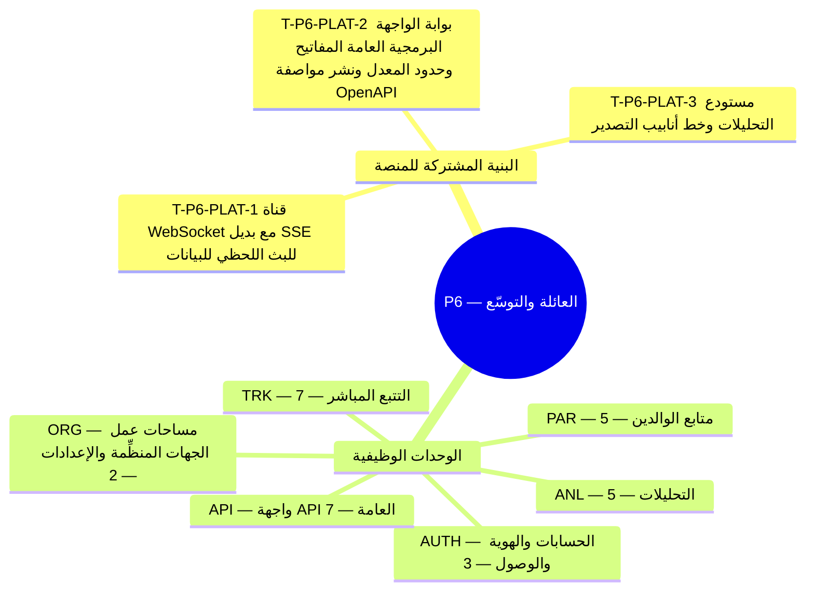

**المحور.** العائلة والتوسّع — التتبع المباشر، ومتابع الوالدين، والتحليلات، والواجهة البرمجية العامة

**تعريف الإتمام.** يرى الوالدان أطفالهما مباشرةً؛ وتحصل الجهات المنظِّمة على التحليلات والتكاملات. *([القسم 3.3 من وثيقة الأعمال](/ar/docs/brd#33-مراحل-التسليم))*

**32 مهمة تسليم** (**29** مهمة وظيفية: **19** إلزامية Must، و**6** مهمة Should، و**4** تحسينية Could + **3** مهام بنية منصة مشتركة) موزعة على **6** وحدات برمجية. تتضمن كل مهمة أدناه المواصفة الكاملة ومخرجات التنفيذ الهندسي ومعايير القبول والجداول المتأثرة وروابط التتبع الشاملة عبر جميع وثائق النظام.

**نموذج البيانات.** تنطبق [اصطلاحات نموذج البيانات](/ar/docs/erd) و[ضوابط الوصول وأمان الصفوف RLS](/ar/docs/erd/acl) و[فهرس القيم المرجعية](/ar/docs/erd/reference) على جميع جداول هذه المرحلة.

<MindmapBlock title="خريطة نطاق المرحلة P6 — العائلة والتوسّع" caption="توزيع مهام البنية المشتركة والوحدات الوظيفية (32 مهمة) وبوابة إغلاق المرحلة P6." trace={{"brd":[{"label":"مراحل التسليم §3.3","href":"/ar/docs/brd#33-مراحل-التسليم"}],"srs":[{"label":"مصفوفة التتبع","href":"/ar/docs/srs/traceability"}],"erd":[{"label":"نموذج البيانات","href":"/ar/docs/erd"}],"plan":[{"label":"المعالم وبوابات المراحل","href":"/ar/docs/plan/milestones"},{"label":"دليل البناء","href":"/ar/docs/plan/build-guide"}],"workflows":[{"label":"تغطية المتطلبات","href":"/ar/docs/workflows/coverage"}],"architecture":[{"label":"معمارية المنصة","href":"/ar/docs/architecture"}],"design":[{"label":"نظام التصميم","href":"/ar/docs/design"}],"system":[{"label":"النظام الشامل","href":"/ar/docs/system/lifecycle"}],"recommendations":[{"label":"حسم القرارات المفتوحة","href":"/ar/docs/recommendations/open-decisions"}]}}>

</MindmapBlock>

## فهرس المهام السريع

| المهمة | الوحدة | المرجع | الأولوية |
|---|---|---|---|
| [T-P6-PLAT-1 — قناة WebSocket مع بديل SSE للبث اللحظي للبيانات](#t-p6-plat-1) | `PLAT` | [البث اللحظي NFR-PERF-06](/ar/docs/srs/quality#81-الأداء-nfr-perf) | Must |
| [T-P6-PLAT-2 — بوابة الواجهة البرمجية العامة: المفاتيح وحدود المعدل ونشر مواصفة OpenAPI](#t-p6-plat-2) | `PLAT` | [حدود المعدل NFR-SEC-13](/ar/docs/srs/quality#82-الأمان-nfr-sec) | Must |
| [T-P6-PLAT-3 — مستودع التحليلات وخط أنابيب التصدير](#t-p6-plat-3) | `PLAT` | [التوسع NFR-SCL](/ar/docs/srs/quality#84-قابلية-التوسع-nfr-scl) | Must |
| [T-P6-AUTH-1 — تسجيل مفاتيح المرور](#t-p6-auth-1) | `AUTH` | [FR-AUTH-11](/ar/docs/srs/requirements/auth#fr-auth-11--تسجيل-مفاتيح-المرور) | Must |
| [T-P6-AUTH-2 — تسجيل الدخول بمفتاح المرور](#t-p6-auth-2) | `AUTH` | [FR-AUTH-12](/ar/docs/srs/requirements/auth#fr-auth-12--تسجيل-الدخول-بمفتاح-المرور) | Must |
| [T-P6-AUTH-3 — إدارة مفاتيح المرور والتعافي من فقدان الجهاز](#t-p6-auth-3) | `AUTH` | [FR-AUTH-13](/ar/docs/srs/requirements/auth#fr-auth-13--إدارة-مفاتيح-المرور-والتعافي-من-فقدان-الجهاز) | Should |
| [T-P6-ORG-1 — نظام CRM وwebhooks](#t-p6-org-1) | `ORG` | [FR-ORG-06](/ar/docs/srs/requirements/org#fr-org-06--نظام-crm-وwebhooks) | Should |
| [T-P6-ORG-2 — هوية بصرية مخصصة](#t-p6-org-2) | `ORG` | [FR-ORG-08](/ar/docs/srs/requirements/org#fr-org-08--هوية-بصرية-مخصصة) | Could |
| [T-P6-TRK-1 — موقع المركبة المباشر](#t-p6-trk-1) | `TRK` | [FR-TRK-01](/ar/docs/srs/requirements/trk#fr-trk-01--موقع-المركبة-المباشر) | Must |
| [T-P6-TRK-2 — جمع الموقع](#t-p6-trk-2) | `TRK` | [FR-TRK-02](/ar/docs/srs/requirements/trk#fr-trk-02--جمع-الموقع) | Must |
| [T-P6-TRK-3 — عرض مركبة الراكب](#t-p6-trk-3) | `TRK` | [FR-TRK-03](/ar/docs/srs/requirements/trk#fr-trk-03--عرض-مركبة-الراكب) | Must |
| [T-P6-TRK-4 — مفتاح تتبع الأبناء لكل رحلة](#t-p6-trk-4) | `TRK` | [FR-TRK-04](/ar/docs/srs/requirements/trk#fr-trk-04--مفتاح-تتبع-الأبناء-لكل-رحلة) | Must |
| [T-P6-TRK-5 — نطاق بيانات التتبع](#t-p6-trk-5) | `TRK` | [FR-TRK-05](/ar/docs/srs/requirements/trk#fr-trk-05--نطاق-بيانات-التتبع) | Must |
| [T-P6-TRK-6 — نهاية التتبع](#t-p6-trk-6) | `TRK` | [FR-TRK-06](/ar/docs/srs/requirements/trk#fr-trk-06--نهاية-التتبع) | Must |
| [T-P6-TRK-7 — لا موقع مباشر للمسافرين](#t-p6-trk-7) | `TRK` | [FR-TRK-07](/ar/docs/srs/requirements/trk#fr-trk-07--لا-موقع-مباشر-للمسافرين) | Must |
| [T-P6-PAR-1 — ربط طفل](#t-p6-par-1) | `PAR` | [FR-PAR-01](/ar/docs/srs/requirements/par#fr-par-01--ربط-طفل) | Must |
| [T-P6-PAR-2 — نطاق عرض الوالد](#t-p6-par-2) | `PAR` | [FR-PAR-02](/ar/docs/srs/requirements/par#fr-par-02--نطاق-عرض-الوالد) | Must |
| [T-P6-PAR-3 — الأهلية](#t-p6-par-3) | `PAR` | [FR-PAR-03](/ar/docs/srs/requirements/par#fr-par-03--الأهلية) | Must |
| [T-P6-PAR-4 — قيود بيانات الأبناء](#t-p6-par-4) | `PAR` | [FR-PAR-05](/ar/docs/srs/requirements/par#fr-par-05--قيود-بيانات-الأبناء) | Must |
| [T-P6-PAR-5 — انتهاء الارتباط بانتهاء الحجز](#t-p6-par-5) | `PAR` | [FR-PAR-06](/ar/docs/srs/requirements/par#fr-par-06--انتهاء-الارتباط-بانتهاء-الحجز) | Must |
| [T-P6-ANL-1 — تحليلات الجهة المنظِّمة](#t-p6-anl-1) | `ANL` | [FR-ANL-01](/ar/docs/srs/requirements/anl#fr-anl-01--تحليلات-الجهة-المنظِّمة) | Must |
| [T-P6-ANL-2 — تحليلات مقدّمي الخدمات](#t-p6-anl-2) | `ANL` | [FR-ANL-02](/ar/docs/srs/requirements/anl#fr-anl-02--تحليلات-مقدّمي-الخدمات) | Should |
| [T-P6-ANL-3 — تحليلات مشرف المنصة](#t-p6-anl-3) | `ANL` | [FR-ANL-03](/ar/docs/srs/requirements/anl#fr-anl-03--تحليلات-مشرف-المنصة) | Must |
| [T-P6-ANL-4 — النطاقات والحداثة والتصدير](#t-p6-anl-4) | `ANL` | [FR-ANL-04](/ar/docs/srs/requirements/anl#fr-anl-04--النطاقات-والحداثة-والتصدير) | Should |
| [T-P6-ANL-5 — الخصوصية في التحليلات](#t-p6-anl-5) | `ANL` | [FR-ANL-05](/ar/docs/srs/requirements/anl#fr-anl-05--الخصوصية-في-التحليلات) | Must |
| [T-P6-API-1 — واجهة API العامة](#t-p6-api-1) | `API` | [FR-API-01](/ar/docs/srs/requirements/api#fr-api-01--واجهة-api-العامة) | Could |
| [T-P6-API-2 — دورة حياة مفاتيح API](#t-p6-api-2) | `API` | [FR-API-02](/ar/docs/srs/requirements/api#fr-api-02--دورة-حياة-مفاتيح-api) | Could |
| [T-P6-API-3 — نقاط نهاية القراءة للموارد](#t-p6-api-3) | `API` | [FR-API-03](/ar/docs/srs/requirements/api#fr-api-03--نقاط-نهاية-القراءة-للموارد) | Could |
| [T-P6-API-4 — اصطلاحات واجهة API](#t-p6-api-4) | `API` | [FR-API-04](/ar/docs/srs/requirements/api#fr-api-04--اصطلاحات-واجهة-api) | Must |
| [T-P6-API-5 — نشر مواصفة OpenAPI](#t-p6-api-5) | `API` | [FR-API-05](/ar/docs/srs/requirements/api#fr-api-05--نشر-مواصفة-openapi) | Should |
| [T-P6-API-6 — سلوك تحديد المعدل](#t-p6-api-6) | `API` | [FR-API-06](/ar/docs/srs/requirements/api#fr-api-06--سلوك-تحديد-المعدل) | Should |
| [T-P6-API-7 — تماثل عقد webhook](#t-p6-api-7) | `API` | [FR-API-07](/ar/docs/srs/requirements/api#fr-api-07--تماثل-عقد-webhook) | Must |

## عابرة للمجالات

تُبنى مهام البنية المشتركة هذه بالتوازي مع مهام الوحدات وتُشترط لاجتياز بوابة إغلاق المرحلة.

### T-P6-PLAT-1 — قناة WebSocket مع بديل SSE للبث اللحظي للبيانات

<TaskCard id="T-P6-PLAT-1" title="قناة WebSocket مع بديل SSE للبث اللحظي للبيانات" phase="P6" module="PLAT" priority="Must" kind="platform" surfaces={["بوابة البث اللحظي","خادم Redis Pub/Sub","متابع الوالدين","لوحة الجهة المنظِّمة"]} tables={["child_links","trip_vehicles"]} trace={{"brd":[{"label":"المرحلة P6","href":"/ar/docs/brd#33-مراحل-التسليم"}],"srs":[{"label":"البث اللحظي NFR-PERF-06","href":"/ar/docs/srs/quality#81-الأداء-nfr-perf"}],"erd":[{"label":"العمليات","href":"/ar/docs/erd/domains/operations"},{"label":"الأسطول والرحلات","href":"/ar/docs/erd/domains/fleet-and-trips"},{"label":"child_links","href":"/ar/docs/erd/domains/operations#child_links","detail":"table"},{"label":"trip_vehicles","href":"/ar/docs/erd/domains/fleet-and-trips#trip_vehicles","detail":"table"},{"label":"أمان الصفوف ACL","href":"/ar/docs/erd/acl"}],"plan":[{"label":"المعالم","href":"/ar/docs/plan/milestones"},{"label":"استراتيجية الاختبار","href":"/ar/docs/plan/testing"}],"workflows":[{"label":"trip-day","href":"/ar/docs/workflows/trip-day"}],"userFlows":[{"label":"تدفقات الأدوار","href":"/ar/docs/user-flows"}],"architecture":[{"label":"المعمارية","href":"/ar/docs/architecture#سياق-النظام"}],"design":[{"label":"نظام التصميم","href":"/ar/docs/design#متابع-الوالدين"}],"system":[{"label":"STAGE-07","href":"/ar/docs/system/lifecycle#stage-07"}],"recommendations":[{"label":"REC-TRK-07","href":"/ar/docs/recommendations/architecture-and-ops#rec-trk-07"}]}}>

**نطاق البنية المشتركة.** توسيع بوابة البث اللحظي الموثَّقة عبر WebSocket مع التحول التلقائي إلى SSE عبر Redis Pub/Sub لتحديثات المقاعد ولوحة العمليات وتتبع الوالدين بأقل من 500 مللي ثانية.

**مخرجات التنفيذ الهندسي.**

- تفويض دقيق عند الاشتراك في كل قناة يتحقق من صلاحية المستأجر أو أهلية الوالد المرتبط ويقطع البث فور انتهاء الرحلة.
- جدول TimescaleDB لإحداثيات التتبع مع سياسة حذف تلقائي للنقاط الخام بعد 90 يومًا.

**معايير القبول والتحقق.**

- Given مسافر عادي يحاول الاشتراك في قناة موقع المركبة، when يتحقق الخادم من الصلاحية، then يُرفض الاشتراك فورًا.
- Given شبكة تحجب بروتوكول WebSocket، when يتصل التطبيق، then يتحول تلقائيًا إلى قناة SSE خلال ثانيتين.

</TaskCard>

### T-P6-PLAT-2 — بوابة الواجهة البرمجية العامة: المفاتيح وحدود المعدل ونشر مواصفة OpenAPI

<TaskCard id="T-P6-PLAT-2" title="بوابة الواجهة البرمجية العامة: المفاتيح وحدود المعدل ونشر مواصفة OpenAPI" phase="P6" module="PLAT" priority="Must" kind="platform" surfaces={["الواجهة البرمجية العامة","لوحة الجهة المنظِّمة"]} tables={[]} trace={{"brd":[{"label":"المرحلة P6","href":"/ar/docs/brd#33-مراحل-التسليم"}],"srs":[{"label":"حدود المعدل NFR-SEC-13","href":"/ar/docs/srs/quality#82-الأمان-nfr-sec"}],"erd":[{"label":"الجهات المنظِّمة","href":"/ar/docs/erd/domains/organizations"},{"label":"المنصة","href":"/ar/docs/erd/domains/platform"},{"label":"أمان الصفوف ACL","href":"/ar/docs/erd/acl"}],"plan":[{"label":"المعالم","href":"/ar/docs/plan/milestones"},{"label":"استراتيجية الاختبار","href":"/ar/docs/plan/testing"}],"workflows":[{"label":"scheduled-jobs","href":"/ar/docs/workflows/scheduled-jobs"}],"userFlows":[{"label":"تدفقات الأدوار","href":"/ar/docs/user-flows"}],"architecture":[{"label":"المعمارية","href":"/ar/docs/architecture#التكاملات"}],"design":[{"label":"نظام التصميم","href":"/ar/docs/design#لوحة-الجهة-المنظِّمة"}],"system":[{"label":"STAGE-08","href":"/ar/docs/system/lifecycle#stage-08"}],"recommendations":[{"label":"REC-ARCH-01","href":"/ar/docs/recommendations/architecture-and-ops#rec-arch-01"}]}}>

**نطاق البنية المشتركة.** إتاحة بوابة الشركاء البرمجية بمفاتيح مستأجرين مجزَّأة عبر SHA-256 ومحددات معدل في Redis وترقيم بالمؤشر ونشر توثيق OpenAPI 3.1 آليًا.

**مخرجات التنفيذ الهندسي.**

- واجهة ونقاط نهاية لإدارة دورة حياة مفاتيح API (إنشاء، إظهار لمرة واحدة، تدوير بمهلة 24 ساعة، وإلغاء فوري).
- فحص آلي يضمن تطابق مخطط OpenAPI المنشور مع مظروف الويب هوك الصادر.

**معايير القبول والتحقق.**

- Given تجاوز جهة منظِّمة لحصة طلبات API المسموحة، when تستدعي الواجهة العامة، then يعود رمز 429 مع ترويسة وقت إعادة المحاولة.

</TaskCard>

### T-P6-PLAT-3 — مستودع التحليلات وخط أنابيب التصدير

<TaskCard id="T-P6-PLAT-3" title="مستودع التحليلات وخط أنابيب التصدير" phase="P6" module="PLAT" priority="Must" kind="platform" surfaces={["النسخ القرائية","عمليات الخلفية","لوحة الجهة المنظِّمة","لوحة مشرف المنصة"]} tables={["bookings","trips"]} trace={{"brd":[{"label":"المرحلة P6","href":"/ar/docs/brd#33-مراحل-التسليم"}],"srs":[{"label":"التوسع NFR-SCL","href":"/ar/docs/srs/quality#84-قابلية-التوسع-nfr-scl"}],"erd":[{"label":"المنصة","href":"/ar/docs/erd/domains/platform"},{"label":"المالية","href":"/ar/docs/erd/domains/finance"},{"label":"bookings","href":"/ar/docs/erd/domains/booking-and-payment#bookings","detail":"table"},{"label":"trips","href":"/ar/docs/erd/domains/fleet-and-trips#trips","detail":"table"},{"label":"أمان الصفوف ACL","href":"/ar/docs/erd/acl"}],"plan":[{"label":"المعالم","href":"/ar/docs/plan/milestones"},{"label":"استراتيجية الاختبار","href":"/ar/docs/plan/testing"}],"workflows":[{"label":"scheduled-jobs","href":"/ar/docs/workflows/scheduled-jobs"}],"userFlows":[{"label":"تدفقات الأدوار","href":"/ar/docs/user-flows"}],"architecture":[{"label":"المعمارية","href":"/ar/docs/architecture#معمارية-البيانات"}],"design":[{"label":"نظام التصميم","href":"/ar/docs/design#لوحة-الجهة-المنظِّمة"}],"system":[{"label":"STAGE-08","href":"/ar/docs/system/lifecycle#stage-08"}],"recommendations":[{"label":"REC-DATA-02","href":"/ar/docs/recommendations/architecture-and-ops#rec-data-02"}]}}>

**نطاق البنية المشتركة.** بناء تجميعات تحليلية مستمرة على النسخ القرائية لقاعدة البيانات بتأخر لا يتجاوز 5 دقائق وعمال تصدير غير متزامنين دون إجهاد قاعدة البيانات الأساسية ودون كشف بيانات الأطفال.

**مخرجات التنفيذ الهندسي.**

- عروض تجميعية تُحدَّث كل 5 دقائق أو أقل على النسخ القرائية مع توجيه الاستعلامات المعزولة لكل مستأجر.
- عامل تصدير غير متزامن ينشئ ملفات تنزيل موقَّعة مؤقتة تخضع لسياسات الاحتفاظ.

**معايير القبول والتحقق.**

- Given طلب تصدير تحليلات ضخم لمدة 12 شهرًا، when يعمل في الخلفية، then لا يتأثر زمن استجابة الحجوزات ولا تظهر أي بيانات للقُصَّر.

</TaskCard>

## AUTH — الحسابات والهوية والوصول

**نموذج البيانات.** [الهوية والوصول](/ar/docs/erd/domains/identity-and-access) — النطاقات والجداول التي تقرؤها وتكتبها متطلبات هذه الوحدة.

### T-P6-AUTH-1 — تسجيل مفاتيح المرور

<TaskCard id="T-P6-AUTH-1" title="تسجيل مفاتيح المرور" phase="P6" module="AUTH" priority="Must" surfaces={["واجهة الزوار","تطبيق المسافر","لوحة الجهة المنظِّمة","لوحة مشرف المنصة"]} tables={["user_roles"]} trace={{"brd":[{"label":"BR-AUTH-09","href":"/ar/docs/brd/requirements#61-الحسابات-والوصول-auth","detail":"P6"},{"label":"BRL-20","href":"/ar/docs/brd/requirements#7-قواعد-العمل","detail":"قاعدة"}],"srs":[{"label":"FR-AUTH-11","href":"/ar/docs/srs/requirements/auth#fr-auth-11--تسجيل-مفاتيح-المرور","detail":"Must"},{"label":"معايير الجودة NFR","href":"/ar/docs/srs/quality"}],"erd":[{"label":"الهوية والوصول","href":"/ar/docs/erd/domains/identity-and-access"},{"label":"user_roles","href":"/ar/docs/erd/domains/identity-and-access#user_roles","detail":"table"}],"plan":[{"label":"معلم P6","href":"/ar/docs/plan/milestones"},{"label":"استراتيجية الاختبار","href":"/ar/docs/plan/testing"}],"workflows":[{"label":"scheduled-jobs","href":"/ar/docs/workflows/scheduled-jobs"}],"userFlows":[{"label":"UF-SHR-17","href":"/ar/docs/user-flows/shared#uf-shr-17-تسجيل-مفاتيح-المرور-وإدارتها-والتعافي-من-فقدان-الجهاز"}],"architecture":[{"label":"المعمارية","href":"/ar/docs/architecture#نموذج-الخدمات"}],"design":[{"label":"الواجهات والتصميم","href":"/ar/docs/design#النماذج-والتحقق"}],"system":[{"label":"STAGE-01","href":"/ar/docs/system/lifecycle#stage-01"}],"recommendations":[{"label":"REC-SEC-09","href":"/ar/docs/recommendations/architecture-and-ops#rec-sec-09"}]}}>

**المواصفة الوظيفية ([FR-AUTH-11](/ar/docs/srs/requirements/auth#fr-auth-11--تسجيل-مفاتيح-المرور)).** يسجِّل المستخدمون مفاتيح المرور (WebAuthn) في حساباتهم ثم لاحقًا من إعدادات الحساب. يتطلب أول مفتاح مرور تحققًا برمز لمرة واحدة وفق [BRL-20](/ar/docs/brd/requirements#7-قواعد-العمل) قبل تخزين بيانات الاعتماد. تخزن المنصة معرّف بيانات الاعتماد والمفتاح العام فقط؛ ولا يغادر المفتاح الخاص الجهاز أبدًا. [OPEN: أي منصات تطرح تسجيل مفاتيح المرور أولًا.](/ar/docs/recommendations/open-decisions#open-04)

**مخرجات التنفيذ الهندسي.**

- **منطق النطاق والواجهة البرمجية:** تنفيذ معالجات المصادقة وتدوير الجلسات والرموز وحدود الإقفال وتبديل سياق الدور والمستأجر مع التسجيل الكامل في سجل التدقيق.
- **التخزين وأمان مستوى الصفوف:** عمليات القراءة والكتابة على الجداول `user_roles` مع الالتزام بالأعمدة الأساسية والحذف الناعم وضوابط الوصول ([ACL](/ar/docs/erd/acl)).
- **التحقق والرصد:** اختبارات آلية تغطي سيناريوهات قبول `FR-AUTH-11` وفق [استراتيجية الاختبار](/ar/docs/plan/testing) مع تسجيل الأحداث والآثار.

**معايير القبول.**

- Given حساب موثَّق، when يسجِّل المستخدم مفتاح مرور، then تُخزَّن بيانات الاعتماد وتظهر في الإعدادات.
- Given بيانات تواصل غير موثَّقة، when يحاول المستخدم تسجيل أول مفتاح مرور، then ينتظر التسجيل رمزًا لمرة واحدة وفق [BRL-20](/ar/docs/brd/requirements#7-قواعد-العمل).
- Given مفتاح مرور مسجَّل، when يسجِّل المستخدم مفتاحًا ثانيًا من الإعدادات، then يُضاف دون تكرار الرمز لمرة واحدة.

**التتبع التجاري وقواعد العمل الحاكمة.**

- [BR-AUTH-09](/ar/docs/brd/requirements#61-الحسابات-والوصول-auth): يسجِّل المستخدمون مفاتيح مرور (WebAuthn) في حساباتهم ومن إعدادات الحساب. [OPEN: أي منصات تطرح تسجيل مفاتيح المرور أولًا.]
- [BRL-20](/ar/docs/brd/requirements#7-قواعد-العمل): تنتهي صلاحية رموز التحقق بعد 5 دقائق. وبعد 5 رموز خاطئة يتوقف التحقق لمدة 15 دقيقة. ولا تعيد إعادةُ الإرسال ضبطَ عداد الرموز الخاطئة؛ وبعد 3 محاولات توصيل فاشلة يُرسل الرمز عبر القناة الأخرى (D-58, D-59).

</TaskCard>

### T-P6-AUTH-2 — تسجيل الدخول بمفتاح المرور

<TaskCard id="T-P6-AUTH-2" title="تسجيل الدخول بمفتاح المرور" phase="P6" module="AUTH" priority="Must" surfaces={["واجهة الزوار","تطبيق المسافر","لوحة الجهة المنظِّمة","لوحة مشرف المنصة"]} tables={["user_roles"]} trace={{"brd":[{"label":"BR-AUTH-10","href":"/ar/docs/brd/requirements#61-الحسابات-والوصول-auth","detail":"P6"}],"srs":[{"label":"FR-AUTH-12","href":"/ar/docs/srs/requirements/auth#fr-auth-12--تسجيل-الدخول-بمفتاح-المرور","detail":"Must"},{"label":"معايير الجودة NFR","href":"/ar/docs/srs/quality"}],"erd":[{"label":"الهوية والوصول","href":"/ar/docs/erd/domains/identity-and-access"},{"label":"user_roles","href":"/ar/docs/erd/domains/identity-and-access#user_roles","detail":"table"}],"plan":[{"label":"معلم P6","href":"/ar/docs/plan/milestones"},{"label":"استراتيجية الاختبار","href":"/ar/docs/plan/testing"}],"workflows":[{"label":"scheduled-jobs","href":"/ar/docs/workflows/scheduled-jobs"}],"userFlows":[{"label":"UF-SHR-03","href":"/ar/docs/user-flows/shared#uf-shr-03-تسجيل-الدخول"},{"label":"UF-SHR-17","href":"/ar/docs/user-flows/shared#uf-shr-17-تسجيل-مفاتيح-المرور-وإدارتها-والتعافي-من-فقدان-الجهاز"}],"architecture":[{"label":"المعمارية","href":"/ar/docs/architecture#نموذج-الخدمات"}],"design":[{"label":"الواجهات والتصميم","href":"/ar/docs/design#النماذج-والتحقق"}],"system":[{"label":"STAGE-01","href":"/ar/docs/system/lifecycle#stage-01"}],"recommendations":[{"label":"REC-SEC-09","href":"/ar/docs/recommendations/architecture-and-ops#rec-sec-09"}]}}>

**المواصفة الوظيفية ([FR-AUTH-12](/ar/docs/srs/requirements/auth#fr-auth-12--تسجيل-الدخول-بمفتاح-المرور)).** يسجِّل المستخدمون الدخول بمفتاح مرور مسجَّل كبديل عن طريقة الدخول الخاصة بدورهم (كلمة المرور أو الرمز لمرة واحدة). يتحقق الخادم من تحدي الجلسة وأصلها في الطقوس، ويقارن التوكيد بالمفتاح العام المخزَّن، ويرفض بيانات اعتماد لا يتجاوز عدّادها آخر قيمة مرصودة. ولا يمكن لبيانات اعتماد ملغاة تسجيل الدخول.

**مخرجات التنفيذ الهندسي.**

- **منطق النطاق والواجهة البرمجية:** تنفيذ معالجات المصادقة وتدوير الجلسات والرموز وحدود الإقفال وتبديل سياق الدور والمستأجر مع التسجيل الكامل في سجل التدقيق.
- **التخزين وأمان مستوى الصفوف:** عمليات القراءة والكتابة على الجداول `user_roles` مع الالتزام بالأعمدة الأساسية والحذف الناعم وضوابط الوصول ([ACL](/ar/docs/erd/acl)).
- **التحقق والرصد:** اختبارات آلية تغطي سيناريوهات قبول `FR-AUTH-12` وفق [استراتيجية الاختبار](/ar/docs/plan/testing) مع تسجيل الأحداث والآثار.

**معايير القبول.**

- Given مفتاح مرور مسجَّل، when يسجِّل المستخدم الدخول به، then تُفتح الجلسة كتسجيل دخول بكلمة المرور.
- Given توكيد لا يتجاوز عدّاده آخر قيمة مرصودة، when يتحقق منه الخادم، then تُرفض بيانات الاعتماد بوصفها مُستنسخة ويُطلب وسيلة أخرى.
- Given مفتاح مرور ملغى، when تُقدَّم بيانات اعتماده، then يُرفض تسجيل الدخول.

**التتبع التجاري وقواعد العمل الحاكمة.**

- [BR-AUTH-10](/ar/docs/brd/requirements#61-الحسابات-والوصول-auth): يسجِّل المستخدمون الدخول بمفتاح مرور مسجَّل كبديل عن طريقة الدخول الخاصة بدورهم (كلمة المرور أو الرمز لمرة واحدة).

</TaskCard>

### T-P6-AUTH-3 — إدارة مفاتيح المرور والتعافي من فقدان الجهاز

<TaskCard id="T-P6-AUTH-3" title="إدارة مفاتيح المرور والتعافي من فقدان الجهاز" phase="P6" module="AUTH" priority="Should" surfaces={["واجهة الزوار","تطبيق المسافر","لوحة الجهة المنظِّمة","لوحة مشرف المنصة"]} tables={["user_roles"]} trace={{"brd":[{"label":"BR-AUTH-11","href":"/ar/docs/brd/requirements#61-الحسابات-والوصول-auth","detail":"P6"},{"label":"BRL-20","href":"/ar/docs/brd/requirements#7-قواعد-العمل","detail":"قاعدة"}],"srs":[{"label":"FR-AUTH-13","href":"/ar/docs/srs/requirements/auth#fr-auth-13--إدارة-مفاتيح-المرور-والتعافي-من-فقدان-الجهاز","detail":"Should"},{"label":"معايير الجودة NFR","href":"/ar/docs/srs/quality"}],"erd":[{"label":"الهوية والوصول","href":"/ar/docs/erd/domains/identity-and-access"},{"label":"user_roles","href":"/ar/docs/erd/domains/identity-and-access#user_roles","detail":"table"}],"plan":[{"label":"معلم P6","href":"/ar/docs/plan/milestones"},{"label":"استراتيجية الاختبار","href":"/ar/docs/plan/testing"}],"workflows":[{"label":"scheduled-jobs","href":"/ar/docs/workflows/scheduled-jobs"}],"userFlows":[{"label":"UF-SHR-17","href":"/ar/docs/user-flows/shared#uf-shr-17-تسجيل-مفاتيح-المرور-وإدارتها-والتعافي-من-فقدان-الجهاز"}],"architecture":[{"label":"المعمارية","href":"/ar/docs/architecture#نموذج-الخدمات"}],"design":[{"label":"الواجهات والتصميم","href":"/ar/docs/design#النماذج-والتحقق"}],"system":[{"label":"STAGE-01","href":"/ar/docs/system/lifecycle#stage-01"}],"recommendations":[{"label":"REC-SEC-09","href":"/ar/docs/recommendations/architecture-and-ops#rec-sec-09"}]}}>

**المواصفة الوظيفية ([FR-AUTH-13](/ar/docs/srs/requirements/auth#fr-auth-13--إدارة-مفاتيح-المرور-والتعافي-من-فقدان-الجهاز)).** يسرد المستخدمون مفاتيح مرورهم ويلغونها من إعدادات الحساب في أي جلسة نشطة. تتطلب كل إلغاء إعادة تحقق برمز لمرة واحدة وفق [BRL-20](/ar/docs/brd/requirements#7-قواعد-العمل). والمستخدم الذي فقد الجهاز الحامل للمفتاح يلغي مفتاحه من جلسة نشطة أخرى ويسجِّل مفتاحًا جديدًا بعد إعادة التحقق. [OPEN: أي منصات وواجهات تعرض إدارة مفاتيح المرور والتعافي منها.](/ar/docs/recommendations/open-decisions#open-05)

**مخرجات التنفيذ الهندسي.**

- **منطق النطاق والواجهة البرمجية:** تنفيذ معالجات المصادقة وتدوير الجلسات والرموز وحدود الإقفال وتبديل سياق الدور والمستأجر مع التسجيل الكامل في سجل التدقيق.
- **التخزين وأمان مستوى الصفوف:** عمليات القراءة والكتابة على الجداول `user_roles` مع الالتزام بالأعمدة الأساسية والحذف الناعم وضوابط الوصول ([ACL](/ar/docs/erd/acl)).
- **التحقق والرصد:** اختبارات آلية تغطي سيناريوهات قبول `FR-AUTH-13` وفق [استراتيجية الاختبار](/ar/docs/plan/testing) مع تسجيل الأحداث والآثار.

**معايير القبول.**

- Given جلستان نشطتان، when يلغي المستخدم مفتاحًا من الثانية، then لا يمكن لبيانات الاعتماد الملغاة تسجيل الدخول في أي مكان.
- Given طلب إلغاء دون رمز لمرة واحدة، when يُقدَّم، then يُرفض الإلغاء.
- Given جهاز مفقود يحمل آخر مفتاح مرور، when يعيد المستخدم التحقق ويسجِّل مفتاحًا جديدًا من جلسة أخرى، then تُزال بيانات الاعتماد القديمة ويسجِّل المفتاح الجديد الدخول.

**التتبع التجاري وقواعد العمل الحاكمة.**

- [BR-AUTH-11](/ar/docs/brd/requirements#61-الحسابات-والوصول-auth): يتعافى المستخدم الذي فقد جهازه بإزالة المفتاح المخزَّن وإعادة التحقق من هويته قبل تسجيل مفتاح جديد.
- [BRL-20](/ar/docs/brd/requirements#7-قواعد-العمل): تنتهي صلاحية رموز التحقق بعد 5 دقائق. وبعد 5 رموز خاطئة يتوقف التحقق لمدة 15 دقيقة. ولا تعيد إعادةُ الإرسال ضبطَ عداد الرموز الخاطئة؛ وبعد 3 محاولات توصيل فاشلة يُرسل الرمز عبر القناة الأخرى (D-58, D-59).

</TaskCard>

## ORG — مساحات عمل الجهات المنظِّمة والإعدادات

**نموذج البيانات.** [المالية](/ar/docs/erd/domains/finance), [الجهات المنظِّمة](/ar/docs/erd/domains/organizations) — النطاقات والجداول التي تقرؤها وتكتبها متطلبات هذه الوحدة.

### T-P6-ORG-1 — نظام CRM وwebhooks

<TaskCard id="T-P6-ORG-1" title="نظام CRM وwebhooks" phase="P6" module="ORG" priority="Should" surfaces={["لوحة الجهة المنظِّمة","لوحة مشرف المنصة"]} tables={["organizations","organization_members"]} trace={{"brd":[{"label":"BR-ORG-06","href":"/ar/docs/brd/requirements#63-الجهات-المنظِّمة-والموظفون-org","detail":"P6"}],"srs":[{"label":"FR-ORG-06","href":"/ar/docs/srs/requirements/org#fr-org-06--نظام-crm-وwebhooks","detail":"Should"},{"label":"معايير الجودة NFR","href":"/ar/docs/srs/quality"}],"erd":[{"label":"المالية","href":"/ar/docs/erd/domains/finance"},{"label":"الجهات المنظِّمة","href":"/ar/docs/erd/domains/organizations"},{"label":"organizations","href":"/ar/docs/erd/domains/organizations#organizations","detail":"table"},{"label":"organization_members","href":"/ar/docs/erd/domains/organizations#organization_members","detail":"table"}],"plan":[{"label":"معلم P6","href":"/ar/docs/plan/milestones"},{"label":"استراتيجية الاختبار","href":"/ar/docs/plan/testing"}],"workflows":[{"label":"دليل المهام المجدولة","href":"/ar/docs/workflows/scheduled-jobs#العدادات-التنازلية-مؤقّتات-على-مستوى-كل-سجل"}],"userFlows":[{"label":"UF-ORG-17","href":"/ar/docs/user-flows/organization#uf-org-17-crm-وwebhooks"},{"label":"UF-ORG-24","href":"/ar/docs/user-flows/organization#uf-org-24-استخدام-api-العام"}],"architecture":[{"label":"المعمارية","href":"/ar/docs/architecture#معمارية-البيانات"}],"design":[{"label":"الواجهات والتصميم","href":"/ar/docs/design#لوحة-الجهة-المنظِّمة"}],"system":[{"label":"STAGE-02","href":"/ar/docs/system/lifecycle#stage-02"}],"recommendations":[{"label":"REC-DATA-02","href":"/ar/docs/recommendations/architecture-and-ops#rec-data-02"}]}}>

**المواصفة الوظيفية ([FR-ORG-06](/ar/docs/srs/requirements/org#fr-org-06--نظام-crm-وwebhooks)).** تربط الجهة المنظِّمة نظام CRM وتسجّل نقاط نهاية webhook لأحداث نشر الرحلة، وإلغاء الرحلة، وتأكيد الحجز، وإلغاء الحجز، وتسجيل الحضور، وتسجيل المغادرة. وتكون عمليات التسليم موقَّعة (COM-04)، وتُعاد محاولتها 5 مرات على مدى 24 ساعة، ثم يُرسَل بريد إلكتروني إلى المالك؛ ويمكن إعادة إرسال عمليات التسليم لمدة 7 أيام؛ ويظل المفتاح القديم صالحًا 24 ساعة بعد تدوير المفتاح السري. ولا تنطبق أي قيود خطة (D-62 إلى D-64). وعدد نقاط النهاية لكل خطة هو [OPEN: D-65]. وأنظمة CRM المستهدفة هي [OPEN: [OD-18](/ar/docs/brd/compliance#11-القرارات-المفتوحة)].

**مخرجات التنفيذ الهندسي.**

- **منطق النطاق والواجهة البرمجية:** فرض عزل المستأجر عبر سياسات RLS في PostgreSQL وتهيئة مساحة العمل فور الاعتماد وحدود الموردين التابعين للجهة وروابط الويب الموقَّعة.
- **التخزين وأمان مستوى الصفوف:** عمليات القراءة والكتابة على الجداول `organizations`، `organization_members` مع الالتزام بالأعمدة الأساسية والحذف الناعم وضوابط الوصول ([ACL](/ar/docs/erd/acl)).
- **التحقق والرصد:** اختبارات آلية تغطي سيناريوهات قبول `FR-ORG-06` وفق [استراتيجية الاختبار](/ar/docs/plan/testing) مع تسجيل الأحداث والآثار.

**معايير القبول.**

- بافتراض نقطة نهاية مشتركة في حدث تأكيد الحجز، عند تأكيد حجز، تُسلَّم رسالة موقَّعة تحمل معرّف حدث.
- بافتراض خمس محاولات فاشلة على مدى 24 ساعة، عند فشل المحاولة الأخيرة، يُرسَل بريد إلكتروني إلى المالك وتظهر عملية التسليم بحالة فاشلة مع خيار إعادة الإرسال.

**التتبع التجاري وقواعد العمل الحاكمة.**

- [BR-ORG-06](/ar/docs/brd/requirements#63-الجهات-المنظِّمة-والموظفون-org): يمكن للجهات المنظِّمة ربط نظام CRM وإرسال أحداث الرحلات والحجوزات وتسجيل الحضور إلى تطبيقات خارجية عبر webhooks موقَّعة.

</TaskCard>

### T-P6-ORG-2 — هوية بصرية مخصصة

<TaskCard id="T-P6-ORG-2" title="هوية بصرية مخصصة" phase="P6" module="ORG" priority="Could" surfaces={["لوحة الجهة المنظِّمة","لوحة مشرف المنصة"]} tables={["organizations"]} trace={{"brd":[{"label":"BR-ORG-08","href":"/ar/docs/brd/requirements#63-الجهات-المنظِّمة-والموظفون-org","detail":"P6"}],"srs":[{"label":"FR-ORG-08","href":"/ar/docs/srs/requirements/org#fr-org-08--هوية-بصرية-مخصصة","detail":"Could"},{"label":"معايير الجودة NFR","href":"/ar/docs/srs/quality"}],"erd":[{"label":"المالية","href":"/ar/docs/erd/domains/finance"},{"label":"الجهات المنظِّمة","href":"/ar/docs/erd/domains/organizations"},{"label":"organizations","href":"/ar/docs/erd/domains/organizations#organizations","detail":"table"}],"plan":[{"label":"معلم P6","href":"/ar/docs/plan/milestones"},{"label":"استراتيجية الاختبار","href":"/ar/docs/plan/testing"}],"workflows":[{"label":"applications","href":"/ar/docs/workflows/applications"}],"userFlows":[{"label":"UF-ORG-20","href":"/ar/docs/user-flows/organization#uf-org-20-الهوية-البصرية-enterprise"}],"architecture":[{"label":"المعمارية","href":"/ar/docs/architecture#معمارية-البيانات"}],"design":[{"label":"الواجهات والتصميم","href":"/ar/docs/design#لوحة-الجهة-المنظِّمة"}],"system":[{"label":"STAGE-02","href":"/ar/docs/system/lifecycle#stage-02"}],"recommendations":[{"label":"REC-DATA-02","href":"/ar/docs/recommendations/architecture-and-ops#rec-data-02"}]}}>

**المواصفة الوظيفية ([FR-ORG-08](/ar/docs/srs/requirements/org#fr-org-08--هوية-بصرية-مخصصة)).** ترفع الجهات المنظِّمة من فئة Enterprise شعارًا وألوان علامة تجارية تُطبَّق على صفحات رحلاتها العامة ورسائلها الإلكترونية وملفات PDF الخاصة بالفواتير.

**مخرجات التنفيذ الهندسي.**

- **منطق النطاق والواجهة البرمجية:** فرض عزل المستأجر عبر سياسات RLS في PostgreSQL وتهيئة مساحة العمل فور الاعتماد وحدود الموردين التابعين للجهة وروابط الويب الموقَّعة.
- **التخزين وأمان مستوى الصفوف:** عمليات القراءة والكتابة على الجداول `organizations` مع الالتزام بالأعمدة الأساسية والحذف الناعم وضوابط الوصول ([ACL](/ar/docs/erd/acl)).
- **التحقق والرصد:** اختبارات آلية تغطي سيناريوهات قبول `FR-ORG-08` وفق [استراتيجية الاختبار](/ar/docs/plan/testing) مع تسجيل الأحداث والآثار.

**معايير القبول.**

- بافتراض جهة منظِّمة على خطة Growth، عند فتح إعدادات الهوية البصرية، تكون مقفلة مع مطالبة بالترقية.

**التتبع التجاري وقواعد العمل الحاكمة.**

- [BR-ORG-08](/ar/docs/brd/requirements#63-الجهات-المنظِّمة-والموظفون-org): يمكن للجهات المنظِّمة من فئة Enterprise تطبيق هوية بصرية مخصصة على صفحات الرحلات الموجهة للمسافرين والرسائل الإلكترونية والفواتير.

</TaskCard>

## TRK — التتبع المباشر

**نموذج البيانات.** [الأسطول والرحلات](/ar/docs/erd/domains/fleet-and-trips), [العمليات](/ar/docs/erd/domains/operations) — النطاقات والجداول التي تقرؤها وتكتبها متطلبات هذه الوحدة.

### T-P6-TRK-1 — موقع المركبة المباشر

<TaskCard id="T-P6-TRK-1" title="موقع المركبة المباشر" phase="P6" module="TRK" priority="Must" surfaces={["تطبيق السائق","لوحة الجهة المنظِّمة","متابع الوالدين","لوحة مشرف المنصة"]} tables={["checkin_events"]} trace={{"brd":[{"label":"BR-TRK-01","href":"/ar/docs/brd/requirements#69-تسجيل-الحضور-والمشرفون-والتتبع-chk-mod-trk","detail":"P6"}],"srs":[{"label":"FR-TRK-01","href":"/ar/docs/srs/requirements/trk#fr-trk-01--موقع-المركبة-المباشر","detail":"Must"},{"label":"معايير الجودة NFR","href":"/ar/docs/srs/quality"}],"erd":[{"label":"الأسطول والرحلات","href":"/ar/docs/erd/domains/fleet-and-trips"},{"label":"العمليات","href":"/ar/docs/erd/domains/operations"},{"label":"checkin_events","href":"/ar/docs/erd/domains/operations#checkin_events","detail":"table"}],"plan":[{"label":"معلم P6","href":"/ar/docs/plan/milestones"},{"label":"استراتيجية الاختبار","href":"/ar/docs/plan/testing"}],"workflows":[{"label":"دليل المهام المجدولة","href":"/ar/docs/workflows/scheduled-jobs#خطوط-المعالجة-المستمرة"},{"label":"يوم الرحلة","href":"/ar/docs/workflows/trip-day#المؤقّتات-والقواعد"},{"label":"يوم الرحلة","href":"/ar/docs/workflows/trip-day#قصص-المستخدم"}],"userFlows":[{"label":"UF-ORG-12","href":"/ar/docs/user-flows/organization#uf-org-12-العمليات-المباشرة"}],"architecture":[{"label":"المعمارية","href":"/ar/docs/architecture#معمارية-البيانات"}],"design":[{"label":"الواجهات والتصميم","href":"/ar/docs/design#متابع-الوالدين"}],"system":[{"label":"STAGE-07","href":"/ar/docs/system/lifecycle#stage-07"}],"recommendations":[{"label":"REC-TRK-07","href":"/ar/docs/recommendations/architecture-and-ops#rec-trk-07"}]}}>

**المواصفة الوظيفية ([FR-TRK-01](/ar/docs/srs/requirements/trk#fr-trk-01--موقع-المركبة-المباشر)).** يرى موظفو العمليات الذين يملكون وصولًا إلى الرحلة الموقع المباشر لكل مركبة، محدَّثًا خلال 500 مللي ثانية من وصوله.

**مخرجات التنفيذ الهندسي.**

- **منطق النطاق والواجهة البرمجية:** بناء استقبال إحداثيات GPS في جداول TimescaleDB والبث اللحظي عبر WebSocket/SSE وحجب الموقع عن المسافرين العاديين وإيقافه تلقائيًا.
- **التخزين وأمان مستوى الصفوف:** عمليات القراءة والكتابة على الجداول `checkin_events` مع الالتزام بالأعمدة الأساسية والحذف الناعم وضوابط الوصول ([ACL](/ar/docs/erd/acl)).
- **التحقق والرصد:** اختبارات آلية تغطي سيناريوهات قبول `FR-TRK-01` وفق [استراتيجية الاختبار](/ar/docs/plan/testing) مع تسجيل الأحداث والآثار.

**معايير القبول.**

- بافتراض نقطة GPS جديدة للمركبة 2، عندما تكون الخريطة مفتوحة، تتحرك المركبة 2 خلال 500 مللي ثانية.

**التتبع التجاري وقواعد العمل الحاكمة.**

- [BR-TRK-01](/ar/docs/brd/requirements#69-تسجيل-الحضور-والمشرفون-والتتبع-chk-mod-trk): يرى موظفو العمليات موقع كل مركبة مباشرة وفي أي مركبة يوجد كل مسافر. ولا يرى المسافرون موقع المركبة المباشر أبدًا ([BRL-29](/ar/docs/brd/requirements#7-قواعد-العمل)).

</TaskCard>

### T-P6-TRK-2 — جمع الموقع

<TaskCard id="T-P6-TRK-2" title="جمع الموقع" phase="P6" module="TRK" priority="Must" surfaces={["تطبيق السائق","لوحة الجهة المنظِّمة","متابع الوالدين","لوحة مشرف المنصة"]} tables={["checkin_events"]} trace={{"brd":[{"label":"BR-TRK-01","href":"/ar/docs/brd/requirements#69-تسجيل-الحضور-والمشرفون-والتتبع-chk-mod-trk","detail":"P6"}],"srs":[{"label":"FR-TRK-02","href":"/ar/docs/srs/requirements/trk#fr-trk-02--جمع-الموقع","detail":"Must"},{"label":"معايير الجودة NFR","href":"/ar/docs/srs/quality"}],"erd":[{"label":"الأسطول والرحلات","href":"/ar/docs/erd/domains/fleet-and-trips"},{"label":"العمليات","href":"/ar/docs/erd/domains/operations"},{"label":"checkin_events","href":"/ar/docs/erd/domains/operations#checkin_events","detail":"table"}],"plan":[{"label":"معلم P6","href":"/ar/docs/plan/milestones"},{"label":"استراتيجية الاختبار","href":"/ar/docs/plan/testing"}],"workflows":[{"label":"دليل المهام المجدولة","href":"/ar/docs/workflows/scheduled-jobs#خطوط-المعالجة-المستمرة"},{"label":"يوم الرحلة","href":"/ar/docs/workflows/trip-day#المؤقّتات-والقواعد"},{"label":"يوم الرحلة","href":"/ar/docs/workflows/trip-day#قصص-المستخدم"}],"userFlows":[{"label":"UF-DRV-04","href":"/ar/docs/user-flows/driver#uf-drv-04-تشغيل-مركبة-مُسندة"}],"architecture":[{"label":"المعمارية","href":"/ar/docs/architecture#معمارية-البيانات"}],"design":[{"label":"الواجهات والتصميم","href":"/ar/docs/design#متابع-الوالدين"}],"system":[{"label":"STAGE-07","href":"/ar/docs/system/lifecycle#stage-07"}],"recommendations":[{"label":"REC-TRK-07","href":"/ar/docs/recommendations/architecture-and-ops#rec-trk-07"}]}}>

**المواصفة الوظيفية ([FR-TRK-02](/ar/docs/srs/requirements/trk#fr-trk-02--جمع-الموقع)).** يرسل تطبيق السائق (أو تطبيق المشرف بوصفه خيارًا احتياطيًا) نقطة كل 5 إلى 10 ثوانٍ فقط أثناء كون الرحلة In Progress، مع تجميع حتى 10 نقاط في كل طلب وتخزين مؤقت حتى 60 دقيقة أثناء انقطاع الاتصال (D-34, D-121).

**مخرجات التنفيذ الهندسي.**

- **منطق النطاق والواجهة البرمجية:** بناء استقبال إحداثيات GPS في جداول TimescaleDB والبث اللحظي عبر WebSocket/SSE وحجب الموقع عن المسافرين العاديين وإيقافه تلقائيًا.
- **التخزين وأمان مستوى الصفوف:** عمليات القراءة والكتابة على الجداول `checkin_events` مع الالتزام بالأعمدة الأساسية والحذف الناعم وضوابط الوصول ([ACL](/ar/docs/erd/acl)).
- **التحقق والرصد:** اختبارات آلية تغطي سيناريوهات قبول `FR-TRK-02` وفق [استراتيجية الاختبار](/ar/docs/plan/testing) مع تسجيل الأحداث والآثار.

**معايير القبول.**

- بافتراض أن الرحلة لم تبدأ، عندما يكون الجهاز متصلًا، لا تُرسَل أي نقاط.

**التتبع التجاري وقواعد العمل الحاكمة.**

- [BR-TRK-01](/ar/docs/brd/requirements#69-تسجيل-الحضور-والمشرفون-والتتبع-chk-mod-trk): يرى موظفو العمليات موقع كل مركبة مباشرة وفي أي مركبة يوجد كل مسافر. ولا يرى المسافرون موقع المركبة المباشر أبدًا ([BRL-29](/ar/docs/brd/requirements#7-قواعد-العمل)).

</TaskCard>

### T-P6-TRK-3 — عرض مركبة الراكب

<TaskCard id="T-P6-TRK-3" title="عرض مركبة الراكب" phase="P6" module="TRK" priority="Must" surfaces={["تطبيق السائق","لوحة الجهة المنظِّمة","متابع الوالدين","لوحة مشرف المنصة"]} tables={["trips","checkin_events"]} trace={{"brd":[{"label":"BR-TRK-01","href":"/ar/docs/brd/requirements#69-تسجيل-الحضور-والمشرفون-والتتبع-chk-mod-trk","detail":"P6"}],"srs":[{"label":"FR-TRK-03","href":"/ar/docs/srs/requirements/trk#fr-trk-03--عرض-مركبة-الراكب","detail":"Must"},{"label":"معايير الجودة NFR","href":"/ar/docs/srs/quality"}],"erd":[{"label":"الأسطول والرحلات","href":"/ar/docs/erd/domains/fleet-and-trips"},{"label":"العمليات","href":"/ar/docs/erd/domains/operations"},{"label":"trips","href":"/ar/docs/erd/domains/fleet-and-trips#trips","detail":"table"},{"label":"checkin_events","href":"/ar/docs/erd/domains/operations#checkin_events","detail":"table"}],"plan":[{"label":"معلم P6","href":"/ar/docs/plan/milestones"},{"label":"استراتيجية الاختبار","href":"/ar/docs/plan/testing"}],"workflows":[{"label":"trip-day","href":"/ar/docs/workflows/trip-day"}],"userFlows":[{"label":"UF-ORG-12","href":"/ar/docs/user-flows/organization#uf-org-12-العمليات-المباشرة"}],"architecture":[{"label":"المعمارية","href":"/ar/docs/architecture#معمارية-البيانات"}],"design":[{"label":"الواجهات والتصميم","href":"/ar/docs/design#متابع-الوالدين"}],"system":[{"label":"STAGE-07","href":"/ar/docs/system/lifecycle#stage-07"}],"recommendations":[{"label":"REC-TRK-07","href":"/ar/docs/recommendations/architecture-and-ops#rec-trk-07"}]}}>

**المواصفة الوظيفية ([FR-TRK-03](/ar/docs/srs/requirements/trk#fr-trk-03--عرض-مركبة-الراكب)).** ترى العمليات في أي مركبة يوجد كل راكب سُجِّل حضوره.

**مخرجات التنفيذ الهندسي.**

- **منطق النطاق والواجهة البرمجية:** بناء استقبال إحداثيات GPS في جداول TimescaleDB والبث اللحظي عبر WebSocket/SSE وحجب الموقع عن المسافرين العاديين وإيقافه تلقائيًا.
- **التخزين وأمان مستوى الصفوف:** عمليات القراءة والكتابة على الجداول `trips`، `checkin_events` مع الالتزام بالأعمدة الأساسية والحذف الناعم وضوابط الوصول ([ACL](/ar/docs/erd/acl)).
- **التحقق والرصد:** اختبارات آلية تغطي سيناريوهات قبول `FR-TRK-03` وفق [استراتيجية الاختبار](/ar/docs/plan/testing) مع تسجيل الأحداث والآثار.

**معايير القبول.**

- بافتراض أن P سُجِّل حضوره على المركبة 2 ولم تُسجَّل مغادرته، عندما تبحث العمليات عن P، تظهر المركبة 2.

**التتبع التجاري وقواعد العمل الحاكمة.**

- [BR-TRK-01](/ar/docs/brd/requirements#69-تسجيل-الحضور-والمشرفون-والتتبع-chk-mod-trk): يرى موظفو العمليات موقع كل مركبة مباشرة وفي أي مركبة يوجد كل مسافر. ولا يرى المسافرون موقع المركبة المباشر أبدًا ([BRL-29](/ar/docs/brd/requirements#7-قواعد-العمل)).

</TaskCard>

### T-P6-TRK-4 — مفتاح تتبع الأبناء لكل رحلة

<TaskCard id="T-P6-TRK-4" title="مفتاح تتبع الأبناء لكل رحلة" phase="P6" module="TRK" priority="Must" surfaces={["تطبيق السائق","لوحة الجهة المنظِّمة","متابع الوالدين","لوحة مشرف المنصة"]} tables={["trips"]} trace={{"brd":[{"label":"BR-PAR-04","href":"/ar/docs/brd/requirements#69-تسجيل-الحضور-والمشرفون-والتتبع-chk-mod-trk","detail":"P6"}],"srs":[{"label":"FR-TRK-04","href":"/ar/docs/srs/requirements/trk#fr-trk-04--مفتاح-تتبع-الأبناء-لكل-رحلة","detail":"Must"},{"label":"معايير الجودة NFR","href":"/ar/docs/srs/quality"}],"erd":[{"label":"الأسطول والرحلات","href":"/ar/docs/erd/domains/fleet-and-trips"},{"label":"العمليات","href":"/ar/docs/erd/domains/operations"},{"label":"trips","href":"/ar/docs/erd/domains/fleet-and-trips#trips","detail":"table"}],"plan":[{"label":"معلم P6","href":"/ar/docs/plan/milestones"},{"label":"استراتيجية الاختبار","href":"/ar/docs/plan/testing"}],"workflows":[{"label":"trip-day","href":"/ar/docs/workflows/trip-day"}],"userFlows":[{"label":"UF-PAR-03","href":"/ar/docs/user-flows/parent#uf-par-03-الخريطة-المباشرة"}],"architecture":[{"label":"المعمارية","href":"/ar/docs/architecture#معمارية-البيانات"}],"design":[{"label":"الواجهات والتصميم","href":"/ar/docs/design#متابع-الوالدين"}],"system":[{"label":"STAGE-07","href":"/ar/docs/system/lifecycle#stage-07"}],"recommendations":[{"label":"REC-TRK-07","href":"/ar/docs/recommendations/architecture-and-ops#rec-trk-07"}]}}>

**المواصفة الوظيفية ([FR-TRK-04](/ar/docs/srs/requirements/trk#fr-trk-04--مفتاح-تتبع-الأبناء-لكل-رحلة)).** لا يتاح تتبع الوالدين المباشر إلا في الرحلات التي يكون مفتاح تتبع الأبناء فيها مُفعَّلًا ([FR-PAR-03](/ar/docs/srs/requirements/par#fr-par-03--الأهلية)).

**مخرجات التنفيذ الهندسي.**

- **منطق النطاق والواجهة البرمجية:** بناء استقبال إحداثيات GPS في جداول TimescaleDB والبث اللحظي عبر WebSocket/SSE وحجب الموقع عن المسافرين العاديين وإيقافه تلقائيًا.
- **التخزين وأمان مستوى الصفوف:** عمليات القراءة والكتابة على الجداول `trips` مع الالتزام بالأعمدة الأساسية والحذف الناعم وضوابط الوصول ([ACL](/ar/docs/erd/acl)).
- **التحقق والرصد:** اختبارات آلية تغطي سيناريوهات قبول `FR-TRK-04` وفق [استراتيجية الاختبار](/ar/docs/plan/testing) مع تسجيل الأحداث والآثار.

**معايير القبول.**

- بافتراض أن المفتاح معطَّل، عندما يفتح الوالد أداة التتبع، لا يظهر أي موقع مباشر.

**التتبع التجاري وقواعد العمل الحاكمة.**

- [BR-PAR-04](/ar/docs/brd/requirements#69-تسجيل-الحضور-والمشرفون-والتتبع-chk-mod-trk): يتاح تتبع الأبناء عندما يكون الوالد على خطة Explorer أو VIP وتكون الجهة المنظِّمة على Growth أو Enterprise مع تفعيل التتبع للرحلة ([OD-05](/ar/docs/brd/compliance#11-القرارات-المفتوحة)). ولا يظهر الموقع المباشر إلا أثناء كون الرحلة In Progress (D-317).

</TaskCard>

### T-P6-TRK-5 — نطاق بيانات التتبع

<TaskCard id="T-P6-TRK-5" title="نطاق بيانات التتبع" phase="P6" module="TRK" priority="Must" surfaces={["تطبيق السائق","لوحة الجهة المنظِّمة","متابع الوالدين","لوحة مشرف المنصة"]} tables={["trips","checkin_events"]} trace={{"brd":[{"label":"BRL-01","href":"/ar/docs/brd/requirements#7-قواعد-العمل","detail":"قاعدة"},{"label":"BRL-29","href":"/ar/docs/brd/requirements#7-قواعد-العمل","detail":"قاعدة"}],"srs":[{"label":"FR-TRK-05","href":"/ar/docs/srs/requirements/trk#fr-trk-05--نطاق-بيانات-التتبع","detail":"Must"},{"label":"معايير الجودة NFR","href":"/ar/docs/srs/quality"}],"erd":[{"label":"الأسطول والرحلات","href":"/ar/docs/erd/domains/fleet-and-trips"},{"label":"العمليات","href":"/ar/docs/erd/domains/operations"},{"label":"trips","href":"/ar/docs/erd/domains/fleet-and-trips#trips","detail":"table"},{"label":"checkin_events","href":"/ar/docs/erd/domains/operations#checkin_events","detail":"table"}],"plan":[{"label":"معلم P6","href":"/ar/docs/plan/milestones"},{"label":"استراتيجية الاختبار","href":"/ar/docs/plan/testing"}],"workflows":[{"label":"يوم الرحلة","href":"/ar/docs/workflows/trip-day#المؤقّتات-والقواعد"}],"userFlows":[{"label":"parent","href":"/ar/docs/user-flows/parent"}],"architecture":[{"label":"المعمارية","href":"/ar/docs/architecture#معمارية-البيانات"}],"design":[{"label":"الواجهات والتصميم","href":"/ar/docs/design#متابع-الوالدين"}],"system":[{"label":"STAGE-07","href":"/ar/docs/system/lifecycle#stage-07"}],"recommendations":[{"label":"REC-TRK-07","href":"/ar/docs/recommendations/architecture-and-ops#rec-trk-07"}]}}>

**المواصفة الوظيفية ([FR-TRK-05](/ar/docs/srs/requirements/trk#fr-trk-05--نطاق-بيانات-التتبع)).** لا تظهر المواقع وحركة الركاب إلا لموظفي الجهة المنظِّمة المالكة ممن يملكون وصول العمليات، ولمشرفي المنصة، وللوالدين المرتبطين المؤهلين.

**مخرجات التنفيذ الهندسي.**

- **منطق النطاق والواجهة البرمجية:** بناء استقبال إحداثيات GPS في جداول TimescaleDB والبث اللحظي عبر WebSocket/SSE وحجب الموقع عن المسافرين العاديين وإيقافه تلقائيًا.
- **التخزين وأمان مستوى الصفوف:** عمليات القراءة والكتابة على الجداول `trips`، `checkin_events` مع الالتزام بالأعمدة الأساسية والحذف الناعم وضوابط الوصول ([ACL](/ar/docs/erd/acl)).
- **التحقق والرصد:** اختبارات آلية تغطي سيناريوهات قبول `FR-TRK-05` وفق [استراتيجية الاختبار](/ar/docs/plan/testing) مع تسجيل الأحداث والآثار.

**معايير القبول.**

- بافتراض أن مستخدمًا من جهة منظِّمة أخرى يطلب المواقع، عندما يُعالَج الطلب، يكون الرد "غير موجود".

**التتبع التجاري وقواعد العمل الحاكمة.**

- [BRL-01](/ar/docs/brd/requirements#7-قواعد-العمل): سجلات الرحلة معزولة على مستوى المستأجر. ولا يجوز الاطلاع عليها إلا لموظفي الجهة المنظِّمة المالكة، ومشرف المنصة، والأشخاص المرتبطين بحجز ضمن نطاقهم الخاص (المسافر، أو الوالد المرتبط، أو المشرف المسند، أو السائق أو المصوّر).
- [BRL-29](/ar/docs/brd/requirements#7-قواعد-العمل): لا يرى المسافرون موقع المركبة المباشر أبدًا. بل يراه فقط موظفو العمليات في الجهة المنظِّمة المالكة ومشرف المنصة والوالدان المرتبطان المؤهلان، ولا يراه الوالدان إلا أثناء كون الرحلة In Progress (D-317).

</TaskCard>

### T-P6-TRK-6 — نهاية التتبع

<TaskCard id="T-P6-TRK-6" title="نهاية التتبع" phase="P6" module="TRK" priority="Must" surfaces={["تطبيق السائق","لوحة الجهة المنظِّمة","متابع الوالدين","لوحة مشرف المنصة"]} tables={["trips","checkin_events"]} trace={{"brd":[{"label":"BR-TRK-01","href":"/ar/docs/brd/requirements#69-تسجيل-الحضور-والمشرفون-والتتبع-chk-mod-trk","detail":"P6"},{"label":"BR-PAR-03","href":"/ar/docs/brd/requirements#69-تسجيل-الحضور-والمشرفون-والتتبع-chk-mod-trk","detail":"P6"}],"srs":[{"label":"FR-TRK-06","href":"/ar/docs/srs/requirements/trk#fr-trk-06--نهاية-التتبع","detail":"Must"},{"label":"معايير الجودة NFR","href":"/ar/docs/srs/quality"}],"erd":[{"label":"الأسطول والرحلات","href":"/ar/docs/erd/domains/fleet-and-trips"},{"label":"العمليات","href":"/ar/docs/erd/domains/operations"},{"label":"trips","href":"/ar/docs/erd/domains/fleet-and-trips#trips","detail":"table"},{"label":"checkin_events","href":"/ar/docs/erd/domains/operations#checkin_events","detail":"table"}],"plan":[{"label":"معلم P6","href":"/ar/docs/plan/milestones"},{"label":"استراتيجية الاختبار","href":"/ar/docs/plan/testing"}],"workflows":[{"label":"يوم الرحلة","href":"/ar/docs/workflows/trip-day#المؤقّتات-والقواعد"}],"userFlows":[{"label":"UF-DRV-04","href":"/ar/docs/user-flows/driver#uf-drv-04-تشغيل-مركبة-مُسندة"},{"label":"UF-PAR-03","href":"/ar/docs/user-flows/parent#uf-par-03-الخريطة-المباشرة"}],"architecture":[{"label":"المعمارية","href":"/ar/docs/architecture#معمارية-البيانات"}],"design":[{"label":"الواجهات والتصميم","href":"/ar/docs/design#متابع-الوالدين"}],"system":[{"label":"STAGE-07","href":"/ar/docs/system/lifecycle#stage-07"}],"recommendations":[{"label":"REC-TRK-07","href":"/ar/docs/recommendations/architecture-and-ops#rec-trk-07"}]}}>

**المواصفة الوظيفية ([FR-TRK-06](/ar/docs/srs/requirements/trk#fr-trk-06--نهاية-التتبع)).** عندما تُعلَّم الرحلة منتهية، يتوقف جمع المواقع ويصل حدث الانتهاء إلى الوالدين المرتبطين والعمليات.

**مخرجات التنفيذ الهندسي.**

- **منطق النطاق والواجهة البرمجية:** بناء استقبال إحداثيات GPS في جداول TimescaleDB والبث اللحظي عبر WebSocket/SSE وحجب الموقع عن المسافرين العاديين وإيقافه تلقائيًا.
- **التخزين وأمان مستوى الصفوف:** عمليات القراءة والكتابة على الجداول `trips`، `checkin_events` مع الالتزام بالأعمدة الأساسية والحذف الناعم وضوابط الوصول ([ACL](/ar/docs/erd/acl)).
- **التحقق والرصد:** اختبارات آلية تغطي سيناريوهات قبول `FR-TRK-06` وفق [استراتيجية الاختبار](/ar/docs/plan/testing) مع تسجيل الأحداث والآثار.

**معايير القبول.**

- بافتراض أن الرحلة انتهت، عندما تصل نقطة جديدة، تُرفض.

**التتبع التجاري وقواعد العمل الحاكمة.**

- [BR-TRK-01](/ar/docs/brd/requirements#69-تسجيل-الحضور-والمشرفون-والتتبع-chk-mod-trk): يرى موظفو العمليات موقع كل مركبة مباشرة وفي أي مركبة يوجد كل مسافر. ولا يرى المسافرون موقع المركبة المباشر أبدًا ([BRL-29](/ar/docs/brd/requirements#7-قواعد-العمل)).
- [BR-PAR-03](/ar/docs/brd/requirements#69-تسجيل-الحضور-والمشرفون-والتتبع-chk-mod-trk): يُخطَر الوالدان عند تأكيد الصعود وعند بدء الرحلة وعند الوصول إلى كل توقف وعند انتهائها.

</TaskCard>

### T-P6-TRK-7 — لا موقع مباشر للمسافرين

<TaskCard id="T-P6-TRK-7" title="لا موقع مباشر للمسافرين" phase="P6" module="TRK" priority="Must" surfaces={["تطبيق السائق","لوحة الجهة المنظِّمة","متابع الوالدين","لوحة مشرف المنصة"]} tables={["trips","checkin_events"]} trace={{"brd":[{"label":"BRL-29","href":"/ar/docs/brd/requirements#7-قواعد-العمل","detail":"قاعدة"}],"srs":[{"label":"FR-TRK-07","href":"/ar/docs/srs/requirements/trk#fr-trk-07--لا-موقع-مباشر-للمسافرين","detail":"Must"},{"label":"معايير الجودة NFR","href":"/ar/docs/srs/quality"}],"erd":[{"label":"الأسطول والرحلات","href":"/ar/docs/erd/domains/fleet-and-trips"},{"label":"العمليات","href":"/ar/docs/erd/domains/operations"},{"label":"trips","href":"/ar/docs/erd/domains/fleet-and-trips#trips","detail":"table"},{"label":"checkin_events","href":"/ar/docs/erd/domains/operations#checkin_events","detail":"table"}],"plan":[{"label":"معلم P6","href":"/ar/docs/plan/milestones"},{"label":"استراتيجية الاختبار","href":"/ar/docs/plan/testing"}],"workflows":[{"label":"يوم الرحلة","href":"/ar/docs/workflows/trip-day#المؤقّتات-والقواعد"}],"userFlows":[{"label":"UF-TRV-08","href":"/ar/docs/user-flows/traveler#uf-trv-08-يوم-الرحلة"}],"architecture":[{"label":"المعمارية","href":"/ar/docs/architecture#معمارية-البيانات"}],"design":[{"label":"الواجهات والتصميم","href":"/ar/docs/design#متابع-الوالدين"}],"system":[{"label":"STAGE-07","href":"/ar/docs/system/lifecycle#stage-07"}],"recommendations":[{"label":"REC-TRK-07","href":"/ar/docs/recommendations/architecture-and-ops#rec-trk-07"}]}}>

**المواصفة الوظيفية ([FR-TRK-07](/ar/docs/srs/requirements/trk#fr-trk-07--لا-موقع-مباشر-للمسافرين)).** لا يرى المسافرون أبدًا الموقع المباشر لمركبة أو وقت الوصول المتوقع؛ بل يقتصر عرض يوم الرحلة لديهم على المركبة والمقعد وحالة تسجيل الحضور والجدول (D-317).

**مخرجات التنفيذ الهندسي.**

- **منطق النطاق والواجهة البرمجية:** بناء استقبال إحداثيات GPS في جداول TimescaleDB والبث اللحظي عبر WebSocket/SSE وحجب الموقع عن المسافرين العاديين وإيقافه تلقائيًا.
- **التخزين وأمان مستوى الصفوف:** عمليات القراءة والكتابة على الجداول `trips`، `checkin_events` مع الالتزام بالأعمدة الأساسية والحذف الناعم وضوابط الوصول ([ACL](/ar/docs/erd/acl)).
- **التحقق والرصد:** اختبارات آلية تغطي سيناريوهات قبول `FR-TRK-07` وفق [استراتيجية الاختبار](/ar/docs/plan/testing) مع تسجيل الأحداث والآثار.

**معايير القبول.**

- بافتراض مسافر على رحلة In Progress، عندما يفتح يوم الرحلة، لا يظهر أي موقع على الخريطة أو مسافة.

**التتبع التجاري وقواعد العمل الحاكمة.**

- [BRL-29](/ar/docs/brd/requirements#7-قواعد-العمل): لا يرى المسافرون موقع المركبة المباشر أبدًا. بل يراه فقط موظفو العمليات في الجهة المنظِّمة المالكة ومشرف المنصة والوالدان المرتبطان المؤهلان، ولا يراه الوالدان إلا أثناء كون الرحلة In Progress (D-317).

</TaskCard>

## PAR — متابع الوالدين

**نموذج البيانات.** [العمليات](/ar/docs/erd/domains/operations), [المنصة](/ar/docs/erd/domains/platform) — النطاقات والجداول التي تقرؤها وتكتبها متطلبات هذه الوحدة.

### T-P6-PAR-1 — ربط طفل

<TaskCard id="T-P6-PAR-1" title="ربط طفل" phase="P6" module="PAR" priority="Must" surfaces={["متابع الوالدين","تطبيق المسافر"]} tables={["child_links"]} trace={{"brd":[{"label":"BR-PAR-02","href":"/ar/docs/brd/requirements#610-الوالدان-والأبناء-par","detail":"P6"},{"label":"BRL-10","href":"/ar/docs/brd/requirements#7-قواعد-العمل","detail":"قاعدة"}],"srs":[{"label":"FR-PAR-01","href":"/ar/docs/srs/requirements/par#fr-par-01--ربط-طفل","detail":"Must"},{"label":"معايير الجودة NFR","href":"/ar/docs/srs/quality"}],"erd":[{"label":"العمليات","href":"/ar/docs/erd/domains/operations"},{"label":"المنصة","href":"/ar/docs/erd/domains/platform"},{"label":"child_links","href":"/ar/docs/erd/domains/operations#child_links","detail":"table"}],"plan":[{"label":"معلم P6","href":"/ar/docs/plan/milestones"},{"label":"استراتيجية الاختبار","href":"/ar/docs/plan/testing"}],"workflows":[{"label":"trip-day","href":"/ar/docs/workflows/trip-day"}],"userFlows":[{"label":"UF-PAR-01","href":"/ar/docs/user-flows/parent#uf-par-01-ربط-طفل"}],"architecture":[{"label":"المعمارية","href":"/ar/docs/architecture#معمارية-البيانات"}],"design":[{"label":"الواجهات والتصميم","href":"/ar/docs/design#متابع-الوالدين"}],"system":[{"label":"STAGE-07","href":"/ar/docs/system/lifecycle#stage-07"}],"recommendations":[{"label":"REC-SEC-09","href":"/ar/docs/recommendations/architecture-and-ops#rec-sec-09"}]}}>

**المواصفة الوظيفية ([FR-PAR-01](/ar/docs/srs/requirements/par#fr-par-01--ربط-طفل)).** يربط الوالد مسافرًا طفلًا بحجز عبر مرجع حجز صالح، واسم الطفل كما هو وارد في الحجز، وإقرار ولاية يُسجَّل باعتباره موافقة (D-126). ويُرفَض الإدخال غير الصالح أو غير المطابق برسالة عامة.

**مخرجات التنفيذ الهندسي.**

- **منطق النطاق والواجهة البرمجية:** فرض ربط الطفل بالحجز مع إقرار الولاية وبوابات الأهلية المزدوجة وحظر استخدام بيانات القُصَّر تسويقيًا وانتهاء الربط بانتهاء الحجز.
- **التخزين وأمان مستوى الصفوف:** عمليات القراءة والكتابة على الجداول `child_links` مع الالتزام بالأعمدة الأساسية والحذف الناعم وضوابط الوصول ([ACL](/ar/docs/erd/acl)).
- **التحقق والرصد:** اختبارات آلية تغطي سيناريوهات قبول `FR-PAR-01` وفق [استراتيجية الاختبار](/ar/docs/plan/testing) مع تسجيل الأحداث والآثار.

**معايير القبول.**

- بافتراض مرجع صالح واسم مطابق، عند الإرسال مع الإقرار، يُربَط الطفل.
- بافتراض مرجع غير صالح، عند الإرسال، يُرفض دون كشف أي تفاصيل عن الحجز.

**التتبع التجاري وقواعد العمل الحاكمة.**

- [BR-PAR-02](/ar/docs/brd/requirements#610-الوالدان-والأبناء-par): يربط الوالدان الابن أو الابنة بحجز عبر مرجع حجز صالح وإقرار وصاية (D-126). وينتهي الارتباط عند إلغاء الحجز أو استرداده.
- [BRL-10](/ar/docs/brd/requirements#7-قواعد-العمل): يرى الوالدان البيانات الخاصة بالأبناء المرتبطين بحجوزاتهما فقط.

</TaskCard>

### T-P6-PAR-2 — نطاق عرض الوالد

<TaskCard id="T-P6-PAR-2" title="نطاق عرض الوالد" phase="P6" module="PAR" priority="Must" surfaces={["متابع الوالدين","تطبيق المسافر"]} tables={["child_links"]} trace={{"brd":[{"label":"BR-PAR-01","href":"/ar/docs/brd/requirements#610-الوالدان-والأبناء-par","detail":"P6"},{"label":"BRL-10","href":"/ar/docs/brd/requirements#7-قواعد-العمل","detail":"قاعدة"}],"srs":[{"label":"FR-PAR-02","href":"/ar/docs/srs/requirements/par#fr-par-02--نطاق-عرض-الوالد","detail":"Must"},{"label":"معايير الجودة NFR","href":"/ar/docs/srs/quality"}],"erd":[{"label":"العمليات","href":"/ar/docs/erd/domains/operations"},{"label":"المنصة","href":"/ar/docs/erd/domains/platform"},{"label":"child_links","href":"/ar/docs/erd/domains/operations#child_links","detail":"table"}],"plan":[{"label":"معلم P6","href":"/ar/docs/plan/milestones"},{"label":"استراتيجية الاختبار","href":"/ar/docs/plan/testing"}],"workflows":[{"label":"trip-day","href":"/ar/docs/workflows/trip-day"}],"userFlows":[{"label":"UF-PAR-02","href":"/ar/docs/user-flows/parent#uf-par-02-حالة-رحلة-الطفل"}],"architecture":[{"label":"المعمارية","href":"/ar/docs/architecture#معمارية-البيانات"}],"design":[{"label":"الواجهات والتصميم","href":"/ar/docs/design#متابع-الوالدين"}],"system":[{"label":"STAGE-07","href":"/ar/docs/system/lifecycle#stage-07"}],"recommendations":[{"label":"REC-SEC-09","href":"/ar/docs/recommendations/architecture-and-ops#rec-sec-09"}]}}>

**المواصفة الوظيفية ([FR-PAR-02](/ar/docs/srs/requirements/par#fr-par-02--نطاق-عرض-الوالد)).** لا يرى الوالد إلا مركبة الأبناء المرتبطين ومقاعدهم وحالة تسجيل حضورهم وبرامجهم.

**مخرجات التنفيذ الهندسي.**

- **منطق النطاق والواجهة البرمجية:** فرض ربط الطفل بالحجز مع إقرار الولاية وبوابات الأهلية المزدوجة وحظر استخدام بيانات القُصَّر تسويقيًا وانتهاء الربط بانتهاء الحجز.
- **التخزين وأمان مستوى الصفوف:** عمليات القراءة والكتابة على الجداول `child_links` مع الالتزام بالأعمدة الأساسية والحذف الناعم وضوابط الوصول ([ACL](/ar/docs/erd/acl)).
- **التحقق والرصد:** اختبارات آلية تغطي سيناريوهات قبول `FR-PAR-02` وفق [استراتيجية الاختبار](/ar/docs/plan/testing) مع تسجيل الأحداث والآثار.

**معايير القبول.**

- بافتراض ابنين مرتبطين ومسافر آخر في حجز مختلف، عند فتح المتابع، يظهر الطفلان فقط.

**التتبع التجاري وقواعد العمل الحاكمة.**

- [BR-PAR-01](/ar/docs/brd/requirements#610-الوالدان-والأبناء-par): يرى الوالدان أبناءهما المرتبطين فقط: المركبة والمقعد وحالة تسجيل الحضور والبرامج. ولا تُستخدم بيانات الأبناء أبدًا للتسويق أو الإعلانات أو تدريب النماذج.
- [BRL-10](/ar/docs/brd/requirements#7-قواعد-العمل): يرى الوالدان البيانات الخاصة بالأبناء المرتبطين بحجوزاتهما فقط.

</TaskCard>

### T-P6-PAR-3 — الأهلية

<TaskCard id="T-P6-PAR-3" title="الأهلية" phase="P6" module="PAR" priority="Must" surfaces={["متابع الوالدين","تطبيق المسافر"]} tables={["child_links"]} trace={{"brd":[{"label":"BR-PAR-04","href":"/ar/docs/brd/requirements#610-الوالدان-والأبناء-par","detail":"P6"}],"srs":[{"label":"FR-PAR-03","href":"/ar/docs/srs/requirements/par#fr-par-03--الأهلية","detail":"Must"},{"label":"معايير الجودة NFR","href":"/ar/docs/srs/quality"}],"erd":[{"label":"العمليات","href":"/ar/docs/erd/domains/operations"},{"label":"المنصة","href":"/ar/docs/erd/domains/platform"},{"label":"child_links","href":"/ar/docs/erd/domains/operations#child_links","detail":"table"}],"plan":[{"label":"معلم P6","href":"/ar/docs/plan/milestones"},{"label":"استراتيجية الاختبار","href":"/ar/docs/plan/testing"}],"workflows":[{"label":"trip-day","href":"/ar/docs/workflows/trip-day"}],"userFlows":[{"label":"UF-PAR-03","href":"/ar/docs/user-flows/parent#uf-par-03-الخريطة-المباشرة"}],"architecture":[{"label":"المعمارية","href":"/ar/docs/architecture#معمارية-البيانات"}],"design":[{"label":"الواجهات والتصميم","href":"/ar/docs/design#متابع-الوالدين"}],"system":[{"label":"STAGE-07","href":"/ar/docs/system/lifecycle#stage-07"}],"recommendations":[{"label":"REC-SEC-09","href":"/ar/docs/recommendations/architecture-and-ops#rec-sec-09"}]}}>

**المواصفة الوظيفية ([FR-PAR-03](/ar/docs/srs/requirements/par#fr-par-03--الأهلية)).** يتاح تتبع الأبناء حيث يكون الوالد على خطة Explorer أو VIP، وتكون الجهة المنظِّمة على خطة Growth أو Enterprise مع تفعيل مفتاح الرحلة ([OD-05](/ar/docs/brd/compliance#11-القرارات-المفتوحة)، مقترح). ولا يظهر الموضع المباشر إلا أثناء كون الرحلة In Progress (D-317). وتوضح الحالة المحجوبة ما إذا كان السبب خطة الوالد أم إعداد الجهة المنظِّمة؛ ولا تُعرَض مطالبة بالترقية إلا في حالة الخطة.

**مخرجات التنفيذ الهندسي.**

- **منطق النطاق والواجهة البرمجية:** فرض ربط الطفل بالحجز مع إقرار الولاية وبوابات الأهلية المزدوجة وحظر استخدام بيانات القُصَّر تسويقيًا وانتهاء الربط بانتهاء الحجز.
- **التخزين وأمان مستوى الصفوف:** عمليات القراءة والكتابة على الجداول `child_links` مع الالتزام بالأعمدة الأساسية والحذف الناعم وضوابط الوصول ([ACL](/ar/docs/erd/acl)).
- **التحقق والرصد:** اختبارات آلية تغطي سيناريوهات قبول `FR-PAR-03` وفق [استراتيجية الاختبار](/ar/docs/plan/testing) مع تسجيل الأحداث والآثار.

**معايير القبول.**

- بافتراض والد على خطة Free، عند محاولة الربط، تظهر مطالبة بالترقية.
- بافتراض أن الجهة المنظِّمة على خطة Starter، عندما يفتح الوالد الرحلة، يكون التتبع غير متاح دون عرض مطالبة بالترقية.

**التتبع التجاري وقواعد العمل الحاكمة.**

- [BR-PAR-04](/ar/docs/brd/requirements#610-الوالدان-والأبناء-par): يتاح تتبع الأبناء عندما يكون الوالد على خطة Explorer أو VIP وتكون الجهة المنظِّمة على Growth أو Enterprise مع تفعيل التتبع للرحلة ([OD-05](/ar/docs/brd/compliance#11-القرارات-المفتوحة)). ولا يظهر الموقع المباشر إلا أثناء كون الرحلة In Progress (D-317).

</TaskCard>

### T-P6-PAR-4 — قيود بيانات الأبناء

<TaskCard id="T-P6-PAR-4" title="قيود بيانات الأبناء" phase="P6" module="PAR" priority="Must" surfaces={["متابع الوالدين","تطبيق المسافر"]} tables={["child_links"]} trace={{"brd":[{"label":"BR-PAR-01","href":"/ar/docs/brd/requirements#610-الوالدان-والأبناء-par","detail":"P6"},{"label":"BRL-10","href":"/ar/docs/brd/requirements#7-قواعد-العمل","detail":"قاعدة"}],"srs":[{"label":"FR-PAR-05","href":"/ar/docs/srs/requirements/par#fr-par-05--قيود-بيانات-الأبناء","detail":"Must"},{"label":"معايير الجودة NFR","href":"/ar/docs/srs/quality"}],"erd":[{"label":"العمليات","href":"/ar/docs/erd/domains/operations"},{"label":"المنصة","href":"/ar/docs/erd/domains/platform"},{"label":"child_links","href":"/ar/docs/erd/domains/operations#child_links","detail":"table"}],"plan":[{"label":"معلم P6","href":"/ar/docs/plan/milestones"},{"label":"استراتيجية الاختبار","href":"/ar/docs/plan/testing"}],"workflows":[{"label":"يوم الرحلة","href":"/ar/docs/workflows/trip-day#المؤقّتات-والقواعد"}],"userFlows":[{"label":"parent","href":"/ar/docs/user-flows/parent"}],"architecture":[{"label":"المعمارية","href":"/ar/docs/architecture#معمارية-البيانات"}],"design":[{"label":"الواجهات والتصميم","href":"/ar/docs/design#متابع-الوالدين"}],"system":[{"label":"STAGE-07","href":"/ar/docs/system/lifecycle#stage-07"}],"recommendations":[{"label":"REC-SEC-09","href":"/ar/docs/recommendations/architecture-and-ops#rec-sec-09"}]}}>

**المواصفة الوظيفية ([FR-PAR-05](/ar/docs/srs/requirements/par#fr-par-05--قيود-بيانات-الأبناء)).** لا تُستخدَم بيانات الأبناء في التسويق أو الإعلانات أو أحداث التحليلات أو تدريب النماذج، ولا تظهر في أي تصدير تسويقي أو جمهور مستهدف.

**مخرجات التنفيذ الهندسي.**

- **منطق النطاق والواجهة البرمجية:** فرض ربط الطفل بالحجز مع إقرار الولاية وبوابات الأهلية المزدوجة وحظر استخدام بيانات القُصَّر تسويقيًا وانتهاء الربط بانتهاء الحجز.
- **التخزين وأمان مستوى الصفوف:** عمليات القراءة والكتابة على الجداول `child_links` مع الالتزام بالأعمدة الأساسية والحذف الناعم وضوابط الوصول ([ACL](/ar/docs/erd/acl)).
- **التحقق والرصد:** اختبارات آلية تغطي سيناريوهات قبول `FR-PAR-05` وفق [استراتيجية الاختبار](/ar/docs/plan/testing) مع تسجيل الأحداث والآثار.

**معايير القبول.**

- بافتراض إنشاء جمهور تسويقي، عند توليده، لا يتضمن أي سجل مرتبط بطفل.

**التتبع التجاري وقواعد العمل الحاكمة.**

- [BR-PAR-01](/ar/docs/brd/requirements#610-الوالدان-والأبناء-par): يرى الوالدان أبناءهما المرتبطين فقط: المركبة والمقعد وحالة تسجيل الحضور والبرامج. ولا تُستخدم بيانات الأبناء أبدًا للتسويق أو الإعلانات أو تدريب النماذج.
- [BRL-10](/ar/docs/brd/requirements#7-قواعد-العمل): يرى الوالدان البيانات الخاصة بالأبناء المرتبطين بحجوزاتهما فقط.

</TaskCard>

### T-P6-PAR-5 — انتهاء الارتباط بانتهاء الحجز

<TaskCard id="T-P6-PAR-5" title="انتهاء الارتباط بانتهاء الحجز" phase="P6" module="PAR" priority="Must" surfaces={["متابع الوالدين","تطبيق المسافر"]} tables={["child_links"]} trace={{"brd":[{"label":"BR-PAR-02","href":"/ar/docs/brd/requirements#610-الوالدان-والأبناء-par","detail":"P6"},{"label":"BRL-10","href":"/ar/docs/brd/requirements#7-قواعد-العمل","detail":"قاعدة"}],"srs":[{"label":"FR-PAR-06","href":"/ar/docs/srs/requirements/par#fr-par-06--انتهاء-الارتباط-بانتهاء-الحجز","detail":"Must"},{"label":"معايير الجودة NFR","href":"/ar/docs/srs/quality"}],"erd":[{"label":"العمليات","href":"/ar/docs/erd/domains/operations"},{"label":"المنصة","href":"/ar/docs/erd/domains/platform"},{"label":"child_links","href":"/ar/docs/erd/domains/operations#child_links","detail":"table"}],"plan":[{"label":"معلم P6","href":"/ar/docs/plan/milestones"},{"label":"استراتيجية الاختبار","href":"/ar/docs/plan/testing"}],"workflows":[{"label":"trip-day","href":"/ar/docs/workflows/trip-day"}],"userFlows":[{"label":"UF-PAR-06","href":"/ar/docs/user-flows/parent#uf-par-06-انتهاء-الربط"}],"architecture":[{"label":"المعمارية","href":"/ar/docs/architecture#معمارية-البيانات"}],"design":[{"label":"الواجهات والتصميم","href":"/ar/docs/design#متابع-الوالدين"}],"system":[{"label":"STAGE-07","href":"/ar/docs/system/lifecycle#stage-07"}],"recommendations":[{"label":"REC-SEC-09","href":"/ar/docs/recommendations/architecture-and-ops#rec-sec-09"}]}}>

**المواصفة الوظيفية ([FR-PAR-06](/ar/docs/srs/requirements/par#fr-par-06--انتهاء-الارتباط-بانتهاء-الحجز)).** ينتهي ارتباط الطفل عند إلغاء حجزه أو استرداده.

**مخرجات التنفيذ الهندسي.**

- **منطق النطاق والواجهة البرمجية:** فرض ربط الطفل بالحجز مع إقرار الولاية وبوابات الأهلية المزدوجة وحظر استخدام بيانات القُصَّر تسويقيًا وانتهاء الربط بانتهاء الحجز.
- **التخزين وأمان مستوى الصفوف:** عمليات القراءة والكتابة على الجداول `child_links` مع الالتزام بالأعمدة الأساسية والحذف الناعم وضوابط الوصول ([ACL](/ar/docs/erd/acl)).
- **التحقق والرصد:** اختبارات آلية تغطي سيناريوهات قبول `FR-PAR-06` وفق [استراتيجية الاختبار](/ar/docs/plan/testing) مع تسجيل الأحداث والآثار.

**معايير القبول.**

- بافتراض حجز مُسترد، عند الحفظ، لا يرى الوالد حالة الطفل بعد ذلك.

**التتبع التجاري وقواعد العمل الحاكمة.**

- [BR-PAR-02](/ar/docs/brd/requirements#610-الوالدان-والأبناء-par): يربط الوالدان الابن أو الابنة بحجز عبر مرجع حجز صالح وإقرار وصاية (D-126). وينتهي الارتباط عند إلغاء الحجز أو استرداده.
- [BRL-10](/ar/docs/brd/requirements#7-قواعد-العمل): يرى الوالدان البيانات الخاصة بالأبناء المرتبطين بحجوزاتهما فقط.

</TaskCard>

## ANL — التحليلات

**نموذج البيانات.** [المنصة](/ar/docs/erd/domains/platform) — النطاقات والجداول التي تقرؤها وتكتبها متطلبات هذه الوحدة.

### T-P6-ANL-1 — تحليلات الجهة المنظِّمة

<TaskCard id="T-P6-ANL-1" title="تحليلات الجهة المنظِّمة" phase="P6" module="ANL" priority="Must" surfaces={["لوحة الجهة المنظِّمة","تطبيق السائق","استوديو المصوّر","لوحة مشرف المنصة"]} tables={[]} trace={{"brd":[{"label":"BR-ANL-01","href":"/ar/docs/brd/requirements#617-التحليلات-anl","detail":"P6"}],"srs":[{"label":"FR-ANL-01","href":"/ar/docs/srs/requirements/anl#fr-anl-01--تحليلات-الجهة-المنظِّمة","detail":"Must"},{"label":"معايير الجودة NFR","href":"/ar/docs/srs/quality"}],"erd":[{"label":"المنصة","href":"/ar/docs/erd/domains/platform"}],"plan":[{"label":"معلم P6","href":"/ar/docs/plan/milestones"},{"label":"استراتيجية الاختبار","href":"/ar/docs/plan/testing"}],"workflows":[{"label":"scheduled-jobs","href":"/ar/docs/workflows/scheduled-jobs"}],"userFlows":[{"label":"UF-ORG-16","href":"/ar/docs/user-flows/organization#uf-org-16-التحليلات"}],"architecture":[{"label":"المعمارية","href":"/ar/docs/architecture#معمارية-البيانات"}],"design":[{"label":"الواجهات والتصميم","href":"/ar/docs/design#لوحة-الجهة-المنظِّمة"}],"system":[{"label":"STAGE-08","href":"/ar/docs/system/lifecycle#stage-08"}],"recommendations":[{"label":"REC-DATA-02","href":"/ar/docs/recommendations/architecture-and-ops#rec-data-02"}]}}>

**المواصفة الوظيفية ([FR-ANL-01](/ar/docs/srs/requirements/anl#fr-anl-01--تحليلات-الجهة-المنظِّمة)).** ترى الجهات المنظِّمة تحليلات حسب الرحلة (المشاهدات، والتحويل، والحجوزات، والإيراد، ونسبة الإشغال، والبرامج)، وحسب الصفحة (زيارات صفحات الرحلات وصفحة الجهة المنظِّمة ومصادرها)، وحسب العميل (المسافرون الجدد والمتكررون، ومعدل التكرار)، وحسب مقدّم الخدمة (الصفقات، والتكاليف، ووقت الاستجابة). تحصل خطة Growth على تحليلات أساسية، وخطة Enterprise على التحليلات كاملة؛ وخطة Starter على لا شيء.

**مخرجات التنفيذ الهندسي.**

- **منطق النطاق والواجهة البرمجية:** تقديم تحليلات من النسخ القرائية بتحديث أقل من 5 دقائق للجهات والرحلات والموردين والمنصة مع التصدير وحجب بيانات القُصَّر.
- **التحقق والرصد:** اختبارات آلية تغطي سيناريوهات قبول `FR-ANL-01` وفق [استراتيجية الاختبار](/ar/docs/plan/testing) مع تسجيل الأحداث والآثار.

**معايير القبول.**

- Given جهة منظِّمة على خطة Growth، when تفتح تحليلات الرحلات، then تظهر المشاهدات والحجوزات والإيراد عن النطاق المحدد.

**التتبع التجاري وقواعد العمل الحاكمة.**

- [BR-ANL-01](/ar/docs/brd/requirements#617-التحليلات-anl): ترى الجهات المنظِّمة تحليلات حسب الرحلة (المشاهدات، والتحويل، والحجوزات، والإيرادات، والإشغال، والبرامج)، وحسب الصفحة (زيارات صفحة الرحلة وصفحة الجهة المنظِّمة)، وحسب العميل (المسافرون الجدد والعائدون ومعدل التكرار)، وحسب مقدم الخدمة (الصفقات والتكاليف وسجل الالتزام بالمواعيد). ويتبع العمق الخطة (Growth أساسي، وEnterprise كامل).

</TaskCard>

### T-P6-ANL-2 — تحليلات مقدّمي الخدمات

<TaskCard id="T-P6-ANL-2" title="تحليلات مقدّمي الخدمات" phase="P6" module="ANL" priority="Should" surfaces={["لوحة الجهة المنظِّمة","تطبيق السائق","استوديو المصوّر","لوحة مشرف المنصة"]} tables={[]} trace={{"brd":[{"label":"BR-ANL-02","href":"/ar/docs/brd/requirements#617-التحليلات-anl","detail":"P6"}],"srs":[{"label":"FR-ANL-02","href":"/ar/docs/srs/requirements/anl#fr-anl-02--تحليلات-مقدّمي-الخدمات","detail":"Should"},{"label":"معايير الجودة NFR","href":"/ar/docs/srs/quality"}],"erd":[{"label":"المنصة","href":"/ar/docs/erd/domains/platform"}],"plan":[{"label":"معلم P6","href":"/ar/docs/plan/milestones"},{"label":"استراتيجية الاختبار","href":"/ar/docs/plan/testing"}],"workflows":[{"label":"scheduled-jobs","href":"/ar/docs/workflows/scheduled-jobs"}],"userFlows":[{"label":"UF-ADM-15","href":"/ar/docs/user-flows/admin#uf-adm-15-تحليلات-المنصة-والتدقيق"}],"architecture":[{"label":"المعمارية","href":"/ar/docs/architecture#معمارية-البيانات"}],"design":[{"label":"الواجهات والتصميم","href":"/ar/docs/design#لوحة-الجهة-المنظِّمة"}],"system":[{"label":"STAGE-08","href":"/ar/docs/system/lifecycle#stage-08"}],"recommendations":[{"label":"REC-DATA-02","href":"/ar/docs/recommendations/architecture-and-ops#rec-data-02"}]}}>

**المواصفة الوظيفية ([FR-ANL-02](/ar/docs/srs/requirements/anl#fr-anl-02--تحليلات-مقدّمي-الخدمات)).** يرى السائقون والمصوّرون تحليلات الحجوزات والأرباح والاستجابة للصفقات بعمق التقارير الذي يحدده مستوى خطتهم.

**مخرجات التنفيذ الهندسي.**

- **منطق النطاق والواجهة البرمجية:** تقديم تحليلات من النسخ القرائية بتحديث أقل من 5 دقائق للجهات والرحلات والموردين والمنصة مع التصدير وحجب بيانات القُصَّر.
- **التحقق والرصد:** اختبارات آلية تغطي سيناريوهات قبول `FR-ANL-02` وفق [استراتيجية الاختبار](/ar/docs/plan/testing) مع تسجيل الأحداث والآثار.

**معايير القبول.**

- Given سائق على خطة Basic، when تُفتح التحليلات، then يظهر التقرير الأساسي دون تصدير.

**التتبع التجاري وقواعد العمل الحاكمة.**

- [BR-ANL-02](/ar/docs/brd/requirements#617-التحليلات-anl): يرى السائقون والمصوّرون تحليلات حجوزاتهم وأرباحهم بعمق خطتهم.

</TaskCard>

### T-P6-ANL-3 — تحليلات مشرف المنصة

<TaskCard id="T-P6-ANL-3" title="تحليلات مشرف المنصة" phase="P6" module="ANL" priority="Must" surfaces={["لوحة الجهة المنظِّمة","تطبيق السائق","استوديو المصوّر","لوحة مشرف المنصة"]} tables={[]} trace={{"brd":[{"label":"BR-ANL-03","href":"/ar/docs/brd/requirements#617-التحليلات-anl","detail":"P6"}],"srs":[{"label":"FR-ANL-03","href":"/ar/docs/srs/requirements/anl#fr-anl-03--تحليلات-مشرف-المنصة","detail":"Must"},{"label":"معايير الجودة NFR","href":"/ar/docs/srs/quality"}],"erd":[{"label":"المنصة","href":"/ar/docs/erd/domains/platform"}],"plan":[{"label":"معلم P6","href":"/ar/docs/plan/milestones"},{"label":"استراتيجية الاختبار","href":"/ar/docs/plan/testing"}],"workflows":[{"label":"scheduled-jobs","href":"/ar/docs/workflows/scheduled-jobs"}],"userFlows":[{"label":"UF-ADM-15","href":"/ar/docs/user-flows/admin#uf-adm-15-تحليلات-المنصة-والتدقيق"}],"architecture":[{"label":"المعمارية","href":"/ar/docs/architecture#معمارية-البيانات"}],"design":[{"label":"الواجهات والتصميم","href":"/ar/docs/design#لوحة-الجهة-المنظِّمة"}],"system":[{"label":"STAGE-08","href":"/ar/docs/system/lifecycle#stage-08"}],"recommendations":[{"label":"REC-DATA-02","href":"/ar/docs/recommendations/architecture-and-ops#rec-data-02"}]}}>

**المواصفة الوظيفية ([FR-ANL-03](/ar/docs/srs/requirements/anl#fr-anl-03--تحليلات-مشرف-المنصة)).** يرى مشرفو المنصة تحليلات المنصة حسب السوق والجهة المنظِّمة والدور والخطة.

**مخرجات التنفيذ الهندسي.**

- **منطق النطاق والواجهة البرمجية:** تقديم تحليلات من النسخ القرائية بتحديث أقل من 5 دقائق للجهات والرحلات والموردين والمنصة مع التصدير وحجب بيانات القُصَّر.
- **التحقق والرصد:** اختبارات آلية تغطي سيناريوهات قبول `FR-ANL-03` وفق [استراتيجية الاختبار](/ar/docs/plan/testing) مع تسجيل الأحداث والآثار.

**معايير القبول.**

- Given مرشِّح سوق، when يُطبَّق، then تعرض كل المخططات ذلك السوق فقط.

**التتبع التجاري وقواعد العمل الحاكمة.**

- [BR-ANL-03](/ar/docs/brd/requirements#617-التحليلات-anl): يرى مشرف المنصة تحليلات المنصة حسب السوق والجهة المنظِّمة والدور والخطة.

</TaskCard>

### T-P6-ANL-4 — النطاقات والحداثة والتصدير

<TaskCard id="T-P6-ANL-4" title="النطاقات والحداثة والتصدير" phase="P6" module="ANL" priority="Should" surfaces={["لوحة الجهة المنظِّمة","تطبيق السائق","استوديو المصوّر","لوحة مشرف المنصة"]} tables={[]} trace={{"brd":[{"label":"BR-ANL-04","href":"/ar/docs/brd/requirements#617-التحليلات-anl","detail":"P6"}],"srs":[{"label":"FR-ANL-04","href":"/ar/docs/srs/requirements/anl#fr-anl-04--النطاقات-والحداثة-والتصدير","detail":"Should"},{"label":"معايير الجودة NFR","href":"/ar/docs/srs/quality"}],"erd":[{"label":"المنصة","href":"/ar/docs/erd/domains/platform"}],"plan":[{"label":"معلم P6","href":"/ar/docs/plan/milestones"},{"label":"استراتيجية الاختبار","href":"/ar/docs/plan/testing"}],"workflows":[{"label":"scheduled-jobs","href":"/ar/docs/workflows/scheduled-jobs"}],"userFlows":[{"label":"UF-ADM-15","href":"/ar/docs/user-flows/admin#uf-adm-15-تحليلات-المنصة-والتدقيق"},{"label":"UF-ORG-16","href":"/ar/docs/user-flows/organization#uf-org-16-التحليلات"}],"architecture":[{"label":"المعمارية","href":"/ar/docs/architecture#معمارية-البيانات"}],"design":[{"label":"الواجهات والتصميم","href":"/ar/docs/design#لوحة-الجهة-المنظِّمة"}],"system":[{"label":"STAGE-08","href":"/ar/docs/system/lifecycle#stage-08"}],"recommendations":[{"label":"REC-DATA-02","href":"/ar/docs/recommendations/architecture-and-ops#rec-data-02"}]}}>

**المواصفة الوظيفية ([FR-ANL-04](/ar/docs/srs/requirements/anl#fr-anl-04--النطاقات-والحداثة-والتصدير)).** توفر التحليلات نطاقات جاهزة من 7 و30 و90 يومًا ونطاقًا مخصصًا، وتتأخر عن المصدر بما لا يزيد على 5 دقائق، وتُصدَّر خلال 15 دقيقة (D-177, D-281).

**مخرجات التنفيذ الهندسي.**

- **منطق النطاق والواجهة البرمجية:** تقديم تحليلات من النسخ القرائية بتحديث أقل من 5 دقائق للجهات والرحلات والموردين والمنصة مع التصدير وحجب بيانات القُصَّر.
- **التحقق والرصد:** اختبارات آلية تغطي سيناريوهات قبول `FR-ANL-04` وفق [استراتيجية الاختبار](/ar/docs/plan/testing) مع تسجيل الأحداث والآثار.

**معايير القبول.**

- Given حجز مؤكد الساعة 10:00، when تُحدَّث التحليلات الساعة 10:05، then يُحتسب.

**التتبع التجاري وقواعد العمل الحاكمة.**

- [BR-ANL-04](/ar/docs/brd/requirements#617-التحليلات-anl): توفر التحليلات إعدادات جاهزة لـ 7 و30 و90 يومًا ونطاقًا مخصصًا، وتتأخر عن المصدر بما لا يزيد على 5 دقائق، وتكون التصديرات جاهزة خلال 15 دقيقة (D-177, D-281).

</TaskCard>

### T-P6-ANL-5 — الخصوصية في التحليلات

<TaskCard id="T-P6-ANL-5" title="الخصوصية في التحليلات" phase="P6" module="ANL" priority="Must" surfaces={["لوحة الجهة المنظِّمة","تطبيق السائق","استوديو المصوّر","لوحة مشرف المنصة"]} tables={[]} trace={{"brd":[{"label":"BR-PAR-01","href":"/ar/docs/brd/requirements#617-التحليلات-anl","detail":"P6"},{"label":"BR-ANL-01","href":"/ar/docs/brd/requirements#617-التحليلات-anl","detail":"P6"}],"srs":[{"label":"FR-ANL-05","href":"/ar/docs/srs/requirements/anl#fr-anl-05--الخصوصية-في-التحليلات","detail":"Must"},{"label":"معايير الجودة NFR","href":"/ar/docs/srs/quality"}],"erd":[{"label":"المنصة","href":"/ar/docs/erd/domains/platform"}],"plan":[{"label":"معلم P6","href":"/ar/docs/plan/milestones"},{"label":"استراتيجية الاختبار","href":"/ar/docs/plan/testing"}],"workflows":[{"label":"scheduled-jobs","href":"/ar/docs/workflows/scheduled-jobs"}],"userFlows":[{"label":"UF-ADM-15","href":"/ar/docs/user-flows/admin#uf-adm-15-تحليلات-المنصة-والتدقيق"}],"architecture":[{"label":"المعمارية","href":"/ar/docs/architecture#معمارية-البيانات"}],"design":[{"label":"الواجهات والتصميم","href":"/ar/docs/design#لوحة-الجهة-المنظِّمة"}],"system":[{"label":"STAGE-08","href":"/ar/docs/system/lifecycle#stage-08"}],"recommendations":[{"label":"REC-DATA-02","href":"/ar/docs/recommendations/architecture-and-ops#rec-data-02"}]}}>

**المواصفة الوظيفية ([FR-ANL-05](/ar/docs/srs/requirements/anl#fr-anl-05--الخصوصية-في-التحليلات)).** تستبعد أحداث التحليلات السجلات المرتبطة بالأطفال والمعرفات الشخصية؛ وتستخدم تحليلات الصفحات معرفًا مجهول الهوية للزوار.

**مخرجات التنفيذ الهندسي.**

- **منطق النطاق والواجهة البرمجية:** تقديم تحليلات من النسخ القرائية بتحديث أقل من 5 دقائق للجهات والرحلات والموردين والمنصة مع التصدير وحجب بيانات القُصَّر.
- **التحقق والرصد:** اختبارات آلية تغطي سيناريوهات قبول `FR-ANL-05` وفق [استراتيجية الاختبار](/ar/docs/plan/testing) مع تسجيل الأحداث والآثار.

**معايير القبول.**

- Given والد يعرض المتتبع، when تُكتب أحداث التحليلات، then لا يُخزَّن أي معرف للطفل.

**التتبع التجاري وقواعد العمل الحاكمة.**

- [BR-PAR-01](/ar/docs/brd/requirements#617-التحليلات-anl): يرى الوالدان أبناءهما المرتبطين فقط: المركبة والمقعد وحالة تسجيل الحضور والبرامج. ولا تُستخدم بيانات الأبناء أبدًا للتسويق أو الإعلانات أو تدريب النماذج.
- [BR-ANL-01](/ar/docs/brd/requirements#617-التحليلات-anl): ترى الجهات المنظِّمة تحليلات حسب الرحلة (المشاهدات، والتحويل، والحجوزات، والإيرادات، والإشغال، والبرامج)، وحسب الصفحة (زيارات صفحة الرحلة وصفحة الجهة المنظِّمة)، وحسب العميل (المسافرون الجدد والعائدون ومعدل التكرار)، وحسب مقدم الخدمة (الصفقات والتكاليف وسجل الالتزام بالمواعيد). ويتبع العمق الخطة (Growth أساسي، وEnterprise كامل).

</TaskCard>

## API — واجهة API العامة

**نموذج البيانات.** [الجهات المنظِّمة](/ar/docs/erd/domains/organizations) — النطاقات والجداول التي تقرؤها وتكتبها متطلبات هذه الوحدة.

### T-P6-API-1 — واجهة API العامة

<TaskCard id="T-P6-API-1" title="واجهة API العامة" phase="P6" module="API" priority="Could" surfaces={["لوحة الجهة المنظِّمة","الواجهة البرمجية العامة"]} tables={["organization_members"]} trace={{"brd":[{"label":"BR-API-01","href":"/ar/docs/brd/requirements#617-التحليلات-anl","detail":"P6"}],"srs":[{"label":"FR-API-01","href":"/ar/docs/srs/requirements/api#fr-api-01--واجهة-api-العامة","detail":"Could"},{"label":"معايير الجودة NFR","href":"/ar/docs/srs/quality"}],"erd":[{"label":"الجهات المنظِّمة","href":"/ar/docs/erd/domains/organizations"},{"label":"organization_members","href":"/ar/docs/erd/domains/organizations#organization_members","detail":"table"}],"plan":[{"label":"معلم P6","href":"/ar/docs/plan/milestones"},{"label":"استراتيجية الاختبار","href":"/ar/docs/plan/testing"}],"workflows":[{"label":"scheduled-jobs","href":"/ar/docs/workflows/scheduled-jobs"}],"userFlows":[{"label":"UF-ORG-24","href":"/ar/docs/user-flows/organization#uf-org-24-استخدام-api-العام"}],"architecture":[{"label":"المعمارية","href":"/ar/docs/architecture#التكاملات"}],"design":[{"label":"الواجهات والتصميم","href":"/ar/docs/design#لوحة-الجهة-المنظِّمة"}],"system":[{"label":"STAGE-08","href":"/ar/docs/system/lifecycle#stage-08"}],"recommendations":[{"label":"REC-ARCH-01","href":"/ar/docs/recommendations/architecture-and-ops#rec-arch-01"}]}}>

**المواصفة الوظيفية ([FR-API-01](/ar/docs/srs/requirements/api#fr-api-01--واجهة-api-العامة)).** تصل الجهات المنظِّمة والشركاء إلى الرحلات والحجوزات عبر واجهة API عامة ذات إصدارات وموثقة على docs.trips-enjoy.com، بمصادقة عبر مفاتيح API للجهة المنظِّمة محدودة النطاق بحسب الصلاحية، مع تحديد المعدل لكل مفتاح.

**مخرجات التنفيذ الهندسي.**

- **منطق النطاق والواجهة البرمجية:** نشر واجهة OpenAPI العامة المقيَّدة بمفاتيح مشفَّرة لكل مستأجر مع التدوير والترقيم وحدود المعدل وتطابق مظروف الويب هوك.
- **التخزين وأمان مستوى الصفوف:** عمليات القراءة والكتابة على الجداول `organization_members` مع الالتزام بالأعمدة الأساسية والحذف الناعم وضوابط الوصول ([ACL](/ar/docs/erd/acl)).
- **التحقق والرصد:** اختبارات آلية تغطي سيناريوهات قبول `FR-API-01` وفق [استراتيجية الاختبار](/ar/docs/plan/testing) مع تسجيل الأحداث والآثار.

**معايير القبول.**

- Given مفتاح API ملغى، when يُستخدم، then يُرفض الطلب باعتباره غير مصادَق عليه.

**التتبع التجاري وقواعد العمل الحاكمة.**

- [BR-API-01](/ar/docs/brd/requirements#617-التحليلات-anl): يمكن للجهات المنظِّمة والشركاء استخدام API عام موثَّق للرحلات والحجوزات.

</TaskCard>

### T-P6-API-2 — دورة حياة مفاتيح API

<TaskCard id="T-P6-API-2" title="دورة حياة مفاتيح API" phase="P6" module="API" priority="Could" surfaces={["لوحة الجهة المنظِّمة","الواجهة البرمجية العامة"]} tables={["organization_members"]} trace={{"brd":[{"label":"BR-API-01","href":"/ar/docs/brd/requirements#617-التحليلات-anl","detail":"P6"}],"srs":[{"label":"FR-API-02","href":"/ar/docs/srs/requirements/api#fr-api-02--دورة-حياة-مفاتيح-api","detail":"Could"},{"label":"معايير الجودة NFR","href":"/ar/docs/srs/quality"}],"erd":[{"label":"الجهات المنظِّمة","href":"/ar/docs/erd/domains/organizations"},{"label":"organization_members","href":"/ar/docs/erd/domains/organizations#organization_members","detail":"table"}],"plan":[{"label":"معلم P6","href":"/ar/docs/plan/milestones"},{"label":"استراتيجية الاختبار","href":"/ar/docs/plan/testing"}],"workflows":[{"label":"scheduled-jobs","href":"/ar/docs/workflows/scheduled-jobs"}],"userFlows":[{"label":"UF-ORG-24","href":"/ar/docs/user-flows/organization#uf-org-24-استخدام-api-العام"}],"architecture":[{"label":"المعمارية","href":"/ar/docs/architecture#التكاملات"}],"design":[{"label":"الواجهات والتصميم","href":"/ar/docs/design#لوحة-الجهة-المنظِّمة"}],"system":[{"label":"STAGE-08","href":"/ar/docs/system/lifecycle#stage-08"}],"recommendations":[{"label":"REC-ARCH-01","href":"/ar/docs/recommendations/architecture-and-ops#rec-arch-01"}]}}>

**المواصفة الوظيفية ([FR-API-02](/ar/docs/srs/requirements/api#fr-api-02--دورة-حياة-مفاتيح-api)).** تدير الجهات المنظِّمة مفاتيح API الخاصة بها: إنشاء مفتاح بالنطاق المختار من مجموعة الصلاحيات، وسرد المفاتيح النشطة، وإلغاء أي مفتاح فورًا؛ ويُرفض المفتاح الملغى باعتباره غير مصادَق عليه عند استخدامه التالي.

**مخرجات التنفيذ الهندسي.**

- **منطق النطاق والواجهة البرمجية:** نشر واجهة OpenAPI العامة المقيَّدة بمفاتيح مشفَّرة لكل مستأجر مع التدوير والترقيم وحدود المعدل وتطابق مظروف الويب هوك.
- **التخزين وأمان مستوى الصفوف:** عمليات القراءة والكتابة على الجداول `organization_members` مع الالتزام بالأعمدة الأساسية والحذف الناعم وضوابط الوصول ([ACL](/ar/docs/erd/acl)).
- **التحقق والرصد:** اختبارات آلية تغطي سيناريوهات قبول `FR-API-02` وفق [استراتيجية الاختبار](/ar/docs/plan/testing) مع تسجيل الأحداث والآثار.

**معايير القبول.**

- Given موظف لا يملك صلاحية API، when يفتح إدارة المفاتيح، then يُرفض.
- Given مفتاح ملغى، when يصل طلب خلال دقيقة واحدة من الإلغاء، then يُرفض باعتباره غير مصادَق عليه.

**التتبع التجاري وقواعد العمل الحاكمة.**

- [BR-API-01](/ar/docs/brd/requirements#617-التحليلات-anl): يمكن للجهات المنظِّمة والشركاء استخدام API عام موثَّق للرحلات والحجوزات.

</TaskCard>

### T-P6-API-3 — نقاط نهاية القراءة للموارد

<TaskCard id="T-P6-API-3" title="نقاط نهاية القراءة للموارد" phase="P6" module="API" priority="Could" surfaces={["لوحة الجهة المنظِّمة","الواجهة البرمجية العامة"]} tables={["organization_members"]} trace={{"brd":[{"label":"BR-API-01","href":"/ar/docs/brd/requirements#617-التحليلات-anl","detail":"P6"}],"srs":[{"label":"FR-API-03","href":"/ar/docs/srs/requirements/api#fr-api-03--نقاط-نهاية-القراءة-للموارد","detail":"Could"},{"label":"معايير الجودة NFR","href":"/ar/docs/srs/quality"}],"erd":[{"label":"الجهات المنظِّمة","href":"/ar/docs/erd/domains/organizations"},{"label":"organization_members","href":"/ar/docs/erd/domains/organizations#organization_members","detail":"table"}],"plan":[{"label":"معلم P6","href":"/ar/docs/plan/milestones"},{"label":"استراتيجية الاختبار","href":"/ar/docs/plan/testing"}],"workflows":[{"label":"scheduled-jobs","href":"/ar/docs/workflows/scheduled-jobs"}],"userFlows":[{"label":"UF-ORG-24","href":"/ar/docs/user-flows/organization#uf-org-24-استخدام-api-العام"}],"architecture":[{"label":"المعمارية","href":"/ar/docs/architecture#التكاملات"}],"design":[{"label":"الواجهات والتصميم","href":"/ar/docs/design#لوحة-الجهة-المنظِّمة"}],"system":[{"label":"STAGE-08","href":"/ar/docs/system/lifecycle#stage-08"}],"recommendations":[{"label":"REC-ARCH-01","href":"/ar/docs/recommendations/architecture-and-ops#rec-arch-01"}]}}>

**المواصفة الوظيفية ([FR-API-03](/ar/docs/srs/requirements/api#fr-api-03--نقاط-نهاية-القراءة-للموارد)).** تعرض واجهة API العامة نقاط نهاية للقراءة لمجموعات الموارد المنشورة — الرحلات والحجوزات والتوفر على الأقل — وتعيد البيانات نفسها التي تراها الجهة المنظِّمة في لوحة المعلومات، محدودة النطاق بمستأجر الجهة الطالبة.

**مخرجات التنفيذ الهندسي.**

- **منطق النطاق والواجهة البرمجية:** نشر واجهة OpenAPI العامة المقيَّدة بمفاتيح مشفَّرة لكل مستأجر مع التدوير والترقيم وحدود المعدل وتطابق مظروف الويب هوك.
- **التخزين وأمان مستوى الصفوف:** عمليات القراءة والكتابة على الجداول `organization_members` مع الالتزام بالأعمدة الأساسية والحذف الناعم وضوابط الوصول ([ACL](/ar/docs/erd/acl)).
- **التحقق والرصد:** اختبارات آلية تغطي سيناريوهات قبول `FR-API-03` وفق [استراتيجية الاختبار](/ar/docs/plan/testing) مع تسجيل الأحداث والآثار.

**معايير القبول.**

- Given مفتاح نطاقه القراءة فقط، when يطلب رحلات جهة منظِّمة أخرى، then تكون الاستجابة فارغة لذلك المستأجر، لا خطأ.
- Given رحلة في حالة Draft، when يُطلب عبر واجهة API، then لا تُعاد.

**التتبع التجاري وقواعد العمل الحاكمة.**

- [BR-API-01](/ar/docs/brd/requirements#617-التحليلات-anl): يمكن للجهات المنظِّمة والشركاء استخدام API عام موثَّق للرحلات والحجوزات.

</TaskCard>

### T-P6-API-4 — اصطلاحات واجهة API

<TaskCard id="T-P6-API-4" title="اصطلاحات واجهة API" phase="P6" module="API" priority="Must" surfaces={["لوحة الجهة المنظِّمة","الواجهة البرمجية العامة"]} tables={["organization_members"]} trace={{"brd":[{"label":"BR-API-01","href":"/ar/docs/brd/requirements#617-التحليلات-anl","detail":"P6"}],"srs":[{"label":"FR-API-04","href":"/ar/docs/srs/requirements/api#fr-api-04--اصطلاحات-واجهة-api","detail":"Must"},{"label":"معايير الجودة NFR","href":"/ar/docs/srs/quality"}],"erd":[{"label":"الجهات المنظِّمة","href":"/ar/docs/erd/domains/organizations"},{"label":"organization_members","href":"/ar/docs/erd/domains/organizations#organization_members","detail":"table"}],"plan":[{"label":"معلم P6","href":"/ar/docs/plan/milestones"},{"label":"استراتيجية الاختبار","href":"/ar/docs/plan/testing"}],"workflows":[{"label":"scheduled-jobs","href":"/ar/docs/workflows/scheduled-jobs"}],"userFlows":[{"label":"UF-ORG-24","href":"/ar/docs/user-flows/organization#uf-org-24-استخدام-api-العام"}],"architecture":[{"label":"المعمارية","href":"/ar/docs/architecture#التكاملات"}],"design":[{"label":"الواجهات والتصميم","href":"/ar/docs/design#لوحة-الجهة-المنظِّمة"}],"system":[{"label":"STAGE-08","href":"/ar/docs/system/lifecycle#stage-08"}],"recommendations":[{"label":"REC-ARCH-01","href":"/ar/docs/recommendations/architecture-and-ops#rec-arch-01"}]}}>

**المواصفة الوظيفية ([FR-API-04](/ar/docs/srs/requirements/api#fr-api-04--اصطلاحات-واجهة-api)).** تتبع نقاط النهاية في واجهة API العامة اصطلاحات الواجهة: ترقيم الإصدارات في عنوان URL تحت /api/v1 مع حصر التغييرات الجذرية في إصدار رئيسي جديد، وترقيم صفحات بالمؤشر لنقاط النهاية القائمة، ومغلف أخطاء موحد يحمل رمزًا ثابتًا ورسالة ومعرفًا للطلب.

**مخرجات التنفيذ الهندسي.**

- **منطق النطاق والواجهة البرمجية:** نشر واجهة OpenAPI العامة المقيَّدة بمفاتيح مشفَّرة لكل مستأجر مع التدوير والترقيم وحدود المعدل وتطابق مظروف الويب هوك.
- **التخزين وأمان مستوى الصفوف:** عمليات القراءة والكتابة على الجداول `organization_members` مع الالتزام بالأعمدة الأساسية والحذف الناعم وضوابط الوصول ([ACL](/ar/docs/erd/acl)).
- **التحقق والرصد:** اختبارات آلية تغطي سيناريوهات قبول `FR-API-04` وفق [استراتيجية الاختبار](/ar/docs/plan/testing) مع تسجيل الأحداث والآثار.

**معايير القبول.**

- Given تغيير جذري في حقل استجابة، when يُطلق، then يُطلق ضمن إصدار رئيسي جديد ويحافظ /api/v1 على شكله.
- Given حدوث خطأ، when يُفحص محتوى الاستجابة، then يحتوي المغلف على الرمز والرسالة ومعرف الطلب.

**التتبع التجاري وقواعد العمل الحاكمة.**

- [BR-API-01](/ar/docs/brd/requirements#617-التحليلات-anl): يمكن للجهات المنظِّمة والشركاء استخدام API عام موثَّق للرحلات والحجوزات.

</TaskCard>

### T-P6-API-5 — نشر مواصفة OpenAPI

<TaskCard id="T-P6-API-5" title="نشر مواصفة OpenAPI" phase="P6" module="API" priority="Should" surfaces={["لوحة الجهة المنظِّمة","الواجهة البرمجية العامة"]} tables={["organization_members"]} trace={{"brd":[{"label":"BR-API-01","href":"/ar/docs/brd/requirements#617-التحليلات-anl","detail":"P6"}],"srs":[{"label":"FR-API-05","href":"/ar/docs/srs/requirements/api#fr-api-05--نشر-مواصفة-openapi","detail":"Should"},{"label":"معايير الجودة NFR","href":"/ar/docs/srs/quality"}],"erd":[{"label":"الجهات المنظِّمة","href":"/ar/docs/erd/domains/organizations"},{"label":"organization_members","href":"/ar/docs/erd/domains/organizations#organization_members","detail":"table"}],"plan":[{"label":"معلم P6","href":"/ar/docs/plan/milestones"},{"label":"استراتيجية الاختبار","href":"/ar/docs/plan/testing"}],"workflows":[{"label":"scheduled-jobs","href":"/ar/docs/workflows/scheduled-jobs"}],"userFlows":[{"label":"UF-ORG-24","href":"/ar/docs/user-flows/organization#uf-org-24-استخدام-api-العام"}],"architecture":[{"label":"المعمارية","href":"/ar/docs/architecture#التكاملات"}],"design":[{"label":"الواجهات والتصميم","href":"/ar/docs/design#لوحة-الجهة-المنظِّمة"}],"system":[{"label":"STAGE-08","href":"/ar/docs/system/lifecycle#stage-08"}],"recommendations":[{"label":"REC-ARCH-01","href":"/ar/docs/recommendations/architecture-and-ops#rec-arch-01"}]}}>

**المواصفة الوظيفية ([FR-API-05](/ar/docs/srs/requirements/api#fr-api-05--نشر-مواصفة-openapi)).** تنشر واجهة API العامة مواصفة OpenAPI 3.1 مولدة من الشيفرة على docs.trips-enjoy.com، وتُحدَّث مع كل نشر، بحيث يبني الشركاء على العقد لا على التنفيذ.

**مخرجات التنفيذ الهندسي.**

- **منطق النطاق والواجهة البرمجية:** نشر واجهة OpenAPI العامة المقيَّدة بمفاتيح مشفَّرة لكل مستأجر مع التدوير والترقيم وحدود المعدل وتطابق مظروف الويب هوك.
- **التخزين وأمان مستوى الصفوف:** عمليات القراءة والكتابة على الجداول `organization_members` مع الالتزام بالأعمدة الأساسية والحذف الناعم وضوابط الوصول ([ACL](/ar/docs/erd/acl)).
- **التحقق والرصد:** اختبارات آلية تغطي سيناريوهات قبول `FR-API-05` وفق [استراتيجية الاختبار](/ar/docs/plan/testing) مع تسجيل الأحداث والآثار.

**معايير القبول.**

- Given تغيير منشور يعدل نقطة نهاية، when تُجلب المواصفة، then تعكس الشكل المنشور.

**التتبع التجاري وقواعد العمل الحاكمة.**

- [BR-API-01](/ar/docs/brd/requirements#617-التحليلات-anl): يمكن للجهات المنظِّمة والشركاء استخدام API عام موثَّق للرحلات والحجوزات.

</TaskCard>

### T-P6-API-6 — سلوك تحديد المعدل

<TaskCard id="T-P6-API-6" title="سلوك تحديد المعدل" phase="P6" module="API" priority="Should" surfaces={["لوحة الجهة المنظِّمة","الواجهة البرمجية العامة"]} tables={["organization_members"]} trace={{"brd":[{"label":"BR-API-01","href":"/ar/docs/brd/requirements#617-التحليلات-anl","detail":"P6"}],"srs":[{"label":"FR-API-06","href":"/ar/docs/srs/requirements/api#fr-api-06--سلوك-تحديد-المعدل","detail":"Should"},{"label":"معايير الجودة NFR","href":"/ar/docs/srs/quality"}],"erd":[{"label":"الجهات المنظِّمة","href":"/ar/docs/erd/domains/organizations"},{"label":"organization_members","href":"/ar/docs/erd/domains/organizations#organization_members","detail":"table"}],"plan":[{"label":"معلم P6","href":"/ar/docs/plan/milestones"},{"label":"استراتيجية الاختبار","href":"/ar/docs/plan/testing"}],"workflows":[{"label":"scheduled-jobs","href":"/ar/docs/workflows/scheduled-jobs"}],"userFlows":[{"label":"UF-ORG-24","href":"/ar/docs/user-flows/organization#uf-org-24-استخدام-api-العام"}],"architecture":[{"label":"المعمارية","href":"/ar/docs/architecture#التكاملات"}],"design":[{"label":"الواجهات والتصميم","href":"/ar/docs/design#لوحة-الجهة-المنظِّمة"}],"system":[{"label":"STAGE-08","href":"/ar/docs/system/lifecycle#stage-08"}],"recommendations":[{"label":"REC-ARCH-01","href":"/ar/docs/recommendations/architecture-and-ops#rec-arch-01"}]}}>

**المواصفة الوظيفية ([FR-API-06](/ar/docs/srs/requirements/api#fr-api-06--سلوك-تحديد-المعدل)).** تحدّ واجهة API العامة من المعدل لكل مفتاح بحدود معلنة، وتعيد 429 مع ترويسة Retry-After عند تجاوز الحد، وتعرض ترويسات الحصة المتبقية في كل استجابة.

**مخرجات التنفيذ الهندسي.**

- **منطق النطاق والواجهة البرمجية:** نشر واجهة OpenAPI العامة المقيَّدة بمفاتيح مشفَّرة لكل مستأجر مع التدوير والترقيم وحدود المعدل وتطابق مظروف الويب هوك.
- **التخزين وأمان مستوى الصفوف:** عمليات القراءة والكتابة على الجداول `organization_members` مع الالتزام بالأعمدة الأساسية والحذف الناعم وضوابط الوصول ([ACL](/ar/docs/erd/acl)).
- **التحقق والرصد:** اختبارات آلية تغطي سيناريوهات قبول `FR-API-06` وفق [استراتيجية الاختبار](/ar/docs/plan/testing) مع تسجيل الأحداث والآثار.

**معايير القبول.**

- Given مفتاح تجاوز حده، when يصل الطلب التالي، then تكون الاستجابة 429 ويحدد Retry-After مدة الانتظار.
- Given مفتاح أقل بكثير من حده، when ينجح أي طلب، then تكون ترويسات الحصة المتبقية موجودة.

**التتبع التجاري وقواعد العمل الحاكمة.**

- [BR-API-01](/ar/docs/brd/requirements#617-التحليلات-anl): يمكن للجهات المنظِّمة والشركاء استخدام API عام موثَّق للرحلات والحجوزات.

</TaskCard>

### T-P6-API-7 — تماثل عقد webhook

<TaskCard id="T-P6-API-7" title="تماثل عقد webhook" phase="P6" module="API" priority="Must" surfaces={["لوحة الجهة المنظِّمة","الواجهة البرمجية العامة"]} tables={["organization_members"]} trace={{"brd":[{"label":"BR-API-01","href":"/ar/docs/brd/requirements#617-التحليلات-anl","detail":"P6"},{"label":"BR-ORG-06","href":"/ar/docs/brd/requirements#617-التحليلات-anl","detail":"P6"}],"srs":[{"label":"FR-API-07","href":"/ar/docs/srs/requirements/api#fr-api-07--تماثل-عقد-webhook","detail":"Must"},{"label":"معايير الجودة NFR","href":"/ar/docs/srs/quality"}],"erd":[{"label":"الجهات المنظِّمة","href":"/ar/docs/erd/domains/organizations"},{"label":"organization_members","href":"/ar/docs/erd/domains/organizations#organization_members","detail":"table"}],"plan":[{"label":"معلم P6","href":"/ar/docs/plan/milestones"},{"label":"استراتيجية الاختبار","href":"/ar/docs/plan/testing"}],"workflows":[{"label":"scheduled-jobs","href":"/ar/docs/workflows/scheduled-jobs"}],"userFlows":[{"label":"UF-ORG-24","href":"/ar/docs/user-flows/organization#uf-org-24-استخدام-api-العام"}],"architecture":[{"label":"المعمارية","href":"/ar/docs/architecture#التكاملات"}],"design":[{"label":"الواجهات والتصميم","href":"/ar/docs/design#لوحة-الجهة-المنظِّمة"}],"system":[{"label":"STAGE-08","href":"/ar/docs/system/lifecycle#stage-08"}],"recommendations":[{"label":"REC-ARCH-01","href":"/ar/docs/recommendations/architecture-and-ops#rec-arch-01"}]}}>

**المواصفة الوظيفية ([FR-API-07](/ar/docs/srs/requirements/api#fr-api-07--تماثل-عقد-webhook)).** تستخدم تسليمات webhook المغلف والتوقيع نفسيهما المعتمدين في عقد واجهة API العامة: معرف حدث، ونوع، ووقت حدوث، وتوقيع (COM-04)، بحيث يتحقق الشركاء من السطحين بتنفيذ واحد؛ ويتبع سلوك التسليم [FR-ORG-06](/ar/docs/srs/requirements/org#fr-org-06--نظام-crm-وwebhooks).

**مخرجات التنفيذ الهندسي.**

- **منطق النطاق والواجهة البرمجية:** نشر واجهة OpenAPI العامة المقيَّدة بمفاتيح مشفَّرة لكل مستأجر مع التدوير والترقيم وحدود المعدل وتطابق مظروف الويب هوك.
- **التخزين وأمان مستوى الصفوف:** عمليات القراءة والكتابة على الجداول `organization_members` مع الالتزام بالأعمدة الأساسية والحذف الناعم وضوابط الوصول ([ACL](/ar/docs/erd/acl)).
- **التحقق والرصد:** اختبارات آلية تغطي سيناريوهات قبول `FR-API-07` وفق [استراتيجية الاختبار](/ar/docs/plan/testing) مع تسجيل الأحداث والآثار.

**معايير القبول.**

- Given webhook بسرٍّ مُدوَّر خلال فترة التداخل البالغة 24 ساعة، when يُفحص التوقيع بأي من السرين، then ينجح التحقق.

**التتبع التجاري وقواعد العمل الحاكمة.**

- [BR-API-01](/ar/docs/brd/requirements#617-التحليلات-anl): يمكن للجهات المنظِّمة والشركاء استخدام API عام موثَّق للرحلات والحجوزات.
- [BR-ORG-06](/ar/docs/brd/requirements#617-التحليلات-anl): يمكن للجهات المنظِّمة ربط نظام CRM وإرسال أحداث الرحلات والحجوزات وتسجيل الحضور إلى تطبيقات خارجية عبر webhooks موقَّعة.

</TaskCard>

