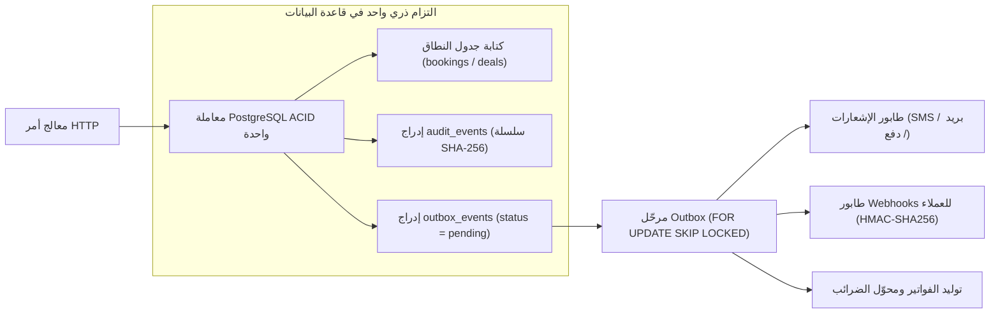
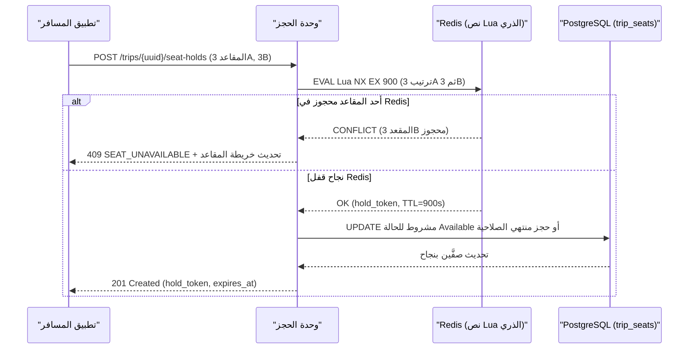
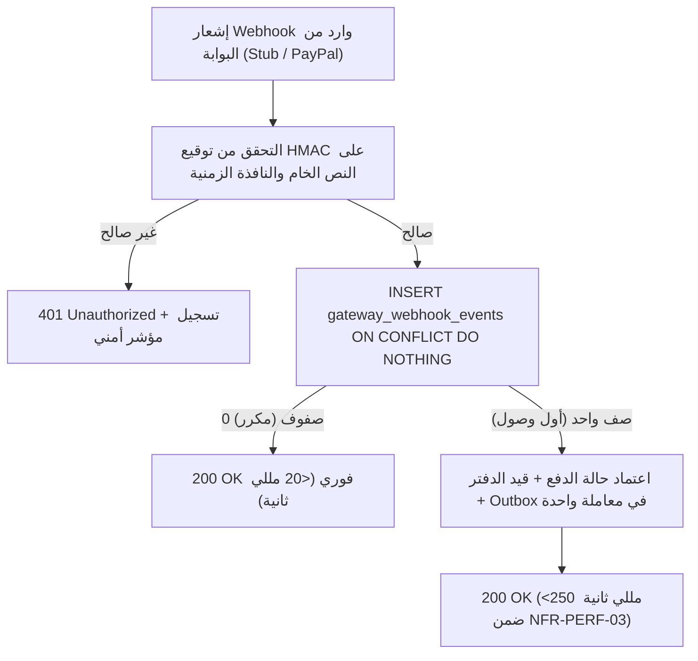
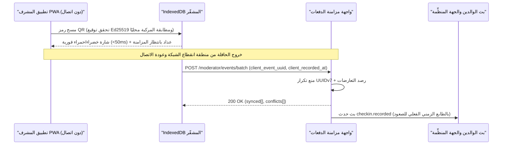

يقدّم هذا الدليل **اثني عشر مخططًا هندسيًا وتشغيليًا جاهزًا للتنفيذ (`REC-ARCH-01` إلى `REC-OPS-12`)** لترجمة قواعد العمل (`BRL-*`) والمتطلبات الوظيفية (`FR-*`) ومؤشرات الجودة (`NFR-*`) ومخطط الكيانات (`ERD`) لمنصة Trips Enjoy إلى أنماط إنتاج عالية الاعتمادية في **مصر (`EG`)** و**المملكة العربية السعودية (`SA`)** و**الإمارات العربية المتحدة (`AE`)**.

<Callout type="info" title="النطاق الاستشاري والتوافق التام مع المواصفات">
تحمل جميع البطاقات أدناه وسم `Strategic Advisory`، وهي تُعزّز المعمارية المعتمدة للمونوليث المعياري (`/ar/docs/architecture`) ومخطط قاعدة بيانات PostgreSQL 16 + TimescaleDB (`/ar/docs/erd`) وخطة المراحل الست (`/ar/docs/plan`) دون أي تعارض معها.
</Callout>

| معرّف المخطط | المجال | النمط الهندسي الأساسي | المرحلة المستهدفة |
| :--- | :--- | :--- | :--- |
| [`REC-ARCH-01`](/ar/docs/recommendations/architecture-and-ops#rec-arch-01) | المعمارية | حدود الحزم داخل المونوليث المعياري وصندوق الصادر التبادلي (`FOR UPDATE SKIP LOCKED`) | P1 |
| [`REC-DATA-02`](/ar/docs/recommendations/architecture-and-ops#rec-data-02) | البيانات متعددة المستأجرين | عزل RLS الآمن مع مجمّع الاتصالات (`SET LOCAL`) وضغط مقاطع TimescaleDB | P1 وP6 |
| [`REC-BOOK-03`](/ar/docs/recommendations/architecture-and-ops#rec-book-03) | التزامن | الحجز الذري للمقاعد دون تعارض (Redis Lua TTL + التحديث المشروط في Postgres) | P2 وP3 |
| [`REC-PAY-04`](/ar/docs/recommendations/architecture-and-ops#rec-pay-04) | المدفوعات | التوجيه عبر سجل بوابات الدفع (بوابة Stub وPayPal) ومنع تكرار Webhooks | P2 وP5 |
| [`REC-TAX-05`](/ar/docs/recommendations/architecture-and-ops#rec-tax-05) | الضرائب والفوترة | محوّل المرحلة الثانية من فاتورة ZATCA (`UBL 2.1 XML` / `TLV QR`) والجاهزية لإيصالات الضرائب المصرية | P2 وP5 |
| [`REC-OFF-06`](/ar/docs/recommendations/architecture-and-ops#rec-off-06) | العمل دون اتصال | معمارية تطبيق المشرف دون اتصال (`IndexedDB` مشفّر، طوابع رتيبة، وواجهة فضّ التعارض) | P3 |
| [`REC-TRK-07`](/ar/docs/recommendations/architecture-and-ops#rec-trk-07) | التتبع المباشر | إرسال GPS الموفر للبطارية وضوابط الخصوصية الصارمة والبث عبر Redis Pub/Sub | P6 |
| [`REC-MED-08`](/ar/docs/recommendations/architecture-and-ops#rec-med-08) | خط الوسائط | الرفع المتعدد المباشر إلى S3 وعمال `libvips` المعزولون وإزالة بيانات EXIF وتوقيع ملفات تعريف CDN | P4 |
| [`REC-SEC-09`](/ar/docs/recommendations/architecture-and-ops#rec-sec-09) | الثقة والسلامة | جدار حماية بيانات الأطفال واعتماد المشرفَين المزدوج وسلسلة التدقيق الموقعة عبر KMS | P1 وP3 |
| [`REC-FIN-10`](/ar/docs/recommendations/architecture-and-ops#rec-fin-10) | الدفتر المالي | مشغّلات توازن القيد المزدوج بالوحدات الصغرى والتسلسل الضريبي بلا فجوات ومطابقة الساعة 04:00 | P2 وP5 |
| [`REC-UX-11`](/ar/docs/recommendations/architecture-and-ops#rec-ux-11) | تجربة RTL والوصول | خصائص CSS المنطقية والأرقام الغربية (`0–9`) والمناطق الزمنية للرحلات وإمكانية الوصول للمقاعد | P1–P6 |
| [`REC-OPS-12`](/ar/docs/recommendations/architecture-and-ops#rec-ops-12) | الجاهزية التشغيلية | بوابات أعلام الميزات ومحاكاة رحلة 120 راكبًا في 3 حافلات وتدريبات الفوضى وأدلة المناوبة | P2–P6 |

---

## 1. المعمارية الأساسية وعزل المستأجرين والتزامن

### REC-ARCH-01 — حدود حزم المونوليث المعياري وصندوق الصادر التبادلي (Outbox)

<RecommendationCard
  id="REC-ARCH-01"
  title="عقود صارمة بين الوحدات الداخلية وترحيل الأحداث عبر صندوق الصادر (FOR UPDATE SKIP LOCKED)"
  category="architecture"
  currentStatus="Strategic Advisory"
  targetPhase="P1 الأساس"
  owner="معمارية الخلفية"
  impact="Critical"
  recommendedResolution="فرض حدود حزم صارمة وقت الترجمة بين وحدات الأعمال داخل تطبيق مونوليث معياري موحّد (`BRD §9.1`) مع منع عمليات الربط `JOIN` المباشرة أو تعديل الجداول خارج الوحدة المالكة لها. وتُحفظ كل عملية تغيير حالة مع صف التدقيق في `audit_events` وصف الحدث في `outbox_events` داخل معاملة PostgreSQL ACID واحدة، ثم تتولى عملية ترحيل خفيفة سحب الأحداث عبر `SELECT ... FOR UPDATE SKIP LOCKED LIMIT 100` ودفعها إلى طوابير BullMQ/Redis لتشغيل الإشعارات وWebhooks والفواتير والتحليلات."
  trace={{
    brd: [
      { label: 'BRD §9.1 قاعدة كود موحدة', href: '/ar/docs/brd/compliance#91-الافتراضات' },
    ],
    srs: [
      { label: 'NFR-MNT-01 و NFR-MNT-03', href: '/ar/docs/srs/quality#89-قابلية-الصيانة-nfr-mnt' },
      { label: 'FR-NTF-06 منع تكرار التسليم', href: '/ar/docs/srs/requirements/ntf#fr-ntf-06--منع-تكرار-التسليم' },
    ],
    erd: [
      { label: 'خريطة علاقات النطاقات', href: '/ar/docs/erd#خريطة-علاقات-النطاقات' },
      { label: 'audit_events', href: '/ar/docs/erd/domains/platform#audit_events' },
    ],
    plan: [
      { label: 'P1 — الأساس', href: '/ar/docs/plan/p1' },
    ],
    workflows: [
      { label: 'عقد المحرّك', href: '/ar/docs/workflows#عقد-المحرّك' },
    ],
    userFlows: [
      { label: 'UF-TRV-03 حجز رحلة', href: '/ar/docs/user-flows/traveler#uf-trv-03-حجز-رحلة' },
    ],
    architecture: [
      { label: 'نموذج الخدمات', href: '/ar/docs/architecture#نموذج-الخدمات' },
    ],
    design: [
      { label: 'لوحة مشرف المنصة', href: '/ar/docs/design#لوحة-مشرف-المنصة' },
    ],
    system: [
      { label: 'المرحلة 01 — الأساس', href: '/ar/docs/system/lifecycle#stage-01' },
      { label: 'المرحلة 05 — الحجز وصندوق الصادر', href: '/ar/docs/system/lifecycle#stage-05' },
    ],
    recommendations: [
      { label: 'OPEN-08 سلسلة التدقيق', href: '/ar/docs/recommendations/open-decisions#open-08' },
    ],
  }}
>

- **عزل الحدود البرمجية (`eslint-plugin-boundaries`):** تقسيم الشيفرة إلى سياقات محددة (`identity`، `onboarding`، `tenancy`، `catalog-trips`، `staffing-deals`، `booking-payments`، `operations-tracking`، `media`، `subscriptions`، `finance-ledger`، `notifications`) بحيث تتخاطب حصريًا عبر واجهات خدمات معلنة وأحداث نطاق قياسية (`booking.confirmed.v1`).
- **القضاء على أخطاء الكتابة المزدوجة:** يمنع هذا النمط إرسال رسالة SMS أو بريد قبل التزام قاعدة البيانات، كما يمنع ضياع الإشعار إذا تعطل Redis لحظيًا.
- **عدم تكرار المعالجة (Idempotency):** يسجّل كل مستهلك `(consumer_name, event_uuid)` في جدول `processed_events` لضمان عدم تكرار الرسائل أو القيود عند إعادة تسليم الحدث (`FR-NTF-06`).
</RecommendationCard>

### REC-DATA-02 — أمان سياسات RLS مع مجمّع الاتصالات وضغط بيانات TimescaleDB

<RecommendationCard
  id="REC-DATA-02"
  title="تصفير سياق RLS على مستوى المعاملة (SET LOCAL) وإدارة دورة حياة مقاطع TimescaleDB"
  category="architecture"
  currentStatus="Strategic Advisory"
  targetPhase="P1 (عزل RLS) وP6 (TimescaleDB)"
  owner="هندسة قواعد البيانات والخلفية"
  impact="Critical"
  recommendedResolution="منع تسرب سياق المستأجر عبر الاتصالات المعاد استخدامها (`RSK-01` و`DAT-01` و`NFR-SEC-07`) بتشغيل مجمّع `PgBouncer` في وضع `transaction`، والاتصال بدور قاعدة بيانات غير فائق الصلاحية (`trips_app` مع خاصية `NOBYPASSRLS`)، وتمرير السياق داخل كل معاملة عبر `SELECT set_config('app.current_org_id', $1, true), set_config('app.current_user_id', $2, true), set_config('app.current_role', $3, true)` (`is_local = true` أي `SET LOCAL` الذي يُمسح تلقائيًا عند `COMMIT` أو `ROLLBACK`). وتُقسَّم نقاط التتبع `tracking_points` كجدول فائق في TimescaleDB بمقاطع `7 أيام` مع ضغط عمودي تلقائي بعد `7 أيام` مقسمًا بـ `trip_vehicle_id`، وحذف آلي للمقاطع عند `90 يومًا` (`SRS §6.4`)."
  trace={{
    brd: [
      { label: 'RSK-01 تسرب بيانات المستأجرين', href: '/ar/docs/brd/compliance#10-المخاطر' },
    ],
    srs: [
      { label: 'DAT-01 إلى DAT-03', href: '/ar/docs/srs/data#62-عزل-البيانات' },
      { label: 'NFR-SEC-07 عزل RLS', href: '/ar/docs/srs/quality#82-الأمان-nfr-sec' },
      { label: 'SRS §6.4 الاحتفاظ ببيانات GPS لـ 90 يومًا', href: '/ar/docs/srs/data#64-مدة-الاحتفاظ' },
    ],
    erd: [
      { label: 'كتالوج سياسات RLS', href: '/ar/docs/erd/acl#كتالوج-السياسات' },
      { label: 'سياسة المعرّفات (BIGINT + UUIDv7)', href: '/ar/docs/erd#سياسة-المعرّفات' },
    ],
    plan: [
      { label: 'P1 — عزل المستأجرين', href: '/ar/docs/plan/p1' },
      { label: 'P6 — التتبع المباشر', href: '/ar/docs/plan/p6' },
    ],
    workflows: [
      { label: 'الأرشفة والتطهير', href: '/ar/docs/workflows/scheduled-jobs#مهام-الأرشفة-والاحتفاظ-بالبيانات' },
    ],
    userFlows: [
      { label: 'UF-ORG-02 تبديل الجهة المنظِّمة', href: '/ar/docs/user-flows/organization#uf-org-02-تبديل-الجهة-المنظِّمة' },
    ],
    architecture: [
      { label: 'معمارية البيانات', href: '/ar/docs/architecture#معمارية-البيانات' },
    ],
    design: [
      { label: 'لوحة الجهة المنظِّمة', href: '/ar/docs/design#لوحة-الجهة-المنظِّمة' },
    ],
    system: [
      { label: 'المرحلة 02 — تجهيز المستأجر', href: '/ar/docs/system/lifecycle#stage-02' },
      { label: 'المرحلة 07 — قياسات GPS', href: '/ar/docs/system/lifecycle#stage-07' },
    ],
    recommendations: [
      { label: 'OPEN-11 اختبارات RLS السلبية', href: '/ar/docs/recommendations/open-decisions#open-11' },
    ],
  }}
>
- **خطورة `SET` على مستوى الجلسة:** استخدام `SET` العادي دون `LOCAL` قد يترك معرّف الجهة A عالقًا على اتصال مشترك في حال حدوث استثناء؛ بينما يضمن `set_config(..., true)` تصفير المتغير حتميًا مع نهاية المعاملة، وتضمن صيغة `NULLIF(current_setting('app.current_org_id', true), '')::bigint` الإغلاق الآمن بإرجاع صفر صفوف إن لم يُضبط السياق.
- **وفورات ضغط TimescaleDB (>90%):** عند تشغيل `500` مركبة نشطة متزامنة (`NFR-SCL-01`) بمعدل نقطة كل 3 ثوانٍ (~14.4 مليون صف يوميًا)، يقلص الضغط العمودي حجم تخزين الـ 90 يومًا من قرابة `198 GB` إلى `16 GB` فقط، بينما يحذف `drop_chunks(INTERVAL '90 days')` المقاطع المنتهية فوريًا دون عبء `VACUUM`.
</RecommendationCard>

### REC-BOOK-03 — الحجز الذري للمقاعد دون تعارض (Redis Lua + Postgres)

<RecommendationCard
  id="REC-BOOK-03"
  title="قفل مزدوج الطبقات لحجز المقعد لمدة 15 دقيقة وتأكيد الدفع دون ازدواج"
  category="architecture"
  currentStatus="Strategic Advisory"
  targetPhase="P2 (حجز السعة) وP3 (خريطة المقاعد)"
  owner="هندسة الخلفية"
  impact="Critical"
  recommendedResolution="منع تخصيص المقعد ذاته لمسافرَين عند ذروة الإقبال (`BRL-09` و`FR-SEAT-04` و`NFR-PERF-02` زمن استجابة أقل من 400 مللي ثانية) عبر طبقتَي حماية متكاملتين: (1) **بوابة التزاحم السريعة في Redis:** تنفيذ نص `Lua` ذري يحجز المفاتيح `SET seat:hold:{trip_vehicle_id}:{seat_no} {hold_token} NX EX 900` لجميع المقاعد المطلوبة مرتبةً أبجديًا (مع التراجع الفوري الكلي إذا كان أي مقعد محجوزًا)؛ (2) **المصدر المرجعي النهائي في PostgreSQL:** تنفيذ تحديث مشروط `UPDATE trip_seats SET state = 'Held', held_by_user_id = $1, hold_token = $2, hold_expires_at = now() + interval '15 minutes' WHERE trip_vehicle_id = $3 AND seat_number = ANY($4) AND (state = 'Available' OR (state = 'Held' AND hold_expires_at < now()))` والتحقق من تطابق عدد الصفوف المحدثة مع عدد المقاعد المطلوبة."
  trace={{
    brd: [
      { label: 'BRL-09 حجز المقعد 15 دقيقة', href: '/ar/docs/brd/requirements#7-قواعد-العمل' },
    ],
    srs: [
      { label: 'FR-SEAT-04 و FR-SEAT-05', href: '/ar/docs/srs/requirements/seat#fr-seat-04--الحجز-المؤقت-للمقعد' },
      { label: 'SRS §7.3 آلة حالة المقعد', href: '/ar/docs/srs/state-machines#73-المقعد' },
      { label: 'NFR-PERF-02 حجز المقعد < 400ms', href: '/ar/docs/srs/quality#81-الأداء-nfr-perf' },
    ],
    erd: [
      { label: 'trip_seats و bookings', href: '/ar/docs/erd/domains/booking-and-payment#trip_seats' },
    ],
    plan: [
      { label: 'P2 — الحجز والدفع', href: '/ar/docs/plan/p2' },
      { label: 'P3 — خريطة المقاعد الحية', href: '/ar/docs/plan/p3' },
    ],
    workflows: [
      { label: 'الحجز والدفع', href: '/ar/docs/workflows/booking-payment' },
    ],
    userFlows: [
      { label: 'UF-TRV-03 حجز رحلة', href: '/ar/docs/user-flows/traveler#uf-trv-03-حجز-رحلة' },
    ],
    architecture: [
      { label: 'معمارية البيانات', href: '/ar/docs/architecture#معمارية-البيانات' },
    ],
    design: [
      { label: 'تطبيق المسافر — منتقي المقاعد', href: '/ar/docs/design#تطبيق-المسافر' },
    ],
    system: [
      { label: 'المرحلة 05 — حجز المقعد والدفع', href: '/ar/docs/system/lifecycle#stage-05' },
    ],
    recommendations: [
      { label: 'OD-09 الاختيار الذاتي للمقاعد', href: '/ar/docs/recommendations/open-decisions#od-09' },
    ],
  }}
>

- **منع الإغلاق المتبادل (Deadlocks):** ترتيب أرقام المقاعد أبجديًا قبل القفل في كلٍّ من Redis وPostgreSQL يمنع حدوث أي تعليق متبادل حين يطلب مسافران مقاطع متداخلة (`[3A, 3B]` و`[3B, 3C]`) في اللحظة ذاتها.
- **معالجة إشعارات الدفع المتأخرة بعد الدقيقة 15:** إذا وصل إشعار نجاح مصادقة `3DS` في الدقيقة `15:08` بعد انتهاء المهلة: إن كانت المقاعد لا تزال متاحة يُؤكَّد الحجز فورًا؛ وإن حجزها مسافر آخر يُحوَّل الدفع تلقائيًا إلى استرداد فوري كامل `100%` مع إشعار المسافر دون المساس بسلامة جدول `trip_seats`.
</RecommendationCard>

---

## 2. بوابات الدفع والفوترة الإلكترونية

### REC-PAY-04 — التوجيه عبر سجل بوابات الدفع ومنع تكرار معالجة Webhooks

<RecommendationCard
  id="REC-PAY-04"
  title="منفذ موحّد لبوابات الدفع (PaymentGatewayPort) وتفريد صارم للإشعارات الراجعة"
  category="payments-tax"
  currentStatus="Strategic Advisory"
  targetPhase="P2 (مصر) وP5 (الخليج والاشتراكات)"
  owner="هندسة المدفوعات والخلفية"
  impact="Critical"
  recommendedResolution="عزل جميع بوابات الدفع والصرف خلف واجهتَي `PaymentGatewayPort` و`PayoutGatewayPort` الموحدتين اللتين تُوجَّهان تلقائيًا بحسب `(market_code, payment_method, flow_type)` عبر سجل بوابات قابل للتهيئة من لوحة الإدارة (`market_payment_methods`) وفق `OD-11`: توفير **1) محوّل Stub للاختبار** و**2) محوّل PayPal (`Sandbox` و`Live` للتحصيل وصرف المستحقات)** جاهزَين منذ البداية، مع تمكين مشرف المنصة من ربط أي بوابة دفع أو صرف **بدولة واحدة أو عدة دول** وتبديل المزود النشط دون إعادة نشر الكود. وتُحفظ حمولة كل إشعار وارد خامًا في جدول `gateway_webhook_events` بقيد تفرد `UNIQUE (provider, provider_event_id)` قبل تنفيذ أي تعديل على حالة الحجز (`FR-PAY-02`)."
  trace={{
    brd: [
      { label: 'OD-11 بوابات الدفع', href: '/ar/docs/brd/compliance#11-القرارات-المفتوحة' },
      { label: 'RSK-02 انقطاع بوابة الدفع', href: '/ar/docs/brd/compliance#10-المخاطر' },
    ],
    srs: [
      { label: 'FR-PAY-01 إلى FR-PAY-08', href: '/ar/docs/srs/requirements/pay' },
      { label: 'NFR-PERF-03 معالجة الإشعار < 500ms', href: '/ar/docs/srs/quality#81-الأداء-nfr-perf' },
    ],
    erd: [
      { label: 'bookings و payments', href: '/ar/docs/erd/domains/booking-and-payment#bookings' },
    ],
    plan: [
      { label: 'P2 — الدفع في مصر', href: '/ar/docs/plan/p2' },
      { label: 'P5 — وسائل الخليج والاشتراكات', href: '/ar/docs/plan/p5' },
    ],
    workflows: [
      { label: 'الحجز والدفع', href: '/ar/docs/workflows/booking-payment' },
      { label: 'الأموال والتسويات', href: '/ar/docs/workflows/money' },
    ],
    userFlows: [
      { label: 'UF-TRV-15 الدفع المعلق', href: '/ar/docs/user-flows/traveler#uf-trv-15-نتيجة-الدفع-ومعالجة-الحالة-المعلّقة' },
      { label: 'UF-ADM-12 تصعيد الدفع', href: '/ar/docs/user-flows/admin#uf-adm-12-تصعيد-الدفع' },
    ],
    architecture: [
      { label: 'التكاملات', href: '/ar/docs/architecture#التكاملات' },
    ],
    design: [
      { label: 'تطبيق المسافر — الدفع', href: '/ar/docs/design#تطبيق-المسافر' },
    ],
    system: [
      { label: 'المرحلة 05 — تنفيذ الدفع', href: '/ar/docs/system/lifecycle#stage-05' },
    ],
    recommendations: [
      { label: 'OD-11 اختيار بوابات الدفع', href: '/ar/docs/recommendations/open-decisions#od-11' },
    ],
  }}
>

- **الاستعلام النشط عن المدفوعات المعلقة (`FR-PAY-08` و`D-37`):** لا يُعتمد على Webhooks وحدها؛ تفحص مهمة خلفية حالة المعاملة لدى البوابة عند الدقائق `+2` و`+10` و`+30` والساعات `+2` و`+6` و`+24`، وتفتح تذكرة تصعيد مالي للإدارة (`UF-ADM-12`) إذا بقيت معلقة بعد 24 ساعة.
</RecommendationCard>

### REC-TAX-05 — محوّل المرحلة الثانية من فاتورة ZATCA والجاهزية لإيصالات الضرائب المصرية

<RecommendationCard
  id="REC-TAX-05"
  title="محوّل امتثال ضريبي معياري (TaxComplianceAdapter) لفاتورة ZATCA السعودية ومصلحة الضرائب المصرية"
  category="payments-tax"
  currentStatus="Strategic Advisory"
  targetPhase="P2 (أساس PDF/QR) وP5 (تفعيل ZATCA المرحلة الثانية)"
  owner="هندسة المالية والخلفية"
  impact="Critical"
  recommendedResolution="تهيئة جدول `invoices` منذ المرحلة P2 بحقول الامتثال الضريبي الاختيارية (`tax_authority`, `invoice_hash`, `prev_invoice_hash`, `cryptographic_stamp`, `tlv_qr_base64`, `xml_s3_key`, `authority_uuid`, `clearance_status`) وعزل قواعد الفوترة الخاصة بكل دولة خلف سجل محوّلات غير متزامن قابل للتهيئة لكل دولة `TaxComplianceAdapter` (`markets.invoice_config`، يعمل عبر صندوق الصادر وفق `D-179`: 3 محاولات إعادة خلال 30 دقيقة دون تعطيل تأكيد حجز المسافر): تحدد كل دولة قواعد الفوترة النظامية وبادئة الترقيم والحقول الضريبية والمحوّل النشط (**في مصر (`EG`):** فواتير ضريبية ثنائية اللغة بنسبة 14% في P2 جاهزة لتفعيل منظومة الإيصال/الفاتورة الإلكترونية لمصلحة الضرائب المصرية (`ETA`)؛ **وفي السعودية (`SA` في P5):** توليد ملفات `UBL 2.1 XML` كاملة للمرحلة الثانية من **فاتورة (ZATCA)** مع ختم التشفير `ECDSA secp256k1` ورمز `TLV QR` ذي الحقول التسعة وربط واجهة الإبلاغ للفواتير المبسطة (`0200000`) وواجهة الاعتماد للفواتير الضريبية بين الشركات (`0100000`)؛ **وفي الإمارات (`AE` في P5):** فاتورة ضريبية بنسبة 5% متوافقة مع الهيئة الاتحادية للضرائب ورقم `TRN`)."
  trace={{
    brd: [
      { label: 'BRD §8.4 الضرائب والفوترة', href: '/ar/docs/brd/compliance#84-الضرائب-والفوترة' },
      { label: 'OD-10 نطاق ZATCA', href: '/ar/docs/brd/compliance#11-القرارات-المفتوحة' },
    ],
    srs: [
      { label: 'FR-ACC-08 فواتير لجميع الأطراف', href: '/ar/docs/srs/requirements/acc#fr-acc-08--فواتير-لجميع-الأطراف' },
      { label: 'FR-ORG-07 فواتير B2B وB2C', href: '/ar/docs/srs/requirements/org#fr-org-07--فواتير-b2b-وb2c' },
      { label: 'NFR-COM-08 الفوترة الإلكترونية', href: '/ar/docs/srs/quality#810-الامتثال-nfr-com' },
    ],
    erd: [
      { label: 'invoices', href: '/ar/docs/erd/domains/finance#invoices' },
    ],
    plan: [
      { label: 'P2 — الإيصالات الأساسية', href: '/ar/docs/plan/p2' },
      { label: 'P5 — ضرائب الخليج والفواتير الكاملة', href: '/ar/docs/plan/p5' },
    ],
    workflows: [
      { label: 'المهام المجدولة — إعادة المحاولة', href: '/ar/docs/workflows/scheduled-jobs#جداول-إعادة-المحاولة-ملاحقة-كل-إخفاق' },
    ],
    userFlows: [
      { label: 'UF-ORG-14 الفواتير', href: '/ar/docs/user-flows/organization#uf-org-14-الفواتير' },
    ],
    architecture: [
      { label: 'التكاملات', href: '/ar/docs/architecture#التكاملات' },
    ],
    design: [
      { label: 'RTL والملفات ثنائية اللغة', href: '/ar/docs/design#rtl-والتعريب' },
    ],
    system: [
      { label: 'المرحلة 05 — الفواتير', href: '/ar/docs/system/lifecycle#stage-05' },
      { label: 'المرحلة 08 — التسويات', href: '/ar/docs/system/lifecycle#stage-08' },
    ],
    recommendations: [
      { label: 'OD-10 قرار ZATCA', href: '/ar/docs/recommendations/open-decisions#od-10' },
      { label: 'OD-27 نسب الضريبة', href: '/ar/docs/recommendations/open-decisions#od-27' },
    ],
  }}
>
- **التمييز القانوني بين الأصيل والوكيل في الفواتير:**
  - **فاتورة حجز المسافر (`FR-ORG-07`):** تصدر باسم **الجهة المنظِّمة ورقمها الضريبي** وتسلسلها المستقل بوصفها مقدّم خدمة الرحلة الأصيل.
  - **فواتير الاشتراكات وعمولة المنصة (`FR-ACC-08`):** تصدر باسم **الكيان القانوني لمنصة Trips Enjoy** موجّهةً إلى الجهة المنظِّمة أو المورد مقابل رسوم الاشتراك أو عمولة الوساطة.
  - **إشعارات الدائن عند الاسترداد:** لا تُعدَّل الفاتورة المصدرة أبدًا (`DAT-08`)، بل يصدر عند الاسترداد **إشعار دائن (Credit Note `381`)** مرتبط بمعرّف الفاتورة الأصلية.
</RecommendationCard>

---

## 3. العمل دون اتصال والتتبع المباشر وخط معالجة الوسائط

### REC-OFF-06 — معمارية تطبيق المشرف للعمل دون اتصال (Offline-First)

<RecommendationCard
  id="REC-OFF-06"
  title="تخزين كشف الركاب المشفّر في IndexedDB وطابور الأحداث الرتيب وواجهة حسم التعارضات"
  category="operations"
  currentStatus="Strategic Advisory"
  targetPhase="P3 العمق التشغيلي"
  owner="هندسة الواجهات والعمليات"
  impact="Critical"
  recommendedResolution="بناء تطبيق المشرف القابل للتثبيت (`FR-MOD-04` و`FR-CHK-05`) فوق محرك بيانات محلي أولًا (`IndexedDB` مشفّر بمفتاح `AES-GCM` مشتق من الجلسة يُمسح فور انتهاء صلاحية المشرف `FR-MOD-03`): يُحمَّل مسبقًا عند تسجيل الدخول كشف ركاب المركبة والمفتاح العام للتحقق من رموز QR وقائمة المحطات وخريطة المقاعد. وتُخزَّن أحداث الصعود والمغادرة والحوادث محليًا مع `client_event_uuid` (`UUIDv7`) و`client_recorded_at` لتُرسَل في دفعات من `50` حدثًا خلال أقل من `60 ثانية` من عودة الاتصال (`NFR-PERF-06`) عبر نقطة نهاية غير قابلة للتكرار `POST /api/v1/moderator/events/batch`."
  trace={{
    brd: [
      { label: 'BRL-10 و BRL-11 قواعد الحضور', href: '/ar/docs/brd/requirements#7-قواعد-العمل' },
    ],
    srs: [
      { label: 'FR-CHK-01 إلى FR-CHK-07', href: '/ar/docs/srs/requirements/chk' },
      { label: 'FR-MOD-01 إلى FR-MOD-06', href: '/ar/docs/srs/requirements/mod' },
      { label: 'NFR-PERF-06 المزامنة < 60 ثانية', href: '/ar/docs/srs/quality#81-الأداء-nfr-perf' },
    ],
    erd: [
      { label: 'checkin_events', href: '/ar/docs/erd/domains/operations#checkin_events' },
    ],
    plan: [
      { label: 'P3 — العمق التشغيلي', href: '/ar/docs/plan/p3' },
    ],
    workflows: [
      { label: 'عمليات يوم الرحلة', href: '/ar/docs/workflows/trip-day' },
    ],
    userFlows: [
      { label: 'UF-MOD-04 تسجيل حضور راكب', href: '/ar/docs/user-flows/moderator#uf-mod-04-تسجيل-حضور-راكب' },
      { label: 'UF-MOD-06 الطابور دون اتصال', href: '/ar/docs/user-flows/moderator#uf-mod-06-قائمة-الانتظار-دون-اتصال' },
    ],
    architecture: [
      { label: 'نموذج الخدمات', href: '/ar/docs/architecture#نموذج-الخدمات' },
    ],
    design: [
      { label: 'تطبيق المشرف', href: '/ar/docs/design#تطبيق-المشرف' },
    ],
    system: [
      { label: 'المرحلة 07 — تسجيل الحضور دون اتصال', href: '/ar/docs/system/lifecycle#stage-07' },
    ],
    recommendations: [
      { label: 'OPEN-14 متصفحات تطبيق المشرف', href: '/ar/docs/recommendations/open-decisions#open-14' },
    ],
  }}
>

- **التحقق التشفيري من QR بلا إنترنت (`FR-CHK-02`):** يحمل رمز الصعود توقيع `Ed25519` على `(booking_passenger_uuid, trip_uuid, trip_vehicle_id, seat_no)`، مما يمكّن المشرف في نقاط التجمع الصحراوية (الفيوم، العلا، حتا) من رفض التذاكر المزورة وكشف ركاب الحافلة الخطأ (`BRL-10`) في أقل من 50 مللي ثانية دون أي تغطية خلوية.
- **قواعد فضّ التعارض:** عند مسح الراكب نفسه من مشرفَين على نفس الحافلة دون اتصال يُعتمد الطابع الأقدم دون إظهار خطأ؛ أما إذا أُلغي حجز الراكب أثناء الانقطاع فتظهر بطاقة تنبيه كهرمانية واضحة للمراجعة في `UF-MOD-06`.
</RecommendationCard>

### REC-TRK-07 — استقبال GPS الموفر للبطارية وضوابط الخصوصية والبث الفوري

<RecommendationCard
  id="REC-TRK-07"
  title="تكييف تردد GPS بحسب الحركة، وأربع بوابات خصوصية، وبث Redis Pub/Sub"
  category="architecture"
  currentStatus="Strategic Advisory"
  targetPhase="P6 العائلة والتوسّع"
  owner="هندسة الجوال والأنظمة اللحظية"
  impact="High"
  recommendedResolution="تحقيق مستهدف تحديث الخريطة الحية خلال `3–5 ثوانٍ` (`NFR-PERF-05` لـ `500` مركبة متزامنة `NFR-SCL-01`) دون استنزاف بطارية هاتف السائق عبر تكييف معدل الالتقاط (`كل 3 ثوانٍ` عند السرعة `>= 3 م/ث`، ونبضة `كل 30 ثانية` عند التوقف لأكثر من دقيقتين، مع ذاكرة حلقية محلية أثناء انقطاع الشبكة) وفرض ضوابط الخصوصية الصارمة على الخادم (`FR-TRK-02..07`): رفض أي إحداثيات خارج حالة `In_Progress`، وحجب بيانات جهاز السائق، ومنع وصول المسافرين البالغين العاديين نهائيًا (`FR-TRK-07`)، وبث الإحداثيات عبر قناة Redis Pub/Sub `vehicle:pos:{trip_vehicle_id}`."
  trace={{
    brd: [
      { label: 'BRD §6.9 التتبع و §6.10 الوالدان', href: '/ar/docs/brd/requirements#69-تسجيل-الحضور-والمشرفون-والتتبع-chk-mod-trk' },
      { label: 'BRL-06 و BRL-07 تتبع الأبناء', href: '/ar/docs/brd/requirements#7-قواعد-العمل' },
    ],
    srs: [
      { label: 'FR-TRK-01 إلى FR-TRK-07', href: '/ar/docs/srs/requirements/trk' },
      { label: 'FR-PAR-02 إلى FR-PAR-06', href: '/ar/docs/srs/requirements/par#fr-par-02--نطاق-عرض-الوالد' },
      { label: 'NFR-PERF-05 التحديث المباشر <= 5 ثوانٍ', href: '/ar/docs/srs/quality#81-الأداء-nfr-perf' },
    ],
    erd: [
      { label: 'child_links و operations', href: '/ar/docs/erd/domains/operations#child_links' },
    ],
    plan: [
      { label: 'P6 — التتبع المباشر ومتابع الوالدين', href: '/ar/docs/plan/p6' },
    ],
    workflows: [
      { label: 'عمليات يوم الرحلة', href: '/ar/docs/workflows/trip-day' },
    ],
    userFlows: [
      { label: 'UF-DRV-04 تشغيل مركبة', href: '/ar/docs/user-flows/driver#uf-drv-04-تشغيل-مركبة-مُسندة' },
      { label: 'UF-PAR-03 الخريطة المباشرة', href: '/ar/docs/user-flows/parent#uf-par-03-الخريطة-المباشرة' },
    ],
    architecture: [
      { label: 'معمارية البيانات — TimescaleDB', href: '/ar/docs/architecture#معمارية-البيانات' },
    ],
    design: [
      { label: 'متابع الوالدين', href: '/ar/docs/design#متابع-الوالدين' },
    ],
    system: [
      { label: 'المرحلة 07 — التتبع وخريطة الوالدين', href: '/ar/docs/system/lifecycle#stage-07' },
    ],
    recommendations: [
      { label: 'OPEN-07 حدود معدل السائق والوالدين', href: '/ar/docs/recommendations/open-decisions#open-07' },
    ],
  }}
>
- **بوابات التحقق الأربع عند فتح اتصال الخريطة الحية (`WebSocket / SSE`):**
  1. أن تكون الرحلة في حالة `In_Progress` حصريًا (`FR-TRK-06` — يُغلق الاتصال فور انتهاء الرحلة).
  2. لولي الأمر: تفعيل مفتاح تتبع الأبناء للرحلة (`FR-TRK-04`)، ووجود ربط طفل نشط على الحجز (`FR-PAR-06`)، واشتراك سارٍ في باقة `Explorer` أو `VIP` (`BRL-07`).
  3. عزل المركبة: يستقبل ولي الأمر إحداثيات المركبة الوحيدة التي تقل طفله فقط (`FR-TRK-03` و`FR-PAR-02`) دون بقية مركبات الرحلة أو أسماء الركاب الآخرين.
  4. حجب المسافرين البالغين: لا يملك المسافر البالغ غير المرتبط بطفل أي وصول لنقطة نهاية الموقع المباشر (`FR-TRK-07`).
</RecommendationCard>

### REC-MED-08 — خط رفع ومعالجة الوسائط المتعدد الأجزاء وتوقيع روابط CDN

<RecommendationCard
  id="REC-MED-08"
  title="الرفع المباشر القابل للاستئناف إلى S3، وعزل عمال libvips، وإزالة EXIF الإلزامية وتوقيع CloudFront"
  category="architecture"
  currentStatus="Strategic Advisory"
  targetPhase="P4 جانب العرض في المنصة"
  owner="هندسة الوسائط والبنية التحتية"
  impact="High"
  recommendedResolution="تفريغ عبء رفع ألبومات الصور عالية الدقة (`FR-MED-02` خلال نافذة الـ 30 يومًا بعد الرحلة `FR-MED-01`) بالكامل عن خوادم API عبر **روابط الرفع المتعدد الموقعة مسبقًا إلى S3** (أجزاء بحجم `8 MB` قابلة للاستئناف عند انقطاع الشبكة). وتُعالَج الملفات غير متزامنًا في **مجمّع حاويات معزول** (`sharp`/`libvips` بسقوف ذاكرة صارمة وفحص نوع الملف)، مع **إزالة جميع بيانات EXIF الجغرافية وبيانات الكاميرا إلزاميًا** وتوليد نسخ العرض (`400w` مصغرة، و`1600w` مع العلامة المائية الاختيارية لباقتَي `Studio` و`Pro` وفق `FR-MED-06`، والنسخة الأصلية المحمية)، وتقديمها حصريًا عبر **ملفات تعريف ارتباط أو روابط CloudFront موقعة قصيرة العمر** (`15 دقيقة`)."
  trace={{
    brd: [
      { label: 'BRD §6.11 الوسائط والمصوّرون', href: '/ar/docs/brd/requirements#611-الوسائط-والمصوّرون-med-pho' },
      { label: 'BRL-08 أوضاع خصوصية الألبوم', href: '/ar/docs/brd/requirements#7-قواعد-العمل' },
    ],
    srs: [
      { label: 'FR-MED-01 إلى FR-MED-09', href: '/ar/docs/srs/requirements/med' },
      { label: 'NFR-SEC-09 روابط الوسائط الموقعة', href: '/ar/docs/srs/quality#82-الأمان-nfr-sec' },
    ],
    erd: [
      { label: 'نطاق الوسائط media', href: '/ar/docs/erd/domains/media' },
    ],
    plan: [
      { label: 'P4 — الوسائط واستوديو المصوّر', href: '/ar/docs/plan/p4' },
    ],
    workflows: [
      { label: 'ألبومات الوسائط', href: '/ar/docs/workflows/media' },
    ],
    userFlows: [
      { label: 'UF-PHO-05 إنشاء ألبوم ورفعه', href: '/ar/docs/user-flows/photographer#uf-pho-05-إنشاء-ألبوم-ورفعه' },
      { label: 'UF-TRV-09 عرض الألبومات', href: '/ar/docs/user-flows/traveler#uf-trv-09-الألبومات' },
    ],
    architecture: [
      { label: 'معمارية البيانات — تخزين الكائنات', href: '/ar/docs/architecture#معمارية-البيانات' },
    ],
    design: [
      { label: 'تطبيق المصوّر', href: '/ar/docs/design#تطبيق-المصوّر' },
    ],
    system: [
      { label: 'المرحلة 08 — ألبومات ما بعد الرحلة', href: '/ar/docs/system/lifecycle#stage-08' },
    ],
    recommendations: [
      { label: 'OPEN-07 حدود معدل رفع الصور', href: '/ar/docs/recommendations/open-decisions#open-07' },
    ],
  }}
>
- **ضرورة عزل عمال معالجة الصور:** فك ضغط صور بحجم 50–100 ميجابكسل داخل خادم الـ API الرئيسي قد يرفع استهلاك الذاكرة بأكثر من 1 GB ويبطئ طلبات الحجز؛ لذا يضمن تشغيل `libvips` في حاويات خلفية مستقلة ثبات زمن استجابة المنصة (`NFR-PERF-01`).
- **الإبطال الفوري للروابط المشتركة (`FR-MED-04` و`FR-MED-09`):** تبقى حاويات S3 خاصة بالكامل، ويتوقف إصدار التوقيعات القصيرة فور إبطال الرابط المشترك، بينما تنظف قاعدة دورة حياة S3 الأجزاء اليتيمة غير المكتملة بعد `48 ساعة`.
</RecommendationCard>

---

## 4. الأمان وسلامة الدفتر وتجربة RTL والجاهزية التشغيلية

### REC-SEC-09 — حواجز حماية بيانات الأطفال والاعتماد الثنائي وسلسلة التدقيق

<RecommendationCard
  id="REC-SEC-09"
  title="جدار عزل بيانات القُصّر وضوابط الأعين الأربع للإشراف وسجل التدقيق غير القابل للتزوير"
  category="security"
  currentStatus="Strategic Advisory"
  targetPhase="P1 (التدقيق والصلاحيات) وP3 (سلامة الطفل)"
  owner="هندسة الأمان والثقة"
  impact="Critical"
  recommendedResolution="فرض عزل بيانات الأطفال (`FR-PAR-05` و`NFR-COM-04`) بنيويًا على مستوى الجداول ومحولات الإخراج: تُحفظ سجلات الركاب القُصّر وروابط أولياء الأمور في جداول مستقلة غير مرئية لعروض التحليلات (`FR-ANL-05`) ومخرجات أنظمة CRM وWebhooks (`FR-ORG-06`) وأدوات التسويق. ويُقرن ذلك بمحرك قواعد تصعيد سلامة الطفل القابل للتهيئة من لوحة الإدارة (`OPEN-03` و`D-68`: ضبط جهات الاتصال وجداول المناوبة وقنوات التنبيه ومؤقتات الاستجابة بقيمة افتراضية `<= 15 دقيقة` للرحلات الجارية و`<= ساعتين` لغير الجارية)، وتُفرض قاعدة الاعتماد الثنائي لمشرفَين مختلفين (`D-233` و`D-227`) بقيد قاعدة بيانات صريح عند إعادة تفعيل حساب موقوف لدواعي السلامة أو تمرير استرداد استثنائي كبير، مع توثيق كل إجراء في سلسلة التجزئة الموقعة عبر KMS (`OPEN-08`)."
  trace={{
    brd: [
      { label: 'BRD §8.1 سلامة الطفل', href: '/ar/docs/brd/compliance#81-سلامة-الطفل' },
      { label: 'BRD §8.5 التدقيق والاحتفاظ', href: '/ar/docs/brd/compliance#85-التدقيق-والاحتفاظ-بالبيانات' },
    ],
    srs: [
      { label: 'FR-PAR-05 و FR-PAR-07', href: '/ar/docs/srs/requirements/par#fr-par-05--قيود-بيانات-الأبناء' },
      { label: 'NFR-COM-04 عزل بيانات الأطفال', href: '/ar/docs/srs/quality#810-الامتثال-nfr-com' },
      { label: 'NFR-SEC-16 مقاومة التلاعب بالتدقيق', href: '/ar/docs/srs/quality#82-الأمان-nfr-sec' },
    ],
    erd: [
      { label: 'child_links', href: '/ar/docs/erd/domains/operations#child_links' },
      { label: 'audit_events', href: '/ar/docs/erd/domains/platform#audit_events' },
    ],
    plan: [
      { label: 'P1 — الصلاحيات والتدقيق', href: '/ar/docs/plan/p1' },
      { label: 'P3 — سلامة الطفل', href: '/ar/docs/plan/p3' },
    ],
    workflows: [
      { label: 'عمليات يوم الرحلة', href: '/ar/docs/workflows/trip-day' },
    ],
    userFlows: [
      { label: 'UF-ADM-04 إدارة حساب (موافقة ثنائية)', href: '/ar/docs/user-flows/admin#uf-adm-04-إدارة-حساب' },
      { label: 'UF-PAR-05 بلاغ سلامة الطفل', href: '/ar/docs/user-flows/parent#uf-par-05-الإبلاغ-عن-مشكلة-تتعلق-بسلامة-الطفل' },
    ],
    architecture: [
      { label: 'سمات الجودة — الأمان', href: '/ar/docs/architecture#سمات-الجودة' },
    ],
    design: [
      { label: 'لوحة مشرف المنصة', href: '/ar/docs/design#لوحة-مشرف-المنصة' },
    ],
    system: [
      { label: 'المرحلة 07 — سلامة الطفل', href: '/ar/docs/system/lifecycle#stage-07' },
    ],
    recommendations: [
      { label: 'OPEN-03 فرز بلاغات السلامة خلال 15 دقيقة', href: '/ar/docs/recommendations/open-decisions#open-03' },
      { label: 'OPEN-08 سلسلة التدقيق عبر KMS', href: '/ar/docs/recommendations/open-decisions#open-08' },
    ],
  }}
>
- **اختبار الكناري الآلي في CI:** يُضاف اختبار تكاملي ينشئ حجزًا يتضمن طفلين مرتبطين ثم يستدعي جميع نقاط تصدير المحاسبة والتحليلات وWebhooks وAPI العام للتحقق الآلي من عدم ظهور أي اسم أو معرّف للطفل خارج شاشة المشرف ومتابع الوالدين.
- **قيد الأعين الأربع في قاعدة البيانات:** يمنع القيد `CHECK (requested_by_admin_id <> approved_by_admin_id)` أي مشرف من الموافقة الذاتية على طلب رفعه بنفسه حتى في حال وجود خطأ في الواجهة.
</RecommendationCard>

### REC-FIN-10 — ثوابت دفتر القيد المزدوج والتسلسل الضريبي والمطابقة اليومية

<RecommendationCard
  id="REC-FIN-10"
  title="مشغّلات توازن القيد المزدوج بالوحدات الصغرى، وأرقام الفواتير المتسلسلة، ومطابقة الساعة 04:00"
  category="payments-tax"
  currentStatus="Strategic Advisory"
  targetPhase="P2 (الدفتر الأساسي) وP5 (التسويات الكاملة)"
  owner="هندسة الأنظمة المالية"
  impact="Critical"
  recommendedResolution="تخزين جميع المبالغ المالية كأعداد صحيحة بالوحدة الصغرى للعملة (`amount_minor BIGINT` مع `currency CHAR(3)` ومنع أنواع الفاصلة العائمة نهائيًا، مع التقريب للنصف الأعلى `D-157`) داخل دفتر قيد مزدوج للإلحاق فقط (`ledger_journals` و`ledger_postings` وفق `FR-ACC-01`) محمي بمشغّل قيد مؤجَّل `DEFERRABLE INITIALLY DEFERRED` يتحقق قبل `COMMIT` من معادلة `SUM(debit_minor) = SUM(credit_minor)` ووحدة العملة. وتُولَّد أرقام الفواتير الضريبية المتسلسلة بلا فجوات لكل مُصدِر عبر جدول `invoice_sequences` يُقفل لحظة الإصدار النهائي فقط، مع تشغيل مهمة المطابقة اليومية الساعة `04:00` بالتوقيت المحلي (`FR-PAY-05` و`FR-ACC-09`) لمقارنة تقارير البوابات مع قيود الدفتر."
  trace={{
    brd: [
      { label: 'BRD §6.14 المحاسبة والتسويات', href: '/ar/docs/brd/requirements#614-المحاسبة-والفواتير-والتسويات-acc' },
      { label: 'BRL-25 صرف المستحقات الإثنين', href: '/ar/docs/brd/requirements#7-قواعد-العمل' },
    ],
    srs: [
      { label: 'FR-ACC-01 إلى FR-ACC-10', href: '/ar/docs/srs/requirements/acc' },
      { label: 'FR-PAY-05 مطابقة بوابة الدفع', href: '/ar/docs/srs/requirements/pay#fr-pay-05--مطابقة-بوابة-الدفع' },
      { label: 'FR-MKT-05 الوحدات الصغرى والتقريب', href: '/ar/docs/srs/requirements/mkt#fr-mkt-05--التقريب-والعرض' },
    ],
    erd: [
      { label: 'invoices ونطاق المالية', href: '/ar/docs/erd/domains/finance#invoices' },
    ],
    plan: [
      { label: 'P2 — الدفتر الأساسي', href: '/ar/docs/plan/p2' },
      { label: 'P5 — المحاسبة الكاملة والتصدير', href: '/ar/docs/plan/p5' },
    ],
    workflows: [
      { label: 'الأموال والتسويات', href: '/ar/docs/workflows/money' },
      { label: 'المهام المجدولة — اليومية والأسبوعية', href: '/ar/docs/workflows/scheduled-jobs#المهام-اليومية' },
    ],
    userFlows: [
      { label: 'UF-ORG-15 المحاسبة والتسويات', href: '/ar/docs/user-flows/organization#uf-org-15-المحاسبة-والتسويات' },
      { label: 'UF-ADM-11 العمليات المالية', href: '/ar/docs/user-flows/admin#uf-adm-11-العمليات-المالية' },
    ],
    architecture: [
      { label: 'معمارية البيانات', href: '/ar/docs/architecture#معمارية-البيانات' },
    ],
    design: [
      { label: 'لوحة مشرف المنصة — المالية', href: '/ar/docs/design#لوحة-مشرف-المنصة' },
    ],
    system: [
      { label: 'المرحلة 08 — الدفتر وصرف الإثنين', href: '/ar/docs/system/lifecycle#stage-08' },
    ],
    recommendations: [
      { label: 'OD-14 الحدود الدنيا للصرف', href: '/ar/docs/recommendations/open-decisions#od-14' },
      { label: 'OD-15 نسب العمولة', href: '/ar/docs/recommendations/open-decisions#od-15' },
    ],
  }}
>
- **شجرة الحسابات الفرعية القياسية لكل عملة:**
  - `1100 مستحقات مقاصة بوابة الدفع` ← `2100 أمانات حجوزات المسافرين قيد التنفيذ` ← تُحرَّر بعد إتمام الرحلة وانتهاء نافذة الـ 24 ساعة إلى `2200 مستحقات الجهة المنظِّمة` + `4100 إيراد عمولة المنصة` + `2300 ضريبة القيمة المضافة المستحقة`.
  - `2210 أمانات صفقات الموردين` ← تُصرف في دفعة الإثنين الساعة `06:00` صباحًا (`BRL-25`) عند بلوغ الحد الأدنى (`OD-14`).
- **تطابق صفري في جميع التصديرات (`FR-ACC-07`):** تُستخرج جميع ملفات CSV وXLSX مباشرةً من جدول `ledger_postings` لضمان انعدام أي فرق بين لوحة التحكم والفواتير وكشوف المحاسبين.
</RecommendationCard>

### REC-UX-11 — هندسة الواجهات العربية (RTL) والأرقام والمناطق الزمنية وإمكانية الوصول

<RecommendationCard
  id="REC-UX-11"
  title="خصائص CSS المنطقية، والأرقام الغربية (0–9)، والتوقيت المحلي للرحلة، وقائمة المقاعد الميسّرة"
  category="ux-rtl"
  currentStatus="Strategic Advisory"
  targetPhase="P1–P6 عابرة للمراحل"
  owner="أنظمة التصميم وهندسة الواجهات"
  impact="High"
  recommendedResolution="فرض أربعة ثوابت هندسية في جميع الأسطح السبعة منذ اليوم الأول في P1 (`NFR-I18N-01..04` و`NFR-A11Y-01..04`): (1) **استخدام خصائص CSS المنطقية بنسبة 100%** (`ms-*`, `me-*`, `ps-*`, `pe-*`, `start-*`, `end-*` ومنع الخصائص الفيزيائية عبر أداة الفحص الآلي) مع عكس الأيقونات الاتجاهية فقط؛ (2) **إلزام الأرقام العربية الغربية (`0–9` وفق `D-159`)** عبر `Intl.NumberFormat('ar-EG-u-nu-latn')` وثنائية خط `IBM Plex Sans Arabic` + `Inter` بخاصية `tabular-nums` (`OPEN-15`)؛ (3) **عرض أوقات الانطلاق والوصول دائمًا بالتوقيت المحلي لسوق انطلاق الرحلة** (`Africa/Cairo` أو `Asia/Riyadh` أو `Asia/Dubai`) مع إظهار رمز المنطقة الزمنية صراحةً دون إزاحة مضللة عند التصفح من دولة أخرى (`FR-MKT-03`)؛ (4) **توفير عرض قائمي ميسّر ومتزامن لخريطة المقاعد (`NFR-A11Y-03`)** يعمل بلوحة المفاتيح وقارئات الشاشة جنبًا إلى جنب مع المخطط البصري للحافلة."
  trace={{
    brd: [
      { label: 'BRD §5.3 اللغات والأرقام الغربية', href: '/ar/docs/brd#53-الأسواق' },
    ],
    srs: [
      { label: 'NFR-I18N-01 إلى NFR-I18N-04', href: '/ar/docs/srs/quality#87-التدويل-nfr-i18n' },
      { label: 'NFR-A11Y-01 إلى NFR-A11Y-04', href: '/ar/docs/srs/quality#88-إمكانية-الوصول-nfr-a11y' },
      { label: 'FR-MKT-03 التصفح عبر الأسواق', href: '/ar/docs/srs/requirements/mkt#fr-mkt-03--التصفح-عبر-الأسواق' },
    ],
    erd: [
      { label: 'markets', href: '/ar/docs/erd/domains/lookups-and-markets#markets' },
    ],
    plan: [
      { label: 'P1 — هيكل الواجهة وRTL', href: '/ar/docs/plan/p1' },
      { label: 'P3 — وصول خريطة المقاعد', href: '/ar/docs/plan/p3' },
    ],
    workflows: [
      { label: 'الحجز والدفع', href: '/ar/docs/workflows/booking-payment' },
    ],
    userFlows: [
      { label: 'UF-SHR-13 اللغة والتخطيط', href: '/ar/docs/user-flows/shared#uf-shr-13-اللغة-والتخطيط' },
      { label: 'UF-TRV-03 حجز رحلة', href: '/ar/docs/user-flows/traveler#uf-trv-03-حجز-رحلة' },
    ],
    architecture: [
      { label: 'سمات الجودة', href: '/ar/docs/architecture#سمات-الجودة' },
    ],
    design: [
      { label: 'RTL والتعريب', href: '/ar/docs/design#rtl-والتعريب' },
      { label: 'إمكانية الوصول', href: '/ar/docs/design#إمكانية-الوصول' },
    ],
    system: [
      { label: 'المرحلة 05 — اختيار المقعد والدفع', href: '/ar/docs/system/lifecycle#stage-05' },
    ],
    recommendations: [
      { label: 'OPEN-15 الخط العربي للويب', href: '/ar/docs/recommendations/open-decisions#open-15' },
    ],
  }}
>
- **عدم عكس الهندسة الفيزيائية لمقصورة الحافلة:** عند التحويل إلى العربية تنعكس الواجهة من اليمين إلى اليسار، **باستثناء المخطط العلوي الفيزيائي للحافلة** حيث يبقى مقعد السائق يسارًا والباب يمينًا كما هو في الواقع بمصر والسعودية والإمارات، مع تسمية صريحة لـ `"مقدمة الحافلة"` و`"جهة الباب (يمين)"`.
- **تباين عالٍ تحت أشعة الشمس:** اعتماد نسب تباين `>= 7:1` مع أيقونات تمييز واضحة بجانب الألوان على شارات صعود الركاب لتسهيل قراءة شاشة المشرف والسائق في ضوء النهار الساطع.
</RecommendationCard>

### REC-OPS-12 — بوابات الإطلاق المرحلي وتدريبات المحاكاة والفوضى وأدلة المناوبة

<RecommendationCard
  id="REC-OPS-12"
  title="أعلام ميزات الأسواق، ومحاكاة 120 راكبًا في 3 حافلات، وتدريبات الفوضى وأدلة الاستجابة"
  category="operations"
  currentStatus="Strategic Advisory"
  targetPhase="P2–P6 بوابات الإطلاق"
  owner="موثوقية الأنظمة وضمان الجودة والعمليات"
  impact="High"
  recommendedResolution="ربط ترقية كل مرحلة إطلاق (`P2` حتى `P6`) بأعلام تشغيل حية (`markets.is_enabled` وقواطع دوائر بوابات الدفع) واجتياز أربعة تدريبات محاكاة إلزامية قبل الإطلاق: (1) **تدريب الضغط المالي قبل P2:** محاكاة 500 طلب متزامن لحجز المقاعد مع عاصفة إشعارات مكررة ومتأخرة من بوابة الدفع والتحقق من صفر حجوزات مزدوجة وصفر قيود غير متوازنة؛ (2) **التدريب الميداني قبل P3:** محاكاة رحلة تضم **120 راكبًا موزعين على 3 مركبات** مع قطع الشبكة (وضع الطيران) لمدة 20 دقيقة أثناء الصعود والتحقق من اكتمال المزامنة خلال أقل من `60 ثانية` (`NFR-PERF-06`)؛ (3) **تدريب التوسع قبل P6:** محاكاة `500` حافلة تبث إحداثيات GPS كل 3 ثوانٍ مع `2,000` متابع والدين متصلين والتحقق من وصول التحديث في `<= 5 ثوانٍ` (`NFR-PERF-05`)؛ (4) **تجربة الاستعادة الفصلية (`NFR-BKP-02`):** اختبار استعادة قاعدة البيانات لعند نقطة زمنية ضمن `RPO <= 5 دقائق` و`RTO <= ساعة واحدة`."
  trace={{
    brd: [
      { label: 'BRD §3.3 مراحل التسليم', href: '/ar/docs/brd#33-مراحل-التسليم' },
      { label: 'BRD §10 المخاطر', href: '/ar/docs/brd/compliance#10-المخاطر' },
    ],
    srs: [
      { label: 'NFR-AVL-01 و NFR-SCL-01', href: '/ar/docs/srs/quality#83-التوافر-nfr-avl' },
      { label: 'NFR-BKP-01 إلى NFR-BKP-03', href: '/ar/docs/srs/quality#811-النسخ-الاحتياطي-والاسترداد-nfr-bkp' },
      { label: 'FR-MKT-04 تبديل حالة السوق', href: '/ar/docs/srs/requirements/mkt#fr-mkt-04--تبديل-حالة-السوق' },
    ],
    erd: [
      { label: 'markets', href: '/ar/docs/erd/domains/lookups-and-markets#markets' },
    ],
    plan: [
      { label: 'سلّم المراحل', href: '/ar/docs/plan/milestones' },
      { label: 'استراتيجية الاختبار', href: '/ar/docs/plan/testing' },
    ],
    workflows: [
      { label: 'المهام المجدولة وخطوط المعالجة', href: '/ar/docs/workflows/scheduled-jobs' },
    ],
    userFlows: [
      { label: 'UF-ADM-13 إعدادات النظام والأسواق', href: '/ar/docs/user-flows/admin#uf-adm-13-الإعدادات' },
    ],
    architecture: [
      { label: 'طوبولوجيا النشر', href: '/ar/docs/architecture#طوبولوجيا-النشر' },
    ],
    design: [
      { label: 'حالات الفراغ والخطأ', href: '/ar/docs/design#حالات-الفراغ-والتحميل-والخطأ' },
    ],
    system: [
      { label: 'دورة الحياة الشاملة', href: '/ar/docs/system/lifecycle' },
    ],
    recommendations: [
      { label: 'OPEN-10 الاحتفاظ بالسجلات', href: '/ar/docs/recommendations/open-decisions#open-10' },
      { label: 'OPEN-11 بوابات تغطية الاختبارات', href: '/ar/docs/recommendations/open-decisions#open-11' },
    ],
  }}
>
- **أدلة المناوبة الخمسة الإلزامية قبل الإطلاق:**
  1. **تدهور بوابة دفع (`RSK-02`):** مفتاح إيقاف فوري لوسيلة الدفع المتعثرة من `UF-ADM-13` مع إبقاء الوسائل البديلة نشطة وتمديد مهلة المقاعد المحجوزة `+10 دقائق`.
  2. **تصعيد بلاغ سلامة طفل (`OPEN-03`):** قائمة إجراءات الفرز خلال 15 دقيقة والاتصال المباشر بالمشرف والسائق وتجميد الأدلة.
  3. **فرق المطابقة اليومية (`تنبيه 04:00`):** إجراءات التحقيق في فروق التسوية قبل إطلاق دفعة صرف الموردين صباح الإثنين `06:00`.
  4. **توقف واجهة الفوترة الضريبية (`D-179`):** مراقبة طابور الإعادة وإعادة البث الدفعي فور عودة الخدمة الحكومية.
  5. **التعافي من فشل قاعدة البيانات والتحقق من RLS:** فحص دخاني آلي يؤكد فعالية قيد `NOBYPASSRLS` قبل فتح حركة المرور الخارجية.
</RecommendationCard>
