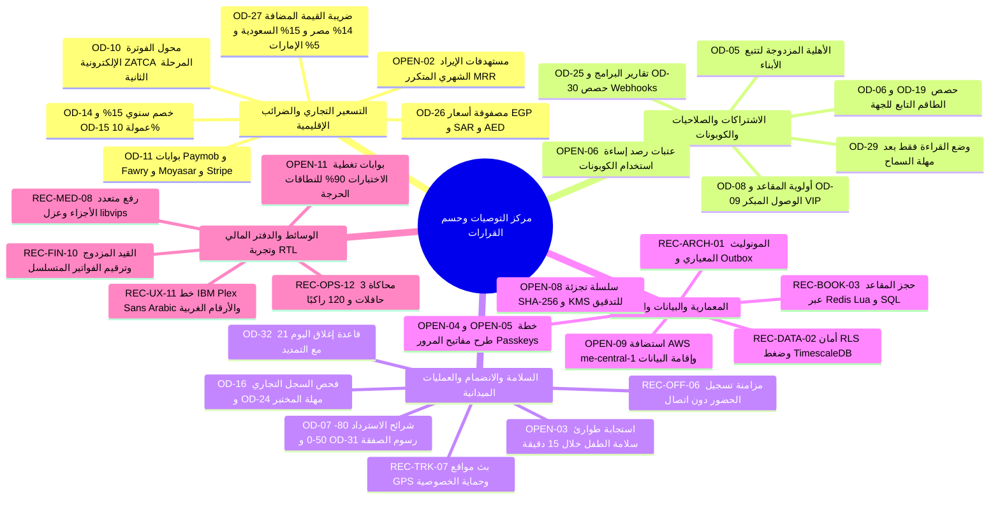

يمثّل **مركز التوصيات وحسم القرارات المفتوحة** حلقة الوصل التنفيذية بين حوكمة الأعمال والامتثال التنظيمي في مصر والخليج والتنفيذ الهندسي لمنصة **Trips Enjoy**. يجد القارئ هنا توصية مرجعية رقمية قابلة للتنفيذ الفوري لكل قرار مفتوح أو مقترح في [القسم 11 من BRD](/ar/docs/brd/compliance#11-القرارات-المفتوحة)، ولكل علامة `[OPEN]` مضمّنة عبر [متطلبات الأعمال (BRD)](/ar/docs/brd) و[متطلبات البرمجيات (SRS)](/ar/docs/srs) و[نموذج البيانات (ERD)](/ar/docs/erd) و[نظام التصميم](/ar/docs/design)، فضلًا عن المخططات الهندسية والتشغيلية الحاسمة.

<Callout type="info" title="شفافية التدقيق وعدم تغيير حالات الاعتماد قبل التوقيع الرسمي">
حفاظًا على سلامة التدقيق المؤسسي، تبقى البنود الموسومة بحالة `مفتوح` أو `مقترح` في [القسم 11 من BRD](/ar/docs/brd/compliance#11-القرارات-المفتوحة) على حالتها الصريحة في وثيقة متطلبات الأعمال إلى حين توقيع أصحاب الصلاحية المسمّين ([OPEN-01](/ar/docs/recommendations/open-decisions#open-01)). وتعتمد فرق الهندسة والتصميم والتشغيل **القرارات الموصى بها** في هذا المركز كقيم افتراضية معيارية تمنع تعطّل البناء بسبب غياب جداول الأسعار أو عتبات الحماية أو غموض الحالات الحدية.
</Callout>

## منهجية الحوكمة وكيفية استخدام هذا المركز

1. **47 بطاقة لحسم القرارات والبنود المفتوحة (`OD-01`..`OD-32` + `OPEN-01`..`OPEN-15`):** يقدّم دليل [حسم القرارات المفتوحة والبنود المعلقة](/ar/docs/recommendations/open-decisions) توصيات رقمية مفصّلة لجميع القرارات الـ **21** المفتوحة أو المقترحة، وضوابط تنفيذية ملزمة للقرارات الـ **11** المقرَّرة سلفًا، وحلولًا هندسية وقانونية لجميع علامات `[OPEN]` الـ **15** المضمّنة في الوثائق بعملات الأسواق الثلاثة (`EGP` و`SAR` و`AED`).
2. **12 مخططًا هندسيًا وتشغيليًا معمقًا (`REC-ARCH-01`..`REC-OPS-12`):** يضع دليل [توصيات المعمارية والأمان والتشغيل](/ar/docs/recommendations/architecture-and-ops) المخططات المرجعية لنمط `Transactional Outbox`، وأمان مجمّع اتصالات PostgreSQL مع `RLS`، وحجز المقاعد الذري عبر Redis وPostgres، وتوجيه بوابات الدفع الإقليمية، ومحوّلات الفوترة الإلكترونية `ZATCA Phase 2` و`ETA` المصرية، ومزامنة تطبيق المشرف دون اتصال، وبث مواقع GPS مع حماية الخصوصية، ومعالجة الوسائط المعزولة عبر `libvips`، وضمانات سلامة الطفل، وثوابت دفتر القيد المزدوج، وتجربة RTL بالأرقام الغربية (`0-9`)، واختبارات الفوضى لرحلة الـ 3 حافلات و120 راكبًا.
3. **تتبّع شامل ثنائي الاتجاه عبر جميع الوثائق:** تنتهي كل بطاقة بشريط `<TraceBar />` يربطها مباشرة بمتطلبات وقواعد الأعمال (`BR-*` و`BRL-*`)، والمتطلبات الوظيفية وغير الوظيفية (`FR-*` و`NFR-*` و`DAT-*`)، وجداول قاعدة البيانات في `ERD`، وصفحات مراحل الخطة (`P1`–`P6`)، ومسارات سير العمل، وتدفقات المستخدمين (`UF-*`)، والمعمارية، وأسطح التصميم، و[دورة الحياة الشاملة ذات المراحل الثماني](/ar/docs/system/lifecycle).

## نظرة بصرية شاملة على مسارات التوصيات

<MindmapBlock
  title="إطار حوكمة التوصيات وحسم القرارات المفتوحة"
  caption="توزيع القرارات الـ 32 (OD-*) والبنود المفتوحة الـ 15 (OPEN-*) والمخططات الهندسية الـ 12 (REC-*) عبر مراحل التسليم من P1 إلى P6."
  trace={{
    brd: [
      { label: 'BRD §11 القرارات المفتوحة', href: '/ar/docs/brd/compliance#11-القرارات-المفتوحة' },
      { label: 'BRD §5 النموذج التجاري', href: '/ar/docs/brd#5-النموذج-التجاري' },
    ],
    srs: [
      { label: 'SRS §11 البنود المفتوحة والتعارضات', href: '/ar/docs/srs/traceability#11-البنود-المفتوحة-والتعارضات' },
      { label: 'SRS §8 متطلبات الجودة', href: '/ar/docs/srs/quality#8-المتطلبات-غير-الوظيفية' },
    ],
    erd: [
      { label: 'نطاقات نموذج البيانات', href: '/ar/docs/erd#النطاقات' },
      { label: 'صلاحيات الوصول و RLS', href: '/ar/docs/erd/acl' },
    ],
    plan: [
      { label: 'معالم المراحل', href: '/ar/docs/plan/milestones' },
      { label: 'دليل البناء', href: '/ar/docs/plan/build-guide' },
    ],
    workflows: [
      { label: 'عقد محرك سير العمل', href: '/ar/docs/workflows#عقد-المحرّك' },
      { label: 'المهام المجدولة', href: '/ar/docs/workflows/scheduled-jobs' },
    ],
    userFlows: [
      { label: 'تدفقات المستخدمين حسب الدور', href: '/ar/docs/user-flows' },
    ],
    architecture: [
      { label: 'معمارية النظام', href: '/ar/docs/architecture' },
    ],
    design: [
      { label: 'نظام التصميم و RTL', href: '/ar/docs/design#rtl-والتعريب' },
    ],
    system: [
      { label: 'دورة الحياة الشاملة للنظام', href: '/ar/docs/system/lifecycle' },
    ],
    recommendations: [
      { label: 'OD-01..OD-32 و OPEN-01..15', href: '/ar/docs/recommendations/open-decisions' },
      { label: 'REC-ARCH-01..REC-OPS-12', href: '/ar/docs/recommendations/architecture-and-ops' },
    ],
  }}
>

</MindmapBlock>

## مصفوفة بوابات حسم القرارات حسب مراحل التسليم

تتطلب كل مرحلة في [خطة التسليم](/ar/docs/plan/milestones) إغلاق القرارات والضوابط المعمارية المرتبطة بها **قبل** بدء تنفيذ مهام المرحلة:

| البوابة | قرارات `OD-*` الحاكمة | البنود المفتوحة `OPEN-*` | المخططات الهندسية `REC-*` | أصحاب الاعتماد | معيار التحقق عند إغلاق المرحلة |
|---|---|---|---|---|---|
| **قبل [P1](/ar/docs/plan/p1)** (الأساس) | [OD-02](/ar/docs/recommendations/open-decisions#od-02)، [OD-03](/ar/docs/recommendations/open-decisions#od-03)، [OD-12](/ar/docs/recommendations/open-decisions#od-12)، [OD-21](/ar/docs/recommendations/open-decisions#od-21)، [OD-23](/ar/docs/recommendations/open-decisions#od-23)، [OD-32](/ar/docs/recommendations/open-decisions#od-32) | [OPEN-01](/ar/docs/recommendations/open-decisions#open-01)، [OPEN-08](/ar/docs/recommendations/open-decisions#open-08)، [OPEN-09](/ar/docs/recommendations/open-decisions#open-09)، [OPEN-10](/ar/docs/recommendations/open-decisions#open-10)، [OPEN-11](/ar/docs/recommendations/open-decisions#open-11)، [OPEN-12](/ar/docs/recommendations/open-decisions#open-12)، [OPEN-13](/ar/docs/recommendations/open-decisions#open-13)، [OPEN-14](/ar/docs/recommendations/open-decisions#open-14)، [OPEN-15](/ar/docs/recommendations/open-decisions#open-15) | [REC-ARCH-01](/ar/docs/recommendations/architecture-and-ops#rec-arch-01)، [REC-DATA-02](/ar/docs/recommendations/architecture-and-ops#rec-data-02)، [REC-SEC-09](/ar/docs/recommendations/architecture-and-ops#rec-sec-09)، [REC-UX-11](/ar/docs/recommendations/architecture-and-ops#rec-ux-11) | المنتج، القانونية، الأمان، الهندسة، التصميم | نجاح اختبارات عزل المستأجرين RLS؛ والتحقق من سلسلة تجزئة `audit_events`؛ واجتياز مؤقتات اليوم 14 واليوم 21. |
| **قبل [P2](/ar/docs/plan/p2)** (تجربة مصر) | [OD-01](/ar/docs/recommendations/open-decisions#od-01)، [OD-04](/ar/docs/recommendations/open-decisions#od-04)، [OD-07](/ar/docs/recommendations/open-decisions#od-07)، [OD-11](/ar/docs/recommendations/open-decisions#od-11)، [OD-15](/ar/docs/recommendations/open-decisions#od-15)، [OD-20](/ar/docs/recommendations/open-decisions#od-20)، [OD-27](/ar/docs/recommendations/open-decisions#od-27) (ضريبة مصر 14%) | [OPEN-04](/ar/docs/recommendations/open-decisions#open-04)، [OPEN-05](/ar/docs/recommendations/open-decisions#open-05) | [REC-BOOK-03](/ar/docs/recommendations/architecture-and-ops#rec-book-03)، [REC-PAY-04](/ar/docs/recommendations/architecture-and-ops#rec-pay-04)، [REC-FIN-10](/ar/docs/recommendations/architecture-and-ops#rec-fin-10) | المالية، القانونية، العمليات، هندسة المدفوعات | عدم تكرار معالجة إشعارات Paymob وFawry وStripe بالجنيه المصري؛ وتوازن دفتر الأستاذ؛ واختبار التزاحم على المقاعد. |
| **قبل [P3](/ar/docs/plan/p3)** (العمق التشغيلي) | [OD-06](/ar/docs/recommendations/open-decisions#od-06)، [OD-08](/ar/docs/recommendations/open-decisions#od-08)، [OD-19](/ar/docs/recommendations/open-decisions#od-19)، [OD-22](/ar/docs/recommendations/open-decisions#od-22)، [OD-25](/ar/docs/recommendations/open-decisions#od-25) | [OPEN-03](/ar/docs/recommendations/open-decisions#open-03) (مسؤول ومناوبة سلامة الطفل)، [OPEN-07](/ar/docs/recommendations/open-decisions#open-07) | [REC-OFF-06](/ar/docs/recommendations/architecture-and-ops#rec-off-06)، [REC-OPS-12](/ar/docs/recommendations/architecture-and-ops#rec-ops-12) | العمليات، مسؤول السلامة، المنتج، هندسة الجوال | اعتماد مناوبة سلامة الطفل بزمن استجابة 15 دقيقة؛ ومزامنة تسجيل حضور 120 راكبًا على 3 حافلات خلال 60 ثانية. |
| **قبل [P4](/ar/docs/plan/p4)** (عرض الموردين) | [OD-13](/ar/docs/recommendations/open-decisions#od-13)، [OD-16](/ar/docs/recommendations/open-decisions#od-16)، [OD-24](/ar/docs/recommendations/open-decisions#od-24)، [OD-26](/ar/docs/recommendations/open-decisions#od-26) (موعد تثبيت الأسعار)، [OD-31](/ar/docs/recommendations/open-decisions#od-31) | [OPEN-13](/ar/docs/recommendations/open-decisions#open-13) (المراجعة القانونية للمختبرات) | [REC-MED-08](/ar/docs/recommendations/architecture-and-ops#rec-med-08)، [REC-SEC-09](/ar/docs/recommendations/architecture-and-ops#rec-sec-09) | المالية، العمليات، القانونية، هندسة الوسائط | توقيع الرأي القانوني لفحوص السائقين؛ وإزالة بيانات EXIF بنسبة 100%؛ وحسم رسوم إلغاء الصفقات بعد الإسناد. |
| **قبل [P5](/ar/docs/plan/p5)** (الإيرادات والخليج) | [OD-09](/ar/docs/recommendations/open-decisions#od-09)، [OD-10](/ar/docs/recommendations/open-decisions#od-10) (ZATCA)، [OD-11](/ar/docs/recommendations/open-decisions#od-11) (الخليج)، [OD-14](/ar/docs/recommendations/open-decisions#od-14)، [OD-18](/ar/docs/recommendations/open-decisions#od-18)، [OD-26](/ar/docs/recommendations/open-decisions#od-26)، [OD-27](/ar/docs/recommendations/open-decisions#od-27) (السعودية 15%، الإمارات 5%)، [OD-28](/ar/docs/recommendations/open-decisions#od-28)، [OD-29](/ar/docs/recommendations/open-decisions#od-29)، [OD-30](/ar/docs/recommendations/open-decisions#od-30) | [OPEN-02](/ar/docs/recommendations/open-decisions#open-02)، [OPEN-06](/ar/docs/recommendations/open-decisions#open-06)، [OPEN-09](/ar/docs/recommendations/open-decisions#open-09) (التحقق من PDPL السعودي) | [REC-PAY-04](/ar/docs/recommendations/architecture-and-ops#rec-pay-04)، [REC-TAX-05](/ar/docs/recommendations/architecture-and-ops#rec-tax-05)، [REC-FIN-10](/ar/docs/recommendations/architecture-and-ops#rec-fin-10) | المالية، المستشار الضريبي، المنتج، هندسة الخلفية | اجتياز محول ZATCA المرحلة الثانية في بيئة الاختبار؛ والتحقق من سلوك انتهاء مهلة السماح `OD-29`؛ وتفعيل SAR وAED. |
| **قبل [P6](/ar/docs/plan/p6)** (العائلة والتوسّع) | [OD-05](/ar/docs/recommendations/open-decisions#od-05)، [OD-17](/ar/docs/recommendations/open-decisions#od-17)، [OD-18](/ar/docs/recommendations/open-decisions#od-18) | [OPEN-07](/ar/docs/recommendations/open-decisions#open-07) (حدود معدل الوالدين وAPI العامة) | [REC-DATA-02](/ar/docs/recommendations/architecture-and-ops#rec-data-02)، [REC-TRK-07](/ar/docs/recommendations/architecture-and-ops#rec-trk-07)، [REC-OPS-12](/ar/docs/recommendations/architecture-and-ops#rec-ops-12) | المنتج، هندسة الموثوقية SRE، الوقت الفعلي | نجاح اختبار حمل 10,000 نقطة GPS/ثانية؛ وانعدام بيانات الأطفال في `analytics_events`؛ واختبار التحول التلقائي إلى SSE. |

## أبرز التعارضات المحسومة والقيم المرجعية عالية الأثر

يعالج هذا المركز ستة تعارضات وفجوات جوهرية كانت موزعة بين سجل القرارات ووثيقتي الأعمال والبرمجيات بعقود تنفيذية حاسمة:

| البند | التعارض أو الفجوة في المواصفات | ملخص القرار الموصى به للاعتماد | المخطط الهندسي المرافق |
|---|---|---|---|
| **[OD-29](/ar/docs/recommendations/open-decisions#od-29)** | ينص `D-08` على الهبوط للباقة الأساسية وحجب الحجوزات الجديدة بعد انتهاء مهلة السماح (7 أيام)، بينما تشترط [BRL-02](/ar/docs/brd/requirements#7-قواعد-العمل) خطة مدفوعة نشطة لكل دور غير المسافر (ما يعني الحجب الكامل). | تطبيق **وضع القراءة فقط لتعليق الفوترة** (`Past_Due_Locked`) للجهات المنظِّمة وسائقي ومصوّري المنصة: تستمر الرحلات المؤكدة وكشوف الركاب وتسجيل الحضور ورفع الألبومات وصرف المستحقات الأسبوعي حتى الاكتمال حمايةً للمسافرين، بينما يُحجب نشر الرحلات الجديدة أو التقدم للصفقات أو إضافة الموارد برمز `402 PLAN_REQUIRED` التزامًا بـ `BRL-02`. أما المسافر فيعود تلقائيًا إلى باقة `Free`. | [REC-FIN-10](/ar/docs/recommendations/architecture-and-ops#rec-fin-10) |
| **[OD-32](/ar/docs/recommendations/open-decisions#od-32)** | يذكر سجل القرارات إغلاق طلب الانضمام بحالة `Changes_Requested` في اليوم 14، بينما تقترح تدفقات الجوال اليوم 21 عند طلب تمديد. | **معادلة حتمية `14 + 7 = 21` يومًا:** يحصل كل طلب بحالة `Changes_Requested` على مهلة أساسية مدتها **14 يومًا تقويميًا** (`closes_at = requested_at + 14d`)، ويحق لمقدّم الطلب طلب **تمديد وحيد لمدة 7 أيام** قبل انتهاء المهلة ليصبح الإغلاق التلقائي في **اليوم 21** (`requested_at + 21d`). | [REC-OPS-12](/ar/docs/recommendations/architecture-and-ops#rec-ops-12) |
| **[OD-10](/ar/docs/recommendations/open-decisions#od-10)** | أُجِّل تكامل الفوترة الإلكترونية السعودية `ZATCA` لما بعد المراحل P1–P4، لكن المرحلة P5 تطلق السوق السعودية (`SAR`) بفواتير B2B وB2C إلزامية. | بناء واجهة **`TaxComplianceAdapter`** داخلية منذ P2 (إصدار PDF قياسي مع جاهزية إيصالات مصلحة الضرائب المصرية ETA)، وتنفيذ **المرحلة الثانية من ZATCA (فاتورة UBL 2.1 XML وختم التشفير ECDSA ورمز TLV QR)** قبل إطلاق السعودية في P5 (اعتماد فوري لفواتير B2B وإبلاغ خلال 24 ساعة لفواتير B2C المبسطة). | [REC-TAX-05](/ar/docs/recommendations/architecture-and-ops#rec-tax-05) |
| **[OD-26](/ar/docs/recommendations/open-decisions#od-26)** | غياب أسعار الخطط المعتمدة عبر الأدوار الأربعة والعملات الثلاث (`EGP` و`SAR` و`AED`) يهدد بتأخير إيرادات المرحلة P5 (`RSK-07`). | اعتماد **جداول أسعار مرجعية مراعية للقوة الشرائية في المنطقة** داخل `plan_prices` (مثل خطط الجهات `Starter / Growth / Enterprise`: `1,490 / 4,490 / 11,900 EGP` و`299 / 899 / 2,499 SAR` و`299 / 899 / 2,499 AED`؛ وباقات المسافر `Explorer / VIP`: `99 / 249 EGP` و`29 / 69 SAR` و`29 / 69 AED`) مع خصم سنوي 15% ([OD-14](/ar/docs/recommendations/open-decisions#od-14)). | [REC-FIN-10](/ar/docs/recommendations/architecture-and-ops#rec-fin-10) |
| **[OD-27](/ar/docs/recommendations/open-decisions#od-27)** | تُركت نسب ضريبة القيمة المضافة وطريقة عرضها في فواتير الأفراد والشركات مفتوحة بانتظار الإدارة المالية. | تهيئة جدول `tax_rates` بالنسب النظامية القياسية قابلة للتأريخ دون تثبيت برمجي: **مصر `14%`**، **السعودية `15%`**، **الإمارات `5%`**؛ مع عرض الأسعار **شاملةً الضريبة** للمسافرين الأفراد (B2C) مع تفصيل الضريبة في الفاتورة، وعرض **السعر الأساسي + الضريبة المفصّلة** في تسويات وفواتير الشركات (B2B). | [REC-TAX-05](/ar/docs/recommendations/architecture-and-ops#rec-tax-05) |
| **[OPEN-03](/ar/docs/recommendations/open-decisions#open-03)** | اشتراط وجود جهة اتصال وإجراء تصعيد لبلاغات سلامة الطفل (`D-68`) قبل تجربة المرحلة P3 لرحلات المدارس والعائلات. | تعيين **قائد الثقة وسلامة الطفل** بالاسم مع جدول مناوبة على مدار الساعة لمشرفي العمليات عبر PagerDuty، باتفاقية استجابة وفرز خلال **15 دقيقة** أثناء الرحلات الجارية، واشتراط موافقة مشرفين لرفع الإيقاف (`D-233`)، وعزل تام لبيانات الأطفال عن التحليلات والتسويق. | [REC-SEC-09](/ar/docs/recommendations/architecture-and-ops#rec-sec-09) |

## أدلة التوصيات في هذا القسم

<Cards>
  <Card
    title="حسم القرارات المفتوحة والبنود المعلقة (47 بطاقة)"
    description="توصيات مرجعية شاملة وإرشادات تنفيذية للقرارات OD-01..OD-32 والبنود OPEN-01..OPEN-15 مع روابط تتبع كاملة عبر جميع الوثائق."
    href="/ar/docs/recommendations/open-decisions"
  />
  <Card
    title="مخططات المعمارية والأمان والتشغيل (12 بطاقة)"
    description="مخططات هندسية إنتاجية من REC-ARCH-01 إلى REC-OPS-12 تغطي Outbox وRLS وحجز المقاعد وبوابات الدفع وZATCA والعمل دون اتصال وGPS والوسائط والدفتر المالي وRTL."
    href="/ar/docs/recommendations/architecture-and-ops"
  />
  <Card
    title="سجل القرارات المفتوحة في BRD §11"
    description="الجدول المرجعي لمتطلبات الأعمال الذي يوضح حالات القرارات (مقرَّر، مقترح، مفتوح) وسجل المخاطر وجدول الاعتماد."
    href="/ar/docs/brd/compliance#11-القرارات-المفتوحة"
  />
  <Card
    title="دورة الحياة الشاملة للنظام (8 مراحل)"
    description="تتبّع كيف تتجسد هذه القرارات والمخططات عمليًا خطوة بخطوة منذ تسجيل الحساب واعتماد المستأجر حتى التسويات المالية الأسبوعية."
    href="/ar/docs/system/lifecycle"
  />
</Cards>
