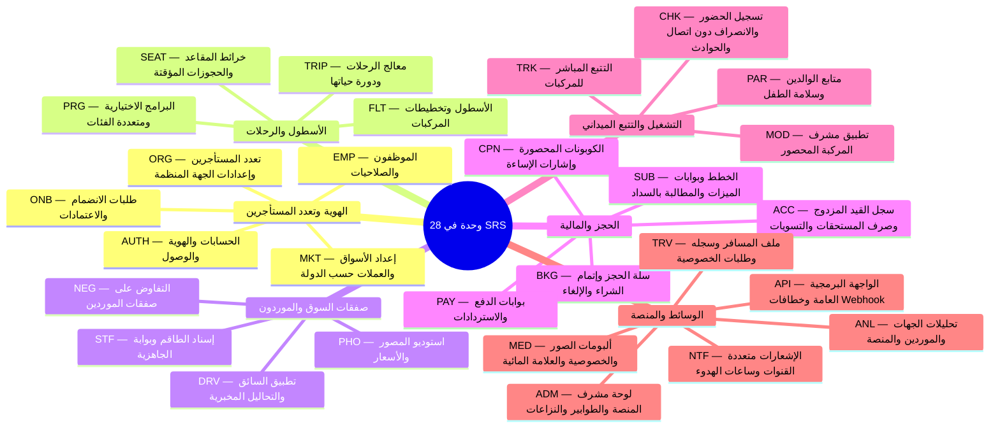

## 1. التحكم في المستند

<Callout type="info" title="التحكم في المستند">

**المنتج** Trips Enjoy (trips-enjoy.com)  
**نوع المستند** مواصفة المتطلبات البرمجية  
**الإصدار** 1.1  
**التاريخ** 9 نوفمبر 2026  
**الحالة** قيد المراجعة. العناصر المعلَّمة بـ [OPEN] تحتاج إلى قرار قبل إطلاق السلوك المتأثر بها. العناصر المعلَّمة بـ (placeholder) تحمل قيمة عملية يجب أن يؤكدها المالك المسمّى.  
**المالك** فريق المنتج والهندسة (Trips Enjoy)  
**المعتمِدون** [OPEN: معتمِدون بالأسماء، D-314 — مصفوفة الاعتماد المقترحة في OPEN-01](/ar/docs/recommendations/open-decisions#open-01)  
**المستندات المرافقة** [BRD](/ar/docs/brd) v1.1 (مصدر كل معرّف BR وBRL وOD وRSK)، [ERD](/ar/docs/erd) v1.0 (نموذج البيانات)، user-flows/ من 00 إلى 08 (تدفقات كل تطبيق)، Tasks.md (قائمة مهام التسليم)، trips-enjoy-technical-architecture.md (الهندسة، 18 أبريل 2026).  
**حالة المصادر لهذا الإصدار** قُرئت بالكامل: BRD v1.1، والهندسة التقنية (18 أبريل 2026)، وسير عمل النظام (18 أبريل 2026)، وقواعد المصادقة والحسابات (4 أكتوبر 2026)، وتدقيق قيمة التصميم وتدقيق تغطية الشاشات (17 أكتوبر 2026، وتشيران إلى أرقام D في سجل القرارات). وعندما تتعارض مستندات أكتوبر مع مستندات أبريل، فمستندات أكتوبر هي الغالبة.

</Callout>

<TraceBar
  brd={[
    { label: 'نظرة عامة على BRD', href: '/ar/docs/brd' },
    { label: 'المتطلبات وقواعد العمل', href: '/ar/docs/brd/requirements', detail: 'BRL-01..30' },
    { label: 'القرارات المفتوحة', href: '/ar/docs/brd/compliance#11-القرارات-المفتوحة', detail: 'OD-01..32' },
  ]}
  srs={[
    { label: 'ملخص القدرات', href: '/ar/docs/srs/capabilities', detail: '28 وحدة' },
    { label: 'آلات الحالات', href: '/ar/docs/srs/state-machines', detail: '10 آلات' },
    { label: 'قواعد البيانات', href: '/ar/docs/srs/data', detail: 'DAT-*' },
    { label: 'الجودة وNFRs', href: '/ar/docs/srs/quality', detail: 'NFR-*' },
    { label: 'مصفوفة التتبع', href: '/ar/docs/srs/traceability' },
  ]}
  erd={[
    { label: 'نموذج البيانات', href: '/ar/docs/erd', detail: '14 نطاقًا' },
    { label: 'ACL وRLS', href: '/ar/docs/erd/acl' },
  ]}
  plan={[
    { label: 'خطة التسليم', href: '/ar/docs/plan', detail: '231 مهمة · P1–P6' },
    { label: 'استراتيجية الاختبار', href: '/ar/docs/plan/testing' },
  ]}
  workflows={[
    { label: 'سير العمل في النظام', href: '/ar/docs/workflows', detail: '10 عمليات' },
    { label: 'مصفوفة التغطية', href: '/ar/docs/workflows/coverage', detail: '213/213 FR' },
  ]}
  userFlows={[
    { label: 'تدفقات المستخدم', href: '/ar/docs/user-flows', detail: '106 UF-*' },
  ]}
  architecture={[
    { label: 'معمارية المنصة', href: '/ar/docs/architecture' },
  ]}
  design={[
    { label: 'نظام التصميم', href: '/ar/docs/design' },
  ]}
  system={[
    { label: 'النظام الشامل', href: '/ar/docs/system' },
    { label: 'أطلس الخرائط الذهنية', href: '/ar/docs/system/mindmaps' },
  ]}
  recommendations={[
    { label: 'مركز التوصيات', href: '/ar/docs/recommendations' },
    { label: 'حسم القرارات المفتوحة', href: '/ar/docs/recommendations/open-decisions', detail: '#open-14' },
  ]}
/>

### 1.1 التغييرات عن v1.0

| النطاق | التغيير |
|---|---|
| المصادر | تمت مراجعة الهندسة وسير العمل وقواعد المصادقة. أُغلق التعارض C-06 (عدم مراجعة الهندسة) وC-07 (غياب user-flows من 03 إلى 08). |
| العناصر المفتوحة المغلقة | حوالي 40 عنصرًا [OPEN] أصبحت الآن محدَّدة من سجل القرارات: التحقق حسب الدور، ونافذة الاعتراض، وانتهاء صلاحية الصفقة، وجدول الاسترداد (placeholder)، وإعادة المحاولة بعد انتهاء الحجز المؤقت، وعدد محاولات الدفع، وتعريف الرحلة النشطة، واحتساب الكوبونات، وسياسة webhook، وقواعد الفواتير، وقواعد التسوية، وجدول صرف المستحقات، ومستويات خدمة النزاعات (SLA)، وفئات الحوادث، وفترات الاحتفاظ، ومراحل السعة، والنسخ الاحتياطية، وأدوات المراقبة (observability)، والتنبيه الطارئ (paging)، وإشعار الإيقاف التدريجي، ونافذة الصيانة، وشكل الأرقام. |
| السلوك المتغيِّر | الرحلات التي تلغيها الجهة المنظِّمة تُسترَدّ قيمتها كاملة الآن (D-150، وكانت «السياسة نفسها المطبَّقة على استرداد المسافر»). حالة Filling Up تبدأ الآن عند 80 بالمئة من المقاعد المحجوزة (D-189، وكانت «أول حجز»). تُحفظ أحداث تسجيل الحضور سنة واحدة لا 7 سنوات (D-45). قفل الحساب يسري الآن على جميع الأدوار (D-53). |
| الوحدات الجديدة | MKT (الأسواق)، ANL (التحليلات)، API (واجهة برمجية عامة، Could). |
| المتطلبات الجديدة | [FR-ORG-08](/ar/docs/srs/requirements/org#fr-org-08--هوية-بصرية-مخصصة), [FR-STF-07](/ar/docs/srs/requirements/stf#fr-stf-07--مهلة-إعادة-الإسناد), [FR-PAY-08](/ar/docs/srs/requirements/pay#fr-pay-08--الدفع-المعلق), [FR-SUB-08](/ar/docs/srs/requirements/sub#fr-sub-08--المطالبة-بعد-الفشل-dunning) إلى [FR-SUB-11](/ar/docs/srs/requirements/sub#fr-sub-11--فشل-خدمة-الخطط), [FR-TRK-07](/ar/docs/srs/requirements/trk#fr-trk-07--لا-موقع-مباشر-للمسافرين), [FR-DRV-08](/ar/docs/srs/requirements/drv#fr-drv-08--إتاحة-السائق), [FR-NTF-07](/ar/docs/srs/requirements/ntf#fr-ntf-07--تذكيرات-الرحلات-وإشعارات-التغييرات), [FR-ADM-08](/ar/docs/srs/requirements/adm#fr-adm-08--معالجة-النزاعات), [FR-ADM-09](/ar/docs/srs/requirements/adm#fr-adm-09--طلبات-الفحص-المخبري), [FR-ACC-08](/ar/docs/srs/requirements/acc#fr-acc-08--فواتير-لجميع-الأطراف) إلى [FR-ACC-10](/ar/docs/srs/requirements/acc#fr-acc-10--الأرشفة-بعد-التسوية), [FR-MKT-01](/ar/docs/srs/requirements/mkt#fr-mkt-01--إعداد-السوق) إلى [FR-MKT-06](/ar/docs/srs/requirements/mkt#fr-mkt-06--نطاق-البلد-ومرشِّح-القوائم), [FR-ANL-01](/ar/docs/srs/requirements/anl#fr-anl-01--تحليلات-الجهة-المنظِّمة) إلى [FR-ANL-05](/ar/docs/srs/requirements/anl#fr-anl-05--الخصوصية-في-التحليلات), [FR-API-01](/ar/docs/srs/requirements/api#fr-api-01--واجهة-api-العامة). |
| آلات حالات جديدة | 7.9 التسوية، 7.10 النزاع. |
| البيانات | يشير القسم 6 الآن إلى [ERD](/ar/docs/erd) للجداول والأعمدة؛ ووُسِّعت قائمة الكيانات بكيانات Market وSettlement وDispute وAnalytics. |
## 2. المقدمة

### 2.1 الغرض

تحدد هذه المواصفة (SRS) ما يجب أن تفعله برمجيات Trips Enjoy والخصائص التي يجب أن تتحلى بها. وهي أساس التصميم والبناء والاختبار والقبول. كل متطلب وظيفي يرجع إلى متطلب عمل (BR) أو قاعدة عمل (BRL) أو قرار مفتوح (OD) في BRD. ويحتوي القسم 10 على مصفوفة التتبع. يحدد BRD ما يحتاجه العمل، وتحدد هذه المواصفة كيف يجب أن تتصرف البرمجيات لتلبية تلك الاحتياجات. ولا تعيد صياغة سياسة العمل إلا حيث يجب على البرمجيات فرضها.

### 2.2 النطاق

Trips Enjoy منصة SaaS متعددة المستأجرين ثنائية اللغة (العربية والإنجليزية) للرحلات الجماعية المنظمة. تغطي هذه المواصفة برمجيات:

- الحسابات والهوية وتسجيل الدخول والتسجيل الخاص بكل دور.
- طلبات الانضمام والاعتمادات للجهات المنظِّمة وسائقي المنصة ومصوّري المنصة.
- مساحات عمل الجهات المنظِّمة: الرحلات، والبرامج، والأسطول، والطاقم، والموظفون والصلاحيات، والكوبونات، والاشتراكات، والمحاسبة، والفواتير، والتحليلات، وCRM، وwebhooks.
- حجز المسافر، واختيار المقعد، وإتمام الشراء، والدفع، والاستردادات، والإيصالات، والفواتير.
- التفاوض على الصفقات بين الجهات المنظِّمة وموردي المنصة.
- تسجيل الحضور والانصراف لدى مشرف المركبة، والتتبع المباشر، ومتابع الوالدين.
- ألبومات الصور بثلاثة أوضاع للخصوصية.
- سير عمل التحاليل المخبرية للسائق.
- الإشعارات، ولوحة مشرف المنصة، والسجل، وصرف المستحقات، والتسويات.
- إعداد السوق حسب الدولة.

لا تغطي هذه المواصفة سياسة العمل فيما يتجاوز ما تفرضه البرمجيات (BRD)، ولا المراجعات القانونية لكل سوق، ولا محتوى موقع التسويق، ولا التصميم المرئي، ولا المواصفة التفصيلية للـ API (OpenAPI، وتُولَّد من الكود).

### 2.3 التعريفات والاختصارات

| المصطلح | المعنى |
|---|---|
| لوحة مشرف المنصة | تطبيق الويب الخاص بطاقم المنصة على admin.trips-enjoy.com. |
| مقدِّم الطلب | مستخدم أرسل طلب انضمام ليصبح جهة منظِّمة أو سائق منصة أو مصوّر منصة. |
| BR, BRL, OD, RSK | معرّفات متطلب العمل وقاعدة العمل والقرار المفتوح والمخاطر في BRD. |
| ربط الطفل | سجل يربط أحد الوالدين أو ولي الأمر بمسافر طفل في حجز واحد. |
| D-nn | قرار في سجل القرارات، كما ورد في تدقيق قيمة التصميم (17 أكتوبر 2026). |
| الصفقة | اتفاق متفاوض عليه بين جهة منظِّمة وسائق أو مصوّر منصة لمركبة أو رحلة واحدة. |
| Dunning | إعادة محاولات الدفع والتذكيرات بعد فشل دفع الاشتراك. |
| بوابة الميزة | تحقق من جهة الخادم يمنع إجراءً عندما لا تسمح به خطة الحساب. |
| FR | متطلب وظيفي. |
| فترة السماح | السبعة أيام التي تلي فشل التجديد وتبقى الميزات نشطة خلالها. |
| الحجز المؤقت (Hold) | حجز مؤقت لمقعد أثناء إتمام الشراء لمدة 15 دقيقة. |
| السجل | سجل القيد المزدوج لكل حدث مالي. |
| السوق | إعداد الدولة الذي يحدد العملة وطرق الدفع وقواعد الضريبة والمنطقة الزمنية الافتراضية. |
| المشرف | شخص يشرف على مركبة واحدة في رحلة واحدة. لا يرى سوى تلك المركبة. |
| MoSCoW | مقياس الأولوية: Must وShould وCould. يقابل M وS وC في BRD. |
| NFR | متطلب غير وظيفي. |
| الجهة المنظِّمة | شركة سفر أو مدرسة أو جهة عمل أو منظِّم فعاليات تدير الرحلات. كل جهة منظِّمة هي مستأجر. |
| السائق أو المصوّر التابع لجهة منظِّمة | سائق أو مصوّر ينتمي إلى جهة منظِّمة واحدة ولا تراه إلا هي. |
| متابع الوالدين | قسم تطبيق المسافر حيث يرى الوالدان حالة رحلة أبنائهما المرتبطين. |
| سائق أو مصوّر المنصة | مورد مستقل معتمد من مشرف المنصة يخدم أي جهة منظِّمة من خلال صفقة. |
| الخطة | مستوى اشتراك بحدود وميزات، لدور واحد، ومسعَّر لكل سوق. |
| التسوية | سجل المبالغ المستحقة لكل رحلة بين المنصة والجهة المنظِّمة ومورديها، ويُتابَع حتى تُدفع كل بند. |
| المستأجر | مساحة العمل المعزولة لجهة منظِّمة واحدة. |
| المسافر | شخص يحجز الرحلات ويشارك فيها. |
| الرحلة | السجل الوحيد لرحلة منظمة واحدة، وقد تشغّل مركبات عديدة. |
| نوع المركبة | تخطيط مقاعد قابل لإعادة الاستخدام. |
| ZATCA | هيئة الفوترة الإلكترونية في المملكة العربية السعودية وقواعدها. |
| الاختصارات | API: واجهة برمجة التطبيقات. CDN: شبكة توصيل المحتوى. FCM وAPNS: خدمة Firebase Cloud Messaging وخدمة الإشعارات الفورية من Apple. GDPR: اللائحة العامة لحماية البيانات في الاتحاد الأوروبي. GPS: نظام تحديد المواقع العالمي. HMAC: رمز مصادقة رسائل قائم على التجزئة. JWT: JSON Web Token. MRR: الإيراد الشهري المتكرر. OTP: كلمة مرور للاستخدام مرة واحدة. PDPL: نظام حماية البيانات الشخصية. PWA: تطبيق ويب تقدمي. RLS: أمان على مستوى الصفوف. RPO وRTO: هدفا نقطة الاستعادة وزمن الاستعادة. SSE: الأحداث المرسلة من الخادم. TLS: أمان طبقة النقل. WCAG: إرشادات إتاحة محتوى الويب. |

### 2.4 المراجع

| المستند | الإصدار أو التاريخ | الاستخدام في هذه المواصفة |
|---|---|---|
| [BRD](/ar/docs/brd) | v1.1، 9 نوفمبر 2026 | المصدر الأساسي لمعرّفات BR وBRL وOD وRSK، والخطط والأسواق والتدفقات. |
| [ERD](/ar/docs/erd) | v1.0، 9 نوفمبر 2026 | الجداول والأعمدة والأنواع المرجعية ومسارات RLS لكل كيان في القسم 6. |
| user-flows/ | 9 نوفمبر 2026 | تدفقات كل تطبيق (معرّفات UF)، والشاشات والحالات الحدية. |
| الهندسة التقنية | 18 أبريل 2026 | الحزمة التقنية، ونموذج تعدد المستأجرين، وتصميم الزمن الحقيقي، والمدفوعات، والوسائط، والمهام، والمراقبة، والأمان، والسعة، والنسخ الاحتياطية. |
| سير عمل النظام | 18 أبريل 2026 | آلات الحالات والتتابعات، فيما لا تتناوله مستندات أكتوبر. |
| قواعد المصادقة والحسابات | 4 أكتوبر 2026 | التحقق، والجلسات، وتسجيل الدخول، وطلبات الانضمام، والتحاليل المخبرية، والحذف. |
| تدقيق قيمة التصميم | 17 أكتوبر 2026 | قيم سجل القرارات (أرقام D) وتعارضات اللوحة التصميمية (canvas). |

### 2.5 اصطلاحات المستند

- تستخدم معرّفات المتطلبات الصيغة FR-module-NN وNFR-group-NN. المعرّفات ثابتة. المعرّف المُلغى لا يُعاد استخدامه.
- لكل متطلب وظيفي عنوان، وعبارة «يجب أن»، وأولوية، ومصادره، ومعيار قبول واحد إلى ثلاثة معايير قبول مكتوبة بصيغة Given, when, then.
- تُحدَّد الأولويات بمقياس MoSCoW. تعني Must أنه مطلوب لمرحلة BRD التي تظهر فيها الوحدة. وتعني Should أنه مطلوب في تلك المرحلة إذا سمح الجهد. وتعني Could أنه قابل للتأجيل.
- يعلِّم [OPEN] قيمةً لم يحددها أي مصدر. ويعلِّم (placeholder) قيمةً عملية يجب أن يؤكدها مالكها. لا يمنع أيٌّ منهما المتطلبات المحيطة به، لكن السلوك المتأثر لا يُطلق حتى تُحدَّد القيمة.
- المبلغ المالي قيمة بالوحدات الصغرى مقترنة برمز عملة. كل مبلغ معروض يحمل رمز عملته.
- المصطلحات تتبع مسرد BRD.
## 3. الوصف العام

### 3.1 منظور المنتج

Trips Enjoy منتج واحد بقاعدة كود واحدة (بنية أحادية معيارية modular monolith) وبيانات متعددة المستأجرين بمخطط مشترك مع أمان على مستوى الصفوف (القسمان 1 و4 من وثيقة الهندسة).

| الجزء | الشكل | المستخدمون الأساسيون |
|---|---|---|
| تطبيق المسافر، بما في ذلك قسم متابع الوالدين | ويب متجاوب وتطبيقات جوال (iOS، Android) | المسافرون والوالدان وأولياء الأمور |
| لوحة الجهة المنظِّمة | تطبيق ويب متجاوب على business.trips-enjoy.com | مالكو الجهات المنظِّمة وموظفوها |
| لوحة مشرف المنصة | تطبيق ويب على admin.trips-enjoy.com، لطاقم المنصة فقط | مشرفو المنصة |
| تطبيق السائق | تطبيق جوال؛ والويب محصور بالمستندات والملف الشخصي (D-86) | سائقو المنصة والسائقون التابعون للجهات المنظِّمة |
| استوديو المصوّر | ويب متجاوب في المرحلة الأولى، مع توفير تطبيق جوال (D-86) | مصوّرو المنصة والمصوّرون التابعون للجهات المنظِّمة |
| تطبيق المشرف | تطبيق ويب قابل للتثبيت على الهواتف، محصور بمركبة واحدة | مشرفو المركبات |
| خدمات الواجهة الخلفية | REST API، وقناة WebSocket مع بديل SSE، ومهام مجدولة، وقوائم انتظار، وخدمة إشعارات، ومدفوعات وسجل مالي، ومعالجة وسائط، وبحث | جميع الواجهات والأنظمة الخارجية |
| الأنظمة الخارجية | بوابات الدفع، والمراسلة، والبريد الإلكتروني، والإشعارات الفورية، والخرائط، وشركاء المختبرات، وCRM ووجهات webhook، والسجل التجاري (يدوي في المرحلة الأولى) | انظر القسم 4.3 |

### 3.2 وظائف المنتج حسب الوحدة

| الرمز | الوحدة | الملخص |
|---|---|---|
| AUTH | الحسابات والهوية والوصول | تسجيل خاص بكل دور، والتحقق، وتسجيل الدخول، والجلسات، والحسابات متعددة الأدوار، والتبديل بين الجهات المنظِّمة، والإيقاف والحذف. |
| ONB | طلبات الانضمام والاعتمادات | التقديم، وقائمة الانتظار الإدارية الموحدة، والتغييرات المطلوبة، والرفض، والاعتراض وإعادة التقديم، وقواعد مستندات الموردين. |
| ORG | تعدد المستأجرين وإعدادات الجهة المنظِّمة | إعداد المستأجر، والعزل، والموردون التابعون للجهة المنظِّمة، والأسطول، وإعدادات المقاعد، وCRM وwebhooks، والفواتير، والهوية البصرية. |
| EMP | الموظفون والصلاحيات | الدعوات، ومجموعات الصلاحيات، والحدود، وفرض النطاق. |
| TRIP | الرحلات | المعالج، والنشر، والرحلات متعددة المركبات، ودورة الحياة، والتغييرات التي تمس الحجوزات. |
| PRG | البرامج | نماذج التسعير، وأنواع البرامج، والملخص الحي، وتقارير التسجيل. |
| FLT | الأسطول وأنواع المركبات | تخطيطات المقاعد والمركبات. |
| STF | إسناد الطاقم | مسارا السائق والمصوّر، وبوابة الجاهزية (Ready)، وإسناد المشرفين. |
| NEG | التفاوض على الصفقات | العروض، والمقابلات، وانتهاء الصلاحية، والقبول المتبادل، والإقرار النهائي. |
| SEAT | المقاعد | المقاعد المسندة من الجهة والمختارة ذاتيًا، وخريطة المقاعد الحية، والحجوزات المؤقتة. |
| BKG | الحجز وإتمام الشراء | السلة، والركاب، والبرامج، والمقاعد، والكوبون، وإتمام الشراء، والإلغاء، والإيصالات. |
| PAY | المدفوعات والاستردادات | التحويل إلى البوابة، والنتائج، وحالة الانتظار، وإعادة المحاولات، والاستردادات، والمطابقة. |
| CPN | الكوبونات | النطاق، والتحقق، والاستخدام، والإلغاء، والتحليلات، وإشارات إساءة الاستخدام. |
| SUB | الخطط والاشتراكات | الكتالوج، وبوابات الميزات، والمطالبة بعد الفشل (Dunning)، وفترة السماح، والترقية والتخفيض، والتجاوزات، والعدادات. |
| CHK | تسجيل الحضور والانصراف | أحداث المشرف، ومطابقة المركبة، وقائمة الانتظار دون اتصال، والحوادث، ونسبة الإشغال. |
| MOD | تطبيق المشرف | وصول محصور، وتسجيل الدخول، وتقرير نهاية الرحلة. |
| TRK | التتبع المباشر | مواقع المركبات وحركة الركاب لأغراض التشغيل. |
| PAR | متابع الوالدين | ربط الأبناء، ونطاق العرض، والأهلية، والإشعارات، وتقارير السلامة. |
| MED | الوسائط والألبومات | الألبومات، وأوضاع الخصوصية، والعلامة المائية، والتنزيلات. |
| PHO | استوديو المصوّر | معرض الأعمال، والأسعار، والتوافر، والأرباح، وقواعد الخطة. |
| DRV | تطبيق السائق والتحاليل المخبرية | منطقة العمل، والصفقات، وبوابة التحاليل المخبرية، والمواعيد النهائية، والإيقاف، والأرباح. |
| ADM | لوحة مشرف المنصة | الحسابات، وطاقم الإدارة، والإعدادات، والنزاعات، والتحاليل المخبرية، وسجل التدقيق. |
| ACC | المحاسبة والتسويات | السجل، وعرض المحاسبة، وصرف المستحقات، والتسويات، والفواتير عبر الأطراف، والمطابقة، والتصدير. |
| NTF | الإشعارات | القنوات، واللغة، وساعات الهدوء، والقوالب، والتسليم، والتذكيرات. |
| TRV | ملف المسافر وسجله | الملف الشخصي، والظهور، والسجل، والخصومات، وتغييرات الخطة، وطلبات الخصوصية. |
| MKT | الأسواق | إعداد الدولة: العملة، وطرق الدفع، والضريبة، والمنطقة الزمنية، والأسعار. |
| ANL | التحليلات | تحليلات الجهات المنظِّمة والموردين والإدارة. |
| API | الواجهة البرمجية العامة | API موثَّق للجهات المنظِّمة والشركاء (Could). |

### 3.3 فئات المستخدمين وخصائصها

| فئة المستخدم | الخصائص | متطلب الخطة | الواجهة الرئيسية |
|---|---|---|---|
| زائر | يتصفح الرحلات العامة وصفحات التسجيل. غير مسجِّل الدخول. | لا شيء | تطبيق المسافر |
| المسافر | يحجز الرحلات. يركز على الجوال أولًا. أي عمر، لذا تنطبق قواعد بيانات الأطفال. | لا شيء (Free، Explorer، VIP) | تطبيق المسافر |
| الوالد أو ولي الأمر | مسافر على خطة Explorer أو VIP لديه أبناء مرتبطون. | Explorer أو VIP، إضافة إلى أهلية الجهة المنظِّمة ([FR-PAR-03](/ar/docs/srs/requirements/par#fr-par-03--الأهلية)) | متابع الوالدين |
| مشرف المنصة | من الطاقم. الأدوار: Super admin وOperations وFinance (D-49). | الطاقم | لوحة مشرف المنصة |
| مالك الجهة المنظِّمة | يسجِّل ويدفع ويدير المستأجر. | Starter أو Growth أو Enterprise | لوحة الجهة المنظِّمة |
| موظف الجهة المنظِّمة | يعمل ضمن الصلاحيات الممنوحة. قد ينتمي إلى عدة جهات منظِّمة. | خطة الجهة المنظِّمة | لوحة الجهة المنظِّمة |
| سائق المنصة | مستقل، معتمد من مشرف المنصة. يعمل من خلال الصفقات. | Basic أو Professional أو Premium | تطبيق السائق |
| السائق التابع لجهة منظِّمة | يقود لجهة منظِّمة واحدة فقط. | خطة الجهة المنظِّمة ([OD-19](/ar/docs/brd/compliance#11-القرارات-المفتوحة)، مقترح) | تطبيق السائق |
| مصوّر المنصة | مستقل، معتمد من مشرف المنصة. يعمل من خلال الصفقات. | Basic أو Studio أو Pro | استوديو المصوّر |
| المصوّر التابع لجهة منظِّمة | يعمل لجهة منظِّمة واحدة فقط. | خطة الجهة المنظِّمة ([OD-19](/ar/docs/brd/compliance#11-القرارات-المفتوحة)، مقترح) | استوديو المصوّر |
| مشرف المركبة | مركبة واحدة في رحلة واحدة. غالبًا غير تقني، داخل حافلة، وبيده هاتف. | `[OPEN]` ([OD-06](/ar/docs/brd/compliance#11-القرارات-المفتوحة)) | تطبيق المشرف |

### 3.4 بيئة التشغيل

| البند | المتطلب |
|---|---|
| متصفحات الويب | الإصدار الرئيسي الحالي والسابق من Chrome وSafari وEdge وFirefox على الحواسيب والجوالات ([OPEN: تأكيد القائمة — التوصية المقترحة في OPEN-14](/ar/docs/recommendations/open-decisions#open-14)). |
| أنظمة تشغيل الجوال | iOS وAndroid ([OPEN: الحد الأدنى للإصدارات — التوصية المقترحة في OPEN-14](/ar/docs/recommendations/open-decisions#open-14)). تطلب التطبيقات التحديث عند النزول دون الإصدار المدعوم. |
| تطبيق المشرف | تطبيق ويب قابل للتثبيت على Android وiOS، يعمل على بيانات الجوال، مع قائمة انتظار دون اتصال ([FR-CHK-05](/ar/docs/srs/requirements/chk#fr-chk-05--قائمة-الانتظار-دون-اتصال)). |
| اللغات | العربية (من اليمين إلى اليسار) والإنجليزية منذ الإصدار الأول. الأرقام الغربية من 0 إلى 9 في كلتيهما (D-159). |
| المناطق الزمنية | لكل رحلة منطقة زمنية. تُعتمد المنطقة الزمنية للجهة المنظِّمة افتراضيًا من المنطقة الرئيسية لسوقها: القاهرة أو الرياض أو دبي (D-282). تُعرض الأوقات بمنطقة الرحلة الزمنية، إضافة إلى منطقة المشاهد عند اختلافهما. |
| منطقة الاستضافة | الموصى به: AWS me-central-1 (الإمارات) أساسيًا مع نسخ احتياطية عبر المناطق (الهندسة 20.2) ([OPEN: التأكد في ضوء متطلبات إقامة البيانات المصرية — التوصية المقترحة في OPEN-09](/ar/docs/recommendations/open-decisions#open-09)) ([NFR-DAT-04](/ar/docs/srs/quality#85-البيانات-nfr-dat)، [DAT-04](/ar/docs/srs/data#62-عزل-البيانات)). |

### 3.5 قيود التصميم والتنفيذ

| المعرّف | القيد |
|---|---|
| CON-01 | عزل المستأجرين إلزامي. لا تصبح بيانات جهة منظِّمة مرئية لجهة أخرى أبدًا ([BRL-01](/ar/docs/brd/requirements#7-قواعد-العمل)). |
| CON-02 | لا تصل بيانات البطاقات إلى خوادم Trips Enjoy أبدًا. يعمل الدفع عبر الصفحات المستضافة لدى البوابة أو عبر SDKs ([BR-BKG-02](/ar/docs/brd/requirements#67-الحجز-والدفع-bkg)). |
| CON-03 | العربية والإنجليزية منذ الإصدار الأول، مع تخطيطات من اليمين إلى اليسار. |
| CON-04 | الأسواق: تجربة مصر في المرحلة 2؛ السعودية والإمارات في المرحلة 5 (D-69). |
| CON-05 | الحزمة التقنية الموصى بها (القسم 3 من وثيقة الهندسة، ويؤكَّد في T-FND-01): TypeScript من الطرف إلى الطرف؛ NestJS ببنية أحادية معيارية؛ PostgreSQL 16 مع RLS وTimescaleDB؛ Redis 7؛ SQS وSNS؛ ويب Next.js؛ جوال React Native؛ S3 أو R2 مع CDN؛ AWS مع ECS Fargate؛ Terraform؛ GitHub Actions. |
| CON-06 | تُفرض حدود الخطط وبوابات الميزات على الخادم ([BRL-02](/ar/docs/brd/requirements#7-قواعد-العمل)). |
| CON-07 | كل حدث مالي يُكتب في سجل بالقيد المزدوج ([BRL-18](/ar/docs/brd/requirements#7-قواعد-العمل)). |
| CON-08 | لا تُستخدم بيانات الأطفال للإعلان أو التسويق أو تدريب النماذج أبدًا. |
| CON-09 | يتبع التسليم المراحل الست في BRD 3.3. |
| CON-10 | يتبع الموردون BRD 9.2. ويتبع اختيار البوابة لكل سوق [OD-11](/ar/docs/brd/compliance#11-القرارات-المفتوحة). |
| CON-11 | تتبع اصطلاحات قاعدة البيانات القسم 1 من [ERD](/ar/docs/erd): مفاتيح BIGSERIAL مع UUID عام، وTIMESTAMPTZ، وحذف ناعم مع أعمدة تدقيق، وجداول مرجعية بدل أنواع enum. |

### 3.6 الافتراضات والتبعيات

تنطبق الافتراضات في BRD 9.1 والتبعيات في BRD 9.2. افتراضات إضافية:

| المعرّف | الافتراض | الأثر إن كان خاطئًا |
|---|---|---|
| ASM-01 | يمكن لحساب واحد أن يحمل دوري المسافر والمورد في الوقت نفسه. | تتغير نمذجة الحسابات. |
| ASM-02 | تصل نتائج شريك المختبر إلى المنصة مباشرة. ورفع السائق هو البديل الاحتياطي. | يتغير [FR-DRV-04](/ar/docs/srs/requirements/drv#fr-drv-04--مهلة-الفحص-المختبري-ونتيجته). |
| ASM-03 | لا يُجمع الموقع الحي إلا أثناء كون الرحلة في حالة In Progress. | يتغير تصميم التتبع والخصوصية. |
| ASM-04 | المالك فقط، أو موظف لديه صلاحية الاشتراكات، يغيِّر الخطط والفوترة. | يتغير تصميم الصلاحيات. |
| ASM-05 | تُباع الرحلة بعملة سوق الجهة المنظِّمة فقط. | يلزم تسعير بعدة عملات. |
## 4. متطلبات الواجهات الخارجية

### 4.1 واجهات المستخدم

| الواجهة | المستخدمون | قواعد الوصول |
|---|---|---|
| تطبيق المسافر | المسافرون، الوالدان | تصفح عام. إجراءات الحجز والحساب بعد تسجيل الدخول. |
| لوحة الجهة المنظِّمة | المالكون، الموظفون | كلمة مرور بالإضافة إلى رمز SMS أو رمز تطبيق المصادقة عند كل تسجيل دخول. محصورة بنطاق المستأجر. مع مبدِّل الجهات المنظِّمة. |
| لوحة مشرف المنصة | المشرفون | كلمة مرور مع تطبيق مصادقة إلزامي. مسار منفصل. |
| تطبيق السائق | السائقون | تسجيل دخول. مقيد بأربعة إجراءات أثناء تعلُّق تحليل مخبري ([FR-DRV-03](/ar/docs/srs/requirements/drv#fr-drv-03--الإيقاف-مؤقتًا-لأجل-الفحص-المختبري)). |
| استوديو المصوّر | المصوّرون | تسجيل دخول. ميزات مقيَّدة بالخطة. |
| تطبيق المشرف | المشرفون | رمز الطاقم. مركبة واحدة. |
| متابع الوالدين | الوالدان | قسم من تطبيق المسافر (D-124). الأبناء المرتبطون فقط. |

| المعرّف | متطلب الواجهة | الأولوية |
|---|---|---|
| UI-01 | تدعم كل واجهة العربية والإنجليزية، مع توفير مبدِّل اللغة في كل شاشة دون فقدان المهمة الحالية. | Must |
| UI-02 | تُعكس التخطيطات العربية انعكاسًا كاملًا: التنقل، والنماذج، والجداول، والرسوم البيانية، والأيقونات الدالة على الاتجاه. | Must |
| UI-03 | تستوفي كل واجهة WCAG 2.1 مستوى AA (مقترح). | Must |
| UI-04 | يعيد كل سطح ترتيب محتواه لعرض هاتف قدره 360 px دون تمرير أفقي للصفحة، مع هامش جانبي قدره 16 px. | Must |
| UI-05 | تعرض النماذج الأخطاء بجوار الحقل بلغة المستخدم وتحتفظ بالبيانات المُدخلة بعد الخطأ. | Must |
| UI-06 | كل مبلغ يوسَم برمز عملته ويتبع قاعدة تقريب السوق. | Must |
| UI-07 | تستخدم لوحة مشرف المنصة ولوحة الجهة المنظِّمة مسارات منفصلة عن تطبيق المسافر. | Must |
| UI-08 | تستخدم الإجراءات المدمِّرة وإجراءات تحريك الأموال خطوة تأكيد تُسمِّي الأثر. | Must |
| UI-09 | لا تعرض أي شاشة حقل رقم بطاقة. يفتح الدفع صفحة البوابة أو SDK. | Must |

### 4.2 واجهات العتاد

لا حاجة إلى عتاد خاص. تُستخدم الهواتف للـ GPS (موقع تسجيل الحضور، والتتبع المباشر)، والكاميرا (التقاط المستندات، ومسح التذاكر، ورفع الصور)، والإشعارات الفورية. عند رفض أي إذن، يُخبَر المستخدم بما هو مفقود وما يظل يعمل. وإذا رُفض الموقع عند تسجيل الحضور، يُسجَّل الحدث مع ذلك دون موقع ويُعلَّم (مقترح).

### 4.3 واجهات البرمجيات

| الواجهة | الغرض | ملاحظات |
|---|---|---|
| Stub (للاختبار) + PayPal (Sandbox & Live) | الحجوزات والخطط والاستردادات والمدفوعات | سجل بوابات الدفع القابل للتوصيل ([OD-11](/ar/docs/brd/compliance#11-القرارات-المفتوحة)). |
| SMS وWhatsApp (Twilio أو مزود محلي) | OTP، ورموز الطاقم، والإشعارات | تُسجَّل حالة التسليم؛ ويُبدَّل القناة بعد 3 محاولات تسليم فاشلة. |
| البريد الإلكتروني التشغيلي (AWS SES، وPostmark بديلًا) | الإشعارات، والإيصالات، والفواتير | معالجة الارتداد والشكاوى. |
| الإشعارات الفورية (FCM، APNS) | إشعارات الجوال | رمز (token) لكل جهاز مسجَّل الدخول. |
| الخرائط والتوجيه (Mapbox) | المسارات، والتوقفات، والخريطة الحية | مربعات الخرائط والتوجيه فقط؛ تبقى بيانات الموقع على تخزين المنصة. |
| تخزين الكائنات وCDN (S3 أو R2، وCloudFront أو Cloudflare) | الوسائط والمستندات | مستندات الهوية في حاوية مقيدة. رفع مباشر عبر URL موقَّع مسبقًا. |
| شبكة شركاء المختبرات | التحاليل المخبرية للسائقين | تُرسل النتائج من المختبر إلى المنصة. |
| التحقق من السجل التجاري والضرائب | تهيئة الجهات المنظِّمة | يدوي في المرحلة الأولى ([OD-16](/ar/docs/brd/compliance#11-القرارات-المفتوحة)). |
| CRM وwebhooks الصادرة | إرسال الأحداث إلى أنظمة الجهات المنظِّمة | [FR-ORG-06](/ar/docs/srs/requirements/org#fr-org-06--نظام-crm-وwebhooks). |
| البحث (النص الكامل في Postgres أولًا؛ وOpenSearch أو Meilisearch لاحقًا) | اكتشاف الرحلات والموردين | فهرسة مدفوعة بالأحداث؛ يُقبل تأخير من 5 إلى 30 ثانية. |

### 4.4 واجهات الاتصالات

| المعرّف | المتطلب | الأولوية |
|---|---|---|
| COM-01 | يستخدم كل مرور البيانات بين العميل والخادم HTTPS مع TLS 1.3 وHSTS. تثبِّت تطبيقات الجوال الشهادات. | Must |
| COM-02 | تستخدم قناة الزمن الحقيقي WebSocket مع بديل SSE، لخريطة المقاعد، والتتبع المباشر، وتحديثات الصفقات، ولوحات التشغيل. | Must |
| COM-03 | كل اشتراك في الزمن الحقيقي يُصادَق ويُصرَّح له بالرحلة أو المركبة أو الصفقة أو الحساب الذي يسميه قبل إرسال أي بيانات. | Must |
| COM-04 | تستخدم webhooks الصادرة HTTPS، وتُوقَّع بـ HMAC-SHA256 فوق المتن والطابع الزمني، وتحمل معرّف حدث. يرفض المستقبلون الطوابع الزمنية الأقدم من 5 دقائق (D-62). | Must |
| COM-05 | يُتحقق من عمليات الاستدعاء الواردة من البوابات والمراسلة مقابل توقيع المزود قبل أي تغيير في الحالة. | Must |
## فهرس الوحدات

ينقسم القسم 5 إلى صفحة واحدة لكل وحدة (28 وحدة بإجمالي 213 متطلبًا وظيفيًا):

<MindmapBlock
  title="وحدات SRS الـ28 — مجموعات القدرات"
  caption="توزيع جميع وحدات المتطلبات الوظيفية الـ28 في ست مجموعات مجال: الهوية وتعدد المستأجرين، والأسطول والرحلات، وصفقات السوق، والحجز والمالية، والتشغيل والتتبع، والوسائط والمنصة."
  trace={{
    brd: [
      { label: 'متطلبات العمل §6', href: '/ar/docs/brd/requirements#6-متطلبات-العمل' },
    ],
    srs: [
      { label: 'ملخص القدرات', href: '/ar/docs/srs/capabilities' },
      { label: 'آلات الحالات §7', href: '/ar/docs/srs/state-machines' },
      { label: 'مصفوفة التتبع §10', href: '/ar/docs/srs/traceability' },
    ],
    erd: [
      { label: '14 نطاق بيانات', href: '/ar/docs/erd#النطاقات' },
    ],
    plan: [
      { label: 'بطاقات مهام P1–P6', href: '/ar/docs/plan', detail: '213 مهمة FR' },
    ],
    workflows: [
      { label: 'مصفوفة التغطية', href: '/ar/docs/workflows/coverage', detail: '213/213 FR' },
    ],
    userFlows: [
      { label: '106 تدفقات أدوار', href: '/ar/docs/user-flows' },
    ],
    architecture: [
      { label: 'البنية الأحادية المعيارية', href: '/ar/docs/architecture#نموذج-الخدمات' },
    ],
    design: [
      { label: '7 واجهات تطبيقات', href: '/ar/docs/design#أسطح-التطبيقات' },
    ],
    system: [
      { label: 'دورة الحياة الشاملة', href: '/ar/docs/system' },
    ],
    recommendations: [
      { label: 'التوصيات والقرارات المقترحة', href: '/ar/docs/recommendations' },
    ],
  }}
>

</MindmapBlock>

<Cards>
  <Card title="AUTH" description="الحسابات والهوية والوصول" href="/ar/docs/srs/requirements/auth" />
  <Card title="ONB" description="طلبات الانضمام والاعتمادات" href="/ar/docs/srs/requirements/onb" />
  <Card title="ORG" description="تعدد المستأجرين وإعدادات الجهة المنظِّمة" href="/ar/docs/srs/requirements/org" />
  <Card title="EMP" description="الموظفون والصلاحيات" href="/ar/docs/srs/requirements/emp" />
  <Card title="TRIP" description="الرحلات" href="/ar/docs/srs/requirements/trip" />
  <Card title="PRG" description="البرامج" href="/ar/docs/srs/requirements/prg" />
  <Card title="FLT" description="الأسطول وأنواع المركبات" href="/ar/docs/srs/requirements/flt" />
  <Card title="STF" description="إسناد الطاقم" href="/ar/docs/srs/requirements/stf" />
  <Card title="NEG" description="التفاوض على الصفقات" href="/ar/docs/srs/requirements/neg" />
  <Card title="SEAT" description="المقاعد" href="/ar/docs/srs/requirements/seat" />
  <Card title="BKG" description="الحجز وإتمام الشراء" href="/ar/docs/srs/requirements/bkg" />
  <Card title="PAY" description="المدفوعات والاستردادات" href="/ar/docs/srs/requirements/pay" />
  <Card title="CPN" description="الكوبونات" href="/ar/docs/srs/requirements/cpn" />
  <Card title="SUB" description="الخطط والاشتراكات" href="/ar/docs/srs/requirements/sub" />
  <Card title="CHK" description="تسجيل الحضور والانصراف" href="/ar/docs/srs/requirements/chk" />
  <Card title="MOD" description="تطبيق المشرف" href="/ar/docs/srs/requirements/mod" />
  <Card title="TRK" description="التتبع المباشر" href="/ar/docs/srs/requirements/trk" />
  <Card title="PAR" description="متابع الوالدين" href="/ar/docs/srs/requirements/par" />
  <Card title="MED" description="الوسائط والألبومات" href="/ar/docs/srs/requirements/med" />
  <Card title="PHO" description="استوديو المصوّر" href="/ar/docs/srs/requirements/pho" />
  <Card title="DRV" description="تطبيق السائق والتحاليل المخبرية" href="/ar/docs/srs/requirements/drv" />
  <Card title="ADM" description="لوحة مشرف المنصة" href="/ar/docs/srs/requirements/adm" />
  <Card title="ACC" description="المحاسبة والتسويات" href="/ar/docs/srs/requirements/acc" />
  <Card title="NTF" description="الإشعارات" href="/ar/docs/srs/requirements/ntf" />
  <Card title="TRV" description="ملف المسافر وسجله" href="/ar/docs/srs/requirements/trv" />
  <Card title="MKT" description="الأسواق" href="/ar/docs/srs/requirements/mkt" />
  <Card title="ANL" description="التحليلات" href="/ar/docs/srs/requirements/anl" />
  <Card title="API" description="الواجهة البرمجية العامة" href="/ar/docs/srs/requirements/api" />
</Cards>

تسرد كل وحدة متطلباتها. تشير المعرّفات المصدرية إلى BRD. معايير القبول جمل بصيغة Given, when, then.
