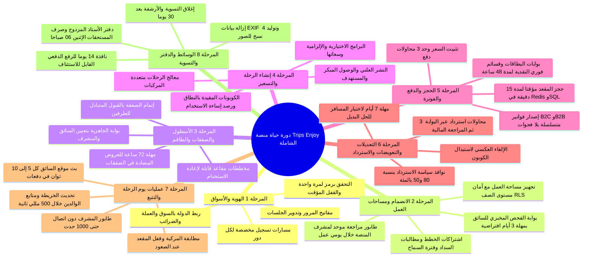
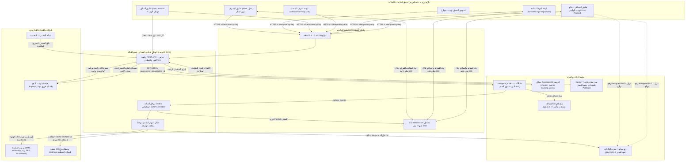
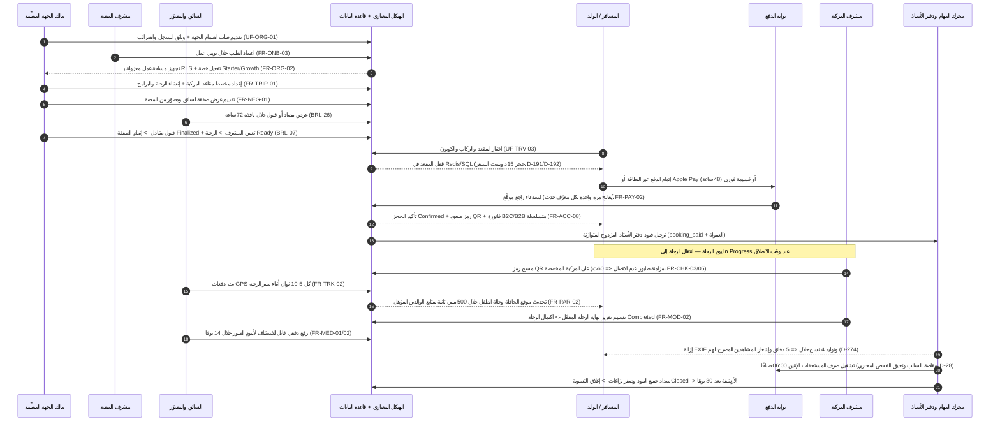

تعمل منصة **Trips Enjoy** بوصفها سوقًا إلكترونيًا ومنصة تشغيل رحلات ثنائية اللغة (`العربية` و`الإنجليزية`) ومتعددة المستأجرين داخل كيان تشغيلي واحد متماسك. فبدلًا من تشتيت العمل بين أدوات منفصلة للحجز وإدارة الأسطول والمحادثات والمحاسبة، ينسّق هيكل أحادي معياري واحد كل طرف فاعل — بدءًا من السجل التجاري للجهة المنظِّمة واعتماد الفحوص المخبرية للسائقين، مرورًا بالحجز المؤقت للمقاعد والدفع متعدد البوابات وتسجيل صعود الحافلات دون اتصال والتتبع المباشر للأبناء وألبومات الصور المحمية بالعلامة المائية، وصولًا إلى التسوية المالية عبر دفتر الأستاذ المزدوج.

يربط مركز **النظام الشامل (End-to-End)** جميع وثائق المواصفات المرجعية في سرد تشغيلي واحد متصل، بحيث يتمكّن مديرو المنتجات والمعماريون ومهندسو الواجهات الخلفية والجوال وفرق ضمان الجودة والتشغيل المالي من تتبّع أي إجراء منذ نقرة المستخدم وحتى صف قاعدة بيانات PostgreSQL وقفل Redis وحدث `outbox` والمهمة المجدولة وقيد دفتر الأستاذ.

<TraceBar
  brd={[
    { label: 'الملخص التنفيذي والأهداف', href: '/ar/docs/brd#22-أهداف-العمل-ومقاييس-النجاح', detail: 'OBJ-01..08' },
    { label: 'قواعد العمل', href: '/ar/docs/brd/requirements#7-قواعد-العمل', detail: 'BRL-01..31' },
    { label: 'القرارات المفتوحة', href: '/ar/docs/brd/compliance#11-القرارات-المفتوحة', detail: 'OD-01..32' },
  ]}
  srs={[
    { label: '28 وحدة قدرات برمجية', href: '/ar/docs/srs#فهرس-الوحدات', detail: '213 متطلبًا' },
    { label: '10 آلات حالة', href: '/ar/docs/srs/state-machines', detail: 'القسم 7' },
    { label: 'متطلبات الجودة (NFR)', href: '/ar/docs/srs/quality', detail: 'NFR-PERF..BKP' },
  ]}
  erd={[
    { label: '14 نطاق بيانات', href: '/ar/docs/erd#النطاقات', detail: 'BIGSERIAL + UUIDv7' },
    { label: 'التحكم في الوصول وأمان مستوى الصف RLS', href: '/ar/docs/erd/acl', detail: 'عزل مساحات العمل' },
  ]}
  plan={[
    { label: 'خارطة التسليم (P1–P6)', href: '/ar/docs/plan', detail: '231 مهمة' },
    { label: 'المعالم وبوابات المراحل', href: '/ar/docs/plan/milestones', detail: 'البوابات' },
  ]}
  workflows={[
    { label: 'سير العمل في النظام', href: '/ar/docs/workflows', detail: 'عقد المحرّك' },
    { label: 'كتالوج الوظائف المجدولة', href: '/ar/docs/workflows/scheduled-jobs', detail: 'المؤقتات والإعادات' },
  ]}
  userFlows={[
    { label: '8 مجموعات لتدفقات الأدوار', href: '/ar/docs/user-flows', detail: '106 تدفقات' },
  ]}
  architecture={[
    { label: 'الهيكل الأحادي المعياري والطوبولوجيا', href: '/ar/docs/architecture', detail: 'سياق النظام' },
  ]}
  design={[
    { label: '7 أسطح تطبيقات ودعم RTL', href: '/ar/docs/design', detail: 'الرموز والوصول' },
  ]}
  recommendations={[
    { label: 'دليل التوصيات والقرارات المقترحة', href: '/ar/docs/recommendations', detail: 'OD + REC' },
  ]}
/>

## حجم المنصة والعمود الفقري البنيوي

تتطابق جميع وثائق المواصفات مع مجموعة حتمية مضبوطة من المخرجات الهندسية:

| البُعد | العدد المعتمد | القواعد الحاكمة وحدود الإنفاذ | المرجع الأساسي |
|---|---|---|---|
| **المتطلبات الوظيفية** | `213` (`FR-*`) | مصنّفة وفق أولويات MoSCoW (`Must` و`Should` و`Could`) مع معايير قبول بصيغة Given/When/Then عبر `28` وحدة برمجية | [البرمجيات (SRS)](/ar/docs/srs) |
| **وحدات القدرات البرمجية** | `28` وحدة | حدود نطاقات صارمة داخل هيكل أحادي معياري واحد مكتوب بـ TypeScript وقابل للنشر الموحّد (`AUTH` حتى `API`) | [فهرس وحدات SRS](/ar/docs/srs#فهرس-الوحدات) |
| **نطاقات البيانات** | `14` نطاقًا | PostgreSQL 16 مع جداول TimescaleDB الزمنية، ومفاتيح داخلية `BIGSERIAL` ومعرّفات عامة `UUIDv7`، وجداول مرجعية `lookups` بدلًا من enums، وأمان مستوى الصف RLS على `organization_id` | [نموذج البيانات (ERD)](/ar/docs/erd) |
| **تدفقات المستخدم حسب الدور** | `106` (`UF-*`) | 8 مجموعات تشمل المسافر (`16`)، والجهة المنظِّمة (`24`)، ومشرف المنصة (`16`)، والسائق (`10`)، والمصوّر (`9`)، والمشرف (`8`)، والوالدين (`6`)، والتدفقات المشتركة (`17`) | [تدفقات المستخدم](/ar/docs/user-flows) |
| **سير العمل وآلات الحالة** | `10` آلات حالة | الرحلة، والحجز، والمقعد، والصفقة، وطلب الانضمام، والاشتراك، والكوبون، وفحص المختبر، والتسوية، والنزاع، مع كتالوج الوظائف المجدولة | [آلات الحالة](/ar/docs/srs/state-machines) · [سير العمل](/ar/docs/workflows) |
| **سجل مهام التسليم المرحلي** | `231` مهمة | `213` مهمة وظيفية + `18` مهمة منصة عابرة للمجالات تُسلَّم عبر `6` مراحل متعاقبة ببوابات اعتماد (`P1`–`P6`) | [خطة التسليم](/ar/docs/plan) |
| **أسطح تطبيقات العملاء** | `7` أسطح | تطبيق المسافر، ومتابع الوالدين (داخل تطبيق المسافر)، ولوحة الجهة المنظِّمة، ولوحة مشرف المنصة، وتطبيق السائق، واستوديو المصوّر، وتطبيق المشرف القابل للعمل دون اتصال (PWA) | [نظام التصميم](/ar/docs/design#أسطح-التطبيقات) |
| **الأسواق المستهدفة** | `3` أسواق إطلاق | إعدادات مشتقة من الدولة: مصر (`EGP`، القاهرة، تجربة `P2`)، والسعودية (`SAR`، الرياض، `P5`)، والإمارات (`AED`، دبي، `P5`) | [أسواق BRD](/ar/docs/brd#53-الأسواق) |

## الخريطة الذهنية لدورة الحياة الشاملة

الرحلة على منصة Trips Enjoy ليست مجرد إعلان منفصل في كتالوج؛ بل هي العمود الفقري لحلقة تشغيلية من ثماني مراحل تبدأ بتوثيق الهوية وتجهيز مساحة عمل الجهة المنظِّمة، ولا تُغلق إلا بعد نزول جميع الركاب، وأرشفة ألبومات الصور، وصرف مستحقات المورّدين، وإغلاق التسويات المالية لكل رحلة.

<MindmapBlock
  title="دورة الحياة التشغيلية الشاملة من ثماني مراحل في Trips Enjoy"
  caption="خريطة بصرية للرحلة الكاملة بدءًا من التحقق من الحساب وتجهيز مساحة العمل وحتى العمليات الحية يوم الرحلة وإغلاق التسوية عبر دفتر الأستاذ المزدوج."
  trace={{
    system: [
      { label: 'رحلة التشغيل من 8 مراحل', href: '/ar/docs/system/lifecycle', detail: 'STAGE-01..08' },
      { label: 'أطلس الخرائط الذهنية للمنصة', href: '/ar/docs/system/mindmaps', detail: '7 خرائط رئيسية' },
    ],
    workflows: [
      { label: 'دورة حياة الرحلة', href: '/ar/docs/workflows/trip-lifecycle' },
      { label: 'الحجز والدفع', href: '/ar/docs/workflows/booking-payment' },
      { label: 'يوم الرحلة', href: '/ar/docs/workflows/trip-day' },
      { label: 'الأموال والتسويات', href: '/ar/docs/workflows/money' },
    ],
    recommendations: [
      { label: 'REC-ARCH-01 الهيكل المعياري وOutbox', href: '/ar/docs/recommendations/architecture-and-ops#rec-arch-01' },
      { label: 'REC-FIN-10 ثوابت دفتر الأستاذ المزدوج', href: '/ar/docs/recommendations/architecture-and-ops#rec-fin-10' },
    ],
  }}
>

- **بوابات انتقال صارمة بين المراحل:** لا يمكن لأي رحلة أن تنتقل إلى حالة `In Progress` ما لم تُثبت بوابة الجاهزية (`Ready`) في المرحلة 3 أن لكل مركبة مُسندة سائقًا نشطًا (غير موقوف مؤقتًا لفحص مخبري معلّق) ومشرف مركبة مُعيَّنًا ([BRL-07](/ar/docs/brd/requirements#7-قواعد-العمل)).
- **الحسم المالي قبل الأرشفة:** لا تنتقل الرحلة من `Post-Processing` إلى `Archived` إلا بعد مرور 30 يومًا على اكتمالها (`Completed`) **وبشرط** إغلاق تسويتها المالية (`Closed`) في المرحلة 8 دون أي نزاع مفتوح ([BRL-25](/ar/docs/brd/requirements#7-قواعد-العمل)، [FR-ACC-10](/ar/docs/srs/requirements/acc#fr-acc-10--الأرشفة-بعد-التسوية)).
</MindmapBlock>

## المخطط الرئيسي للمعمارية وتدفق البيانات

يتواصل كل سطح من أسطح العملاء السبعة عبر حافة إنهاء TLS وشبكة CDN إلى هيكل أحادي معياري عديم الحالة مبني بـ TypeScript وNestJS. تُجري الأوامر المتزامنة تعديلاتها على جداول PostgreSQL 16 المعزولة لكل جهة منظِّمة، وتكتب أحداث النطاق ذريًّا في جدول `outbox_events` ضمن المعاملة ذاتها. يتولّى عمال الخلفية ترحيل أحداث الـ outbox إلى خط الإشعارات وفهارس البحث وجداول التحليلات وخطافات webhook الموقَّعة بـ HMAC دون ربط زمن استجابة الطلب بالأنظمة الخارجية.

## التسلسل الزمني الشامل لتفاعل الأدوار وقت التشغيل

يوضّح مخطط التسلسل التالي كيف تمرّ رحلة مدرسية أو مؤسسية متعددة الحافلات عبر تسعة أطراف ومحركات داخلية منذ اعتماد طلب انضمام الجهة المنظِّمة وحتى إغلاق التسوية وصرف المستحقات يوم الإثنين:

## مصفوفة التتبع الشاملة لمراحل دورة الحياة

استخدم هذه المصفوفة للانتقال من أي مرحلة تشغيلية في [رحلة التشغيل من 8 مراحل](/ar/docs/system/lifecycle) إلى الأقسام المرجعية الدقيقة عبر جميع ركائز التوثيق التسع:

| المرحلة | النطاق التشغيلي | الأعمال (BRD) | وحدات SRS وآلات الحالة | نطاقات البيانات (ERD) | تدفقات المستخدم | سير العمل | مرحلة الخطة | التوصيات |
|---|---|---|---|---|---|---|---|---|
| **[STAGE-01](/ar/docs/system/lifecycle#stage-01)** | الهوية، الرمز لمرة واحدة، مفاتيح المرور، تعدد الأدوار وربط السوق | [§6.1 AUTH](/ar/docs/brd/requirements#61-الحسابات-والوصول-auth)، [§6.16 MKT](/ar/docs/brd/requirements#616-الأسواق-mkt) | [AUTH](/ar/docs/srs/requirements/auth)، [MKT](/ar/docs/srs/requirements/mkt) | [الهوية والوصول](/ar/docs/erd/domains/identity-and-access)، [الأسواق](/ar/docs/erd/domains/lookups-and-markets) | [UF-SHR-01..17](/ar/docs/user-flows/shared)، [UF-TRV-02](/ar/docs/user-flows/traveler#uf-trv-02-التسجيل-والتحقق) | [كتالوج الوظائف](/ar/docs/workflows/scheduled-jobs#العدادات-التنازلية-مؤقّتات-على-مستوى-كل-سجل) | [P1](/ar/docs/plan/p1)، [P5](/ar/docs/plan/p5) | [OD-02](/ar/docs/recommendations/open-decisions#od-02)، [OD-23](/ar/docs/recommendations/open-decisions#od-23) |
| **[STAGE-02](/ar/docs/system/lifecycle#stage-02)** | طلبات الانضمام، طابور المراجعة، الفحوص المخبرية، مساحات العمل والخطط | [§6.2 ONB](/ar/docs/brd/requirements#62-طلبات-الانضمام-والاعتمادات-onb)، [§6.13 SUB](/ar/docs/brd/requirements#613-الخطط-والاشتراكات-sub) | [ONB](/ar/docs/srs/requirements/onb)، [ORG](/ar/docs/srs/requirements/org)، [DRV](/ar/docs/srs/requirements/drv)، [SUB](/ar/docs/srs/requirements/sub)، [آلات 7.5/7.6/7.8](/ar/docs/srs/state-machines#75-طلب-الانضمام) | [طلبات الانضمام](/ar/docs/erd/domains/applications)، [الجهات المنظِّمة](/ar/docs/erd/domains/organizations)، [الخطط](/ar/docs/erd/domains/plans-and-subscriptions) | [UF-ADM-02](/ar/docs/user-flows/admin#uf-adm-02-مراجعة-طلب-انضمام)، [UF-DRV-05](/ar/docs/user-flows/driver#uf-drv-05-طلب-تحليل-مخبري) | [طلبات الانضمام](/ar/docs/workflows/applications)، [الاشتراكات](/ar/docs/workflows/subscriptions) | [P1](/ar/docs/plan/p1)، [P4](/ar/docs/plan/p4)، [P5](/ar/docs/plan/p5) | [OD-29](/ar/docs/recommendations/open-decisions#od-29)، [OD-32](/ar/docs/recommendations/open-decisions#od-32)، [REC-DATA-02](/ar/docs/recommendations/architecture-and-ops#rec-data-02) |
| **[STAGE-03](/ar/docs/system/lifecycle#stage-03)** | الأسطول، مخططات المقاعد، صفقات المورّدين وبوابة الجاهزية | [§6.4 FLT](/ar/docs/brd/requirements#64-الرحلات-والبرامج-والأسطول-trip-prg-flt)، [§6.5 STF](/ar/docs/brd/requirements#65-الطاقم-والصفقات-stf) | [FLT](/ar/docs/srs/requirements/flt)، [SEAT](/ar/docs/srs/requirements/seat)، [NEG](/ar/docs/srs/requirements/neg)، [STF](/ar/docs/srs/requirements/stf)، [آلة 7.4](/ar/docs/srs/state-machines#74-الصفقة) | [المورّدون](/ar/docs/erd/domains/suppliers)، [الأسطول والرحلات](/ar/docs/erd/domains/fleet-and-trips)، [التعاقدات](/ar/docs/erd/domains/deals) | [UF-ORG-04](/ar/docs/user-flows/organization#uf-org-04-الأسطول)، [UF-ORG-07](/ar/docs/user-flows/organization#uf-org-07-التعاقد-مع-مورّد-من-المنصة-صفقة)، [UF-DRV-03](/ar/docs/user-flows/driver#uf-drv-03-الرد-على-صفقة) | [دورة حياة الرحلة](/ar/docs/workflows/trip-lifecycle) | [P2](/ar/docs/plan/p2)، [P3](/ar/docs/plan/p3)، [P4](/ar/docs/plan/p4) | [OD-06](/ar/docs/recommendations/open-decisions#od-06)، [OD-13](/ar/docs/recommendations/open-decisions#od-13)، [OD-19](/ar/docs/recommendations/open-decisions#od-19) |
| **[STAGE-04](/ar/docs/system/lifecycle#stage-04)** | معالج الرحلة، البرامج، الكوبونات والنشر | [§6.4 TRIP/PRG](/ar/docs/brd/requirements#64-الرحلات-والبرامج-والأسطول-trip-prg-flt)، [§6.8 CPN](/ar/docs/brd/requirements#68-الكوبونات-cpn) | [TRIP](/ar/docs/srs/requirements/trip)، [PRG](/ar/docs/srs/requirements/prg)، [CPN](/ar/docs/srs/requirements/cpn)، [آلات 7.1/7.7](/ar/docs/srs/state-machines#71-دورة-حياة-الرحلة) | [الرحلات](/ar/docs/erd/domains/fleet-and-trips#trips)، [الكوبونات](/ar/docs/erd/domains/coupons#coupons) | [UF-ORG-06](/ar/docs/user-flows/organization#uf-org-06-إنشاء-رحلة-معالج-إرشادي)، [UF-ORG-13](/ar/docs/user-flows/organization#uf-org-13-الكوبونات) | [دورة حياة الرحلة](/ar/docs/workflows/trip-lifecycle) | [P2](/ar/docs/plan/p2)، [P3](/ar/docs/plan/p3)، [P5](/ar/docs/plan/p5) | [OD-09](/ar/docs/recommendations/open-decisions#od-09)، [OD-25](/ar/docs/recommendations/open-decisions#od-25) |
| **[STAGE-05](/ar/docs/system/lifecycle#stage-05)** | الاستكشاف، حجز المقعد 15د، الدفع متعدد البوابات والفواتير | [§6.6 SEAT](/ar/docs/brd/requirements#66-المقاعد-seat)، [§6.7 BKG](/ar/docs/brd/requirements#67-الحجز-والدفع-bkg) | [TRV](/ar/docs/srs/requirements/trv)، [BKG](/ar/docs/srs/requirements/bkg)، [PAY](/ar/docs/srs/requirements/pay)، [آلات 7.2/7.3](/ar/docs/srs/state-machines#72-الحجز) | [الحجز والدفع](/ar/docs/erd/domains/booking-and-payment#bookings)، [المالية والفواتير](/ar/docs/erd/domains/finance#invoices) | [UF-TRV-03](/ar/docs/user-flows/traveler#uf-trv-03-حجز-رحلة)، [UF-TRV-15](/ar/docs/user-flows/traveler#uf-trv-15-نتيجة-الدفع-ومعالجة-الحالة-المعلّقة) | [الحجز والدفع](/ar/docs/workflows/booking-payment) | [P2](/ar/docs/plan/p2)، [P3](/ar/docs/plan/p3)، [P5](/ar/docs/plan/p5) | [REC-BOOK-03](/ar/docs/recommendations/architecture-and-ops#rec-book-03)، [REC-PAY-04](/ar/docs/recommendations/architecture-and-ops#rec-pay-04)، [REC-TAX-05](/ar/docs/recommendations/architecture-and-ops#rec-tax-05) |
| **[STAGE-06](/ar/docs/system/lifecycle#stage-06)** | الإلغاءات، نوافذ السياسة، الحلول البديلة والاستردادات | [BRL-11/12/24/30](/ar/docs/brd/requirements#7-قواعد-العمل) | [BKG](/ar/docs/srs/requirements/bkg)، [PAY](/ar/docs/srs/requirements/pay)، [CPN](/ar/docs/srs/requirements/cpn)، [ADM](/ar/docs/srs/requirements/adm)، [آلة 7.10](/ar/docs/srs/state-machines#710-النزاع) | [الحجز والدفع](/ar/docs/erd/domains/booking-and-payment)، [المالية](/ar/docs/erd/domains/finance) | [UF-TRV-06](/ar/docs/user-flows/traveler#uf-trv-06-إلغاء-حجز)، [UF-TRV-07](/ar/docs/user-flows/traveler#uf-trv-07-اختيار-الحل-بعد-تغيير-في-الرحلة)، [UF-ADM-16](/ar/docs/user-flows/admin#uf-adm-16-الاسترداد-خارج-السياسة) | [الاستردادات](/ar/docs/workflows/refunds) | [P2](/ar/docs/plan/p2)، [P5](/ar/docs/plan/p5) | [OD-07](/ar/docs/recommendations/open-decisions#od-07)، [OD-18](/ar/docs/recommendations/open-decisions#od-18) |
| **[STAGE-07](/ar/docs/system/lifecycle#stage-07)** | تسجيل الصعود دون اتصال، الحوادث، GPS ومتابع الوالدين المباشر | [§6.9 CHK/MOD/TRK](/ar/docs/brd/requirements#69-تسجيل-الحضور-والمشرفون-والتتبع-chk-mod-trk)، [§6.10 PAR](/ar/docs/brd/requirements#610-الوالدان-والأبناء-par) | [CHK](/ar/docs/srs/requirements/chk)، [MOD](/ar/docs/srs/requirements/mod)، [TRK](/ar/docs/srs/requirements/trk)، [PAR](/ar/docs/srs/requirements/par)، [NTF](/ar/docs/srs/requirements/ntf) | [العمليات](/ar/docs/erd/domains/operations#checkin_events)، [روابط الأبناء](/ar/docs/erd/domains/operations#child_links) | [UF-MOD-04](/ar/docs/user-flows/moderator#uf-mod-04-تسجيل-حضور-راكب)، [UF-MOD-06](/ar/docs/user-flows/moderator#uf-mod-06-قائمة-الانتظار-دون-اتصال)، [UF-PAR-03](/ar/docs/user-flows/parent#uf-par-03-الخريطة-المباشرة) | [يوم الرحلة](/ar/docs/workflows/trip-day)، [الإشعارات](/ar/docs/workflows/notifications) | [P3](/ar/docs/plan/p3)، [P6](/ar/docs/plan/p6) | [REC-OFF-06](/ar/docs/recommendations/architecture-and-ops#rec-off-06)، [REC-TRK-07](/ar/docs/recommendations/architecture-and-ops#rec-trk-07)، [REC-SEC-09](/ar/docs/recommendations/architecture-and-ops#rec-sec-09) |
| **[STAGE-08](/ar/docs/system/lifecycle#stage-08)** | ألبومات الصور، دفتر الأستاذ المزدوج، صرف المستحقات والتحليلات | [§6.11 MED/PHO](/ar/docs/brd/requirements#611-الوسائط-والمصوّرون-med-pho)، [§6.14 ACC](/ar/docs/brd/requirements#614-المحاسبة-والفواتير-والتسويات-acc)، [§6.17 ANL](/ar/docs/brd/requirements#617-التحليلات-anl) | [MED](/ar/docs/srs/requirements/med)، [PHO](/ar/docs/srs/requirements/pho)، [ACC](/ar/docs/srs/requirements/acc)، [ANL](/ar/docs/srs/requirements/anl)، [API](/ar/docs/srs/requirements/api)، [آلة 7.9](/ar/docs/srs/state-machines#79-التسوية) | [الوسائط](/ar/docs/erd/domains/media)، [المالية](/ar/docs/erd/domains/finance)، [المنصة والتدقيق](/ar/docs/erd/domains/platform#audit_events) | [UF-PHO-05](/ar/docs/user-flows/photographer#uf-pho-05-إنشاء-ألبوم-ورفعه)، [UF-ORG-15](/ar/docs/user-flows/organization#uf-org-15-المحاسبة-والتسويات)، [UF-ADM-11](/ar/docs/user-flows/admin#uf-adm-11-العمليات-المالية) | [الوسائط](/ar/docs/workflows/media)، [الأموال](/ar/docs/workflows/money) | [P4](/ar/docs/plan/p4)، [P5](/ar/docs/plan/p5)، [P6](/ar/docs/plan/p6) | [REC-MED-08](/ar/docs/recommendations/architecture-and-ops#rec-med-08)، [REC-FIN-10](/ar/docs/recommendations/architecture-and-ops#rec-fin-10) |

## الثوابت المعمارية والتشغيلية الحاكمة

تسري ستة ثوابت غير قابلة للتفاوض عبر المراحل الثماني جميعًا في كل استدعاء API، وكل دورة لعامل خلفية، وكل شاشة عميل:

1. **عزل مساحات العمل ثلاثي الطبقات (`BRL-01`، `DAT-01`، `NFR-SEC-07`):** يحمل كل جدول مملوك لجهة منظِّمة عمود `organization_id` غير فارغ (مُكرَّر على الجداول الفرعية حتى لا تحتاج السياسات إلى أي عملية ربط join)، ويُفرض في آنٍ واحد عبر حراس الـ API، وتقييد المستودعات البرمجية، وسياسات أمان مستوى الصف RLS في PostgreSQL (`SET LOCAL app.current_organization_id`). وتُرجع أي محاولة وصول إلى سجل جهة أخرى استجابة `404` عامة موحّدة.
2. **تمثيل الأموال بالوحدات الصغرى ودفتر الأستاذ المزدوج غير القابل للتغيير (`BRL-18`، `DAT-08`، `D-157`):** لا توجد أعداد عشرية عائمة للأموال في أي طبقة من النظام. كل عملية تحصيل أو عمولة أو خصم كوبون أو رسوم بوابة أو استرداد أو صرف مستحقات لمورّد تكتب أطراف مدين ودائن متوازنة (`debit_minor` / `credit_minor`) في `ledger_entries` ضمن مظروف `ledger_transactions`؛ ولا تُعدَّل القيود أبدًا بل تُصحَّح بقيود عكسية جديدة أو إشعارات دائنة (`D-181`).
3. **عدم مرور بيانات البطاقات عبر خوادم المنصة (`CON-02`، `UI-09`):** تُنفَّذ جميع عمليات الدفع وتحصيل الاشتراكات حصريًا عبر الصفحات المستضافة لبوابات الدفع أو حزم SDK المرمّزة (Stripe وPaymob وTap وقسائم فوري النقدية)، مع معالجة الاستدعاءات الواردة بمنع التكرار وفق معرّف حدث البوابة (`FR-PAY-02`).
4. **الإغلاق الآمن لبوابات الخطط والأموال مع التدهور السلس للقراءة (`FR-SUB-11`، `D-224`):** ترفض فحوص الخادم أي إجراء يحرّك أموالًا أو يتجاوز حدود الخطة فورًا عند تعذّر الوصول إلى خدمة تقييم الاشتراكات، في حين تتدهور التحليلات (على نسخ القراءة بتأخير لا يتجاوز `5` دقائق) والتصديرات غير المتزامنة (`<= 15` دقيقة) بسلاسة دون تعطيل الحجز أو مسح صعود الركاب.
5. **سلامة الطفل وخصوصية موقع المسافرين (`CON-08`، `BRL-29`، `FR-PAR-05`، `FR-TRK-07`):** تُستبعد بيانات الأطفال كليًا من التحليلات والتسويق وتدريب النماذج؛ وتنتهي روابط الوالدين تلقائيًا بانتهاء الحجز؛ ولا يرى المسافرون البالغون العاديون الموقع الحي للمركبة أو وقت الوصول المتوقع أبدًا (`D-317`) — إذ تقتصر الخريطة الحية على غرفة عمليات الجهة المنظِّمة والوالدين المؤهلين المرتبطين أثناء حالة `In Progress`.
6. **أولوية العربية واتجاه RTL والأرقام الغربية (`CON-03`، `NFR-I18N-04`، `D-159`):** تصدر كل شاشة وقالب إشعار وإيصال وفاتورة بالعربية (بانعكاس RTL كامل عبر خصائص CSS المنطقية) والإنجليزية منذ الإصدار الأول، مع اعتماد الأرقام الغربية (`0–9`) ورموز العملات القياسية (`EGP` و`SAR` و`AED`) في جميع الواجهات.

## استكشف مخطط النظام الشامل

<Cards>
  <Card
    title="رحلة التشغيل الكاملة من 8 مراحل"
    description="التسلسل التفصيلي لتفاعل البشر والنظام عبر المراحل STAGE-01..STAGE-08 مع مخططات التسلسل وتعديلات PostgreSQL/Redis والمؤقتات الدقيقة ومسارات التعافي من الإخفاق."
    icon="GitBranch"
    href="/ar/docs/system/lifecycle"
  />
  <Card
    title="أطلس الخرائط الذهنية للمنصة"
    description="سبع خرائط ذهنية بصرية بصيغة Mermaid تغطي الأدوار، والنموذج التجاري، و28 وحدة SRS، و14 نطاق بيانات، و10 مسارات عمل، و6 مراحل تسليم، والأمان والامتثال."
    icon="Network"
    href="/ar/docs/system/mindmaps"
  />
  <Card
    title="التوصيات وحسم القرارات المفتوحة"
    description="قرارات موصى بها بمعايير أسواق الشرق الأوسط وشمال أفريقيا لجميع القرارات المفتوحة الـ 32 وعناصر [OPEN] الـ 15 و12 مخططًا معماريًا وتشغيليًا."
    icon="Lightbulb"
    href="/ar/docs/recommendations"
  />
  <Card
    title="خطة التسليم المرحلية (P1–P6)"
    description="جميع المهام الهندسية الـ 231 القابلة للتنفيذ (213 وظيفية + 18 للمنصة) مرتبطة بوثائق الأعمال والبرمجيات والبيانات وسير العمل والمعمارية والتصميم."
    icon="ListTodo"
    href="/ar/docs/plan"
  />
</Cards>
