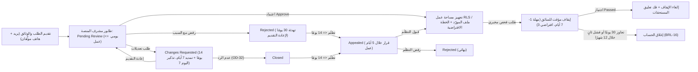
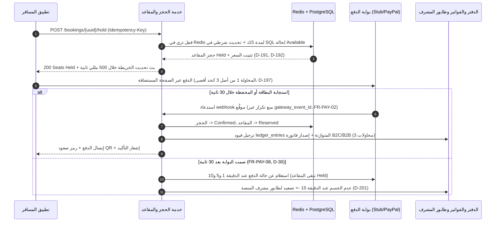
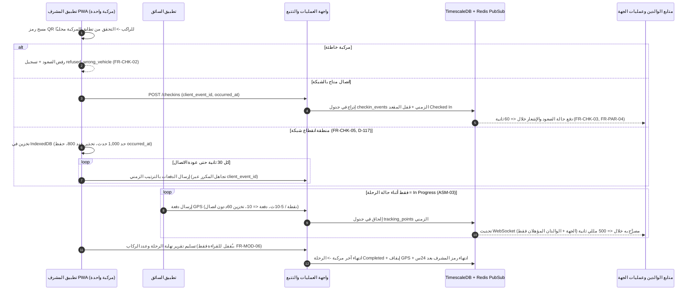
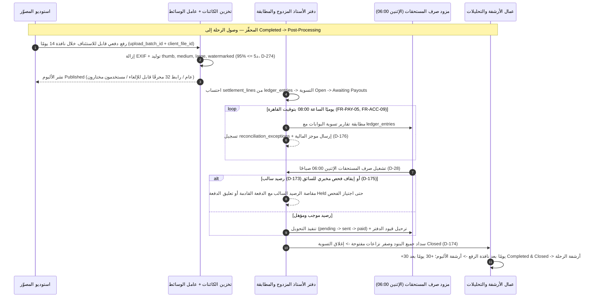

يوثّق هذا المستند دورة الحياة التشغيلية الكاملة لمنصة **Trips Enjoy** عبر **ثماني مراحل متعاقبة (`STAGE-01` حتى `STAGE-08`)**. توضّح كل مرحلة التسلسل الدقيق لتفاعل البشر والنظام، وآلات الحالة النشطة في SRS، وجداول PostgreSQL 16 وTimescaleDB المتأثرة، وأقفال Redis وأحداث `outbox` الصادرة، ومؤقتات اتفاقيات مستوى الخدمة (SLA) بالنص الحرفي، ومسارات التعافي من الإخفاق — متبوعةً بشريط تتبع شامل `<TraceBar />` عبر جميع ركائز التوثيق.

<Callout type="info" title="قراءة المؤقتات وحراس الحالة">
تتبع مهل أيام العمل (مثل هدف مراجعة طلب الانضمام خلال يومي عمل أو إرسال الاسترداد خلال يومي عمل) تقويم سوق الطرف المسؤول (`Africa/Cairo` أو `Asia/Riyadh` أو `Asia/Dubai`). أما المؤقتات الزمنية المطلقة (حجز المقعد لمدة `15 دقيقة`، ومهلة `72 ساعة` للعرض المضاد في الصفقات، وتشغيل صرف المستحقات الإثنين الساعة `06:00`) فتعمل بتوقيت UTC على أعمدة `TIMESTAMPTZ`.
</Callout>

## المرحلة 1 — الهوية والتحقق وتعيين السوق

<SystemStage
  stageNumber={1}
  id="STAGE-01"
  title="الهوية والتحقق والحسابات متعددة الأدوار وربط السوق"
  phaseIntroduced="P1 (المصادقة الأساسية وسوق مصر) · P5 (مفاتيح المرور وأسواق الخليج)"
  actors={['الزائر', 'المسافر', 'مالك الجهة المنظِّمة', 'الموظف', 'مورّد المنصة', 'مشرف المنصة']}
  stateMachines={['تدوير رموز الجلسات', 'نافذة رمز التحقق لمرة واحدة', 'مهلة السماح لحذف الحساب 30 يومًا']}
  tablesWritten={[
    'users',
    'user_roles',
    'auth_factors',
    'passkey_credentials',
    'otp_challenges',
    'sessions',
    'devices',
    'consents',
    'notification_preferences',
    'privacy_requests',
    'audit_logs',
  ]}
  eventsEmitted={['auth.otp.requested', 'auth.user.verified', 'auth.session.locked', 'auth.deletion.scheduled']}
  trace={{
    brd: [
      { label: 'BR-AUTH-01..08', href: '/ar/docs/brd/requirements#61-الحسابات-والوصول-auth', detail: 'الحسابات والوصول' },
      { label: 'BR-MKT-01..04', href: '/ar/docs/brd/requirements#616-الأسواق-mkt', detail: 'أسواق الدول' },
      { label: 'BRL-15 / 20 / 21 / 22 / 23 / 27', href: '/ar/docs/brd/requirements#7-قواعد-العمل', detail: 'قواعد الهوية والسوق' },
    ],
    srs: [
      { label: 'AUTH (FR-AUTH-01..13)', href: '/ar/docs/srs/requirements/auth', detail: '13 متطلبًا' },
      { label: 'MKT (FR-MKT-01..05)', href: '/ar/docs/srs/requirements/mkt', detail: '5 متطلبات' },
      { label: 'NFR-SEC-01..15', href: '/ar/docs/srs/quality#82-الأمان-nfr-sec', detail: 'أمان المصادقة' },
    ],
    erd: [
      { label: 'users & user_roles', href: '/ar/docs/erd/domains/identity-and-access#users', detail: 'نطاق الهوية' },
      { label: 'otp_challenges', href: '/ar/docs/erd/domains/identity-and-access#otp_challenges', detail: 'صلاحية 5د' },
      { label: 'markets', href: '/ar/docs/erd/domains/lookups-and-markets#markets', detail: 'العملة والضرائب' },
      { label: 'تحديد الفاعل ACL', href: '/ar/docs/erd/acl#تحديد-الفاعل', detail: 'مطالبات JWT' },
    ],
    plan: [
      { label: 'المرحلة P1 الأساس', href: '/ar/docs/plan/p1', detail: 'المصادقة الأساسية' },
      { label: 'المرحلة P5 أسواق الخليج', href: '/ar/docs/plan/p5', detail: 'تبديل السوق' },
      { label: 'المرحلة P6 مفاتيح المرور', href: '/ar/docs/plan/p6', detail: 'WebAuthn' },
    ],
    workflows: [
      { label: 'العدادات التنازلية وصلاحية الرموز', href: '/ar/docs/workflows/scheduled-jobs#العدادات-التنازلية-مؤقّتات-على-مستوى-كل-سجل' },
      { label: 'مهمة الحذف اليومية', href: '/ar/docs/workflows/scheduled-jobs#المهام-اليومية' },
    ],
    userFlows: [
      { label: 'UF-SHR-01..05 & UF-SHR-17', href: '/ar/docs/user-flows/shared#uf-shr-01-منتقي-التسجيل', detail: 'التسجيل والرمز ومفاتيح المرور' },
      { label: 'UF-TRV-02 التسجيل والتحقق', href: '/ar/docs/user-flows/traveler#uf-trv-02-التسجيل-والتحقق' },
    ],
    architecture: [
      { label: 'API عديم الحالة وجلسات Redis', href: '/ar/docs/architecture#نموذج-الخدمات' },
    ],
    design: [
      { label: 'النماذج وRTL والأرقام الغربية', href: '/ar/docs/design#rtl-والتعريب' },
    ],
    recommendations: [
      { label: 'OD-02 سياسة الجلسات والرموز', href: '/ar/docs/recommendations/open-decisions#od-02' },
      { label: 'OD-23 إعادة إرسال الرمز والقفل', href: '/ar/docs/recommendations/open-decisions#od-23' },
      { label: 'OPEN-04 إطلاق مفاتيح المرور', href: '/ar/docs/recommendations/open-decisions#open-04' },
    ],
  }}
>
### 1.1 التسلسل التشغيلي وتفاعل الأدوار

1. **التسجيل المخصص لكل دور والتقاط الدولة (`FR-AUTH-01`، `FR-AUTH-02`، `BRL-23`):** يختار الزائر مسار التسجيل المناسب (`/register/traveler`، أو `/register/organization` عبر الويب فقط، أو `/register/driver`، أو `/register/photographer`). يُلزم كل نموذج بإدخال رمز الدولة `country_code` (`EG` أو `SA` أو `AE`)، مما يربط الحساب حتميًا بسوقه `market_id` (`BRL-27`) — محدِّدًا العملة الافتراضية (`EGP` أو `SAR` أو `AED`)، ووسائل الدفع المسموحة، والقواعد الضريبية، والمنطقة الزمنية الافتراضية (`Africa/Cairo` أو `Asia/Riyadh` أو `Asia/Dubai`).
2. **التحقق من قنوات الاتصال (`FR-AUTH-03`، `D-20`):** يُفعَّل حساب المسافر فورًا على خطة `Free` بمجرد التحقق من **واحد على الأقل** من البريد الإلكتروني أو الهاتف عبر رمز لمرة واحدة (OTP). أما الجهات المنظِّمة وسائقو ومصوّرو المنصة فيجب عليهم التحقق من **البريد الإلكتروني والهاتف معًا** قبل إرسال طلب الانضمام وخروجه من حالة `Draft`.
3. **طرق الدخول والعامل الثاني بحسب الدور (`FR-AUTH-04`، `FR-AUTH-11..13`):** يدخل المسافر بكلمة مرور أو رمز OTP أو مفتاح مرور WebAuthn. ويُلزَم مالكو الجهات المنظِّمة وموظفوها بكلمة مرور مع عامل ثانٍ عبر SMS أو تطبيق المصادقة في كل عملية دخول. بينما يدخل مشرفو المنصة عبر مسار مستقل معزول (`admin.trips-enjoy.com`) مع مصادقة TOTP إلزامية، ويدخل مشرفو المركبات إلى تطبيق المشرف (PWA) برمز طاقم مؤقت مقيّد بالرحلة (`D-107`).
4. **تعدد الأدوار والتبديل بين الجهات المنظِّمة (`FR-AUTH-06`، `FR-AUTH-07`):** يمكن لسجل `users` واحد أن يحمل دورَي `traveler` و`supplier` (`driver` أو `photographer`) في آنٍ واحد (`ASM-01`)، كما يستطيع الموظف المدعو إلى أكثر من جهة منظِّمة تبديل مساحة العمل النشطة عبر مبدّل الجهات (`UF-ORG-02`) بإصدار رمز جلسة جديد مقيّد بالجهة دون إعادة إدخال بيانات الاعتماد.

### 1.2 تعديلات البيانات وحالة Redis وأحداث Outbox

- **عمليات الكتابة في PostgreSQL:** إدراج سجلات `users` (`id BIGSERIAL` داخلي، و`uuid UUIDv7` عام، وأعمدة بيانات شخصية مشفّرة عبر KMS مع أعمدة تجزئة `*_hash` للبحث)، و`user_roles`، و`consents` (إدراج فقط غير قابل للتعديل)، و`notification_preferences`، مع ربط `markets` و`currencies` عبر رمز الدولة.
- **الحالة المؤقتة في Redis:** تخزين بيانات الجلسات النشطة، وعائلات رموز التحديث الدوّارة، ونوافذ حدود المعدل لكل عنوان IP ولكل حساب، وعدادات المحاولات الفاشلة (`auth:fail:{user_id}` و`otp:fail:{challenge_id}`).
- **أحداث Outbox:** تسجيل `auth.otp.requested` (يُوجَّه عبر المسار العاجل متجاوزًا ساعات الهدوء) و`auth.user.verified` داخل جدول `outbox_events`.

### 1.3 المؤقتات واتفاقيات الخدمة والتعافي من الإخفاق

- **صلاحية رمز التحقق والإيقاف المؤقت (`BRL-20`، `D-58`، `D-59`):** تنتهي صلاحية كل رمز OTP خلال **5 دقائق**؛ وتُتاح إعادة الإرسال بعد **45 إلى 60 ثانية**؛ وتؤدي **5 رموز خاطئة** إلى إيقاف التحقق مؤقتًا لمدة **15 دقيقة**.
- **قفل تسجيل الدخول (`BRL-21`، `FR-AUTH-05`، `D-53`):** تؤدي **5 محاولات دخول فاشلة** إلى قفل الحساب عبر جميع الأدوار لمدة **15 دقيقة** مع إشعار صاحب الحساب.
- **أعمار الجلسات والرموز (`BRL-22`، `FR-AUTH-10`):** تنتهي رموز الوصول (Access JWT) خلال **15 دقيقة**؛ وتدور رموز التحديث على الجوال مع كل استخدام ضمن نافذة **30 يومًا** (وإعادة استخدام رمز قديم تُبطل عائلة الجلسة بالكامل)؛ وتنتهي جلسات الويب بعد **12 ساعة**.
- **مهلة السماح لحذف الحساب (`BRL-15`، `FR-AUTH-09`):** يضع طلب حذف الحساب المستخدم في **مهلة استرجاع مدتها 30 يومًا** (تمنع الحجوزات الجديدة مع حفظ الالتزامات المالية القائمة)؛ وفي **اليوم 31** تنفّذ المهمة الليلية إخفاء البيانات الشخصية مع الإبقاء على قيود الدفتر والتدقيق غير القابلة للتغيير لمدة **7 سنوات**.
</SystemStage>

## المرحلة 2 — طلبات الانضمام والفحوص المخبرية وتجهيز مساحات العمل

<SystemStage
  stageNumber={2}
  id="STAGE-02"
  title="طلبات انضمام الجهات والمورّدين والفحوص المخبرية وتجهيز مساحات العمل والاشتراكات"
  phaseIntroduced="P1 (اعتماد الجهات وRLS) · P4 (المورّدون والفحوص المخبرية) · P5 (الخطط الكاملة ومطالبات السداد)"
  actors={['مقدِّم الطلب (جهة / سائق / مصوّر)', 'مشرف المنصة', 'المختبر الشريك', 'مالك الجهة المنظِّمة']}
  stateMachines={['7.5 طلب الانضمام', '7.6 الاشتراك', '7.8 فحص المختبر']}
  tablesWritten={[
    'applications',
    'application_documents',
    'application_decisions',
    'appeals',
    'organizations',
    'organization_members',
    'member_permissions',
    'invitations',
    'driver_profiles',
    'photographer_profiles',
    'portfolio_items',
    'lab_tests',
    'subscriptions',
    'subscription_charges',
    'usage_counters',
    'audit_events',
  ]}
  eventsEmitted={[
    'onboarding.application.submitted',
    'onboarding.application.approved',
    'tenant.organization.provisioned',
    'driver.lab_test.requested',
    'subscription.renewal.failed',
  ]}
  trace={{
    brd: [
      { label: 'BR-ONB-01..06', href: '/ar/docs/brd/requirements#62-طلبات-الانضمام-والاعتمادات-onb', detail: 'الاعتمادات' },
      { label: 'BR-ORG-01..08', href: '/ar/docs/brd/requirements#63-الجهات-المنظِّمة-والموظفون-org', detail: 'مساحات العمل' },
      { label: 'BR-SUB-01..09', href: '/ar/docs/brd/requirements#613-الخطط-والاشتراكات-sub', detail: 'الخطط والمطالبات' },
      { label: '§8.2 الفحوص المخبرية للسائقين', href: '/ar/docs/brd/compliance#82-التحاليل-المخبرية-والفحوصات-الأمنية-للسائقين', detail: 'بوابة السلامة' },
    ],
    srs: [
      { label: 'ONB (FR-ONB-01..09)', href: '/ar/docs/srs/requirements/onb', detail: '9 متطلبات' },
      { label: 'ORG & EMP', href: '/ar/docs/srs/requirements/org', detail: 'العزل والصلاحيات' },
      { label: 'DRV (FR-DRV-03..06)', href: '/ar/docs/srs/requirements/drv#fr-drv-03--الإيقاف-مؤقتًا-لأجل-الفحص-المختبري', detail: 'إيقاف الفحص' },
      { label: 'SUB (FR-SUB-01..11)', href: '/ar/docs/srs/requirements/sub', detail: 'الخطط والبوابات' },
      { label: 'آلات 7.5 / 7.6 / 7.8', href: '/ar/docs/srs/state-machines#75-طلب-الانضمام', detail: 'آلات الحالة' },
    ],
    erd: [
      { label: 'applications', href: '/ar/docs/erd/domains/applications#applications' },
      { label: 'organizations & members', href: '/ar/docs/erd/domains/organizations#organizations' },
      { label: 'driver_profiles & lab_tests', href: '/ar/docs/erd/domains/suppliers#lab_tests' },
      { label: 'subscriptions', href: '/ar/docs/erd/domains/plans-and-subscriptions#subscriptions' },
      { label: 'كتالوج سياسات RLS', href: '/ar/docs/erd/acl#كتالوج-السياسات' },
    ],
    plan: [
      { label: 'المرحلة P1 اعتماد الجهات', href: '/ar/docs/plan/p1' },
      { label: 'المرحلة P4 المورّدون والفحوص', href: '/ar/docs/plan/p4' },
      { label: 'المرحلة P5 الاشتراكات', href: '/ar/docs/plan/p5' },
    ],
    workflows: [
      { label: 'سير عمل طلبات الانضمام', href: '/ar/docs/workflows/applications' },
      { label: 'الاشتراكات ومطالبات السداد', href: '/ar/docs/workflows/subscriptions' },
    ],
    userFlows: [
      { label: 'UF-ADM-02 مراجعة طلب انضمام', href: '/ar/docs/user-flows/admin#uf-adm-02-مراجعة-طلب-انضمام' },
      { label: 'UF-ADM-06 طلب فحص مخبري', href: '/ar/docs/user-flows/admin#uf-adm-06-طلب-فحص-مخبري-ومراجعته' },
      { label: 'UF-DRV-05 طلب تحليل مخبري', href: '/ar/docs/user-flows/driver#uf-drv-05-طلب-تحليل-مخبري' },
      { label: 'UF-ORG-03 دعوة الموظفين', href: '/ar/docs/user-flows/organization#uf-org-03-دعوة-الموظفين-وإدارتهم' },
    ],
    architecture: [
      { label: 'عزل مساحات العمل عبر RLS', href: '/ar/docs/architecture#معمارية-البيانات' },
    ],
    design: [
      { label: 'نمط الطابور ولوحة التفاصيل للمشرف', href: '/ar/docs/design#لوحة-مشرف-المنصة' },
    ],
    recommendations: [
      { label: 'OD-29 سلوك ما بعد فترة السماح', href: '/ar/docs/recommendations/open-decisions#od-29' },
      { label: 'OD-32 إغلاق التعديلات المطلوبة', href: '/ar/docs/recommendations/open-decisions#od-32' },
      { label: 'REC-DATA-02 أمان تجمّع اتصالات RLS', href: '/ar/docs/recommendations/architecture-and-ops#rec-data-02' },
    ],
  }}
>
### 2.1 التسلسل التشغيلي وتفاعل الأدوار

1. **تقديم طلبات الانضمام (`FR-ONB-01`، `FR-ONB-06..08`):**
   - **الجهات المنظِّمة:** ترفع السجل التجاري والبطاقة الضريبية عبر روابط موقَّعة مسبقًا إلى حاوية تخزين مقيدة مشفّرة بـ KMS، وتختار خطتها المبدئية (`Starter` أو `Growth` أو `Enterprise` — دون أي خصم مالي قبل صدور الاعتماد).
   - **سائقو المنصة:** يقدّمون الهوية الوطنية ورخصة القيادة وبيانات المركبة الخاصة إن وُجدت (استمارة وتأمين سارٍ لمدة `3 أشهر` على الأقل)، والموافقة على الفحوص المخبرية، ونتيجة فحص مبدئية مؤرخة خلال **30 يومًا** (`FR-ONB-08`)، مع احتفاظهم بكامل صلاحيات تطبيق المسافر أثناء المراجعة (`FR-TRV-06`).
   - **مصوّرو المنصة:** يقدّمون إثبات الهوية والمعدات ومناطق الخدمة والأسعار وما لا يقل عن **8 صور في معرض الأعمال** (`FR-ONB-06`).
2. **طابور المراجعة الموحّد وتجهيز مساحة العمل (`FR-ONB-02`، `FR-ORG-02`):** تدخل جميع الطلبات طابور مراجعة موحّدًا لمشرف المنصة (`Pending Review`، بزمن مستهدف وسيط لا يتجاوز **يومي عمل**). وعند الاعتماد (`Approve`)، تنشئ معاملة واحدة في قاعدة البيانات سجل `organizations` (أو ملف السائق/المصوّر)، وتزرع عضوية المالك `organization_members` وصلاحياته، وتُهيّئ `usage_counters`، وتبدأ الاشتراك (`Starter` افتراضيًا للجهات وفق `D-24`؛ و`Basic` للمورّدين وفق `D-78`).
3. **دعوة الموظفين والمورّدين التابعين للجهة (`FR-EMP-01..06`، `FR-ORG-03`):** يدعو مالك الجهة الموظفين (رابط بريد صالح **7 أيام**، `D-286`) والسائقين والمصوّرين التابعين للجهة (رابط SMS/بريد صالح **7 أيام**، `D-94`، يُقبلون بالتعيين المباشر دون مراجعة مشرف المنصة وفق `BRL-05` ولا يظهرون لأي جهة أخرى).
4. **بوابة الفحص المخبري المستمرة للسائقين (`FR-DRV-03..06`، `FR-ADM-09`، `BRL-16`، `BRL-17`):** يمكن لمشرف المنصة في أي وقت طلب فحص مخبري دوري أو طارئ لسائق معتمد. وفور انتقال الفحص إلى `Requested -> Pending` يُوقَف السائق مؤقتًا (**paused**): تُرفض عروض الصفقات المفتوحة تلقائيًا (`reason: provider paused`)، وتُعلَّق المستحقات المالية بحالة `held` (`D-175`)، ويُقيَّد تطبيق السائق بأربع شاشات آمنة فقط (الملف الشخصي، رفع نتيجة الفحص، الأرباح السابقة، الدعم).

### 2.2 تعديلات البيانات وحالة Redis وأحداث Outbox

- **إنفاذ PostgreSQL وأمان مستوى الصف RLS:** يضبط كل طلب داخل مساحة عمل معتمدة المتغير المحلّي `SET LOCAL app.current_organization_id = '<org_id>'` داخل المعاملة (`REC-DATA-02`)، فارضًا سياسات RLS على `organization_id` عبر جميع جداول المستأجر (`NFR-SEC-07`). كما يُسجَّل كل اعتماد أو رفض أو تعديل صلاحيات أو تجاوز خطة بموافقة مشرفَين (`D-227`) في جدول `audit_events` المحمي بسلسلة تجزئة (`FR-ADM-10`).
- **فحوص الخطط والعدادات الشهرية:** تضبط جداول `subscriptions` و`usage_counters` حدود الرحلات النشطة شهريًا (`D-143`) وعدد الموظفين والمركبات والبرامج والكوبونات النشطة/الموقوفة (`D-203`)، وتُصفَّر العدادات الشهرية الساعة `00:00` في اليوم الأول من كل شهر بتوقيت مالك الحساب (`FR-SUB-10`، `D-218`).

### 2.3 المؤقتات واتفاقيات الخدمة والتعافي من الإخفاق

- **التعديلات المطلوبة والتظلّمات (`FR-ONB-04`، `FR-ONB-05`، `BRL-06`):** مهلة **14 يومًا** للرد (مع تذكير في **اليوم 7** وتمديد واحد لمدة **7 أيام**؛ وتُغلق المهمة اليومية الطلبات غير المجاب عنها وفق `OD-32`). ويتيح الرفض تظلّمًا واحدًا خلال **14 يومًا** (يُبتّ فيه خلال **5 أيام عمل**) أو إعادة التقديم بعد **30 يومًا**.
- **مهل الفحص المخبري (`BRL-16`، `FR-DRV-04..06`):** المهلة الافتراضية **3 أيام** (قابلة للضبط بين **1 و7 أيام**). وتجاوز المهلة ينقل الفحص إلى `Missed` ويوقف حساب السائق؛ وإذا تجاوز الإيقاف **30 يومًا** أو تكرر الرسوب **للمرة الثانية خلال 12 شهرًا** يُغلق الحساب نهائيًا. ويتطلب رفع الإيقاف المبكر موافقة **مشرف منصة ثانٍ**.
- **مطالبات سداد الاشتراك والإغلاق الآمن (`FR-SUB-03`، `FR-SUB-08`، `FR-SUB-11`):** يدخل فشل التجديد **فترة سماح `Grace` مدتها 7 أيام** مع الاحتفاظ بكامل الميزات وإعادة محاولة الخصم وإرسال بريد في **الأيام 1 و3 و5 و7** (`D-09`)، ويُحسم سلوك ما بعد السماح وفق `D-08` / `OD-29`. وعند تعطل خدمة الخطط وقت التشغيل، **تُرفض آمنًا (fail closed)** جميع العمليات المالية أو الخاضعة للحدود بينما تبقى شاشات القراءة متاحة (`D-224`).
</SystemStage>

## المرحلة 3 — الأسطول ومخططات المقاعد وصفقات المورّدين وتعيين الطاقم

<SystemStage
  stageNumber={3}
  id="STAGE-03"
  title="إعداد الأسطول ومخططات المقاعد والتفاوض على صفقات المورّدين وتعيين طاقم الرحلة"
  phaseIntroduced="P2 (الأسطول الأساسي) · P3 (تعدد المركبات وخرائط المقاعد والمشرفون) · P4 (صفقات المورّدين)"
  actors={['مالك / موظف الجهة المنظِّمة', 'سائق المنصة', 'مصوّر المنصة', 'الطاقم التابع للجهة', 'مشرف المركبة']}
  stateMachines={['7.4 الصفقة (Deal)', '7.1 الرحلة (Published -> Negotiating -> Ready)']}
  tablesWritten={[
    'vehicle_types',
    'vehicle_type_seats',
    'vehicles',
    'provider_vehicles',
    'availability_slots',
    'deals',
    'deal_offers',
    'trip_vehicles',
    'trip_staff_assignments',
    'trip_seats',
  ]}
  eventsEmitted={[
    'deal.proposed',
    'deal.countered',
    'deal.finalized',
    'deal.expired',
    'trip.staffing.ready',
    'trip.staffing.gap_alert',
  ]}
  trace={{
    brd: [
      { label: 'BR-FLT-01..03', href: '/ar/docs/brd/requirements#64-الرحلات-والبرامج-والأسطول-trip-prg-flt', detail: 'الأسطول والمخططات' },
      { label: 'BR-STF-01..06', href: '/ar/docs/brd/requirements#65-الطاقم-والصفقات-stf', detail: 'الطاقم والصفقات' },
      { label: 'BRL-05 / 07 / 26', href: '/ar/docs/brd/requirements#7-قواعد-العمل', detail: 'بوابة الجاهزية ومهلة 72س' },
    ],
    srs: [
      { label: 'FLT (FR-FLT-01..06)', href: '/ar/docs/srs/requirements/flt', detail: '6 متطلبات' },
      { label: 'SEAT (FR-SEAT-01..07)', href: '/ar/docs/srs/requirements/seat', detail: '7 متطلبات' },
      { label: 'NEG (FR-NEG-01..07)', href: '/ar/docs/srs/requirements/neg', detail: '7 متطلبات' },
      { label: 'STF (FR-STF-01..07)', href: '/ar/docs/srs/requirements/stf', detail: '7 متطلبات' },
      { label: 'آلة 7.4 الصفقة', href: '/ar/docs/srs/state-machines#74-الصفقة' },
    ],
    erd: [
      { label: 'trip_vehicles & staff', href: '/ar/docs/erd/domains/fleet-and-trips#trip_vehicles' },
      { label: 'deals & deal_offers', href: '/ar/docs/erd/domains/deals#deals', detail: 'عروض غير قابلة للتغيير' },
      { label: 'driver_profiles', href: '/ar/docs/erd/domains/suppliers#driver_profiles' },
    ],
    plan: [
      { label: 'المرحلة P2 أساسيات الأسطول', href: '/ar/docs/plan/p2' },
      { label: 'المرحلة P3 المقاعد والمشرفون', href: '/ar/docs/plan/p3' },
      { label: 'المرحلة P4 التفاوض على الصفقات', href: '/ar/docs/plan/p4' },
    ],
    workflows: [
      { label: 'دورة حياة الرحلة وبوابة الجاهزية', href: '/ar/docs/workflows/trip-lifecycle' },
      { label: 'مؤقتات انتهاء الصفقة وفجوة الطاقم', href: '/ar/docs/workflows/scheduled-jobs#العدادات-التنازلية-مؤقّتات-على-مستوى-كل-سجل' },
    ],
    userFlows: [
      { label: 'UF-ORG-04 الأسطول', href: '/ar/docs/user-flows/organization#uf-org-04-الأسطول' },
      { label: 'UF-ORG-07 التعاقد مع مورّد من المنصة', href: '/ar/docs/user-flows/organization#uf-org-07-التعاقد-مع-مورّد-من-المنصة-صفقة' },
      { label: 'UF-ORG-08 نقل رحلة إلى Ready', href: '/ar/docs/user-flows/organization#uf-org-08-نقل-رحلة-إلى-حالة-ready' },
      { label: 'UF-DRV-03 الرد على صفقة', href: '/ar/docs/user-flows/driver#uf-drv-03-الرد-على-صفقة' },
      { label: 'UF-PHO-03 الرد على صفقة', href: '/ar/docs/user-flows/photographer#uf-pho-03-الرد-على-صفقة' },
    ],
    architecture: [
      { label: 'تحديثات الصفقات عبر WebSocket', href: '/ar/docs/architecture#سياق-النظام' },
    ],
    design: [
      { label: 'خريطة المقاعد والبديل القائمي للوصول', href: '/ar/docs/design#إمكانية-الوصول' },
    ],
    recommendations: [
      { label: 'OD-06 قاعدة خطة مشرف المركبة', href: '/ar/docs/recommendations/open-decisions#od-06' },
      { label: 'OD-13 نافذة انتهاء عرض الصفقة', href: '/ar/docs/recommendations/open-decisions#od-13' },
      { label: 'OD-19 تغطية خطة المورّدين التابعين للجهة', href: '/ar/docs/recommendations/open-decisions#od-19' },
    ],
  }}
>
### 3.1 التسلسل التشغيلي وتفاعل الأدوار

1. **أنواع المركبات القابلة لإعادة الاستخدام وسجل الأسطول (`FR-FLT-01..06`):** تُعرِّف الجهة المنظِّمة `vehicle_types` القابلة لإعادة الاستخدام (مثل حافلة 50 مقعدًا، أو ميكروباص 14 مقعدًا، أو حافلة VIP) مع شبكة مقاعد مرقّمة في `vehicle_type_seats` (فئة المقعد، قابلية الوصول، ممر/نافذة)، وتُسجّل مركباتها الفعلية في `vehicles` (اللوحة، الطراز، السعة، التأمين). ولا يُسمح بالتعديل الهدّام لنوع مركبة مرتبط برحلات نشطة بل يُؤرشف (`FR-FLT-06`).
2. **مسارا إسناد الطاقم (`FR-STF-01`، `FR-STF-02`):**
   - **مسار الطاقم التابع للجهة (`Starter` فما فوق):** إسناد مباشر للسائقين والمصوّرين التابعين للجهة المنظِّمة (`BRL-05`) دون الحاجة إلى صفقة تفاوضية.
   - **مسار مورّدي المنصة (`Growth` و`Enterprise` فقط، `FR-NEG-07`):** تبحث الجهة في `driver_profiles` و`photographer_profiles` حسب منطقة الخدمة وفترات الإتاحة وأولوية الظهور بالخطة وحد الحجوزات النشطة شهريًا (`Basic: 3`، و`Professional/Studio: 10`، و`Premium/Pro: غير محدود`).
3. **آلة حالة التفاوض على الصفقة (`FR-NEG-01..06`، `آلة 7.4`):** يقدّم أحد الطرفين عرض سعر بعملة سوق الجهة المنظِّمة (`Proposed`)، وتتبادل العروض المضادة (`Countered by Provider` ↔ `Countered by Organization`) بإدراج صفوف غير قابلة للتغيير في `deal_offers`. وعند قبول طرف واحد ينتقل السجل إلى `Accepted by One Side`، ولا تتحول الصفقة إلى `Finalized` (`OBJ-04`) إلا عند **قبول الطرف الثاني للشروط ذاتها دون تعديل**، مما ينشئ سجل `trip_staff_assignments` الملزم ويثبّت تكلفة المورّد لتسوية المرحلة 8.
4. **تعيين المشرف وبوابة الجاهزية `Ready` (`FR-STF-03`، `FR-STF-05`، `BRL-07`):** يجب إسناد مشرف مركبة مخصص (برقم هاتفه لإصدار رمز دخول لجهاز واحد) **وسائق صالح** لكل سجل في `trip_vehicles`. وبمجرد استيفاء جميع مركبات الرحلة المنشورة لهذين الشرطين تنتقل الرحلة إلى حالة `Ready`.

### 3.2 تعديلات البيانات وحالة Redis وأحداث Outbox

- **توليد مقاعد الرحلة:** عند ربط مركبة بسجل `trip_vehicles` تُنسخ المقاعد من `vehicle_type_seats` إلى جدول `trip_seats` بحالة مبدئية `Available`، ويُمنع حذف مركبة بعد وجود حجوزات عليها ما لم يُعَد توزيع الركاب أو تعويضهم (`FR-FLT-05`).
- **سجل تفاوض غير قابل للتغيير:** جدول `deal_offers` مخصص للإدراج فقط (`DAT-13`)، مما يحفظ كل سعر مقترح وملاحظة نطاق وتوقيت لأغراض تدقيق الصفقات (`FR-NEG-06`، `UF-ADM-09`).
- **القناة اللحظية:** تُدفع العروض المضادة وقرارات القبول عبر قناة WebSocket الموثّقة (`COM-02`، `COM-03`) إلى لوحة الجهة وتطبيق المورّد فورًا.

### 3.3 المؤقتات واتفاقيات الخدمة والتعافي من الإخفاق

- **انتهاء عرض الصفقة بعد 72 ساعة (`BRL-26`، `FR-NEG-02`، `D-14`):** أي صفقة مفتوحة يمضي عليها **72 ساعة** منذ آخر عرض أو عرض مضاد دون رد تنتقل تلقائيًا إلى `Rejected (reason: expired)`.
- **إيقاف الفحص المخبري أثناء التفاوض (`BRL-17`):** إذا أُوقف سائق منصة مؤقتًا لفحص مخبري أثناء وجود صفقة مفتوحة، تُرفض الصفقة فورًا (`reason: provider paused`)؛ وإن كانت `Finalized` لرحلة قادمة يُطلق تنبيه فجوة طاقم عاجل للجهة المنظِّمة.
- **مهلة 48 / 24 ساعة لإعادة إسناد الطاقم (`FR-STF-07`، `D-185`، `D-187`):** عند انسحاب سائق أو مشرف أو إيقافه قبل الانطلاق بأقل من **48 ساعة** تُرسل تنبيهات عاجلة، ويُسمح بالاستبدال حتى **24 ساعة** قبل الانطلاق (أو بتجاوز طارئ من مشرف المنصة) لمنع انطلاق أي مركبة بلا طاقم مكتمل.
</SystemStage>

## المرحلة 4 — إنشاء الرحلة والبرامج والكوبونات والنشر

<SystemStage
  stageNumber={4}
  id="STAGE-04"
  title="معالج إنشاء الرحلة والسعة متعددة المركبات والبرامج والكوبونات والنشر"
  phaseIntroduced="P2 (معالج مركبة واحدة) · P3 (تعدد المركبات والبرامج) · P5 (الكوبونات والوصول المبكر VIP)"
  actors={['مالك / موظف الجهة المنظِّمة', 'سائق المنصة', 'مصوّر المنصة', 'مشرف المنصة']}
  stateMachines={['7.1 الرحلة (Draft -> Published -> Filling Up -> Sold Out)', '7.7 الكوبون']}
  tablesWritten={[
    'trips',
    'trip_stops',
    'trip_audiences',
    'programs',
    'program_tiers',
    'coupons',
    'coupon_programs',
    'coupon_audiences',
    'abuse_flags',
    'usage_counters',
  ]}
  eventsEmitted={['trip.published', 'trip.capacity.filling_up', 'trip.capacity.sold_out', 'coupon.activated', 'coupon.abuse_flagged']}
  trace={{
    brd: [
      { label: 'BR-TRIP-01..07 & BR-PRG-01..04', href: '/ar/docs/brd/requirements#64-الرحلات-والبرامج-والأسطول-trip-prg-flt', detail: 'الرحلات والبرامج' },
      { label: 'BR-CPN-01..05', href: '/ar/docs/brd/requirements#68-الكوبونات-cpn', detail: 'الكوبونات' },
      { label: 'BRL-09 / 10 / 24', href: '/ar/docs/brd/requirements#7-قواعد-العمل', detail: 'قواعد الكوبونات والتغييرات' },
    ],
    srs: [
      { label: 'TRIP (FR-TRIP-01..07)', href: '/ar/docs/srs/requirements/trip', detail: '7 متطلبات' },
      { label: 'PRG (FR-PRG-01..06)', href: '/ar/docs/srs/requirements/prg', detail: '6 متطلبات' },
      { label: 'CPN (FR-CPN-01..08)', href: '/ar/docs/srs/requirements/cpn', detail: '8 متطلبات' },
      { label: 'آلة 7.1 الرحلة و7.7 الكوبون', href: '/ar/docs/srs/state-machines#71-دورة-حياة-الرحلة' },
    ],
    erd: [
      { label: 'trips & programs', href: '/ar/docs/erd/domains/fleet-and-trips#trips' },
      { label: 'coupons & abuse_flags', href: '/ar/docs/erd/domains/coupons#coupons' },
    ],
    plan: [
      { label: 'المرحلة P2 معالج الرحلة', href: '/ar/docs/plan/p2' },
      { label: 'المرحلة P3 تعدد المركبات والبرامج', href: '/ar/docs/plan/p3' },
      { label: 'المرحلة P5 الكوبونات والوصول المبكر', href: '/ar/docs/plan/p5' },
    ],
    workflows: [
      { label: 'سير عمل دورة حياة الرحلة', href: '/ar/docs/workflows/trip-lifecycle' },
    ],
    userFlows: [
      { label: 'UF-ORG-06 معالج إنشاء رحلة', href: '/ar/docs/user-flows/organization#uf-org-06-إنشاء-رحلة-معالج-إرشادي' },
      { label: 'UF-ORG-13 & UF-ORG-22 الكوبونات', href: '/ar/docs/user-flows/organization#uf-org-13-الكوبونات' },
      { label: 'UF-ADM-08 الكوبونات وإساءة الاستخدام', href: '/ar/docs/user-flows/admin#uf-adm-08-الكوبونات-وإساءة-الاستخدام' },
    ],
    architecture: [
      { label: 'فهرسة البحث المبنية على الأحداث', href: '/ar/docs/srs#43-واجهات-البرمجيات' },
    ],
    design: [
      { label: 'المعالج متعدد الخطوات والتحقق من النماذج', href: '/ar/docs/design#النماذج-والتحقق' },
    ],
    recommendations: [
      { label: 'OD-09 نوافذ الوصول المبكر والأولوية', href: '/ar/docs/recommendations/open-decisions#od-09' },
      { label: 'OD-25 تكديس الكوبونات والحد الأدنى للسعر', href: '/ar/docs/recommendations/open-decisions#od-25' },
      { label: 'OPEN-06 عتبات رصد إساءة استخدام الكوبونات', href: '/ar/docs/recommendations/open-decisions#open-06' },
    ],
  }}
>
### 4.1 التسلسل التشغيلي وتفاعل الأدوار

1. **معالج إنشاء الرحلة متعدد الخطوات (`FR-TRIP-01`، `FR-TRIP-03`):** يُنشئ فريق الجهة المنظِّمة رحلة بحالة `Draft` تتضمن الاسم والوصف ثنائيَي اللغة (`JSONB {"en","ar"}`)، ومحطات المسار `trip_stops` مرتّبة بالإحداثيات ومواعيد الوصول والمغادرة في المنطقة الزمنية للرحلة، والسعر الأساسي بالوحدات الصغرى لعملة سوق الجهة (`ASM-05`)، ونمط تعيين المقاعد (`التعيين من الجهة` افتراضيًا أو `الاختيار الذاتي` لخطتي `Growth` و`Enterprise`، `FR-SEAT-01`/`07`)، ومفتاح تتبع الأبناء (`FR-TRK-04`)، ومركبة واحدة أو أكثر (`Starter: <= 2`، `Growth: <= 10`، `Enterprise: غير محدود`).
2. **البرامج الاختيارية والإلزامية وبرامج VIP (`FR-PRG-01..06`):** تُلحق الجهة بالرحلة سجلات `programs` و`program_tiers` (`Starter: <= 3`، `Growth: <= 15`، `Enterprise: غير محدود`) بتسعير للفرد أو بسعر مقطوع، وسعة مستقلة لكل برنامج، وإمكانية قصر البرنامج على مسافري خطة `VIP`. وتُطبَّق خصومات خطط المسافرين (`Explorer: 5%` و`VIP: 10%`) **على أسعار البرامج فقط** دون السعر الأساسي للرحلة (`FR-TRV-04`).
3. **الكوبونات المقيّدة بنطاق المنشئ (`FR-CPN-01..08`، `BRL-09`، `BRL-10`):** تنشئ الجهات المنظِّمة وسائقو المنصة ومصوّرو المنصة ومشرفو المنصة كوبونات بنسبة مئوية أو بمبلغ ثابت مقيّدة حصريًا برحلاتهم أو حجوزاتهم (`FR-CPN-02` يرفض الاستخدام عبر الجهات عند التحقق اللحظي). وتُحتسب الكوبونات النشطة والموقوفة مؤقتًا ضمن سقف الخطة (`Starter: 5`، `Growth: 20`، المورّدون `Basic: 3` / `10` / `غير محدود`، `D-203`).
4. **النشر ومستويات الظهور (`FR-TRIP-02`، `FR-TRV-02`):** يزيد نشر الرحلة عدّاد الرحلات النشطة الشهري للجهة (`D-143`)، ويتيحها علنًا (مع نافذة وصول مبكر اختيارية لمسافري `VIP` ونافذة أولوية اختيار مقاعد لـ `Explorer`/`VIP`، `OD-09`) أو بشكل موجّه لجمهور محدد في `trip_audiences` (مثل قوائم المدارس أو الشركات المغلقة).

### 4.2 تعديلات البيانات وحالة Redis وأحداث Outbox

- **انتقالات عتبات السعة (`D-189`، `آلة 7.1`):** مع تزايد حجوزات المقاعد في المرحلة 5 تنتقل الرحلة تلقائيًا إلى `Filling Up` عند حجز **80% من السعة** وإلى `Sold Out` عند **100%** (وتعود إلى `Filling Up` إذا حُرِّر مقعد بإلغاء قبل إغلاق الحجز).
- **تحديث فهرس البحث:** تُحدِّث أحداث `trip.published` و`trip.updated` في الـ outbox فهارس البحث خلال **5 إلى 30 ثانية** (`SRS §4.3`).

### 4.3 المؤقتات واتفاقيات الخدمة والتعافي من الإخفاق

- **تعديلات البرامج مقابل التغييرات الجوهرية بعد الحجز (`FR-TRIP-04`، `FR-TRIP-06`):** تظل إضافة البرامج غير الماسّة بالحجوزات متاحة حتى موعد الانطلاق، أما تعديل تاريخ الرحلة أو مسارها أو سعرها بعد وجود حجوزات مؤكدة فيفعّل تلقائيًا **نافذة اختيار الحل البديل للمسافر لمدة 7 أيام** في المرحلة 6 (`BRL-24`).
- **رصد سرعة استبدال الكوبونات وإساءة الاستخدام (`FR-CPN-07`، `D-216`، `D-217`):** تُسجّل أنماط الاستبدال غير الطبيعية إشارات في `abuse_flags` دون المساس بالحجوزات المؤكدة القائمة، وتُحال إلى طابور مشرف المنصة بمهلة مراجعة مدتها **يوما عمل**.
</SystemStage>

## المرحلة 5 — الاستكشاف والحجز المؤقت للمقعد والدفع والفوترة

<SystemStage
  stageNumber={5}
  id="STAGE-05"
  title="استكشاف الرحلات والحجز المؤقت للمقعد لمدة 15 دقيقة والدفع متعدد البوابات والفوترة المتسلسلة"
  phaseIntroduced="P2 (إتمام الدفع بـ EGP) · P3 (خريطة المقاعد الحية) · P5 (بوابات SAR/AED والكوبونات وفواتير B2B/B2C)"
  actors={['الزائر / المسافر', 'الوالد / الوصي', 'بوابة الدفع (Stub / PayPal)', 'مشرف المنصة']}
  stateMachines={['7.2 الحجز (Cart -> Seats Held -> Payment Pending -> Confirmed)', '7.3 المقعد (Available -> Held -> Reserved)']}
  tablesWritten={[
    'bookings',
    'booking_passengers',
    'booking_programs',
    'trip_seats',
    'child_links',
    'coupon_redemptions',
    'payments',
    'payment_attempts',
    'idempotency_keys',
    'ledger_transactions',
    'ledger_entries',
    'invoices',
    'invoice_lines',
  ]}
  eventsEmitted={[
    'seat.held',
    'seat.released',
    'booking.payment_pending',
    'booking.confirmed',
    'payment.escalated_admin',
    'invoice.issued',
  ]}
  trace={{
    brd: [
      { label: 'BR-SEAT-01..04', href: '/ar/docs/brd/requirements#66-المقاعد-seat', detail: 'المقاعد والحجز المؤقت' },
      { label: 'BR-BKG-01..06', href: '/ar/docs/brd/requirements#67-الحجز-والدفع-bkg', detail: 'الدفع وإتمام الشراء' },
      { label: 'BRL-08 / 18 / 28', href: '/ar/docs/brd/requirements#7-قواعد-العمل', detail: 'الحجز المؤقت والدفتر والفواتير' },
    ],
    srs: [
      { label: 'BKG (FR-BKG-01..07)', href: '/ar/docs/srs/requirements/bkg', detail: '7 متطلبات' },
      { label: 'PAY (FR-PAY-01..08)', href: '/ar/docs/srs/requirements/pay', detail: '8 متطلبات' },
      { label: 'SEAT (FR-SEAT-02 / 04 / 05)', href: '/ar/docs/srs/requirements/seat#fr-seat-04--الحجز-المؤقت-للمقعد', detail: 'حجز 15د' },
      { label: 'ORG (FR-ORG-07 الفواتير)', href: '/ar/docs/srs/requirements/org#fr-org-07--فواتير-b2b-وb2c' },
      { label: 'آلة 7.2 الحجز و7.3 المقعد', href: '/ar/docs/srs/state-machines#72-الحجز' },
    ],
    erd: [
      { label: 'bookings & trip_seats', href: '/ar/docs/erd/domains/booking-and-payment#bookings' },
      { label: 'invoices & ledger_entries', href: '/ar/docs/erd/domains/finance#invoices' },
      { label: 'child_links', href: '/ar/docs/erd/domains/operations#child_links' },
    ],
    plan: [
      { label: 'المرحلة P2 الدفع بالجنيه المصري', href: '/ar/docs/plan/p2' },
      { label: 'المرحلة P3 خريطة المقاعد الحية', href: '/ar/docs/plan/p3' },
      { label: 'المرحلة P5 مدفوعات الخليج والفواتير', href: '/ar/docs/plan/p5' },
    ],
    workflows: [
      { label: 'سير عمل الحجز والدفع', href: '/ar/docs/workflows/booking-payment' },
      { label: 'الأموال وترقيم الفواتير', href: '/ar/docs/workflows/money' },
    ],
    userFlows: [
      { label: 'UF-TRV-03 حجز رحلة', href: '/ar/docs/user-flows/traveler#uf-trv-03-حجز-رحلة' },
      { label: 'UF-TRV-04 تطبيق كوبون', href: '/ar/docs/user-flows/traveler#uf-trv-04-تطبيق-كوبون' },
      { label: 'UF-TRV-15 معالجة الدفع المعلّق', href: '/ar/docs/user-flows/traveler#uf-trv-15-نتيجة-الدفع-ومعالجة-الحالة-المعلّقة' },
      { label: 'UF-PAR-01 ربط طفل', href: '/ar/docs/user-flows/parent#uf-par-01-ربط-طفل' },
      { label: 'UF-ADM-12 تصعيد الدفع', href: '/ar/docs/user-flows/admin#uf-adm-12-تصعيد-الدفع' },
    ],
    architecture: [
      { label: 'معالجة استدعاءات البوابة مرة واحدة', href: '/ar/docs/architecture#التكاملات' },
    ],
    design: [
      { label: 'معالج حجز المسافر وخريطة المقاعد', href: '/ar/docs/design#تطبيق-المسافر' },
    ],
    recommendations: [
      { label: 'REC-BOOK-03 حجز المقاعد الخالي من التزاحم', href: '/ar/docs/recommendations/architecture-and-ops#rec-book-03' },
      { label: 'REC-PAY-04 توجيه بوابات الدفع في المنطقة', href: '/ar/docs/recommendations/architecture-and-ops#rec-pay-04' },
      { label: 'REC-TAX-05 جاهزية ZATCA والضرائب', href: '/ar/docs/recommendations/architecture-and-ops#rec-tax-05' },
    ],
  }}
>
### 5.1 التسلسل التشغيلي وتفاعل الأدوار

1. **تكوين السلة وربط الأبناء (`FR-BKG-01`، `FR-PAR-01`):** يستعرض المسافر الرحلات عبر الأسواق (`FR-MKT-03`، وتُسعَّر وتُدفع حصريًا بعملة سوق الجهة المنظِّمة)، ويُضيف الركاب في `booking_passengers` (مع ربط الأطفال القُصَّر عبر `child_links` عند الحجز من حساب والد أو وصي)، ويختار البرامج في `booking_programs` (مع احتساب خصم `5%` لخطة `Explorer` أو `10%` لخطة `VIP` لحظيًا في الملخص، `FR-PRG-03`)، ويتحقق من الكوبون (`FR-CPN-03`). ويُحدَّد معدل محاولات الحجز بـ **5 حجوزات في الساعة** للمسافر ما لم يُتحقق من نشاطه (`NFR-SEC-15`).
2. **حجز المقعد الخالي من التزاحم وتثبيت السعر (`FR-SEAT-04`، `BRL-08`، `D-191`، `D-192`):** عند الانتقال من `Cart` يحجز النظام المقعد بقفل ذري في Redis (`SET seat:hold:{trip_seat_id} {booking_uuid} NX EX 900`) مقترنًا بتحديث شرطي في PostgreSQL (`UPDATE trip_seats SET status_id = Held WHERE id = $1 AND status_id = Available`). وتُحدَّث خريطة المقاعد الحية لدى جميع المتصفحين عبر WebSocket خلال **500 مللي ثانية** (`FR-SEAT-02`)، مع **تثبيت أسعار البنود بالوحدات الصغرى** طوال مدة الحجز المؤقت البالغة **15 دقيقة**.
3. **التحويل إلى بوابة الدفع (`FR-BKG-02`، `FR-PAY-07`):** يرسل التطبيق مفتاح `Idempotency-Key` (صالح **24 ساعة**، `NFR-SEC-06`) ويفتح صفحة الدفع المستضافة أو SDK للسوق عبر سجل بوابات الدفع القابل للتوصيل (بوابة `Stub` أو `PayPal`).
4. **التأكيد غير المتكرر ودفتر الأستاذ والفوترة (`FR-PAY-01`، `FR-PAY-02`، `FR-ORG-07`):** فور وصول الاستدعاء الراجع الموقَّع بـ HMAC من البوابة (ويُعالج مرة واحدة على الأكثر لكل معرّف حدث بوابة)، تنتقل حالة `bookings -> Confirmed` و`trip_seats -> Reserved` ذريًّا، وتُصدَر رموز صعود QR لكل راكب، وتُرحَّل قيود متوازنة (`booking_paid` + عمولة `10%` مبدئية وفق `D-15`/`OD-15` + `gateway_fee`) إلى `ledger_entries`، وتُصدَر فاتورة غير قابلة للتعديل من نوع `B2B` (عند وجود رقم ضريبي للمشتري) أو `B2C` (`BRL-28`، `D-180`).

### 5.2 تعديلات البيانات وحالة Redis وأحداث Outbox

- **دفاع مزدوج ضد التزاحم (`REC-BOOK-03`):** يمتص Redis نقرات المقاعد الكثيفة المتزامنة، بينما يضمن التحديث الشرطي والفهرس الجزئي في PostgreSQL استحالة حجز المقعد ذاته (`trip_seat_id`) لحجزَين مختلفين حتى لو أُعيد تشغيل Redis.
- **المحاسبة غير القابلة للتغيير والفواتير المتسلسلة (`REC-FIN-10`):** يتحقق جدول `ledger_transactions` من تساوي مجموع المدين والدائن (`SUM(debit_minor) = SUM(credit_minor)`) لكل عملة. ويُصدر جدول `invoices` أرقامًا متسلسلة لكل مُصدِر وسوق؛ ولا تُعدَّل الفاتورة الصادرة أبدًا بل تُصحَّح بإصدار إشعار دائن `credit_note` مرتبط عبر `original_invoice_id` (`D-181`).

### 5.3 المؤقتات واتفاقيات الخدمة والتعافي من الإخفاق

- **سقف 3 محاولات دفع وانتهاء الحجز المؤقت (`FR-BKG-03`، `D-191`، `D-197`):** يُسمح بما يصل إلى **3 محاولات دفع فاشلة** ضمن نافذة الحجز المؤقت البالغة 15 دقيقة. وإذا انتهت الـ 15 دقيقة قبل نجاح الدفع، تعود المقاعد إلى `Available` مع الاحتفاظ بمحتويات السلة `Cart`؛ وعند إعادة المحاولة يتحقق النظام مجددًا من توافر المقاعد ويبدأ حجزًا مؤقتًا جديدًا لمدة 15 دقيقة إذا كانت لا تزال شاغرة.
- **صمت البوابة بعد 30 ثانية والتصعيد التلقائي (`FR-PAY-08`، `D-30`، `D-201`):** عند غياب رد البوابة خلال **30 ثانية** تبقى المقاعد `Held` ويستعلم العامل عن الحالة عند الدقائق **1 و5 و10**؛ وإذا لم تُحسم عند **الدقيقة 15** تُصعَّد إلى طابور مشرف المنصة (`UF-ADM-12`) دون إسقاط مقاعد المسافر.
- **عزل فشل ترقيم الفواتير (`D-179`):** إذا تعثّر ترقيم الفاتورة المتسلسل بسبب تنافس الأقفال أو محوّل الضرائب، يعيد العامل المحاولة **3 مرات** ثم يحيلها إلى المراجعة المالية — **دون إلغاء أو تراجع عن الحجز المؤكد المدفوع**.
</SystemStage>

## المرحلة 6 — الإلغاءات ونوافذ السياسة والحلول البديلة والاستردادات

<SystemStage
  stageNumber={6}
  id="STAGE-06"
  title="إلغاءات المسافر والجهة المنظِّمة ونوافذ السياسة وحلول تعديل الرحلة والاستردادات"
  phaseIntroduced="P2 (الإلغاء والاسترداد وفق السياسة) · P5 (الإلغاء العكسي للكوبونات والإشعارات الدائنة والنزاعات)"
  actors={['المسافر', 'مالك / موظف الجهة المنظِّمة', 'مشرف المنصة', 'بوابة الدفع', 'مسؤول المالية']}
  stateMachines={['7.2 الحجز (Confirmed -> Cancelled -> Refund Pending -> Refunded)', '7.7 الكوبون', '7.10 النزاع']}
  tablesWritten={[
    'bookings',
    'trip_seats',
    'booking_remedies',
    'refunds',
    'coupon_redemptions',
    'coupons',
    'ledger_transactions',
    'ledger_entries',
    'invoices',
    'disputes',
    'dispute_files',
    'audit_events',
  ]}
  eventsEmitted={[
    'booking.cancelled',
    'trip.change.remedy_opened',
    'refund.dispatched',
    'refund.confirmed',
    'refund.escalated_finance',
    'dispute.opened',
  ]}
  trace={{
    brd: [
      { label: 'BR-BKG-04..06', href: '/ar/docs/brd/requirements#67-الحجز-والدفع-bkg', detail: 'الإلغاءات' },
      { label: 'BRL-11 / 12 / 19 / 24 / 30', href: '/ar/docs/brd/requirements#7-قواعد-العمل', detail: 'قواعد الاسترداد والتعويض' },
      { label: 'BR-ADM-07 النزاعات', href: '/ar/docs/brd/requirements#615-إدارة-المنصة-adm' },
    ],
    srs: [
      { label: 'FR-BKG-04 & FR-BKG-06', href: '/ar/docs/srs/requirements/bkg#fr-bkg-04--إلغاء-المسافر-والاسترداد' },
      { label: 'FR-PAY-03 & FR-PAY-04', href: '/ar/docs/srs/requirements/pay#fr-pay-03--تنفيذ-الاسترداد' },
      { label: 'FR-CPN-06 الإلغاء العكسي', href: '/ar/docs/srs/requirements/cpn#fr-cpn-06--الاستبدال-والإلغاء-العكسي' },
      { label: 'FR-TRIP-06 تغييرات الرحلة', href: '/ar/docs/srs/requirements/trip#fr-trip-06--التغييرات-التي-تمس-الحجوزات-المؤكدة' },
      { label: 'FR-ADM-04 & FR-ADM-08', href: '/ar/docs/srs/requirements/adm#fr-adm-08--معالجة-النزاعات' },
      { label: 'آلة 7.10 النزاع', href: '/ar/docs/srs/state-machines#710-النزاع' },
    ],
    erd: [
      { label: 'bookings & refunds', href: '/ar/docs/erd/domains/booking-and-payment#bookings' },
      { label: 'coupons', href: '/ar/docs/erd/domains/coupons#coupons' },
      { label: 'invoices (credit_note) & disputes', href: '/ar/docs/erd/domains/finance#invoices' },
    ],
    plan: [
      { label: 'المرحلة P2 استردادات السياسة', href: '/ar/docs/plan/p2' },
      { label: 'المرحلة P5 العكس والنزاعات', href: '/ar/docs/plan/p5' },
    ],
    workflows: [
      { label: 'سير عمل الاستردادات', href: '/ar/docs/workflows/refunds' },
      { label: 'حلول تغييرات دورة حياة الرحلة', href: '/ar/docs/workflows/trip-lifecycle' },
    ],
    userFlows: [
      { label: 'UF-TRV-06 إلغاء حجز', href: '/ar/docs/user-flows/traveler#uf-trv-06-إلغاء-حجز' },
      { label: 'UF-TRV-07 اختيار الحل بعد التغيير', href: '/ar/docs/user-flows/traveler#uf-trv-07-اختيار-الحل-بعد-تغيير-في-الرحلة' },
      { label: 'UF-TRV-14 فتح نزاع', href: '/ar/docs/user-flows/traveler#uf-trv-14-فتح-نزاع' },
      { label: 'UF-ORG-10 & UF-ORG-11 تعديل/إلغاء رحلة', href: '/ar/docs/user-flows/organization#uf-org-10-تغيير-رحلة-بعد-وجود-حجوزات' },
      { label: 'UF-ADM-10 & UF-ADM-16 النزاعات والاستثناءات', href: '/ar/docs/user-flows/admin#uf-adm-16-الاسترداد-خارج-السياسة' },
    ],
    architecture: [
      { label: 'توقيع خطافات Webhook وإعادة المحاولة', href: '/ar/docs/architecture#التكاملات' },
    ],
    design: [
      { label: 'حوارات تأكيد الإجراءات الحساسة', href: '/ar/docs/design#النماذج-والتحقق' },
    ],
    recommendations: [
      { label: 'OD-07 نسب نوافذ الاسترداد والرسوم غير المستردة', href: '/ar/docs/recommendations/open-decisions#od-07' },
      { label: 'OD-18 مهلة إيقاف الإلغاء', href: '/ar/docs/recommendations/open-decisions#od-18' },
    ],
  }}
>
### 6.1 التسلسل التشغيلي وتفاعل الأدوار

1. **نوافذ سياسة إلغاء المسافر (`BRL-12`، `FR-BKG-04`، `D-07`، `OD-07`):** يعرض تطبيق المسافر معاينة دقيقة بالمبلغ المستحق للاسترداد بالوحدات الصغرى قبل التأكيد استنادًا إلى الوقت المتبقي على الانطلاق:
   - **`48 ساعة فأكثر` قبل الانطلاق:** استرداد **80%** (قيمة مبدئية رهن حسم `OD-07`).
   - **`من 24 إلى أقل من 48 ساعة` قبل الانطلاق:** استرداد **50%** (قيمة مبدئية).
   - **`أقل من 24 ساعة` قبل الانطلاق:** **0%** استرداد تلقائي (ينتهي الحجز عند `Cancelled` نهائيًا)؛ وتُحال طلبات الاستثناء بعد المهلة إلى الجهة المنظِّمة للبتّ خلال **يومي عمل** ثم إلى مشرف المنصة عند عدم الاتفاق (`D-151`).
   - **بعد انطلاق الرحلة أو تسجيل صعود الراكب (`D-25`، `D-152`، `D-153`):** يُمنع الإلغاء كليًا، وتُعالج الحالات عبر بلاغات الحوادث أو آلة حالة النزاعات (`آلة 7.10`).
2. **التغييرات الجوهرية للرحلة وحق المسافر في الحل البديل (`BRL-24`، `FR-TRIP-06`، `D-148`):** عند تغيير موعد الانطلاق أو المسار أو السعر لرحلة عليها حجوزات مؤكدة، يُنشأ سجل `booking_remedies` يمنح كل مسافر متأثر مهلة **7 أيام** للاختيار بين قبول التعديل أو الإلغاء مع **استرداد كامل بنسبة 100%** (وتُصعَّد الحالات غير المجاب عنها بعد اليوم السابع إلى مشرف المنصة).
3. **إلغاء الرحلة من قِبل الجهة المنظِّمة أو مشرف المنصة (`BRL-30`، `FR-BKG-06`، `D-150`):** يتطلب إلغاء الرحلة تسجيل سبب إلزامي، وينقل الرحلة إلى `Cancelled`، ويُدرج **استردادات كاملة بنسبة 100%** لجميع الحجوزات المؤكدة، ثم ينقل الرحلة إلى `Refunds Issued` فور تأكيد جميع الاستردادات من البوابات.
4. **الإلغاء العكسي للكوبون وإعادة إتاحة المقعد (`BRL-11`، `FR-CPN-06`، `آلة 7.3`):** يعكس كل حجز مسترد سجل `coupon_redemptions` الخاص به، ويحرر حصة الاستخدام الشخصية للمسافر، ويعيد الكوبون من `Exhausted` إلى `Active` إذا كانت نافذته الزمنية لا تزال مفتوحة، كما يحرر المقعد (`Reserved -> Released -> Available` طالما بقيت الرحلة متاحة للحجز).

### 6.2 تعديلات البيانات وحالة Redis وأحداث Outbox

- **تأكيد البوابة شرط لترحيل العكس المحاسبي (`FR-PAY-03`):** يضع طلب الاسترداد الموجب الحجز في حالة `Refund Pending` ("الاسترداد قيد التنفيذ")، ولا يتحول إلى `Refunded` ولا تُرحَّل القيود العكسية في `ledger_entries` (للإيراد والعمولة والرسوم) وإشعار الدائن `credit_note` في `invoices` (`BRL-28`) **إلا بعد تأكيد بوابة الدفع فعليًا**.
- **التدقيق ومزامنة الشركاء:** تتطلب الاستردادات خارج السياسة من مشرف المنصة (`FR-PAY-04`، `BRL-19`) سببًا موثقًا في `audit_events`، وتُبلَّغ أنظمة CRM للجهات عبر خطافات webhook موقَّعة (`booking.cancelled`، `FR-ORG-06`).

### 6.3 المؤقتات واتفاقيات الخدمة والتعافي من الإخفاق

- **الإرسال خلال يومي عمل وسقف 3 محاولات (`FR-PAY-03`، `D-322`):** تُرسل الاستردادات المعتمدة إلى البوابة خلال **يومي عمل**. وعند رفض البوابة أو تعثّرها تُعاد المحاولة **3 مرات**؛ وبعد الفشل الثالث يستقر السجل في حالة `Refund Pending` داخل طابور المراجعة المالية (`UF-ADM-11`) بدلًا من الدوران اللانهائي.
- **اتفاقيات خدمة معالجة النزاعات (`BR-ADM-07`، `FR-ADM-08`، `D-32`، `D-254`):** يُقرّ مشرف المنصة باستلام أي نزاع خلال **يومي عمل**، ويُمنح الطرف **5 أيام عمل** للرد على طلبات المعلومات، ويُسجَّل القرار خلال **10 أيام عمل** من تاريخ الفتح، ثم يُغلق النزاع (`Closed`) بعد نافذة اعتراض مدتها **7 أيام** (`آلة 7.10`).
</SystemStage>

## المرحلة 7 — تسجيل الصعود دون اتصال والحوادث والتتبع المباشر للوالدين يوم الرحلة

<SystemStage
  stageNumber={7}
  id="STAGE-07"
  title="عمليات يوم الرحلة — تسجيل الصعود دون اتصال والتحقق من المركبة والحوادث ومتابع الوالدين المباشر"
  phaseIntroduced="P3 (تجربة 3 حافلات و120 راكبًا وتطبيق المشرف PWA) · P6 (التتبع الحي عبر GPS ومتابع الوالدين)"
  actors={['مشرف المركبة', 'السائق (منصة / تابع للجهة)', 'المسافر', 'الوالد / الوصي', 'عمليات الجهة المنظِّمة', 'مشرف المنصة']}
  stateMachines={[
    '7.1 الرحلة (Ready -> In Progress -> Partially Completed -> Completed)',
    '7.2 الحجز (Confirmed -> Checked In -> Checked Out)',
    '7.3 المقعد (Reserved -> Checked In -> Checked Out)',
  ]}
  tablesWritten={[
    'trips',
    'checkin_events',
    'trip_seats',
    'bookings',
    'incidents',
    'trip_reports',
    'tracking_points',
    'safety_cases',
    'notifications',
    'notification_deliveries',
  ]}
  eventsEmitted={[
    'trip.in_progress',
    'checkin.passenger.boarded',
    'checkin.refused_wrong_vehicle',
    'tracking.vehicle.position',
    'incident.reported',
    'safety.child_concern.escalated',
    'trip.completed',
  ]}
  trace={{
    brd: [
      { label: 'OBJ-01 / OBJ-02 / OBJ-07', href: '/ar/docs/brd#22-أهداف-العمل-ومقاييس-النجاح', detail: '120 راكبًا ومهلة 60ث' },
      { label: 'BR-CHK / BR-MOD / BR-TRK', href: '/ar/docs/brd/requirements#69-تسجيل-الحضور-والمشرفون-والتتبع-chk-mod-trk' },
      { label: 'BR-PAR-01..05', href: '/ar/docs/brd/requirements#610-الوالدان-والأبناء-par', detail: 'متابع الوالدين' },
      { label: '§8.1 سلامة الطفل', href: '/ar/docs/brd/compliance#81-سلامة-الطفل' },
    ],
    srs: [
      { label: 'CHK (FR-CHK-01..07)', href: '/ar/docs/srs/requirements/chk', detail: 'طابور عدم الاتصال' },
      { label: 'MOD (FR-MOD-01..06)', href: '/ar/docs/srs/requirements/mod', detail: 'تطبيق PWA مقيد' },
      { label: 'TRK (FR-TRK-01..07)', href: '/ar/docs/srs/requirements/trk', detail: 'موقع GPS الحي' },
      { label: 'PAR (FR-PAR-01..07)', href: '/ar/docs/srs/requirements/par', detail: 'نطاق بيانات الأبناء' },
      { label: 'NTF (FR-NTF-01..07)', href: '/ar/docs/srs/requirements/ntf', detail: 'التذكيرات والتنبيهات' },
    ],
    erd: [
      { label: 'checkin_events (جدول زمني)', href: '/ar/docs/erd/domains/operations#checkin_events' },
      { label: 'child_links & safety_cases', href: '/ar/docs/erd/domains/operations#child_links' },
      { label: 'مسارات الوصول الخاصة للمشرف والوالدين', href: '/ar/docs/erd/acl#مسارات-الوصول-الخاصة' },
    ],
    plan: [
      { label: 'المرحلة P3 العمق التشغيلي', href: '/ar/docs/plan/p3', detail: 'تجربة 3 حافلات' },
      { label: 'المرحلة P6 العائلة والتوسّع', href: '/ar/docs/plan/p6', detail: 'التتبع المباشر' },
    ],
    workflows: [
      { label: 'سير عمل يوم الرحلة', href: '/ar/docs/workflows/trip-day' },
      { label: 'خط معالجة الإشعارات', href: '/ar/docs/workflows/notifications' },
    ],
    userFlows: [
      { label: 'UF-MOD-04..08 الصعود والطابور والتقرير', href: '/ar/docs/user-flows/moderator#uf-mod-04-تسجيل-حضور-راكب' },
      { label: 'UF-DRV-04 تشغيل مركبة مُسندة', href: '/ar/docs/user-flows/driver#uf-drv-04-تشغيل-مركبة-مُسندة' },
      { label: 'UF-ORG-12 العمليات المباشرة', href: '/ar/docs/user-flows/organization#uf-org-12-العمليات-المباشرة' },
      { label: 'UF-PAR-02..05 الخريطة المباشرة وسلامة الطفل', href: '/ar/docs/user-flows/parent#uf-par-02-حالة-رحلة-الطفل' },
    ],
    architecture: [
      { label: 'جداول TimescaleDB وقنوات WebSocket', href: '/ar/docs/architecture#معمارية-البيانات' },
    ],
    design: [
      { label: 'واجهة المشرف دون اتصال ومتابع الوالدين', href: '/ar/docs/design#تطبيق-المشرف' },
    ],
    recommendations: [
      { label: 'OD-22 علامة عدم الصعود (Not Boarded)', href: '/ar/docs/recommendations/open-decisions#od-22' },
      { label: 'REC-OFF-06 معمارية الطابور دون اتصال', href: '/ar/docs/recommendations/architecture-and-ops#rec-off-06' },
      { label: 'REC-TRK-07 استقبال GPS وخصوصية الموقع', href: '/ar/docs/recommendations/architecture-and-ops#rec-trk-07' },
      { label: 'REC-SEC-09 ضوابط سلامة الطفل', href: '/ar/docs/recommendations/architecture-and-ops#rec-sec-09' },
    ],
  }}
>
### 7.1 التسلسل التشغيلي وتفاعل الأدوار

1. **تذكير ما قبل الانطلاق وانتقال الرحلة للتشغيل (`FR-NTF-07`، `آلة 7.1`):** ترسل المهمة الساعية تذكيرات الرحلة **قبل 24 ساعة من الانطلاق** (`D-27`). وعند حلول وقت الانطلاق واستيفاء بوابة `Ready`، تنقل أول مركبة منطلقة حالة الرحلة إلى `In Progress`. ويسجّل مشرف المركبة دخوله إلى تطبيق المشرف القابل للتثبيت (PWA) برمز طاقم مقيّد بالمركبة (`FR-MOD-01`، `FR-MOD-05`) يعمل على **جهاز واحد فقط في الوقت ذاته** (`D-108`) ويعرض قائمة ركاب مركبته حصريًا.
2. **التحقق من تطابق المركبة وطابور عدم الاتصال (`FR-CHK-01..05`، `OBJ-02`):** يتحقق مسح رمز QR للراكب من حالة `Confirmed` وتطابق معرّف المركبة `trip_vehicle_id`. وإذا حاول راكب الصعود إلى حافلة أخرى يُرفض فورًا ويُسجَّل الحدث بنوع `refused_wrong_vehicle` (`FR-CHK-02`). وعند انقطاع الشبكة في الجراجات أو الطرق الصحراوية، تُحفظ الأحداث محليًا في IndexedDB على هاتف المشرف (**حتى 1,000 حدث مع شريط تحذير عند 800 حدث**، `D-117`) محتفظةً بالطوابع الزمنية الأصلية ومعرّف `client_event_id` لمنع التكرار، وتُزامَن بالترتيب كل **30 ثانية**.
3. **بث موقع السائق عبر GPS وخصوصية متابع الوالدين (`FR-TRK-01..07`، `FR-PAR-02..05`):** طالما كانت الرحلة في حالة `In Progress` فقط (`ASM-03`)، يلتقط تطبيق السائق نقطة GPS كل **5 إلى 10 ثوانٍ** ويرسلها في دفعات تصل إلى **10 نقاط** (مع ذاكرة تخزين مؤقت دون اتصال لمدة **60 دقيقة**، `D-34`، `D-121`). وترى غرفة عمليات الجهة (`UF-ORG-12`) جميع مركبات الرحلة، بينما يرى الوالد المشترك في خطة `Explorer` أو `VIP` والمرتبط بطفل في رحلة لجهة مؤهلة (`Growth`/`Enterprise`) مع تفعيل تتبع الأبناء **مركبة طفله ومقعده وحالة صعوده وموقعه المباشر فقط** بتحديث خلال **500 مللي ثانية** (`FR-PAR-03`). أما المسافرون البالغون العاديون **فلا يرون الموقع الحي أو وقت الوصول المتوقع أبدًا** (`FR-TRK-07`، `BRL-29`، `D-317`).
4. **الحوادث وسلامة الطفل وقفل تقرير نهاية الرحلة (`FR-CHK-06`، `FR-PAR-07`، `FR-MOD-02`، `FR-MOD-06`):** يسجّل المشرف الحوادث المصنّفة مباشرةً من صف الراكب، ويستطيع الوالد رفع بلاغ سلامة طفل بضغطة واحدة في `safety_cases` ليصل فورًا إلى طابورَي السلامة في الجهة والمنصة (`D-68`). ومع انتهاء بعض المركبات تدخل الرحلة `Partially Completed`، وفور تسليم **جميع** مشرفي المركبات تقارير نهاية الرحلة `trip_reports` متضمنةً العدد الفعلي وأسباب أي فروق (وتُقفل للقراءة فقط بعد الإرسال) تنتقل الرحلة إلى `Completed` ويتوقف بث GPS فورًا (`FR-TRK-06`).

### 7.2 تعديلات البيانات وحالة Redis وأحداث Outbox

- **جداول TimescaleDB الزمنية:** يعمل جدولا `checkin_events` و`tracking_points` بنمط الإدراج فقط غير القابل للتغيير (`DAT-13`) كجداول TimescaleDB مقسّمة زمنيًا على `occurred_at` (`PK (id, occurred_at)`)، مما يستوعب تدفقات الكتابة الكثيفة للرحلات متعددة الحافلات دون إبطاء فهارس المعاملات المالية.
- **تصريح القنوات اللحظية (`COM-03`):** تتحقق اشتراكات WebSocket عند المصافحة من المستأجر والدور وأهلية `child_links` (`FR-PAR-03`)، وتُبطل الجلسة فور انتهاء الحجز (`FR-PAR-06`) أو خروج الرحلة من حالة `In Progress`.

### 7.3 المؤقتات واتفاقيات الخدمة والتعافي من الإخفاق

- **مهلة 60 ثانية لتسجيل الصعود والصمود دون اتصال (`OBJ-02`، `FR-CHK-03`، `FR-CHK-05`):** تصل أحداث الصعود المتصلة إلى لوحة العمليات وإشعارات الوالدين خلال **60 ثانية**؛ ويعيد طابور عدم الاتصال المحاولة كل **30 ثانية** بالترتيب الزمني الأصلي. وإذا رُفض إذن الموقع على هاتف المشرف يُسجَّل الحدث دون إحداثيات مع وسمه للمراجعة (`SRS §4.2`).
- **انتهاء وصول المشرف (`FR-MOD-03`، `D-107`):** تنتهي صلاحية رمز طاقم المشرف تلقائيًا بعد **24 ساعة من انتهاء الرحلة** لضمان عدم بقاء أي صلاحية دائمة لمشرف موسمي.
- **تقليل البيانات ومدد الاحتفاظ (`FR-TRK-05`، `D-45`، `D-135`):** تُحذف نقاط `tracking_points` الخام بعد **90 يومًا** مع الإبقاء على ملخص ساعي للمسار فقط؛ وتُحذف سجلات `checkin_events` وسجل رحلات الأبناء بعد **سنة واحدة**.
</SystemStage>

## المرحلة 8 — ألبومات الوسائط ودفتر الأستاذ المزدوج وصرف المستحقات والتحليلات

<SystemStage
  stageNumber={8}
  id="STAGE-08"
  title="ألبومات صور ما بعد الرحلة وتسويات دفتر الأستاذ المزدوج وصرف مستحقات الإثنين والتحليلات وواجهة API العامة"
  phaseIntroduced="P2 (المطابقة اليومية) · P4 (ألبومات الصور وصرف الإثنين) · P5 (التسويات الكاملة) · P6 (التحليلات وAPI العام)"
  actors={['المصوّر (منصة / تابع للجهة)', 'المسافر', 'مالك الجهة المنظِّمة', 'سائق المنصة', 'مشرف المالية', 'نظام شريك خارجي']}
  stateMachines={['7.9 التسوية (Open -> Awaiting Payouts -> Disputed -> Closed)', '7.1 الرحلة (Completed -> Post-Processing -> Archived)']}
  tablesWritten={[
    'albums',
    'photos',
    'album_shared_links',
    'album_members',
    'download_logs',
    'settlements',
    'settlement_lines',
    'payout_runs',
    'payouts',
    'ledger_transactions',
    'ledger_entries',
    'reconciliation_exceptions',
    'analytics_events',
    'analytics_daily',
    'webhook_deliveries',
    'api_keys',
  ]}
  eventsEmitted={[
    'trip.post_processing.started',
    'album.published',
    'album.archived',
    'payout.run.executed',
    'reconciliation.digest.ready',
    'settlement.closed',
    'trip.archived',
  ]}
  trace={{
    brd: [
      { label: 'OBJ-06 دقة الأموال', href: '/ar/docs/brd#22-أهداف-العمل-ومقاييس-النجاح', detail: 'توازن 100%' },
      { label: 'BR-MED-01..05 & BR-PHO', href: '/ar/docs/brd/requirements#611-الوسائط-والمصوّرون-med-pho' },
      { label: 'BR-ACC-01..07', href: '/ar/docs/brd/requirements#614-المحاسبة-والفواتير-والتسويات-acc' },
      { label: 'BR-ANL-01..04 & BR-API-01', href: '/ar/docs/brd/requirements#617-التحليلات-anl' },
      { label: 'BRL-18 / 25 / 31', href: '/ar/docs/brd/requirements#7-قواعد-العمل', detail: 'الدفتر والأرشفة والملفات اليتيمة' },
    ],
    srs: [
      { label: 'MED (FR-MED-01..09)', href: '/ar/docs/srs/requirements/med', detail: '9 متطلبات' },
      { label: 'PHO (FR-PHO-01..06)', href: '/ar/docs/srs/requirements/pho', detail: '6 متطلبات' },
      { label: 'ACC (FR-ACC-01..10)', href: '/ar/docs/srs/requirements/acc', detail: '10 متطلبات' },
      { label: 'ANL (FR-ANL-01..05)', href: '/ar/docs/srs/requirements/anl', detail: '5 متطلبات' },
      { label: 'API (FR-API-01..07)', href: '/ar/docs/srs/requirements/api', detail: '7 متطلبات' },
      { label: 'آلة 7.9 التسوية', href: '/ar/docs/srs/state-machines#79-التسوية' },
    ],
    erd: [
      { label: 'الوسائط (albums, photos, download_logs)', href: '/ar/docs/erd/domains/media' },
      { label: 'المالية (ledger, payouts, settlements)', href: '/ar/docs/erd/domains/finance' },
      { label: 'المنصة (analytics, audit_events)', href: '/ar/docs/erd/domains/platform#audit_events' },
      { label: 'مفاتيح API والوصول الآلي', href: '/ar/docs/erd/acl#مفاتيح-api-والوصول-الآلي' },
    ],
    plan: [
      { label: 'المرحلة P4 الوسائط وصرف المستحقات', href: '/ar/docs/plan/p4' },
      { label: 'المرحلة P5 التسويات والتصديرات', href: '/ar/docs/plan/p5' },
      { label: 'المرحلة P6 التحليلات وAPI العام', href: '/ar/docs/plan/p6' },
    ],
    workflows: [
      { label: 'خط معالجة الوسائط', href: '/ar/docs/workflows/media' },
      { label: 'الأموال والتسويات', href: '/ar/docs/workflows/money' },
      { label: 'المهام الأسبوعية واليومية والأرشفة', href: '/ar/docs/workflows/scheduled-jobs#المهام-الأسبوعية' },
    ],
    userFlows: [
      { label: 'UF-PHO-05..07 رفع الألبوم والخصوصية والعلامة المائية', href: '/ar/docs/user-flows/photographer#uf-pho-05-إنشاء-ألبوم-ورفعه' },
      { label: 'UF-TRV-09 عرض الألبومات', href: '/ar/docs/user-flows/traveler#uf-trv-09-الألبومات' },
      { label: 'UF-ORG-15..17 التسويات والتحليلات وWebhooks', href: '/ar/docs/user-flows/organization#uf-org-15-المحاسبة-والتسويات' },
      { label: 'UF-ORG-24 استخدام API العام', href: '/ar/docs/user-flows/organization#uf-org-24-استخدام-api-العام' },
      { label: 'UF-ADM-11 العمليات المالية', href: '/ar/docs/user-flows/admin#uf-adm-11-العمليات-المالية' },
    ],
    architecture: [
      { label: 'نسخ القراءة المتماثلة وتخزين الكائنات وCDN', href: '/ar/docs/architecture#معمارية-البيانات' },
    ],
    design: [
      { label: 'استوديو المصوّر وجداول المالية', href: '/ar/docs/design#تطبيق-المصوّر' },
    ],
    recommendations: [
      { label: 'OD-15 نسب العمولات', href: '/ar/docs/recommendations/open-decisions#od-15' },
      { label: 'REC-MED-08 معالجة الوسائط وCDN الموقَّع', href: '/ar/docs/recommendations/architecture-and-ops#rec-med-08' },
      { label: 'REC-FIN-10 ثوابت الدفتر والمطابقة اليومية', href: '/ar/docs/recommendations/architecture-and-ops#rec-fin-10' },
    ],
  }}
>
### 8.1 التسلسل التشغيلي وتفاعل الأدوار

1. **نافذة 14 يومًا لرفع الألبوم ومعالجة النسخ (`FR-MED-01..08`، `D-267`، `D-274`):** بوصول الرحلة إلى `Completed` تُفتح نافذة مدتها **14 يومًا** للمصوّر المعيّن لرفع الألبومات (ويُقيَّد عدد الألبومات وأوضاع الخصوصية بالخطة: `Basic` = ألبوم عام واحد؛ و`Studio` = `5` ألبومات بوضع عام أو رابط مشترك قابل للإلغاء بطول **32 محرفًا** `shared_link`؛ و`Pro` = ألبومات غير محدودة + وضع `selected_users`). يرفع المصوّر دفعات قابلة للاستئناف مباشرةً إلى تخزين الكائنات بروابط موقَّعة مربوطة بـ `(upload_batch_id, client_file_id)`. وتُزيل عمال الوسائط بيانات EXIF، وتحسب البصمة البصرية `perceptual_hash`، وتولّد **أربع نسخ** (`thumb` و`medium` و`large` و`watermarked` في الزاوية السفلية اليمنى بهامش `3%` من العرض وشفافية `30%` لخطتي `Studio` و`Pro`، `D-275`) بإنجاز **95% من الصور خلال 5 دقائق**.
2. **احتساب التسوية التلقائية لكل رحلة (`FR-ACC-01..05`، `آلة 7.9`):** يفتح الانتقال `Completed -> Post-Processing` سجل تسوية `settlements` بحالة `Open` تُشتق بنوده `settlement_lines` حتميًا من `ledger_entries` لجميع الأطراف — صافي مدفوعات المسافرين، وخصومات الكوبونات، ومستحقات صفقات المورّدين المعتمدة، ورسوم البوابات، وعمولات المنصة (`Awaiting Payouts`). وإذا فتح أي طرف نزاعًا (`آلة 7.10`) تنتقل التسوية إلى `Disputed` حتى يُحسم النزاع وتُرحَّل قيود التسوية التعديلية.
3. **تشغيل صرف المستحقات الأسبوعي كل إثنين (`FR-ACC-03`، `D-28`، `D-173`، `D-175`):** في تمام الساعة **06:00 صباح كل يوم إثنين** يجمّع مجدول الصرف المستحقات الجاهزة لكل عملة ويحوّلها عبر PayPal أو التحويل البنكي أو المزوّد المحلي:
   - الحسابات ذات **الرصيد السالب** (نتيجة استردادات أو تعديلات لاحقة) لا يُصرف لها وتُخصم تلقائيًا بالمقاصة من أرباحها القادمة بالعملة ذاتها (`D-173`).
   - السائقون الخاضعون حاليًا **لإيقاف فحص مخبري مؤقت** تُحجز دفعاتهم بحالة `held` (`hold_reason: lab_pause`، `D-175`) وتُفرج تلقائيًا فور اجتياز الفحص `Passed`.
4. **المطابقة اليومية والتحليلات وواجهة API العامة (`FR-PAY-05`، `FR-ACC-09`، `FR-ANL-01..05`، `FR-API-01..07`):** تقارن مهمة يومية تقارير تسوية البوابات بقيود `ledger_entries`، مسجِّلةً الفروق في `reconciliation_exceptions` ومرسِلةً موجز استثناءات المالية اليومي الساعة **08:00 صباحًا بتوقيت القاهرة** (`D-176`). وتُحدَّث جداول `analytics_daily` على نسخ القراءة بتأخير لا يتجاوز **5 دقائق** (`D-281`، مع تحذير عند تجاوز عمر البيانات **26 ساعة**، `D-250`) مع استبعاد كامل بيانات الأطفال (`FR-ANL-05`). وتتكامل أنظمة الجهات الخارجية عبر مفاتيح `api_keys` مقيدة الصلاحية وخطافات webhook موقَّعة تشترك في مظروف الحدث ذاته (`FR-API-07`).
5. **إغلاق التسوية والأرشفة بعد 30 يومًا (`FR-ACC-10`، `BRL-25`، `D-26`، `D-268`):** بمجرد سداد جميع سطور `settlement_lines` وعدم بقاء أي نزاع مفتوح (`D-174`) تنتقل التسوية إلى `Closed`. وبعد **30 يومًا** من اكتمال الرحلة (`Completed`) مع إغلاق التسوية (`Closed`) تنقل مهمة الأرشفة الرحلة إلى `Archived`؛ وتُؤرشف الألبومات بعد **30 يومًا** من إغلاق نافذة الرفع البالغة 14 يومًا.

### 8.2 تعديلات البيانات وحالة Redis وأحداث Outbox

- **تنظيف الملفات اليتيمة كل ساعة (`BRL-31`، `FR-MED-09`):** تحذف مهمة ساعية أي ملف مرفوع (مع نسخه المشتقة) لم يُربط بسجل مالك خلال **24 ساعة** من الرفع ما لم يكن مُنشأً بواسطة النظام.
- **الاحتفاظ المالي والتدقيقي غير القابل للتغيير لمدة 7 سنوات (`DAT-08`، `SRS §6.4`):** يُحتفظ بجداول `ledger_transactions` و`ledger_entries` و`audit_events` لمدة **7 سنوات** مع نسخ احتياطية مقفلة (`35 يومًا` لقطات يومية، و`7 أيام` استرجاع لحظي PITR، و`30 يومًا` نسخ عابرة للمناطق)؛ ويُحتفظ بسجلات `download_logs` لمدة **سنة واحدة** (`D-271`).

### 8.3 المؤقتات واتفاقيات الخدمة والتعافي من الإخفاق

- **مهلة التصديرات وانتهاء صلاحيتها (`FR-ACC-06`، `D-249`، `D-177`):** تُجهَّز ملفات التصدير المحاسبية والتحليلية المطابَقة للدفتر بشكل غير متزامن خلال **15 دقيقة** وتنتهي صلاحية روابط تنزيلها بعد **7 أيام** — مع عزلها الكامل بحيث لا يؤثر تباطؤ التصدير على الحجز أو تسجيل الصعود (`NFR-OBS-04`).
- **موثوقية خطافات Webhook وتدوير المفاتيح السرية (`FR-ORG-06`، `D-62..64`):** تُعاد محاولة تسليم خطافات الشركاء الفاشلة **5 مرات على مدى 24 ساعة** مع إمكانية إعادة التشغيل اليدوي لمدة **7 أيام**؛ ويبقى المفتاح السري القديم صالحًا لمدة **24 ساعة** عند تدوير المفاتيح لضمان انتقال سلس دون فقدان أحداث.
</SystemStage>

## ملخص عزل الأعطال ومسارات التعافي الشاملة

| سيناريو الإخفاق | السلوك الفوري للنظام | إعادة المحاولة / التعافي الآلي | بوابة التصعيد البشري |
|---|---|---|---|
| **انتهاء حجز المقعد أثناء الدفع** | يعود المقعد إلى `Available` وتُحفظ السلة `Cart` (`D-191`) | تتحقق إعادة المحاولة من توافر المقعد وتبدأ حجزًا جديدًا لمدة 15د إن كان شاغرًا | لا يلزم تدخل ما لم تصبح الرحلة `Sold Out` |
| **صمت بوابة الدفع بعد 30 ثانية** | يبقى الحجز `Payment Pending` وتبقى المقاعد `Held` (`FR-PAY-08`) | يستعلم العامل من البوابة عند الدقائق `+1` و`+5` و`+10` (`D-30`) | يُصعَّد لطابور مشرف المنصة عند الدقيقة `+15` (`D-201`) |
| **رفض البوابة لعملية استرداد** | يبقى الحجز `Refund Pending` دون عكس الدفتر (`FR-PAY-03`) | يعيد العامل المحاولة عبر البوابة حتى `3` مرات (`D-322`) | يتوقف في طابور المراجعة المالية (`UF-ADM-11`) |
| **تنافس ترقيم الفواتير المتسلسل** | يبقى الحجز `Confirmed` ويصدر إيصال الدفع (`D-179`) | يعيد العامل محاولة الترقيم `3` مرات بشكل غير متزامن | يُحال للمراجعة المالية دون المساس بالحجز |
| **انقطاع شبكة هاتف المشرف** | يُتحقق من الصعود محليًا ويُحفظ في IndexedDB (`<= 1,000`، تحذير `800`) | مزامنة مرتّبة كل `30 ثانية` مع منع التكرار عبر `client_event_id` | توثيق سبب أي فرق في `trip_reports` المقفَل |
| **دخول حافلة السائق نفقًا أو منطقة انقطاع** | يخزن تطبيق السائق نقاط GPS محليًا حتى `60 دقيقة` (`D-121`) | تفريغ متسلسل زمنيًا في دفعات من `10` نقاط فور عودة الاتصال | تعرض لوحة العمليات آخر طابع زمني مستلم حتى التفريغ |
| **تعطل خدمة تقييم الخطط والاشتراكات** | **تُرفض آمنًا (fail closed)** العمليات المالية أو الخاضعة للحدود (`FR-SUB-11`، `D-224`) | تعزل فحوص الجاهزية النسخة المتدهورة وتبقى شاشات القراءة متاحة | تنبيه فوري عبر OpenTelemetry ومراقبي الصحة |
| **تعطل نقطة webhook لنظام شريك** | تنجح المعاملة الأساسية وتُحفظ في `outbox_events` | `5` محاولات بتراجع أُسّي خلال `24 ساعة` + نافذة إعادة تشغيل `7 أيام` | يظهر سجل فشل التسليم في لوحة الجهة المنظِّمة |
