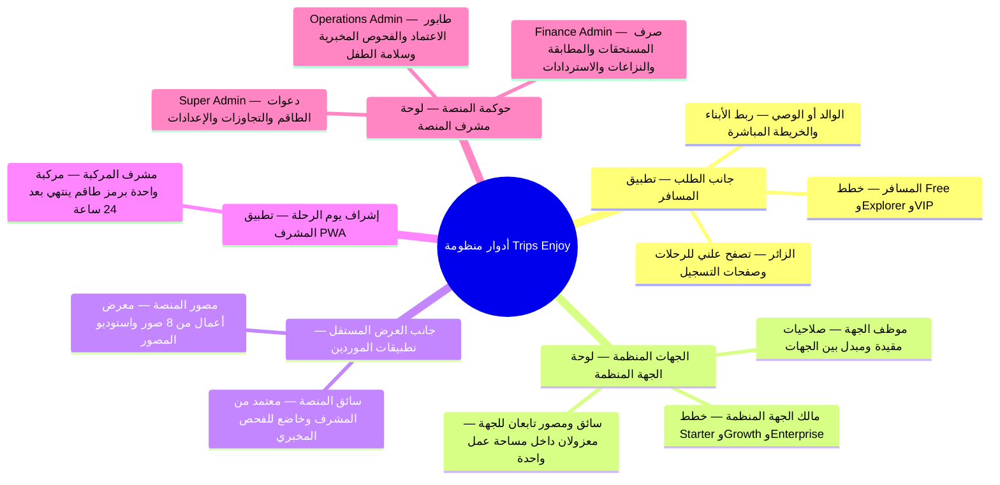
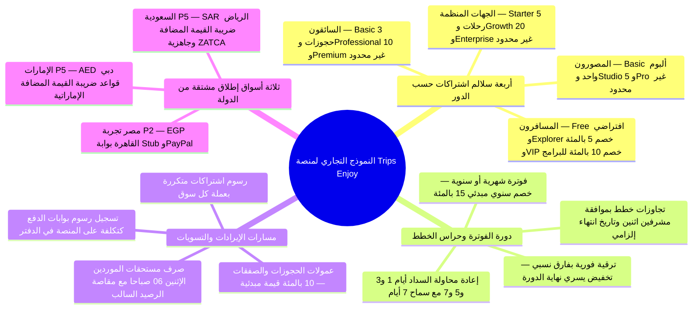
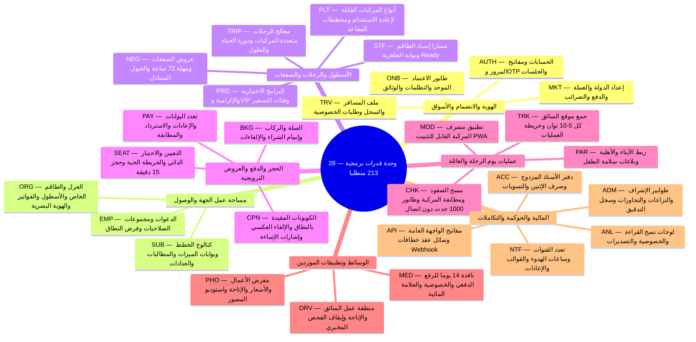
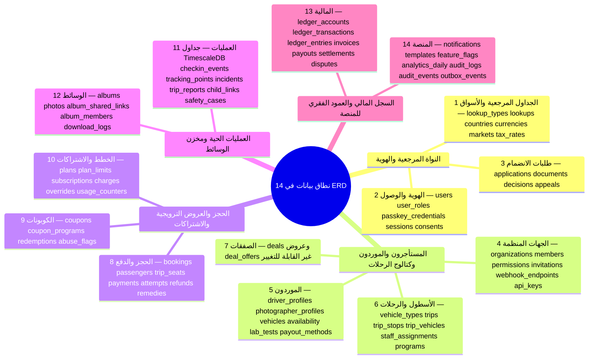
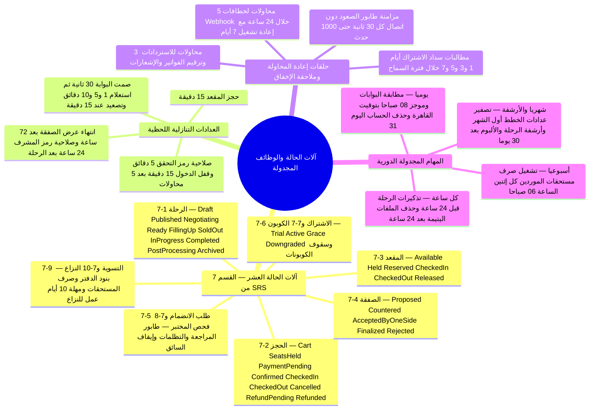
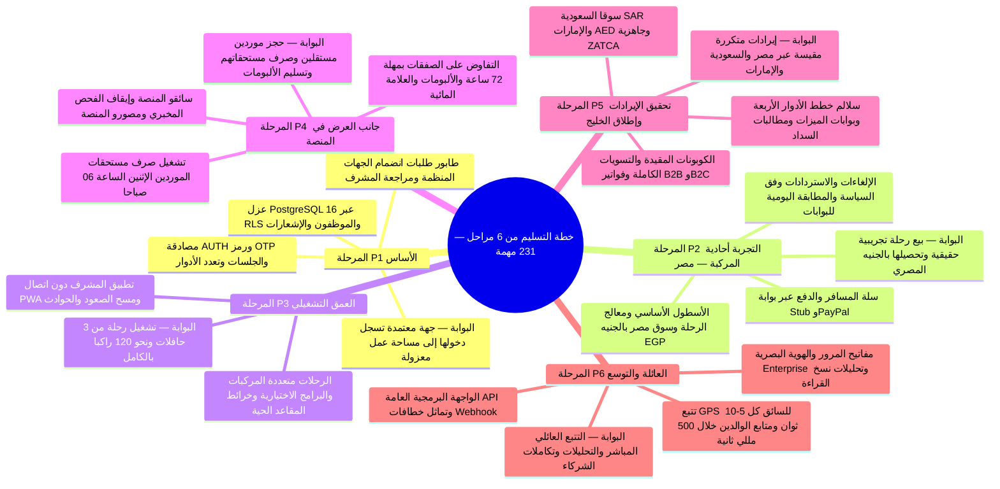
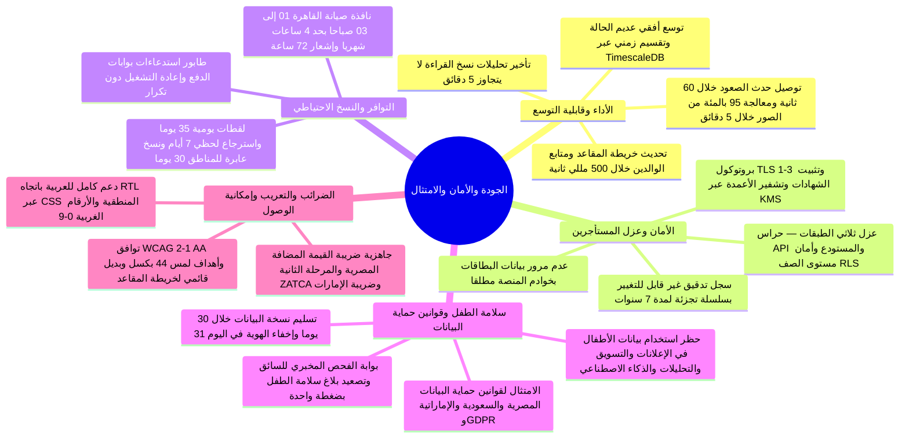

يقدّم **أطلس الخرائط الذهنية للمنصة** نموذجًا ذهنيًا بصريًا شاملًا لكل بُعد بنيوي في منصة **Trips Enjoy** على شاشة واحدة. تجمع كل خريطة ذهنية أدناه بين شرح معماري وافٍ ومكوّن `<MindmapBlock />` وشريط تتبع كامل `<TraceBar />` عبر جميع الركائز، بما يمكّن الفرق الهندسية والتجارية من الانتقال السلس من الصورة الكلية إلى المتطلبات الدقيقة وجداول البيانات وتدفقات المستخدم وسير العمل والتوصيات المعتمدة.

## 1. المنظومة وأدوار أصحاب المصلحة

تخدم منصة Trips Enjoy **عشر فئات من المستخدمين عبر سبعة أسطح تطبيقات**، تحكمها بوابات انضمام وقواعد تحقق وصلاحيات خطط مخصصة لكل دور. يتصفح الزوار الرحلات علنًا؛ ويُفعَّل المسافرون فور التحقق من البريد أو الهاتف (`Free` و`Explorer` و`VIP`)؛ ويحصل الوالدان على تتبع مباشر للأبناء داخل تطبيق المسافر (`Explorer`/`VIP` + جهة منظِّمة مؤهلة)؛ وتمر الجهات المنظِّمة ومورّدو المنصة المستقلون عبر طابور اعتماد موحّد لمشرف المنصة بمهلة يومي عمل؛ بينما يعمل الطاقم التابع للجهة ومشرفو المركبات حصريًا ضمن حدود مساحة عمل الجهة الداعية؛ ويدير مشرفو المنصة العمليات والمالية والسلامة من لوحة معزولة (`admin.trips-enjoy.com`).

<MindmapBlock
  title="الأطراف الفاعلة وبوابات الاعتماد وأسطح التطبيقات في المنظومة"
  caption="كيف يصادق 10 أصناف من المستخدمين على هويتهم، ويحصلون على الاعتماد، ويحملون الخطط، ويتفاعلون عبر 7 أسطح ثنائية اللغة و106 تدفقات مستخدم."
  trace={{
    brd: [
      { label: '§4.1 الأدوار وقواعد الخطط', href: '/ar/docs/brd#41-الأدوار', detail: '10 فئات مستخدمين' },
      { label: '§4.3 رحلات الأدوار في لمحة', href: '/ar/docs/brd#43-رحلات-الأدوار-في-لمحة' },
    ],
    srs: [
      { label: '§3.1 أسطح المنتج', href: '/ar/docs/srs#31-منظور-المنتج', detail: '7 أسطح' },
      { label: '§3.3 فئات المستخدمين', href: '/ar/docs/srs#33-فئات-المستخدمين-وخصائصها' },
      { label: 'وحدتا AUTH وONB', href: '/ar/docs/srs/requirements/auth' },
    ],
    erd: [
      { label: 'users & user_roles', href: '/ar/docs/erd/domains/identity-and-access#users' },
      { label: 'كتالوج الأدوار والصلاحيات', href: '/ar/docs/erd/acl#كتالوج-الأدوار' },
    ],
    plan: [
      { label: 'المرحلة P1 الهوية والجهات', href: '/ar/docs/plan/p1' },
      { label: 'المرحلة P3 تطبيق المشرف PWA', href: '/ar/docs/plan/p3' },
      { label: 'المرحلة P4 المورّدون', href: '/ar/docs/plan/p4' },
      { label: 'المرحلة P6 متابع الوالدين', href: '/ar/docs/plan/p6' },
    ],
    workflows: [
      { label: 'سير عمل طلبات الانضمام', href: '/ar/docs/workflows/applications' },
    ],
    userFlows: [
      { label: 'جميع مجموعات التدفقات الثماني', href: '/ar/docs/user-flows', detail: '106 تدفقات UF' },
    ],
    architecture: [
      { label: 'سياق النظام والحافة', href: '/ar/docs/architecture#سياق-النظام' },
    ],
    design: [
      { label: 'أسطح التطبيقات السبعة', href: '/ar/docs/design#أسطح-التطبيقات' },
    ],
    system: [
      { label: 'STAGE-01 الهوية', href: '/ar/docs/system/lifecycle#stage-01' },
      { label: 'STAGE-02 الانضمام', href: '/ar/docs/system/lifecycle#stage-02' },
    ],
    recommendations: [
      { label: 'OD-06 قاعدة خطة مشرف المركبة', href: '/ar/docs/recommendations/open-decisions#od-06' },
      { label: 'OD-19 تغطية خطة المورّد التابع للجهة', href: '/ar/docs/recommendations/open-decisions#od-19' },
    ],
  }}
>

- **الحسابات متعددة الأدوار (`ASM-01`، `FR-AUTH-06`):** يمكن لحساب واحد أن يجمع بين دور `المسافر` ودور `سائق المنصة` أو `مصوّر المنصة` مع احتفاظه الكامل بصلاحيات المسافر أثناء مراجعة طلب انضمامه كمورّد (`FR-TRV-06`).
- **عزل صارم لنطاق الرؤية (`FR-MOD-01`، `FR-PAR-02`):** لا يرى مشرف المركبة سوى قائمة ركاب مركبته الواحدة المُسندة إليه، ولا يرى الوالدان سوى أطفالهما المرتبطين في الرحلات المؤهلة.
</MindmapBlock>

## 2. النموذج التجاري والإيرادات

التزامًا بقاعدة [ضبط المستند في القسم 1 من BRD](/ar/docs/brd#1-ضبط-المستند) التي تقضي بخلو صفحات `brd/*` تمامًا من أي شيفرات أو مخططات مرمّزة، يستضيف هذا القسم الخريطة الذهنية البصرية المعتمدة للنموذج التجاري لمنصة Trips Enjoy. يجمع تحقيق الإيرادات بين **أربعة سلالم اشتراكات متكررة حسب الدور**، و**عمولات الحجوزات والصفقات** (`10%` قيمة مبدئية رهن حسم `OD-15`)، و**كوبونات ترويجية مقيّدة بنطاق المنشئ**، و**إعدادات أسواق مشتقة من الدولة** في مصر (`EGP`) والسعودية (`SAR`) والإمارات (`AED`)، وتُرحَّل جميعها بالوحدات الصغرى الصحيحة إلى دفتر أستاذ مزدوج غير قابل للتغيير.

<MindmapBlock
  title="النموذج التجاري وخطط الأدوار ومصادر الإيرادات وأسواق الدول"
  caption="تركيب بصري للقسم 5 من BRD — فئات الاشتراك، وبوابات الميزات، وقواعد مطالبات السداد، وبنود الإيرادات والتكاليف، وإعدادات أسواق المنطقة."
  trace={{
    brd: [
      { label: '§5.1 خطط الأدوار وحدودها', href: '/ar/docs/brd#51-الخطط' },
      { label: '§5.2 الإيرادات والتكاليف', href: '/ar/docs/brd#52-الإيرادات-والتكاليف' },
      { label: '§5.3 أسواق الدول', href: '/ar/docs/brd#53-الأسواق' },
      { label: '§8.4 الضرائب والفوترة', href: '/ar/docs/brd/compliance#84-الضرائب-والفوترة' },
    ],
    srs: [
      { label: 'SUB (FR-SUB-01..11)', href: '/ar/docs/srs/requirements/sub', detail: 'الخطط والمطالبات' },
      { label: 'MKT (FR-MKT-01..05)', href: '/ar/docs/srs/requirements/mkt', detail: 'الأسواق' },
      { label: 'ACC (FR-ACC-01..10)', href: '/ar/docs/srs/requirements/acc', detail: 'الدفتر وصرف المستحقات' },
    ],
    erd: [
      { label: 'subscriptions & plans', href: '/ar/docs/erd/domains/plans-and-subscriptions#subscriptions' },
      { label: 'markets & tax_rates', href: '/ar/docs/erd/domains/lookups-and-markets#markets' },
      { label: 'invoices & ledger', href: '/ar/docs/erd/domains/finance#invoices' },
    ],
    plan: [
      { label: 'المرحلة P2 تجربة مصر EGP', href: '/ar/docs/plan/p2' },
      { label: 'المرحلة P5 تحقيق الإيرادات والخليج', href: '/ar/docs/plan/p5' },
    ],
    workflows: [
      { label: 'الاشتراكات ومطالبات السداد', href: '/ar/docs/workflows/subscriptions' },
      { label: 'الأموال وصرف مستحقات الإثنين', href: '/ar/docs/workflows/money' },
    ],
    userFlows: [
      { label: 'UF-ORG-18 الخطة والفوترة', href: '/ar/docs/user-flows/organization#uf-org-18-الخطة-والفوترة' },
      { label: 'UF-SHR-06..07 الحدود وفترة السماح', href: '/ar/docs/user-flows/shared#uf-shr-06-تنبيه-حدود-الخطة' },
    ],
    architecture: [
      { label: 'تكاملات بوابات الدفع', href: '/ar/docs/architecture#التكاملات' },
    ],
    design: [
      { label: 'رموز العملات والأرقام الجدولية الغربية', href: '/ar/docs/design#rtl-والتعريب' },
    ],
    system: [
      { label: 'STAGE-05 الدفع والفواتير', href: '/ar/docs/system/lifecycle#stage-05' },
      { label: 'STAGE-08 الدفتر وصرف المستحقات', href: '/ar/docs/system/lifecycle#stage-08' },
    ],
    recommendations: [
      { label: 'OD-10 نطاق الفوترة الإلكترونية ZATCA', href: '/ar/docs/recommendations/open-decisions#od-10' },
      { label: 'OD-15 نسب العمولات', href: '/ar/docs/recommendations/open-decisions#od-15' },
      { label: 'OD-26 & OD-27 الأسعار وضريبة القيمة المضافة', href: '/ar/docs/recommendations/open-decisions#od-26' },
      { label: 'REC-PAY-04 & REC-TAX-05', href: '/ar/docs/recommendations/architecture-and-ops#rec-pay-04' },
    ],
  }}
>

- **دقة الوحدات الصغرى (`D-157`، `UI-06`):** تُخزَّن جميع الأسعار والضرائب والعمولات والخصومات كأعداد صحيحة `BIGINT` بالوحدات الصغرى مقترنةً برمز العملة القياسي، مع التقريب النصف للأعلى لكل سطر وجمع السطور المقرّبة.
- **حماية البيانات القائمة بعد التخفيض (`D-144`، `FR-SUB-09`):** تظل العناصر الزائدة عن حد الخطة الأدنى عاملة بعد التخفيض، بينما يُمنع إنشاء عناصر جديدة حتى ينخفض العدد الفعلي دون الحد الجديد.
</MindmapBlock>

## 3. وحدات القدرات البرمجية

تُقسّم [مواصفة المتطلبات البرمجية (SRS)](/ar/docs/srs) إجمالي `213` متطلبًا وظيفيًا (`FR-*`) على **28 وحدة قدرات برمجية متماسكة**. تملك كل وحدة داخل الهيكل الأحادي المعياري متحكمات REST وباعثات القنوات اللحظية وخدمات النطاق وحراس الخطط والصلاحيات من جانب الخادم وانتقالات آلات الحالة الخاصة بها.

<MindmapBlock
  title="وحدات القدرات البرمجية الـ 28 في SRS موزعة على سبع مجموعات وظيفية"
  caption="التفكيك الوظيفي الكامل لجميع المتطلبات الـ 213 عبر سبع مجموعات مترابطة."
  trace={{
    brd: [
      { label: '§6 متطلبات العمل (BR-*)', href: '/ar/docs/brd/requirements#6-متطلبات-العمل' },
    ],
    srs: [
      { label: 'ملخص الوحدات SRS §3.2', href: '/ar/docs/srs#32-وظائف-المنتج-حسب-الوحدة', detail: '28 وحدة' },
      { label: 'نظرة القدرات البرمجية', href: '/ar/docs/srs/capabilities' },
      { label: 'مصفوفة التتبع SRS §10', href: '/ar/docs/srs/traceability#10-مصفوفة-التتبع', detail: '213 متطلبًا' },
    ],
    erd: [
      { label: 'تتبع المتطلبات في ERD §5', href: '/ar/docs/erd/reference#5-قابلية-التتبع' },
    ],
    plan: [
      { label: 'سجل المهام المرحلي (P1–P6)', href: '/ar/docs/plan', detail: '213 مهمة وظيفية' },
    ],
    workflows: [
      { label: 'مصفوفة تغطية سير العمل', href: '/ar/docs/workflows/coverage', detail: 'تغطية كاملة' },
    ],
    userFlows: [
      { label: 'تدفقات المستخدم حسب الدور', href: '/ar/docs/user-flows' },
    ],
    architecture: [
      { label: 'نموذج خدمات الهيكل المعياري', href: '/ar/docs/architecture#نموذج-الخدمات' },
    ],
    design: [
      { label: 'طقم المكونات المشترك', href: '/ar/docs/design#المكونات' },
    ],
    recommendations: [
      { label: 'REC-ARCH-01 حدود الحزم البرمجية', href: '/ar/docs/recommendations/architecture-and-ops#rec-arch-01' },
    ],
  }}
>

- **قابلية تتبع بنسبة 100% (`SRS §10`):** يرتبط كل متطلب `FR-*` صعودًا بمتطلب عمل `BR-*` أو قاعدة `BRL-*` أو قرار `OD-*` في وثيقة الأعمال، وهبوطًا بمهمة تسليم دقيقة (`T-P*-*`) وجدول بيانات وسير عمل.
</MindmapBlock>

## 4. نطاقات البيانات وعزل مساحات العمل

يُنظّم [تصميم الكيانات والعلاقات (ERD)](/ar/docs/erd) قاعدة بيانات PostgreSQL 16 وTimescaleDB في **14 نطاق بيانات** تحكمها اتفاقيات موحّدة: مفاتيح أساسية وأجنبية داخلية `id BIGSERIAL` مقترنة بمعرّفات عامة مرتّبة زمنيًا `uuid UUIDv7` (`DAT-10`)، وجداول مرجعية `lookups` بدلًا من أنواع `ENUM`، وتشفير أعمدة البيانات الحساسة عبر KMS مع أعمدة تجزئة `*_hash` للفهرسة (`DAT-05`)، وحذف ناعم عبر `deleted_at` بنافذة استرجاع 30 يومًا (`DAT-11`)، وجداول مالية وتدقيقية وزمنية غير قابلة للتغيير مخصصة للإدراج فقط (`DAT-08`، `DAT-13`)، وتكرار عمود `organization_id` لإنفاذ أمان مستوى الصف RLS دون عمليات ربط (`DAT-01`، `NFR-SEC-07`).

<MindmapBlock
  title="نطاقات البيانات الـ 14 وعزل مساحات العمل عبر PostgreSQL RLS والعمود الفقري غير القابل للتغيير"
  caption="كيف تتوزع أكثر من 101 جدول علائقي وزمني عبر 14 نطاقًا مع عزل صارم للمستأجرين وقابلية تدقيق كاملة."
  trace={{
    brd: [
      { label: 'BRL-01 عزل الجهات وBRL-18 الدفتر', href: '/ar/docs/brd/requirements#7-قواعد-العمل' },
    ],
    srs: [
      { label: 'متطلبات البيانات SRS §6 (DAT-01..15)', href: '/ar/docs/srs/data', detail: 'العزل والاحتفاظ' },
    ],
    erd: [
      { label: 'اتفاقيات ERD وسياسة المعرّفات', href: '/ar/docs/erd#سياسة-المعرّفات' },
      { label: 'جميع مخططات النطاقات الـ 14', href: '/ar/docs/erd#النطاقات' },
      { label: 'كتالوج الوصول وسياسات RLS', href: '/ar/docs/erd/acl#كتالوج-السياسات' },
      { label: 'كتالوج الجداول المرجعية', href: '/ar/docs/erd/reference#4-كتالوج-أنواع-الجداول-المرجعية' },
    ],
    plan: [
      { label: 'المرحلة P1 تأسيس المخطط وRLS', href: '/ar/docs/plan/p1' },
    ],
    workflows: [
      { label: 'مهام الأرشفة والحذف الدوري', href: '/ar/docs/workflows/scheduled-jobs#مهام-الأرشفة-والاحتفاظ-بالبيانات' },
    ],
    userFlows: [
      { label: 'UF-TRV-13 & UF-ADM-05 طلبات الخصوصية', href: '/ar/docs/user-flows/traveler#uf-trv-13-طلبات-الخصوصية' },
    ],
    architecture: [
      { label: 'معمارية البيانات ونسخ القراءة', href: '/ar/docs/architecture#معمارية-البيانات' },
    ],
    design: [
      { label: 'قاعدة استجابة 404 العامة بين المستأجرين (IF-12)', href: '/ar/docs/design#حالات-الفراغ-والتحميل-والخطأ' },
    ],
    recommendations: [
      { label: 'REC-DATA-02 أمان تجمّع اتصالات RLS', href: '/ar/docs/recommendations/architecture-and-ops#rec-data-02' },
      { label: 'OPEN-08 سلسلة تجزئة سجلات التدقيق', href: '/ar/docs/recommendations/open-decisions#open-08' },
    ],
  }}
>

- **أمان مستوى الصف RLS دون عمليات ربط (`DAT-01`):** يكرر كل جدول فرعي تابع لجهة منظِّمة عمود `organization_id BIGINT NOT NULL` بحيث تنفّذ PostgreSQL شرط `organization_id = current_setting('app.current_organization_id')::bigint` عبر فحص فهرس مباشر.
- **جداول مالية وتدقيقية وزمنية للإدراج فقط (`DAT-13`):** تمنع جداول `ledger_transactions` و`ledger_entries` و`audit_logs` و`audit_events` و`deal_offers` و`checkin_events` و`tracking_points` و`consents` و`outbox_events` أي تعديل أو حذف؛ وتُعالج التصحيحات بإدراج صفوف عكسية جديدة.
</MindmapBlock>

## 5. سير العمل في النظام والوظائف المجدولة

فيما بين نقرات البشر، يدار النظام بواسطة **10 آلات حالة رسمية** (`SRS §7`) و**كتالوج حتمي للمؤقتات والوظائف المجدولة** (`workflows/scheduled-jobs`). يحمل كل مؤقت وسقف إعادة محاولة وتأجيل لساعات الهدوء ومهمة مطابقة مرجعًا صريحًا وطابور تصعيد يمنع تعلّق أي سجل بصمت.

<MindmapBlock
  title="آلات الحالة العشر وحلقات إعادة المحاولة ودوريات الوظائف المجدولة"
  caption="منظور محرك التشغيل — كيف تنسّق حراس الحالة والعدادات التنازلية وحلقات إعادة المحاولة والمهام الدورية حركة المنصة."
  trace={{
    brd: [
      { label: '§7 قواعد العمل (BRL-06..31)', href: '/ar/docs/brd/requirements#7-قواعد-العمل' },
    ],
    srs: [
      { label: 'آلات الحالة العشر SRS §7', href: '/ar/docs/srs/state-machines', detail: '7.1..7.10' },
    ],
    erd: [
      { label: 'outbox_events & idempotency_keys', href: '/ar/docs/erd/domains/platform' },
    ],
    plan: [
      { label: 'هرم الاختبارات والتحقق من المؤقتات', href: '/ar/docs/plan/testing' },
    ],
    workflows: [
      { label: 'عقد محرّك سير العمل', href: '/ar/docs/workflows#عقد-المحرّك' },
      { label: 'كتالوج الوظائف المجدولة الكامل', href: '/ar/docs/workflows/scheduled-jobs', detail: 'جميع الدوريات' },
    ],
    userFlows: [
      { label: 'UF-ADM-11 & UF-ADM-12 طوابير التصعيد', href: '/ar/docs/user-flows/admin#uf-adm-12-تصعيد-الدفع' },
    ],
    architecture: [
      { label: 'العمال الداخليون وخط Outbox', href: '/ar/docs/architecture#نموذج-الخدمات' },
    ],
    design: [
      { label: 'صندوق الإشعارات وساعات الهدوء', href: '/ar/docs/design#أسطح-الإشعارات' },
    ],
    system: [
      { label: 'ملخص عزل الأعطال والتعافي', href: '/ar/docs/system/lifecycle#ملخص-عزل-الأعطال-ومسارات-التعافي-الشاملة' },
    ],
    recommendations: [
      { label: 'REC-ARCH-01 مرحّل Outbox SKIP LOCKED', href: '/ar/docs/recommendations/architecture-and-ops#rec-arch-01' },
      { label: 'REC-OPS-12 اختبارات التحمل والمؤقتات', href: '/ar/docs/recommendations/architecture-and-ops#rec-ops-12' },
    ],
  }}
>

- **ضمانات منع التكرار (Idempotency):** تُعالج استدعاءات بوابات الدفع مرة واحدة على الأكثر لكل معرّف حدث بوابة (`FR-PAY-02`)، وتُحفظ مفاتيح `Idempotency-Key` لمدة **24 ساعة** (`NFR-SEC-06`)، وتُتجاهل أحداث الصعود المعاد إرسالها عبر `client_event_id` (`FR-CHK-05`)، وتُمنع الإشعارات المكررة عبر `(user_id, event_key)` (`FR-NTF-06`).
</MindmapBlock>

## 6. خارطة طريق التسليم من ست مراحل

تُسلَّم منصة Trips Enjoy تدريجيًا عبر **ست مراحل تسليم محكومة ببوابات اعتماد (`P1`–`P6`)** تضم **231 مهمة هندسية** (`213` مهمة وظيفية مرتبطة واحدًا لواحد بمتطلبات `FR-*` إضافةً إلى `18` مهمة منصة عابرة للمجالات `T-P1-PLAT-1`..`T-P6-PLAT-3`). وتنتهي كل مرحلة بمعلم تشغيلي ملموس وقائمة قرارات مفتوحة (`OD-*`) يتعيّن حسمها قبل الإطلاق.

<MindmapBlock
  title="خارطة التسليم من ست مراحل (P1–P6) — 231 مهمة ومعالم اعتماد المراحل"
  caption="التدرج من تأسيس العزل وتجربة مصر بالجنيه المصري إلى تشغيل 3 حافلات ومورّدي السوق وإطلاق الخليج والتتبع المباشر للعائلة."
  trace={{
    brd: [
      { label: '§3.3 مراحل التسليم وتعريف الإنجاز', href: '/ar/docs/brd#33-مراحل-التسليم', detail: 'P1..P6' },
    ],
    srs: [
      { label: 'مواءمة أولويات MoSCoW بالمراحل', href: '/ar/docs/srs#25-اصطلاحات-المستند' },
    ],
    erd: [
      { label: 'ترحيلات المخطط بنمط Expand-Contract', href: '/ar/docs/erd' },
    ],
    plan: [
      { label: 'نظرة عامة على خطة التسليم', href: '/ar/docs/plan' },
      { label: 'المرحلة P1 الأساس', href: '/ar/docs/plan/p1' },
      { label: 'المرحلة P2 تجربة مصر', href: '/ar/docs/plan/p2' },
      { label: 'المرحلة P3 العمق التشغيلي', href: '/ar/docs/plan/p3' },
      { label: 'المرحلة P4 جانب العرض', href: '/ar/docs/plan/p4' },
      { label: 'المرحلة P5 تحقيق الإيرادات والخليج', href: '/ar/docs/plan/p5' },
      { label: 'المرحلة P6 العائلة والتوسّع', href: '/ar/docs/plan/p6' },
      { label: 'المعالم والاختبارات', href: '/ar/docs/plan/milestones' },
    ],
    workflows: [
      { label: 'تدرج سير العمل عبر المراحل', href: '/ar/docs/workflows' },
    ],
    userFlows: [
      { label: 'رحلات الأدوار حسب المرحلة', href: '/ar/docs/user-flows' },
    ],
    architecture: [
      { label: 'مفاتيح تشغيل الميزات وطوبولوجيا النشر', href: '/ar/docs/architecture#طوبولوجيا-النشر' },
    ],
    design: [
      { label: 'حوكمة التصميم وبوابة التماثل', href: '/ar/docs/design#الحوكمة' },
    ],
    recommendations: [
      { label: 'مصفوفة القرارات حسب المرحلة', href: '/ar/docs/recommendations' },
      { label: 'REC-OPS-12 محاكاة 3 حافلات و120 راكبًا', href: '/ar/docs/recommendations/architecture-and-ops#rec-ops-12' },
    ],
  }}
>

- **الترقية المحكومة بمفاتيح تشغيل الميزات (`NFR-MNT-03`):** تُشحن ميزات كل مرحلة خلف مفاتيح `feature_flags` مقيدة بالسوق والخطة مع ترحيلات قواعد بيانات بنمط expand-contract (`NFR-MNT-01`)، بحيث لا تعطّل ميزات المرحلة القادمة إصلاحات الإنتاج الجارية.
</MindmapBlock>

## 7. الجودة والأمان والامتثال

صُممت المتطلبات غير الوظيفية (`SRS §8`، `NFR-*`) والالتزامات التنظيمية والقانونية (`BRD §8`) في صلب مسار الطلبات وطوبولوجيا التخزين وبوابات التكامل المستمر منذ اليوم الأول بدلًا من إضافتها لاحقًا بعد المرحلة السادسة.

<MindmapBlock
  title="سمات الجودة (NFR) وضوابط الأمان والخصوصية والامتثال التنظيمي في المنطقة"
  caption="ميزانيات زمن الاستجابة، والأمان متعدد الطبقات، وحماية بيانات الأطفال، والامتثال الضريبي وأهداف التعافي من الكوارث."
  trace={{
    brd: [
      { label: '§8.1..8.5 الامتثال وسلامة الطفل وحماية البيانات والضرائب', href: '/ar/docs/brd/compliance#8-الامتثال-والسلامة-والشؤون-القانونية' },
      { label: '§10 سجل مخاطر المنصة', href: '/ar/docs/brd/compliance#10-المخاطر' },
    ],
    srs: [
      { label: 'جميع مجموعات الجودة الـ 11 في SRS §8', href: '/ar/docs/srs/quality#8-المتطلبات-غير-الوظيفية', detail: 'PERF..BKP' },
      { label: 'متطلبات الواجهات وAPI في SRS §9', href: '/ar/docs/srs/quality#9-متطلبات-الواجهات-و-api' },
    ],
    erd: [
      { label: 'التحكم في الوصول وتشفير KMS وسلسلة التدقيق', href: '/ar/docs/erd/acl' },
      { label: 'audit_events', href: '/ar/docs/erd/domains/platform#audit_events' },
    ],
    plan: [
      { label: 'هرم الاختبارات والتحقق', href: '/ar/docs/plan/testing' },
    ],
    workflows: [
      { label: 'مهام الاحتفاظ والنسخ الاحتياطي ونافذة الصيانة', href: '/ar/docs/workflows/scheduled-jobs#مهام-الأرشفة-والاحتفاظ-بالبيانات' },
    ],
    userFlows: [
      { label: 'UF-PAR-05 بلاغ سلامة الطفل', href: '/ar/docs/user-flows/parent#uf-par-05-الإبلاغ-عن-مشكلة-تتعلق-بسلامة-الطفل' },
      { label: 'UF-TRV-13 نسخ البيانات وحذفها', href: '/ar/docs/user-flows/traveler#uf-trv-13-طلبات-الخصوصية' },
    ],
    architecture: [
      { label: 'جدول إنفاذ سمات الجودة', href: '/ar/docs/architecture#سمات-الجودة' },
    ],
    design: [
      { label: 'معيار WCAG 2.1 AA والتباين ولوحة المفاتيح', href: '/ar/docs/design#إمكانية-الوصول' },
    ],
    recommendations: [
      { label: 'REC-SEC-09 سلامة الطفل وسلسلة التدقيق', href: '/ar/docs/recommendations/architecture-and-ops#rec-sec-09' },
      { label: 'REC-UX-11 هندسة RTL وإمكانية وصول المقاعد', href: '/ar/docs/recommendations/architecture-and-ops#rec-ux-11' },
      { label: 'OPEN-09 إقامة البيانات ومناطق الاستضافة', href: '/ar/docs/recommendations/open-decisions#open-09' },
    ],
  }}
>

- **الامتثال المدمج بالتصميم:** تُفرض قيود سلامة الطفل (`CON-08`)، وتجنّب نطاق بيانات البطاقات (`CON-02`)، والاحتفاظ المالي والتدقيقي لمدة 7 سنوات (`DAT-08`)، ومعايير إمكانية الوصول ثنائية اللغة WCAG 2.1 AA (`NFR-A11Y-01..04`) مباشرةً عبر مخططات قاعدة البيانات ومكوّنات الواجهة المشتركة وفحوص التكامل المستمر.
</MindmapBlock>
