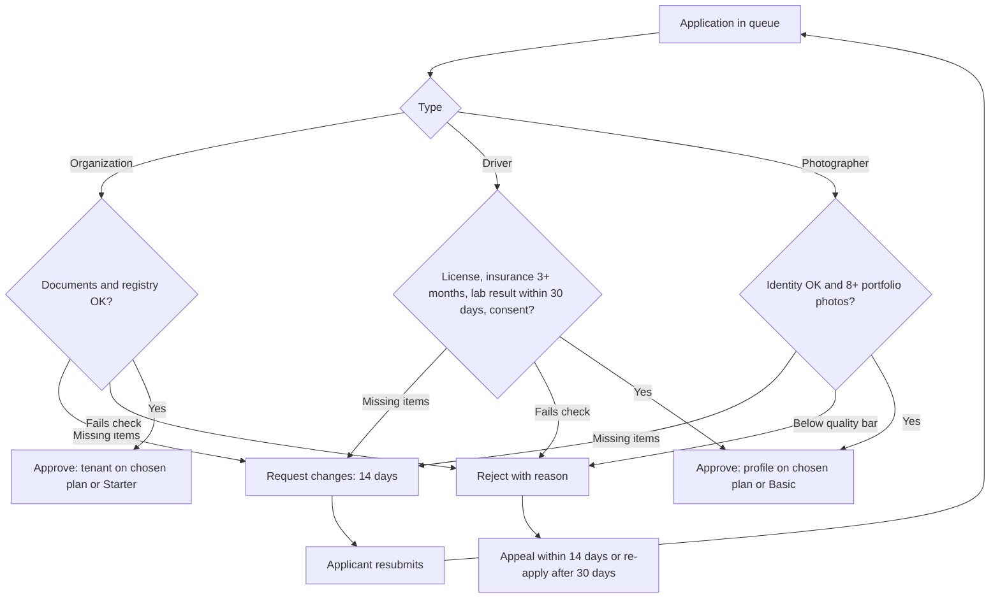

الواجهة: admin.trips-enjoy.com، لطاقم العمل فقط. الأدوار: المشرف الأعلى، العمليات، المالية (D-49).

## التسجيل

لا يوجد تسجيل عام. يدعو المشرفُ الأعلى مشرفًا جديدًا عبر البريد الإلكتروني مع تحديد الدور؛ ويكون الرابط صالحًا 72 ساعة (D-50). يُعرِّف المشرف الجديد كلمة مرور (12 حرفًا أو أكثر) ويُسجِّل أداة المصادقة (authenticator) قبل أن تُفتح اللوحة.

## الاعتماد

المشرف الأعلى الداعي هو المعتمِد. وتُدوَّن تغييرات الأدوار والإزالات في التدقيق.

## صلاحيات الأدوار

| النطاق | المشرف الأعلى | العمليات | المالية |
|---|---|---|---|
| طلبات الانضمام والتظلمات | نعم | نعم | عرض |
| الحسابات (تعليق، إعادة تنشيط، إعادة تعيين) | نعم | نعم | عرض |
| الفحوصات المخبرية | نعم | نعم | لا |
| النزاعات | نعم | نعم | قرارات الاسترداد |
| الخطط والأسعار والتجاوزات | نعم | عرض | نعم |
| الكوبونات وإشارات إساءة الاستخدام | نعم | نعم | عرض |
| صرف المستحقات والتسويات والمطابقة | نعم | عرض | نعم |
| الأسواق والقوالب وإشارات الميزات | نعم | القوالب | الأسواق (الضريبة، الأسعار) |
| طاقم الإشراف | نعم | لا | لا |
| سجل التدقيق | نعم | عرض | عرض |

## التدفقات

### UF-ADM-01. تسجيل الدخول
البريد الإلكتروني وكلمة المرور، ثم رمز أداة المصادقة. 5 محاولات فاشلة تقفل الحساب 15 دقيقة.
القواعد: [FR-AUTH-04](/ar/docs/srs/requirements/auth#fr-auth-04--طرق-تسجيل-دخول-خاصة-بكل-دور)، [FR-AUTH-05](/ar/docs/srs/requirements/auth#fr-auth-05--القفل-بعد-محاولات-دخول-فاشلة).

### UF-ADM-02. مراجعة طلب انضمام
الفاعل: العمليات أو المشرف الأعلى. المُحفِّز: طلب انضمام في قائمة الانتظار.
<Steps>
<Step>
تعرض قائمة الانتظار الطلبات حسب النوع (جهة منظِّمة، سائق، مصوّر)، والعمر، ووسم التجاوز (أكثر من يومي عمل)، والدولة.
</Step>
<Step>
تعرض التفاصيل جميع الحقول والمستندات (تُفتح من مخزن مقيد، وتُدوَّن كل عملية فتح في التدقيق)، والفحوصات الواجب تسجيلها: الهوية، وصلاحية المستندات، وتأمين لا يقل عن 3 أشهر (السائقون)، ونتيجة مخبرية خلال 30 يومًا (السائقون)، وملف أعمال من 8 صور أو أكثر (المصوّرون)، والتحقق من السجل (الجهات المنظِّمة).
</Step>
<Step>
القرار:
  - **الاعتماد**: تُختار الخطة أو تُعيَّن الخطة الافتراضية؛ ويُنشأ مستأجر الجهة المنظِّمة أو ملف المورّد؛ ويُخطَر مقدِّم الطلب.
  - **طلب تعديلات**: قائمة بالبنود ورسالة بلغة مقدِّم الطلب؛ ومهلة 14 يومًا.
  - **الرفض**: رمز سبب ورسالة؛ ويُبلَّغ مقدِّم الطلب بالتظلم (14 يومًا) وإعادة التقديم (30 يومًا).
</Step>
</Steps>
القواعد: من [FR-ONB-02](/ar/docs/srs/requirements/onb#fr-onb-02--قائمة-انتظار-واحدة-لمشرف-المنصة) إلى [FR-ONB-05](/ar/docs/srs/requirements/onb#fr-onb-05--الرفض-والتظلم-وإعادة-التقديم).

### UF-ADM-03. البتّ في تظلم
<Steps>
<Step>
يعرض التظلم القرار الأصلي والبيان وحتى 5 ملفات.
</Step>
<Step>
قبول التظلم (يُعتمد الطلب) أو رفضه (يصبح الرفض نهائيًا) خلال 5 أيام عمل.
</Step>
</Steps>
القواعد: [FR-ONB-05](/ar/docs/srs/requirements/onb#fr-onb-05--الرفض-والتظلم-وإعادة-التقديم).

### UF-ADM-04. إدارة حساب
<Steps>
<Step>
البحث بالاسم أو البريد الإلكتروني أو الهاتف أو مرجع الحجز أو الجهة المنظِّمة.
</Step>
<Step>
تفاصيل الكيان: الأدوار، والخطة، والحالة، والحجوزات، والصفقات، ومسار التدقيق.
</Step>
<Step>
التعليق برمز سبب؛ وإعادة التنشيط؛ وإعادة تعيين بيانات الدخول؛ ورفع التعليق الأمني مبكرًا يتطلب مشرفًا ثانيًا.
</Step>
</Steps>
القواعد: [FR-AUTH-08](/ar/docs/srs/requirements/auth#fr-auth-08--الإيقاف-وإعادة-التفعيل)، [FR-ADM-01](/ar/docs/srs/requirements/adm#fr-adm-01--إدارة-الحسابات).

### UF-ADM-05. طلبات الخصوصية
قائمة انتظار لطلبات نسخ البيانات والحذف مع تواريخ الاستحقاق؛ تُسلَّم نسخ البيانات خلال 30 يومًا؛ وتعرض عمليات الحذف تاريخ نهاية فترة السماح.
القواعد: [FR-TRV-07](/ar/docs/srs/requirements/trv#fr-trv-07--نسخ-البيانات-وحذفها)، [FR-AUTH-09](/ar/docs/srs/requirements/auth#fr-auth-09--حذف-الحساب-مع-مهلة-سماح-مدتها-30-يومًا).

### UF-ADM-06. طلب فحص مخبري ومراجعته
<Steps>
<Step>
من ملف سائق، طلب فحص مخبري: النوع (فحص مخدرات، أو لياقة طبية، أو كلاهما) والمهلة (من يوم إلى 7 أيام، والافتراضي 3).
</Step>
<Step>
يُوقف السائق فورًا؛ وتُنهى الصفقات المفتوحة؛ وتعود المهام القادمة إلى الجهات المنظِّمة.
</Step>
<Step>
قائمة انتظار الفحوص المخبرية حسب الحالة والمهلة. وتُراجَع النتائج الواردة من المختبر الشريك أو المرفوعة من السائق: ناجح (إلغاء الإيقاف) أو راسب (يبقى موقوفًا؛ والفشل الثاني خلال 12 شهرًا يغلق الحساب).
</Step>
<Step>
تفويت المهلة يعلّق السائق؛ وتجاوز 30 يومًا يغلق الحساب.
</Step>
</Steps>
القواعد: [FR-ADM-09](/ar/docs/srs/requirements/adm#fr-adm-09--طلبات-الفحص-المخبري)، من [FR-DRV-03](/ar/docs/srs/requirements/drv#fr-drv-03--الإيقاف-مؤقتًا-لأجل-الفحص-المختبري) إلى [FR-DRV-06](/ar/docs/srs/requirements/drv#fr-drv-06--الإيقاف-عند-تجاوز-المهلة).

### UF-ADM-07. الخطط والتجاوزات
<Steps>
<Step>
كتالوج الخطط لكل دور: الحدود، والميزات، ومدة التجربة، والأسعار حسب السوق وفاصل الفوترة.
</Step>
<Step>
التجاوزات: يطلب مشرفٌ ذلك مع سبب وتاريخ نهاية؛ ويعتمده مشرف ثانٍ؛ ويُرسل بريد إلكتروني إلى المالك؛ وتعود الخطة إلى أصلها عند تاريخ النهاية.
</Step>
</Steps>
القواعد: [FR-SUB-01](/ar/docs/srs/requirements/sub#fr-sub-01--كتالوج-الخطط)، [FR-SUB-05](/ar/docs/srs/requirements/sub#fr-sub-05--تجاوزات-مشرف-المنصة).

### UF-ADM-08. الكوبونات وإساءة الاستخدام
إنشاء كوبونات المنصة (اختياريًا لكل سوق)؛ وإلغاء أي كوبون؛ ومراجعة إشارات إساءة الاستخدام خلال يومي عمل (لا تحجب الإشارات شيئًا تلقائيًا أبدًا).
القواعد: [FR-ADM-06](/ar/docs/srs/requirements/adm#fr-adm-06--كوبونات-على-مستوى-المنصة)، [FR-ADM-07](/ar/docs/srs/requirements/adm#fr-adm-07--إشارات-إساءة-الاستخدام)، [FR-CPN-07](/ar/docs/srs/requirements/cpn#fr-cpn-07--التحليلات-وإشارات-إساءة-الاستخدام).

### UF-ADM-09. تدقيق الصفقات
قائمة الصفقات مع مرشِّحات؛ وخط زمني لكل عرض؛ ووسم صفقة بسبب، ما قد يعلّقها.
القواعد: [FR-NEG-06](/ar/docs/srs/requirements/neg#fr-neg-06--تدقيق-التعاقد).

### UF-ADM-10. النزاعات
<Steps>
<Step>
قائمة انتظار بالنوع والعمر وموعد الإقرار المستحق (يومي عمل) وموعد الحل المستحق (10 أيام عمل).
</Step>
<Step>
الإقرار، وطلب معلومات (تُجاب خلال 5 أيام عمل)، وتسجيل النتيجة، وإصدار استرداد وفق السياسة أو خارجها مع سبب.
</Step>
</Steps>
القواعد: [FR-ADM-04](/ar/docs/srs/requirements/adm#fr-adm-04--نتائج-النزاعات-والاستردادات)، [FR-ADM-08](/ar/docs/srs/requirements/adm#fr-adm-08--معالجة-النزاعات)، [FR-PAY-04](/ar/docs/srs/requirements/pay#fr-pay-04--الاسترداد-خارج-السياسة).

### UF-ADM-11. العمليات المالية
الفاعل: المالية أو المشرف الأعلى.
<Steps>
<Step>
العرض المالي للمنصة حسب السوق والشهر.
</Step>
<Step>
تشغيل صرف المستحقات الأسبوعي (الاثنين 06:00): مراجعة، واعتماد، وإرسال؛ وتُدرَج عمليات الصرف الفاشلة والمعلقة مع أسبابها.
</Step>
<Step>
متتبّع التسويات: مفتوحة، بانتظار صرف المستحقات، متنازع عليها، مغلقة.
</Step>
<Step>
استثناءات المطابقة (يوميًا) وموجز 08:00 بتوقيت القاهرة.
</Step>
<Step>
الفواتير قيد مراجعة المالية (إخفاقات الترقيم).
</Step>
</Steps>
القواعد: من [FR-ACC-03](/ar/docs/srs/requirements/acc#fr-acc-03--أرباح-المورّدين-وصرف-المستحقات) إلى [FR-ACC-05](/ar/docs/srs/requirements/acc#fr-acc-05--التسويات)، [FR-ACC-09](/ar/docs/srs/requirements/acc#fr-acc-09--المطابقة-اليومية-وموجز-المالية)، [FR-ORG-07](/ar/docs/srs/requirements/org#fr-org-07--فواتير-b2b-وb2c).

### UF-ADM-12. تصعيد الدفع
تظهر المدفوعات المعلقة لأكثر من 15 دقيقة في قائمة انتظار مع فحوص لحالة البوابة؛ ويحل مشرف المنصة الأمر بالتأكيد أو الإعلان عن الفشل بعد التحقق لدى البوابة.
القواعد: [FR-PAY-08](/ar/docs/srs/requirements/pay#fr-pay-08--الدفع-المعلق).

### UF-ADM-13. الإعدادات
الأسواق (العملة، ووسائل الدفع، والضريبة، والمنطقة الزمنية، والعمولة، والحالة)، وقوالب الإشعارات حسب الفئة والقناة واللغة، وإشارات الميزات. ويُدوَّن كل تغيير في التدقيق.
القواعد: [FR-ADM-03](/ar/docs/srs/requirements/adm#fr-adm-03--الإعدادات)، [FR-MKT-01](/ar/docs/srs/requirements/mkt#fr-mkt-01--إعداد-السوق)، [FR-NTF-04](/ar/docs/srs/requirements/ntf#fr-ntf-04--قوالب-مُدارة-بالإصدارات).

### UF-ADM-14. الإشراف على الرحلات وسجل التدقيق
الرحلات عبر الجهات المنظِّمة مع مرشِّحات الحالة؛ والإلغاء قبل حالة «قيد التنفيذ» فقط. سجل تدقيق قابل للبحث بالفاعل والإجراء والهدف والتاريخ؛ للقراءة فقط، ويُحفظ 7 سنوات.
القواعد: [FR-TRIP-05](/ar/docs/srs/requirements/trip#fr-trip-05--دورة-حياة-الرحلة)، [FR-ADM-05](/ar/docs/srs/requirements/adm#fr-adm-05--سجل-تدقيق-غير-قابل-للتغيير).

### UF-ADM-15. تحليلات المنصة والتدقيق
الفاعل: المشرف الأعلى أو العمليات. المُحفِّز: فتح التحليلات أو سجل التدقيق.
<Steps>
<Step>
يفتح تحليلات المنصة: عروض الحجوزات والإيرادات وقمع التحويل عبر الأسواق، ببيانات لا تتجاوز قدمتها 5 دقائق.
</Step>
<Step>
ينتقل إلى عرض الخصوصية: أرقام مجمّعة فقط دون بيانات شخصية، مع عرض ملاحظة الخصوصية.
</Step>
<Step>
ينتقل إلى تحليلات المورّدين لعروض أداء السائقين والمصوّرين.
</Step>
<Step>
يصدّر عرضًا؛ ويكون التصدير جاهزًا خلال 15 دقيقة وتنتهي صلاحيته بعد 7 أيام.
</Step>
<Step>
يبحث في سجل التدقيق بالفاعل والإجراء والكائن لمسار المساءلة.
</Step>
</Steps>
الحالات الحدّية: تنتظر التصديرات خلف النطاقات الكبيرة في طابور (وتظهر الحالة حتى الجاهزية).
القواعد: [FR-ADM-10](/ar/docs/srs/requirements/adm#fr-adm-10--سجل-حدث-التدقيق)، [FR-ADM-11](/ar/docs/srs/requirements/adm#fr-adm-11--عرض-الاستعلام-عن-التدقيق)، [FR-ANL-02](/ar/docs/srs/requirements/anl#fr-anl-02--تحليلات-مقدّمي-الخدمات)، [FR-ANL-03](/ar/docs/srs/requirements/anl#fr-anl-03--تحليلات-مشرف-المنصة)، [FR-ANL-04](/ar/docs/srs/requirements/anl#fr-anl-04--النطاقات-والحداثة-والتصدير)، [FR-ANL-05](/ar/docs/srs/requirements/anl#fr-anl-05--الخصوصية-في-التحليلات).

### UF-ADM-16. الاسترداد خارج السياسة
الفاعل: مشرف المنصة بدور المالية. المُحفِّز: استرداد لا يمنحه محرك السياسة.
<Steps>
<Step>
يفتح الحجز أو النزاع ويختار مبلغًا يختلف عن المحسوب وفق السياسة.
</Step>
<Step>
يسجّل رمز سبب؛ ويسمّي التأكيدُ الفارق عن السياسة.
</Step>
<Step>
يؤكد؛ ويُرسَل الاسترداد مثل أي استرداد آخر، ويحمل عكس القيد في السجل السببَ وقيْدًا في التدقيق.
</Step>
</Steps>
الحالات الحدّية: الاستردادات المرتبطة بنزاع تتبع حالة حلّ النزاع أولًا.
القواعد: [FR-PAY-04](/ar/docs/srs/requirements/pay#fr-pay-04--الاسترداد-خارج-السياسة)، [BRL-19](/ar/docs/brd/requirements#7-قواعد-العمل)، [FR-ADM-04](/ar/docs/srs/requirements/adm#fr-adm-04--نتائج-النزاعات-والاستردادات).
