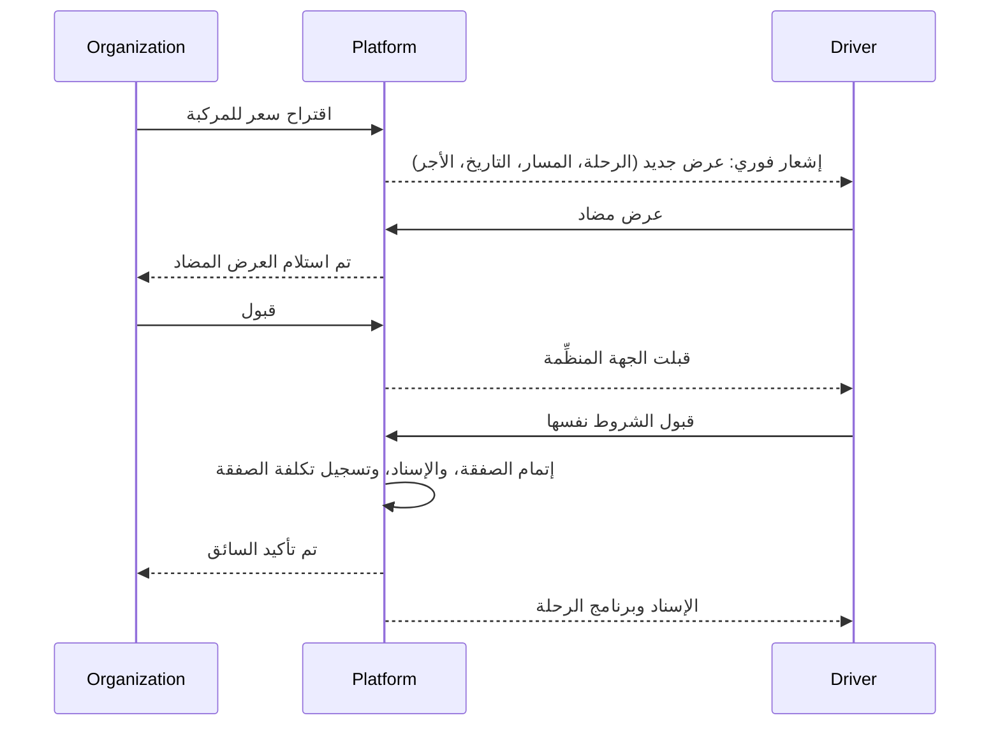

الواجهة: تطبيق الهاتف؛ ويقتصر الويب على المستندات والملف الشخصي (D-86). الأدوار: سائق المنصة، وسائق الجهة المنظِّمة.

## التسجيل: سائق المنصة

| الحقل | مطلوب | ملاحظات |
|---|---|---|
| الاسم الكامل | نعم | |
| البريد الإلكتروني والهاتف | نعم، مع التحقق من كليهما | D-20 |
| كلمة المرور | نعم | |
| الدولة | نعم | تحدد السوق وعملة صرف المستحقات |
| رقم الهوية الوطنية | نعم | تخزين مقيد |
| رقم رخصة القيادة وصورتها وتاريخ انتهائها | نعم | |
| هل يستخدم مركبته الخاصة؟ | نعم | إذا نعم: رقم اللوحة، والموديل، وسنة الصنع، وعدد المقاعد، وشهادة التسجيل، وتأمين صالح لمدة 3 أشهر إضافية على الأقل |
| مناطق الخدمة | نعم | |
| الموافقة على التحليل المخبري | نعم | تُسجَّل مع نسخة نصية |
| نتيجة التحليل المخبري الأولية | نعم | بتاريخ لا يتجاوز آخر 30 يومًا |
| الموافقة على فحص الخلفية | حيثما تسمح المراجعة القانونية في السوق | |
| اختيار الخطة | لا | الخطة الأساسية إن لم يُختر شيء (D-78)؛ ولا تُحصل أي رسوم قبل الاعتماد |

## التسجيل: سائق الجهة المنظِّمة

تصل الدعوة من جهة منظِّمة عبر SMS أو البريد الإلكتروني (صالحة لمدة 7 أيام). الحقول: الاسم، والهاتف (متحقق منه)، والدولة، والرخصة. لا حاجة لاعتماد مشرف المنصة؛ ويُقبل السائق عند الإسناد.

## الاعتماد: سائق المنصة

يراجع مشرف المنصة الهوية والرخصة ومستندات المركبة والتأمين ونتيجة التحليل المخبري ([لوحة مشرف المنصة](/ar/docs/user-flows/admin), [UF-ADM-02](/ar/docs/user-flows/admin#uf-adm-02-مراجعة-طلب-انضمام)). يعتمد الطلب أو يطلب تعديلات أو يرفضه. عند الاعتماد ينتقل السائق إلى الشاشة الرئيسية مع الخطة، ويظهر في مجموعة سائقي المنصة.

## التدفقات

### UF-DRV-01. التسجيل وتقديم الطلب
<Steps>
<Step>
خطوة الحساب، والتحقق من وسيلتي التواصل كلتيهما، والبيانات، والمركبة، والمستندات، والموافقة المخبرية ونتيجتها، والخطة.
</Step>
<Step>
الإرسال؛ تعرض صفحة الحالة «قيد المراجعة» والموعد المستهدف وهو يومان عمل.
</Step>
<Step>
طُلبت التعديلات: تعرض صفحة الحالة العناصر، والموعد النهائي، وإجراء «طلب 7 أيام إضافية» (مرة واحدة).
</Step>
</Steps>
القواعد: [FR-ONB-01](/ar/docs/srs/requirements/onb#fr-onb-01--طلب-الانضمام-ووصول-المورد), [FR-ONB-07](/ar/docs/srs/requirements/onb#fr-onb-07--بيانات-مركبة-السائق-وتأمينه), [FR-ONB-08](/ar/docs/srs/requirements/onb#fr-onb-08--الموافقة-على-الفحوصات-المخبرية-والنتيجة-المبدئية).

### UF-DRV-02. تحديد الإتاحة والملف الشخصي
تحديد التواريخ والنطاقات المتاحة أو غير المتاحة (دون قواعد أسبوعية). تعديل الأسعار والمناطق والمركبة والمستندات؛ والمستندات القريبة من الانتهاء تُطلق التذكيرات.
القواعد: [FR-DRV-08](/ar/docs/srs/requirements/drv#fr-drv-08--إتاحة-السائق).

### UF-DRV-03. الرد على صفقة
<Steps>
<Step>
صندوق العروض: عروض جديدة، وعروض مضادة، وأخرى على وشك الانتهاء (72 ساعة بعد آخر عرض مضاد).
</Step>
<Step>
تفاصيل العرض: الجهة المنظِّمة، والرحلة، والمسار، والتاريخ، والمركبة، والأجر قبل أي إجراء.
</Step>
<Step>
قبول، أو عرض مضاد بسعر وملاحظة جديدين، أو رفض.
</Step>
<Step>
عندما يقبل الطرفان الشروط نفسها، تُقفل الصفقة ويظهر الإسناد في قسم الرحلات.
</Step>
</Steps>
الحالات الحدّية: تعارض مع إسناد قائم في التاريخ نفسه (تحذير)؛ بلوغ حد الخطة الشهري للحجوزات عند إتمام الصفقة (تنبيه ترقية).
القواعد: [FR-DRV-02](/ar/docs/srs/requirements/drv#fr-drv-02--الرد-على-طلبات-التعاقد), [FR-NEG-01](/ar/docs/srs/requirements/neg#fr-neg-01--عرض-التعاقد) إلى [FR-NEG-04](/ar/docs/srs/requirements/neg#fr-neg-04--الرفض), [FR-STF-06](/ar/docs/srs/requirements/stf#fr-stf-06--ظهور-طلب-الصفقة).

### UF-DRV-04. تشغيل مركبة مُسندة
<Steps>
<Step>
قائمة الرحلات: الإسنادات القادمة مع الجهة المنظِّمة، والمركبة، ووقت الالتقاط.
</Step>
<Step>
قائمة التحقق قبل الرحلة؛ والتواصل مع المشرف وفريق العمليات.
</Step>
<Step>
بدء المسار: تُشارَك بيانات GPS كل 5 إلى 10 ثوانٍ أثناء كون الرحلة «قيد التنفيذ»، مع تخزين مؤقت يصل إلى 60 دقيقة عند انقطاع الاتصال.
</Step>
<Step>
نهاية الرحلة: يُغلق المسار؛ وتتوقف مشاركة الموقع.
</Step>
</Steps>
القواعد: [FR-TRK-02](/ar/docs/srs/requirements/trk#fr-trk-02--جمع-الموقع), [FR-TRK-06](/ar/docs/srs/requirements/trk#fr-trk-06--نهاية-التتبع).

### UF-DRV-05. طلب تحليل مخبري
المُشغِّل: يطلب مشرف المنصة تحليلًا مخبريًا.
<Steps>
<Step>
يفتح التطبيق على بوابة التحليل المخبري. لا تعمل سوى أربعة إجراءات: حجز موعد التحليل، ورفع النتيجة، والتواصل مع الدعم، وتسجيل الخروج.
</Step>
<Step>
حجز موعد في معمل شريك (مجانًا)؛ مع عرض العدّ التنازلي للموعد النهائي.
</Step>
<Step>
يرسل المعمل الشريك النتيجة، أو يرفعها السائق بنفسه.
</Step>
<Step>
ناجح: يُفتح التطبيق من جديد. فاشل: يبقى موقوفًا مؤقتًا ليتولى مشرف المنصة الأمر. فائت الموعد: إيقاف الحساب؛ ويُغلق بعد 30 يومًا.
</Step>
<Step>
تعود الرحلات القادمة إلى منظّميها؛ وتُدفع أتعاب الرحلات المكتملة، وتُحتجز أتعاب غير المكتملة.
</Step>
</Steps>
القواعد: [FR-DRV-03](/ar/docs/srs/requirements/drv#fr-drv-03--الإيقاف-مؤقتًا-لأجل-الفحص-المختبري) إلى [FR-DRV-06](/ar/docs/srs/requirements/drv#fr-drv-06--الإيقاف-عند-تجاوز-المهلة), [BRL-16](/ar/docs/brd/requirements#7-قواعد-العمل), [BRL-17](/ar/docs/brd/requirements#7-قواعد-العمل).

### UF-DRV-06. الأرباح وصرف المستحقات
أرباح لكل رحلة، وكشوف حساب، وصرف أسبوعي للمستحقات أيام الاثنين؛ تُعرض العمولة كبند في السجل دون نسبة معلنة حتى يُحدَّد [OD-15](/ar/docs/brd/compliance#11-القرارات-المفتوحة)؛ والأرصدة السالبة تُرحَّل.
القواعد: [FR-DRV-07](/ar/docs/srs/requirements/drv#fr-drv-07--الأرباح-وصرف-المستحقات), [FR-ACC-03](/ar/docs/srs/requirements/acc#fr-acc-03--أرباح-المورّدين-وصرف-المستحقات).

### UF-DRV-07. الكوبونات
إنشاء كوبونات تنطبق فقط على الحجوزات المُسنَدة إلى السائق، ضمن عدد الخطة.
القواعد: [FR-CPN-01](/ar/docs/srs/requirements/cpn#fr-cpn-01--نطاق-المُنشئ), [FR-CPN-08](/ar/docs/srs/requirements/cpn#fr-cpn-08--عدد-الكوبونات-حسب-الخطة).

### UF-DRV-08. الخطة
الخطة الحالية، والاستخدام الشهري للحجوزات، ومستوى الظهور، والترقية أو التخفيض عبر صفحة البوابة في المتصفح.
القواعد: [FR-SUB-02](/ar/docs/srs/requirements/sub#fr-sub-02--بوابات-الميزات), [FR-SUB-04](/ar/docs/srs/requirements/sub#fr-sub-04--الترقية-والتخفيض-والإلغاء).

### UF-DRV-09. الشاشة الرئيسية لسائق الجهة المنظِّمة
لا يرى سوى رحلات تلك الجهة المنظِّمة وإسناداتها؛ دون صندوق عروض، أو شاشة خطة، أو كوبونات.
القواعد: [FR-DRV-01](/ar/docs/srs/requirements/drv#fr-drv-01--منطقة-عمل-السائق), [BRL-05](/ar/docs/brd/requirements#7-قواعد-العمل).

### UF-DRV-10. الدعم
التواصل مع الدعم من أي حالة، بما في ذلك بوابة التحليل المخبري؛ وتعرض التذاكر حالتها.
القواعد: [FR-DRV-03](/ar/docs/srs/requirements/drv#fr-drv-03--الإيقاف-مؤقتًا-لأجل-الفحص-المختبري).
