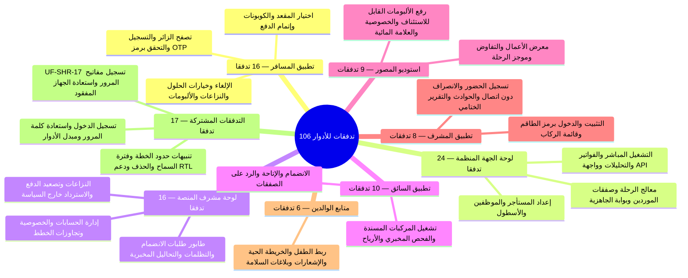
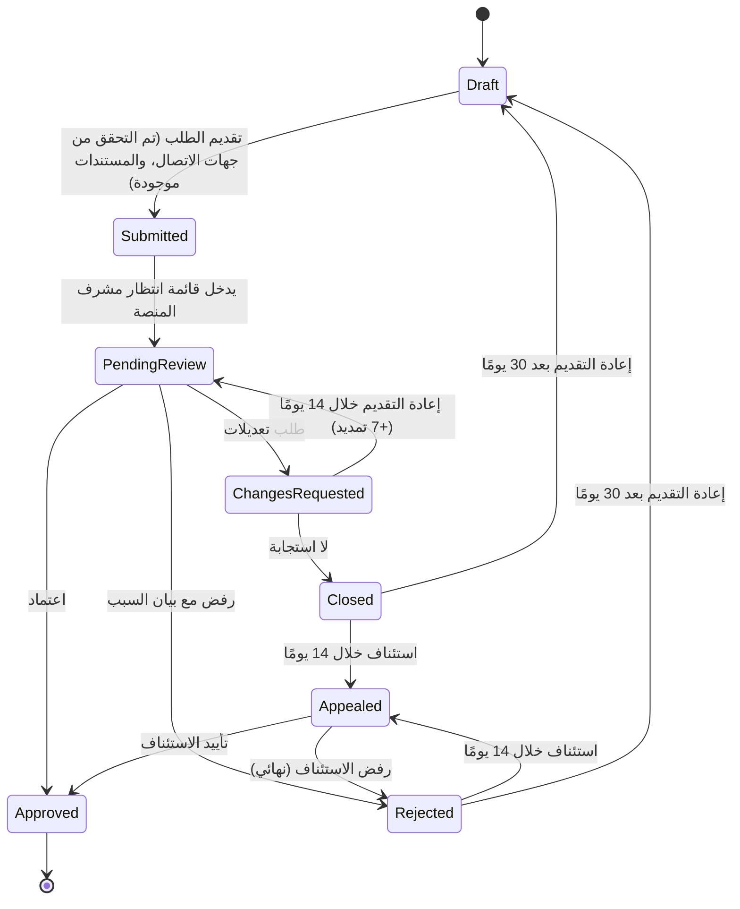

# Trips Enjoy: تدفقات المستخدم

<Callout type="info" title="التحكم في المستند">

**الإصدار** 1.0  
**التاريخ** 9 نوفمبر 2026  
**يتتبّع إلى** [BRD](/ar/docs/brd) v1.1، [SRS](/ar/docs/srs) v1.1، [ERD](/ar/docs/erd) v1.0

</Callout>

تصف هذه الملفات، لكل تطبيق ودور، كيفية تسجيل الشخص حسابه، وكيفية اعتماد وصوله، وما يمكنه فعله بعد أن يصبح نشطًا عبر **106** تدفقات للأدوار موزّعة على **8** مجموعات. لكل تدفق معرّف UF، والفاعل، والمُحفِّز، وخطوات مرقّمة، والقواعد المنطبقة (BRL، FR)، والحالات الحدية. وتُسمّى الشاشات بمعرّفاتها SCR (الويب) أو MSCR (الجوال) من تدقيق تغطية الشاشات حيثما وُجد معرّف.

<TraceBar
  brd={[
    { label: 'الأدوار ورحلاتها §4', href: '/ar/docs/brd#4-أصحاب-المصلحة-والأدوار' },
    { label: 'قواعد العمل §7', href: '/ar/docs/brd/requirements#7-قواعد-العمل' },
  ]}
  srs={[
    { label: 'نظرة عامة على SRS', href: '/ar/docs/srs', detail: '213 FR' },
    { label: 'آلات الحالات §7', href: '/ar/docs/srs/state-machines' },
  ]}
  erd={[
    { label: 'نموذج البيانات', href: '/ar/docs/erd' },
    { label: 'ACL والأدوار', href: '/ar/docs/erd/acl#كتالوج-الأدوار' },
  ]}
  plan={[
    { label: 'خطة التسليم', href: '/ar/docs/plan', detail: '231 مهمة' },
  ]}
  workflows={[
    { label: 'سير العمل في النظام', href: '/ar/docs/workflows' },
    { label: 'مصفوفة التغطية', href: '/ar/docs/workflows/coverage', detail: '213/213 FR' },
  ]}
  userFlows={[
    { label: 'المسافر (16)', href: '/ar/docs/user-flows/traveler' },
    { label: 'الجهة المنظِّمة (24)', href: '/ar/docs/user-flows/organization' },
    { label: 'مشرف المنصة (16)', href: '/ar/docs/user-flows/admin' },
    { label: 'المشتركة ومفاتيح المرور (17)', href: '/ar/docs/user-flows/shared' },
  ]}
  architecture={[
    { label: 'سياق النظام', href: '/ar/docs/architecture#سياق-النظام' },
  ]}
  design={[
    { label: '7 واجهات تطبيقات', href: '/ar/docs/design#أسطح-التطبيقات' },
  ]}
  system={[
    { label: 'رحلة دورة الحياة', href: '/ar/docs/system/lifecycle' },
    { label: 'أطلس الخرائط الذهنية', href: '/ar/docs/system/mindmaps' },
  ]}
  recommendations={[
    { label: 'حسم القرارات المفتوحة', href: '/ar/docs/recommendations/open-decisions' },
  ]}
/>

## التدفقات حسب الدور

<MindmapBlock
  title="106 تدفقات للمستخدمين عبر 8 مجموعات أدوار"
  caption="كل تفاعل بشري عبر واجهات عملاء المنصة، بدءًا من استعراض الرحلات واختيار المقاعد، مرورًا بتشغيل الجهات المنظِّمة وصفقات الموردين وتسجيل الحضور دون اتصال، وصولًا إلى متابعة الأبناء ومفاتيح المرور."
  trace={{
    userFlows: [
      { label: 'المسافر (16)', href: '/ar/docs/user-flows/traveler' },
      { label: 'الجهة المنظِّمة (24)', href: '/ar/docs/user-flows/organization' },
      { label: 'مشرف المنصة (16)', href: '/ar/docs/user-flows/admin' },
      { label: 'السائق (10)', href: '/ar/docs/user-flows/driver' },
      { label: 'المصوّر (9)', href: '/ar/docs/user-flows/photographer' },
      { label: 'المشرف (8)', href: '/ar/docs/user-flows/moderator' },
      { label: 'متابع الوالدين (6)', href: '/ar/docs/user-flows/parent' },
      { label: 'المشتركة (17)', href: '/ar/docs/user-flows/shared', detail: 'بما فيها UF-SHR-17' },
    ],
    design: [
      { label: 'أنماط الواجهات', href: '/ar/docs/design#أسطح-التطبيقات' },
    ],
    system: [
      { label: 'رحلة الـ8 مراحل', href: '/ar/docs/system/lifecycle' },
    ],
  }}
>

</MindmapBlock>

<Cards>
  <Card title="تطبيق المسافر" description="16 تدفقًا" href="/ar/docs/user-flows/traveler" />
  <Card title="لوحة الجهة المنظِّمة" description="24 تدفقًا" href="/ar/docs/user-flows/organization" />
  <Card title="لوحة مشرف المنصة" description="16 تدفقًا" href="/ar/docs/user-flows/admin" />
  <Card title="تطبيق السائق" description="10 تدفقات" href="/ar/docs/user-flows/driver" />
  <Card title="استوديو المصوّر" description="9 تدفقات" href="/ar/docs/user-flows/photographer" />
  <Card title="تطبيق المشرف" description="8 تدفقات" href="/ar/docs/user-flows/moderator" />
  <Card title="متابع الوالدين" description="6 تدفقات" href="/ar/docs/user-flows/parent" />
  <Card title="التدفقات المشتركة" description="17 تدفقًا" href="/ar/docs/user-flows/shared" />
</Cards>
| الدور | التسجيل عبر | الجهة المعتمِدة | الخطة المطلوبة | وجهة الوصول |
|---|---|---|---|---|
| المسافر | /register/traveler أو التطبيق | لا أحد (يُنشَّط عند التحقق) | لا (خطة Free افتراضيًا) | استعراض الرحلات |
| الجهة المنظِّمة | /register/organization (الويب فقط) | مشرف المنصة | نعم (خطة Starter افتراضيًا) | مساحة عمل الجهة المنظِّمة |
| الموظف | دعوة عبر البريد الإلكتروني | المالك (الأذونات) | خطة الجهة المنظِّمة | مساحة عمل الجهة المنظِّمة |
| سائق المنصة | /register/driver أو تطبيق السائق | مشرف المنصة | نعم (خطة Basic افتراضيًا) | الشاشة الرئيسية للسائق |
| مصوّر المنصة | /register/photographer أو الاستوديو | مشرف المنصة | نعم (خطة Basic افتراضيًا) | الشاشة الرئيسية للاستوديو |
| سائق أو مصوّر تابع للجهة المنظِّمة | دعوة عبر SMS أو البريد الإلكتروني | الجهة المنظِّمة (تُقبل عند الإسناد) | خطة الجهة المنظِّمة ([OD-19](/ar/docs/brd/compliance#11-القرارات-المفتوحة)) | الشاشة الرئيسية للسائق أو للاستوديو، ضمن نطاق الجهة المنظِّمة |
| المشرف | تعيين من قِبل الجهة المنظِّمة (الهاتف) | الجهة المنظِّمة | [OD-06](/ar/docs/brd/compliance#11-القرارات-المفتوحة) | الشاشة الرئيسية للمركبة |
| الوالد | حساب المسافر | لا أحد؛ الأهلية حسب الخطة | Explorer أو VIP | متابع الوالدين |
| مشرف المنصة | دعوة من Super admin | Super admin | Staff | الشاشة الرئيسية للمشرف |

- يعني "يجب التحقق" إدخال رمز لمرة واحدة ([BRL-20](/ar/docs/brd/requirements#7-قواعد-العمل)): تنتهي صلاحيته خلال 5 دقائق، و5 رموز خاطئة توقف المحاولات 15 دقيقة، وإعادة الإرسال بعد 45 إلى 60 ثانية.
- يسجّل كل نموذج تسجيل الدولة ([BRL-23](/ar/docs/brd/requirements#7-قواعد-العمل))؛ وتحدّد الدولة السوق ([BRL-27](/ar/docs/brd/requirements#7-قواعد-العمل)).
- كل إجراء محدود بالخطة قد ينتهي برسالة تدعو إلى ترقية الخطة ([UF-SHR-06](/ar/docs/user-flows/shared#uf-shr-06-تنبيه-حدود-الخطة)).
- كل قائمة وشاشة موجودة بالعربية (من اليمين إلى اليسار) والإنجليزية.
- القيم المعلَّمة بـ (placeholder) أو [OPEN] تتبع القسم 11 من BRD.
