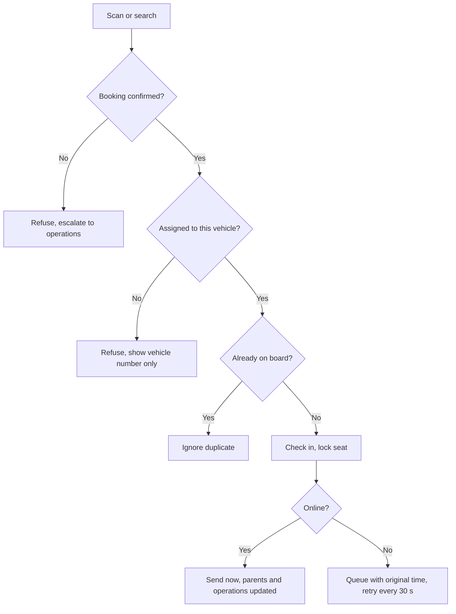

الواجهة: تطبيق ويب قابل للتثبيت على الهواتف. الدور: مشرف مركبة.

## التسجيل

لا يوجد تسجيل ذاتي. تُسنِد الجهة المنظِّمة مشرفًا إلى مركبة واحدة في رحلة واحدة بالاسم والهاتف (D-107). ويتلقى المشرف رابط SMS لتثبيت التطبيق ورمز موظف.

## الاعتماد

الإسناد من الجهة المنظِّمة هو نفسه الاعتماد. يستمر الوصول حتى 24 ساعة بعد انتهاء الرحلة، وعلى جهاز واحد في كل مرة (D-108). واستبدال المشرف يُنهي الوصول فورًا. وقاعدة خطة المشرف هي [OD-06](/ar/docs/brd/compliance#11-القرارات-المفتوحة).

## التدفقات

### UF-MOD-01. التثبيت والفتح الأول
<Steps>
<Step>
يفتح رابط SMS؛ ويضيف التطبيق إلى الشاشة الرئيسية.
</Step>
<Step>
مقدمة الأذونات: الموقع (لموضع تسجيل الحضور وللتتبع الاحتياطي)، والكاميرا (المسح)، والإشعارات.
</Step>
<Step>
يفتح التطبيق على عرض المركبة.
</Step>
</Steps>
القواعد: [FR-MOD-04](/ar/docs/srs/requirements/mod#fr-mod-04--تطبيق-قابل-للتثبيت).

### UF-MOD-02. تسجيل الدخول
الهاتف ورمز الموظف. تسجيل الدخول على جهاز ثانٍ يُنهي الجلسة الأولى. وفي حال عدم وجود إسناد، أو انتهاء صلاحيته، تُعرض رسالة «لا توجد مركبة نشطة».
القواعد: [FR-MOD-05](/ar/docs/srs/requirements/mod#fr-mod-05--تسجيل-دخول-المشرف).

### UF-MOD-03. الشاشة الرئيسية للمركبة وقائمة الركاب
لافتة المركبة، والرحلة، ووقت الانطلاق، ونقطة الالتقاط، وجهة اتصال السائق، وجهة اتصال العمليات؛ وقائمة الركاب مع المقعد والحالة (لم يصعد، على المتن، غادر المركبة)؛ وعدّاد الإشغال.
القواعد: [FR-MOD-01](/ar/docs/srs/requirements/mod#fr-mod-01--الوصول-المقيَّد-بالمركبة), [FR-CHK-07](/ar/docs/srs/requirements/chk#fr-chk-07--الإشغال).

### UF-MOD-04. تسجيل حضور راكب
<Steps>
<Step>
مسح رمز الصعود الخاص بالراكب، أو البحث في القائمة بالاسم.
</Step>
<Step>
النتائج:
  - **تم تسجيل الحضور**: يُؤكَّد المقعد؛ ويُسجَّل الحدث بالوقت والموضع حيثما سُمح بذلك.
  - **مركبة خاطئة**: رفض؛ ويُعرض «المركبة N» فقط.
  - **غير موجود أو غير مؤكد**: رفض؛ مع تصعيد إلى العمليات.
  - **على المتن بالفعل**: يُتجاهل التكرار.
  - **في قائمة الانتظار**: دون اتصال؛ ستُزامَن لاحقًا.
</Step>
</Steps>
القواعد: [FR-CHK-01](/ar/docs/srs/requirements/chk#fr-chk-01--تسجيل-الحضور-عند-الصعود) إلى [FR-CHK-03](/ar/docs/srs/requirements/chk#fr-chk-03--سجل-الحدث), [BRL-09](/ar/docs/brd/requirements#7-قواعد-العمل).

### UF-MOD-05. تسجيل الخروج عند توقف أو وجهة
اختيار التوقف؛ وتسجيل خروج الركاب فرادى أو دفعة واحدة؛ ويمكن لراكب سُجّل خروجه عند توقف أن يعود إلى المركبة ويُسجَّل حضوره مجددًا (مقترح).
القواعد: [FR-CHK-04](/ar/docs/srs/requirements/chk#fr-chk-04--تسجيل-المغادرة-عند-المحطات).

### UF-MOD-06. قائمة الانتظار دون اتصال
يعرض شريط التنبيه حالة انعدام الاتصال وعدد الأحداث في قائمة الانتظار؛ وتحذير عند 800؛ وحد أقصى 1,000؛ وتُرسل الأحداث بالترتيب بأوقاتها الأصلية عند عودة الاتصال.
القواعد: [FR-CHK-05](/ar/docs/srs/requirements/chk#fr-chk-05--قائمة-الانتظار-دون-اتصال).

### UF-MOD-07. الإبلاغ عن حادث
الفئة (سلامة، طبية، عطل في المركبة، مسافر مفقود، سلوك، أخرى)، والوصف، والصورة، والموقع؛ ويراها فريق العمليات فورًا.
القواعد: [FR-CHK-06](/ar/docs/srs/requirements/chk#fr-chk-06--الإبلاغ-عن-الحوادث).

### UF-MOD-08. تقرير نهاية الرحلة وانتهاء الوصول
<Steps>
<Step>
إدخال العدّ النهائي للركاب؛ وإذا اختلف عن عدد من سُجّل حضورهم يُطلب ذكر السبب؛ مع إضافة ملاحظات؛ ثم الإرسال (ويصبح للقراءة فقط بعد ذلك).
</Step>
<Step>
ينتهي الوصول بعد 24 ساعة من انتهاء الرحلة، أو فورًا عند الاستبدال، مع شاشة «انتهى الوصول».
</Step>
</Steps>
القواعد: [FR-MOD-02](/ar/docs/srs/requirements/mod#fr-mod-02--تقرير-نهاية-الرحلة), [FR-MOD-03](/ar/docs/srs/requirements/mod#fr-mod-03--إبطال-الوصول), [FR-MOD-06](/ar/docs/srs/requirements/mod#fr-mod-06--قفل-التقرير).
