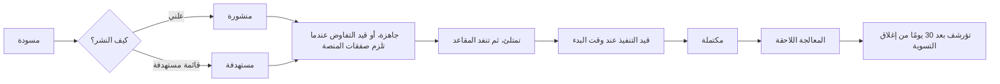

الواجهة: business.trips-enjoy.com (التسجيل عبر الويب فقط؛ واللوحة متجاوبة مع أحجام الشاشات). الأدوار: مالك الجهة المنظِّمة، والموظف.

## التسجيل

| الحقل | مطلوب | ملاحظات |
|---|---|---|
| الاسم الكامل للمالك | نعم | يصبح حساب المالك |
| البريد الإلكتروني والهاتف للمالك | نعم، مع التحقق من كليهما | D-20 |
| كلمة المرور | نعم | يُعدّ العامل الثاني عند أول تسجيل دخول |
| الدولة | نعم | تحدّد سوق الجهة المنظِّمة وعملتها وقواعد الضرائب ومنطقتها الزمنية |
| الاسم النظامي والاسم التجاري | نعم | بالعربية والإنجليزية |
| رقم السجل التجاري | نعم | |
| الرقم الضريبي | نعم حيثما يشترطه السوق | |
| مستندات التسجيل | نعم | السجل التجاري، والشهادة الضريبية؛ بصيغة PDF أو JPG أو PNG وبحد أقصى 10 MB |
| عنوان النشاط وفئته | نعم | الفئة: مدرسة، شركات، ديني، سياحة، فعالية، أخرى |
| جهة اتصال الفوترة | نعم | البريد الإلكتروني للفواتير |
| اختيار الخطة | لا | تُعرض دون رسوم؛ وخطة Starter في حال عدم الاختيار (D-77، D-24) |

## الاعتماد

<Steps>
<Step>
يدخل الطلب قائمة انتظار مشرف المنصة؛ ويرى مقدّم الطلب حالة "قيد المراجعة" مع مستهدف يومَي عمل.
</Step>
<Step>
يتحقق مشرف المنصة من المستندات وتفاصيل السجل (يدويًا في المرحلة 1).
</Step>
<Step>
القرار: الاعتماد (يُنشأ المستأجر على الخطة المختارة أو Starter، وتُرسل دعوة للمالك)؛ أو طلب التعديلات (14 يومًا، وتذكير في اليوم 7، وتمديد واحد مدته 7 أيام)؛ أو الرفض مع بيان السبب (استئناف خلال 14 يومًا، وإعادة التقديم بعد 30 يومًا).
</Step>
<Step>
يُخطَر المالك بكل قرار بلغته.
</Step>
</Steps>

## التدفقات

### UF-ORG-01. أول تسجيل دخول والإعداد
<Steps>
<Step>
يسجّل المالك الدخول بالبريد الإلكتروني وكلمة المرور؛ ويُعدّ عاملًا ثانيًا عبر SMS أو تطبيق مصادقة.
</Step>
<Step>
قائمة الإعداد: الملف التعريفي والشعار، والمنطقة الزمنية (افتراضيات من السوق)، وإعدادات الفواتير، وأول نوع مركبة، وأول مركبة، ودعوة الموظفين، وإدخال السائقين والمصوّرين الخاصين، وبيانات الحساب البنكي لصرف المستحقات.
</Step>
<Step>
تعرض الصفحة الرئيسية في حالتها الفارغة قائمة الإعداد واستخدام الخطة.
</Step>
</Steps>
القواعد: [FR-ORG-02](/ar/docs/srs/requirements/org#fr-org-02--إنشاء-مساحة-العمل-عند-الاعتماد)، [FR-EMP-06](/ar/docs/srs/requirements/emp#fr-emp-06--الدعوة-وتسجيل-الدخول-الأول).

### UF-ORG-02. تبديل الجهة المنظِّمة
<Steps>
<Step>
يرى الموظف الذي يُدرَج بريده الإلكتروني لدى عدة جهات منظِّمة مبدِّل الجهة المنظِّمة.
</Step>
<Step>
اختيار إحداها يغيّر مساحة العمل؛ ولا تُعرض بيانات الجهة الأخرى مطلقًا.
</Step>
</Steps>
القواعد: [FR-AUTH-07](/ar/docs/srs/requirements/auth#fr-auth-07--وصول-الموظفين-إلى-عدة-جهات-منظِّمة)، [BRL-01](/ar/docs/brd/requirements#7-قواعد-العمل).

### UF-ORG-03. دعوة الموظفين وإدارتهم
<Steps>
<Step>
الدعوة عبر البريد الإلكتروني مع قالب أذونات (Operations، Finance، Support، Manager) أو أذونات مخصصة تشمل: الرحلات، والحجوزات، والتشغيل، والمحاسبة، والكوبونات، والموظفين، والأسطول، والاشتراك، والتكاملات، والتحليلات.
</Step>
<Step>
الرابط صالح 7 أيام؛ وعند أول تسجيل دخول يُعيّن الموظف كلمة المرور والعامل الثاني.
</Step>
<Step>
تغيير الأذونات (يعرض السجل الفاعل والوقت والوضع قبل وبعد)؛ أو التعليق أو الإزالة (ينتهي الوصول في الحال).
</Step>
</Steps>
حالة حدية: بلوغ حد الموظفين في الخطة؛ تُحجب الدعوة مع رسالة تدعو إلى ترقية الخطة.
القواعد: [FR-EMP-01](/ar/docs/srs/requirements/emp#fr-emp-01--مجموعات-الصلاحيات) إلى [FR-EMP-06](/ar/docs/srs/requirements/emp#fr-emp-06--الدعوة-وتسجيل-الدخول-الأول).

### UF-ORG-04. الأسطول
<Steps>
<Step>
أنواع المركبات: الاسم، وشبكة المقاعد، والمقاعد المعنونة، والمقاعد الميسَّرة والمحجوبة؛ والأرشفة.
</Step>
<Step>
المركبات: اللوحة، والطراز، وسنة الصنع، والنوع، والمقاعد (يجب أن تتطابق)، وصلاحية التسجيل.
</Step>
</Steps>
القواعد: [FR-FLT-01](/ar/docs/srs/requirements/flt#fr-flt-01--أنواع-المركبات-القابلة-لإعادة-الاستخدام)، [FR-FLT-02](/ar/docs/srs/requirements/flt#fr-flt-02--سجل-المركبات)، [FR-FLT-06](/ar/docs/srs/requirements/flt#fr-flt-06--أرشفة-أنواع-المركبات).

### UF-ORG-05. السائقون والمصوّرون الخاصون
<Steps>
<Step>
الدعوة عبر SMS أو البريد الإلكتروني (صالحة 7 أيام) مع الاسم والهاتف والدولة؛ والرخصة للسائقين.
</Step>
<Step>
يظهرون في قوائم هذه الجهة المنظِّمة فقط، ويُقبلون عند الإسناد.
</Step>
<Step>
إزالة أحدهم تحرّر إسناداته المستقبلية وتنبّه فريق العمليات.
</Step>
</Steps>
القواعد: [FR-ORG-03](/ar/docs/srs/requirements/org#fr-org-03--سائقون-ومصوّرون-تابعون-للجهة-المنظِّمة)، [BRL-05](/ar/docs/brd/requirements#7-قواعد-العمل).

### UF-ORG-06. إنشاء رحلة (معالج إرشادي)
<Steps>
<Step>
**الأساسيات**: العنوان، والوصف، والفئة، وصورة الغلاف، واللغة.
</Step>
<Step>
**المواعيد والمسار**: البداية والنهاية، والمنطقة الزمنية، ونقاط الالتقاط، والتوقفات، والوجهة على الخريطة.
</Step>
<Step>
**المركبات**: إضافة مركبات حتى حد الخطة، لكل منها نوع مركبة ووسم.
</Step>
<Step>
**الطاقم**: لكل مركبة سائق (خاص، أو من المنصة عبر صفقة على خطتي Growth وEnterprise) ومشرف (مع رقم الهاتف)؛ ومصوّر الرحلة (خاص أو من المنصة).
</Step>
<Step>
**البرامج**: إضافة برامج مع نموذج التسعير، والسعر أو الشرائح، وإشارات النوع، والطاقة الاستيعابية؛ حتى حد الخطة.
</Step>
<Step>
**المقاعد**: تعيين من الشركة أو اختيار ذاتي (خطتا Growth وEnterprise)؛ ونافذة أولوية لمسافري Explorer وVIP.
</Step>
<Step>
**التسعير والطاقة الاستيعابية**: السعر الأساسي بعملة السوق؛ ومفتاح تتبع الأطفال (خطتا Growth وEnterprise).
</Step>
<Step>
**النشر**: حفظ المسودة، أو النشر علنًا، أو النشر إلى قائمة مستهدفة.
</Step>
</Steps>
حالات حدية: الخطوة الناقصة تحجب النشر وتسمّي الخطوة؛ بلوغ الحد الشهري للرحلات النشطة؛ السوق غير مُطلَق.
القواعد: [FR-TRIP-01](/ar/docs/srs/requirements/trip#fr-trip-01--معالج-إنشاء-الرحلة) إلى [FR-TRIP-03](/ar/docs/srs/requirements/trip#fr-trip-03--الرحلات-متعددة-المركبات)، [FR-TRIP-07](/ar/docs/srs/requirements/trip#fr-trip-07--حد-الرحلات-النشطة)، [FR-PRG-01](/ar/docs/srs/requirements/prg#fr-prg-01--نماذج-التسعير) إلى [FR-PRG-06](/ar/docs/srs/requirements/prg#fr-prg-06--حد-عدد-البرامج)، [FR-ORG-05](/ar/docs/srs/requirements/org#fr-org-05--إعداد-الاختيار-الذاتي-للمقاعد)، [FR-SEAT-07](/ar/docs/srs/requirements/seat#fr-seat-07--الاختيار-الذاتي-بحسب-الخطة).

آلة الحالات الكاملة، بما في ذلك مسارات الإلغاء والمعالجات، هي [سير عمل دورة حياة الرحلة](/ar/docs/workflows/trip-lifecycle).

### UF-ORG-07. التعاقد مع مورّد من المنصة (صفقة)
<Steps>
<Step>
البحث عن سائقي المنصة أو مصوّريها بحسب التوفر في التاريخ، والمنطقة، وشارة التقييم، والسعر.
</Step>
<Step>
اقتراح سعر لمركبة أو للرحلة؛ ويرى المورّد الرحلة والمسار والتاريخ والمركبة والأجر.
</Step>
<Step>
التفاوض بعروض وعروض مضادة دون حد لعدد الجولات؛ وتنتهي صلاحية كل عرض بعد 72 ساعة من آخر عرض مضاد.
</Step>
<Step>
القبول: عندما يقبل الطرفان الشروط نفسها تُنجَز الصفقة نهائيًا ويُسند المورّد.
</Step>
<Step>
الرفض أو انتهاء الصلاحية: يُعاد فتح الشاغر لمورّد آخر.
</Step>
</Steps>
القواعد: [FR-NEG-01](/ar/docs/srs/requirements/neg#fr-neg-01--عرض-التعاقد) إلى [FR-NEG-07](/ar/docs/srs/requirements/neg#fr-neg-07--التفاوض-حسب-الخطة)، [BRL-04](/ar/docs/brd/requirements#7-قواعد-العمل)، [BRL-26](/ar/docs/brd/requirements#7-قواعد-العمل).

### UF-ORG-08. نقل رحلة إلى حالة Ready
<Steps>
<Step>
تعرض لوحة الطاقم حالة السائق والمشرف لكل مركبة وكل صفقة مفتوحة.
</Step>
<Step>
يُرفض الانتقال إلى Ready مع قائمة الفجوات حتى يكتمل طاقم كل مركبة وتُنجَز كل صفقة نهائيًا.
</Step>
<Step>
تصل رسالة بريد إلكتروني عن فجوة الطاقم قبل الانطلاق بـ48 ساعة؛ وتُتاح إعادة الإسناد حتى 24 ساعة قبل الانطلاق.
</Step>
</Steps>
القواعد: [FR-STF-03](/ar/docs/srs/requirements/stf#fr-stf-03--بوابة-الجاهزية-ready)، [FR-STF-07](/ar/docs/srs/requirements/stf#fr-stf-07--مهلة-إعادة-الإسناد)، [BRL-07](/ar/docs/brd/requirements#7-قواعد-العمل).

### UF-ORG-09. إدارة الحجوزات والمقاعد
<Steps>
<Step>
قائمة الحجوزات مع مرشحات بحسب الحالة والمركبة والبرنامج؛ وكشف بأسماء الركاب.
</Step>
<Step>
تفاصيل الحجز: الركاب، والمقاعد، والبرامج، والإجماليات، والمدفوعات، والاستردادات، والملاحظات.
</Step>
<Step>
خريطة المقاعد في وضع التعيين: اسحب الركاب إلى المقاعد؛ ويُرفض التعارض.
</Step>
<Step>
معالجة طلبات الإلغاء الواردة بعد الموعد النهائي للسياسة خلال يومَي عمل.
</Step>
</Steps>
القواعد: [FR-SEAT-06](/ar/docs/srs/requirements/seat#fr-seat-06--إسناد-المقاعد-من-الموظفين)، [FR-BKG-04](/ar/docs/srs/requirements/bkg#fr-bkg-04--إلغاء-المسافر-والاسترداد).

### UF-ORG-10. تغيير رحلة بعد وجود حجوزات
<Steps>
<Step>
تعديل البرامج أو المركبات أو وضع المقاعد أو المواعيد.
</Step>
<Step>
إذا تأثرت الحجوزات المؤكدة، يسرد النظام هذه الحجوزات ويشترط إرسال المعالجات قبل الحفظ.
</Step>
<Step>
أمام المسافرين 7 أيام للاختيار؛ وتُحال الحالات غير المحسومة إلى مشرف المنصة.
</Step>
</Steps>
القواعد: [FR-TRIP-06](/ar/docs/srs/requirements/trip#fr-trip-06--التغييرات-التي-تمس-الحجوزات-المؤكدة)، [BRL-24](/ar/docs/brd/requirements#7-قواعد-العمل).

### UF-ORG-11. إلغاء رحلة
<Steps>
<Step>
الإلغاء مع بيان السبب قبل بدء الرحلة؛ وتعرض المعاينة الحجوزات وإجمالي المبلغ المسترد كاملًا.
</Step>
<Step>
تُلغى جميع الحجوزات المؤكدة ويُسترد مبلغها كاملًا؛ ويُخطَر المورّدون والمسافرون.
</Step>
<Step>
لا يمكن إلغاء الرحلات قيد التنفيذ؛ وتوجّه الشاشة إلى معالجة الحوادث.
</Step>
</Steps>
القواعد: [FR-BKG-06](/ar/docs/srs/requirements/bkg#fr-bkg-06--إلغاء-الجهة-المنظِّمة-للرحلة)، [BRL-30](/ar/docs/brd/requirements#7-قواعد-العمل).

### UF-ORG-12. العمليات المباشرة
<Steps>
<Step>
شاشة قيادة الرحلة يوم الانطلاق: المركبات على الخريطة، والإشغال لكل مركبة، وتسجيلات الحضور لحظة حدوثها، والحوادث في الوقت الفعلي.
</Step>
<Step>
البحث عن أي راكب لمعرفة مركبته وحالته.
</Step>
<Step>
مراجعة تقارير نهاية الرحلة وإضافة ملاحظة.
</Step>
</Steps>
القواعد: [FR-TRK-01](/ar/docs/srs/requirements/trk#fr-trk-01--موقع-المركبة-المباشر)، [FR-TRK-03](/ar/docs/srs/requirements/trk#fr-trk-03--عرض-مركبة-الراكب)، [FR-CHK-06](/ar/docs/srs/requirements/chk#fr-chk-06--الإبلاغ-عن-الحوادث)، [FR-CHK-07](/ar/docs/srs/requirements/chk#fr-chk-07--الإشغال)، [FR-MOD-06](/ar/docs/srs/requirements/mod#fr-mod-06--قفل-التقرير).

### UF-ORG-13. الكوبونات
إنشاء الكوبونات لرحلاتها الخاصة وإيقافها مؤقتًا واستئنافها وإلغاؤها؛ وتحليلات لكل كوبون مع إعدادات جاهزة لـ 7 و30 و90 يومًا؛ والعدد محدود بالخطة (النشط والموقوف مؤقتًا).
القواعد: [FR-CPN-01](/ar/docs/srs/requirements/cpn#fr-cpn-01--نطاق-المُنشئ)، [FR-CPN-07](/ar/docs/srs/requirements/cpn#fr-cpn-07--التحليلات-وإشارات-إساءة-الاستخدام)، [FR-CPN-08](/ar/docs/srs/requirements/cpn#fr-cpn-08--عدد-الكوبونات-حسب-الخطة).

### UF-ORG-14. الفواتير
<Steps>
<Step>
تُصدر فواتير B2C تلقائيًا عند التأكيد؛ وفواتير B2B عندما يكون المشتري قد قدّم رقمًا ضريبيًا.
</Step>
<Step>
إصدار فاتورة يدوية لمشترٍ جماعي أو مشترٍ من الشركات.
</Step>
<Step>
التصحيحات بالإشعار الدائن فقط.
</Step>
</Steps>
القواعد: [FR-ORG-07](/ar/docs/srs/requirements/org#fr-org-07--فواتير-b2b-وb2c)، [BRL-28](/ar/docs/brd/requirements#7-قواعد-العمل).

### UF-ORG-15. المحاسبة والتسويات
<Steps>
<Step>
محاسبة الرحلة: الإيراد الأساسي، وإيراد البرامج، وأثر الكوبونات، وتكاليف المورّدين، والعمولة، ورسوم بوابة الدفع.
</Step>
<Step>
مستعرض السجل مع مرشحات؛ والتصديرات حسب الخطة.
</Step>
<Step>
التسويات: تسوية واحدة لكل رحلة مكتملة، ببنود لكل طرف، والحالة، والإغلاق عند السداد وخلوّها من النزاعات.
</Step>
</Steps>
القواعد: [FR-ACC-02](/ar/docs/srs/requirements/acc#fr-acc-02--محاسبة-الجهة-المنظِّمة-لكل-رحلة)، [FR-ACC-05](/ar/docs/srs/requirements/acc#fr-acc-05--التسويات) إلى [FR-ACC-07](/ar/docs/srs/requirements/acc#fr-acc-07--تصديرات-مطابَقة-للسجل).

### UF-ORG-16. التحليلات
تحليلات الرحلات والصفحات والعملاء والمورّدين (أساسية في Growth وكاملة في Enterprise)، مع إعدادات جاهزة للتواريخ والتصدير.
القواعد: [FR-ANL-01](/ar/docs/srs/requirements/anl#fr-anl-01--تحليلات-الجهة-المنظِّمة)، [FR-ANL-04](/ar/docs/srs/requirements/anl#fr-anl-04--النطاقات-والحداثة-والتصدير).

### UF-ORG-17. CRM وwebhooks
<Steps>
<Step>
ربط نظام CRM؛ وتسجيل نقاط نهاية webhook واختيار الأحداث.
</Step>
<Step>
عرض عمليات التسليم والإخفاقات وإعادة تشغيل أي عملية تسليم خلال 7 أيام؛ وتدوير السر (يبقى السر القديم صالحًا 24 ساعة).
</Step>
</Steps>
القواعد: [FR-ORG-06](/ar/docs/srs/requirements/org#fr-org-06--نظام-crm-وwebhooks).

### UF-ORG-18. الخطة والفوترة
<Steps>
<Step>
الخطة الحالية، والاستخدام مقابل الحدود، وتاريخ التجديد، والفواتير.
</Step>
<Step>
الترقية (فورًا، بالاحتساب النسبي) أو التخفيض (نهاية الدورة)؛ والإلغاء.
</Step>
<Step>
شريط مهلة السماح أثناء فشل التجديدات مع تواريخ إعادة المحاولة.
</Step>
</Steps>
القواعد: [FR-SUB-02](/ar/docs/srs/requirements/sub#fr-sub-02--بوابات-الميزات) إلى [FR-SUB-04](/ar/docs/srs/requirements/sub#fr-sub-04--الترقية-والتخفيض-والإلغاء)، [FR-SUB-08](/ar/docs/srs/requirements/sub#fr-sub-08--المطالبة-بعد-الفشل-dunning).

### UF-ORG-19. تقارير سلامة الأطفال
يقدّم أحد الموظفين تقريرًا عن راكب طفل؛ وتُوجَّه الحالة إلى جهة اتصال التصعيد؛ وتعرض القائمة الحالة.
القواعد: [FR-PAR-07](/ar/docs/srs/requirements/par#fr-par-07--الإبلاغ-عن-سلامة-الأبناء).

### UF-ORG-20. الهوية البصرية (Enterprise)
تطبيق الشعار والألوان على صفحات الرحلات العامة والرسائل الإلكترونية والفواتير.
القواعد: [FR-ORG-08](/ar/docs/srs/requirements/org#fr-org-08--هوية-بصرية-مخصصة).

### UF-ORG-21. أول تسجيل دخول للموظف
الفاعل: الموظف. المُحفِّز: فتح رابط الدعوة خلال مدة صلاحيته البالغة 7 أيام.
<Steps>
<Step>
يعيّن كلمة مرور من رسالة الدعوة؛ وينتهي الرابط بعد 7 أيام ويمكن للمالك إعادة إرساله.
</Step>
<Step>
يفعّل عاملًا ثانيًا (SMS أو تطبيق مصادقة)؛ ويدخله موظفو الجهة المنظِّمة عند كل تسجيل دخول.
</Step>
<Step>
يصل إلى مساحة عمل الجهة المنظِّمة بالأذونات التي منحها المالك فقط.
</Step>
</Steps>
حالات حدية: رابط منتهٍ (يعيد المالك إرساله)؛ وفقدان العامل الثاني (يعيد المالك ضبطه عبر الدعم).
القواعد: [FR-ORG-03](/ar/docs/srs/requirements/org#fr-org-03--سائقون-ومصوّرون-تابعون-للجهة-المنظِّمة)، [FR-EMP-02](/ar/docs/srs/requirements/emp#fr-emp-02--تدقيق-تغييرات-الصلاحيات)، [FR-AUTH-04](/ar/docs/srs/requirements/auth#fr-auth-04--طرق-تسجيل-دخول-خاصة-بكل-دور).

### UF-ORG-22. دورة حياة الكوبون
الفاعل: مالك الجهة المنظِّمة أو موظف لديه إذن الكوبونات. المُحفِّز: إنشاء حملة.
<Steps>
<Step>
ينشئ الكوبون: النوع، وقابلية التكديس، ونافذة الصلاحية، وحدود الاستخدام، والحد الأدنى للإنفاق؛ ويتفعّل فورًا أو عند بدء النافذة.
</Step>
<Step>
يراقب الاستخدام في قائمة الكوبونات؛ ويوقفه مؤقتًا ويستأنفه في أي وقت.
</Step>
<Step>
يلغيه مع بيان السبب عند انتهاء الحملة؛ وتفشل الرموز الملغاة بحالة غير موجود.
</Step>
<Step>
الاستردادات تعكس عمليات استخدام الكوبون: تعود أعداد الاستخدام إلى ما كانت عليه، ويعود الكوبون المستنفَد إلى نشط إذا كانت نافذته لا تزال مفتوحة.
</Step>
<Step>
عمليات الاستخدام المشبوهة ترفع إشارة إساءة استخدام لمراجعة مشرف المنصة خلال يومَي عمل.
</Step>
</Steps>
حالات حدية: استنفاد الكوبون أثناء إتمام الحجز (يفشل الرمز برسالة واضحة عند خطوة Summary)؛ وتتحرر حدود الاستخدام لكل مستخدم بالاستردادات.
القواعد: [FR-CPN-04](/ar/docs/srs/requirements/cpn#fr-cpn-04--أنواع-الكوبونات)، [FR-CPN-05](/ar/docs/srs/requirements/cpn#fr-cpn-05--دورة-الحياة-وعناصر-التحكم)، [FR-CPN-06](/ar/docs/srs/requirements/cpn#fr-cpn-06--الاستبدال-والإلغاء-العكسي)، [FR-CPN-07](/ar/docs/srs/requirements/cpn#fr-cpn-07--التحليلات-وإشارات-إساءة-الاستخدام).

### UF-ORG-23. الأسطول أثناء دورة الحياة
الفاعل: مالك الجهة المنظِّمة أو مدير الأسطول. المُحفِّز: تغيير الأسطول مع وجود رحلات.
<Steps>
<Step>
يضيف مركبة بنوعها ووسمها؛ وتنبثق خريطة المقاعد من صفوف نوع المركبة وتخطيطه.
</Step>
<Step>
يسند المركبات إلى الرحلات حتى الحد المسموح لكل رحلة؛ وتنتقل الوسوم إلى صفحات الرحلات المنشورة والتذاكر.
</Step>
<Step>
لا يزيل مركبة إلا عندما لا تعتمد عليها حجوزات مستقبلية؛ وإلا سمّت محاولة الإزالة الرحلات التي تمنعها.
</Step>
</Steps>
حالات حدية: تغييرات وضع المقاعد في رحلة بها حجوزات تتبع قواعد المعالجات الخاصة بتغيير الرحلة.
القواعد: [FR-ORG-04](/ar/docs/srs/requirements/org#fr-org-04--تسجيل-الأسطول)، [FR-FLT-03](/ar/docs/srs/requirements/flt#fr-flt-03--حد-المركبات-لكل-رحلة)، [FR-FLT-04](/ar/docs/srs/requirements/flt#fr-flt-04--خريطة-المقاعد-من-نوع-المركبة)، [FR-FLT-05](/ar/docs/srs/requirements/flt#fr-flt-05--إزالة-المركبة-بعد-وجود-حجوزات)، [FR-SEAT-01](/ar/docs/srs/requirements/seat#fr-seat-01--التعيين-من-الجهة-افتراضيًا).

### UF-ORG-24. استخدام API العام
الفاعل: مطوّر الجهة المنظِّمة. المُحفِّز: تكامل الحجوزات أو الرحلات أو webhook مع أنظمة خارجية.
<Steps>
<Step>
ينشئ مفتاح API من إعدادات الجهة المنظِّمة؛ ويحمل المفتاح حدود خطة الجهة المنظِّمة.
</Step>
<Step>
يوقّع الطلبات بالمفتاح؛ ويقرأ الرحلات والحجوزات والتوفر عبر نقاط النهاية العامة.
</Step>
<Step>
يسجل نقطة نهاية webhook ويتحقق من التوقيع؛ وتُعاد محاولة عمليات التسليم 5 مرات خلال 24 ساعة وتبقى قابلة لإعادة التشغيل مدة 7 أيام.
</Step>
<Step>
يدوّر سر التوقيع مع فترة تقاطع مدتها 24 ساعة حتى تظل عمليات التسليم الجارية صالحة التحقق.
</Step>
</Steps>
حالات حدية: تدوير السر (يبقى السر القديم صالحًا 24 ساعة)؛ والأحداث الفائتة (إعادة تشغيلها من سجل الأحداث).
القواعد: [FR-API-01](/ar/docs/srs/requirements/api#fr-api-01--واجهة-api-العامة) إلى [FR-API-07](/ar/docs/srs/requirements/api#fr-api-07--تماثل-عقد-webhook)، [FR-ORG-06](/ar/docs/srs/requirements/org#fr-org-06--نظام-crm-وwebhooks).
