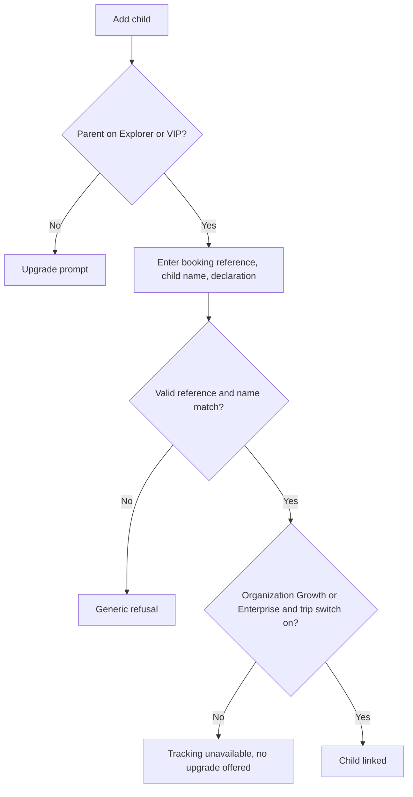

الواجهة: قسم داخل تطبيق المسافر (D-124). الدور: والد أو وصيّ (مسافر).

## التسجيل

الوالد مسافر أصلًا ([تطبيق المسافر](/ar/docs/user-flows/traveler), [UF-TRV-02](/ar/docs/user-flows/traveler#uf-trv-02-التسجيل-والتحقق)). لا يوجد تسجيل إضافي. يتطلب ربط طفل رقمَ مرجع الحجز، واسم الطفل كما هو في الحجز، وإقرار وصاية يُسجَّل باعتباره موافقة.

## الأهلية (بدلًا من الاعتماد)

| الشرط | المطلوب |
|---|---|
| خطة الوالد | Explorer أو VIP |
| خطة الجهة المنظِّمة | Growth أو Enterprise |
| إعداد الرحلة | تتبّع الأطفال مُفعَّل |
| الموضع المباشر | فقط أثناء كون الرحلة قيد التنفيذ |

يجب أن تتحقق شروط الخطة والإعداد الثلاثة كلها ([OD-05](/ar/docs/brd/compliance#11-القرارات-المفتوحة)، مقترح). وتذكر شاشة الحجب أيّ شرط لم يتحقق؛ ولا تُعرض الترقية إلا في حالة خطة الوالد.

## التدفقات

### UF-PAR-01. ربط طفل
<Steps>
<Step>
في متابع الوالدين، «إضافة طفل».
</Step>
<Step>
إدخال رقم مرجع الحجز واسم الطفل؛ وتأكيد إقرار الوصاية.
</Step>
<Step>
تم الربط: يظهر الطفل مع الرحلة. الرفض: رسالة عامة (مرجع غير صالح، أو عدم تطابق الاسم، أو أن الراكب ليس طفلًا، أو أن التتبع معطّل للرحلة).
</Step>
</Steps>
القواعد: [FR-PAR-01](/ar/docs/srs/requirements/par#fr-par-01--ربط-طفل), [BRL-10](/ar/docs/brd/requirements#7-قواعد-العمل).

### UF-PAR-02. حالة رحلة الطفل
لكل طفل مرتبط: الرحلة، والمركبة، والمقعد، وحالة تسجيل الحضور، والبرامج، والجدول؛ وجهة اتصال المشرف.
القواعد: [FR-PAR-02](/ar/docs/srs/requirements/par#fr-par-02--نطاق-عرض-الوالد).

### UF-PAR-03. الخريطة المباشرة
أثناء كون الرحلة قيد التنفيذ ومستوفية للشروط: موضع المركبة على خريطة يُحدَّث مباشرة؛ وقبل البدء وبعد النهاية لا يُعرض أي موضع.
القواعد: [FR-PAR-03](/ar/docs/srs/requirements/par#fr-par-03--الأهلية), [FR-TRK-04](/ar/docs/srs/requirements/trk#fr-trk-04--مفتاح-تتبع-الأبناء-لكل-رحلة), [FR-TRK-06](/ar/docs/srs/requirements/trk#fr-trk-06--نهاية-التتبع).

### UF-PAR-04. الإشعارات
تأكيد الصعود، وبدء الرحلة، والوصول إلى توقف، وانتهاء الرحلة؛ وأيضًا «لم يصعد» عندما تنطلق المركبة دون تسجيل حضور الطفل (مقترح).
القواعد: [FR-PAR-04](/ar/docs/srs/requirements/par#fr-par-04--إشعارات-الوالدين).

### UF-PAR-05. الإبلاغ عن مشكلة تتعلق بسلامة الطفل
وصف المشكلة؛ فتُنشأ حالة وتُوجَّه إلى جهة اتصال التصعيد؛ وتُعرض حالتها.
القواعد: [FR-PAR-07](/ar/docs/srs/requirements/par#fr-par-07--الإبلاغ-عن-سلامة-الأبناء).

### UF-PAR-06. انتهاء الربط
عند إلغاء الحجز أو استرداده، يختفي الطفل من المتابع وتتوقف البيانات المباشرة. ويُحتفظ بسجل رحلات الطفل لمدة عام واحد.
القواعد: [FR-PAR-06](/ar/docs/srs/requirements/par#fr-par-06--انتهاء-الارتباط-بانتهاء-الحجز).
