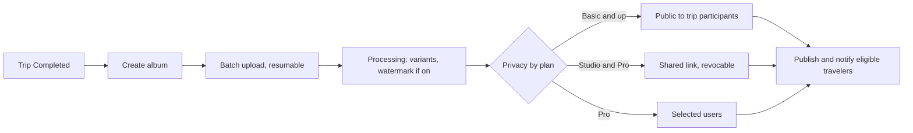

الواجهة: ويب متجاوب في المرحلة الأولى، إضافة إلى الهاتف (D-86). الأدوار: مصوّر المنصة، ومصوّر الجهة المنظِّمة.

## التسجيل: مصوّر المنصة

| الحقل | مطلوب | ملاحظات |
|---|---|---|
| الاسم الكامل | نعم | |
| البريد الإلكتروني والهاتف | نعم، مع التحقق من كليهما | D-20 |
| كلمة المرور | نعم | |
| الدولة | نعم | |
| وثيقة الهوية | نعم | تخزين مقيد |
| ملف الأعمال | نعم، 8 صور على الأقل | بصيغة JPEG أو PNG أو HEIC، وبحد 25 ميغابايت لكل صورة |
| النبذة التعريفية، والمعدات، ومناطق الخدمة | نعم | |
| الأسعار | نعم | بعملة السوق |
| اختيار الخطة | لا | الخطة الأساسية إن لم يُختر شيء (D-78) |

## التسجيل: مصوّر الجهة المنظِّمة

تصل الدعوة من جهة منظِّمة عبر SMS أو البريد الإلكتروني (صالحة لمدة 7 أيام): الاسم، والهاتف، والدولة. لا حاجة لاعتماد مشرف المنصة؛ ويُقبل المصوّر عند الإسناد.

## الاعتماد: مصوّر المنصة

يتحقق مشرف المنصة من الهوية وجودة ملف الأعمال ([لوحة مشرف المنصة](/ar/docs/user-flows/admin), [UF-ADM-02](/ar/docs/user-flows/admin#uf-adm-02-مراجعة-طلب-انضمام)). يعتمد الطلب أو يطلب تعديلات أو يرفضه. عند الاعتماد تصبح الجهات المنظِّمة من فئتي Growth وEnterprise قادرة على اكتشاف المصوّر. ولا تنطبق التحاليل المخبرية على المصوّرين.

## التدفقات

### UF-PHO-01. التسجيل وتقديم الطلب
الحساب، والتحقق، والملف الشخصي، ورفع ملف الأعمال (8 صور على الأقل)، والأسعار، والخطة؛ ثم الإرسال؛ وصفحة الحالة كما في [UF-DRV-01](/ar/docs/user-flows/driver#uf-drv-01-التسجيل-وتقديم-الطلب).
القواعد: [FR-ONB-06](/ar/docs/srs/requirements/onb#fr-onb-06--الحد-الأدنى-لمعرض-أعمال-المصوّر).

### UF-PHO-02. ملف الأعمال والملف الشخصي والإتاحة
إدارة ملف الأعمال ضمن حدود الخطة (10، 50، بلا حدود)؛ ويتبع مستوى الظهور والشارة الخطة؛ مع تحديد التواريخ والنطاقات المتاحة وغير المتاحة.
القواعد: [FR-PHO-01](/ar/docs/srs/requirements/pho#fr-pho-01--معرض-الأعمال), [FR-PHO-02](/ar/docs/srs/requirements/pho#fr-pho-02--الأسعار-والتوافر), [FR-PHO-06](/ar/docs/srs/requirements/pho#fr-pho-06--الظهور-والشارة).

### UF-PHO-03. الرد على صفقة
التفاوض نفسه كما لدى السائقين ([تطبيق السائق](/ar/docs/user-flows/driver), [UF-DRV-03](/ar/docs/user-flows/driver#uf-drv-03-الرد-على-صفقة))، لكن لرحلة كاملة بدلًا من مركبة. وتُرفض الصفقات في التواريخ غير المتاحة.
القواعد: [FR-NEG-01](/ar/docs/srs/requirements/neg#fr-neg-01--عرض-التعاقد) إلى [FR-NEG-04](/ar/docs/srs/requirements/neg#fr-neg-04--الرفض), [FR-STF-02](/ar/docs/srs/requirements/stf#fr-stf-02--مسارا-المصوّر).

### UF-PHO-04. موجز الرحلة المُسندة
الرحلة، والتواريخ، والمسار والتوقفات، وجهة اتصال الجهة المنظِّمة، والبرامج المطلوب تغطيتها، ونافذة تسليم الألبوم المتوقعة (14 يومًا بعد الاكتمال).
القواعد: [FR-MED-01](/ar/docs/srs/requirements/med#fr-med-01--نافذة-إنشاء-الألبوم).

### UF-PHO-05. إنشاء ألبوم ورفعه
<Steps>
<Step>
بعد اكتمال الرحلة، يُنشأ الألبوم (خلال 14 يومًا؛ والعدد وفق الخطة).
</Step>
<Step>
الرفع على دفعات مباشرة إلى التخزين؛ وتُستأنف الدفعات المتقطعة.
</Step>
<Step>
تنشئ المعالجة نسخًا مصغّرة ومتوسطة وكبيرة ونسخًا مختومة بعلامة مائية؛ وتُحذف بيانات EXIF.
</Step>
</Steps>
القواعد: [FR-MED-01](/ar/docs/srs/requirements/med#fr-med-01--نافذة-إنشاء-الألبوم), [FR-MED-02](/ar/docs/srs/requirements/med#fr-med-02--الرفع-الدفعي-القابل-للاستئناف), [FR-MED-08](/ar/docs/srs/requirements/med#fr-med-08--عدد-الألبومات-لكل-رحلة-حسب-الخطة).

### UF-PHO-06. الخصوصية والمشاركة
<Steps>
<Step>
اختيار وضع الخصوصية الذي تسمح به الخطة.
</Step>
<Step>
الرابط المشترك: إنشاء ونسخ وإلغاء (الرابط الملغى يعيد «غير موجود»).
</Step>
<Step>
المستخدمون المحددون: اختيار المسافرين من قائمة مشاركي الرحلة.
</Step>
<Step>
التنزيلات: تمنح الألبومات العامة النسخة ذات العلامة المائية أو المتوسطة؛ والأوضاع الأخرى للعرض فقط.
</Step>
</Steps>
القواعد: [FR-MED-03](/ar/docs/srs/requirements/med#fr-med-03--أوضاع-الخصوصية-حسب-الخطة) إلى [FR-MED-05](/ar/docs/srs/requirements/med#fr-med-05--وصول-المستخدمين-المختارين), [FR-MED-07](/ar/docs/srs/requirements/med#fr-med-07--وصول-المسافر-والتنزيل).

### UF-PHO-07. العلامة المائية
خطتا Studio وPro: تشغيل العلامة؛ بموضع ثابت أسفل الجهة اليمنى، بهامش 3 بالمئة، وشفافية 30 بالمئة؛ مع معاينة قبل النشر. الخطة Basic: مقفلة مع تنبيه ترقية.
القواعد: [FR-MED-06](/ar/docs/srs/requirements/med#fr-med-06--العلامة-المائية).

### UF-PHO-08. الأرباح والكوبونات والخطة
الأرباح وصرف أسبوعي للمستحقات؛ وكوبونات للحجوزات الخاصة به؛ واستخدام الخطة (الحجوزات شهريًا، وملف الأعمال، والألبومات) وتغييراتها.
القواعد: [FR-PHO-03](/ar/docs/srs/requirements/pho#fr-pho-03--الأرباح) إلى [FR-PHO-05](/ar/docs/srs/requirements/pho#fr-pho-05--كوبونات-المصوّر), [FR-SUB-04](/ar/docs/srs/requirements/sub#fr-sub-04--الترقية-والتخفيض-والإلغاء).

### UF-PHO-09. مصوّر الجهة المنظِّمة
لا يرى سوى رحلات تلك الجهة المنظِّمة؛ ويرفع الألبومات لصالحها؛ دون منصة ولا خطة ولا كوبونات.
القواعد: [BRL-05](/ar/docs/brd/requirements#7-قواعد-العمل).
