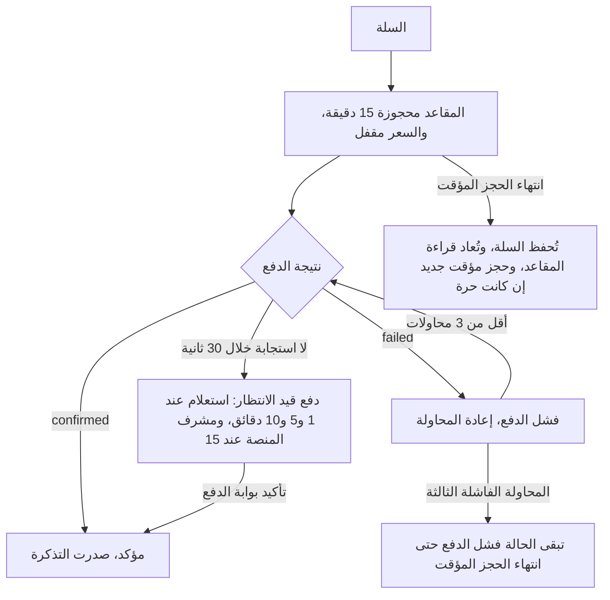

الواجهات: الويب المتجاوب (trips-enjoy.com) وتطبيقات الهاتف. الأدوار: الزائر، المسافر. ميزات الوالدين في [متابع الوالدين](/ar/docs/user-flows/parent).

## التسجيل

| الحقل | مطلوب | ملاحظات |
|---|---|---|
| الاسم الكامل | نعم | |
| البريد الإلكتروني | أحد الخيارين: البريد الإلكتروني أو الهاتف | يجب التحقق من الوسيط المُدخَل (D-20) |
| الهاتف | أحد الخيارين: البريد الإلكتروني أو الهاتف | بصيغة E.164؛ ويجب التحقق منه إن أُدخِل |
| كلمة المرور | نعم، ما لم يختر المسافر تسجيل الدخول بالرمز فقط | 12 حرفًا أو أكثر، مع فحص كلمات المرور المسرَّبة |
| الدولة | نعم | تحدد سوق الحساب ([BRL-23](/ar/docs/brd/requirements#7-قواعد-العمل)، [BRL-27](/ar/docs/brd/requirements#7-قواعد-العمل)) |
| اللغة | نعم | العربية أو الإنجليزية؛ والافتراضي من الجهاز |
| الموافقة على الشروط وسياسة الخصوصية | نعم | تُسجَّل مع نسخة النص |
| الموافقة على الرسائل التسويقية | لا | منفصلة عن الرسائل المعاملاتية |

## الاعتماد

لا يوجد. يصبح الحساب نشطًا فور إتمام التحقق، على خطة Free.

## التدفقات

### UF-TRV-01. التصفح كزائر
الفاعل: زائر. المُحفِّز: فتح الموقع أو التطبيق.
<Steps>
<Step>
تعرض الصفحة الرئيسية الرحلات العامة المميزة والقادمة من الأسواق النشطة فقط — البلدان المسموح بها ([FR-MKT-06](/ar/docs/srs/requirements/mkt#fr-mkt-06--نطاق-البلد-ومرشِّح-القوائم)) — مع بحث حسب الوجهة والتاريخ والجهة المنظِّمة والسعر والفئة، ومرشِّح بلد يقدَّم البلدان المسموح بها فقط.
</Step>
<Step>
يفتح الزائر رحلة: الوصف، الجهة المنظِّمة، التواريخ، المسار والتوقفات، المركبات، البرامج بأسعارها، السعر الأساسي بعملة الرحلة، وضع المقاعد، وملخص السياسة.
</Step>
<Step>
يطلب زر «احجز الآن» من الزائر إنشاء حساب أو تسجيل الدخول، ثم يعود إلى الرحلة نفسها.
</Step>
</Steps>
القواعد: [FR-TRIP-02](/ar/docs/srs/requirements/trip#fr-trip-02--المسودة-والنشر-العلني-والمستهدف) (إخفاء المسودات والرحلات المستهدفة)، [FR-TRV-02](/ar/docs/srs/requirements/trv#fr-trv-02--ظهور-الرحلات-والوصول-المبكر) (إخفاء الوصول المبكر لمسافري VIP)، [FR-MKT-03](/ar/docs/srs/requirements/mkt#fr-mkt-03--التصفح-عبر-الأسواق)، [FR-MKT-06](/ar/docs/srs/requirements/mkt#fr-mkt-06--نطاق-البلد-ومرشِّح-القوائم) (القوائم ومرشِّح البلد يقدمان البلدان المسموح بها فقط).

### UF-TRV-02. التسجيل والتحقق
الفاعل: زائر. المُحفِّز: إنشاء حساب كمسافر.
<Steps>
<Step>
يملأ نموذج التسجيل أعلاه.
</Step>
<Step>
يستلم رمزًا عبر رسالة نصية أو WhatsApp أو البريد الإلكتروني؛ ثم يُدخِله.
</Step>
<Step>
يصل إلى تهيئة قصيرة: صورة الملف الشخصي (اختيارية)، وتفضيلات الإشعارات، واختيار الخطة (خطة Free محددة؛ وتُعرَض خلتا Explorer وVIP).
</Step>
<Step>
يعود إلى الرحلة التي كان يشاهدها، أو إلى الصفحة الرئيسية.
</Step>
</Steps>
الحالات الحدّية: انتهاء صلاحية الرمز (إعادة الإرسال بعد العد التنازلي)؛ 5 رموز خاطئة (إيقاف مؤقت 15 دقيقة)؛ 3 محاولات تسليم فاشلة (عرض الوسيط الآخر)؛ بريد إلكتروني أو هاتف مسجَّل مسبقًا (عرض تسجيل الدخول وإعادة تعيين كلمة المرور).
القواعد: من [FR-AUTH-01](/ar/docs/srs/requirements/auth#fr-auth-01--مسارات-تسجيل-خاصة-بكل-دور) إلى [FR-AUTH-03](/ar/docs/srs/requirements/auth#fr-auth-03--التحقق-عبر-رمز-لمرة-واحدة).

### UF-TRV-03. حجز رحلة
الفاعل: المسافر. المُحفِّز: زر «احجز الآن» على رحلة منشورة.
<Steps>
<Step>
**المسافرون**: عدد الركاب؛ اسم لكل راكب؛ وسم «طفل» حين يكون الراكب قاصرًا.
</Step>
<Step>
**البرامج**: تُضاف البرامج المطلوبة مسبقًا وتُقفل؛ ويمكن إضافة البرامج الاختيارية بمفتاح تبديل أو الكمية أو الفئة؛ وتظهر البرامج الحصرية لـ VIP مقفلة لمستخدمي Free وExplorer مع مطالبة بالترقية؛ وتظهر البرامج الممتلئة غير متاحة. يتحدّث الملخص مباشرة متضمّنًا خصم الخطة على البرامج (5 أو 10 بالمئة).
</Step>
<Step>
**المقاعد**: إن كان الاختيار الذاتي مفعّلًا، تظهر خريطة مقاعد مباشرة للمركبة المعيَّنة؛ واختيار مقعد يحجزه 15 دقيقة مع عدّ تنازلي ظاهر. خلال نافذة الأولوية، يرى مسافرو Free الخريطة للقراءة فقط. وإن كان التعيين من الجهة المنظِّمة، تعرض الخطوة «يُعيَّن المقعد لاحقًا».
</Step>
<Step>
**الملخص**: الأساس، والبرامج، والخصومات، وحقل الكوبون، ورقم ضريبي اختياري لفاتورة B2B، والإجمالي مع رمز العملة. يكون السعر مقفلًا منذ بداية الحجز المؤقت.
</Step>
<Step>
**الدفع**: وسائل دفع سوق الرحلة؛ تُفتح صفحة بوابة الدفع أو SDK؛ ولا تظهر حقول البطاقات على المنصة.
</Step>
<Step>
**النتيجة**: مؤكد (تذكرة بمرجع الحجز ورمز الصعود، وإيصال، وفاتورة)، أو قيد الانتظار (جارٍ تأكيد الدفع)، أو فاشل (إعادة المحاولة).
</Step>
</Steps>
الحالات الحدّية: انتهاء الحجز المؤقت أثناء الدفع (تُحفظ السلة، وتُعاد قراءة المقاعد، وحجز مؤقت جديد إن كانت المقاعد حرة)؛ المحاولة الفاشلة الثالثة (تبقى الحالة «فشل الدفع» حتى انتهاء الحجز المؤقت)؛ نفاد مقاعد الرحلة والسلة مفتوحة (تعرض خطوة المقاعد «غير متاح»، وتُعرض مركبات أخرى).
القواعد: من [FR-BKG-01](/ar/docs/srs/requirements/bkg#fr-bkg-01--تكوين-الحجز) إلى [FR-BKG-05](/ar/docs/srs/requirements/bkg#fr-bkg-05--الإيصالات-والفواتير)، من [FR-SEAT-02](/ar/docs/srs/requirements/seat#fr-seat-02--خريطة-المقاعد-الحية) إلى [FR-SEAT-04](/ar/docs/srs/requirements/seat#fr-seat-04--الحجز-المؤقت-للمقعد)، من [FR-PAY-07](/ar/docs/srs/requirements/pay#fr-pay-07--وسائل-الدفع-حسب-السوق) إلى [FR-PAY-08](/ar/docs/srs/requirements/pay#fr-pay-08--الدفع-المعلق)، [FR-PRG-02](/ar/docs/srs/requirements/prg#fr-prg-02--أنواع-البرامج)، [FR-PRG-03](/ar/docs/srs/requirements/prg#fr-prg-03--ملخص-الحجز-الحي).

عرض المحرّك لهذا المسار، بما يشمل معالجة الاستدعاءات الراجعة مرة واحدة والتصعيد، هو [سير عمل الحجز والدفع](/ar/docs/workflows/booking-payment).

### UF-TRV-04. تطبيق كوبون
<Steps>
<Step>
يُدخِل رمزًا في خطوة الملخص.
</Step>
<Step>
صالح: يظهر سطر الخصم ويتحدّث الإجمالي. غير صالح: يظهر أول سبب للفشل (غير موجود، متوقف مؤقتًا، منتهي الصلاحية، لا ينطبق على هذا الحجز، مستنفَد، مستخدَم مسبقًا، الحد الأدنى للإنفاق غير مستوفى).
</Step>
<Step>
يُرفَض كوبون ثانٍ غير قابل للتكدّس؛ ويبقى الأول.
</Step>
</Steps>
القواعد: [FR-CPN-02](/ar/docs/srs/requirements/cpn#fr-cpn-02--رفض-الاستخدام-عبر-الجهات)، [FR-CPN-03](/ar/docs/srs/requirements/cpn#fr-cpn-03--التحقق-في-الوقت-الفعلي).

### UF-TRV-05. إدارة الحجوزات
<Steps>
<Step>
تعرض «حجوزاتي» الحجوزات القادمة والسابقة والملغاة مع حالتها.
</Step>
<Step>
تفاصيل الحجز: الرحلة، والركاب، والمقاعد، والبرامج، والإجماليات، وحالة الدفع، والسياسة، والتذكرة، والإيصال، والفاتورة، والإجراءات المسموح بها وفق الحالة.
</Step>
<Step>
قائمة الإيصالات والفواتير؛ والتصدير على VIP.
</Step>
</Steps>
القواعد: [FR-BKG-05](/ar/docs/srs/requirements/bkg#fr-bkg-05--الإيصالات-والفواتير)، [FR-TRV-03](/ar/docs/srs/requirements/trv#fr-trv-03--السجل-والإيصالات-بحسب-الخطة).

### UF-TRV-06. إلغاء حجز
<Steps>
<Step>
من تفاصيل الحجز، يعرض زر «إلغاء» معاينة الاسترداد وفق السياسة (قيمة مؤقتة: 80 بالمئة عند 48 ساعة أو أكثر، و50 بالمئة من 24 إلى أقل من 48 ساعة، ولا شيء دون 24 ساعة) وأثر الكوبون.
</Step>
<Step>
يؤكد. تنتقل الحالة إلى «ملغى»، ثم «بانتظار الاسترداد» حتى تأكيد بوابة الدفع («الاسترداد جارٍ»)، ثم «تم الاسترداد».
</Step>
<Step>
بعد الموعد النهائي، يمكن للمسافر إرسال طلب إلى الجهة المنظِّمة بدلًا من ذلك (يُبتّ فيه خلال يومي عمل، ثم لدى مشرف المنصة).
</Step>
</Steps>
الحالات الحدّية: بعد الانطلاق أو تسجيل الحضور، يُستبدَل الإلغاء بـ«فتح نزاع».
القواعد: [FR-BKG-04](/ar/docs/srs/requirements/bkg#fr-bkg-04--إلغاء-المسافر-والاسترداد)، [FR-PAY-03](/ar/docs/srs/requirements/pay#fr-pay-03--تنفيذ-الاسترداد)، [BRL-11](/ar/docs/brd/requirements#7-قواعد-العمل)، [BRL-12](/ar/docs/brd/requirements#7-قواعد-العمل).

### UF-TRV-07. اختيار الحل بعد تغيير في الرحلة
المُحفِّز: تغيّر الجهة المنظِّمة برنامجًا أو وضع المقاعد أو المركبة أو الوقت بما يؤثر على الحجز.
<Steps>
<Step>
إشعار ولافتة على الحجز يعرضان التغيير.
</Step>
<Step>
الخيارات: قبول التغيير، أو خيار التبديل (برنامج أو مركبة أخرى حيثما عُرضت)، أو الإلغاء مع استرداد كامل.
</Step>
<Step>
الاختيار خلال 7 أيام؛ وإلا تُحال الحالة إلى مشرف المنصة.
</Step>
</Steps>
القواعد: [FR-TRIP-06](/ar/docs/srs/requirements/trip#fr-trip-06--التغييرات-التي-تمس-الحجوزات-المؤكدة)، [BRL-24](/ar/docs/brd/requirements#7-قواعد-العمل).

### UF-TRV-08. يوم الرحلة
<Steps>
<Step>
تذكرة برمز الصعود، ووسم المركبة، والمقعد (عند تعيينه)، ونقطة الركوب ووقتها، وبيانات التواصل مع المشرف، وحالة تسجيل الحضور.
</Step>
<Step>
بعد تسجيل الحضور: حالة «على متن المركبة»؛ والبرامج والجدول الزمني.
</Step>
<Step>
لا يُعرض للمسافرين موقع مباشر للمركبة ولا وقت وصول متوقع.
</Step>
</Steps>
القواعد: [FR-TRK-07](/ar/docs/srs/requirements/trk#fr-trk-07--لا-موقع-مباشر-للمسافرين)، [BRL-29](/ar/docs/brd/requirements#7-قواعد-العمل).

### UF-TRV-09. الألبومات
<Steps>
<Step>
يسرد سجل الرحلات الرحلات المكتملة؛ وتعرض كل رحلة الألبومات التي يجوز للمسافر رؤيتها.
</Step>
<Step>
الألبومات العامة: عرض؛ وتنزيل النسخة ذات العلامة المائية أو النسخة المتوسطة. ألبومات الرابط المشترك والمستخدمين المختارين: عرض فقط.
</Step>
<Step>
الرابط المشترك المفتوح دون تسجيل دخول يطلب من المسافر تسجيل الدخول.
</Step>
</Steps>
القواعد: [FR-MED-05](/ar/docs/srs/requirements/med#fr-med-05--وصول-المستخدمين-المختارين)، [FR-MED-07](/ar/docs/srs/requirements/med#fr-med-07--وصول-المسافر-والتنزيل).

### UF-TRV-10. تغيير الخطة
<Steps>
<Step>
تقارن صفحة الخطط بين Free وExplorer وVIP بأسعار بعملة سوق الحساب.
</Step>
<Step>
تفتح الترقية صفحة بوابة الدفع في المتصفح؛ وتسري المزايا فورًا مع الاحتساب النسبي.
</Step>
<Step>
يُجدوَل التخفيض لنهاية الدورة ويمكن إلغاؤه.
</Step>
</Steps>
القواعد: [FR-TRV-05](/ar/docs/srs/requirements/trv#fr-trv-05--تغييرات-الخطة)، [FR-SUB-04](/ar/docs/srs/requirements/sub#fr-sub-04--الترقية-والتخفيض-والإلغاء).

### UF-TRV-11. التقدّم بطلب دور مورّد
<Steps>
<Step>
تعرض قائمة الحساب: «كن سائقًا»، و«كن مصوّرًا»، و«سجّل جهة منظِّمة».
</Step>
<Step>
السائق: انتقال إلى تطبيق السائق. المصوّر: انتقال إلى الاستوديو. الجهة المنظِّمة: انتقال إلى نموذج الويب (على الويب فقط).
</Step>
<Step>
أثناء الانتظار أو بعد الرفض، يبقى وصول المسافر دون تغيير.
</Step>
</Steps>
القواعد: [FR-TRV-06](/ar/docs/srs/requirements/trv#fr-trv-06--طلب-دور-المورّد-مع-بقاء-وصول-المسافر)، [FR-AUTH-06](/ar/docs/srs/requirements/auth#fr-auth-06--حسابات-متعددة-الأدوار).

### UF-TRV-12. الملف الشخصي واللغة والإشعارات
تحرير الاسم والصورة وبيانات التواصل (إعادة التحقق عند التغيير) واللغة والقنوات لكل فئة. لا يمكن إيقاف رسائل الأمان.
القواعد: [FR-TRV-01](/ar/docs/srs/requirements/trv#fr-trv-01--الملف-الشخصي-والتفضيلات)، [FR-NTF-01](/ar/docs/srs/requirements/ntf#fr-ntf-01--القنوات-حسب-التفضيل).

### UF-TRV-13. طلبات الخصوصية
<Steps>
<Step>
طلب نسخة من البيانات: التحقق برمز، وتُسلَّم خلال 30 يومًا كرابط تنزيل.
</Step>
<Step>
طلب الحذف: انظر [UF-SHR-09](/ar/docs/user-flows/shared#uf-shr-09-حذف-الحساب).
</Step>
</Steps>
القواعد: [FR-TRV-07](/ar/docs/srs/requirements/trv#fr-trv-07--نسخ-البيانات-وحذفها)، [FR-AUTH-09](/ar/docs/srs/requirements/auth#fr-auth-09--حذف-الحساب-مع-مهلة-سماح-مدتها-30-يومًا).

### UF-TRV-14. فتح نزاع
<Steps>
<Step>
من حجز: اختيار النوع (حجز، دفع، استرداد، سلوك الجهة المنظِّمة، أخرى)، والوصف، وإرفاق حتى 5 ملفات.
</Step>
<Step>
تتبّع الحالة: مفتوح، طُلبت معلومات، قيد المراجعة، تم الحل، مغلق.
</Step>
</Steps>
القواعد: [FR-ADM-08](/ar/docs/srs/requirements/adm#fr-adm-08--معالجة-النزاعات).

### UF-TRV-15. نتيجة الدفع ومعالجة الحالة المعلّقة
الفاعل: المسافر. المُحفِّز: إرسال الدفع دون نتيجة فورية.
<Steps>
<Step>
تُفتح صفحة بوابة الدفع أو SDK؛ ولا تظهر حقول البطاقات على المنصة أبدًا.
</Step>
<Step>
أثناء صمت البوابة، تعرض الحالة «جارٍ تأكيد الدفع»: يستعلم النظام عند الدقيقة 1 و5 و10 وتبقى المقاعد محجوزة.
</Step>
<Step>
مؤكد: تظهر التذكرة والإيصال والفاتورة فورًا. فاشل: تُعرض إعادة المحاولة ما دامت المحاولات أقل من ثلاث لهذا الحجز المؤقت.
</Step>
<Step>
بعد المحاولة الفاشلة الثالثة تبقى الحالة «فشل الدفع» حتى انتهاء الحجز المؤقت؛ ويُعرض التواصل مع الدعم عند تصعيد الحالة إلى مشرف المنصة عند 15 دقيقة.
</Step>
</Steps>
الحالات الحدّية: انتهاء الحجز المؤقت أثناء الدفع (تُحفظ السلة، وتُعاد قراءة المقاعد، وحجز مؤقت جديد فقط إن كانت المقاعد حرة).
القواعد: [FR-PAY-01](/ar/docs/srs/requirements/pay#fr-pay-01--نتائج-الدفع)، [FR-PAY-02](/ar/docs/srs/requirements/pay#fr-pay-02--معالجة-الاستدعاءات-الراجعة-مرة-واحدة)، [FR-PAY-08](/ar/docs/srs/requirements/pay#fr-pay-08--الدفع-المعلق)، [FR-BKG-03](/ar/docs/srs/requirements/bkg#fr-bkg-03--إعادة-المحاولة-دون-فقدان-السلة).

### UF-TRV-16. ما بعد التخفيض
الفاعل: المسافر. المُحفِّز: انتهاء دورة الفوترة على خطة مخفَّضة.
<Steps>
<Step>
يبقى كل ما حُجز مسبقًا يعمل: تظل العناصر التي تجاوزت الحد والمنشأة قبل التخفيض متاحة.
</Step>
<Step>
يُرفَض الإجراء التالي الذي يتجاوز الحد الجديد بواسطة البوابة من جهة الخادم، التي تسمّي الفئة والخطة الحالية والحد والفئة الأعلى التالية.
</Step>
<Step>
تعرض مطالبة الترقية الفئة الأعلى التالية؛ وتُصفَّر العدادات في اليوم الأول من الشهر الساعة 00:00 بتوقيت مالك الحساب.
</Step>
</Steps>
الحالات الحدّية: تسري قواعد فترة السماح قبل سريان التخفيض؛ انظر سير عمل الاشتراكات.
القواعد: [FR-SUB-09](/ar/docs/srs/requirements/sub#fr-sub-09--الحدود-بعد-التخفيض)، [FR-SUB-10](/ar/docs/srs/requirements/sub#fr-sub-10--تصفير-العدادات)، [FR-SUB-02](/ar/docs/srs/requirements/sub#fr-sub-02--بوابات-الميزات).

## حالات الحجز كما يراها المسافر

| الحالة | التسمية المعروضة |
|---|---|
| مقاعد محجوزة مؤقتًا | المقاعد محجوزة، الوقت المتبقي mm:ss |
| بانتظار الدفع | جارٍ تأكيد الدفع |
| فشل الدفع | لم تكتمل عملية الدفع، أعد المحاولة |
| مؤكد | مؤكد |
| تم تسجيل الحضور / تم تسجيل المغادرة | على متن المركبة / خارج المركبة |
| ملغى | ملغى |
| بانتظار الاسترداد | الاسترداد جارٍ |
| تم الاسترداد | تم الاسترداد |
