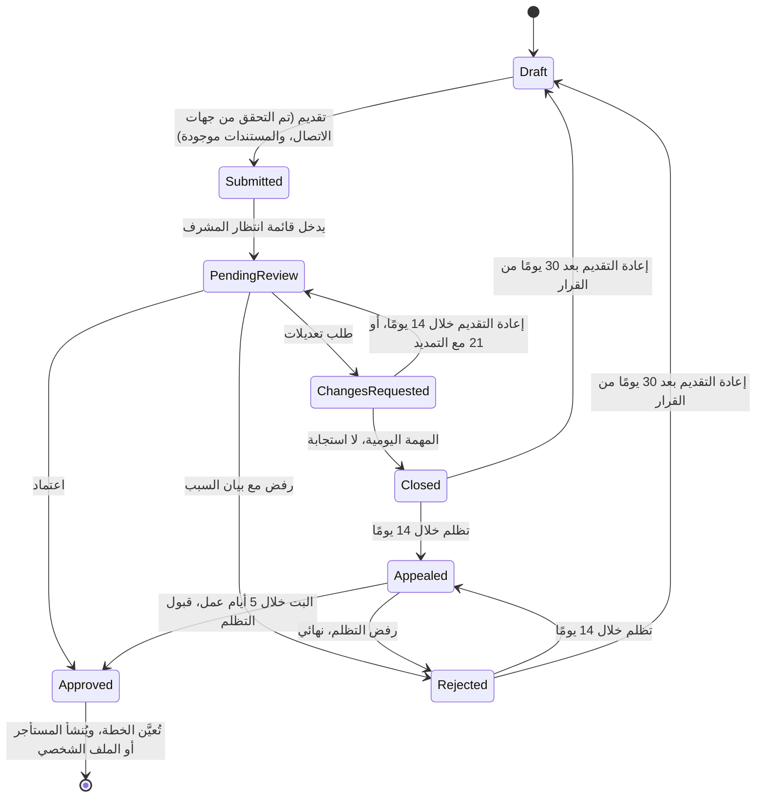

يمرّ كل جهة منظِّمة وسائق منصة ومصوّر منصة بسير عمل واحد لطلب الانضمام قبل أن يتمكّن من العمل على المنصة ([BRL-02](/ar/docs/brd/requirements#7-قواعد-العمل)). هذه الصفحة هي منظور المحرّك لآلة الحالات 7.5؛ أما الجانب البشري فيغطّيه [UF-ADM-02](/ar/docs/user-flows/admin#uf-adm-02-مراجعة-طلب-انضمام).

**مرحلة التسليم:** P1 الأساس (الجهات المنظِّمة)، P4 جانب العرض في المنصة (السائقون والمصوّرون).

## المُحفِّز والفاعلون

- **المُحفِّز:** يقدِّم مقدِّم الطلب طلبًا في حالة مسودة (تم التحقق من جهات الاتصال، والمستندات موجودة).
- **الفاعلون:** مقدِّم الطلب؛ مراجع مشرف المنصة؛ مهمة الإغلاق اليومية؛ النظام (تعيين الخطة، وإنشاء المستأجر، والإشعارات).

## المخطط

## المؤقتات والقواعد

| الخطوة | المؤقت (نصًّا) | تتبع القاعدة |
|---|---|---|
| علامة قائمة المراجعة | بقاء الطلب قيد الانتظار "أكثر من يومَي عمل" يضع علامة على الطلب؛ والهدف الوسيط لاتخاذ القرار هو يومَا عمل | [FR-ONB-03](/ar/docs/srs/requirements/onb#fr-onb-03--المدة-المستهدفة-لاتخاذ-القرار), [BR-ONB-03](/ar/docs/brd/requirements#62-طلبات-الانضمام-والاعتمادات-onb) |
| نافذة التعديلات المطلوبة | "14 يومًا للرد، مع تذكير في اليوم السابع وتمديد واحد مدته 7 أيام عند الطلب" | [FR-ONB-04](/ar/docs/srs/requirements/onb#fr-onb-04--التعديلات-المطلوبة), [BR-ONB-04](/ar/docs/brd/requirements#62-طلبات-الانضمام-والاعتمادات-onb), D-235 |
| مهمة الإغلاق | تُغلِق المهمة اليومية التعديلاتِ التي لم يُردّ عليها؛ ويوم الإغلاق عند استخدام التمديد هو [OPEN: قرار مفتوح [OD-32](/ar/docs/brd/compliance#11-القرارات-المفتوحة)] | [FR-ONB-04](/ar/docs/srs/requirements/onb#fr-onb-04--التعديلات-المطلوبة), [OD-32](/ar/docs/brd/compliance#11-القرارات-المفتوحة) |
| نافذة التظلم | "خلال 14 يومًا من الإشعار"، وتظلم واحد لكل رفض، ويُبت فيه "خلال 5 أيام عمل" | [FR-ONB-05](/ar/docs/srs/requirements/onb#fr-onb-05--الرفض-والتظلم-وإعادة-التقديم), [BR-ONB-05](/ar/docs/brd/requirements#62-طلبات-الانضمام-والاعتمادات-onb), [BRL-06](/ar/docs/brd/requirements#7-قواعد-العمل), D-237 |
| فترة التهدئة لإعادة التقديم | "بعد 30 يومًا من الرفض؛ ويُحتسب الطلب المغلق مرفوضًا" | [FR-ONB-05](/ar/docs/srs/requirements/onb#fr-onb-05--الرفض-والتظلم-وإعادة-التقديم), [BRL-06](/ar/docs/brd/requirements#7-قواعد-العمل) |
| عند الاعتماد | تُعيَّن الخطة ويُنشأ المستأجر أو الملف الشخصي تلقائيًا؛ وتبقى إجراءات المورّد مرفوضة حتى ذلك الحين | [FR-ONB-01](/ar/docs/srs/requirements/onb#fr-onb-01--طلب-الانضمام-ووصول-المورد), [FR-ORG-02](/ar/docs/srs/requirements/org#fr-org-02--إنشاء-مساحة-العمل-عند-الاعتماد), D-24, D-77 |
| الإشعارات | كل تغيير في الحالة يُخطِر مقدِّم الطلب بلغته عبر قناة مفعّلة واحدة على الأقل | [FR-ONB-09](/ar/docs/srs/requirements/onb#fr-onb-09--إشعارات-حالة-مقدِّم-الطلب) |
| بوابات الحداثة عند التقديم | نتائج فحوص السائق المخبرية "بتاريخ لا يتجاوز آخر 30 يومًا"؛ والتأمين "سارٍ لمدة 3 أشهر إضافية على الأقل" | [FR-ONB-07](/ar/docs/srs/requirements/onb#fr-onb-07--بيانات-مركبة-السائق-وتأمينه), [FR-ONB-08](/ar/docs/srs/requirements/onb#fr-onb-08--الموافقة-على-الفحوصات-المخبرية-والنتيجة-المبدئية) |

## القصص

- **بصفتي مقدِّم طلب**، أريد أن توضع علامة على مراجعتي المتأخرة عندما تتجاوز يومَي عمل، حتى يعمل اتفاق SLA الخاص بالمنصة نفسها لمصلحتي. *([FR-ONB-03](/ar/docs/srs/requirements/onb#fr-onb-03--المدة-المستهدفة-لاتخاذ-القرار))*
- **بصفتي مراجع مشرف المنصة**، أريد أن تُغلَق طلبات التعديلات التي لم يُردّ عليها تلقائيًا بعد انتهاء النافذة، حتى لا تحتفظ قائمة الانتظار إلا بالحالات النشطة. *([FR-ONB-04](/ar/docs/srs/requirements/onb#fr-onb-04--التعديلات-المطلوبة))*
- **بصفتي مقدِّم طلب رُفض طلبه**، أريد تظلمًا واحدًا يُبتّ فيه خلال خمسة أيام عمل، حتى لا يكلفني الخطأ شهرًا كاملًا. *([FR-ONB-05](/ar/docs/srs/requirements/onb#fr-onb-05--الرفض-والتظلم-وإعادة-التقديم), [BRL-06](/ar/docs/brd/requirements#7-قواعد-العمل))*
- **بصفتي جهة منظِّمة معتمدة**، أريد أن تُنشأ خطتي ومستأجري لحظة اعتمادي، حتى أبدأ العمل دون انتظار ثانٍ. *([FR-ORG-02](/ar/docs/srs/requirements/org#fr-org-02--إنشاء-مساحة-العمل-عند-الاعتماد))*
