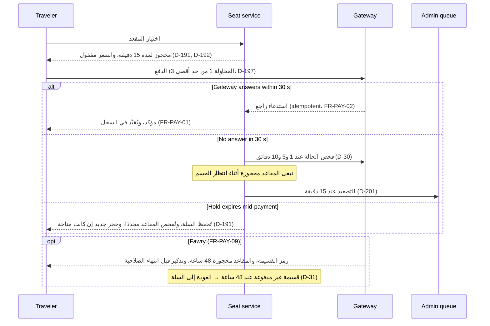

يُعدّ خط معالجة الحجز سير العمل الأكثر كثافة بالمؤقتات في المنصة: حجز مؤقت للمقعد لمدة 15 دقيقة مع قفل السعر، وحد أقصى قدره ثلاث محاولات للدفع، ومسار قسائم Fawry لمدة 48 ساعة، وجدول استعلام دوري للبوابة يُصعَّد إلى مشرف المنصة. هذه هي رؤية المحرّك لآلتي الحالات 7.2 (الحجز) و7.3 (المقعد)؛ أما جانب المسافر فهو [UF-TRV-03](/ar/docs/user-flows/traveler#uf-trv-03-حجز-رحلة).

**مرحلة التسليم:** P2 تجربة المركبة الواحدة (مصر).

## المُحفِّز والفاعلون

- **المُحفِّز:** يختار المسافر مقعدًا (اختيار ذاتي) أو يؤكد الركاب (تعيين من الجهة المنظِّمة).
- **الفاعلون:** المسافر؛ بوابة الدفع؛ مرحّل الاستدعاءات الراجعة للدفع؛ طابور التصعيد إلى مشرف المنصة.

## المخطط

## المؤقتات والقواعد

| الخطوة | المؤقت (نصًّا) | تتبّع القاعدة |
|---|---|---|
| حجز المقعد المؤقت | "محجوز لمدة 15 دقيقة ويُفرَج عنه تلقائيًا عند انتهاء مدته"؛ والسعر "مقفول عند بدء الحجز" | [BRL-08](/ar/docs/brd/requirements#7-قواعد-العمل)، [FR-SEAT-04](/ar/docs/srs/requirements/seat#fr-seat-04--الحجز-المؤقت-للمقعد)، D-191، D-192 |
| انتهاء الحجز أثناء الدفع | "إعادة المحاولة بعد انتهاء الحجز تُبقي السلة، وتفحص المقاعد مجددًا، وتبدأ حجزًا جديدًا لمدة 15 دقيقة فقط إذا كانت لا تزال متاحة" | [FR-BKG-03](/ar/docs/srs/requirements/bkg#fr-bkg-03--إعادة-المحاولة-دون-فقدان-السلة)، D-191 |
| الحد الأقصى للمحاولات | "حتى 3 محاولات لكل حجز"؛ وبعد الثالثة يبقى الحجز في حالة فشل الدفع حتى انتهاء الحجز | [FR-BKG-03](/ar/docs/srs/requirements/bkg#fr-bkg-03--إعادة-المحاولة-دون-فقدان-السلة)، [BR-BKG-03](/ar/docs/brd/requirements#67-الحجز-والدفع-bkg)، D-197 |
| انتهاء مهلة البوابة | "إذا لم تُجب البوابة خلال 30 ثانية… تُفحص الحالة عند الدقيقة 1 و5 و10 ويُصعَّد الأمر إلى مشرف المنصة عند الدقيقة 15. وتبقى المقاعد محجوزة أثناء انتظار الحسم" | [FR-PAY-08](/ar/docs/srs/requirements/pay#fr-pay-08--الدفع-المعلق)، D-30، D-201 |
| الاستدعاءات الراجعة | "مرة واحدة على الأكثر لكل معرِّف حدث لدى البوابة"؛ وتُدرَج الاستدعاءات الراجعة في طابور وتُعاد معالجتها | [FR-PAY-02](/ar/docs/srs/requirements/pay#fr-pay-02--معالجة-الاستدعاءات-الراجعة-مرة-واحدة)، [NFR-AVL-03](/ar/docs/srs/quality#83-التوافر-nfr-avl) |
| قسيمة Fawry | "إصدار قسيمة صالحة لمدة 48 ساعة وحجز المقاعد طوال هذه النافذة. القسيمة غير المدفوعة تنتهي صلاحيتها ويُفرَج عن المقاعد" | [FR-PAY-09](/ar/docs/srs/requirements/pay#fr-pay-09--قسائم-fawry-النقدية)، [BRL-08](/ar/docs/brd/requirements#7-قواعد-العمل)، D-31، D-41 |
| النجاح | حالة التأكيد تُقيِّد القيد في السجل؛ وتُصدَر التذكرة مع مرجع الحجز ورمز الصعود | [FR-PAY-01](/ar/docs/srs/requirements/pay#fr-pay-01--نتائج-الدفع)، [UF-TRV-03](/ar/docs/user-flows/traveler#uf-trv-03-حجز-رحلة) |
| حالات المقعد | متاح، محجوز مؤقتًا، محجوز، تم تسجيل الحضور، تم تسجيل المغادرة، مُفرَج عنه — الحلقة الكامنة خلف الحجز | [FR-SEAT-05](/ar/docs/srs/requirements/seat#fr-seat-05--حالات-المقعد) |
| اختيار المقعد | التعيين من الجهة المنظِّمة افتراضيًا؛ والاختيار الذاتي بحسب الخطة وإعداد الرحلة | [FR-SEAT-01](/ar/docs/srs/requirements/seat#fr-seat-01--التعيين-من-الجهة-افتراضيًا)، [FR-SEAT-07](/ar/docs/srs/requirements/seat#fr-seat-07--الاختيار-الذاتي-بحسب-الخطة) |
| حالات الحجز | الحالات العشر الظاهرة للمسافر في الآلة 7.2، من السلة إلى تم الاسترداد | [FR-BKG-07](/ar/docs/srs/requirements/bkg#fr-bkg-07--حالات-الحجز) |
| خصومات البرنامج | تخصم الخطط من أسعار البرنامج بنسبة 5 أو 10 في المئة في الملخص المباشر | [FR-TRV-04](/ar/docs/srs/requirements/trv#fr-trv-04--خصومات-البرامج) |
| التزامن | تُحلّ حالات التنافس على الحجز بقفل Redis وتحديث شرطي لحالة المقعد | ERD trip_seats |

## قصص المستخدم

- **بصفتي مسافرًا**، أريد أن يكون السعر مقفولًا لحظة حجز مقعدي، حتى لا يتغير شيء تحتي وأنا أدفع. *([FR-SEAT-04](/ar/docs/srs/requirements/seat#fr-seat-04--الحجز-المؤقت-للمقعد)، D-192)*
- **بصفتي مسافرًا**، أريد أن تُحسم عملية الدفع المعلقة عبر الاستعلام الدوري بدلًا من طريق مسدود، حتى لا يكلّفني بطء البوابة المقعد. *([FR-PAY-08](/ar/docs/srs/requirements/pay#fr-pay-08--الدفع-المعلق))*
- **بصفتي مشرف منصة**، أريد أن تُصعَّد حالات عدم إجابة البوابة بعد 15 دقيقة مع بقاء المقاعد محجوزة، حتى أُكمل ما عجز عنه المؤقت. *([FR-PAY-08](/ar/docs/srs/requirements/pay#fr-pay-08--الدفع-المعلق)، D-201)*
- **بصفتي مستخدم Fawry**، أريد 48 ساعة لدفع القسيمة مع تذكير قبل انتهاء الصلاحية، حتى يعمل الدفع النقدي مثل أي وسيلة أخرى. *([FR-PAY-09](/ar/docs/srs/requirements/pay#fr-pay-09--قسائم-fawry-النقدية)، D-31)*
