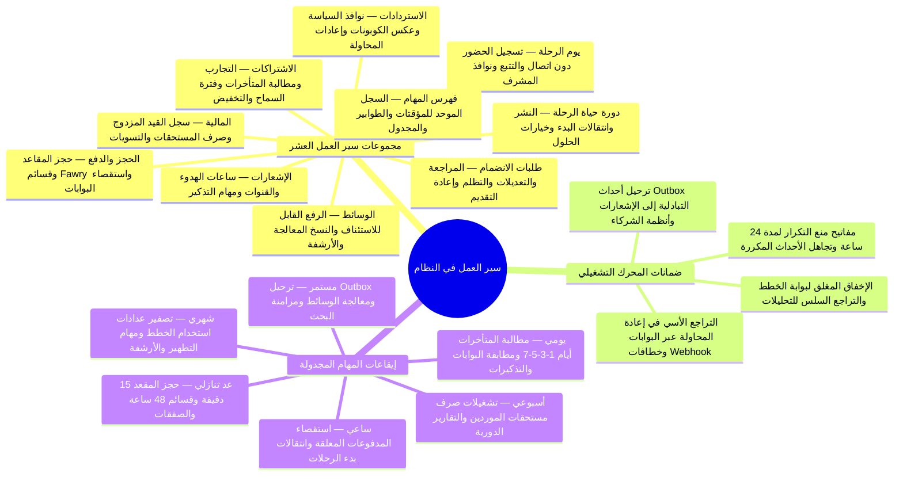

تصف تدفقات المستخدم ما يفعله الناس. ويصف هذا القسم ما يفعله **النظام**: كل عملية لها حالة أو مؤقت أو إعادة محاولة أو قائمة انتظار — نوع العملية التي يتولاها محرّك سير العمل. تحيل الـSRS إلى مستند مصدر بعنوان *سير عمل النظام* لهذه العمليات؛ وهذه الصفحات هي ذلك المستند، متتبَّعة بالكامل عبر جميع المتطلبات الوظيفية البالغ عددها **213** متطلبًا.

تتبع كل صفحة الشكل نفسه: المُحفِّز، والفاعلون، والمخطط، والمؤقتات، و**القصص** التي يخدمها سير العمل.

<TraceBar
  brd={[
    { label: 'قواعد العمل §7', href: '/ar/docs/brd/requirements#7-قواعد-العمل', detail: 'BRL-01..30' },
  ]}
  srs={[
    { label: '10 آلات حالات §7', href: '/ar/docs/srs/state-machines' },
    { label: 'التوافر وإعادة المحاولة', href: '/ar/docs/srs/quality#83-التوافر-nfr-avl' },
  ]}
  erd={[
    { label: 'Outbox ومنع التكرار', href: '/ar/docs/erd/domains/platform' },
    { label: 'نموذج البيانات', href: '/ar/docs/erd' },
  ]}
  plan={[
    { label: 'خطة التسليم', href: '/ar/docs/plan', detail: '231 مهمة' },
  ]}
  workflows={[
    { label: 'فهرس المهام المجدولة', href: '/ar/docs/workflows/scheduled-jobs' },
    { label: 'مصفوفة التغطية', href: '/ar/docs/workflows/coverage', detail: '213/213 FR' },
  ]}
  userFlows={[
    { label: '106 تدفقات أدوار', href: '/ar/docs/user-flows' },
  ]}
  architecture={[
    { label: 'العمال وOutbox', href: '/ar/docs/architecture#نموذج-الخدمات' },
    { label: 'استدعاءات البوابات', href: '/ar/docs/architecture#التكاملات' },
  ]}
  design={[
    { label: 'أسطح الإشعارات', href: '/ar/docs/design#أسطح-الإشعارات' },
  ]}
  system={[
    { label: 'رحلة دورة الحياة', href: '/ar/docs/system/lifecycle' },
    { label: 'أطلس الخرائط الذهنية', href: '/ar/docs/system/mindmaps' },
  ]}
  recommendations={[
    { label: 'Outbox والمعمارية', href: '/ar/docs/recommendations/architecture-and-ops#rec-arch-01', detail: 'REC-ARCH-01' },
    { label: 'حجز المقاعد وعدم الاتصال', href: '/ar/docs/recommendations/architecture-and-ops#rec-book-03', detail: 'REC-BOOK-03 · REC-OFF-06' },
  ]}
/>

## عقد المحرّك

تتشارك كل عمليات سير العمل في هذا القسم قواعد التنفيذ نفسها، المستمدة من الـSRS:

| الخاصية | القاعدة | التتبع |
|---|---|---|
| الحالات | كل سير عمل هو إحدى آلات الحالات العشر (القسم 7 من SRS) أو خط أنابيب مسمّى أدناه | [القسم 7 من SRS](/ar/docs/srs/state-machines) |
| المؤقتات | الانتقالات المبنية على الوقت حارسات على آلة الحالات، مع نوافذ زمنية منقولة نصًّا في كل صفحة | حسب كل آلة |
| إعادة المحاولة | تُعالَج الاستدعاءات الراجعة للدفع مرة واحدة على الأكثر لكل معرّف حدث لدى بوابة الدفع؛ والإشعارات 3 مرات مع تراجع أُسّي؛ والاستردادات 3 مرات؛ والـwebhooks 5 مرات على مدى 24 ساعة | [FR-PAY-02](/ar/docs/srs/requirements/pay#fr-pay-02--معالجة-الاستدعاءات-الراجعة-مرة-واحدة), [FR-NTF-05](/ar/docs/srs/requirements/ntf#fr-ntf-05--سجلات-التسليم-وإعادة-المحاولة), [FR-PAY-03](/ar/docs/srs/requirements/pay#fr-pay-03--تنفيذ-الاسترداد), [FR-ORG-06](/ar/docs/srs/requirements/org#fr-org-06--نظام-crm-وwebhooks) |
| منع التكرار | مفاتيح منع التكرار (idempotency) صالحة لمدة 24 ساعة؛ وتُتجاهَل عمليات إعادة الإرسال المكررة استنادًا إلى معرّف الحدث لدى العميل | [القسم 6.4 من SRS](/ar/docs/srs/data#64-مدة-الاحتفاظ), [FR-CHK-05](/ar/docs/srs/requirements/chk#fr-chk-05--قائمة-الانتظار-دون-اتصال) |
| المهام | مهام مجدولة مسمّاة تُشغّل المؤقتات: بإيقاعات يومية وساعية وأسبوعية وشهرية — انظر فهرس المهام | [FR-ONB-04](/ar/docs/srs/requirements/onb#fr-onb-04--التعديلات-المطلوبة), [FR-NTF-07](/ar/docs/srs/requirements/ntf#fr-ntf-07--تذكيرات-الرحلات-وإشعارات-التغييرات), [FR-ACC-03](/ar/docs/srs/requirements/acc#fr-acc-03--أرباح-المورّدين-وصرف-المستحقات), [FR-SUB-10](/ar/docs/srs/requirements/sub#fr-sub-10--تصفير-العدادات) |
| سلوك الإخفاق | تفشل خدمة الخطة وهي مغلقة؛ وتتراجع التحليلات والتصديرات دون تعطيل الحجوزات | [FR-SUB-11](/ar/docs/srs/requirements/sub#fr-sub-11--فشل-خدمة-الخطط), [NFR-OBS-04](/ar/docs/srs/quality#86-الرصد-nfr-obs) |

## عمليات سير العمل

<MindmapBlock
  title="عمليات سير العمل وضمانات المحرّك وإيقاعات المهام المجدولة"
  caption="التنسيق الخلفي المتكامل لمنصة Trips Enjoy: 10 مجموعات لسير العمل والمهام، وضمانات التنفيذ غير المكرر، وإيقاعات المؤقتات المجدولة من خطوط Outbox المستمرة حتى تصفير العدادات الشهري."
  trace={{
    workflows: [
      { label: 'طلبات الانضمام', href: '/ar/docs/workflows/applications' },
      { label: 'الحجز والدفع', href: '/ar/docs/workflows/booking-payment' },
      { label: 'الاستردادات', href: '/ar/docs/workflows/refunds' },
      { label: 'دورة حياة الرحلة', href: '/ar/docs/workflows/trip-lifecycle' },
      { label: 'يوم الرحلة', href: '/ar/docs/workflows/trip-day' },
      { label: 'المالية', href: '/ar/docs/workflows/money' },
      { label: 'الاشتراكات', href: '/ar/docs/workflows/subscriptions' },
      { label: 'الإشعارات', href: '/ar/docs/workflows/notifications' },
      { label: 'الوسائط', href: '/ar/docs/workflows/media' },
      { label: 'فهرس المهام', href: '/ar/docs/workflows/scheduled-jobs' },
    ],
    srs: [
      { label: 'آلات الحالات §7', href: '/ar/docs/srs/state-machines' },
    ],
    system: [
      { label: 'رحلة الـ8 مراحل', href: '/ar/docs/system/lifecycle' },
    ],
  }}
>

</MindmapBlock>

<Cards>
  <Card title="طلبات الانضمام" description="المراجعة والتعديلات والتظلم وإعادة التقديم مع اتفاقيات SLA بأيام العمل." icon="ClipboardCheck" href="/ar/docs/workflows/applications" />
  <Card title="الحجز والدفع" description="الحجز المؤقت للمقاعد، وحدود المحاولات، وقسائم Fawry، واستقصاء البوابة، والتصعيد." icon="CreditCard" href="/ar/docs/workflows/booking-payment" />
  <Card title="الاستردادات" description="نوافذ السياسة، وعكس الكوبونات، وإعادات محاولة البوابة، ومسار ما بعد موعد الإيقاف." icon="RotateCcw" href="/ar/docs/workflows/refunds" />
  <Card title="دورة حياة الرحلة" description="النشر، وانتقالات وقت البدء، والمعالجات، والأرشفة." icon="Map" href="/ar/docs/workflows/trip-lifecycle" />
  <Card title="يوم الرحلة" description="تسجيل الحضور، وقوائم الانتظار دون اتصال، والتتبع المباشر، ونوافذ وصول المشرفين." icon="ScanLine" href="/ar/docs/workflows/trip-day" />
  <Card title="المالية" description="السجل، وصرف المستحقات الأسبوعي، والفواتير، ومطابقة الحسابات، وإغلاق التسويات." icon="Landmark" href="/ar/docs/workflows/money" />
  <Card title="الاشتراكات" description="التجارب، وتحصيل المتأخرات في الأيام 1-3-5-7، وفترة السماح، والهبوط بين الخطط، وإعادة ضبط العدادات." icon="RefreshCw" href="/ar/docs/workflows/subscriptions" />
  <Card title="الإشعارات" description="ساعات الهدوء، وإعادة المحاولة، ومنع التكرار، ومهمة التذكير." icon="BellRing" href="/ar/docs/workflows/notifications" />
  <Card title="الوسائط" description="نوافذ الرفع، والدفعات القابلة للاستئناف، والنسخ المعالجة، والأرشفة." icon="Images" href="/ar/docs/workflows/media" />
  <Card title="فهرس المهام" description="كل مؤقت وقائمة انتظار ومهمة مجدولة في صفحة واحدة." icon="CalendarClock" href="/ar/docs/workflows/scheduled-jobs" />
</Cards>

## قراءة المؤقتات

تستخدم اتفاقيات SLA القائمة على أيام العمل (المراجعة خلال يومَي عمل، وإرسال الاستردادات خلال يومَي عمل) تقويم سوق الطرف المسؤول. أما مؤقتات الساعة (الحجز المؤقت للمقاعد، وساعات الهدوء، وتشغيلات صرف المستحقات) فهي مطلقة. وحيثما لم تحسم المواصفة نفسها قيمةً، تشير الصفحة إلى ذلك بمعرّف القرار المفتوح — وتتبع تلك القيم عملية القرارات المفتوحة في BRD وترتبط بقيم مقترحة محددة في قسم [التوصيات والقرارات المقترحة](/ar/docs/recommendations/open-decisions).

## القصص في هذا القسم

تحمل كل صفحة من صفحات سير العمل قصص مستخدم بالصيغة القياسية — *بصفتي (دور)، أريد (قدرة)، حتى (قيمة)* — وكل قصة متتبَّعة إلى المتطلبات التي تخدمها، بحيث يتشارك المنتج والهندسة والعمليات مفردات واحدة.
