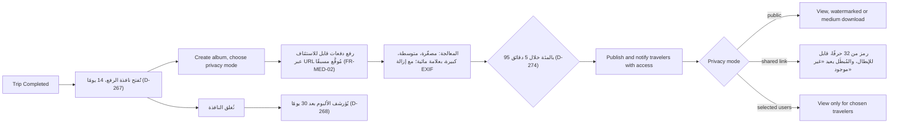

الوسائط هي مخزن الملفات لكل المنصة: تهبط رفوعات كل النطاقات هنا، والملف الذي لا يكون مرتبطًا بكيانه المالك ولم تُنشئه المنصة يُحذف تلقائيًا بعد 24 ساعة من الرفع ([FR-MED-09](/ar/docs/srs/requirements/med#fr-med-09--دورة-حياة-الملفات-وتنظيف-الملفات-اليتيمة)). وللألبومات ساعة خاصة بها: لا يُفتح الرفع إلا بعد اكتمال الرحلة ويستمر 14 يومًا؛ وتُنشئ المعالجة نسخًا مصغّرة ومتوسطة وكبيرة وبعلامة مائية مع إزالة بيانات EXIF؛ وتُؤرشف الألبومات بعد 30 يومًا من إغلاق النافذة. واجهة المصوّر هي [UF-PHO-05](/ar/docs/user-flows/photographer#uf-pho-05-إنشاء-ألبوم-ورفعه)؛ وواجهة المشاهدة للمسافر هي [UF-TRV-09](/ar/docs/user-flows/traveler#uf-trv-09-الألبومات).

**مرحلة التسليم:** P4 تغذية عرض المنصة.

## المحفِّز والجهات الفاعلة

- **المحفِّز:** تصل الرحلة إلى حالة مكتملة.
- **الجهات الفاعلة:** المصوّر (خطة Studio أو Pro)؛ خط المعالجة؛ مهمة الأرشفة؛ المسافرون الذين لديهم صلاحية الوصول.

## المخطط

## المؤقّتات والقواعد

| الخطوة | المؤقّت (حرفيًا) | أثر القاعدة |
|---|---|---|
| تنظيف الملفات اليتيمة | الملفات غير المرتبطة لمدة 24 ساعة وغير المُنشأة من المنصة تُحذف مع نسخها المشتقة | [FR-MED-09](/ar/docs/srs/requirements/med#fr-med-09--دورة-حياة-الملفات-وتنظيف-الملفات-اليتيمة), [BRL-31](/ar/docs/brd/requirements#7-قواعد-العمل) |
| نافذة الرفع | الألبومات "فقط بعد اكتمال الرحلة وخلال 14 يومًا" | [FR-MED-01](/ar/docs/srs/requirements/med#fr-med-01--نافذة-إنشاء-الألبوم), D-267 |
| الأرشفة | "تُؤرشف الألبومات بعد 30 يومًا من إغلاق النافذة" | [FR-MED-01](/ar/docs/srs/requirements/med#fr-med-01--نافذة-إنشاء-الألبوم), D-268 |
| اتفاقية مستوى الخدمة للمعالجة | "تنتهي معالجة 95 بالمئة من الصور خلال 5 دقائق" | [FR-MED-02](/ar/docs/srs/requirements/med#fr-med-02--الرفع-الدفعي-القابل-للاستئناف), D-274 |
| الرفع | رفع دفعات قابل للاستئناف عبر URL مُوقَّع مسبقًا، ومعرّفات ملفات العميل فريدة لكل دفعة | [FR-MED-02](/ar/docs/srs/requirements/med#fr-med-02--الرفع-الدفعي-القابل-للاستئناف), ERD photos |
| النسخ المعالجة | مصغّرة، متوسطة، كبيرة، بعلامة مائية؛ مع إزالة بيانات EXIF | [FR-MED-06](/ar/docs/srs/requirements/med#fr-med-06--العلامة-المائية), [UF-PHO-05](/ar/docs/user-flows/photographer#uf-pho-05-إنشاء-ألبوم-ورفعه) |
| العلامة المائية | "أسفل اليمين، بهامش 3 بالمئة من العرض، وشفافية 30 بالمئة"، لخطتي Studio وPro فقط | [FR-MED-06](/ar/docs/srs/requirements/med#fr-med-06--العلامة-المائية), [BR-MED-03](/ar/docs/brd/requirements#611-الوسائط-والمصوّرون-med-pho), D-275 |
| الروابط المشتركة | "رمز من 32 حرفًا وأن تكون قابلة للإبطال؛ الرابط المُبطَل يعيد «غير موجود»" — بلا انتهاء صلاحية زمني | [FR-MED-04](/ar/docs/srs/requirements/med#fr-med-04--الروابط-المشتركة) |
| تسجيل التنزيلات | تُحفظ لمدة سنة | D-271 |
| حدود الخطة | حدود الألبومات وفق الخطة | [FR-MED-08](/ar/docs/srs/requirements/med#fr-med-08--عدد-الألبومات-لكل-رحلة-حسب-الخطة) |

## قصص المستخدم

- **بصفتي مصوّرًا**، أريد دفعة رفع قابلة للاستئناف تصمد أمام انقطاع الاتصال، حتى يُرفع ألبوم بحجم حفل زفاف مرة واحدة. *([FR-MED-02](/ar/docs/srs/requirements/med#fr-med-02--الرفع-الدفعي-القابل-للاستئناف))*
- **بصفتي مسافرًا**، أريد الصور المعالجة خلال خمس دقائق، حتى يكون الألبوم جاهزًا عندما تطلبه المحادثة الجماعية. *(D-274)*
- **بصفتي مسافرًا في ألبوم برابط مشترك**، أريد أن تختفي الروابط المُبطلة، حتى تكون قرارات الخصوصية قابلة للإنفاذ. *([FR-MED-04](/ar/docs/srs/requirements/med#fr-med-04--الروابط-المشتركة))*
- **بصفتي جهة منظِّمة**، أريد أن تُغلق النافذة ويُؤرشف الألبوم في موعده، حتى تكون لالتزامات الوسائط تاريخ نهاية. *([FR-MED-01](/ar/docs/srs/requirements/med#fr-med-01--نافذة-إنشاء-الألبوم), D-268)*
